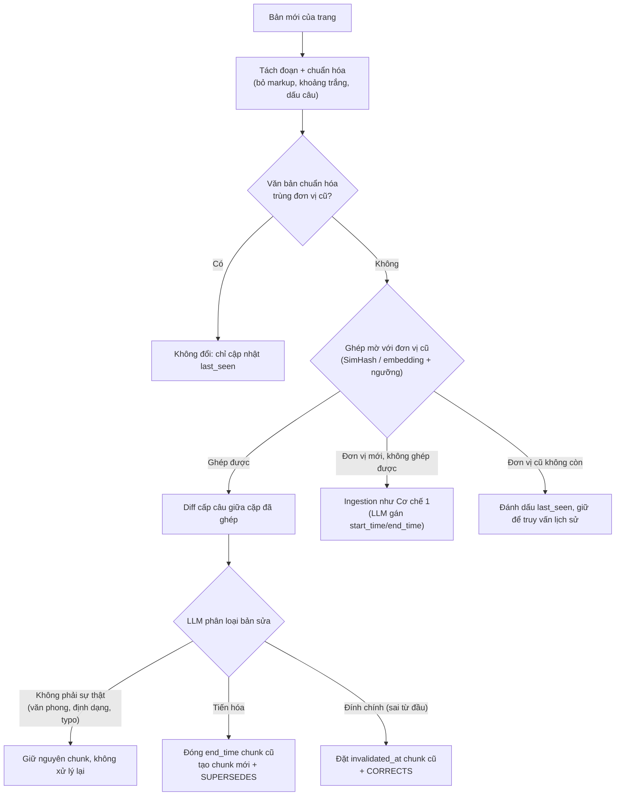

# 09. Phạm vi Cơ chế 3 (Conflict Resolution): bỏ đa nguồn, làm Evolution và Falsehood

**Trạng thái:** Đã quyết phạm vi (thu gọn về nguồn có lịch sử chỉnh sửa, Wikipedia) và luồng chính; đã crawl và đo sơ bộ; dữ liệu đánh giá và code chưa làm.

## Bối cảnh

Cơ chế 3 trong scope gồm hai nhánh: (a) xung đột đa nguồn, ưu tiên nguồn uy tín (Credibility); (b) tiến hóa và đính chính thông tin theo thời gian (Evolution ≠ Falsehood, Belief Revision). Nhánh (a) cần hai nguồn mâu thuẫn nhau tại cùng một mốc thời gian; hiện không có benchmark công khai phù hợp và chưa đủ thời gian tự xây dựng.

## Quyết định

- **Bỏ nhánh đa nguồn** và cơ chế Credibility Score. Ghi vào phần hạn chế của luận văn, không cam kết trong phiếu giao nhiệm vụ.
- **Giữ Cơ chế 3 ở nhánh (b):** đóng `end_time` khi thông tin tiến hóa, đặt `invalidated_at` khi thông tin sai từ đầu, cạnh `SUPERSEDES`/`CORRECTS`, `SUSPECTS` cho cáo buộc.
- Dữ liệu đánh giá tự tạo từ lịch sử Wikidata/Wikipedia (xem dưới).

## Kế hoạch dữ liệu và câu hỏi đánh giá (chưa làm)

**Tạo dữ liệu**
- Nhãn đáp án lấy từ **lịch sử Wikidata** (giá trị thuộc tính, `start_time`, `end_time` của đáp án cũ và mới), không để LLM đọc diff Wikipedia. Wikipedia chỉ cung cấp văn bản nạp kho.
- Dựng nhiều snapshot của cùng một trang (S0 cũ, S1 mới); nạp S0 rồi S1 để mô phỏng luồng cập nhật.
- Ưu tiên thuộc tính hay đổi, đã có nhiều trong TimeQA: P54 (đội bóng), P39 (chức vụ), P108 (nơi làm việc), P488 (chủ tịch).
- Quy mô dự kiến: khoảng 100–150 cặp S0/S1.
- Mốc thời gian của chunk lấy theo thời điểm sự kiện (từ Wikidata), không lấy theo ngày chỉnh sửa Wikipedia.

**Các loại câu hỏi**

| # | Loại | Ví dụ | Đáp án đúng | Đo |
|---|---|---|---|---|
| 1 | Hiện tại sau cập nhật | "Hiện nay ai là chủ tịch CLB X?" (sau S1) | Giá trị mới | Temporal Freshness (EM) |
| 2 | Lịch sử sau cập nhật | "Năm 2015 ai là chủ tịch CLB X?" (sau S1) | Giá trị cũ | Đóng `end_time` mà không mất lịch sử |
| 3 | Chuyển tiếp | "Ai kế nhiệm A?", "A rời vị trí khi nào?" | Giá trị mới hoặc mốc thay đổi | Đồ thị tiến hóa |
| 4 | Đính chính (sai từ đầu) | Hỏi về thông tin đã bị sửa vì ghi sai | Giá trị đã sửa, kèm cảnh báo | `invalidated_at` |
| 5 | Đối chứng không đổi | Thuộc tính không đổi giữa S0 và S1 | Giữ nguyên | Tỉ lệ đóng nhầm, xử lý hash trùng |
| 6 | Thăng tiến, không phải mâu thuẫn | "Năm 2010 làm gì?", "Năm 2018 làm gì?" | Cả hai đều còn đúng | Timeline ≠ Conflict |

Loại 1 và 2 luôn đi thành cặp: thiếu loại 2 thì hệ luôn trả "mới nhất" vẫn đạt điểm freshness.

**Chỉ số tổng hợp:** Freshness accuracy (loại 1), Historical retention (loại 2), False-invalidation rate (loại 5, 6), độ chính xác phân loại Evolution và Falsehood (loại 3, 4). Chạy thêm một lượt không có ngữ cảnh để biết LLM tự biết đáp án (xem hạn chế bên dưới).

## Kết quả đo ban đầu (2026-10-24)

Chi tiết và cách đo ở [`eval/06_WIKI_REVISION_CRAWL.md`](../eval/06_WIKI_REVISION_CRAWL.md); crawl 204 trang của bộ 400 câu, 38,273 revision từ 2021.

- **Đính chính "sai từ đầu":** có nhưng nhiễu. 961 ứng viên theo comment (2.5% revision), đọc tay mẫu 40 thì khoảng 10–15% là sửa sự thật rõ ràng. 22% revision là revert/vandalism. Loại 4 chỉ nên là trụ cột phụ, dùng bộ lọc tay nhỏ.
- **Độ ổn định chunk sau một lần sửa nhỏ:** chia theo đoạn giữ nguyên 98% chunk (trung bình đổi 1 chunk trên ~74); chia cố định 100 từ chỉ giữ nguyên 80%, và 20% cặp mất hơn nửa. Chốt chia theo đoạn/cấu trúc.
- **Khoảng cách dài** (2021 so với nay): chia theo đoạn chỉ còn 37% giữ nguyên, nên lợi thế chi phí của so hash phụ thuộc tần suất nạp; nạp thưa thì gần như tải lại cả trang. Đây là điều kiện áp dụng cần ghi vào luận văn.

- **Replace-all có mất thông tin cũ không:** 88.5–94.5% đáp án của bộ 400 câu (từ bản 2021) vẫn còn trong trang hiện tại; chỉ mất tối đa khoảng 5.5–11.5%, trong đó có cả đổi cách viết. Wikipedia tự giữ lịch sử trong văn bản, nên lợi thế "giữ lịch sử" của kho phiên bản so với tải lại cả trang là nhỏ trên dữ liệu này. Đóng góp chắc chắn của Cơ chế 3 là chi phí cập nhật; Evolution/Falsehood chỉ thể hiện rõ với nguồn không có sẵn cả trang.

## Baseline cho Cơ chế 3

Ngoài Plain RAG, so sánh với:
1. **Replace-all:** có bản mới thì xóa hết chunk cũ của trang rồi nạp lại.
2. **Keep-all-snapshots:** giữ mọi phiên bản của trang, gắn ngày bản chụp; ngày bản chụp không phải ngày hiệu lực, và kho nhân bản N lần.

Ưu thế cần chứng minh: giữ lịch sử mà không nhân bản kho (đo bằng số chunk và số lần gọi LLM), phân biệt tiến hóa với sai từ đầu, hoạt động khi nguồn không có lịch sử bản chụp (chỉ lập luận, Wikipedia không đo được). Cơ chế 3 làm đến đâu được thì đến đó; nếu số liệu cho thấy không rẻ hơn rõ rệt thì đi sâu Cơ chế 1 và 2.

## Phạm vi thu gọn và luồng chính (chốt)

**Thu gọn:** Cơ chế 3 làm cho **dữ liệu có lịch sử chỉnh sửa (Wikipedia)**, dùng diff có sẵn của nguồn để biết chỗ đổi. Về bản chất đây là **cập nhật tri thức theo thời gian (belief revision)**, xử lý lúc nạp dữ liệu; hẹp hơn "xử lý xung đột" trong scope vì đã bỏ đa nguồn. Tên gọi trong luận văn nên phản ánh điều đó. Lý do chọn: mỗi bộ dữ liệu cần phương pháp và phạm vi riêng; nguồn có lịch sử là loại duy nhất có thể đánh giá được với dữ liệu hiện có.

**Wikipedia cung cấp gì (đã gọi thử API, ví dụ trang Toungoo dynasty):**
- `action=query&prop=revisions`: danh sách các lần sửa, mỗi dòng có `revid`, `parentid` (bản liền trước), `user`, `timestamp`, `size`, `comment` (ghi chú do người sửa tự viết, có khi trống hoặc mơ hồ, chỉ dùng làm gợi ý).
- `action=compare&fromrev=..&torev=..`: thông tin chung và trường `body` là bảng HTML diff. Mỗi dòng bảng có nhãn không đổi / dòng cũ bị xóa / dòng mới thêm; trong dòng đổi, chỉ đúng cụm từ khác được bọc `<del class="diffchange">` và `<ins class="diffchange">`. Có kèm số dòng và tên mục.
- Diff tính trên **wikitext thô** (có `[[liên kết]]`, `{{mẫu}}`), nên phải làm sạch trước khi dùng; thay đổi trong infobox hoặc chú thích có thể không nằm trong văn bản đoạn mà pipeline nạp.
- Một "dòng" trong diff là một dòng wikitext, thường là một đoạn (các mục danh sách, tiêu đề, hàng bảng mỗi cái một dòng). Vị trí đổi ở mức dòng, chỗ đổi chính xác ở mức từ.

**Đơn vị cập nhật là đoạn.** TimeQA chia chunk bằng cách tách theo đoạn rồi cắt mỗi đoạn thành các cửa sổ tối đa 100 từ, không chồng lấn (kiểm chứng ở [`eval/06`](../eval/06_WIKI_REVISION_CRAWL.md) mục 4). Vì chunk có thể bị cắt giữa câu, mọi so sánh nên làm ở mức đoạn (đoạn chưa cắt) hoặc mức diff, không so từng chunk. Với đoạn đổi, chia lại chunk bằng đúng quy tắc cũ rồi thay toàn bộ chunk cũ của đoạn đó; đoạn thêm mới thì chia bằng quy tắc đó; đoạn dài hơn sau khi sửa tự sinh thêm cửa sổ.

**Điều chỉnh về bản chất của thay đổi (Wikipedia).** Lịch sử nằm trong nội dung đoạn (các mốc ghi trong văn bản), không nằm ở phiên bản trang. Một lần sửa chỉ rơi vào ba trường hợp: đoạn bị viết lại (thay thế: bỏ đoạn cũ bằng xóa hoặc `invalidated_at`), đoạn mới thêm (thêm, không mâu thuẫn), sửa văn phong (bỏ qua). Phân biệt tiến hóa với đính chính ở mức phiên bản gần như không còn ý nghĩa với dữ liệu này; "tiến hóa" thực tế xuất hiện dưới dạng câu mới được thêm vào, không sửa câu cũ. Mâu thuẫn chéo trang (cùng sự kiện nhắc ở nhiều trang) chỉ chiếm tối đa 7.6% câu và hầu như không nằm trong bộ eval ([`eval/06`](../eval/06_WIKI_REVISION_CRAWL.md) mục 6): **bỏ khỏi phạm vi**, chỉ ghi vào hạn chế.

### Luồng chính (nguồn có diff)

1. Lấy danh sách revision và diff giữa bản đã nạp (S0) và bản mới (hoặc từng cặp liên tiếp để mô phỏng cập nhật theo nhiều mức tần suất).
2. Từ diff xác định các dòng thêm, xóa, sửa (cặp xóa và thêm cùng vị trí), kèm cụm từ đổi.
3. Làm sạch wikitext, chia chunk lại cho các đoạn thêm hoặc sửa; chunk cũ của đoạn bị xóa hoặc sửa được đóng hoặc đánh dấu.
4. LLM nhận cặp (câu cũ, câu mới) kèm ghi chú của người sửa làm gợi ý, phân loại: sửa văn phong / tiến hóa / đính chính / thông tin mới.
5. Ghi: `end_time` (tiến hóa), `invalidated_at` (đính chính), `superseded_by`, `last_seen`.

Ví dụ thật: đoạn về Taungoo Dynasty đổi "(1485–1569)" thành "(1485–1599)" với ghi chú "incorrect date given as per sources". Diff chỉ rõ đúng một con số đổi; LLM phân loại là đính chính (sai từ đầu), không phải tiến hóa, nên đặt `invalidated_at` cho chunk cũ.

### Lưu ý về dịch chunk và về bản gốc

- **Dịch cửa sổ chỉ xảy ra trong một đoạn.** Mỗi đoạn được cắt từ đầu đoạn, nên sửa trong một đoạn chỉ làm dịch các cửa sổ phía sau **trong đoạn đó** (đoạn thường ngắn), không ảnh hưởng đoạn khác. Số thứ tự chunk (`#26`) dịch theo khi thêm hoặc bớt chunk, nhưng đó chỉ là vấn đề đánh số, không phải nội dung; dùng id ổn định (mục, thứ tự đoạn, thứ tự cửa sổ, phiên bản) thì không phải nhúng lại gì.
- **Chọn đoạn cần xử lý bằng diff, không cần xử lý cả trang.** Diff cho biết dòng nào đổi; chỉ đoạn chứa dòng đó mới cắt lại cửa sổ, và cửa sổ nào trùng văn bản cũ thì giữ.
- **Diff API so được hai bản bất kỳ**, nên có thể đi một bước từ bản gốc đến bản mới thay vì từng lần sửa.
- **TimeQA không có revid** và ứng với bản Wikipedia khoảng 2021 chưa xác định được chính xác ([`eval/06`](../eval/06_WIKI_REVISION_CRAWL.md) mục 7). Đề xuất tự dựng S0 từ một revid cố định rồi diff từ đó, đánh giá bằng đáp án chuỗi.

### Các trường hợp chunk khi cập nhật

Gọi đoạn cũ là P với các cửa sổ cũ W1..Wn, đoạn mới là P' với các cửa sổ mới W1'..Wm' (cắt bằng cùng quy tắc 100 từ). Cửa sổ mới có văn bản chuẩn hóa trùng một cửa sổ cũ của đoạn đó thì **giữ chunk cũ** (không embed, không gọi LLM); cửa sổ cũ không còn trùng cửa sổ mới nào thì chunk cũ bị `invalidated_at`.

| # | Trường hợp | Xử lý chunk |
|---|---|---|
| 1 | Diff không chạm đoạn | Không làm gì |
| 2 | Đoạn thêm mới | Chia cửa sổ, ingest như bình thường (LLM gán mốc thời gian) |
| 3 | Đoạn bị xóa | Mọi chunk cũ của đoạn: `invalidated_at` (lý do `removed`) |
| 4 | Đoạn sửa, độ dài không đổi, chỗ sửa nằm trong một cửa sổ | Cửa sổ khác trùng thì giữ; cửa sổ chứa chỗ sửa: chunk cũ `invalidated_at`, chunk mới |
| 5 | Đoạn sửa, độ dài đổi ở giữa đoạn | Các cửa sổ trước chỗ sửa giữ; từ chỗ sửa trở đi bị dịch nên thay hết |
| 6 | Sửa làm đoạn dài hơn 100 từ (m > n) | Sinh thêm cửa sổ mới (ingest) |
| 7 | Sửa làm đoạn ngắn đi (m < n) | Cửa sổ đuôi không còn: chunk cũ `invalidated_at` |
| 8 | Một câu nằm vắt hai cửa sổ bị sửa | Cả hai cửa sổ chạm câu đó đều bị thay |
| 9 | Sửa thật sự đổi nội dung (đổi con số, tên) | Chunk cũ `invalidated_at` (lý do `factual_change`), chunk mới ingest đầy đủ |
| 10 | Sửa văn phong (không đổi ý) | Chunk cũ `invalidated_at` (lý do `recut`), chunk mới kế thừa nhãn thời gian của chunk cũ tương ứng để khỏi gọi LLM |
| 11 | Đoạn bị tách hoặc gộp | Diff báo xóa và thêm không ghép đôi, xử lý như 3 rồi 2 |
| 12 | Đổi tên mục (chỉ đổi `title`) | Văn bản chunk giữ nguyên, chỉ cập nhật metadata |
| 13 | Đổi nằm ngoài văn bản đoạn (infobox, chú thích) | Pipeline không thấy; ghi vào hạn chế |
| 14 | Sửa rồi hoàn tác (văn bản quay về bản cũ) | Chunk cũ đã `invalidated_at`; chunk mới trùng văn bản có thể ingest lại hoặc mở lại chunk cũ, cần chọn |
| 15 | Chunk không đổi nhưng nhãn thời gian suy từ chunk lân cận nay đã cũ | Hạn chế đã biết, kiểm tra lại nhãn các chunk cùng mục khi có chunk đổi nếu cần |

Chunk "không còn thuộc bản hiện tại của trang" được đánh `invalidated_at` kèm lý do (`factual_change`, `recut`, `removed`), dù về ngữ nghĩa trong `design/01` trường này nghĩa là "sai từ gốc". Lý do dùng chung một trường: truy xuất đã lọc cứng `invalidated_at IS NULL` ngay trong truy vấn Qdrant (`query_filter` ở `qdrant_store.py`, trường đã có payload index), nên top-k chỉ lấy từ chunk còn hiệu lực; `end_time` không phải bộ lọc cứng (chỉ giảm điểm), nên không dùng được để loại chunk đã bị thay.

### Lưu trữ và Graph

- **Bắt buộc:** VectorDB với `start_time`, `end_time`, `invalidated_at`, `superseded_by`, `first_seen`, `last_seen`. Truy vấn lấy thông tin mới nhất tương đương `T_req = T_now`: lọc `end_time` rỗng và `invalidated_at` rỗng; truy vấn theo mốc quá khứ dùng lại bộ lọc của Cơ chế 1.
- **Cơ chế 3 không dùng graph riêng.** (thay thế là thao tác trên từng chunk ở VectorDB). Vai trò của Cơ chế 3 với graph của Cơ chế 2 là giữ nó nhất quán: xóa các nút có `pointer_chunk_id` trỏ tới chunk bị thay, trích lại bộ ba cho chunk mới, dựng lại chuỗi `TIẾP_THEO` của ô bị ảnh hưởng bằng cách sắp theo thời gian (ô là cặp (trang, quan hệ), định nghĩa ở `10`). Cách cập nhật nút (đưa nút cũ và đoạn mới cho LLM kiểm tra, kèm kiểm chứng câu trích dẫn bằng code, chunk không đổi thì không động tới) và cấu trúc graph ở [`10`](10_TIMELINE_GRAPH_AND_VECTOR_LINK.md).
- **Graph (dự định dùng, chung với Cơ chế 2):** dùng chung với Cơ chế 2 theo [`design/01`](../design/01_INITIAL_BASE_DESIGN.md) mục 2.2 và 3.2–3.3. Nút là trạng thái sự kiện (thực thể, quan hệ, giá trị, khoảng hiệu lực) kèm `Chunk_ID` trỏ về VectorDB (Boomerang). Cạnh `TIẾP_THEO` nối các trạng thái kế tiếp (Cơ chế 2), cạnh `SUPERSEDES`/`CORRECTS` do phân loại ở bước 4 tạo ra (Cơ chế 3). Khi tóm tắt dòng thời gian, Cơ chế 2 đi dọc `TIẾP_THEO` và bỏ nút có `invalidated_at` hoặc bị `CORRECTS` (Luồng Tích hợp). Dùng `networkx` trong bộ nhớ để thử nhanh trên 204 trang; Neo4j vẫn là ứng viên. Phần chỉ-VectorDB vẫn chạy được nếu Graph chưa kịp.

### Phần tự so hai bản (không có lịch sử): mở rộng, không đánh giá

Với nguồn không có lịch sử chỉnh sửa (hai bản PDF của một văn bản luật), phải tự phát hiện chỗ đổi bằng hash, ghép mờ và các tầng kiểm tra ở mục bên dưới. Phần này không có dữ liệu để đánh giá nên ghi vào hạn chế hoặc làm sau cùng nếu còn thời gian.

## Thiết kế tổng quát cho nguồn không có lịch sử (mở rộng, chưa đánh giá)

Kết quả đo cho thấy không thể dựa hoàn toàn vào hash chunk: hash chỉ là đường tắt, cần ghép mờ làm phương án chính khi chunk lệch (đoạn bị tách/gộp, đoạn dài bị cắt khúc, nạp thưa, nguồn không có cấu trúc đoạn). Đóng góp kỳ vọng so với replace-all: độ chính xác ngang nhau, chi phí nạp thấp hơn, và trả lời được câu hỏi về chính sự thay đổi.

### Luồng khi có văn bản cập nhật của một trang

Bước ghép mờ chỉ để tìm chunk tương ứng; việc quyết định đổi hay không dựa vào so lại văn bản chuẩn hóa hoặc diff, không dựa vào độ tương đồng. Lý do: embedding của đoạn chỉ đổi một năm hay một con số vẫn gần như giống hệt bản cũ, mà đó là kiểu sửa quan trọng nhất.

Nếu nguồn cung cấp sẵn diff giữa hai phiên bản (Wikipedia revision), dùng trực tiếp thay cho bước ghép.

### Lưu trữ

- **VectorDB:** dùng lại schema hiện có (`start_time`, `end_time`, `invalidated_at`) và thêm `superseded_by`, `first_seen`, `last_seen`. Chạy được mà không cần GraphDB.
- **GraphDB (nếu kịp):** nút là sự kiện (thực thể, quan hệ, giá trị, khoảng hiệu lực), cạnh `SUPERSEDES`/`CORRECTS`, nút giữ `Chunk_ID` trỏ về VectorDB (Boomerang). Có thể bỏ nếu thiếu thời gian vì phần lớn giá trị nằm ở payload.
- **Truy xuất:** dùng lại bộ lọc và điểm của Cơ chế 1; thêm kiểu câu hỏi về chính sự thay đổi ("thay đổi gì từ 2023?") bằng cách liệt kê chunk có `superseded_by`.

### Các phương án thay hash chunk (đã cân nhắc)

1. Dùng diff của nguồn nếu có (Wikipedia). Không áp dụng được với nguồn không có lịch sử.
2. Ghép mờ rồi so lại (chọn làm chính, như luồng trên).
3. Chunk theo nội dung (content-defined chunking, rolling hash) cho văn bản không có cấu trúc đoạn.
4. Khóa theo sự kiện (thực thể, quan hệ) thay vì theo chunk; độc lập cách chia chunk nhưng cần LLM trích nên chi phí quay lại.

Đã chạy thử trên 300 cặp revision (chi tiết ở [`eval/06`](../eval/06_WIKI_REVISION_CRAWL.md) mục 4): với chia theo đoạn, hash chunk và hash câu cho gần như cùng chi phí; hash câu (tách câu trên đoạn đã ghép lại, vì chunk TimeQA bị cắt giữa câu ở 32% trường hợp) tốt hơn hash chunk không đáng kể và chỉ thu hẹp phần đưa vào LLM (khoảng một nửa số từ của chunk đổi); ghép mờ ghép được 46% chunk có câu mới với chunk cũ ở mức sửa nhỏ nhưng chưa có nhãn đúng để đo độ chính xác. Content-defined chunking chưa thử.

### Kế hoạch đánh giá theo thứ tự

Hệ thống so sánh: Plain RAG, replace-all, keep-all-snapshots, hệ của đồ án. S0 là bản TimeQA 2021 (đã nạp), S1 là bản hiện tại (đã crawl); dùng thêm các revision trung gian làm bước cập nhật theo tháng và theo năm.

| Bước | Việc | Cần dữ liệu mới |
|---|---|---|
| 1 | Chi phí: số chunk và số lần gọi LLM mỗi lần cập nhật, ở nhiều mức tần suất | Không, chỉ đếm |
| 2 | Giữ lịch sử: chạy 400 câu hiện có sau cập nhật, so Historical retention với replace-all | Không |
| 3 | Phân loại bản sửa: gán nhãn tay khoảng 100 bản sửa từ danh sách ứng viên, đo độ chính xác | Có, ít |
| 4 | Câu hỏi thay đổi và freshness: sinh khoảng 50–100 câu từ diff, kiểm chứng tay (loại 1, 3), kèm câu đối chứng không đổi (loại 5) | Có |
| 5 | Đính chính: khoảng 20–30 ca, chủ yếu chứng minh cơ chế chạy | Có, ít |

Bước 1 và 2 làm trước. Nếu hết thời gian, dừng ở đây vẫn có kết quả.

Kỳ vọng: độ chính xác gần ngang replace-all (replace-all chỉ mất tối đa 5.5–11.5% thông tin cũ); thắng ở chi phí nạp và ở câu hỏi về thay đổi. Chưa chắc thắng ở freshness; không hứa trước trong phiếu khi chưa đo.

## Hạn chế đã biết (ghi vào luận văn)

1. **Không có xung đột đa nguồn.** Không đánh giá được việc chọn nguồn theo độ tin cậy; hệ thống chỉ xử lý mâu thuẫn theo trục thời gian trong cùng một nguồn.
2. **Loại 4 (đính chính) khó lấy từ Wikipedia.** Lịch sử sửa lỗi lẫn nhiều vandalism và chỉnh sửa văn phong. Hướng xử lý: lọc thủ công một bộ nhỏ (vài chục cặp) hoặc chèn đoạn đính chính vào S1; trong cả hai trường hợp phải ghi rõ đây là dữ liệu bán tổng hợp.
3. **Nhiễm tri thức tham số.** LLM đã biết sẵn nhiều nội dung Wikipedia nên có thể đúng mà không cần kho, làm điểm freshness cao giả. Giảm bằng lượt đo không ngữ cảnh và ưu tiên thay đổi sau mốc kiến thức của LLM.
4. **Quy mô nhỏ**, do chi phí gọi LLM cho ingestion; kết quả mang tính kiểm chứng ý tưởng.
5. **Chunk đứng một mình** (không có `page_id`, không có phiên bản cũ của cùng trang để ghép) không được đánh giá.
6. **Lợi thế so hash giảm khi nạp thưa** (xem kết quả đo ở trên).

## Liên quan

- Metric `Temporal Freshness` đặt ở `metrics_conflict.py` (chưa có); đo được chỉ ở Cơ chế 3, không đo được ở Cơ chế 1 và 2.
- Ảnh hưởng tới phiếu giao nhiệm vụ: bỏ "xử lý xung đột đa nguồn", ghi "Evolution và Falsehood" ở Cơ chế 3.
- Scope: `docs/scope/01_PROJECT_SCOPE.md` (mục 1 và 2); kế hoạch: `docs/planning/00_OVERALL_PLAN.md`.
