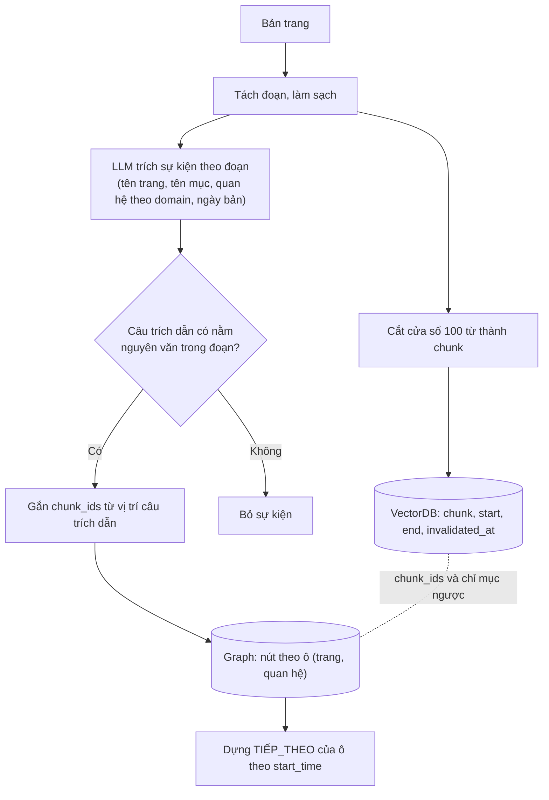
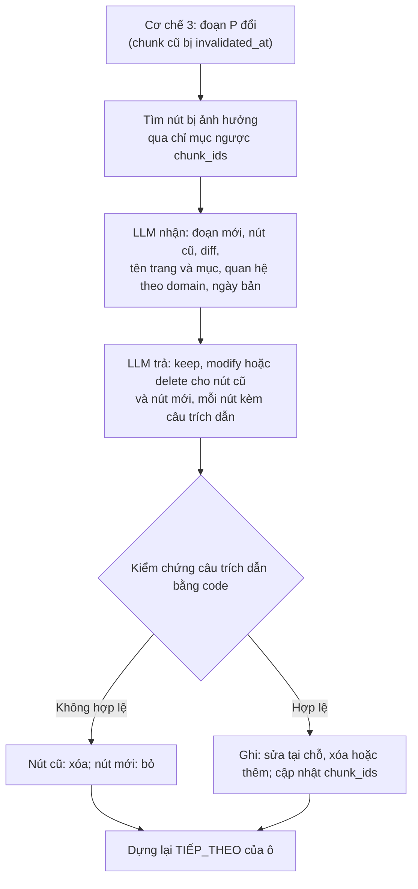
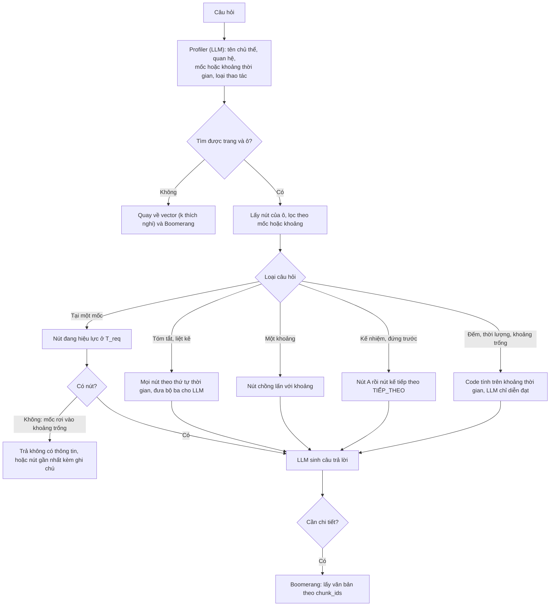

# 10. Cơ chế 2: graph sự kiện, liên kết với VectorDB, cập nhật, và so sánh với vector top-k

**Trạng thái:** Đã thống nhất thiết kế (2026-10-24); chưa code. `design/01` giữ nguyên; các điểm khác với `design/01` ghi ở cuối file.

## Bối cảnh

`design/01` mục 3.2 mô tả Cơ chế 2: VectorDB tìm nút vào, đi dọc đồ thị theo thời gian, trả bộ ba nhẹ (dưới 1,000 token), cần chi tiết thì quay về VectorDB bằng `Chunk_ID` (Boomerang). File này chốt cách dựng graph cho dữ liệu TimeQA/Wikipedia, cách liên kết với VectorDB, cách cập nhật khi chunk đổi (xem [`09`](09_CONFLICT_RESOLUTION_SCOPE.md)), và phương pháp so sánh. Trọng tâm so sánh là **số token tiết kiệm được** ở cùng mức độ phủ; TimeQA ngắn không phải vấn đề vì không dựa vào việc tràn ngữ cảnh.

## Dữ liệu TimeQA cho Cơ chế 2 (đo ngày 2026-10-24)

| Số liệu | Giá trị |
|---|---|
| Số trang | 4,815; chunk mỗi trang: trung vị 19, p90 53, tối đa 100 |
| Độ dài trang | trung vị 1,213 từ, p90 3,586 từ, tối đa 22,037 từ |
| Số ô (trang, quan hệ) có câu hỏi | 4,937 |
| Số sự kiện mỗi ô | trung vị 3, p90 6, tối đa 8; 75.9% ô có từ 3 sự kiện trở lên |
| Số chunk chứa đáp án của một ô (ô có từ 3 sự kiện) | trung vị 3, p90 5, tối đa 12 |
| Ô có câu hỏi ở nhiều split khác nhau | 562/4,937 |

**Dòng thời gian chuẩn:** nhóm câu hỏi theo (`page_id`, `relation`) trên **mọi split**, sắp theo `time_start`, lấy `targets` và `time_start`/`time_end`. **Dòng thời gian chuẩn chưa đầy đủ.** `q_index` là số thứ tự (0, 1, 2, ...) của một sự kiện trong ô, do TimeQA đánh khi sinh câu hỏi từ Wikidata. Có ô thiếu một số thứ tự: ô head coach của 1. FC Köln có câu hỏi cho `q_index` 0 (Markus Anfang), 1 (Achim Beierlorzer), 3 (Markus Gisdol), không có 2. Có sự kiện thứ 2 trong Wikidata nhưng dataset không có câu hỏi cho nó (nguyên nhân chưa kiểm tra), nên dòng thời gian dựng từ câu hỏi bị thủng một lỗ. Trên toàn dữ liệu: 1,110/4,937 ô (22.5%) có `q_index` không liên tục, 600 ô không có `q_index` 0, tổng 1,310 chỉ số bị thiếu giữa các sự kiện đã biết (so với 17,811 sự kiện có câu hỏi, khoảng 7%; chưa đếm được các sự kiện thiếu sau sự kiện cuối). Hệ quả: một sự kiện thật do hệ thống trích ra mà không có trong dòng thời gian chuẩn bị tính là "thừa" dù đúng, nên đo được độ phủ (recall) chắc chắn, còn độ chính xác (precision) bị đánh giá thấp và phải kiểm tay một mẫu.

## Cấu trúc graph

**Ô (slot) là gì.** Hình dung một bảng: mỗi **hàng** là một trang (một thực thể, ví dụ 1. FC Köln), mỗi **cột** là một quan hệ (ví dụ huấn luyện viên trưởng, đội thể thao đã chơi, chức vụ). Giao của một hàng và một cột là một **ô**, tức một cặp (trang, quan hệ). Ô chứa một dãy giá trị kế tiếp nhau theo thời gian. TimeQA gọi mỗi dãy như vậy bằng cặp `page_id` và `relation`, và đánh số các sự kiện trong dãy bằng `q_index`. Mỗi nút của graph là một giá trị trong một ô.

**Quan hệ và domain là hai tầng khác nhau.** *Quan hệ* (`relation`, mã P) là thuộc tính Wikidata mịn, cho biết loại thông tin (P54 member of sports team, P39 position held, P286 head coach...); TimeQA có 71 quan hệ, bộ eval 400 câu dùng 54 quan hệ. *Domain* là 8 nhóm lớn (cộng `other`) gộp các quan hệ theo chủ đề, bằng ánh xạ cố định quan hệ sang domain trong `dataset/full_dataset/TOPICS.md` (ví dụ P54 và P286 thuộc `sports`, P39 thuộc `politics`, P108 thuộc `career`; trong bộ eval mỗi quan hệ nằm đúng một domain). Domain của **chunk** do LLM gán từ văn bản lúc nạp (1 đến 3 nhãn, `decisions/01`). Ô của graph dùng quan hệ (mịn), còn domain dùng để thu hẹp: khi trích sự kiện, chỉ đưa vào prompt các quan hệ của domain mà chunk mang (khoảng 3 đến 10 quan hệ mỗi domain) thay vì cả 71.

| Trang (hàng) | Quan hệ P286 head coach (cột) | Quan hệ P54 member of sports team (cột) |
|---|---|---|
| 1. FC Köln | **ô:** Markus Anfang, Achim Beierlorzer, Markus Gisdol | không có |
| Attaphol Buspakom | không có | **ô:** Port F.C, Thailand national football team, ... |


Mỗi **nút** là một sự kiện; các nút cùng một **ô** (chủ thể = trang, quan hệ = một trong 71 thuộc tính Wikidata của TimeQA) tạo thành dòng thời gian.

```
 Ô: (1. FC Köln, P286 head coach)

 [Markus Anfang]      ──TIẾP_THEO──►  [Achim Beierlorzer]  ──TIẾP_THEO──►  [Markus Gisdol]
  Jul 2018 – Apr 2019                  Jul 2019 – Nov 2019                  Nov 2019 – Nov 2020
  chunk_ids: [#26]                     chunk_ids: [#26]                     chunk_ids: [#26]
        └───────────────────────────────────┬───────────────────────────────────┘
                                            ▼
                         VectorDB: chunk #26 (văn bản gốc của cả ba người)
```

**Trường của nút:** `node_id` (ổn định), `subject` (page_id), `relation` (P-id), `value` và `value_norm`, `start_time`, `end_time` (rỗng nghĩa là đang diễn ra), `chunk_ids` (danh sách), `evidence` (câu trích dẫn nguyên văn), `first_seen`, `last_seen`, `status`.

**Cạnh `TIẾP_THEO` không lưu cố định:** dựng lại bằng cách sắp các nút đang hiệu lực của một ô theo `start_time` (hòa thì theo `end_time`). Đổi một nút không làm hỏng cạnh của nút khác.

### Dòng thời gian đứt đoạn, chồng lấn, đang diễn ra

- **Đứt đoạn** (người trước hết nhiệm kỳ tháng 4/2019, người sau bắt đầu tháng 7/2019): vẫn nối bằng `TIẾP_THEO` theo thứ tự, **không** tạo nút lấp khoảng trống và **không** tự kéo dài `end_time` của nút trước. Khi tóm tắt, nếu khoảng trống lớn hơn một ngưỡng thì ghi rõ "không có thông tin giữa A và B". Không phân biệt được khoảng trống thật với sự kiện bị trích sót; ghi vào hạn chế.
- **Hỏi tại một mốc rơi vào khoảng trống:** không có nút đang hiệu lực, trả lời không có thông tin hoặc trả nút gần nhất kèm ghi chú, không bịa.
- **Chồng lấn** (cầu thủ cùng lúc ở CLB và đội tuyển; mượn): cho phép; hỏi tại một mốc có thể trả nhiều nút.
- **Đang diễn ra** (`end_time` rỗng): coi là còn hiệu lực đến `T_now`.
- **Thăng tiến không phải mâu thuẫn:** nút mới bắt đầu không làm đóng nút trước (giữ bất biến Timeline ≠ Conflict của `design/01`).

## Liên kết với VectorDB

Về bản chất là **n-n**, nhưng thực tế gần như luôn là nhiều nút trỏ về một chunk:
- Một chunk chứa nhiều sự kiện (ba HLV cùng nằm trong chunk #26).
- Một sự kiện đôi khi vắt qua hai chunk vì chunk bị cắt giữa câu.

Nút lưu danh sách `chunk_ids` (thường một phần tử). VectorDB không lưu id nút. Tra ngược từ chunk sang nút bằng chỉ mục phụ trên `chunk_ids`; khi một chunk bị `invalidated_at` (xem `09`), tra ngược để tìm nút bị ảnh hưởng. Nút trỏ vào một chunk bị thay **và** một chunk còn giữ (câu vắt hai cửa sổ) vẫn là nút bị ảnh hưởng.

## Nạp ban đầu

**LLM đọc cả đoạn, không đọc từng chunk**, vì chunk bị cắt giữa câu (32% chunk không kết thúc ở cuối câu). Đoạn được dựng lại từ các cửa sổ liên tiếp (heuristic đã kiểm chứng ở [`eval/06`](../eval/06_WIKI_REVISION_CRAWL.md) mục 4, còn 4.5% trường hợp mơ hồ).

**Input:** văn bản đoạn; tên trang (chủ thể); tên mục; danh sách quan hệ cho phép (chỉ các quan hệ của domain mà chunk đã được gán, xem mục "Quan hệ và domain"; tránh LLM nghĩ ra quan hệ mới); ngày của bản đang nạp.

**Output:** danh sách sự kiện, mỗi sự kiện có quan hệ, giá trị, `start`, `end` và **một câu trích dẫn nguyên văn làm bằng chứng**. Có thể gộp vào cùng lần gọi LLM đang gán `start_time`/`end_time` cho từng chunk của Cơ chế 1 để đỡ tốn lời gọi.

**Xác minh hai lớp:**
1. Bằng code: câu trích dẫn (sau chuẩn hóa) phải nằm nguyên văn trong đoạn; không có thì bỏ sự kiện. Vị trí câu trích dẫn cho ra `chunk_ids`.
2. Đối chiếu với dòng thời gian chuẩn của TimeQA: đo độ phủ giá trị, độ chồng lấn khoảng thời gian, đúng thứ tự.

**Tiêu đề mục (`title`) của TimeQA.** Mỗi phần tử của `paragraphs` có `title`, là tên mục chứa đoạn đó; đoạn mở đầu dùng tên trang. Tiêu đề **phẳng** (chỉ mục sâu nhất, không giữ phân cấp) và có vẻ không đầy đủ. Ví dụ trang 1. FC Köln theo API Wikipedia (`action=parse&prop=sections`) có History > Predecessor sides, A successful new club, Continuing success, Downfall, Turnaround (2012–2017), Decline and changes (2018–); Stadium; Honours > Domestic, International, Regional, Doubles, Reserve team. Trong TimeQA chỉ thấy Predecessor sides, Continuing success, Stadium, Domestic, Regional, Youth..., và mục `Continuing success` trải 22 chunk (#9 đến #30), nhiều khả năng nuốt cả các mục con sau nó (suy luận từ số chunk, chưa kiểm chứng từng chunk). Hệ quả: dùng tiêu đề làm ngữ cảnh gợi ý cho LLM trích sự kiện (nhiều tiêu đề chứa mốc thời gian, ví dụ "Turnaround (2012–2017)") nhưng không dựa vào nó để cắt mục. API Wikipedia có phân cấp mục (`level`, `toclevel`, `number`, `line`), và trong wikitext là dòng `== Tên mục ==`; muốn có tiêu đề đầy đủ phải dựng lại từ wikitext bằng cách theo dõi tiêu đề gần nhất phía trên mỗi đoạn.

### Sơ đồ nạp ban đầu



## Cập nhật khi đoạn đổi

Đầu vào là kết quả của Cơ chế 3: tập chunk cũ bị `invalidated_at` và các cửa sổ mới của đoạn.

1. **Tìm nút bị ảnh hưởng** bằng chỉ mục ngược trên `chunk_ids`.
2. **Đưa vào LLM:** văn bản **mới** của cả đoạn, các **nút cũ bị ảnh hưởng** (dạng JSON: quan hệ, giá trị, khoảng thời gian, câu trích dẫn cũ), diff giữa câu cũ và câu mới làm gợi ý, tên trang, tên mục, danh sách quan hệ, ngày bản mới. Không đưa từng chunk riêng lẻ.
3. **LLM trả về:** với mỗi nút cũ một hành động `keep`, `modify` hoặc `delete`; với mỗi nút giữ hoặc sửa phải kèm câu trích dẫn **từ văn bản mới**; thêm các nút mới nếu có, mỗi nút kèm câu trích dẫn.
4. **Kiểm chứng bằng code:** mọi câu trích dẫn phải nằm nguyên văn trong đoạn mới. Nút cũ không có trích dẫn hợp lệ bị coi là `delete`; nút mới không có trích dẫn hợp lệ bị bỏ. Rồi tính lại `chunk_ids` từ vị trí trích dẫn trong các cửa sổ mới.
5. **Ghi:** `modify` sửa tại chỗ (giữ `node_id`); `delete` đánh `status` bị xóa; nút mới thêm; dựng lại `TIẾP_THEO` của các ô bị ảnh hưởng.

Mỗi đoạn đổi tốn một lời gọi LLM. Nút không trỏ vào chunk bị thay thì không động tới.

**Phương án đối chứng (ablation):** trích lại từ đầu chỉ từ văn bản mới (không đưa nút cũ), rồi đối chiếu bằng code theo (quan hệ, giá trị chuẩn hóa, khoảng thời gian). So chi phí, số nút bị tạo lại không cần thiết và độ chính xác.

Lý do chọn đưa nút cũ làm mặc định: LLM biết đã có những sự kiện nào nên giữ được cách viết giá trị và hiểu thay đổi nào là của sự kiện nào. Rủi ro là LLM bám nút cũ mà không xóa nút lỗi thời; chốt chặn là bắt buộc trích dẫn từ văn bản mới và kiểm chứng bằng code.

### Sơ đồ cập nhật



## Quan hệ với Cơ chế 1

Cơ chế 1 vẫn chạy ở mức chunk, chỉ trên VectorDB, không dùng graph khi truy vấn. Điểm liên quan đã ghi từ trước: một chunk nhiều sự việc chỉ được gán một khoảng thời gian, nên chunk đáp án bị lọc nhầm (nhóm "lỗi lọc" khoảng 3–6 trong 37 câu còn sai, `decisions/06` đề xuất 3, `decisions/07` đề xuất 8) và đã hoãn sang Cơ chế 2.

Khi Cơ chế 2 có nút theo từng sự kiện, đề xuất 8 làm được ngay: mỗi chunk lấy danh sách khoảng thời gian từ các nút của nó, lưu `intervals` vào payload, lọc theo mốc `start` sớm nhất và chấm điểm theo khoảng khớp nhất. Đây là thí nghiệm riêng ("Cơ chế 1 + khoảng theo sự kiện"), đo bằng ablation, không thay đổi Cơ chế 1 hiện tại. Cần thận trọng với bất biến không rò rỉ tương lai (chunk nhắc sự kiện sau `T_req`).

Chia đối tượng ở mức sự kiện chi tiết hơn chunk không có nghĩa là Cơ chế 1 phải dùng graph: có thể dùng nút sự kiện làm đơn vị tìm kiếm trong VectorDB (kiểu parent-child: tìm ở mức sự kiện, trả về chunk cha) mà không cần GraphDB. Chỉ thử nếu còn thời gian.

### Thí nghiệm: Cơ chế 1 cộng graph (làm sau khi xong graph)

Cơ chế 1 hiện tại không đổi; thí nghiệm này chỉ so sánh có và không có graph, và hỏi graph dùng ở **đầu** hay **sau khi lấy top-chunk**:

| Vị trí | Cách dùng graph | Ưu | Nhược |
|---|---|---|---|
| A. Trước truy xuất | Graph xác định ô và các nút đang hiệu lực ở `T_req`, lấy `chunk_ids` của chúng rồi thu hẹp (lọc cứng theo danh sách id) hoặc nâng điểm các chunk đó trước khi xếp hạng | Đúng mốc ở mức sự kiện, tránh lọc nhầm chunk nhiều khoảng | Vào nhầm ô hoặc thiếu nút thì mất chunk đúng; cần quay về Cơ chế 1 khi không chắc |
| B. Sau khi lấy top-chunk | Lấy top-N bằng Cơ chế 1; với mỗi chunk dùng các khoảng của nút trỏ về nó để tính lại điểm thời gian (khoảng khớp nhất) và lọc theo mốc `start` sớm nhất (đề xuất 8 của `07`) | Không đổi quy trình tìm kiếm, rủi ro thấp | Không cứu được chunk đáp án đã không vào top-N |
| C. Hợp | Top-k của Cơ chế 1 hợp với các chunk graph chỉ ra cho ô ở `T_req`, rồi xếp hạng lại | Tăng độ phủ | Thêm chunk thừa, cần cắt |

**Cách đo:** so với Cơ chế 1 hiện tại bằng `mrr`, `hit@5`, `ans_valid@5`, `leakage_rate` và số câu thuộc nhóm "lỗi lọc" ([`07`](07_RANKING_AND_TIME_RANGE_PROPOSALS.md)). Dùng tập valid để so và tune để quét tham số. Tập `test_clean` đã chạy một lần ([`08`](08_TRAIN_VALID_TEST_SPLIT.md)), nên chỉ chạy lại một lần khi chốt cấu hình cuối.

## Cách vào nút và khi graph không có thông tin

**Từ câu hỏi đến ô (trang, quan hệ):**
1. Mở rộng Profiler (đang là LLM trích `semantic_query` và `T_req`) để trích thêm tên chủ thể và quan hệ.
2. **Tìm trang (mặc định, qua chunk):** dùng chính truy xuất của Cơ chế 1 (kể cả bộ lọc thời gian) để lấy top-5 chunk, tra ngược chỉ mục sang nút, rồi bỏ phiếu theo trang. Khớp tên chủ thể với tiêu đề trang chỉ là bước kiểm tra phụ (dễ hỏng với cách gọi khác tên), không làm đường chính.
3. **Chọn ô:** mỗi trang chỉ có vài ô, nên LLM chọn ô trong danh sách ô sẵn có của trang đó (lựa chọn đóng, dễ hơn tự gán trong quan hệ theo domain).
4. Lấy các nút của ô, lọc theo khoảng thời gian trong câu hỏi nếu có.

Đo thêm **độ chính xác bước vào** (đúng trang, đúng ô).

**Số đo sơ bộ (2026-10-25), chỉ mức trang, từ `predictions.jsonl` của 2,356 lần chạy Cơ chế 1 có từ 300 câu:**

| Chỉ số | Thấp nhất | Trung vị | Cao nhất | Ba lần chạy `mrr` cao nhất |
|---|---:|---:|---:|---:|
| Top-1 chunk thuộc đúng trang | 0.886 | 0.968 | 1.000 | 0.992 đến 0.993 |
| Đúng trang nằm trong top-5 | 0.929 | 0.995 | 1.000 | 0.997 |
| Trang chiếm đa số trong top-5 là đúng | 0.839 | 0.973 | 1.000 | 0.990 đến 0.992 |

Lần chạy `mrr` thấp nhất (khoảng 0.27) vẫn đúng trang 97.5% ở top-1, nên bước tìm trang gần như độc lập với chất lượng xếp hạng đúng chunk. **Hạn chế:** kho trong các lần chạy chỉ có 200 đến 600 trang (không phải 4,815), câu hỏi nêu rõ tên chủ thể, và đây mới là đúng trang, chưa phải đúng ô. Với dữ liệu có câu hỏi, 4,698 trong 4,815 trang chỉ có một quan hệ nên chọn ô sau khi đã có trang gần như tầm thường; khi graph có ô trích thêm ngoài đáp án chuẩn thì cần đo riêng. Nên thử thêm một kho lớn hơn (nạp thêm trang gây nhiễu) để xem tỉ lệ trúng giảm bao nhiêu.

**Chọn khía cạnh (quan hệ) của trang.** Có trang rồi vẫn phải biết câu hỏi hỏi khía cạnh nào. Mỗi trang là một nút thực thể, các quan hệ là các nhóm sự kiện đi ra từ nó (mỗi nhóm là một ô):

```
 [1. FC Köln] ── head coach ──────► Anfang, Beierlorzer, Gisdol
              ── member of league ─► ...
              ── owned by ────────► ...
```

Cách chọn, từ rẻ đến đắt:
1. Profiler trích quan hệ từ câu hỏi theo tập đóng (các quan hệ của domain, xem `decisions/01` và `TOPICS.md`).
2. **Chỉ xét các quan hệ trang đó đang có** trong graph (thường vài quan hệ), rồi khớp theo tên quan hệ. Việc này thu hẹp lựa chọn và loại hẳn những quan hệ không tồn tại ở trang.
3. Đối chiếu với bằng chứng từ vector: top-5 chunk trỏ tới nút thuộc quan hệ nào thì quan hệ đó được thêm phiếu.
4. Nếu hai quan hệ gần điểm nhau thì lấy cả hai (số nút ít nên rẻ), hoặc quay về vector.

Cẩn thận với các quan hệ gần nghĩa nhưng ngược chiều: P286 head coach (trang là đội, liệt kê HLV) và P6087 coach of sports team (trang là HLV, liệt kê đội), nên chọn quan hệ phải xét cả loại trang chứ không chỉ từ khóa trong câu hỏi. Đo thêm **độ chính xác chọn quan hệ**.

**Khi graph không có thông tin** (không tìm ra trang hoặc ô, ô ít nút hơn kỳ vọng, hoặc sự kiện bị trích sót): graph chỉ phủ được những gì bước trích xuất đã lấy, nên giới hạn độ phủ của Cơ chế 2 là độ phủ của việc trích. Hướng xử lý: quay về vector (k thích nghi) kèm Boomerang lấy văn bản gốc, và báo cáo tỉ lệ câu phải quay về.

### Phân loại câu hỏi và cách chọn nhánh

Có hai chỗ phải chọn nhánh, cả hai do LLM quyết định bằng đầu ra có cấu trúc với tập nhãn đóng:

1. **Chọn cơ chế (router).** `docs/planning/00_OVERALL_PLAN.md` mục 4 đã dự định ở nấc B: `route` là conditional edge, LLM phân loại. Sau khi Cơ chế 3 chỉ còn ở phía nạp dữ liệu, truy vấn chỉ còn hai nhãn: `temporal` (Cơ chế 1: cần một sự kiện, tại một mốc hoặc một khoảng) và `timeline` (Cơ chế 2: cần nhiều sự kiện của cùng một ô hoặc một đại lượng suy ra từ chúng).
2. **Chọn thao tác trong nhánh `timeline`.** Một trường `operation` trong cùng lần gọi Profiler: `list`, `range_list`, `successor`, `predecessor`, `count`, `duration`, `longest`, `gap`.

Profiler hiện trích `semantic_query`, `t_req` (và `t_end` ở `range_profiler`); mở rộng để trích thêm tên chủ thể, quan hệ, nhãn router và `operation`. Dấu hiệu trong câu: "bao nhiêu", "lâu nhất", "kế nhiệm", "trước đó", "liệt kê", "tất cả", "tóm tắt", "những ai". Khi router không chắc nên nghiêng về `timeline`: nhầm một câu `temporal` sang `timeline` chỉ tốn thêm token (LLM vẫn chọn được đáp án trong tập nút), còn nhầm `timeline` sang `temporal` làm thiếu sự kiện và sai kết quả đếm. Đo độ chính xác router bằng bộ câu có nhãn (câu TimeQA gốc là `temporal`, câu sinh từ ô là `timeline`) và ma trận nhầm lẫn. Việc chọn **ô** nếu trang có nhiều ô nằm ở mục "Cách vào nút".

| Loại câu hỏi | Ví dụ (ô head coach của 1. FC Köln) | Cách trả lời | Cơ chế |
|---|---|---|---|
| Một mốc | "Ai là HLV trưởng Köln tháng 12/2018?" | Một sự kiện đang hiệu lực | Cơ chế 1 |
| Một khoảng, một đáp án | "Ai là HLV trưởng Köln giữa tháng 8 và tháng 10/2019?" (TimeQA vốn hỏi kiểu này, `decisions/07` đề xuất 1) | Sự kiện chồng lấn khoảng | Cơ chế 1 |
| Một khoảng, liệt kê | "Những ai là HLV trưởng Köln từ 7/2018 đến 11/2019?" | Mọi nút chồng lấn khoảng | Cơ chế 2 |
| Tóm tắt, liệt kê | "Liệt kê các HLV trưởng Köln theo thứ tự thời gian" | Mọi nút của ô, sắp theo thời gian | Cơ chế 2 |
| Kế nhiệm, đứng trước | "Ai kế nhiệm Markus Anfang?" | Nút kế tiếp trong chuỗi | Cơ chế 2 |
| Thời lượng | "Markus Gisdol làm HLV Köln bao lâu?", "ai giữ chức lâu nhất?" | Code trừ mốc kết thúc cho mốc bắt đầu; nút đang diễn ra tính đến `T_now` | Cơ chế 2 |
| Đếm | "Köln có bao nhiêu HLV trưởng từ 2018 đến 2020?" | Đếm nút chồng lấn khoảng | Cơ chế 2 |
| Khoảng trống | "Có giai đoạn nào Köln không có HLV trưởng?" | Khoảng giữa hai nút kế tiếp | Cơ chế 2 |

Cơ chế 3 không có nhánh truy vấn riêng (chỉ ở phía nạp, xem `09`). "Một khoảng" chỉ là phạm vi thời gian của câu hỏi, không phải một cơ chế: một đáp án thì thuộc Cơ chế 1, nhiều đáp án thì thuộc Cơ chế 2.

**Cần thống nhất:** thiết kế gốc (`design/01` mục 3.2) chỉ nêu Cơ chế 2 cho "tóm tắt diễn biến". Các thao tác kế nhiệm, thời lượng, đếm, khoảng trống là đề xuất mở rộng Cơ chế 2 thành suy luận trên dòng thời gian, để có loại câu hỏi mà cấu trúc có lợi thế.

**Lưu ý đáp án chuẩn cho câu đếm, thời lượng, khoảng trống:** dòng thời gian chuẩn thiếu sự kiện ở 22.5% ô (`q_index` không liên tục), và có thể thiếu cả sự kiện ở đầu hoặc cuối. Chỉ nên sinh các câu này từ ô có `q_index` liên tục, ghi là xấp xỉ, và kiểm tay một mẫu với trang Wikipedia.

### Sơ đồ các trường hợp truy vấn



## Chi phí thời gian của đường graph

Cả hai đường đều bắt đầu bằng cùng một truy vấn vector. Vector thuần cắt k bằng điểm; đường graph thay bước cắt đó bằng vài thao tác tra bộ nhớ, **không** thêm một chuỗi LLM dài.

```
 Vector thuần:  Profiler(LLM) → tìm kiếm lai → cắt k theo điểm → sinh câu trả lời(LLM, prompt dài)
 Có graph:      Profiler(LLM, thêm router/quan hệ/operation) → tìm kiếm lai (top-N nhỏ hơn được)
                → bỏ phiếu trang qua chỉ mục ngược → chọn ô → lấy nút → thao tác bằng code
                → sinh câu trả lời(LLM, prompt ngắn)
```

| Bước | Vector thuần | Có graph | Ghi chú |
|---|---|---|---|
| Profiler (LLM) | 1 lời gọi | cùng 1 lời gọi, đầu ra dài thêm vài chục token | Gộp router, quan hệ, operation vào một lần |
| Tìm kiếm lai và lọc thời gian | khoảng 0.14 giây mỗi truy vấn (**đo**) | như nhau | Xem phép đo dưới bảng |
| Cắt k hoặc dựng ngữ cảnh | tức thời (so điểm) | tra chỉ mục ngược, chọn ô, lấy nút, thao tác: dưới 1 đến vài ms nếu để trong bộ nhớ, vài ms đến vài chục ms nếu dùng cơ sở dữ liệu đồ thị (**ước lượng, chưa đo**) | |
| Chọn ô khi mơ hồ | không có | thường khớp tên quan hệ (ms); chỉ khi mơ hồ mới thêm một lời gọi LLM nhỏ (**ước lượng** 0.5 đến 2 giây) | Lấy cả hai ô là cách rẻ hơn |
| Sinh câu trả lời (LLM) | prompt dài (k chunk) | prompt ngắn (bộ ba) | Thời gian sinh chủ yếu theo token đầu ra và độ trễ cố định; prompt ngắn chỉ giảm một phần |
| Nạp dữ liệu (một lần) | không đổi | thêm 1 lời gọi LLM trích mỗi đoạn (**ước lượng**), gộp được vào lần gán mốc thời gian của Cơ chế 1 | Chi phí chính nằm ở đây |

**Số đo thật (2026-10-24):** lần chạy `output/20261024_154840` (595 câu, tìm kiếm lai dense + BM25, `top_n` 50, không rerank) mất 82 giây từ 15:48:40 đến 15:50:02, tức khoảng 0.14 giây mỗi câu, đã gồm tải mô hình và chỉ tính truy xuất (không sinh câu trả lời). Chưa biết Profiler có lấy từ cache hay không, nên chưa tính thời gian LLM.

**Kết luận sơ bộ:** ở trường hợp thường, đường graph thêm vào mức mili giây đến vài chục mili giây so với vector thuần; ở trường hợp mơ hồ thêm tối đa một lời gọi LLM nhỏ; phần tốn thời gian và tiền là nạp dữ liệu. Phải đo thật bằng cách ghi thời gian từng bước trong thí nghiệm, vì các ước lượng trên chưa kiểm chứng.

## Truy xuất và phương pháp so sánh

**Câu hỏi đánh giá:** sinh từ ô, ví dụ "Liệt kê các huấn luyện viên trưởng của 1. FC Köln theo thứ tự thời gian"; đáp án chuẩn là dòng thời gian chuẩn của ô (lấy từ mọi split).

| Phương pháp | Cách lấy ngữ cảnh |
|---|---|
| **Graph** (đề xuất) | VectorDB tìm nút vào, lấy mọi nút đang hiệu lực của ô theo khóa (trang, quan hệ), sắp theo thời gian, đưa bộ ba cho LLM; cần chi tiết thì quay về `chunk_ids` |
| **Vector, k cố định** | Top-k chunk với k thuộc {3, 5, 10, 20} |
| **Vector, k thích nghi theo ngưỡng** | Lấy chunk có điểm lớn hơn hoặc bằng α × điểm top-1, α thuộc {0.7, 0.8, 0.9} |
| **Vector, k thích nghi theo điểm gãy** | Cắt ở chỗ điểm giảm mạnh nhất giữa hai chunk liên tiếp (elbow) |
| **Vector, theo ngân sách token** | Thêm chunk theo thứ tự điểm cho đến khi hết ngân sách B thuộc {500, 1000, 2000} token |
| **Cả trang** (tham chiếu, không phải đối thủ chính) | Đưa nguyên trang vào ngữ cảnh; là cận trên về độ phủ và cận trên về token |

Có thể thêm một phương pháp "lặp": LLM cho biết đã đủ chưa, nếu chưa thì lấy thêm, nếu còn thời gian.

**Chỉ số:**
- **Độ phủ:** tỉ lệ sự kiện chuẩn có mặt trong ngữ cảnh (khớp giá trị chuẩn hóa và khoảng thời gian chồng lấn).
- **Đúng thứ tự:** khi yêu cầu LLM liệt kê, thứ tự thời gian có đúng không.
- **Token:** số token ngữ cảnh đưa vào LLM.
- **Báo cáo chính:** đường độ phủ theo token, và số token cần để đạt độ phủ từ một ngưỡng nào đó (ví dụ 90%). Lợi thế cần chứng minh là cùng độ phủ với ít token hơn.

## Đánh giá việc trích xuất sự kiện

Xây graph bắt buộc có LLM trích (quan hệ và giá trị không thể tách bằng luật cứng; chỉ ngày tháng có thể hỗ trợ bằng biểu thức chính quy). Lần gọi LLM này là nền móng của cả Cơ chế 2 nên phải chấm riêng.

**Đơn vị chấm:** sự kiện = (quan hệ, giá trị, khoảng thời gian). Đáp án chuẩn lấy từ dòng thời gian của ô (mọi split), không cần tự gán nhãn.

**Cách khớp** nút trích ra với sự kiện chuẩn:
- **Giá trị:** chuẩn hóa (chữ thường, bỏ dấu, bỏ dấu câu); khớp nếu bằng nhau, một chuỗi chứa chuỗi kia, hoặc F1 theo token từ 0.8 trở lên (cách viết khác).
- **Thời gian:** theo độ mịn của đáp án chuẩn (năm hoặc tháng). Báo hai mức: *chặt* (trùng `start` và `end` ở độ mịn đó) và *lỏng* (mỗi đầu lệch không quá một năm, hoặc độ chồng lấn khoảng IoU từ 0.5 trở lên).

**Chỉ số:** recall giá trị; recall sự kiện (giá trị và thời gian, mức chặt và lỏng); độ chính xác thời gian trên các sự kiện đã khớp giá trị; đúng ô; đúng thứ tự. Độ chính xác (precision): kiểm tay khoảng 100 nút không có trong đáp án chuẩn để ước lượng tỉ lệ đúng thật (vì đáp án chuẩn chưa đầy đủ).

**Thế nào là "đạt".** Không có chuẩn chung. Mốc tham khảo đề xuất (lựa chọn, không phải tiêu chuẩn): recall giá trị từ 0.85 và độ chính xác thời gian mức lỏng từ 0.8 trên các sự kiện đã khớp giá trị. Tiêu chí chính nên là hệ quả cuối: so graph dựng từ **đáp án chuẩn** (graph lý tưởng, "oracle") với graph trích ra; chênh lệch cho biết lỗi trích xuất làm mất bao nhiêu độ phủ. Chấp nhận được nếu graph trích ra vẫn bằng hoặc hơn vector (k thích nghi) ở độ phủ theo token.

**Thứ tự làm để tránh đầu tư sớm (quyết định đi tiếp hay dừng):**
1. **Graph lý tưởng trước:** dựng graph thẳng từ dòng thời gian chuẩn (không cần LLM; lấy từ chú thích **câu hỏi** của TimeQA gồm giá trị, khoảng thời gian và chỉ số chunk, không lấy từ nhãn thời gian của chunk, vì mỗi chunk chỉ có một khoảng nên nối các chunk lại chỉ ra một chuỗi liên tục, tương đương đưa cả trang cho LLM; graph thật bắt buộc phải có LLM trích bộ ba) và so với vector top-k (cố định và thích nghi) trên độ phủ, token và các câu hỏi cấu trúc (đếm, thứ tự, thời lượng, khoảng trống). Nếu graph lý tưởng không hơn vector ở chỉ số nào, graph không có cơ sở để đi tiếp.
2. **Thử trích xuất** trên khoảng 20 ô, so với đáp án chuẩn.
3. Mới làm toàn bộ nạp, cập nhật và thí nghiệm với Cơ chế 1.

**Dữ liệu:** không cần tự xây. 204 trang của bộ eval đã có 217 ô và 749 sự kiện có câu hỏi, trong đó 152 ô có từ 3 sự kiện (632 sự kiện). Đề xuất chia: khoảng 50 ô để chỉnh prompt (dev), khoảng 100 ô để đo cuối (test, khoảng 400 sự kiện). Với recall khoảng 0.85 và 400 sự kiện, khoảng tin cậy 95% xấp xỉ cộng trừ 3.5 điểm (sai số chuẩn nhị thức `sqrt(p(1-p)/n)`). Việc tự làm chỉ là kiểm tay mẫu 100 nút ngoài đáp án chuẩn.

## Lý do chọn graph (giả thuyết cần kiểm chứng)

**Graph không thay vector.** Vector vẫn là bước vào ("la bàn", mục trên) và là phương án quay về khi graph thiếu. So sánh thật là: vector top-k đưa chunk cho LLM, so với vector làm đầu vào rồi graph trả các nút của một ô cho LLM. Các lý do dưới đây xếp theo độ chắc chắn; mỗi lý do là giả thuyết, kết quả đo quyết định điều đưa vào luận văn.

| # | Lý do | Cách kiểm chứng | Độ chắc chắn |
|---|---|---|---|
| 1 | **Số token nhỏ hơn khi sự kiện rải nhiều chunk.** Một ô cần trung vị 3 chunk, p90 là 5, tối đa 12; bộ ba gọn hơn văn bản. Ingestion tốn thêm một lượt trích mỗi đoạn, nên cần tính **điểm hòa vốn**: số truy vấn cần có để token tiết kiệm bù chi phí trích | Đường độ phủ theo token; điểm hòa vốn = chi phí trích mỗi trang chia token tiết kiệm mỗi truy vấn | Khá, nhưng vector với k thích nghi là đối thủ trực tiếp |
| 2 | **Độ phủ theo khóa, không theo xếp hạng.** Lấy nút theo (trang, quan hệ) thì không phụ thuộc cách đặt câu hỏi và không cần chọn k | Độ phủ dòng thời gian chuẩn so với vector k cố định và thích nghi | Trung bình: bị chặn bởi độ phủ của việc trích, và nút bị trích sót thì không có tín hiệu nào báo |
| 3 | **Phép toán thời gian làm bằng code.** Đếm, thứ tự, kế nhiệm, thời lượng, khoảng trống tính trực tiếp trên khoảng thời gian; LLM tính số học trên văn bản thường dễ sai | Bộ câu hỏi đếm, thứ tự, thời lượng, khoảng trống suy từ dòng thời gian chuẩn; so độ đúng với LLM đọc chunk | Khá, vì LLM hay sai ở tính toán ngày; cần đo |
| 4 | **Dẫn chứng kiểm chứng được.** Mỗi kết quả kèm câu trích dẫn và `chunk_ids` | Tỉ lệ câu trích dẫn nằm đúng trong văn bản | Chắc, nhưng chỉ có giá trị khi người đọc quan tâm đến dẫn chứng |
| 5 | **Cập nhật chính xác từng nút** khi đoạn đổi (liên hệ [`09`](09_CONFLICT_RESOLUTION_SCOPE.md)) | Số nút phải trích lại so với số chunk phải nạp lại | Trung bình |
| 6 | **Nâng Cơ chế 1** bằng khoảng thời gian theo từng sự kiện (thí nghiệm ở trên) | Số câu "lỗi lọc" giảm | Chưa biết |
| 7 | **Gộp nhiều tài liệu về cùng một ô** (nhiều nguồn nhắc cùng chủ thể) | Không đánh giá được với TimeQA (mỗi trang riêng) | Lập luận, ghi vào hạn chế |
| 8 | **Chủ động báo "không có".** Truy vấn tại một mốc trả rỗng là tín hiệu rõ ràng (khoảng trống), cho phép từ chối thay vì trả chunk gần nhất không trả lời được câu hỏi; vector luôn trả về một thứ gì đó | Tỉ lệ câu không có đáp án mà hệ thống từ chối đúng | Trung bình: chỉ đúng khi bước trích đủ sự kiện |
| 9 | **Đơn vị là sự kiện, không phụ thuộc ranh giới chunk.** Chunk bị cắt giữa câu (32% chunk không kết thúc ở cuối câu); một sự kiện vắt hai chunk có thể chỉ lấy được một nửa khi tìm bằng vector | Tách các câu hỏi có đáp án vắt hai chunk hoặc đoạn bị cắt, so độ phủ của vector và graph | Chưa biết, cần đếm số ca |
| 10 | **Ghép thời gian giữa hai ô của cùng thực thể** (ví dụ đội nào cầu thủ chơi trong lúc giữ một chức vụ): graph nối khoảng thời gian bằng code, vector buộc LLM suy luận qua nhiều chunk | Bộ câu hỏi ghép; **hạn chế:** chỉ 117 trang có câu hỏi cho từ 2 quan hệ (13 trong 204 trang eval), nên đáp án chuẩn có sẵn rất ít, phải tự sinh và kiểm tay | Yếu với TimeQA vì ít dữ liệu |
| 11 | **Kiểu nhớ cô đọng cho agent (agentic memory).** Sự kiện cũ có thể giữ ở dạng bộ ba, văn bản gốc chuyển sang kho rẻ hơn và lấy lại bằng Boomerang khi cần; kích thước bộ nhớ nóng không tăng theo lượng văn bản | So dung lượng bộ ba và dung lượng văn bản chunk | Trung bình, nằm trong ý tưởng gốc của đề tài |
| 12 | **Kết quả có cấu trúc nên đánh giá bằng độ đo xác định** (tập sự kiện, thứ tự) thay vì nhờ LLM chấm câu trả lời tự do | Mức nhất quán giữa độ đo xác định và chấm tay một mẫu | Chắc, nhưng là lợi ích cho phương pháp đánh giá, không phải cho người dùng |
| 13 | **Độ ổn định khi diễn đạt lại câu hỏi.** Cùng một ô thì cùng một tập nút, trong khi tập chunk vector có thể đổi theo cách đặt câu hỏi | Chạy mỗi câu với vài cách diễn đạt, đo độ trùng của ngữ cảnh | Trung bình |

**Lý do yếu cần nói thẳng:** "không biết chọn k bao nhiêu" yếu hơn vẻ ngoài vì k thích nghi (ngưỡng điểm, điểm gãy, ngân sách token) là đối thủ trực tiếp của graph. Lý do 3 và 4 là hai chỗ cấu trúc có lợi thế rõ nhất.

**Rủi ro riêng của graph:** graph thiếu nút mà không báo lỗi thì câu trả lời thiếu mà không ai biết (khác với trường hợp không tìm được ô, lúc đó đã quay về vector). Giảm bằng cách chạy thêm một bước kiểm tra độ phủ: lấy vài chunk đầu từ vector và xem có chunk nào chứa sự kiện chưa có trong graph không; thử như một biến thể ở mục so sánh.

## Rủi ro và hạn chế

1. Chất lượng trích xuất sự kiện quyết định kết quả; đo bằng độ phủ so với dòng thời gian chuẩn.
2. Dòng thời gian chuẩn chưa đầy đủ nên không đo được độ chính xác chính xác (chỉ cận dưới của độ phủ).
3. Cách viết giá trị khác nhau (ví dụ "Port F.C" và "Port FC"); giảm bằng chuẩn hóa và đưa nút cũ vào lúc cập nhật.
4. Trang TimeQA ngắn nên không kiểm tra được việc tràn ngữ cảnh; so sánh tập trung vào token.
5. Chunk cắt giữa câu: câu trích dẫn có thể vắt hai chunk (nút có hai `chunk_ids`).
6. Khoảng trống thật và sự kiện bị trích sót không phân biệt được.

## Khác với `design/01` (không sửa design)

- Nút lưu danh sách `chunk_ids` thay vì một `pointer_chunk_id` (do liên kết n-n).
- Cạnh `TIẾP_THEO` dựng lại theo thứ tự thời gian của từng ô, không lưu cố định.
- Mỗi nút có câu trích dẫn bằng chứng và được kiểm chứng bằng code.
- Khóa nút là ô (trang, quan hệ), lấy từ cấu trúc câu hỏi TimeQA.

## Liên quan

- Cập nhật chunk: [`09_CONFLICT_RESOLUTION_SCOPE.md`](09_CONFLICT_RESOLUTION_SCOPE.md).
- Số liệu và cách đo: [`../eval/06_WIKI_REVISION_CRAWL.md`](../eval/06_WIKI_REVISION_CRAWL.md).
- Đề xuất "một chunk nhiều khoảng" của Cơ chế 1: [`06`](06_END_UNKNOWN_REMEDIES.md) đề xuất 3, [`07`](07_RANKING_AND_TIME_RANGE_PROPOSALS.md) đề xuất 8.
