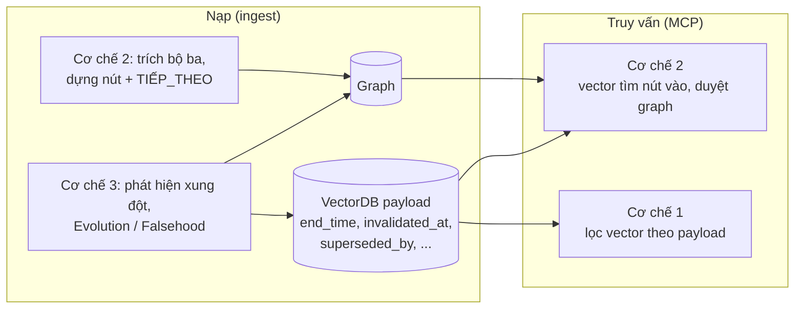
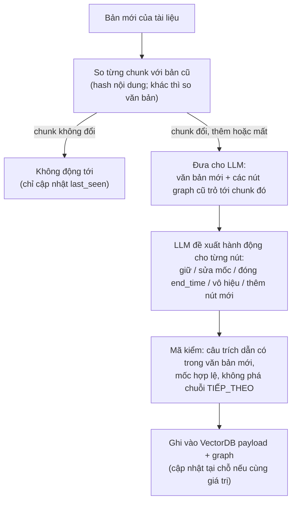
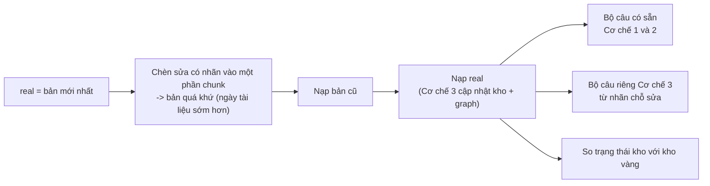

# 12. Vai trò ba cơ chế trong hệ thống thật và quy tắc cập nhật

Ghi ngày 2026-11-04. Bổ sung cho [`09`](09_CONFLICT_RESOLUTION_SCOPE.md), [`10`](10_TIMELINE_GRAPH_AND_VECTOR_LINK.md) và [`11`](11_EVOLUTION_FALSEHOOD_ALIGNMENT.md) (không sửa các file đó). Mục 1 là điều đã bàn và thống nhất; mục 2 và 3 là **đề xuất của Claude, chưa quyết**, chưa kiểm thử.

## 1. Vai trò (đã thống nhất)

- **Cơ chế 1:** thuần vector ở truy vấn.
- **Cơ chế 2:** có phần nạp (dựng đồ thị) và phần truy vấn (duyệt đồ thị).
- **Cơ chế 3:** chỉ là phần nạp, chuẩn bị dữ liệu cho cả hai: đặt `invalidated_at` / đóng `end_time` trong vector, thay hoặc cập nhật nút trong graph. Câu "thay đổi gì từ 2023?" là ngoại lệ nhỏ ở truy vấn.
- **MCP server thật:** truy vấn chỉ có Cơ chế 1 và 2; nạp có 2 và 3.
- **Đo Cơ chế 3:** dùng lại truy xuất Cơ chế 1 (và 2); chỉ khác ở cách nạp (Plain, Replace-all, Keep-all, nạp có xung đột).
- **Cơ chế 2 cũng cần xử lý xung đột** (bỏ nút `invalidated_at`/bị `CORRECTS`, nhưng không đóng nhầm chuỗi sự nghiệp).

### Thử sau: Cơ chế 1 dùng thêm graph (chưa làm, chưa đo)

Ý tưởng: trả "giá trị hiện tại" bằng nút cuối của ô (cặp trang, quan hệ), và/hoặc mở rộng sang chunk lân cận qua `TIẾP_THEO`. Cách làm: thêm một biến thể truy xuất dùng graph, đo trên cùng bộ câu và cùng quy tắc chọn như [`eval/07`](../eval/07_TUNE_VALID_RESULTS.md) và [`eval/09`](../eval/09_CAPABILITY_PROBE_RESULTS.md); **nếu tốt hơn thì dùng**. Hiện chưa có chứng cứ về lợi ích. Số liệu Cơ chế 1 hiện tại chưa chứa hiệu ứng của Cơ chế 3 (kho lấy `end_time` từ chính văn bản chunk; `unknown_decay` của cấu hình X là phương án dự phòng khi chưa có chunk thay thế).

## 2. Đánh dấu "đã cập nhật" trên vector (đề xuất)

Thêm vào payload (đã dự định ở `09`): `superseded_by`, `first_seen`, `last_seen`; đề xuất thêm:

| Trường | Ý nghĩa |
|---|---|
| `update_kind` | `none`, `evolution` (đóng `end_time`), `correction` (sai từ đầu, `invalidated_at`), `refinement` (cùng trạng thái, sửa mốc), `reaffirm` (nhắc lại) |
| `revision` | số lần trạng thái này được cập nhật |
| `interval_history` | danh sách `{start, end, source_chunk, recorded_at}` của các lần khẳng định trước |

Lưu ý ràng buộc thiết kế: payload chỉ index 4 trường. Muốn liệt kê chunk có `superseded_by` (câu "thay đổi gì từ 2023?") mà không quét toàn kho thì cần index thêm trường đó, hoặc giữ nhật ký thay đổi ở graph/bảng riêng. Chưa quyết; thêm index là thay đổi thiết kế.

Khi trả lời, đầu ra của Cơ chế 1 và 2 kèm dấu "đã cập nhật" và giá trị trước đó để LLM nói được "trước đây là ..., hiện là ...".

## 3. Xung đột mốc: cũ 1800 đến 1850, mới 1805 đến 1845 (đề xuất)

**Phân loại trước theo (chủ thể, quan hệ, giá trị):**

| Trường hợp | Ví dụ | Xử lý |
|---|---|---|
| Cùng giá trị, mốc khác nhau | cùng người giữ chức, 1800 đến 1850 so với 1805 đến 1845 | **Cùng một trạng thái, hai lần khẳng định.** Cập nhật mốc tại chỗ, không thay cả trạng thái (mục dưới) |
| Giá trị khác, mốc rời nhau | A 1800 đến 1850, B 1850 đến 1900 | Chuỗi sự kiện bình thường (Cơ chế 2), không xung đột |
| Giá trị khác, mốc chồng nhau, quan hệ chỉ một giá trị tại một lúc (chức vụ, người đứng đầu) | A 1800 đến 1850, B từ 1805 | Xung đột thật: nếu B là tiến hóa thì đóng `end_time` của A tại 1805 (`SUPERSEDES`, ghi `end_inferred`); nếu nguồn nói A sai thì `CORRECTS` và `invalidated_at` |
| Giá trị khác, mốc chồng nhau, quan hệ nhiều giá trị (thành viên, đội) | cùng lúc thuộc hai tổ chức | Không xung đột, giữ cả hai |

**Cùng giá trị, mốc khác nhau (trường hợp trong câu hỏi):**

- Không đặt `invalidated_at` cho cả chunk cũ: nó đúng trong 1805 đến 1845 và lọc cứng sẽ bỏ nó cả ở đó. Chỉ **ranh giới** bị sửa, không phải cả sự kiện.
- Phân biệt **thời gian hiệu lực** (khi sự việc đúng trong thực tế: 1805 đến 1845) với **thời điểm hệ thống biết** (`first_seen`, `last_seen`). Cập nhật không xóa lần khẳng định cũ, mà thêm một phiên bản mới có thời điểm ghi riêng, giữ phiên bản cũ trong `interval_history`.
- **Hiệu lực hiện hành** của trạng thái lấy từ phiên bản thắng. Quy tắc thắng (khai trước, vì bộ dữ liệu chỉ có một nguồn nên **không xét độ tin cậy nguồn**, xem mục 6): (1) hai mốc **không mâu thuẫn** mà một bên cụ thể hơn (12/05/1805 so với 1805) thì lấy bên cụ thể hơn; (2) **mâu thuẫn thật** (1800 so với 1805) thì bản có **ngày tài liệu** mới hơn thắng; (3) vẫn hòa thì lấy giao hai khoảng và gắn `disputed`. Ghi lại lý do chọn.
- **"Mới hơn" là ngày của tài liệu** (ngày xuất bản hoặc ngày sửa bản), không phải ngày nạp: bài 2010 nạp sau bài 2015 thì xét theo ngày nạp sẽ ngược. Không có ngày tài liệu mà phải dùng thứ tự nạp thì gắn cờ `order_inferred`. Hạn chế: với sự kiện lịch sử, bản viết sau chỉ là xấp xỉ "người viết đã xem lại", không bảo đảm đúng hơn (sửa nhầm hay phá hoại trên Wikipedia không phát hiện được).
- **Cho khớp hai nơi:** mốc hiệu lực này được chép (denormalize) vào `start_time`/`end_time` của mọi chunk cùng trạng thái, để Cơ chế 1 lọc đúng. Nếu không, hỏi "năm 1802" vẫn thấy chunk cũ (còn ghi 1800 đến 1850). Mốc gốc được giữ ở `interval_history`.
- Kết quả sau cập nhật: 1800 đến 1805 và 1845 đến 1850 thành khoảng không có thông tin chắc chắn; Cơ chế 1 dùng Case 2 (giảm điểm theo khoảng cách) cho truy vấn rơi vào đó.

**Trong graph (Cơ chế 2): không thay cả nút.**

- Nút có định danh ổn định theo (ô, giá trị), nên cùng giá trị thì **cập nhật tại chỗ**: sửa khoảng hiệu lực, thêm chunk vào danh sách `Chunk_ID` (một nút có thể trích nhiều chunk), ghi lịch sử mốc, rồi sắp lại `TIẾP_THEO` theo mốc mới.
- Chỉ **tạo nút mới** khi giá trị khác (trạng thái mới), kèm `SUPERSEDES`; chỉ **xóa và trích lại** khi chunk nguồn bị thay bằng nội dung khác hẳn.
- Đây là chỉnh so với `09` (mục Cơ chế 3 với graph của Cơ chế 2), vốn mô tả "xóa nút trỏ tới chunk bị thay rồi trích lại": cách đó đúng cho thay đổi giá trị nhưng làm mất lịch sử mốc khi chỉ sửa ranh giới. Chưa quyết.

### Điều chưa kiểm

- Nhận ra "cùng giá trị" cần so khớp giá trị bằng LLM (không có khóa sẵn); sai ở đây dẫn tới gộp nhầm hoặc tách nhầm.
- Chưa có dữ liệu có nhãn cho trường hợp "cùng giá trị, mốc khác" (HoH chủ yếu đổi giá trị); cần dựng riêng một nhóm câu kiểm, chẳng hạn từ các lần sửa ngày trong lịch sử Wikipedia, và đo xem bước gộp có đúng không.
- Quy tắc thắng dựa vào **ngày tài liệu**; kho TimeQA/Wikipedia hiện không có ngày sửa bản cho từng chunk (HoH có `last_modified_time`, `eval/06` có dữ liệu lịch sử sửa Wikipedia), nên cần xem nguồn ngày khi dựng dữ liệu kiểm.

**Cùng một sự kiện thì có cập nhật mốc luôn không?** Không tự động. Phiên bản mới chỉ thành hiệu lực hiện hành nếu thắng theo quy tắc trên. Nếu bản mới cũ hơn hoặc kém cụ thể (chỉ có năm trong khi bản cũ có ngày, không mâu thuẫn) thì chỉ ghi vào `interval_history` và `last_seen`, giữ mốc cũ.

## 4. Các trường hợp xung đột của Cơ chế 3 và xu hướng xử lý (đề xuất, chưa quyết)

So khớp theo (chủ thể, quan hệ); "đơn trị" là quan hệ chỉ có một giá trị tại một lúc (chức vụ, người đứng đầu), "đa trị" là có thể nhiều giá trị (thành viên, đội).

| # | Trường hợp | Ví dụ | Xu hướng xử lý | Ghi vào |
|---|---|---|---|---|
| A | Nhắc lại y hệt (cùng giá trị, cùng mốc, hoặc hash trùng) | cùng câu xuất hiện lại | Không thêm chunk; chỉ cập nhật `last_seen` | `update_kind=reaffirm`, `last_seen` |
| B | Cùng giá trị, mốc cụ thể hơn và không mâu thuẫn | năm 1991 rồi 12/05/1991 | Thu hẹp mốc (cụ thể hơn thắng) | `refinement`, `interval_history` |
| C | Cùng giá trị, mốc **mâu thuẫn** | 1800 đến 1850 rồi 1805 đến 1845 | Bản có ngày tài liệu mới hơn thắng (thứ tự đầy đủ ở mục 3); giữ phiên bản thua trong lịch sử; không `invalidated_at` | `refinement`, `interval_history` |
| C' | Như C nhưng hòa hoàn toàn (cùng ngày tài liệu, hoặc không có ngày) | hai bản không phân được mới cũ | Dùng giao hai khoảng (start muộn hơn, end sớm hơn: an toàn với chặn rò rỉ tương lai) và gắn cờ | `disputed` |
| D | Khác giá trị, đơn trị, mốc rời nhau | A 1800 đến 1850, B 1850 đến 1900 | Không xung đột; nối `TIẾP_THEO` (thăng chức, đổi đội cũng vậy: Timeline ≠ Conflict) | cạnh `TIẾP_THEO` |
| E | Khác giá trị, đơn trị, giá trị mới bắt đầu khi cũ còn mở | người giữ chức mới nhậm chức, bản cũ chưa có `end_time` | Tiến hóa: đóng `end_time` của cũ tại `start` của mới | `evolution`, `SUPERSEDES`, `end_inferred` |
| F | Khác giá trị, đơn trị, mốc chồng nhau và nguồn nói cũ **sai từ đầu** | "nhầm, nghi phạm là C" | Sai từ đầu: `invalidated_at` cho bản sai, `CORRECTS`; chunk sai không bị xóa | `correction` |
| G | Khác giá trị, đa trị, mốc chồng nhau | thuộc hai tổ chức cùng lúc | Không xung đột; giữ cả hai | (không) |
| H | Cáo buộc rồi đính chính hoặc giải oan | "bị tình nghi" rồi "được minh oan" | Giữ cạnh `SUSPECTS` (lịch sử vẫn đúng), không đóng như sự thật | `SUSPECTS` |
| I | Hai nguồn cùng thời điểm nêu giá trị khác nhau | số liệu hai báo lệch | **Ngoài phạm vi** (bộ dữ liệu chỉ có một nguồn, không xét độ tin cậy nguồn); để lại làm hướng phát triển | (không) |
| J | Bản cập nhật **bỏ mất** một sự kiện (câu bị xóa khỏi trang) | Wikipedia sửa bỏ một câu | Vắng mặt không phải bác bỏ: giữ nguyên, không tự đóng | giữ `last_seen` cũ |
| K | Chunk mới không có mốc hoặc mốc tương đối ("hiện nay") | "currently X" | Dùng ngày nạp làm `start`; khi đã có giá trị khác trong ô thì xét như E | `start` suy ra, ghi chú |

Nguyên tắc chung: (1) phân loại theo **giá trị** trước, rồi mới xét mốc; (2) tiến hóa chỉ đóng mốc, không xóa; (3) chỉ sai từ đầu mới dùng `invalidated_at`; (4) không bao giờ xóa thông tin, chỉ đánh dấu; (5) khi không chắc thì gắn cờ chứ không tự quyết.

## 5. Cơ chế 2 cũng phải được kiểm khi đo Cơ chế 3

Cơ chế 3 sửa đồ thị lúc nạp, nên Cơ chế 2 phải đo **trên kho đã qua cập nhật**, không chỉ trên kho nạp một lần. Các phép kiểm đề xuất (cần dựng dữ liệu, chưa làm):

1. **Timeline sau cập nhật đúng:** không còn nút lỗi thời hay nút sai từ đầu, nút giá trị mới có mặt, `TIẾP_THEO` đúng thứ tự.
2. **Đối chứng không đóng nhầm:** chuỗi sự nghiệp (nhân viên rồi giám đốc) giữ nguyên sau khi nạp thêm chunk; đo tỉ lệ đóng nhầm.
3. **Cập nhật tại chỗ giữ lịch sử mốc** (trường hợp C): nút không bị thay cả, `interval_history` đủ.
4. **Không phụ thuộc thứ tự nạp:** nạp cùng tập chunk theo hai thứ tự khác nhau phải cho cùng timeline cuối. Có thể dựng từ timeline vàng ở [`eval/10`](../eval/10_TIMELINE_DATASET_DESIGN.md) bằng cách mô phỏng các bản sửa (đổi mốc, thêm bản đính chính, nhắc lại) rồi so timeline cuối với timeline vàng đã sửa.
5. **Câu hỏi loại Cơ chế 2** (liệt kê, đếm, thứ tự) hỏi trên kho đã cập nhật, so với kho không qua bước Cơ chế 3.

## 6. Phạm vi và quy trình cập nhật khi nạp (đã bàn, chốt hướng)

**Phạm vi:** bộ dữ liệu của đồ án chỉ có **một nguồn** (Wikipedia), và Cơ chế 3 **chỉ giải quyết xung đột về thời gian** (Evolution và Falsehood theo mốc), không xét độ tin cậy giữa nhiều nguồn. Hệ quả: bỏ tiêu chí "nguồn tin cậy hơn" khỏi quy tắc thắng (mục 3), trường hợp I (hai nguồn lệch nhau) ngoài phạm vi, và các câu hỏi về uy tín nguồn không đưa vào đánh giá. Đó là điểm ghi vào hạn chế và hướng phát triển.

**Quy trình khi có bản văn bản mới của một tài liệu đã nạp** (khớp với `09`, mục Cơ chế 3 với graph của Cơ chế 2):

- **Diff để tiết kiệm:** chỉ chunk khác mới tới LLM; chunk không đổi không tốn lời gọi. (Số đo trên Wikipedia thật ở [`eval/06`](../eval/06_WIKI_REVISION_CRAWL.md): chia theo đoạn giữ nguyên 98% chunk sau một lần sửa nhỏ, nhưng chỉ 37% khi cách xa nhiều năm, nên chi phí tăng khi khoảng cách giữa hai bản lớn.)
- **LLM chỉ đề xuất, mã kiểm tra:** câu trích dẫn phải nằm trong văn bản mới; hành động phải theo bảng trường hợp ở mục 4; mốc không tự bịa.
- **Chunk mất đi (trường hợp J):** nút trỏ tới chunk đó không tự đóng; giữ và ghi `last_seen` cũ, vì vắng mặt không phải bác bỏ.
- Quy trình này chưa cài và chưa đo; độ chính xác của bước LLM so khớp "cùng giá trị" là rủi ro chính (xem cuối mục 3).

## 7. Đánh giá Cơ chế 3 bằng chèn sửa có kiểm soát (đề xuất, chưa làm)

Ghi ngày 2026-11-04. Tất cả là thiết kế; chưa dựng dữ liệu, chưa chạy gì.

### 7.1 Ý tưởng

Coi `real` là bản **mới nhất** ("tương lai"). Sinh **bản quá khứ** của các trang bằng cách chèn sửa vào một phần chunk, nạp bản cũ trước (ngày tài liệu sớm hơn), rồi nạp `real`, rồi hỏi. Gold chunk và đáp án của các bộ câu Cơ chế 1 và 2 đã sinh vẫn dùng được; chỉ phải tạo thêm bản quá khứ và một bộ câu riêng. So với số đã có trên kho nạp một lần, và giữa các hệ nạp: Plain, Replace-all, Keep-all-snapshots, nạp có Cơ chế 3.

### 7.2 Cách dựng bản quá khứ

- **Chèn sửa bằng quy tắc lập trình** (đổi ngày, đổi giá trị, đổi tên, xóa một câu, đổi một mốc 1800 thành 1805); chỉ dùng LLM viết lại câu ở phần nhỏ. **Model sinh bản cũ khác model xử lý xung đột** để tránh "nhận ra phong cách của chính mình".
- **Ưu tiên bản sửa thật** từ lịch sử sửa Wikipedia ([`eval/06`](../eval/06_WIKI_REVISION_CRAWL.md), thư mục `local/wiki_revisions`) ở chỗ có; chỉ bịa để lấp chỗ trống và tạo trường hợp hiếm (sai từ đầu, tinh chỉnh mốc). **Chưa kiểm độ phủ** của dữ liệu thu thập với các trang `real`.
- Mỗi chỗ sửa có **nhãn**: loại (A đến K ở mục 4), chunk, giá trị cũ, giá trị mới, đáp án đúng cho từng thời điểm hỏi.
- **Nơi chèn:** khoảng một nửa số chỗ sửa chèn trên **gold chunk của câu có sẵn** (để bộ có sẵn bắt được), nửa còn lại ở chunk khác (để bộ có sẵn không bị trúng toàn bộ và để có chỗ thử "không động tới").
- **Chỉ sửa một phần chunk** (ví dụ 10 đến 20%) để diff tiết kiệm lượt trích thời gian; hạn mức Gemini 500 lượt mỗi ngày mỗi model từng gây nghẽn ở các đợt trước.
- **Định danh:** `chunk_id` hiện là `<trang>#<chỉ số>` và nạp lại là ghi đè. Bản cũ cần `chunk_id` có phiên bản riêng (hoặc cột phiên bản), nếu không bản `real` ghi đè mất bản cũ. Gold chunk của bộ có sẵn phải giữ nguyên id.
- **Ngày tài liệu** của bản cũ sớm hơn `real`; không nhầm với thời gian hiệu lực của sự kiện.

### 7.3 Bộ câu có sẵn đã bao phủ gì

**Cơ chế 1.** Các bộ: `real` (1,394 câu, tune/valid/test_clean, hầu hết mốc tháng và năm, không có mốc đến ngày, gần như không có thời gian tương đối) và bốn bộ kiểm khả năng ([`eval/09`](../eval/09_CAPABILITY_PROBE_RESULTS.md): `day`, `relative`, `no_anchor`, `open_end`, mỗi bộ 100 câu). Giả định chèn sửa trên gold chunk:

| Trường hợp (mục 4) | Bao phủ | Giải thích |
|---|---|---|
| A. Nhắc lại y hệt | Không bằng câu hỏi | Không đổi kết quả truy xuất; kiểm bằng trạng thái kho |
| B. Mốc cụ thể hơn | Ít | `real` không có câu mức ngày; bộ `day` của `eval/09` có 31 câu nhưng chỉ khoảng 6 câu thật sự cần mức ngày |
| C. Mốc mâu thuẫn | Một phần | Chỉ khi mốc hỏi rơi vào phần chênh |
| D. Chuỗi nối | Có | Câu mốc bắt lỗi đóng nhầm khi chunk gold là trạng thái bị ảnh hưởng |
| E. Tiến hóa, bản cũ chưa kết thúc | Có | Câu "năm 2018" của `real`, và `open_end`, `relative`, `no_anchor` của `eval/09` (hỏi "hiện tại", không nêu mốc) bắt lỗi không đóng |
| F. Sai từ đầu | Một phần | Lộ khi bản sai lấn đáp án đúng; không kiểm cảnh báo hay câu "có phải X không" |
| G. Đa trị | Không rõ | Ít câu loại này trong `real` |
| H. Cáo buộc rồi giải oan | Không | Không có trong `real` |
| J. Bản mới bỏ mất sự kiện | Không | Gold ở bản cũ |
| K. Mốc tương đối trong chunk | Rất ít | Chỉ phần `relative` của `eval/09` ở phía câu hỏi, không phải phía chunk |
| Dấu "đã cập nhật" | Không | Không câu nào hỏi tới |

**Cơ chế 2.** Bộ câu timeline của [`eval/10`](../eval/10_TIMELINE_DATASET_DESIGN.md) (**chưa dựng**; bộ `timeline_gold` cũ đã bỏ vì lỗi gold). Nếu dựng xong thì:

| Câu | Bao phủ | Giải thích |
|---|---|---|
| Liệt kê, đếm, thứ tự trên trang có chèn sửa | Một phần | Bắt lỗi nút trùng hoặc thiếu sau cập nhật tại chỗ (C), lỗi đóng nhầm chuỗi (D), nút mới sau tiến hóa (E) |
| Đầu/cuối/kế tiếp | Một phần | Bắt lệch `TIẾP_THEO` sau khi chèn nút hoặc đóng nút |
| Sai từ đầu (F) | Chỉ nếu timeline vàng có sự kiện sai bị loại | Cần đối chiếu riêng: sự kiện sai không được đếm |
| J | Không | Nút phải còn sau khi bản mới bỏ mất chunk |
| Nhóm "không đủ thông tin" | Không liên quan trực tiếp | |

Lưu ý sửa lại nhận định trước đó: bộ có sẵn **không chỉ kiểm "không hại"**; nó bắt được lỗi không đóng và đóng nhầm ở những chỗ trùng với câu đã lấy mẫu. Phần nó không phủ là các chỗ sửa không trúng gold chunk, các trường hợp ít gặp và mọi thứ liên quan dấu cập nhật.

### 7.4 Câu riêng cần sinh cho Cơ chế 3 (logic, lý do, hệ dễ sai)

Mỗi câu sinh từ nhãn chỗ sửa đã chèn, đáp án tính bằng mã; mỗi chỗ sửa 3 đến 5 câu. Ví dụ minh họa bịa (Acme, Jones, Lee, Harbor Bridge) đã nêu trong phiên bàn bạc.

| Loại câu | Kiểm gì (trường hợp) | Vì sao cần | Hệ dễ sai |
|---|---|---|---|
| Lịch sử sau tiến hóa ("2010 ai là CEO", bản cũ đã bị đóng) | Giá trị cũ còn truy xuất được (E, Evolution) | Câu có sẵn chỉ hỏi trạng thái trong bản mới; không đủ để thấy việc xóa nhầm | Replace-all |
| "Có phải X không?" với X là giá trị sai từ đầu, hỏi hiện tại và hỏi lịch sử | Sai không được trả như sự thật (F, Falsehood) | Bộ có sẵn không có tín hiệu "bản trước sai" | Keep-all, hệ không phân biệt hai loại |
| Mốc rơi vào phần chênh (1800 đến 1805) | Sửa mốc có hiệu lực (C) | Câu có sẵn hiếm khi trúng đúng vùng chênh | Keep-all, hệ chưa cập nhật mốc |
| Gold ở bản cũ (sự kiện bị bỏ khỏi bản mới) | Vắng mặt không phải bác bỏ (J) | Gold không tồn tại ở `real` | Replace-all, hệ tự đóng khi mất |
| "Đã thay đổi gì từ năm X?" / "mốc nào được sửa?" | Dấu cập nhật được lưu và dùng (`superseded_by`, `update_kind`) | Chức năng riêng của Cơ chế 3 (đầu ra của truy vấn "thay đổi") | Hệ không lưu dấu |
| Đối chứng không xung đột: chuỗi sự nghiệp, nhắc lại y hệt | Không đóng nhầm (A, D) | Đo mặt trái: đóng quá tay | Hệ đóng quá tay |
| Cơ chế 2: liệt kê/đếm/thứ tự sau cập nhật (có sửa mốc, có sự kiện sai bị loại) | Đồ thị đúng: không trùng, không thiếu, không đếm sự kiện sai | Cơ chế 3 sửa đồ thị; cần kiểm kết quả ở phía Cơ chế 2 | Thay cả nút làm mất lịch sử mốc; không loại nút sai |
| Cơ chế 1 theo mốc trên vùng hai trạng thái chạm nhau (E) | Không rò rỉ tương lai sau khi đóng `end_time` suy ra | Đóng `end_time` sai có thể gây rò rỉ | Đóng quá sớm hoặc quá muộn |

### 7.5 Kiểm trạng thái, không qua câu hỏi

Đo trực tiếp quyết định nạp, nên chính xác hơn và cho biết lỗi nằm ở nạp hay truy xuất:
- **So kho cuối với kho vàng:** precision và recall của hành động (đóng, vô hiệu, giữ, sửa mốc, thêm nút) theo từng loại sửa.
- **Không phụ thuộc thứ tự nạp:** nạp cùng tập chunk theo hai thứ tự (bản cũ trước hoặc sau, nhưng cùng ngày tài liệu) phải ra cùng kho cuối.
- **Nạp lại cùng bản:** không đổi gì (idempotent).
- **Tỉ lệ đóng nhầm** (đóng khi không có xung đột) và **tỉ lệ bỏ sót** (không đóng khi có xung đột).

### 7.6 Hệ và chỉ số

- **Hệ:** Plain (chỉ nạp `real`), Replace-all, Keep-all-snapshots, nạp có Cơ chế 3.
- **Chỉ số:** những chỉ số đã dùng cho Cơ chế 1 (`mrr`, hit@k, `ans_valid_hit@k`, rò rỉ) trên bộ có sẵn; EM/F1 trên bộ câu riêng; tỉ lệ chunk cũ lỗi thời lọt top-k (stale-hit rate); chỉ số trạng thái ở 7.5.
- Quy tắc chọn: phát triển prompt và quy tắc trên trang `tune` và `valid`; `test_clean` chạy một lần. `test_clean` đã chạy hai lần cho Cơ chế 1 (`eval/09`), nên với Cơ chế 3 đây là bộ kiểm khác và ghi rõ như vậy.

### 7.7 Điểm yếu cần ghi nhận

- **Một chiều:** `real` luôn đúng, nên hệ chưa bao giờ gặp trường hợp bản mới sai (bản sửa nhầm, phá hoại); mọi kết luận về "mới hơn thắng" chỉ đúng với dữ liệu này.
- **Vòng luẩn quẩn nếu bản cũ do LLM bịa** (hệ nhận ra dấu hiệu của bản bịa): giảm bằng sửa theo quy tắc, model sinh khác model xử lý, và bản sửa thật.
- **Tín hiệu Evolution và Falsehood do mình đặt vào văn bản** (câu "earlier accounts were wrong"): bước LLM nhận ra được phần nào là tín hiệu do mình dựng, không phải đo khả năng suy luận thật. Cần một mẫu nhỏ từ bản sửa thật để so.
- **Bản cũ ít khác `real` hơn thực tế:** lịch sử sửa Wikipedia thật cho thấy 98% chunk không đổi sau sửa nhỏ nhưng chỉ 37% sau nhiều năm; mức chèn cần phản ánh điều đó.
- **Cỡ mẫu nhỏ:** số chỗ sửa mỗi loại phải đủ để báo sai số; câu cùng một chỗ sửa tương quan nhau, nên cỡ mẫu thực là số chỗ sửa chứ không phải số câu.

### 7.8 Cần kiểm hoặc quyết trước khi làm

1. Độ phủ của `local/wiki_revisions` với các trang `real` (dùng bản thật hay bịa).
2. Thiết kế `chunk_id` có phiên bản mà không làm hỏng gold chunk của bộ có sẵn.
3. Số chỗ sửa mỗi loại và nguồn ngày tài liệu cho bản cũ.
4. Model dùng để sinh bản cũ, khác model xử lý.
5. Chốt bộ câu timeline của `eval/10` trước, vì phần Cơ chế 2 ở 7.3 và 7.4 phụ thuộc vào nó.
