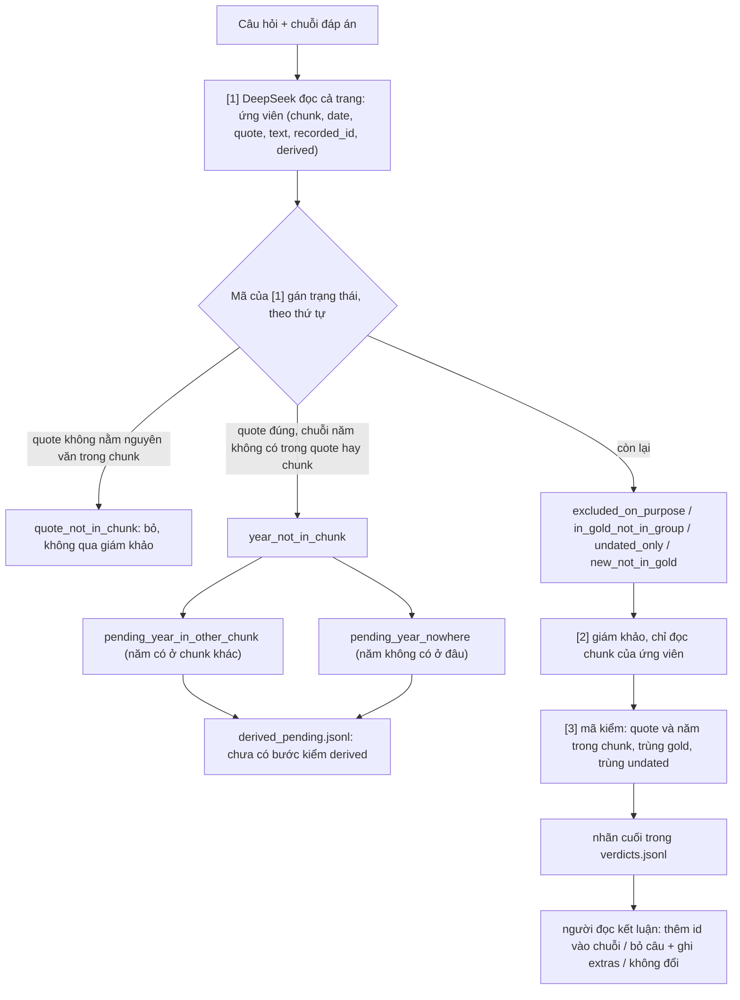

# 14. Kiểm chuỗi đáp án [1][2][3], cờ trong gold và precision ingest

**Trạng thái (2026-11-09):** một điều **đã chốt** (precision ingest bỏ qua mốc không ngày). Mọi điều còn lại là **đề xuất**, chưa chốt và chưa code, trừ phần tách trạng thái `derived_pending` (đã sửa `local/chain_verify.py`). Số liệu của một người đọc.

Bối cảnh và số liệu chi tiết: `docs/eval/10_TIMELINE_DATASET_DESIGN.md` (10.5ar đến 10.5au). Quyết định dùng prompt v8: `13_QUESTION_GENERATION_V8.md`.

## 1. Đã chốt

- **Precision ingest bỏ qua sự kiện không ngày** (`date = None`): không tính đúng, không tính sai. Các số precision cũ (bản 9, tập C) tính cả 14 mốc không ngày vào mẫu số; tính lại với mẫu số 197: chặt 67,0%, vừa 79,2%, rộng 100% (số cũ: 62,6%, 73,9%, 93,4%).
- Bộ chính là v8 + v8n; v7 và v7n chưa cần sửa chuỗi (người dùng, 2026-11-09).

## 2. Sơ đồ các tầng gán trạng thái

Nhãn cuối (thứ tự quyết định): quote hoặc năm không có trong chunk → `reject_code`; trùng mốc trong chuỗi → `duplicate_in_chain`; trùng mốc gold ngoài chuỗi → `duplicate_of_gold`; trùng `undated_mentions` → `duplicate_of_undated`; giám khảo chấp nhận, ngày rõ cùng câu → `auto_accept`; chấp nhận nhưng ngày không cùng câu → `derived_candidate`; `reject` → `reject`; còn lại → `human`. `auto_accept` và `derived_candidate` chỉ là nhãn, chưa bước nào thực thi.

Đối chiếu số ứng viên (đọc tay bằng mã): v7n_1 29 = 22 qua giám khảo + 6 pending + 1 `quote_not_in_chunk`; v8n_1 19 = 17 + 1 + 1. Chạy kiểm `LIMIT=1` trên `v7n_1`: 6 ca pending được tách đúng như đọc tay (2 `nowhere`, 4 `in_other_chunk`), chỉ 1 ca đi qua giám khảo; 21 ca giám khảo còn lại không chạy lại.

## 3. Hành động sau nhãn (đề xuất)

| Mốc [1] báo | Câu hỏi | Ghi vào |
|---|---|---|
| Có trong gold, ngoài chuỗi, thỏa tiêu chí | thêm id vào chuỗi, tính lại `answer_ids` | chỉ đáp án |
| Không có trong gold, ngày rõ cùng câu | bỏ câu (hướng b) | `extras` |
| Không có trong gold, ngày suy ra đã kiểm | bỏ câu nếu nằm trong khoảng chuỗi và thỏa tiêu chí | `extras` kèm cờ `derived` |
| Gold chỉ để ở `undated_mentions` nhưng văn bản có ngày rõ | như dòng 2 | `extras` |
| Không có ngày rõ, không có trong `undated_mentions` | không đổi | không ghi (`verdicts.jsonl`) |
| Trùng gold, trùng undated, trùng chuỗi | không đổi | không ghi |

Bước gộp, kiểm derived và ghi `extras` chưa viết. Kết quả thực tế trên bộ chính (v8, v8n): 0 ca cần sửa.

## 4. Cờ trong gold và câu hỏi (đề xuất)

Gold có 11.980 mốc trên 355 trang: 1165 `derived_date`, 389 `approximate_date`, 156 `source_inconsistent` (73 trang). Cờ `source_inconsistent` gộp ít nhất ba loại mâu thuẫn: ngày xung đột (Sevilla 2008/2009, Talk_im_Turm 1990/1991), sự kiện bị trộn (Charles_Lee e15), hai thực thể khác nhau (Humongous). Gold không lưu ngày thay thế.

Hiện 6 câu của v8+v8n dùng `source_inconsistent` (Humongous:1, Jimmy_Lai:1, Sevilla:1, Talk_im_Turm:1, Steele_Hall:3, Charles_Lee_general:2 ở v8n). Đọc nội dung: Steele_Hall:3 sai (đếm đôi), Talk_im_Turm:1 mơ hồ, Jimmy_Lai:1 đáng ngờ, ba câu còn lại ổn.

**Đề xuất hai quy tắc cho cả bốn loại:**
1. Mốc `source_inconsistent` không nằm trong đáp án và không làm điểm neo.
2. Nếu mốc cờ B thỏa tiêu chí của câu (`criterion`) và nằm gần chuỗi thì đáp án phải không đổi khi B dịch ±2 năm (độ lệch giả định, chưa đo):
   - `list`/`summary`: khoảng của câu phải loại hẳn B (kết thúc trước d−2 hoặc bắt đầu sau d+2).
   - `order_gap`: B không là điểm neo.
   - `first_last_next`: "đầu" cần A sớm hơn d−2; "cuối" cần C muộn hơn d+2; "kế tiếp" cần B không nằm giữa mốc cho trước và đáp án.

Kiểm bằng mã trong `check_questions.py`, không cần LLM. Với 6 câu hiện có, B đều nằm trong chuỗi nên đều bị bỏ (1,3% của 448 câu).

## 5. Precision và ingest với cờ (đề xuất)

- Ingest nhận `derived_date` (mã: năm không nằm trong chunk) và `approximate_date` (model khai); không nhận `source_inconsistent`. Đề xuất không thêm: mâu thuẫn nguồn là việc của Cơ chế 3. Khi trang tự mâu thuẫn, ingest có thể trích hai mốc (mỗi mốc có chunk riêng); điều đó đúng về tính trung thực với chunk nhưng làm timeline có hai mốc cho một chuyện, cần bước gộp nếu muốn timeline sạch (chưa thiết kế).
- Precision tính cả mốc có cờ; mốc ingest được tính đúng khi chunk của nó nói như vậy. Mức chặt chỉ ghép theo ngày gold nên báo thêm một dòng riêng "khớp ngày thay thế của mốc `source_inconsistent`". Recall: tách 156 mốc `source_inconsistent` ra khỏi mẫu số hoặc báo riêng.
- `derived_date` và `approximate_date` báo precision theo cờ riêng. Định nghĩa `derived_date` giữa gold (năm không cùng câu) và ingest (năm không trong chunk) đang khác nhau.

## 6. Việc chưa làm

- Bước kiểm derived (nhận `derived_pending.jsonl`), bước gộp chuỗi, ghi `extras/`.
- Nhận dạng năm viết tắt ("1827–29" → 1829) trong `chain_complete.py` và ingest; kiểm trùng bằng mã trước khi đẩy vào pending; đưa các ca `quote_not_in_chunk` vào giám khảo; ghép chunk kế tiếp khi câu bị cắt ngang ranh giới.
- Thêm quy tắc cờ vào prompt v8 và `check_questions.py`; sửa hai lỗi checker "any order" (Bill_Goldberg:3, Washington_Spirit:2); bốn câu lỗi cũ (Steele_Hall:3, Condor, Panair, Talk_im_Turm).
- Đối chiếu sự kiện ingest không ngày với `undated_mentions` (hiện chỉ bị bỏ qua khi tính precision).
