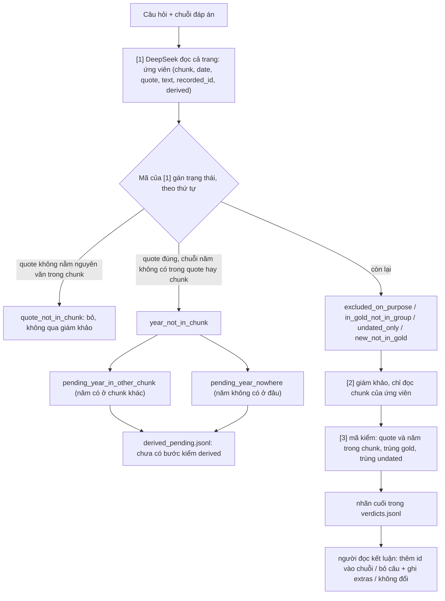

# 14. Kiểm chuỗi đáp án [1][2][3], cờ trong gold và precision ingest

**Trạng thái (2026-11-09):** một điều **đã chốt** (precision ingest bỏ qua mốc không ngày). Mọi điều còn lại là **đề xuất**, chưa chốt và chưa code, trừ phần tách trạng thái `derived_pending` (đã sửa `local/chain_verify.py`). Số liệu của một người đọc.

Bối cảnh và số liệu chi tiết: `docs/eval/10_TIMELINE_DATASET_DESIGN.md` (10.5ar đến 10.5au). Quyết định dùng prompt v8: `13_QUESTION_GENERATION_V8.md`.

## 1. Đã chốt

- **Precision ingest bỏ qua sự kiện không ngày** (`date = None`): không tính đúng, không tính sai. Các số precision cũ (bản 9, tập C) tính cả 14 mốc không ngày vào mẫu số; tính lại với mẫu số 197: chặt 67,0%, vừa 79,2%, rộng 100% (số cũ: 62,6%, 73,9%, 93,4%).
- Bộ chính là v8 + v8n; v7 và v7n chưa cần sửa chuỗi (người dùng, 2026-11-09).
- **Luật cờ trong câu hỏi: mức 2 = quy tắc 1 + quy tắc 2** (mục 4; người dùng chốt 2026-11-09). Độ lệch ±2 năm vẫn là giả định chưa đo. Việc viết prompt v9 và sửa checker: `docs/pending/01_QUESTION_PROMPT_V9.md`.

## 2. Sơ đồ các tầng gán trạng thái

Nhãn cuối (thứ tự quyết định): quote hoặc năm không có trong chunk → `reject_code`; trùng mốc trong chuỗi → `duplicate_in_chain`; trùng mốc gold ngoài chuỗi → `duplicate_of_gold`; trùng `undated_mentions` → `duplicate_of_undated`; giám khảo chấp nhận, ngày rõ cùng câu → `auto_accept`; chấp nhận nhưng ngày không cùng câu → `derived_candidate`; `reject` → `reject`; còn lại → `human`. `auto_accept` và `derived_candidate` chỉ là nhãn, chưa bước nào thực thi.

Đối chiếu số ứng viên (đọc tay bằng mã): v7n_1 29 = 22 qua giám khảo + 6 pending + 1 `quote_not_in_chunk`; v8n_1 19 = 17 + 1 + 1. Chạy kiểm `LIMIT=1` trên `v7n_1`: 6 ca pending được tách đúng như đọc tay (2 `nowhere`, 4 `in_other_chunk`), chỉ 1 ca đi qua giám khảo; 21 ca giám khảo còn lại không chạy lại.

## 3. Hành động sau nhãn (đề xuất)

| Mốc [1] báo | Câu hỏi | Ghi vào |
|---|---|---|
| Có trong gold, ngoài chuỗi, thỏa tiêu chí | thêm id vào chuỗi, tính lại `answer_ids` | chỉ đáp án |
| Không có trong gold, ngày rõ cùng câu | bỏ câu (hướng b) | `extras` |
| Không có trong gold, ngày suy ra đã kiểm | bỏ câu nếu nằm trong khoảng chuỗi và thỏa tiêu chí | `extras` kèm cờ `derived` |
| Gold chỉ để ở `undated_mentions` nhưng văn bản có ngày rõ | như dòng 2 | `extras` |
| Không có ngày rõ, không có trong `undated_mentions` | không đổi | không ghi (`verdicts.jsonl`) |
| Trùng gold, trùng undated, trùng chuỗi | không đổi | không ghi |

Bước gộp, kiểm derived và ghi `extras` chưa viết. Kết quả thực tế trên bộ chính (v8, v8n): 0 ca cần sửa.

## 4. Cờ trong gold và câu hỏi (đề xuất)

Gold có 11.980 mốc trên 355 trang: 1165 `derived_date`, 389 `approximate_date`, 156 `source_inconsistent` (73 trang). Cờ `source_inconsistent` gộp ít nhất ba loại mâu thuẫn: ngày xung đột (Sevilla 2008/2009, Talk_im_Turm 1990/1991), sự kiện bị trộn (Charles_Lee e15), hai thực thể khác nhau (Humongous). Gold không lưu ngày thay thế.

Hiện 6 câu của v8+v8n dùng `source_inconsistent` (Humongous:1, Jimmy_Lai:1, Sevilla:1, Talk_im_Turm:1, Steele_Hall:3, Charles_Lee_general:2 ở v8n). Đọc nội dung: Steele_Hall:3 sai (đếm đôi), Talk_im_Turm:1 mơ hồ, Jimmy_Lai:1 đáng ngờ, ba câu còn lại ổn.

**Hai quy tắc cho cả bốn loại (mức 2, đã chốt 2026-11-09):**
1. Mốc `source_inconsistent` không nằm trong đáp án và không làm điểm neo.
2. Nếu mốc cờ B thỏa tiêu chí của câu (`criterion`) và nằm gần chuỗi thì đáp án phải không đổi khi B dịch ±2 năm (độ lệch giả định, chưa đo):
   - `list`/`summary`: khoảng của câu phải loại hẳn B (kết thúc trước d−2 hoặc bắt đầu sau d+2).
   - `order_gap`: B không là điểm neo.
   - `first_last_next`: "đầu" cần A sớm hơn d−2; "cuối" cần C muộn hơn d+2; "kế tiếp" cần B không nằm giữa mốc cho trước và đáp án.

Kiểm bằng mã trong `check_questions.py`, không cần LLM. Với 6 câu hiện có, B đều nằm trong chuỗi nên đều bị bỏ (1,3% của 448 câu).

## 5. Precision và ingest với cờ (đề xuất)

- Ingest nhận `derived_date` (mã: năm không nằm trong chunk) và `approximate_date` (model khai); không nhận `source_inconsistent`. Đề xuất không thêm (chưa chốt, xem mục 8 về ranh giới với Cơ chế 3). Khi trang tự mâu thuẫn, ingest có thể trích hai mốc (mỗi mốc có chunk riêng); điều đó đúng về tính trung thực với chunk nhưng làm timeline có hai mốc cho một chuyện, cần bước gộp nếu muốn timeline sạch (chưa thiết kế).
- Precision tính cả mốc có cờ; mốc ingest được tính đúng khi chunk của nó nói như vậy. Mức chặt chỉ ghép theo ngày gold nên báo thêm một dòng riêng "khớp ngày thay thế của mốc `source_inconsistent`". Recall: tách 156 mốc `source_inconsistent` ra khỏi mẫu số hoặc báo riêng.
- `derived_date` và `approximate_date` báo precision theo cờ riêng. Định nghĩa `derived_date` giữa gold (năm không cùng câu) và ingest (năm không trong chunk) đang khác nhau.

## 6. Việc chưa làm

- Bước kiểm derived (nhận `derived_pending.jsonl`), bước gộp chuỗi, ghi `extras/`.
- Nhận dạng năm viết tắt ("1827–29" → 1829) trong `chain_complete.py` và ingest; kiểm trùng bằng mã trước khi đẩy vào pending; đưa các ca `quote_not_in_chunk` vào giám khảo; ghép chunk kế tiếp khi câu bị cắt ngang ranh giới.
- Thêm quy tắc cờ vào prompt v8 và `check_questions.py`; sửa hai lỗi checker "any order" (Bill_Goldberg:3, Washington_Spirit:2); bốn câu lỗi cũ (Steele_Hall:3, Condor, Panair, Talk_im_Turm).
- Đối chiếu sự kiện ingest không ngày với `undated_mentions` (hiện chỉ bị bỏ qua khi tính precision).

## 7. Gold lưu mốc `source_inconsistent` không đồng nhất; vai trò của `criterion`

Quy ước trong docs/eval/10 (10.5f, 10.5g): nguồn tự mâu thuẫn thì giữ từng mục và gắn `source_inconsistent`, hoặc gắn cho mốc không nằm trong danh sách chính. Trong gold thực tế có bốn kiểu (ví dụ thật):

| Trang | Gold lưu | Chi tiết |
|---|---|---|
| Talk_im_Turm | 1 mốc có cờ, không có mốc cho phiên bản kia | `e5` Maischberger 1990 (cờ); chunk 8 ghi (1991) không có mốc riêng; `e9` 1991 là lúc rời đi, `derived_date` |
| Steele_Hall | 2 mốc, cả hai có cờ | `e11` 1972-03-15 và `e12` 1973 (cùng một lần từ chức) |
| Charles_Lee | 2 mốc, cả hai có cờ | `e15` 1773 và `e17` 1775 (mua điền trang); `e15` còn trộn "chuyển sang Bắc Mỹ" |
| Sevilla | 1 mốc cờ cạnh mốc chính không cờ | `e8` 2008 (cờ) cạnh `e13` 2009 (không cờ) và `e16` 2010 (cờ) |

Ước lượng thô bằng so từ chung (chưa kiểm): trong 156 mốc `source_inconsistent`, khoảng 58 có mốc khác cùng nội dung khác năm, khoảng 98 thì không. Vì gold không lưu ngày thay thế, không thể kiểm bằng mã ngày thay thế có đổi đáp án hay không; đây là lý do quy tắc ±2 năm ở mục 4 là giả định.

`criterion` (trường của mỗi câu hỏi): một câu tiếng Anh mô tả loại sự kiện chuỗi thu thập; từ v8 Haiku viết nó trước câu hỏi và mỗi cụm trong câu phải có tương ứng trong `criterion`. Mã không dùng giá trị `criterion` (`chain_complete.py` và `chain_verify.py` chỉ nhắc "the question's criterion" trong prompt). Vai trò với cờ: mốc cờ chỉ gây vấn đề nếu cùng loại với `criterion`; việc so khớp đó hiện do Haiku tự phán đoán, chưa có mã.

Ingest (`pass3_p9.py`) chưa từng chạy trên trang có mốc `source_inconsistent` (tập C có 0 mốc). Chưa biết ingest ra một hay hai mốc ở trang như vậy.

## 8. Ranh giới với Cơ chế 3 (ghi tạm, chưa kết luận)

Theo người dùng (2026-11-09): Cơ chế 3 ban đầu để xử lý mâu thuẫn xuất hiện khi **nạp lại một trang với bản mới hơn** (ví dụ cùng trang Wikipedia, bản cập nhật). Còn mâu thuẫn **trong cùng một trang** (`source_inconsistent`) có thuộc Cơ chế 3 hay không thì **chưa biết**. Mục 5 trước đó viết "mâu thuẫn nguồn là việc của Cơ chế 3" là chưa chắc; đã sửa thành chưa chốt.

Cách tránh vấn đề cho bộ câu hỏi (không phụ thuộc kết luận trên): câu hỏi sinh từ gold, Haiku được dặn né mốc cờ; ingest trích trùng không ảnh hưởng việc sinh câu. Đây là né, chưa phải giải quyết: 6/448 câu vẫn dùng mốc cờ; và việc ingest trích trùng một sự kiện (kể cả không do mâu thuẫn, ví dụ Maidan trích hai lần) làm sai câu hỏi dạng đếm/`list` nếu câu chạm đến sự kiện đó.

## 9. Kế hoạch tiếp theo (người dùng nêu: lên v9 để so với v8 và v7 cho sinh câu hỏi bằng Haiku)

Lưu ý tên: **v9 của sinh câu hỏi** (`sinh_cau_hoi_v9.md`, chưa viết) khác **bản 9 của ingest** (`pass3_p9.py`). Quyết định ở `13_QUESTION_GENERATION_V8.md` vẫn là dùng v8; v9 chỉ thay v8 nếu đo tốt hơn (chưa quyết tiêu chí).

Nội dung dự kiến của v9 (đề xuất, chưa chốt): hai quy tắc cờ ở mục 4 (kể cả `list`/`summary`); xử lý bốn câu lỗi cũ (Steele_Hall:3 đếm đôi một sự kiện do hai chunk ghi hai năm, Condor thông báo + hoàn tất, Panair "first service" không phải tuyến mới, Talk_im_Turm mốc cờ trong chuỗi); luật `summary` không chứa cả đầu lẫn cuối một giai đoạn và không chứa hai mốc cờ cùng một sự kiện; quyết định có cho `derived_date` vào `list`/`summary` hay không (hiện cấm hoàn toàn).

Phương án đo (đề xuất): chạy v9 trên cùng 100 trang tune như v7/v8 (50 trang cũ + 50 trang mới, cùng trang để so cặp); chỉ số: số câu mỗi loại, checker (cần cập nhật luật cờ), [1] tỷ lệ lượt có ứng viên thật, [2][3] đóng góp thật, đọc mù mẫu, số câu dùng mốc cờ (mục tiêu 0). Chưa đo nhiễu giữa hai lần sinh cùng prompt; nên chạy hai lần nếu muốn kết luận.

## 10. Danh sách việc còn lại (tổng hợp)

- Bước [4] giám khảo kiểm câu hỏi: **đã viết bản thử `local/question_audit.py` và chạy trên v8/v9/v8n (2026-11-10)**; bắt Werner_Hartmann:4 nhưng bỏ sót Condor:3 và hầu hết lỗi tinh, dùng làm bộ lọc sơ bộ (`docs/pending/04_QUESTION_AUDIT_STEP4.md`, `docs/eval/10` mục 10.5aw). Chờ quyết hướng tiếp.
- ~~Prompt v9 và cập nhật `check_questions.py`~~ **Đã viết và chạy Session 3–4 (2026-11-10); kết quả ở `docs/eval/10` mục 10.5av.** Session 1–2 đã chạy (364 câu trên 100 trang). Đã chốt v9 làm bản chính và sửa các câu nghi (mục 13). Còn: quyết các câu Haiku đề nghị, gộp `list`/`summary`.
- Bước kiểm derived, bước gộp chuỗi, tạo `extras/` (và có đưa 13 mốc thiếu của soát gold 50 trang mới vào đó hay không).
- Sửa [1] và [2]: năm viết tắt, kiểm trùng bằng mã trước khi đẩy pending, đưa `quote_not_in_chunk` vào giám khảo, ghép chunk kế tiếp khi câu bị cắt ngang ranh giới; giám khảo xét sai `in_window` (Alemannia), năm trong tên riêng, sự kiện của thực thể khác.
- Ingest: thống nhất định nghĩa `derived_date` với gold; nhận dạng năm viết tắt; bước gộp mốc trùng trong timeline; đối chiếu mốc ingest không ngày với `undated_mentions`; chọn model ingest (hiện chỉ DeepSeek); tính lại precision bản 8 theo quy tắc mới, thêm người đọc thứ hai.
- Dữ liệu: 23 trang gold có tên file mất ký tự có dấu (ví dụ `S_rgio_Concei_o`) nên không khớp tự động vào `tune`/`valid` bằng tên; khớp tự động cho tune 179, valid 153 (còn 23 trang chưa gán); `test_clean` (186 trang) chưa có gold; `valid` (167 trang) có gold nhưng chưa sinh câu hỏi.
- Chưa quyết: cách chấm `list` so với `summary`; tỷ lệ theo loại câu; soát gold 50 trang mới bằng người đọc thứ hai; quyết định xử lý mâu thuẫn trong cùng trang (mục 8).

## 11. Công cụ đã viết cho bước kiểm derived, gộp và `extras` (2026-11-09; `chain_apply.py` áp thật lần đầu 2026-11-10 cho v9)

- **`local/chain_derived.py`** (kiểm derived, lười): đọc `derived_pending.jsonl` của [2][3] và `results.jsonl` của [1]; thứ tự: (1) mã nhận dạng năm viết tắt, (2) mã loại trùng gold (cùng chunk + cùng ngày + chữ chung ≥ 0,6), (3) giám khảo DeepSeek cho các ca còn lại. Ra `local/derived_verified.json`. Chạy trên 7 ca pending của v7n/v8n: `duplicate_of_gold` 2 (Alemannia `e21` bằng giám khảo; Department_of_Computing bằng mã, nhưng mã cũng ghi nhầm `e6` vì chung cụm "Department of Computing and Control", nên mã trùng bằng chữ chung có thể ghi dư id), `duplicate_in_chain` 1 (Meet_the_Press `e25`), `no_date_stated` 4 (Charles_Lee, Engel, Rush_Holt ×2); 0 mốc mới; 6 lời gọi LLM, 0 ca năm viết tắt.
- **`local/chain_apply.py`** (gộp): áp **quyết định đã duyệt** từ file JSON do người đọc viết (`add_ids` hoặc `drop` kèm `extra`), không tự suy từ nhãn `auto_accept`. Mặc định chạy thử, không ghi gì; `--apply` sao lưu `<page>.jsonl.bak_apply`, ghi nhật ký `local/chain_apply_log.jsonl`, bỏ câu vào `<set>/_dropped.jsonl` (thẻ q của các câu sau trong trang dịch xuống 1), ghi `dataset/eval/timeline_pilot/extras/<page>.json`. `list`/`summary`: thêm id giữ thứ tự thời gian, chặn nếu vượt trần 10/8; `first_last_next`: thêm vào `group_event_ids`, tính lại đáp án theo subtype, **không áp** nếu đáp án đổi hoặc có hòa ngày (báo cần quyết định).
- Chạy thử với `local/chain_decisions_v7n_test.json` (bốn quyết định thật của v7n: Rams:1 thêm `e28`, Sirotkin:1 thêm `e10`, bỏ Cochran:2 và Sam_Selvon:1 kèm hai mục `extras`): đều ra "ÁP" ở chế độ thử, chưa ghi gì; thư mục `extras/` chưa tạo. Chưa áp thật vì bộ chính là v8/v8n (0 ca cần sửa) và v7n chưa cần.

- **Áp thật lần đầu (2026-11-10, v9):** `local/chain_decisions_v9.json` có một quyết định `drop` cho Vologda:4 (`summary`, "changes in Vologda's administrative status..."). Lý do: [1][2][3] cho ứng viên `auto_accept` "In December 1936, Northern Krai was abolished and divided into the Komi ASSR and Northern Oblast" (chunk `/wiki/Vologda#35`); đã đọc chunk, ngày rõ, nằm giữa e37 (1929) và e39 (1937), gold thiếu, `undated_mentions` không có dòng liên quan. Theo luật mục 12 (mốc ngày rõ, mới, chưa có trong gold): bỏ câu và ghi `extras`. Kết quả: `local/questions/v9/Vologda.jsonl` còn 3 câu (sao lưu `Vologda.jsonl.bak_apply`), câu bị bỏ nằm trong `local/questions/v9/_dropped.jsonl`, mốc ghi ở `dataset/eval/timeline_pilot/extras/Vologda.json` (thư mục `extras/` tạo lần đầu), nhật ký `local/chain_apply_log.jsonl`. Gold không đổi. Phát hiện kèm theo: file `_dropped.jsonl` nằm cùng thư mục với file trang làm các script đọc thư mục lỗi; đã cho `check_questions.py`, `chain_complete.py`, `chain_excluded.py`, `chain_span_stats.py` bỏ qua file tên bắt đầu bằng `_`. Sau khi áp, v9 còn 203 câu (Session 3–4), `check_questions.py v9` 0 lỗi.

- **`local/flag_rules.py` (2026-11-10, không LLM):** quét một bộ câu hỏi theo luật cờ mức 2 và ghi file quyết định cho `chain_apply.py`. Quy tắc 1 (id trong chuỗi mang `source_inconsistent`) tự động chính xác; quy tắc 2 (mốc cờ gần chuỗi ±2 năm) chỉ **báo cáo** vì "cùng loại sự kiện với `criterion`" không kiểm được bằng mã, dùng track/label làm đại diện nên đếm dư (`--r2` mới đưa vào file quyết định). Chạy cho v8 + v8n: R1 = 6 câu (Humongous:1, Jimmy_Lai:1, Sevilla:1, Steele_Hall:3, Talk_im_Turm:1 của v8; Charles_Lee_general:2 của v8n), đã áp thật bằng `chain_apply.py --apply` (`local/flag_rules_v8_decisions.json`): v8 171 → 166 câu, v8n 277 → 276, bộ chính 448 → 442 câu; sao lưu `*.jsonl.bak_apply`, câu bị bỏ ở `v8*/_dropped.jsonl`; thẻ q của các câu sau trong cùng trang dịch xuống 1 (kết quả [1][2][3] cũ của v8/v8n theo `qi` cũ không còn khớp thẻ). R2 = 10 câu ứng viên (đọc tay: phần lớn là loại sự kiện khác, ví dụ Leahy đại sứ so với chief of bureau, Cochran bắt đầu so với kết thúc, The_One_Show Chris Evans so với nghỉ thai sản, Real_Madrid:7 huấn luyện viên khác; có thể thật: Michael_Batty:1, Real_Madrid_Baloncesto:3, Humongous:2). **Đã đọc chunk ba câu còn lại (2026-11-10):** Michael_Batty:1 giữ (CHOPS là cơ quan khác với ESRC/SERC/Computer Board trong `criterion`); Humongous:2 giữ (mốc B là xuất bản kết thúc 2009/2013, `criterion` là phá sản hoặc chuyển thương hiệu); Real_Madrid_Baloncesto:3 theo chữ ±2 năm thì vi phạm (Plaza 2006 hoặc 2007, cửa sổ kết thúc 2005) nhưng mâu thuẫn thật chỉ 2006 so với 2007, cả hai ngoài cửa sổ, nên đáp án không đổi: đề xuất giữ (cần người dùng chốt vì ±2 là giả định chặt hơn độ lệch thực tế). Vậy cả 10 câu R2 đề xuất giữ, quy tắc 2 không loại thêm câu nào ở v8/v8n.

- **Chốt của người dùng (2026-11-10) về luật cờ trên v8/v8n:** quy tắc 1 đã áp (6 câu bỏ); quy tắc 2: giữ cả 10 câu ứng viên (đề xuất được chấp nhận, kể cả Real_Madrid_Baloncesto:3); bộ chính v8 + v8n còn 442 câu. Việc kiểm "cùng loại với `criterion`" bằng mã hay giám khảo chưa làm (ghi ở `docs/pending/01`). Lỗi nội dung còn lại trong v8 đã biết: Condor:3 (`summary`, e29 thông báo + e31 hoàn tất, đếm đôi) và Werner_Hartmann:4 (hỏi "first ... and which ..." trong khi `subtype` chỉ có một đáp án); chưa xử lý.

- **`local/question_audit.py` (2026-11-10, bước [4] thử, LLM):** xem `docs/pending/04_QUESTION_AUDIT_STEP4.md`. Không sửa gì, chỉ ghi `verdicts.jsonl`; việc bỏ câu vẫn qua `chain_apply.py` khi người dùng duyệt. `local/read_v8.py` và `local/read_old.py` in câu hỏi + chuỗi để đọc mù (không gọi API).

## 12. Chốt về mốc derived và mốc mới trong đáp án (người dùng, 2026-11-09)

- **Derived đã có trong gold và [2] duyệt** (năm lấy từ chính chunk hoặc từ năm viết tắt do mã tính; năm phải suy từ chunk khác thì không cho): thêm id vào đáp án của câu đó, không đổi gold. Khi sinh câu hỏi, mốc `derived_date` vẫn không làm điểm neo và Haiku không dựa vào nó làm đáp án.
- **Derived mới chưa có trong gold:** chỉ ghi `extras` (để tính precision ingest); không vào đáp án; bỏ câu nếu nó nằm trong khoảng chuỗi và thỏa tiêu chí.
- **Mốc ngày rõ cùng câu nhưng chưa có trong gold** (kiểu Cochran DFC, Sam_Selvon Chaconia): bỏ câu, ghi `extras` (hướng b, giữ như cũ).
- **Chưa chốt, không phải việc trước mắt:** giữ câu và thêm id kiểu `extra_<trang>_<n>` / `answer_extra` cho mốc ngày rõ mới; điều kiện nhất quán và lý do hoãn ở `docs/pending/01_QUESTION_PROMPT_V9.md`.
- Việc kéo theo (chưa làm): `local/chain_apply.py` hiện chưa cho `add_ids` với mốc mang cờ; cần cho phép khi quyết định ghi `verified_derived: true` và vẫn chặn mốc `source_inconsistent`. Ba ca `in_gold_not_in_group` mang `derived_date` (Bill_Goldberg:4, Department_of_Computing:1 của v7n, Air_Component_Command:8) chưa được đọc.

## 13. Chốt bản chính cho bộ câu hỏi Cơ chế 2: v9 (người dùng, 2026-11-10)

Người dùng đồng ý ("oke") với đề xuất sau khi so v8 và v9 trên 100 trang (bằng chứng ở `docs/eval/10` mục 10.5aw). Lưu ý: đây là phản hồi "oke" sau một đề xuất, ghi lại như một quyết định; nếu hiểu sai thì sửa mục này.

1. **Dùng v9 làm bản chính** (`local/prompts/sinh_cau_hoi_v9.md`, `local/questions/v9/`, 364 câu trên 100 trang tune, checker v9 0 lỗi), **thay v8 + v8n** của `decisions/13` mục 3.1. Lý do: trên 50 trang cũ cùng điều kiện v9 có số câu gần bằng v8 (161 so với 166) và ít lỗi hơn (1 lỗi chắc, 1 nghi so với 2 và 5); trên 50 trang mới v9 sạch hơn v8n nhưng ít câu hơn 26% (203 so với 276); v9 không dùng mốc `source_inconsistent` nên không cần bước bỏ câu theo luật cờ. Giới hạn: một người đọc, một lần sinh, chưa đo nhiễu; chênh lệch nhỏ (vài câu trên vài trăm).
2. **v8 và v8n giữ làm đối chứng**, không dùng làm bộ chính nữa; những chốt khác của `decisions/13` giữ nguyên (không thêm mốc vào gold; chỉ điều chỉnh chuỗi đáp án từng câu; `extras/`; bỏ nhóm `work`).
3. **Bước [4] (`local/question_audit.py`)** dùng như bộ lọc sơ bộ để đọc tay các câu bị gắn nghi, không thay đọc mù (bắt 1/2 lỗi chắc, 2/10 theo đúng lý do; xem `docs/pending/04`).

4. **Sửa các câu nghi của v9 (người dùng đồng ý đề xuất, 2026-11-10; mình tự đọc câu hỏi, `criterion` và chuỗi trong gold, không gọi API).** v9 còn **361 câu** (checker 0 lỗi, 158 cảnh báo).
   - **Bỏ 3 câu** (`chain_apply.py --apply`, `local/chain_decisions_v9_user_review.json`, câu bỏ ở `v9/_dropped.jsonl`): Michael_Batty:1 và :2 (mốc cờ e23 "Became Chair of CHOPS" 1986 và e14 "Chair of CHOPS ended" cùng loại với câu hỏi, thiếu trong đáp án, nguồn ghi 1986-1980; không thêm gold nên bỏ câu); Hugh_Scott:4 (e10 Navy Reserve không phải membership/fellowship, còn e8 "member of Governor's Commission" 1938 cùng loại mà thiếu).
   - **Sửa 3 câu** (sửa tay bằng script, sao lưu `*.jsonl.bak_edit`): Humongous_Entertainment:1 gỡ e50 (Infogrames mua Hasbro Interactive là công ty mẹ đi mua, không phải mua/bán Humongous hay công ty mẹ), còn e18, e38; Lenin_Peak:4 gỡ e8 (đường leo "first climbed" không nêu người dẫn đầu), còn e6, e7, e11, e13; Atlanta_Dream:1 `window_to` từ chữ tự do thành `"2010"`.
   - **Giữ** Rezidor_Hotel_Group:2 (e12 là "agreement to convert", lệch nhẹ).
   - **`flag_rules.py` chạy trên v9 (`--r2`): R1 = 0, R2 = 13 ứng viên.** Đọc tay: khoảng 10 báo oan do mốc cờ khác loại (Veliky_Novgorod:1/2/4 "nhắc lần đầu", Leahy:1/2/4/5 đại sứ, Cochran:1 WASP, HMS_Warrior_R31:1, Rezidor:2; Leahy:2 và :4 chỉ suy từ cùng cặp mốc cờ với Leahy:1, chưa đọc từng câu); 2 thật (Batty:1, :2, đã bỏ); 1 sát ngưỡng (Sevilla_FC_Puerto_Rico:1, mốc cờ 2008 chỉ thành mốc đầu nếu lùi đúng 2 năm bằng e3 2006; giữ). Lưu ý: với v8 người dùng chốt giữ cả 10 câu R2 sau khi đọc tay; ở v9 hai câu Batty bị bỏ vì mốc cờ thiếu cùng loại nằm giữa chuỗi.

**Chưa chốt / chưa làm:** có bổ sung câu từ v8n sau khi lọc luật cờ hay không (cần 276 câu v8n; 6 câu `source_inconsistent` đã bỏ, 10 câu quy tắc 2 giữ); đo nhiễu bằng sinh hai lần cùng prompt; gộp `list`/`summary`; cách chấm `list`; hướng tiếp của [4].

## 14. Quy ước ngôn ngữ của prompt và hồ sơ LLM mới (người dùng, 2026-11-10)

- **Prompt viết sau này (ingest, các bước gọi LLM trong `src/tam/`, ...) viết bằng tiếng Anh.** Prompt sinh câu hỏi v9 giữ tiếng Việt cho 100 trang còn lại (`local/prompts/sinh_cau_hoi_v9_rest.md`) để cùng điều kiện với 100 trang đã làm; đổi sang tiếng Anh chỉ thử như một thí nghiệm riêng trên mẫu nhỏ, chưa làm. Chưa kiểm chứng prompt tiếng Anh hay tiếng Việt cho kết quả tốt hơn với Haiku. Hệ quả đã thấy: trường `why_needs_multiple` trong file câu hỏi v9 ra tiếng Việt vì prompt tiếng Việt (chỉ để người đọc, không dùng chấm). Prompt hiện có trong `src/tam/llm/prompts/` (`time_extractor_v1.md`, `ingestion_time_v1.md`) đã bằng tiếng Anh.
- **Profile `opencode_deepseek_flash`** (`configs/config.dev.yaml`): DeepSeek V4.1 Flash qua OpenCode Go, `model_id: deepseek-v4.1-flash`, `base_url: https://opencode.ai/inference/go/openai/v1`, key `OPENCODE_API_KEY` (`.example.env`). Tách khỏi `deepseek_flash` (API DeepSeek trực tiếp, `DEEPSEEK_API_KEY`). Nguồn: `opencode.ai/docs/go` (đọc 2026-11-10). **Chưa gọi thử.** Chưa kiểm chứng: OpenCode có nhận `response_format` (nên đặt `structured_output: false` như `deepseek_flash`), có chuyển tiếp `extra_body.thinking` hay không (dòng này đang để chú thích), và model phục vụ đúng là DeepSeek V4.1 Flash chính thức (có báo cáo trên GitHub của OpenCode về `deepseek-v4-flash` tự nhận là bản cũ; chưa xác minh với `deepseek-v4.1-flash`). Giá theo trang OpenCode: input $0,15 / output $0,60 mỗi 1 triệu token ngoài giờ cao điểm, gấp đôi giờ cao điểm (01:00–04:00 và 06:00–10:00 UTC, thứ Hai đến thứ Sáu, tức 08:00–11:00 và 13:00–17:00 giờ Việt Nam); gói Go có hạn mức tháng $100. Trang ghi mô hình này cần chọn vùng **Global** trong Settings › Privacy (chủ hoặc quản trị workspace) mới dùng được; mặc định là vùng châu Âu và Mỹ.

## 15. Chốt cho v9 Session 5–8 (người dùng, 2026-11-10)

Bối cảnh và số liệu ở `docs/eval/10` mục 10.5ax (288 câu trên 88 trang tune và 12 trang valid, 22 trang 0 câu, nhóm `first_last_next` <3 mốc, cửa sổ chữ tự do).

1. **Đã chốt (người dùng "1 2 4 thì oke"):** (1) bỏ 17 câu của lô này và 3 câu thoái hóa của 100 trang trước (`local/chain_decisions_v9_rest_apply.json`); (2) sửa chữ Security_Service_of_Ukraine:1 và chuẩn hóa 9 cửa sổ chữ tự do ra ngày; (4) thêm luật checker cho `first_last_next` có nhóm <3 mốc. Lệch nhỏ khi làm (4): người dùng duyệt "lỗi cho nhóm <3 mốc", nhưng 30 câu `first`/`last`/`next` có nhóm 2 mốc chỉ yếu, không thoái hóa; nếu cũng tính lỗi thì checker thất bại ở 30 câu. Mình làm **lỗi** cho `first_and_last`/`last_and_previous` (đáp án = cả nhóm) và **cảnh báo** cho ba loại còn lại; nếu người dùng muốn lỗi cả ba, sửa lại và bỏ 30 câu.
2. **Không cần đặt trần số câu mỗi trang** (Luftflotte_1 13 câu, Swedish_Air_Force_Flying_School 11 câu giữ nguyên).
3. **Bỏ luật "order_gap không quá 1/3 số câu của trang" (người dùng: "nới đi, ko cần 1/3 gì đâu, cứ cho hết vào", cùng ngày).** Bỏ hẳn luật (không chỉ nới cho trang ≤3 câu). Prompt (`sinh_cau_hoi_v9.md`, `sinh_cau_hoi_v9_rest.md`, dòng "`order_gap` không quá 1/3 số câu của trang") **không sửa** (người dùng: "prompt thì kệ nó"); lô sinh sau này phải bỏ dòng đó nếu muốn bỏ luật cho agent. Mình thêm tay **10 câu `order_gap`** cho các trang agent báo đã bỏ vì luật này (cặp mốc lấy từ báo cáo agent, chữ câu hỏi do mình viết, sao lưu `*.jsonl.bak_add`; `why_needs_multiple` ghi "thêm tay"): Carrier_Air_Group_Seventeen (e2→e11), The_Clitheroe_Kid (valid, e6→e9), Westover_Plantation (e1→e2), President_of_Uruguay (e1→e2), Corpus_vasorum_antiquorum (e1→e4, `flagged_nearby_ids` e2), St_Luke_s_Anglican_Church_Liverpool (e3→e8), Hanover (e13→e16), D__band_ (e27→e60), Volvo_9700 (e1→e15, `flagged_nearby_ids` e16, e17), Henry_Stommel (e11→e19; cặp mốc agent đã xóa là không rõ nên mình chọn cặp mới). Chưa thêm cho các trang khác 0 câu vì agent không báo cặp (Milan_Metro_Line_2/3, Beugr, Sastamala, Tyne_and_Wear, Pelican, Klemzig, USS_LCS, James_Parmentier, Minuta_slavy, British_Rail_Class_40, U-254, World_Festival, Line_7); nếu muốn thêm thì đọc gold từng trang chọn cặp mốc hai bên không cờ.
4. **Chưa chốt:** xử lý các trang 0 câu còn lại; số trang valid cần làm tiếp; chạy [1][2][3] cho 281 câu mới.
5. Sau đợt này v9 có **639 câu** trên 200 trang (100 trang trước 358, lô này 281; valid 41 câu); checker 0 lỗi, 317 cảnh báo.

## 16. Chốt cho v9 valid (Session 9–15) và đo nhiễu (người dùng, 2026-11-11)

1. **Không đo nhiễu của việc sinh câu** (không sinh hai lần cùng prompt để so): bỏ mục "đo nhiễu" khỏi danh sách việc còn lại. Lý do người dùng nêu: không cần. Hệ quả: mỗi trang chỉ sinh một lần bằng một prompt Haiku, một người đọc; độ lệch giữa các lần sinh không có số đo.
2. **Không nới luật `dup_text`** (người dùng): các câu `first_and_last`/`last_and_previous`/`order_gap` có mốc neo trùng `text` vẫn bị bỏ (đã bỏ 7 câu ở 10.5ay và 2 câu SV_Darmstadt_98 ở 10.5az).
3. **Trang không ra câu thì để trống** (người dùng): 7 trang ở Session 9–12 và 3 trang ở Session 13–15, không thêm tay `order_gap` cho các trang này.
4. **Bỏ 8 câu ở Session 9–12** (7 lỗi checker + USCGC_Southwind:1), **5 câu ở Session 13–15** (Pettus:1, :2, Gordon_W_McKay:2, SV_Darmstadt_98:4, :5) và **2 câu Florida_Gators:1, :2** (nguồn tự mâu thuẫn); chuẩn hóa 8 cửa sổ chữ; sửa chữ Pettus (order_gap) và Han_dynasty:3. v9 hiện có **1182 câu** trên 355 trang (tune 600, valid 582), 31 trang 0 câu, checker 0 lỗi. Chi tiết: `docs/eval/10` mục 10.5ay, 10.5az.
5. **Phạm vi:** đồ án này tìm bộ câu hỏi (đã nêu lại ngày 2026-11-11: "việc là tìm câu hỏi chứ không phải ingest"). Gold chỉ để sinh và kiểm câu hỏi; mốc gold thiếu thì bỏ câu chạm đến nó, không dựng `extras` cho ingest (đề xuất của mình, xem `docs/pending/03`).
6. **Bỏ 52 câu `first_last_next` có nhóm <3 mốc** (người dùng, 2026-11-11: "oke bỏ, nhưng note backup"): tune 28, valid 24 (next 30, first 17, last 5). v9 còn **1130 câu** (tune 572, valid 558); 6 trang mất hết câu (Anmer_Hall, Central_European_University, George_Cambridge_2nd_Marquess_of_Cambridge, Lev_Polugaevsky, Liina_Tennosaar, The_Chris_Gethard_Show); 40 trang còn 1 câu. Lý do: không có mốc gây nhiễu (ví dụ nhóm chỉ có hai mốc thì đáp án "next" luôn là mốc còn lại); số câu còn lại vẫn gần gấp đôi mục tiêu tham khảo 300 mỗi tập. **Sao lưu:** `local/questions/v9/_dropped_weak52.jsonl` (52 câu đầy đủ) và `local/questions/v9/_dropped.jsonl`; quyết định ở `local/chain_decisions_v9_weak52_apply.json`. Luật checker (lỗi cho `first_and_last`/`last_and_previous` nhóm <3, cảnh báo cho `first`/`last`/`next`) giữ nguyên; các câu mới sinh có nhóm <3 vẫn chỉ bị cảnh báo.

## 17. Mốc trước Công nguyên (TCN) trong bộ câu hỏi timeline (người dùng xác nhận, 2026-11-11)

1. **Luật `decisions/05` áp cả cho bộ câu hỏi timeline:** mốc gold có `date` âm (năm thiên văn: 7300 TCN = `-7299`) không được nằm trong `gold_event_ids`, `answer_ids` hay `group_event_ids`. `local/questions/check_questions.py` đã thêm luật này (lỗi); v9 chạy lại: 0 lỗi.
2. **Đã bỏ 1 câu v9:** Han_dynasty:2 (`first_last_next` subtype `next`, dùng `e4`, `e11`, `e12` đều TCN), quyết định `local/chain_decisions_v9_bc_apply.json`, sao lưu `Han_dynasty.jsonl.bak_apply` và `_dropped.jsonl`. v9 còn **1129 câu**.
3. **Gold giữ mốc TCN** (đủ sự kiện); chỉ câu hỏi bị chặn. Prompt sinh câu hỏi test_clean (chưa viết) phải dặn: không dùng mốc có `date` bắt đầu bằng "-".
4. **Số liệu (đếm 2026-11-11):** gold 13744 mốc, 30 mốc âm (0,2%), chỉ ở 2 trang: Han_dynasty (27, valid) và Cueva_de_las_Manos (3, test_clean). Trong 556 trang tune/valid/test_clean, khoảng 6–8 trang có chunk nhắc năm TCN (khoảng 40 chunk, dưới 0,3%; regex còn nhầm "ABC", "Kölner BC", chưa kiểm từng ca). Ingest: năm < 1 là `invalid_time`, chunk bị bỏ.
5. **Chờ quyết (đề xuất, chưa làm):** khi đo precision/recall ingest so với gold, loại các mốc gold có `date` âm khỏi phần so sánh (không xóa khỏi gold); không bỏ cả trang vì mất quá ít.
