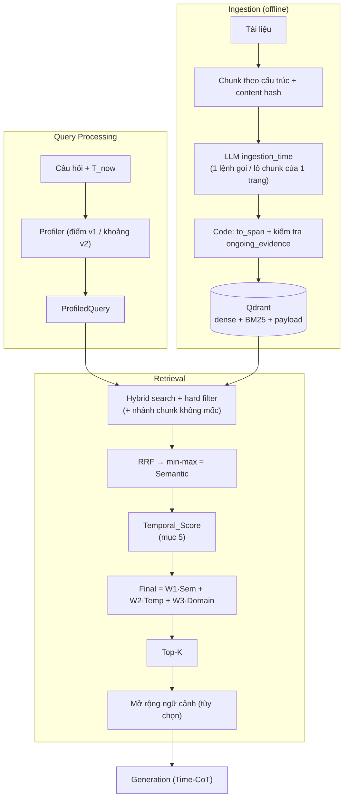
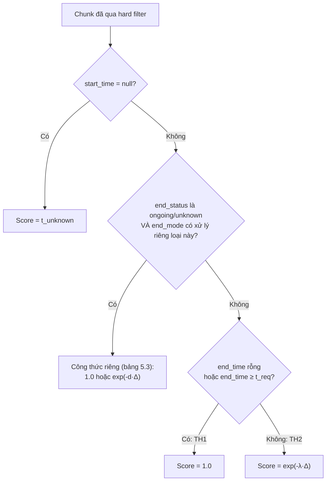

# Cơ chế 1 (v2): Temporal Retrieval sau khi mở rộng

**Ngày:** 2026-10-21. **Thay thế:** [`02_TEMPORAL_RETRIEVAL_DESIGN.md`](02_TEMPORAL_RETRIEVAL_DESIGN.md) (giữ nguyên làm bản gốc để đối chiếu). Doc này mô tả **đúng những gì đã code** ở `src/tam/` tính đến 2026-10-21, kèm lý do và số đo từ [`../eval/05_REAL_RESULTS.md`](../eval/05_REAL_RESULTS.md). Chỗ nào chưa code hoặc chưa đo thì ghi rõ.

## 0. Doc này khác doc 02 ở đâu

| | Doc 02 (gốc) | Doc 03 (v2) |
|---|---|---|
| Ingestion | LLM trích `start`, `end` | LLM trả thêm `ongoing`, `domain`, các câu `reason_*`, `ongoing_evidence`; code suy ra `end_time`, `end_status`; có nhánh chunk không mốc; prompt có phiên bản `v1`/`v2`/`v3` |
| Profiler | Một điểm `T_req` | Có hai bản: điểm (`v1`) và khoảng `[qs, qe]` + `bound` (`v2`) |
| Lọc cứng | `invalidated_at`, `start_time <= T_req`, `domain` (facet khác chỉ là ví dụ) | `domain` **không còn lọc cứng** (chỉ cộng điểm); chunk không mốc có nhánh riêng; cận trên lọc là `qe` ở chế độ khoảng |
| `Temporal_Score` | 2 trường hợp: 1.0 hoặc `exp(-λΔ)` | 5 nhóm trạng thái chunk × 4 `end_mode` × 2 `decay_from` × 2 `time_mode` × 2 `overlap` (mục 5) |
| `Final_Score` | `W1·Sem + W2·Temp` | thêm `W3·Domain`; BM25 có trọng số `sparse_weight` trong RRF |
| Ngữ cảnh gửi LLM | Top-K | Top-K + chunk liền kề hoặc cùng trang (tùy chọn) |
| Chọn tham số | Dự kiến | Có số đo trên 400 câu thật (mục 8) |

> Bất biến không đổi: **không rò rỉ tương lai** (`start_time <= cận trên`), **tin giả bị loại cứng** (`invalidated_at IS NULL`), **chỉ 4 payload index**. Xem mục 9 cho các chỗ hiện thực lệch bản gốc.

---

## 1. Bức tranh tổng thể



---

## 2. Ingestion: đầu ra và giá trị có thể có

### 2.1. Hai tầng đầu ra: LLM trả gì, code lưu gì

Đây là chỗ hay nhầm: `end`, `ongoing` **chỉ là đầu ra thô của LLM**; kho chỉ lưu `end_time` và `end_status` do **code suy ra** (`to_span` trong `time_extraction.py`).

**Tầng 1 – LLM trả cho mỗi chunk (`ChunkTime`):**

| Trường | Kiểu | Giá trị có thể có | Ghi chú |
|---|---|---|---|
| `index` | int | 0..n-1 trong lô | khóa nối với chunk; chunk LLM bỏ sót coi như `no_time` |
| `start` | str \| null | `YYYY`, `YYYY-MM`, `YYYY-MM-DD`, hoặc `null` | giữ đúng độ mịn văn bản; không bịa tháng/ngày. Trước Công nguyên → `null` |
| `end` | str \| null | như `start`, hoặc `null` | `null` khi `ongoing` hoặc khi không biết |
| `ongoing` | bool | `true` / `false` | `true` chỉ khi văn bản **nói** còn tiếp diễn ("since 2012", "currently") |
| `ongoing_evidence` | str | câu trích nguyên văn, hoặc `""` | bắt buộc khi `ongoing=true` |
| `reason_end_date` | str | 1 câu | viết **trước** `end`/`ongoing` để ép LLM lập luận trước khi chốt |
| `domain` | list[str] | 0–3 nhãn trong `business, sports, career, person, politics, place, media_arts, military, other` | nhãn chủ đạo đứng đầu; `[]` cho dòng tham khảo, mảnh vụn |
| `reason_domain` | str | 1 câu | viết trước `domain` |

**Tầng 2 – Code chuẩn hóa thành `TimeResult` rồi `Chunk` (cái thật sự nằm trong Qdrant):**

| Trường lưu | Giá trị | Cách suy ra |
|---|---|---|
| `start_time` | datetime UTC \| `null` | `start` chỉ-năm → `YYYY-01-01`; chỉ-tháng → ngày 1. `null` = chunk không mốc |
| `end_time` | datetime UTC \| `null` | xem bảng dưới |
| `end_status` | `known` \| `ongoing` \| `unknown` \| `null` | xem bảng dưới; `null` = chunk nạp trước khi có trường này |
| `invalidated_at` | datetime \| `null` | `null` mặc định; khác `null` = tin giả (Falsehood), bị loại cứng. **Ingestion hiện chưa tự gán**, dành cho Cơ chế 3 |
| `domain_features.domain` | list[str] | từ `domain` đã chuẩn hóa (bỏ nhãn lạ, bỏ trùng, tối đa 3). `domain_features` là hộp chứa đặc trưng theo bài toán; khóa khác (vd `country`) chỉ là **ví dụ**, không bắt buộc và thiết kế không dựa vào chúng |
| `chunk_id` | `<doc_id>#<chỉ số mục>` | ổn định giữa các lần nạp (ghi lại là ghi đè) |
| `source`, `doc_id` | str | loader quyết định; không index |

### 2.2. Bảng suy ra `end_time` và `end_status` (quan trọng nhất của ingestion)

| `end` (LLM) | `ongoing` | → `end_status` | → `end_time` | Ý nghĩa thực |
|---|---|---|---|---|
| có ngày | `false` | **`known`** | **cuối kỳ của `end`** (`2005` → 31/12/2005; `2005-11` → 30/11/2005) | Biết sự việc kết thúc khi nào. Sự việc một lần (sinh, giải thưởng) thì `end ≈ start` |
| `null` | `true` và bằng chứng đạt | **`ongoing`** | **`null`** | Văn bản nói còn tiếp diễn; còn hiệu lực mãi |
| `null` | `false` | **`unknown`** | **cuối kỳ của `start`** | Không ai nói kết thúc hay tiếp diễn. `end_time` ở đây chỉ là **giá trị tạm** (đã bị coi như hết hạn cuối năm `start`), không phải thông tin thật. Vì vậy phải giữ `end_status` để scoring phân biệt được |
| `null` | `true` nhưng bằng chứng **không đạt** | → hạ về **`unknown`** | như `unknown` | `ongoing_downgraded=true` |
| bất kỳ (kể cả có `end`) | bất kỳ | — (`start = null`) | — | `reason = no_time` → chunk **không mốc**: `end`/`ongoing` bị bỏ qua, không lưu. Có giữ lại hay không: xem 2.3 |
| `end < start`, ngày sai định dạng, năm < 1 | | — | — | `reason = invalid_time` → **luôn bỏ** (kể cả khi bật `--keep-undated`), chỉ đếm vào `skipped_invalid_time` và ghi vết trong `extractions.jsonl` |

**Kiểm tra bằng chứng `ongoing` (`ongoing_evidence_ok`).** Khi LLM nói `ongoing = true`, code chuẩn hóa câu trích (chữ thường, gộp khoảng trắng, bỏ dấu ngoặc bao quanh) rồi đòi **cả hai** điều kiện:

1. **Nguyên văn:** câu trích phải là chuỗi con của văn bản ghép từ **lô chunk đang xử lý** (tối đa 30 chunk của cùng một trang, `batch_size = 30`).
2. **Có dấu hiệu còn hiệu lực:** chứa một trong `since, present, current(ly), still, remain(s/ing), continue(s/ing), to date, this day, today, now, ongoing, incumbent, as of, up to the` (heuristic cho tiếng Anh).

Rớt một trong hai thì `ongoing` bị hạ về `false` (thành `unknown`), ghi `ongoing_downgraded`. Các ca điển hình:

| LLM trả `ongoing_evidence` | Kết quả | Vì sao |
|---|---|---|
| `""` (rỗng) | hạ | không có bằng chứng |
| "he is the current chairman" nhưng văn bản ghi "he serves as chairman" | hạ | **diễn đạt lại**, không nguyên văn |
| "joined City in 2010" (đúng nguyên văn) | hạ | nguyên văn nhưng **không có từ báo hiệu** còn tiếp diễn |
| "is still at the club" (nguyên văn, có "still") | giữ | đạt cả hai |

**Bằng chứng nằm ở chunk khác có được nhận không?** Có. Code chỉ kiểm tra cụm đó có trong **lô** và có từ báo hiệu; nó không biết cụm thuộc chunk nào. Prompt dặn LLM chỉ mượn từ chunk nói về **cùng một sự việc**, nhưng điều này **không được code kiểm** (đã thử bắt bằng chứng nằm trong chính chunk rồi gỡ, vì làm mất các ca đúng: chunk 0 "joined City in 2010", chunk 1 "is still at the club"). Hạn chế: bằng chứng ở chunk thuộc **lô khác** (trang trên 30 chunk) sẽ không thấy được và bị hạ.

Số liệu kho thật (6880 chunk, prompt `v1`): `known` 3974 (57.8%), `unknown` 1238 (18.0%), `ongoing` 167 (2.4%), **không mốc giữ lại 1358 (19.7%)**, bỏ vì `no_time` 102, bỏ vì `invalid_time` 41. Kho có 6737 điểm = 3974 + 1238 + 167 + 1358. Có 55 chunk bị hạ `ongoing`.

### 2.3. Ba loại chunk trong kho và quy tắc đi vào kho

| Loại | Điều kiện | Vào kho? | Hành vi truy xuất |
|---|---|---|---|
| **Có mốc** | có `start_time` | Luôn | Qua lọc cứng thời gian, được chấm TH1/TH2 |
| **Không mốc** (`start_time = null`) | LLM không tìm được mốc **và** có ≥ 1 nhãn domain (dấu hiệu "có nội dung"), chỉ với `--keep-undated` | Tùy chọn | Chỉ thấy bởi nhánh `undated`; điểm thời gian cố định `t_unknown` |
| **Bỏ** | không mốc và không domain; `invalid_time`; `llm_error` (LLM lỗi định dạng sau mọi lần thử) | Không | — |

**Chunk `start = null` đi đâu?** Quy tắc trong `IngestionPipeline`: `reason == no_time` **và** có ≥ 1 nhãn domain **và** bật `--keep-undated` → nạp với `start_time = null`, `end_time = null`, `end_status = null` (mọi thông tin `end`/`ongoing` LLM trả đều bị bỏ). Thiếu một trong ba điều kiện → bỏ. Mặc định `--keep-undated` **tắt**, nên không bật thì mọi chunk không mốc bị bỏ (đếm vào `skipped_no_time`). Dùng nhãn domain làm dấu hiệu "có nội dung" để loại dòng tham khảo, mảnh vụn. Ở kho thật: 1358 chunk không mốc được giữ, 102 bị bỏ.

**Chunk `invalid_time` có bị bỏ vĩnh viễn không?** Trong lần nạp đó thì có, và chạy lại với cùng prompt/model (cache) cho cùng kết quả. Nó chỉ quay lại kho khi bạn đổi prompt hoặc model và nạp lại. Lý do loại: mốc sai hại hơn không có mốc. 41 chunk ở kho thật (chủ yếu mốc trước Công nguyên, `decisions/05`).

> Bất biến gốc "không mốc thì không vào kho" nay thành **"không mốc thì không vào nhánh time-aware chính"**. Chunk không mốc vẫn bị đánh dấu rõ để Time-CoT nói "thông tin này không xác định được thời điểm".

### 2.4. Phiên bản prompt ingestion

| Bản | Nội dung chính | Trạng thái |
|---|---|---|
| `v1` | Ba trạng thái `end` (known/ongoing/unknown), bằng chứng `ongoing`, `domain` | **Dùng cho mọi kết quả đo**. Mặc định |
| `v2` | Thứ tự quyết định cho `end`: sự việc một lần / nhiều mốc / chunk mở đầu / tình huống bắt đầu; "hôm sau còn đúng không?" | Thử 3 trang: `unknown` tăng 9 → 19. **Chưa đo bằng truy xuất** |
| `v3` | v2 + tách "giai đoạn riêng" với "một nhiệm kỳ đang diễn ra" | Thử 3 trang: ≈ v2 (75 known / 16 unknown). **Chưa đo bằng truy xuất** |

Quy ước: sửa prompt thì tạo file `_v<N+1>`, không ghi đè (cache LLM khóa theo nội dung prompt). Chọn bằng `scripts/ingest.py --prompt-version`, nên nạp vào collection riêng.

---

## 3. Query Processing: đầu ra của Profiler

### 3.1. Hai Profiler

| | `Profiler` (v1, điểm) | `RangeProfiler` (v2, khoảng) |
|---|---|---|
| Prompt | `time_extractor_v1.md` | `time_extractor_v2.md` |
| LLM trả | `semantic_query`, `t_req` (ISO), `use_t_now`, `domain` | `semantic_query`, `t_start`, `t_end`, `bound`, `use_t_now`, `domain` |
| Độ mịn | ngày | **đúng độ mịn câu hỏi** (`YYYY`/`YYYY-MM`/`YYYY-MM-DD`); code mở rộng, LLM không tự tính cuối tháng |
| Kết quả | `t_req` là một điểm | `t_req = qs`, `t_end = qe` |

### 3.2. Giá trị của các trường LLM trả (v2)

| Trường | Giá trị có thể có | Ví dụ |
|---|---|---|
| `t_start` | `YYYY`, `YYYY-MM`, `YYYY-MM-DD`, `null` | "in March 1995" → `1995-03` |
| `t_end` | như trên; `null` nếu một đơn vị thời gian, after/before, hoặc không có thời gian | "between Aug 2005 and Sep 2006" → `2006-09` |
| `bound` | `exact`, `after`, `before`, `none` | |
| `use_t_now` | bool: đáp án có đổi theo ngày hôm nay không | "last week", "currently", hoặc không nêu thời gian → `true` |
| `domain` | 1 từ tiếng Anh thường, **chỉ khi câu hỏi nêu rõ**; không thì `null` | |

> Prompt/schema hiện còn một trường `country` (mã nước, chỉ khi câu hỏi nêu rõ). Đó chỉ là ví dụ facet từ doc 02; **thiết kế không cần nó** và chưa có nguồn gán `country` ở ingestion nên nó luôn rỗng. Có thể gỡ khỏi prompt/schema khi dọn code.

`T_now` luôn được tiêm vào system prompt. Câu có `use_t_now=true` **không ghi cache** (kết quả đổi theo ngày).

### 3.3. Bảng quy đổi `bound` → `[qs, qe]` (`expand_range`, code tất định)

Đặt `first/last` = ngày đầu/cuối của đơn vị `t_start` nêu ("2026" → 1/1..31/12/2026; "2026-02" → cả tháng 2; một ngày → chính nó). `today` = ngày của `T_now`.

| `bound` | `[qs, qe]` | Ý nghĩa |
|---|---|---|
| `exact`, một mốc | `[first, last]` | cả đơn vị ("in 2020" → cả năm 2020) |
| `exact`, hai mốc | `[first(t_start), last(t_end)]` | khoảng hai đầu |
| `after X` | `[first, today]` | từ X đến hiện tại |
| `before X`, `before_lower="point"` (mặc định) | `[first, first]` | coi như hỏi tại đúng mốc X |
| `before X`, `before_lower="min"` | `[0001-01-01, first]` | khoảng mở từ thuở đầu đến X |
| `none` hoặc thiếu `t_start` | `[today, today]` | hỏi về hiện tại |

**`before_lower` không phải đầu ra của LLM.** LLM chỉ trả `bound = before` và `t_start = X`. `before_lower` là một tham số của `RangeProfiler` trong code (mặc định `point`), quyết định code đổi "before X" thành khoảng nào ("min" ở đây là *minimum*, cận dưới nhỏ nhất `0001-01-01`). Ví dụ "ai là hiệu trưởng **trước** 9/2006?":

| `before_lower` | Khoảng | Hệ quả |
|---|---|---|
| `point` | `[1/9/2006, 1/9/2006]` | chấm như hỏi đúng ngày 1/9/2006: chunk còn hiệu lực ngày đó được 1.0, chunk hết hạn trước đó giảm dần, nên "người gần nhất trước X" thắng. Không có chunk nào được coi là "mọi chunk trước X đều đúng" |
| `min` | `[1/1/0001, 1/9/2006]` | ở chế độ khoảng (`range`), **mọi** chunk có hiệu lực ở bất kỳ lúc nào trước X đều được 1.0 (chạm khoảng). Phù hợp nếu muốn liệt kê hết, nhưng không phân biệt được chunk nào gần X hơn |

Chưa đo `min`; `point` là mặc định.

**Câu "in 2019" đã được xử lý chưa?** Rồi: LLM chỉ ghi `t_start = 2019` (đúng độ mịn câu hỏi, `t_end = null`, `bound = exact`); code `expand_range` đổi thành `qs = 1/1/2019`, `qe = 31/12/2019`. LLM không phải tự tính ngày cuối năm. **Nhưng** `qe` chỉ được retriever dùng khi `time_mode = range`. Ở `point` (mặc định) retriever chỉ dùng `qs = 1/1/2019`, nên chunk bắt đầu giữa năm 2019 (ví dụ 22/2/2019) bị lọc nhầm (`start > qs`). Đây là nhóm lỗi A1 trong phân tích (4 trong 37 ca bị lọc nhầm). Bật `range` cứu các ca này, nhưng đo tổng thể chỉ +0.002 `mrr` vì chúng ít.

Luôn có `qe <= today` (trừ khi `qs` đã ở tương lai thì giữ nguyên) và `qs <= qe`.

### 3.4. `ProfiledQuery` – đầu vào của Retriever

| Trường | Kiểu | Giá trị |
|---|---|---|
| `semantic_query` | str | nội dung cần tìm, đã bỏ phần thời gian |
| `t_req` | datetime UTC | điểm hỏi; với khoảng là `qs` |
| `t_end` | datetime \| null | `qe`; `null` = hỏi một điểm (≡ `t_req`) |
| `filters` | dict | facet lọc cứng tùy chọn (hiện cho phép khóa `domain`; khóa chưa được index bị từ chối). Mặc định để trống |
| `domains` | list[str] | gợi ý cộng điểm (`W3`) |
| `mechanism` | `temporal` \| `timeline` \| `conflict` | hiện chỉ `temporal` được code |

---

## 4. Retrieval: từ câu hỏi đến danh sách ứng viên

Thứ tự thực hiện trong `TemporalRetriever.retrieve`:

1. **Cận trên thời gian** `upper`: `t_req` (chế độ `point`) hoặc `t_end or t_req` (chế độ `range`).
2. **Hard filter** áp trong **từng nhánh** tìm kiếm (dense và BM25), kèm chốt chặn lần hai bằng Python (`passes_hard_filter`; store lỗi cũng không lọt tương lai):
   - `invalidated_at IS NULL`
   - `start_time <= upper`
   - facet trong `filters` **nếu** có (chỉ dùng cho đo/ablation; mặc định không lọc cứng theo domain)
3. **Nhánh chunk không mốc** (nếu `t_unknown != null`): chạy thêm tìm kiếm với điều kiện `start_time IS NULL` + `invalidated_at IS NULL`, gộp ứng viên theo từng nhánh (`merge_branches`).
4. **RRF**: `RRF(d) = Σ_i w_i / (k + rank_i(d))`, dense `w=1`, BM25 `w=sparse_weight`; `k = rrf_k = 60`. `sparse_weight=0` ⇒ bỏ hẳn BM25 (kể cả chunk chỉ BM25 tìm thấy).
5. Giữ `top_n` (50), **min-max** về [0,1] trên đúng tập đó → `Semantic_Score`. Nếu mọi điểm bằng nhau → tất cả 1.0.
6. Chấm `Temporal_Score`, `Domain_Score`, `Final_Score` (mục 5, 6).
7. Sắp theo `(-Final, -Temporal, chunk_id)` (hòa điểm: ưu tiên đúng thời điểm, rồi id để tái lập), lấy `top_k` (5).

**Đầu ra** (`RetrievalResult`):

| Trường | Nội dung |
|---|---|
| `chunks` | `list[ScoredChunk]`: `chunk`, `semantic_score`, `temporal_score`, `domain_score`, `final_score` |
| `neighbors` | `list[Chunk]` ngữ cảnh thêm, **không xếp hạng** (mục 7); vẫn qua hard filter |
| `trace` | `dense_ids`, `sparse_ids`, `fused_ids`, `ranked_ids` (để tính phễu, debug) |

---

## 5. Lõi: công thức `Temporal_Score` theo từng loại chunk

**Một câu:** mỗi chunk nhận một điểm từ 0 đến 1 trả lời "chunk này đúng với thời điểm được hỏi đến mức nào?". `1.0` = chắc đúng thời điểm; gần `0` = đã quá cũ. Điểm này chỉ dùng để **chọn đúng thời kỳ** giữa các chunk giống nhau về nội dung (xem 5.7).

Ký hiệu: `Δ` = số năm giữa hai mốc (năm Julian 365.25 ngày). `λ` = `decay_lambda` (mặc định 0.5). `d` = `open_decay` (mặc định 0.1). `t_u` = `t_unknown`.

### 5.1. Hai bước: quy tắc chung, rồi xử lý riêng cho chunk "không rõ end"

Mỗi chunk có `[start_time, end_time]`. Code chấm theo thứ tự:

1. **Chunk không mốc** (`start_time = null`) → điểm cố định `t_u`. Xong.
2. **Chunk mà `end_time` không đáng tin** (`end_status` là `ongoing` hoặc `unknown`) → có thể bị chặn lại để xử lý riêng, **tùy `end_mode`** (mục 5.3). Nếu `end_mode` không xử lý riêng cho loại đó thì rơi xuống bước 3.
3. **Quy tắc chung** (dùng `end_time` như nó được lưu; đây là hai trường hợp của doc 02):
   - **TH1 – đang hiệu lực:** `end_time` rỗng (chưa kết thúc) **hoặc** `end_time ≥ t_req` → **1.0**.
   - **TH2 – đã hết hạn:** `end_time < t_req` → `exp(-λ·Δ)`, giảm dần theo thời gian đã trôi (Δ đo từ đâu: mục 5.4).



Nếu `start_time > t_req` (rò rỉ tương lai), code **ném lỗi** thay vì chấm: hard filter đã phải loại chunk đó, gặp ở đây là bug.

**Vì sao `end_time` rỗng cho 1.0?** Rỗng nghĩa là "chưa thấy ngày kết thúc, vẫn đang đúng". Với `ongoing` điều này có bằng chứng trong văn bản ("since 2012"), nên tin được. Trong kho, **`end_time` rỗng chỉ xảy ra ở chunk `ongoing`** (chunk `unknown` luôn được điền `end_time` tạm = cuối năm `start`, xem 2.2). Còn `end_time` rỗng mà đi vào "nhánh 5.3" hay không thì tùy `end_mode`: ở mặc định `stored` **không có nhánh riêng nào**, chunk `ongoing` đi thẳng xuống quy tắc chung và được 1.0.

**Chunk `ongoing` (`end_time` rỗng) được 1.0 với mọi `t_req` — có cao quá không? Sao không giảm dần?** Khoảng hiệu lực của nó là `[start, ∞)`. Hard filter đã bảo đảm `start ≤ t_req`, nên mọi `t_req` còn lại đều **nằm trong khoảng** → TH1 → 1.0. Giảm dần chỉ xảy ra ở TH2 ("sau khi hết hạn"), mà chunk không có `end` thì không bao giờ hết hạn. Điều này hợp lý vì `ongoing` có câu bằng chứng ("since 2012"): hỏi 2015 hay 2024 đều đúng. Rủi ro là chunk gộp nhiều sự việc (một sự việc đã kết thúc năm 1911, một sự việc còn tiếp diễn "since 2001") bị coi còn hiệu lực cả hai; nhưng chỉ 167 chunk (2.4% kho) là `ongoing`. Thử cho `ongoing` giảm dần (`decay`) không tốt hơn: `mrr` 0.438 so với 0.441 của `stored` (cùng `t_unknown = 0.1`).

**Ví dụ chạy xuyên suốt.** Ba chunk, hỏi "năm 2017":

| Chunk | `start` | `end_time` | `end_status` |
|---|---|---|---|
| X: "Ông A làm giám đốc 2010–2015" | 2010 | 31/12/2015 | `known` |
| Y: "Bà B làm giám đốc từ 2010 đến nay" ("since 2010") | 2010 | rỗng | `ongoing` |
| Z: "Ông C gia nhập công ty năm 2010" (không nói rời hay còn) | 2010 | 31/12/2010 (tạm) | `unknown` |

Theo quy tắc chung (`stored`): X hết hạn 2 năm trước → `exp(-0.5·Δ)`; Y → 1.0; Z "hết hạn cuối 2010" → bị phạt nặng dù thực tế chưa biết. Phần còn lại của mục này giải thích từng núm vặn.

### 5.2. `λ` (tốc độ giảm của TH2) và vì sao mặc định 0.5

`exp(-λ·Δ)` nghĩa là: **mỗi năm trôi qua kể từ lúc hết hạn, điểm nhân với `e^(-λ)`**. Với `λ = 0.5`, nhân với 0.61 mỗi năm.

| Δ (năm) | 0 | 1 | 2 | 5 | 10 |
|---|---|---|---|---|---|
| điểm, `λ = 0.5` | 1.00 | 0.61 | 0.37 | 0.08 | 0.007 |
| điểm, `λ = 0.2` | 1.00 | 0.82 | 0.67 | 0.37 | 0.14 |
| điểm, `λ = 0.1` | 1.00 | 0.90 | 0.82 | 0.61 | 0.37 |

**`λ` được dùng ở đâu?** Chỉ ở TH2, tức mọi chunk có `end_time < t_req` khi đi qua quy tắc chung: (a) chunk `known` đã hết hạn thật; (b) chunk `unknown` ở chế độ `stored`, nơi `end_time` chỉ là cuối năm `start` (giả định hết hạn, **không chắc chắn**; đó chính là lý do `stored` phạt chunk `unknown` quá nặng). Ở `decay`/`unknown_decay`, chunk `unknown` không dùng `λ` mà dùng `d`; ở `open` chunk `unknown` không bao giờ vào TH2.

**Số 0.5 là do chọn tay**, từ ví dụ của doc 02, và **chưa từng được tinh chỉnh** (chưa quét `λ`; cần tập `train` riêng). Điểm giảm một nửa sau khoảng 1.4 năm, tức rất dốc: chunk hết hạn hơn 5 năm gần như mất hết điểm thời gian. Muốn đổi thì phải quét trên tập tinh chỉnh, không đoán.

### 5.3. `end_mode`: xử lý chunk `ongoing` và `unknown`

Chỉ hai loại chunk này có `end_time` không đáng tin, nên chỉ chúng bị `end_mode` can thiệp. Chunk `known` luôn đi quy tắc chung. Trong bảng, ô "quy tắc chung" nghĩa là **không có xử lý riêng**; ô có công thức nghĩa là bị chặn lại và chấm bằng công thức đó, với `Δ` = số năm từ `start` đến `t_req`.

| `end_mode` | chunk `ongoing` | chunk `unknown` | Nói dễ hiểu |
|---|---|---|---|
| **`stored`** (mặc định) | quy tắc chung (`end_time` rỗng → **1.0**) | quy tắc chung (`end_time` = cuối năm `start` → TH2, **phạt nặng**) | Tin hoàn toàn cái đã lưu. "Không biết khi nào kết thúc" bị đối xử như "đã kết thúc cuối năm bắt đầu" |
| **`open`** | **1.0** | **1.0** | Không biết thì cho là còn đúng mãi. Chunk `unknown` ngang chunk đúng thời điểm nên dễ lấn át |
| **`decay`** | `exp(-d·Δ)` | `exp(-d·Δ)` | Cả hai đều giảm nhẹ khi `t_req` càng xa `start` |
| **`unknown_decay`** | quy tắc chung (**1.0**) | `exp(-d·Δ)` | `ongoing` có câu bằng chứng nên tin 1.0; `unknown` không có gì nên giảm nhẹ |

Áp vào ví dụ (hỏi 2017, `Δ = 7` năm từ `start = 2010`, `d = 0.1` ⇒ `exp(-0.7) = 0.50`):

| `end_mode` | Y (`ongoing`) | Z (`unknown`) |
|---|---|---|
| `stored` | 1.00 | `exp(-0.5·7) = 0.03` |
| `open` | 1.00 | 1.00 |
| `decay` | 0.50 | 0.50 |
| `unknown_decay` | 1.00 | 0.50 |

**`open_decay` là gì, khác `unknown_decay` ở đâu?** Hai thứ khác loại, tên dễ nhầm:

| Tên | Là gì | Giá trị |
|---|---|---|
| `end_mode: unknown_decay` | **cách chấm** (một giá trị của `end_mode`): `ongoing` giữ 1.0, `unknown` giảm dần | tên cách |
| `open_decay` | **con số `d`**, tốc độ giảm dùng trong công thức `exp(-d·Δ)` | số ≥ 0, mặc định 0.1 |

`open_decay` được đọc bởi **cả hai** chế độ `decay` và `unknown_decay`; `stored` và `open` bỏ qua nó. Tên "open" là di sản của lúc thiết kế (cách "A. open" ra đời trước); nghĩa hiện tại chỉ là "`d` của chunk còn mở". Có thể đổi tên thành `unknown_decay_rate` cho rõ khi dọn code.

**`d` là gì và vì sao nó khác `λ`.** Với chunk `unknown`, ta **không biết** nó đã hết hạn chưa. `d` là mức "mất dần niềm tin": càng xa `start`, càng ít chắc chunk còn đúng, nhưng không tụt về 0 vì có thể vẫn đúng. Vì vậy `d` (0.05–0.1) nhỏ hơn nhiều so với `λ` (0.5): `λ` dành cho chunk mà `end_time` đã qua và ta **tin** `end_time` đó (chunk `known`), nên phạt mạnh. Điểm sau `Δ` năm:

| `d` | giảm một nửa sau | Δ = 2 | Δ = 5 | Δ = 10 | Δ = 18 |
|---|---|---|---|---|---|
| 0.05 | 13.9 năm | 0.90 | 0.78 | 0.61 | 0.41 |
| 0.1 | 6.9 năm | 0.82 | 0.61 | 0.37 | 0.17 |
| 0.2 | 3.5 năm | 0.67 | 0.37 | 0.14 | 0.03 |
| 0.3 | 2.3 năm | 0.55 | 0.22 | 0.05 | 0.005 |

Cách đọc: chọn `d = 0.1` là nói "một chunk `unknown` bắt đầu 7 năm trước, ta tin nó còn đúng khoảng một nửa". **Các giá trị 0.05, 0.1, 0.2, 0.3 đều chọn tay.** Đo thật cho thấy `d` trong 0.05–0.3 gần như không đổi kết quả (`mrr` 0.44–0.45), nên đừng mất công tinh chỉnh `d`.

### 5.4. `decay_from`: TH2 đo khoảng cách từ `start` hay từ `end`

Đây **không phải nhánh riêng**; chỉ là một công tắc cho TH2 (chunk đã hết hạn): `Δ` tính từ đâu.

- `decay_from = start`: `Δ = t_req − start` (doc 02).
- `decay_from = end`: `Δ = t_req − end`.

Ví dụ trực quan, `λ = 0.5`, hỏi năm 2019:

| Chunk | Hết hạn từ | `Δ` từ `start` → điểm | `Δ` từ `end` → điểm |
|---|---|---|---|
| P: "làm giám đốc 1990–2018" | 2018 (**mới hết 1 năm**) | 29 năm → `0.0000005` | 1 năm → **0.61** |
| Q: "làm giám đốc 2015–2016" | 2016 (hết 3 năm) | 4 năm → 0.14 | 3 năm → **0.22** |

Tính từ `start`, P (đương nhiệm gần nhất) bị phạt như một chunk cổ xưa chỉ vì nó **tồn tại lâu**, nên điểm thấp hơn Q dù P vừa mới hết hạn. Tính từ `end` thì P (0.61) hơn Q (0.22), đúng trực giác "người vừa mới nghỉ gần hơn người nghỉ đã lâu".

**Nằm ở đâu trong luồng truy vấn?** Ở bước 6 của mục 4 (chấm `Temporal_Score`), sau khi đã tìm kiếm, lọc cứng và RRF. Nó không ảnh hưởng tìm kiếm hay lọc, chỉ đổi điểm của chunk TH2, nên chỉ có thể đổi **thứ tự** trong danh sách ứng viên đã có.

**Cấu hình tốt nhất có cần nó không?** Không bắt buộc. Cấu hình `mrr` cao nhất (0.464) có dùng `end`, nhưng riêng `decay_from` chỉ đóng góp +0.006 ± 0.008 (khoảng 95% chạm 0). Bỏ nó thì mất khoảng 0.006 `mrr`, không đổi cấu trúc. Đây là núm vặn tùy chọn.

**Dùng khi nào:** chỉ có tác dụng khi **không có chunk nào đúng thời điểm** hoặc khi có chunk hết hạn cạnh tranh với chunk đúng; tức là TH2. Đo thật: `end` tốt hơn `start` ở 28/28 cặp cấu hình, nhưng mỗi cặp chỉ +0.004 đến +0.010 `mrr`. Nên bật `end` (rẻ, không rủi ro). Với chunk `unknown`/`ongoing` ở `decay`/`unknown_decay` công thức luôn đo từ `start` vì `end_time` của chúng không phải thông tin thật.

### 5.5. Tổng hợp: bảng theo loại chunk (mặc định `stored`, `decay_from=start`)

| # | Loại chunk | Vị trí `t_req` | Điểm |
|---|---|---|---|
| 1 | không mốc | — | `t_u` |
| 2 | `known` | `start ≤ t_req ≤ end` | **1.0** |
| 3 | `known` | `t_req > end` | `exp(-λ·Δ)` |
| 4 | `ongoing` (`end_time` rỗng) | `t_req ≥ start` | **1.0** |
| 5 | `unknown` | `t_req ≤ cuối năm start` | 1.0 |
| 6 | `unknown` | `t_req > cuối năm start` | `exp(-λ·Δ)` (phạt nặng) |
| 7 | chunk kho cũ (`end_status = null`) | | như `known` |
| — | `start > t_req` | | không tồn tại (lọc cứng) |

### 5.6. Chế độ khoảng (`time_mode = range`)

Câu hỏi là khoảng `[qs, qe]` ("in 2019" → 1/1/2019 đến 31/12/2019). Lọc cứng đổi thành `start_time ≤ qe`. Thay vì hỏi "`t_req` có nằm trong `[start, end]` không", hỏi **"khoảng hiệu lực của chunk có chạm khoảng hỏi không"**:

| Trường hợp | `overlap = binary` | `overlap = coverage` |
|---|---|---|
| Chunk **chạm** khoảng hỏi (`start ≤ qe` và (`end` rỗng hoặc `end ≥ qs`)) | **1.0** | tỉ lệ ngày của khoảng hỏi mà chunk phủ, `|C ∩ Q| / |Q|` |
| Chunk hết hạn trước `qs` | `exp(-λ·Δ)`, `Δ` đến `qs` | như trái |
| `ongoing`/`unknown` theo `end_mode` | như 5.3, `Δ` đến `qs`, kẹp ≥ 0 | như trái |
| Không mốc | `t_u` | `t_u` |

**Vì sao `end` rỗng vẫn cho 1.0 tối đa?** Vì `end` rỗng nghĩa là chunk còn đúng mãi từ `start`; miễn `start ≤ qe` thì chắc chắn có ít nhất một ngày trong khoảng hỏi mà chunk còn đúng, tức là "chạm". `binary` chỉ hỏi có chạm hay không nên là 1.0, giống chế độ điểm. Ở `coverage` thì không luôn bằng 1: chunk `end` rỗng nhưng bắt đầu giữa năm 2019 chỉ phủ phần cuối năm nên điểm < 1.

Khi `qs = qe` thì chế độ khoảng giống hệt chế độ điểm. Đo thật: `range` hơn `point` chỉ +0.002 ± 0.014 (không phân biệt được), `coverage` kém `binary`.

### 5.7. Gộp vào điểm cuối

```
Final = W1·Semantic + W2·Temporal + W3·Domain
Semantic = minmax( Σ_i w_i / (k + rank_i) )     # RRF của dense + BM25, rồi min-max về [0,1]
Domain   = 1 nếu nhãn domain câu hỏi ∩ nhãn domain chunk ≠ ∅, ngược lại 0     # chỉ tính khi W3 > 0
```

Mặc định `W1 = 0.7`, `W2 = 0.3`, `W3 = 0`; mọi trọng số ≥ 0.

Hệ quả cần nhớ: `Temporal` tối đa đóng góp `0.3`. Chunk đúng thời điểm (1.0) chỉ vượt chunk hết hạn hoàn toàn (≈ 0) khi hai chunk **chênh nhau Semantic dưới 0.3 / 0.7 ≈ 0.43**. Vì vậy điểm thời gian chọn được đúng thời kỳ giữa các chunk giống nội dung, nhưng không cứu được chunk sai nội dung.

---

## 6. Bảng nhanh: giá trị của từng tham số và tác dụng

| Tham số (`retrieval.*`) | Giá trị | Tác dụng |
|---|---|---|
| `w1`, `w2`, `w3` | ≥ 0 | trọng số Semantic / Temporal / Domain |
| `decay_lambda` | ≥ 0 | tốc độ giảm TH2 |
| `rrf_k` | ≥ 0 (60) | làm mượt RRF |
| `sparse_weight` | ≥ 0 (1) | **trọng số của nhánh BM25** trong RRF, dense luôn 1. 1 = hybrid thường; 0.25 = BM25 chỉ góp 1/4 so với dense; 0 = bỏ BM25, chỉ dense |
| `top_n`, `top_k` | `1 ≤ top_k ≤ top_n` (50, 5) | số ứng viên, số trả về |
| `end_mode` | `stored` \| `open` \| `decay` \| `unknown_decay` | mục 5.3 |
| `open_decay` | ≥ 0 | con số `d` cho `exp(-d·Δ)`; chỉ `decay` và `unknown_decay` đọc nó (mục 5.3) |
| `decay_from` | `start` \| `end` | mục 5.4 |
| `time_mode` | `point` \| `range` | mục 5.5 |
| `overlap` | `binary` \| `coverage` | chỉ khi `range` |
| `t_unknown` | `null` \| số ∈ [0,1] | `null` = **tắt** nhánh: không tìm chunk không mốc, chúng không bao giờ xuất hiện. Số (kể cả `0.0`) = **bật** nhánh: chunk không mốc vào ứng viên, điểm thời gian cố định bằng số đó. `0.0` khác tắt ở chỗ chunk không mốc vẫn có thể lên top nhờ `0.7·Semantic` |
| `neighbor_window` | ≥ 0 | chunk liền kề mỗi phía |
| `page_expand` | `none` \| `time` \| `page` | chunk cùng trang (chỉ khi `neighbor_window = 0`) |
| `page_top`, `page_per` | ≥ 1 | số trang, số chunk thêm mỗi trang |

---

## 7. Mở rộng ngữ cảnh (không đổi xếp hạng)

Hai cách thêm chunk cho LLM; **không đổi `hit@5` và `mrr`**, chỉ đổi `ctx_hit` (chunk đúng có nằm trong ngữ cảnh) và kích thước ngữ cảnh. Cả hai vẫn qua hard filter.

| Cách | Cách lấy | Đã đo (cấu hình nền, 399 câu) |
|---|---|---|
| Liền kề `neighbor_window = w` | `Doc#i±1..w` | `w=1`: `ctx_hit` 0.692 → 0.749, 8.2 chunk; `w=2`: 0.774, 10.4; `w=3`: 0.797, 12.1; `w=5`: 0.820, 14.6 |
| Cùng trang, **không** lọc thời gian | tối đa `page_per` chunk của `page_top` trang đầu, gần chunk top-K nhất | 3×2: 0.737, 7.7 chunk; 3×5: 0.774, 11.0 |
| Cùng trang, **có** lọc thời gian | như trên + còn hợp lệ tại `t_req` | 3×2: 0.714; 3×5: 0.719 (kém hơn hai cách trên) |

---

## 8. Chọn giá trị và nhánh: khuyến nghị theo kết quả đo

**Các chỉ số dùng trong bảng** (tất cả tính trên 399 câu có chunk đáp án trong kho):

| Chỉ số | Đo gì | Đọc thế nào |
|---|---|---|
| `mrr` | trung bình của `1/hạng` của chunk nhãn đúng đầu tiên (hạng 1 → 1, hạng 2 → 0.5, không có trong 50 → 0) | cao hơn = chunk đúng đứng cao hơn; nhạy với thay đổi nhỏ của thứ tự |
| `hit@k` | tỉ lệ câu có **chunk nhãn** nằm trong top-k | `hit@5` = 0.69 nghĩa 69% câu |
| `ans@k` | tỉ lệ câu mà top-k có **một chunk chứa chuỗi đáp án** (không cần đúng chunk nhãn) | sát với "LLM có đủ chữ để trả lời" |
| `ans_valid@k` | như `ans@k` nhưng chunk đó còn hiệu lực tại thời điểm hỏi theo nhãn ingestion | nghiêm hơn `ans@k` |
| `ctx_hit` | như `hit@5` nhưng tính cả chunk lấy thêm (liền kề/cùng trang) | đo độ phủ ngữ cảnh gửi LLM |
| `leakage_rate` | tỉ lệ câu có kết quả mà `start` sau thời điểm hỏi (thông tin tương lai) | phải bằng 0 |

**Cách đọc độ tin cậy.** Bộ thật 400 câu có sai số chuẩn `mrr` ≈ 0.02; so ghép cặp hai cấu hình gần nhau phát hiện được chênh ≈ 0.013. **Chênh nhỏ hơn mức đó chỉ là xu hướng.** Hơn 200 cấu hình đã được xem trên cùng tập này, nên con số đứng đầu là cận trên (`decisions/08`: chưa có tập test sạch). Nhãn độ tin: ✔ có ý nghĩa thống kê; ~ cùng chiều nhưng trong sai số; ✘ không có lợi hoặc có hại; ? chưa đo. Mọi con số "A → B" dưới đây ghi rõ chỉ số đi kèm.

### 8.1. Bảng quyết định

| Quyết định | Chọn | Bằng chứng (chỉ số ghi rõ) | Độ tin | Ghi chú |
|---|---|---|---|---|
| Cơ chế 1 so với Plain RAG | **Có** | `mrr` 0.339 → 0.444 (+0.104 ± 0.036); `hit@5` 0.549 → 0.687; `leakage_rate` 0.665 → 0 | ✔ | "Chỉ lọc cứng, bỏ điểm thời gian" đã `mrr` 0.389; điểm thời gian cộng thêm ~0.03 |
| Nền tìm kiếm | **dense** (`sparse_weight = 0`) | `mrr` dense 0.418 vs hybrid 0.386 (+0.032 ± 0.025, hơn 74 / kém 50); `hit@1` 0.288 vs 0.241; nhưng `hit@5` hòa (0.622 vs 0.627). BM25 trọng số 0.25: `mrr` 0.418 (≈ dense), `hit@5` 0.659 | ✔ (nhẹ), chủ yếu ở `mrr`/`hit@1` | Hybrid không giúp trên bộ này. Nếu cần giữ BM25 (tên riêng, số hiệu), dùng `sparse_weight = 0.25`, không dùng 1.0 |
| Nhánh chunk không mốc | **Bật**, `t_unknown ∈ [0.0, 0.2]`, chọn **0.1** | `mrr`: tắt 0.418; 0.0: 0.442; 0.1: 0.441; 0.2: 0.440; 0.5: 0.425; 0.7: 0.413. `hit@5`: tắt 0.622; 0.1: 0.679; 0.7: 0.624 | ✔ (+0.023 ± 0.016 `mrr`) | Lợi ích đến từ việc **đưa chunk vào ứng viên**, không phải giá trị điểm: tắt và 0.0 khác nhau 0.024 `mrr`, còn 0.0 và 0.2 hầu như bằng nhau. Đừng đặt ≥ 0.5. Chunk không mốc có trong top-5 ở ~40% câu |
| `end_mode` | **`stored`** (đơn giản) hoặc `unknown_decay` | `mrr` (với `t_unknown` 0.1): stored 0.441; unknown_decay `d = 0.1` 0.444; decay 0.438; open 0.430. `hit@5`: 0.679 / 0.687 / 0.684 / 0.647 | stored ≈ unknown_decay: ~ (+0.003 ± 0.010, 19 hơn / 17 kém). `open` kém nhất ở `hit@5`: ✔ | **`unknown_decay` đã đo ở bộ thật** (không phải chỉ local); ở local nó cao nhất (`mrr` 0.580) nhưng không tái hiện. Không dùng `open` |
| `open_decay` (`d`) khi dùng `unknown_decay` | **0.05–0.1** | lưới `d × t_unknown`, `mrr`: mọi ô khi `t_unknown ∈ [0, 0.3]` nằm trong 0.440–0.452; `d = 0.05` cao nhất (0.451–0.452) | ~ | Không tinh chỉnh `d` bằng 40 câu local: đã chứng minh không bền |
| `decay_from` | **`end`** (tùy chọn) | `mrr` 0.441 → 0.450 (`stored`, `t_unknown` 0.1); `hit@5` 0.679 → 0.702; tăng ở 28/28 cặp (+0.004 đến +0.010); ghép cặp +0.006 ± 0.008 | ~ nhưng **nhất quán nhất** | Rẻ, không rủi ro; bỏ thì mất ≈ 0.006 `mrr` |
| `time_mode` | **`point`** (mặc định) | `mrr` `range` − `point` = +0.002 ± 0.014; số câu bị lọc cứng chặn 78 → 68 | ✘ không phân biệt | Giữ `RangeProfiler` (cho `qs` tốt hơn ở "after/before"); chỉ bật `range` nếu muốn giảm lọc nhầm |
| `overlap` | **`binary`** | `mrr` `coverage` − `binary` = −0.006 ± 0.012; `ans_valid@5` cũng thấp hơn; `coverage, start`: −0.005 | ✘ | Không dùng `coverage` |
| Domain | **`w3 = 0`** | `mrr`: cộng điểm W3 0.1 = 0.422 vs 0.418 (nền dense); lọc cứng = 0.381 vs 0.386 (nền hybrid) | ✘ | `domain_given` chỉ 140/400 câu nên ít tác động. **Không lọc cứng domain** (hai lần gán nhãn LLM cùng phải đúng) |
| `top_k` | **5** để đo; **10** nếu cho LLM đọc | `hit@k`: k=5: 0.687; 10: 0.789; 15: 0.855; 20: 0.877; bão hòa ~20 | ✔ | Kéo lên 10 cứu thêm ~10 điểm `hit`; Plain RAG từ k ≥ 15 vượt vì lọc cứng mất 9.3% câu |
| Ngữ cảnh | **liền kề `w = 1..2`** | `ctx_hit` 0.692 → 0.749 (w=1), 0.774 (w=2); `hit@5`/`mrr` không đổi | ✔ | Cùng trang có lọc thời gian **kém hơn** liền kề (`ctx_hit` 0.719); bỏ. `w=2` ≈ 10 chunk; chọn theo ngân sách token |
| `decay_lambda`, `W1/W2` | **giữ 0.5 và 0.7/0.3** | **chưa quét** | ? | Cần tập `train`/`valid` riêng (`decisions/08`), không quét trên bộ `real` |
| `rrf_k`, `top_n` | **60**, **50** | chưa quét; chunk đúng không vào top-50 chỉ ≤ 0.8% câu (Cơ chế 1) | ? | Ít rủi ro |
| Prompt ingestion | **`v1`** | `v2`/`v3` chưa đo bằng chỉ số truy xuất | ? | Muốn chuyển phải nạp bộ thật vào collection riêng |

### 8.2. Cấu hình khuyến nghị (bản "đơn giản, bảo thủ")

```yaml
retrieval:
  w1: 0.7
  w2: 0.3
  w3: 0.0
  decay_lambda: 0.5          # chưa tinh chỉnh
  rrf_k: 60
  top_n: 50
  top_k: 5                   # 10 khi đưa cho LLM
  sparse_weight: 0.0         # dense
  end_mode: "stored"         # hoặc unknown_decay + open_decay 0.05..0.1 (không phân biệt được)
  decay_from: "end"
  time_mode: "point"
  overlap: "binary"
  t_unknown: 0.1
  neighbor_window: 1         # 2 nếu còn ngân sách token
  page_expand: "none"
```

Ước lượng: `mrr` ≈ 0.45, `hit@5` ≈ 0.69–0.70 (bộ thật). Trần cứng của mọi cấu hình giữ lọc `start <= T_req`: **`hit@5` ≤ 90.7%** (37 câu có chunk đúng bị lọc nhầm).

### 8.3. Chọn nhánh theo loại câu hỏi (quy tắc tay, từ phân tích lỗi)

| Câu hỏi | Nhánh | Lý do |
|---|---|---|
| Có năm/tháng cụ thể ("in March 1995") | `point` (`qs`); `range` không cần | `range` ≈ `point` về `mrr` |
| "after X" / "since X" | `range` hữu ích nhất (khoảng mở `[X, T_now]`) | A2 trong phân tích: Profiler cũ bỏ phần mở sau X |
| "before X" | `before_lower = point` | chunk gần nhất trước X thắng nhờ điểm lùi |
| Không nêu thời gian / "now", "current" | `t_req = T_now`; chunk `ongoing` và chunk mới nhất thắng | giữ `use_t_now` để không cache |
| Kho có nhiều chunk không mốc (>15%) | bật `t_unknown` | cứu ~0.023 `mrr` |
| Kho ít chunk `unknown` và nhiều `ongoing` | `stored` đủ | `unknown_decay` chỉ khác `stored` ở `unknown` |

### 8.4. Điều đã đo nói gì về chỗ nên đầu tư tiếp

Nguyên nhân sai của cấu hình nền (123/399 câu, `eval/05` mục 6.12):

| Nguyên nhân | % | Sửa ở đâu |
|---|---|---|
| Chunk đúng bị lọc cứng vì `start > t_req` (nhãn ở tương lai) | 33% | **Ingestion**: chunk nhiều thời kỳ chỉ có một khoảng; chấp nhận hoặc "một chunk nhiều khoảng" (đề xuất 8) |
| Chunk đúng đã hết hạn, xếp sau top-5 | 27% | Ingestion: sự kiện bị gán như trạng thái đã kết thúc ("chuyển tới London năm 1950" → `end=1950`) (đề xuất 9) |
| Điểm thời gian đẩy chunk đúng ra khỏi top-5 | 17% | Cùng gốc nhãn `end` sai |
| Chunk đúng không mốc, điểm `t_unknown` thấp | 12% | Kế thừa mốc từ chunk lân cận (đề xuất 11) |
| Lỗi ngữ nghĩa thuần | 8% | Reranker (đề xuất 4, chưa làm) |
| Không vào ứng viên | 2% | — |

**75% câu sai có nhãn thời gian của chunk đúng không khớp thời điểm hỏi**; lỗi Profiler chỉ 3/123. Hệ quả: **tinh chỉnh công thức chấm điểm đã gần chạm trần** (mọi biến thể chênh dưới 0.013), cần cải thiện **chất lượng nhãn lúc ingestion** (prompt `v2`/`v3` cần đo bằng truy xuất, phân biệt sự kiện/trạng thái) và **chấm theo chuỗi đáp án** (`ans@5` 0.81 so với `hit@5` 0.69).

---

### 8.5. Bao nhiêu thì "ổn"? (chỉ cần nhìn 3 con số)

Không có ngưỡng tuyệt đối đáng tin, và **không cần theo dõi cả chục chỉ số**. Chỉ cần ba con số, so với Plain RAG trên cùng bộ câu hỏi:

| Chỉ số | Plain RAG dense | Cơ chế 1 (nền) | Vai trò |
|---|---|---|---|
| `leakage_rate` | 0.665 | **0** | bất biến "không rò rỉ tương lai", phải bằng 0 |
| `mrr` hoặc `hit@5` | 0.339 / 0.549 | ≈ 0.45 / ≈ 0.69 | chỉ số xếp hạng chính để so cấu hình (nhãn theo chunk) |
| `ans@5` | 0.664 | ≈ 0.81 | sát nhất với "LLM có đủ chữ để trả lời" |

`hit@10`, `ans_valid@5`, `ctx_hit`... chỉ là chỉ số phụ để chẩn đoán khi cần (ví dụ `hit@10` cho biết nên đưa 10 hay 5 chunk cho LLM). Có nhiều vì phân tích lỗi cần, không phải vì mỗi cái đều phải đạt ngưỡng.

Nhận định (ý kiến, không phải kết quả đo):

- `hit@5` theo chunk nhãn **bi quan**: nhãn là "đoạn chứa chuỗi đáp án" (xem Phụ lục B), nhiều câu có đoạn khác trong top-5 cũng chứa đáp án. Vì thế `ans@5` ≈ 0.81 phản ánh khả năng trả lời tốt hơn `hit@5` ≈ 0.69.
- Lập luận mạnh của đồ án không nằm ở con số tuyệt đối mà ở: hơn baseline có ý nghĩa thống kê (`mrr` +0.104 ± 0.036), rò rỉ tương lai từ 66% xuống 0, và (khi có Cơ chế 2) tiết kiệm token. Trần của bộ dữ liệu: `hit@5` ≤ 0.907 vì lọc cứng loại nhầm 9.3% câu, ước ~0.85 khi sửa hết nhãn.
- Ngưỡng dừng tối ưu retrieval mà mình thấy hợp lý: `ans@5` quanh 0.8 (đã đạt) và hơn baseline có ý nghĩa thống kê. Phần còn lại chủ yếu là nhiễu nhãn dữ liệu và giới hạn "một chunk một khoảng".
- Chỉ số quyết định cuối cùng là **EM/F1 của câu trả lời sinh ra**, chưa đo (chưa có tầng Generation). Nên chuyển sang đo nó thay vì chắt thêm 0.01 `mrr`.

---

## 9. Chỗ hiện thực khác doc 02 và việc chưa làm

| Mục | Doc 02 | Hiện thực | Trạng thái |
|---|---|---|---|
| `domain` | lọc cứng | cộng điểm `W3` (mặc định 0); lọc cứng chỉ cho ablation | Đã quyết (`decisions/01`) |
| Chunk không mốc | không vào kho | vào kho tùy chọn, nhánh riêng, `t_unknown` | Đã quyết bật (`decisions/04`), **doc 02 và `CLAUDE.md` chưa sửa** |
| `end_time` | luôn đáng tin | `unknown` chỉ là giá trị tạm; phải đọc cùng `end_status` | Đã code |
| Content hash khử trùng | no-op khi trùng | hash được tính, **graph re-affirm chưa có** | Chờ Cơ chế 2 |
| `invalidated_at` | ingestion gán | ingestion **chưa gán** (luôn `null`); lọc cứng đã sẵn | Chờ Cơ chế 3 |
| Cơ chế 2, 3, Router, Time-CoT | | chưa code | `docs/planning/00_OVERALL_PLAN.md` |
| Quét `λ`, `W1/W2` | | chưa; cần tập `train/valid` riêng | `decisions/08` |
| Reranker | | chưa | `decisions/07` đề xuất 4 |
| Mốc ở mức sự việc / một chunk nhiều khoảng | | chưa | gắn với Cơ chế 2 |

## 10. Việc cần làm tiếp (theo thứ tự đáng làm)

- [ ] Chốt mặc định trong `configs/*.yaml`: `sparse_weight 0`, `t_unknown 0.1`, `decay_from end` (cả ba có bằng chứng cùng chiều).
- [ ] Sửa doc 02 (thêm ghi chú trỏ sang doc này) và `CLAUDE.md` (bất biến chunk không mốc).
- [ ] Đo `ingestion_time_v2`/`v3` bằng chỉ số truy xuất trên collection riêng (đề xuất 9): đây là hướng có trần cao nhất.
- [ ] Quét `λ`, `W1/W2`, `d`, `t_unknown` trên tập `train`, xác nhận ở `valid`, báo cáo ở `test sạch` đúng một lần (`decisions/08`).
- [ ] Thử reranker cross-encoder top-20 (`decisions/07` đề xuất 4).
- [ ] Viết `time_extractor_v3` sửa lỗi "late 1900s" → thập niên 1990.

---

## Phụ lục A. Các đề xuất cải thiện nhắc ở mục 8.4 (từ `decisions/07`)

| # | Tên | Vấn đề nó chữa | Cách làm | Trạng thái |
|---|---|---|---|---|
| 4 | Reranker | Lỗi ngữ nghĩa thuần (8% câu sai); dư địa giữa `hit@5` 0.687 và `hit@20` 0.877 | Lấy top-20 theo `Final`, một cross-encoder (đọc cặp câu hỏi–chunk) chấm lại; giữ `W2·Temporal` vì cross-encoder không hiểu thời gian | Chưa code (`fastembed` có sẵn `TextCrossEncoder`) |
| 8 | **Một chunk nhiều khoảng** | Chunk chứa nhiều sự việc ở nhiều thời điểm nhưng chỉ có **một** `[start, end]` | Xem dưới | Chưa code |
| 9 | **Phân biệt sự kiện và trạng thái** (ingestion) | Chunk đúng bị coi là đã hết hạn quá sớm | Xem dưới | Nội dung đã viết thành prompt `v2`/`v3` (xem 2.4), **chưa nạp lại bộ thật để đo** (`decisions/07` còn ghi "chưa code") |
| 10 | `min_validity` | Chunk hết hạn quá sớm (cách rẻ, không cần LLM) | Coi chunk còn hợp lệ ít nhất `start + L` năm, thử `L ∈ {1, 5, 10, ∞}` | Chưa code |
| 11 | Kế thừa mốc cho chunk không mốc | 12% câu sai: chunk đúng không mốc điểm thấp | Chunk không mốc nhận mốc từ chunk có mốc gần nhất cùng mục, đánh dấu "suy ra", điểm thấp hơn mốc thật | Chưa code |

### Đề xuất 8: một chunk nhiều khoảng

**Vấn đề, ví dụ cụ thể.** Một đoạn tiểu sử: "Goryachkina became Woman Grandmaster at 13 ... and Grandmaster in early 2018". Ingestion hiện gán **một** khoảng cho cả đoạn, lấy từ mốc có ngày (2018). Hỏi "danh hiệu năm 2012" → lọc cứng `start (2018) > t_req (2012)` → **chunk đúng bị loại**, dù đoạn có nhắc sự việc năm 2012. Tương tự danh sách giám đốc "A 1991–1997, B 1997–2004, C 2004–2011": một khoảng bao cả danh sách không phân biệt được ai.

**Cách làm đề xuất.** LLM liệt kê **từng sự việc có ngày** trong chunk (`spans: [{start, end, evidence}]`, kèm câu bằng chứng ngắn). `start_time` (đã được index) lưu mốc **sớm nhất** của mọi khoảng, nên lọc cứng giữ nguyên `start_time ≤ cận trên` và không cần index mới. Danh sách đầy đủ nằm trong payload; `Temporal` của chunk = **điểm tốt nhất trong các khoảng**.

**Kỳ vọng thực tế thấp:** nhiều ca không có ngày cho từng sự việc trong văn bản (Goryachkina chỉ ghi "at the age of 13", không có chữ "2012"), nên nhiều khoảng cũng không cứu được. Ước 3–6 trong 37 câu bị lọc nhầm. Chi phí: đổi schema chunk, prompt, scoring, **nạp lại toàn kho**; rủi ro LLM bịa khoảng. Gắn với "mốc theo sự việc" của Cơ chế 2, nên thiết kế chung.

### Đề xuất 9: phân biệt sự kiện và trạng thái

**Vấn đề, ví dụ cụ thể.** Chunk: "Sam Selvon chuyển tới London năm 1950". LLM gán `start = end = 1950` như thể đây là sự kiện một lần đã xong. Nhưng "sống ở London" là một **trạng thái bắt đầu** năm 1950 và kéo dài tới khi có sự kiện thay thế. Hỏi "tháng 1/1975 ông ở đâu?" → chunk bị coi **hết hạn từ 1950** → bị phạt nặng (`exp(-0.5·25)`) và xếp sau top-5. Phân tích câu sai: chunk đúng đã hết hạn chiếm 27% (+17% do điểm thời gian đẩy ra khỏi top-5).

**Cách làm.** Dạy LLM phân biệt: **sự kiện một lần** (sinh, giải thưởng, phát hành tác phẩm): `end = start`. **Trạng thái bắt đầu** (bổ nhiệm, chuyển nhà, kết hôn, mở nhà máy): `end` không phải ngày của động từ; nếu văn bản không nói kết thúc thì `end = null`, `unknown`. Nguyên tắc "hôm sau còn đúng không?". Đã viết thành `ingestion_time_v2.md` và `v3.md`; thử 3 trang cho thấy `unknown` tăng (9 → 16–19) nhưng **chưa đo bằng `mrr`/`hit@5`**. Vì `unknown` bị `stored` phạt nặng, nếu chuyển sang `v2`/`v3` thì nên dùng `unknown_decay` để không đẩy các chunk mới `unknown` ra khỏi top-5.

---

## Phụ lục B. Vì sao nhãn "chunk đáp án" của TimeQA là chunk chứa chuỗi đáp án?

Bộ dữ liệu cho mỗi câu hỏi: trang tài liệu, khoảng thời gian câu hỏi hỏi về (`time_start`–`time_end`), và **vị trí ký tự của chuỗi đáp án trong trang** (`from`/`end`). Nó **không** có nhãn người "đoạn nào liên quan". Vì vậy đồ án tự suy: `gold_chunk_ids` = đoạn (chunk) chứa vị trí đáp án đó (`gold_paragraph_indices`, `docs/process/06`). Đây là cách duy nhất có sẵn, nhưng có hai sai lệch:

1. **Đoạn khác cũng chứa đáp án, nhưng không được tính là đúng** → `hit@5` theo chunk nhãn thấp hơn khả năng trả lời thật. Vì thế có thêm `ans@k` (xét theo chuỗi đáp án).
2. **Đoạn chứa chuỗi đáp án nhưng không nói về đúng thời kỳ được hỏi** (nhắc đáp án như chi tiết phụ, hoặc đáp án là từ chung như "colonel"). Đoạn đó có `start` đúng theo nội dung của nó nhưng sau thời điểm hỏi, nên bị lọc cứng. Đây là 37 câu (9.3%) "bị lọc nhầm"; đọc tay 21 ca cho thấy phần lớn không phải ingestion gán sai mà là nhãn đáp án lệch.

