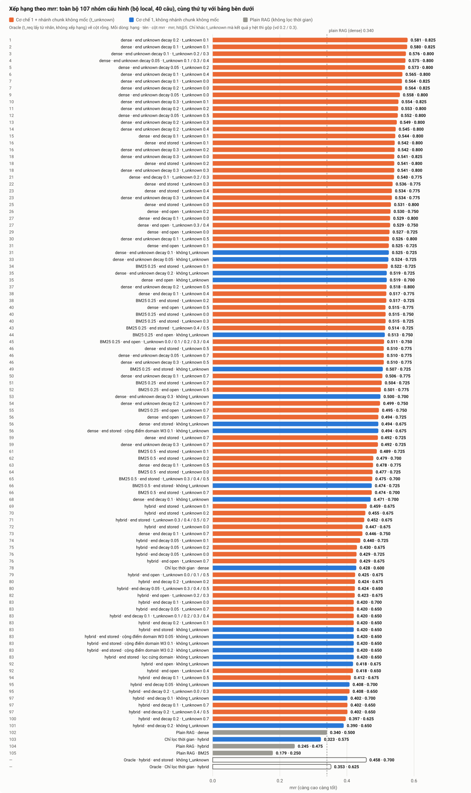
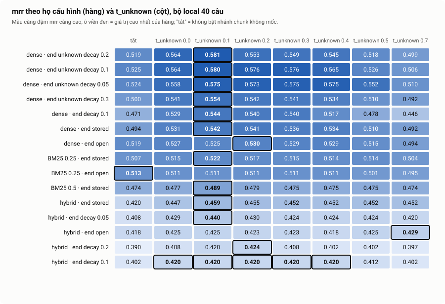
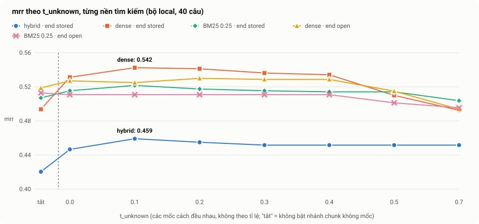

# Kết quả các đợt test (bộ local)

Kế hoạch và lệnh chạy: [`03_TEST_ROUNDS.md`](03_TEST_ROUNDS.md). Mọi số dưới đây từ **một lần ingestion** và **một lần Profiler**, 40 câu mức `hard`, ngày chạy 2026-10-19.

| Thứ | Giá trị |
|---|---|
| LLM | combo 9router `basic-gemini-3.5-flash-lite` (combo `basic-gemini-3.1-flash-lite` bị Gemini trả 503 "high demand" nên đổi) |
| Ingestion | `output/20261019_222626/`, `ingest.py --recreate --keep-undated`: 37 trang, 1275 chunk, nạp 1259 (**309 chunk không mốc**), bỏ 14 `no_time` và 2 `invalid_time`, 0 lỗi LLM. 61 lần gọi LLM |
| Profiler | `output/20261019_222137/profiler.jsonl`, 40/40 câu thành công |
| Qdrant | collection `tam_chunks_dev`, 1259 điểm |

**Không so được với [`02`](02_RETRIEVAL_LOCAL.md):** kho khác (1259 chunk so với 954 vì giờ giữ chunk không mốc), model khác (Gemini 3.5 so với `basic-llm`), và 40 câu đều có chunk đáp án trong kho (trước là 37). Số ở đây chỉ so với nhau.

**Sai số:** 40 câu; một câu đổi chiều là 2.5 điểm phần trăm, sai số khoảng ±15 điểm. Chênh dưới khoảng 2 câu thì ghi "chưa kết luận".

## Quy ước tên các phương pháp

Mọi thứ đo ở đây đều là **truy xuất thông tin (information retrieval)**: cho một câu hỏi, tìm 5 chunk liên quan nhất trong kho. Các cấu hình khác nhau ở chỗ có dùng yếu tố thời gian hay không, và dùng thế nào. Có ba loại:

| Loại | Tên trong bảng | Dùng thời gian? | Là gì |
|---|---|---|---|
| Baseline | `Plain RAG · dense` / `BM25` / `hybrid` | Không | Truy xuất thông thường theo nội dung (vector, từ khóa, hoặc gộp cả hai), không lọc thời gian. Mốc so sánh |
| Cắt bớt Cơ chế 1 | `Chỉ lọc thời gian (bỏ điểm thời gian) · tìm kiếm ...` | Một phần | Có lọc cứng (bỏ chunk bắt đầu sau `t_req`) nhưng không có điểm thời gian. Để tách đóng góp của điểm thời gian |
| **Cơ chế 1** | `Cơ chế 1 · tìm kiếm ... · end ... · chunk không mốc ...` | Đầy đủ | **Phương pháp truy xuất có yếu tố thời gian của đồ án** (Temporal Retrieval, cơ chế 1 trong [`scope`](../scope/01_PROJECT_SCOPE.md)), cho câu hỏi "tại thời điểm T thì sao". Chỉ dùng kho vector (không đồ thị); lúc truy vấn cần Profiler (LLM) để trích `t_req` từ câu hỏi (chế độ oracle bỏ qua Profiler) |

Cơ chế 1 làm ba bước: (1) **tìm ứng viên**; (2) **lọc cứng**: bỏ chunk có `start_time` sau `t_req` (không rò rỉ tương lai) và chunk `invalidated_at` (thông tin sai từ đầu); (3) **chấm lại** `Final = W1·Semantic + W2·Temporal` (W1 = 0.7, W2 = 0.3), với `Temporal` = 1.0 nếu `t_req` nằm trong `[start, end]` của chunk, nếu chunk đã hết hiệu lực thì giảm dần theo số năm.

Cơ chế 1 có **ba lựa chọn độc lập**, mỗi cấu hình trong bảng là một tổ hợp:

| Lựa chọn (cột trong tên) | Giá trị | Quyết định gì |
|---|---|---|
| **tìm kiếm** | `dense` (vector ngữ nghĩa); `hybrid` (dense + BM25 trọng số bằng nhau, RRF); `BM25 0.25`, `BM25 0.5` (BM25 trọng số 0.25 hoặc 0.5 trong RRF) | Cách tìm ứng viên ở bước 1 |
| **end** | `stored` (theo `end_time` đã lưu, mặc định); `open` (chunk `ongoing`/`unknown` coi còn hiệu lực mãi); `decay d` (điểm giảm dần `exp(-d·số năm từ start đến t_req)`) | Điểm thời gian của chunk **có `start` nhưng không rõ khi nào kết thúc** (`end_status` = `ongoing` hoặc `unknown`) |
| **chunk không mốc** | `tắt`; hoặc `t_unknown X` (X = 0.0 đến 0.7) | Chunk **không có `start`** có được tìm ra không (nhánh thứ ba) và điểm thời gian cố định của nó là X |

Hai chữ "unknown" khác nhau: `end_status = unknown` là *không biết khi nào kết thúc* (lựa chọn **end**); `t_unknown` là *chunk không có mốc bắt đầu* (lựa chọn **chunk không mốc**). Thêm tùy chọn: `lấy thêm N chunk liền kề` (đợt 3b), `lọc cứng domain` / `cộng điểm domain W3 X` (đợt 5).

Cách gọi cũ trong các bản nháp: "bản đầu" = `Cơ chế 1 · tìm kiếm hybrid · end stored · chunk không mốc tắt`; "bản dense" = `Cơ chế 1 · tìm kiếm dense · end stored · chunk không mốc tắt`. Dòng `Oracle (t_req từ nhãn)` dùng cùng cấu hình nhưng `t_req` lấy từ nhãn (mức trần của bước trích thời gian), không xếp hạng.

## Bảng xếp hạng (theo `mrr`, càng cao càng tốt)

Tất cả chạy ở chế độ **e2e** (Profiler trích `t_req`), trừ dòng tham chiếu. Chênh dưới khoảng 0.05 `mrr` là chưa phân biệt được. **Lưu ý chọn lọc:** bảng đầy đủ gồm 110 cấu hình (108 chạy e2e, 2 oracle) thử trên cùng 40 câu; các cấu hình đứng đầu đã được chọn sau khi xem kết quả, nên `mrr` của chúng có thể cao hơn thực tế. Phải xác nhận lại trên bộ thật.

Cách đọc: **mỗi dòng là một nhóm cấu hình, đúng 78 dòng và đúng số hạng như bảng đầy đủ bên dưới** (số ở lề trái là hạng). Cột dài hơn = `mrr` cao hơn; nhãn bên phải là `mrr · hit@5`. Tên viết gọn: `nền tìm kiếm · end ... · t_unknown X` (hoặc `không t_unknown`); các dòng chỉ khác `t_unknown` mà kết quả y hệt đã gộp (vd `t_unknown 0.2 / 0.3`). Màu: cam = có nhánh chunk không mốc, xanh = không có, xám = plain RAG (không lọc thời gian, rò rỉ tương lai); cột rỗng = Oracle (tham chiếu, không xếp hạng). Đường nét đứt = plain RAG tốt nhất (dense, 0.340). Muốn so nhanh các giá trị `t_unknown` của từng họ thì xem bảng màu ở mục "Đợt 4b".

### Bảng đầy đủ: mọi cấu hình đã đo

Tên theo quy ước ở mục trên. **Các dòng chỉ khác `t_unknown` mà kết quả y hệt đã gộp** (vd `t_unknown 0.2 / 0.3`; nhiều thư mục cách nhau bằng dấu phẩy). Hạng bằng nhau khi `mrr` bằng nhau ở 3 chữ số. Dòng `Oracle` chỉ để tham chiếu. Các cấu hình có chunk liền kề xếp hạng y hệt cấu hình gốc, nên nằm ở bảng riêng ngay sau. Thư mục là `output/20261019_<...>`.

| Hạng | Cấu hình | `hit@1` | `hit@3` | `hit@5` | `mrr` | `ctx_hit` | `leakage_rate` | Thư mục |
|---|---|---|---|---|---|---|---|---|
| 1 | Cơ chế 1 · tìm kiếm dense · end decay 0.1 · chunk không mốc t_unknown 0.1 | 0.375 | 0.725 | 0.800 | **0.544** | 0.800 | 0.000 | 20261019_234218 |
| 2 | Cơ chế 1 · tìm kiếm dense · end stored · chunk không mốc t_unknown 0.1 | 0.375 | 0.725 | 0.800 | **0.542** | 0.800 | 0.000 | 20261019_233041 |
| 3 | Cơ chế 1 · tìm kiếm dense · end stored · chunk không mốc t_unknown 0.2 | 0.375 | 0.725 | 0.800 | **0.541** | 0.800 | 0.000 | 20261019_233042_2 |
| 4 | Cơ chế 1 · tìm kiếm dense · end decay 0.1 · chunk không mốc t_unknown 0.2 / 0.3 | 0.375 | 0.725 | 0.775 | **0.540** | 0.775 | 0.000 | 20261019_234218_2, 20261019_234219_2 |
| 5 | Cơ chế 1 · tìm kiếm dense · end stored · chunk không mốc t_unknown 0.3 | 0.375 | 0.725 | 0.775 | **0.536** | 0.775 | 0.000 | 20261019_231607_2 |
| 6 | Cơ chế 1 · tìm kiếm dense · end stored · chunk không mốc t_unknown 0.4 | 0.375 | 0.700 | 0.775 | **0.534** | 0.775 | 0.000 | 20261019_233042_3 |
| 7 | Cơ chế 1 · tìm kiếm dense · end stored · chunk không mốc t_unknown 0.0 | 0.350 | 0.725 | 0.800 | **0.531** | 0.800 | 0.000 | 20261019_233036_4 |
| 8 | Cơ chế 1 · tìm kiếm dense · end open · chunk không mốc t_unknown 0.2 | 0.400 | 0.625 | 0.750 | **0.530** | 0.750 | 0.000 | 20261019_233057_4 |
| 9 | Cơ chế 1 · tìm kiếm dense · end decay 0.1 · chunk không mốc t_unknown 0.0 | 0.350 | 0.725 | 0.800 | **0.529** | 0.800 | 0.000 | 20261019_234214_4 |
| 9 | Cơ chế 1 · tìm kiếm dense · end open · chunk không mốc t_unknown 0.3 / 0.4 | 0.400 | 0.625 | 0.750 | **0.529** | 0.750 | 0.000 | 20261019_231625_3, 20261019_233102_2 |
| 11 | Cơ chế 1 · tìm kiếm dense · end open · chunk không mốc t_unknown 0.0 | 0.400 | 0.650 | 0.725 | **0.527** | 0.725 | 0.000 | 20261019_233057_3 |
| 12 | Cơ chế 1 · tìm kiếm dense · end open · chunk không mốc t_unknown 0.1 | 0.400 | 0.625 | 0.725 | **0.525** | 0.725 | 0.000 | 20261019_233057_2 |
| 13 | Cơ chế 1 · tìm kiếm BM25 0.25 · end stored · chunk không mốc t_unknown 0.1 | 0.375 | 0.650 | 0.725 | **0.522** | 0.725 | 0.000 | 20261019_233047_4 |
| 14 | Cơ chế 1 · tìm kiếm dense · end open · chunk không mốc tắt | 0.400 | 0.625 | 0.700 | **0.519** | 0.700 | 0.000 | 20261019_231608_2 |
| 15 | Cơ chế 1 · tìm kiếm dense · end decay 0.1 · chunk không mốc t_unknown 0.4 | 0.325 | 0.750 | 0.775 | **0.517** | 0.775 | 0.000 | 20261019_234219 |
| 15 | Cơ chế 1 · tìm kiếm BM25 0.25 · end stored · chunk không mốc t_unknown 0.2 | 0.375 | 0.650 | 0.725 | **0.517** | 0.725 | 0.000 | 20261019_233052 |
| 17 | Cơ chế 1 · tìm kiếm dense · end open · chunk không mốc t_unknown 0.5 | 0.375 | 0.600 | 0.775 | **0.515** | 0.775 | 0.000 | 20261019_233102_3 |
| 17 | Cơ chế 1 · tìm kiếm BM25 0.25 · end stored · chunk không mốc t_unknown 0.0 | 0.350 | 0.650 | 0.750 | **0.515** | 0.750 | 0.000 | 20261019_233047_3 |
| 17 | Cơ chế 1 · tìm kiếm BM25 0.25 · end stored · chunk không mốc t_unknown 0.3 | 0.375 | 0.625 | 0.725 | **0.515** | 0.725 | 0.000 | 20261019_231625 |
| 20 | Cơ chế 1 · tìm kiếm BM25 0.25 · end stored · chunk không mốc t_unknown 0.4 / 0.5 | 0.375 | 0.625 | 0.725 | **0.514** | 0.725 | 0.000 | 20261019_233052_4, 20261019_233052_3 |
| 21 | Cơ chế 1 · tìm kiếm BM25 0.25 · end open · chunk không mốc tắt | 0.375 | 0.600 | 0.750 | **0.513** | 0.750 | 0.000 | 20261019_233858 |
| 22 | Cơ chế 1 · tìm kiếm BM25 0.25 · end open · chunk không mốc t_unknown 0.0 / 0.1 / 0.2 / 0.3 / 0.4 | 0.375 | 0.575 | 0.750 | **0.511** | 0.750 | 0.000 | 20261019_231625_4, 20261019_233113_4, 20261019_233118, 20261019_233119_2, 20261019_233118_2 |
| 23 | Cơ chế 1 · tìm kiếm dense · end stored · chunk không mốc t_unknown 0.5 | 0.350 | 0.675 | 0.775 | **0.510** | 0.775 | 0.000 | 20261019_231625_2 |
| 24 | Cơ chế 1 · tìm kiếm BM25 0.25 · end stored · chunk không mốc tắt | 0.350 | 0.675 | 0.725 | **0.507** | 0.725 | 0.000 | 20261019_231603_3 |
| 25 | Cơ chế 1 · tìm kiếm BM25 0.25 · end stored · chunk không mốc t_unknown 0.7 | 0.375 | 0.600 | 0.725 | **0.504** | 0.725 | 0.000 | 20261019_233057 |
| 26 | Cơ chế 1 · tìm kiếm BM25 0.25 · end open · chunk không mốc t_unknown 0.5 | 0.350 | 0.550 | 0.775 | **0.501** | 0.775 | 0.000 | 20261019_233123 |
| 27 | Cơ chế 1 · tìm kiếm BM25 0.25 · end open · chunk không mốc t_unknown 0.7 | 0.350 | 0.575 | 0.750 | **0.495** | 0.750 | 0.000 | 20261019_233124 |
| 28 | Cơ chế 1 · tìm kiếm dense · end open · chunk không mốc t_unknown 0.7 | 0.350 | 0.600 | 0.725 | **0.494** | 0.725 | 0.000 | 20261019_233102_4 |
| 28 | Cơ chế 1 · tìm kiếm dense · end stored · chunk không mốc tắt | 0.350 | 0.650 | 0.675 | **0.494** | 0.675 | 0.000 | 20261019_231603 |
| 28 | Cơ chế 1 · tìm kiếm dense · end stored · cộng điểm domain W3 0.1 · chunk không mốc tắt | 0.350 | 0.650 | 0.675 | **0.494** | 0.675 | 0.000 | 20261019_231611 |
| 31 | Cơ chế 1 · tìm kiếm dense · end stored · chunk không mốc t_unknown 0.7 | 0.350 | 0.650 | 0.725 | **0.492** | 0.725 | 0.000 | 20261019_231630 |
| 32 | Cơ chế 1 · tìm kiếm BM25 0.5 · end stored · chunk không mốc t_unknown 0.1 | 0.350 | 0.575 | 0.725 | **0.489** | 0.725 | 0.000 | 20261019_234208_2 |
| 33 | Cơ chế 1 · tìm kiếm BM25 0.5 · end stored · chunk không mốc t_unknown 0.2 | 0.350 | 0.575 | 0.700 | **0.479** | 0.700 | 0.000 | 20261019_234208_4 |
| 34 | Cơ chế 1 · tìm kiếm dense · end decay 0.1 · chunk không mốc t_unknown 0.5 | 0.275 | 0.725 | 0.775 | **0.478** | 0.775 | 0.000 | 20261019_234224 |
| 35 | Cơ chế 1 · tìm kiếm BM25 0.5 · end stored · chunk không mốc t_unknown 0.0 | 0.325 | 0.575 | 0.725 | **0.477** | 0.725 | 0.000 | 20261019_234208 |
| 36 | Cơ chế 1 · tìm kiếm BM25 0.5 · end stored · chunk không mốc t_unknown 0.3 / 0.4 / 0.5 | 0.350 | 0.550 | 0.700 | **0.475** | 0.700 | 0.000 | 20261019_234208_3, 20261019_234214, 20261019_234214_2 |
| 37 | Cơ chế 1 · tìm kiếm BM25 0.5 · end stored · chunk không mốc tắt | 0.325 | 0.575 | 0.725 | **0.474** | 0.725 | 0.000 | 20261019_231603_2 |
| 37 | Cơ chế 1 · tìm kiếm BM25 0.5 · end stored · chunk không mốc t_unknown 0.7 | 0.350 | 0.550 | 0.700 | **0.474** | 0.700 | 0.000 | 20261019_234214_3 |
| 39 | Cơ chế 1 · tìm kiếm dense · end decay 0.1 · chunk không mốc tắt | 0.300 | 0.650 | 0.700 | **0.471** | 0.700 | 0.000 | 20261019_231612 |
| 40 | Cơ chế 1 · tìm kiếm hybrid · end stored · chunk không mốc t_unknown 0.1 | 0.325 | 0.550 | 0.675 | **0.459** | 0.675 | 0.000 | 20261019_233031 |
| 41 | Cơ chế 1 · tìm kiếm hybrid · end stored · chunk không mốc t_unknown 0.2 | 0.325 | 0.550 | 0.675 | **0.455** | 0.675 | 0.000 | 20261019_233031_2 |
| 42 | Cơ chế 1 · tìm kiếm hybrid · end stored · chunk không mốc t_unknown 0.3 / 0.4 / 0.5 / 0.7 | 0.325 | 0.525 | 0.675 | **0.452** | 0.675 | 0.000 | 20261019_224241, 20261019_224241_4, 20261019_224245_2, 20261019_233036 |
| 43 | Cơ chế 1 · tìm kiếm hybrid · end stored · chunk không mốc t_unknown 0.0 | 0.300 | 0.550 | 0.675 | **0.447** | 0.675 | 0.000 | 20261019_233031_4 |
| 44 | Cơ chế 1 · tìm kiếm dense · end decay 0.1 · chunk không mốc t_unknown 0.7 | 0.275 | 0.650 | 0.750 | **0.446** | 0.750 | 0.000 | 20261019_234224_2 |
| 45 | Cơ chế 1 · tìm kiếm hybrid · end decay 0.05 · chunk không mốc t_unknown 0.1 | 0.275 | 0.550 | 0.725 | **0.440** | 0.725 | 0.000 | 20261019_234234_3 |
| 46 | Cơ chế 1 · tìm kiếm hybrid · end decay 0.05 · chunk không mốc t_unknown 0.2 | 0.275 | 0.550 | 0.675 | **0.430** | 0.675 | 0.000 | 20261019_234234_4 |
| 47 | Cơ chế 1 · tìm kiếm hybrid · end decay 0.05 · chunk không mốc t_unknown 0.0 | 0.250 | 0.550 | 0.725 | **0.429** | 0.725 | 0.000 | 20261019_234234_2 |
| 47 | Cơ chế 1 · tìm kiếm hybrid · end open · chunk không mốc t_unknown 0.7 | 0.275 | 0.550 | 0.675 | **0.429** | 0.675 | 0.000 | 20261019_234234 |
| 49 | Chỉ lọc thời gian (bỏ điểm thời gian) · tìm kiếm dense | 0.300 | 0.550 | 0.600 | **0.428** | 0.600 | 0.000 | 20261019_231603_4 |
| 50 | Cơ chế 1 · tìm kiếm hybrid · end open · chunk không mốc t_unknown 0.0 / 0.1 / 0.5 | 0.275 | 0.550 | 0.675 | **0.425** | 0.675 | 0.000 | 20261019_234224_3, 20261019_234224_4, 20261019_234229_4 |
| 51 | Cơ chế 1 · tìm kiếm hybrid · end decay 0.2 · chunk không mốc t_unknown 0.2 | 0.275 | 0.525 | 0.675 | **0.424** | 0.675 | 0.000 | 20261019_234255_2 |
| 51 | Cơ chế 1 · tìm kiếm hybrid · end decay 0.05 · chunk không mốc t_unknown 0.3 / 0.4 / 0.5 | 0.275 | 0.550 | 0.650 | **0.424** | 0.650 | 0.000 | 20261019_234239, 20261019_234239_2, 20261019_234239_3 |
| 53 | Cơ chế 1 · tìm kiếm hybrid · end open · chunk không mốc t_unknown 0.2 / 0.3 | 0.275 | 0.550 | 0.675 | **0.423** | 0.675 | 0.000 | 20261019_234229, 20261019_234229_2 |
| 54 | Cơ chế 1 · tìm kiếm hybrid · end decay 0.1 · chunk không mốc t_unknown 0.0 | 0.250 | 0.525 | 0.700 | **0.420** | 0.700 | 0.000 | 20261019_234244 |
| 54 | Cơ chế 1 · tìm kiếm hybrid · end decay 0.05 · chunk không mốc t_unknown 0.7 | 0.275 | 0.525 | 0.650 | **0.420** | 0.650 | 0.000 | 20261019_234240 |
| 54 | Cơ chế 1 · tìm kiếm hybrid · end decay 0.1 · chunk không mốc t_unknown 0.1 / 0.2 / 0.3 / 0.4 | 0.275 | 0.525 | 0.650 | **0.420** | 0.650 | 0.000 | 20261019_234245, 20261019_234245_2, 20261019_234245_3, 20261019_234250 |
| 54 | Cơ chế 1 · tìm kiếm hybrid · end decay 0.2 · chunk không mốc t_unknown 0.1 | 0.275 | 0.525 | 0.650 | **0.420** | 0.650 | 0.000 | 20261019_234255 |
| 54 | Cơ chế 1 · tìm kiếm hybrid · end stored · chunk không mốc tắt | 0.275 | 0.525 | 0.650 | **0.420** | 0.650 | 0.000 | 20261019_224156 |
| 54 | Cơ chế 1 · tìm kiếm hybrid · end stored · cộng điểm domain W3 0.05 · chunk không mốc tắt | 0.275 | 0.525 | 0.650 | **0.420** | 0.650 | 0.000 | 20261019_224245 |
| 54 | Cơ chế 1 · tìm kiếm hybrid · end stored · cộng điểm domain W3 0.1 · chunk không mốc tắt | 0.275 | 0.525 | 0.650 | **0.420** | 0.650 | 0.000 | 20261019_224246 |
| 54 | Cơ chế 1 · tìm kiếm hybrid · end stored · cộng điểm domain W3 0.2 · chunk không mốc tắt | 0.275 | 0.525 | 0.650 | **0.420** | 0.650 | 0.000 | 20261019_224247 |
| 54 | Cơ chế 1 · tìm kiếm hybrid · end stored · lọc cứng domain · chunk không mốc tắt | 0.275 | 0.525 | 0.650 | **0.420** | 0.650 | 0.000 | 20261019_224200 |
| 63 | Cơ chế 1 · tìm kiếm hybrid · end open · chunk không mốc tắt | 0.250 | 0.575 | 0.675 | **0.418** | 0.675 | 0.000 | 20261019_224227_4 |
| 63 | Cơ chế 1 · tìm kiếm hybrid · end open · chunk không mốc t_unknown 0.4 | 0.275 | 0.550 | 0.650 | **0.418** | 0.650 | 0.000 | 20261019_234229_3 |
| 65 | Cơ chế 1 · tìm kiếm hybrid · end decay 0.1 · chunk không mốc t_unknown 0.5 | 0.250 | 0.525 | 0.675 | **0.412** | 0.675 | 0.000 | 20261019_234250_2 |
| 66 | Cơ chế 1 · tìm kiếm hybrid · end decay 0.05 · chunk không mốc tắt | 0.225 | 0.525 | 0.700 | **0.408** | 0.700 | 0.000 | 20261019_224227_3 |
| 66 | Cơ chế 1 · tìm kiếm hybrid · end decay 0.2 · chunk không mốc t_unknown 0.0 / 0.3 | 0.250 | 0.525 | 0.650 | **0.408** | 0.650 | 0.000 | 20261019_234250_3, 20261019_234255_3 |
| 68 | Cơ chế 1 · tìm kiếm hybrid · end decay 0.1 · chunk không mốc tắt | 0.225 | 0.500 | 0.700 | **0.402** | 0.700 | 0.000 | 20261019_224227_2 |
| 68 | Cơ chế 1 · tìm kiếm hybrid · end decay 0.1 · chunk không mốc t_unknown 0.7 | 0.250 | 0.500 | 0.650 | **0.402** | 0.650 | 0.000 | 20261019_234250_4 |
| 68 | Cơ chế 1 · tìm kiếm hybrid · end decay 0.2 · chunk không mốc t_unknown 0.4 / 0.5 | 0.250 | 0.500 | 0.650 | **0.402** | 0.650 | 0.000 | 20261019_234256, 20261019_234301 |
| 71 | Cơ chế 1 · tìm kiếm hybrid · end decay 0.2 · chunk không mốc t_unknown 0.7 | 0.250 | 0.500 | 0.625 | **0.397** | 0.625 | 0.000 | 20261019_234301_2 |
| 72 | Cơ chế 1 · tìm kiếm hybrid · end decay 0.2 · chunk không mốc tắt | 0.225 | 0.500 | 0.650 | **0.390** | 0.650 | 0.000 | 20261019_224227 |
| 73 | Plain RAG · dense | 0.225 | 0.450 | 0.500 | **0.340** | 0.500 | 0.675 | 20261019_224200_2 |
| 74 | Chỉ lọc thời gian (bỏ điểm thời gian) · tìm kiếm hybrid | 0.175 | 0.425 | 0.575 | **0.323** | 0.575 | 0.000 | 20261019_224156_3 |
| 75 | Plain RAG · hybrid | 0.100 | 0.375 | 0.475 | **0.245** | 0.475 | 0.725 | 20261019_224200_4 |
| 76 | Plain RAG · BM25 | 0.125 | 0.250 | 0.250 | **0.179** | 0.250 | 0.725 | 20261019_224200_3 |
| — | Oracle (t_req từ nhãn) · Cơ chế 1 · tìm kiếm hybrid · end stored · chunk không mốc tắt | 0.300 | 0.575 | 0.700 | **0.458** | 0.700 | 0.000 | 20261019_224156_2 |
| — | Oracle (t_req từ nhãn) · Chỉ lọc thời gian (bỏ điểm thời gian) · tìm kiếm hybrid | 0.200 | 0.450 | 0.625 | **0.353** | 0.625 | 0.000 | 20261019_224156_4 |

### Cấu hình có chunk liền kề

Giống cấu hình gốc về `hit@k` và `mrr`; khác ở `ctx_hit` (tỉ lệ câu có chunk đáp án trong ngữ cảnh gồm 5 chunk và chunk liền kề).

| Cấu hình | `hit@5` | `ctx_hit` | `mrr` | Thư mục |
|---|---|---|---|---|
| Cơ chế 1 · tìm kiếm dense · end stored · lấy thêm 1 chunk liền kề · chunk không mốc t_unknown 0.0 | 0.800 | **0.850** | 0.531 | 20261019_233107 |
| Cơ chế 1 · tìm kiếm dense · end stored · lấy thêm 1 chunk liền kề · chunk không mốc t_unknown 0.1 | 0.800 | **0.850** | 0.542 | 20261019_233107_2 |
| Cơ chế 1 · tìm kiếm dense · end stored · lấy thêm 1 chunk liền kề · chunk không mốc t_unknown 0.2 | 0.800 | **0.850** | 0.541 | 20261019_233107_3 |
| Cơ chế 1 · tìm kiếm dense · end stored · lấy thêm 1 chunk liền kề · chunk không mốc t_unknown 0.3 | 0.775 | **0.825** | 0.536 | 20261019_231608 |
| Cơ chế 1 · tìm kiếm dense · end stored · lấy thêm 1 chunk liền kề · chunk không mốc t_unknown 0.4 | 0.775 | **0.825** | 0.534 | 20261019_233113 |
| Cơ chế 1 · tìm kiếm dense · end stored · lấy thêm 1 chunk liền kề · chunk không mốc t_unknown 0.5 | 0.775 | **0.825** | 0.510 | 20261019_233113_2 |
| Cơ chế 1 · tìm kiếm dense · end stored · lấy thêm 1 chunk liền kề · chunk không mốc t_unknown 0.7 | 0.725 | **0.775** | 0.492 | 20261019_233113_3 |
| Cơ chế 1 · tìm kiếm dense · end stored · lấy thêm 1 chunk liền kề · chunk không mốc tắt | 0.675 | **0.750** | 0.494 | 20261019_231607 |
| Cơ chế 1 · tìm kiếm hybrid · end stored · lấy thêm 1 chunk liền kề · chunk không mốc tắt | 0.650 | **0.725** | 0.420 | 20261019_224241_3 |
| Cơ chế 1 · tìm kiếm hybrid · end stored · lấy thêm 2 chunk liền kề · chunk không mốc tắt | 0.650 | **0.725** | 0.420 | 20261019_224241_2 |

Dữ liệu thô: [`results_local.csv`](results_local.csv) (sinh bằng `scripts/summarize_runs.py`); biểu đồ sinh bằng `scripts/plot_results.py`.

**Đọc nhanh:**
- Cơ chế 1 (tìm kiếm dense) hơn plain RAG (dense thuần): `mrr` 0.494 so 0.340. So từng câu: **15 câu lên, 3 câu xuống**, và không rò rỉ. Đây là kết quả mạnh nhất về Cơ chế 1.
- Bỏ BM25 là thay đổi có tác dụng lớn: tìm kiếm hybrid 0.420 → tìm kiếm dense 0.494 (10 câu lên, 4 xuống).
- Điểm thời gian vẫn đóng góp trên tìm kiếm dense: 0.428 (chỉ lọc) → 0.494 (+ điểm thời gian).
- **Nhánh chunk không mốc** nâng tìm kiếm dense lên 0.531 đến 0.542 (`t_unknown` 0.0 đến 0.4). Lợi ích chủ yếu đến từ việc **có nhánh này** (mở rộng ứng viên), không phải từ điểm cố định: `t_unknown` = 0.0 đã cho 5 câu lên, 0 xuống so với tắt. Xem đợt 4b.
- Các biến thể nhỏ (cách chấm `end`, domain, chunk liền kề) chưa phân biệt được trên 40 câu. Ví dụ cấu hình đứng đầu bảng đầy đủ (`dense`, `end: decay 0.1`, `t_unknown` 0.1, `mrr` 0.544) chỉ hơn dense + `t_unknown` 0.1 (0.542) 0.002, tức hòa; chọn cách đơn giản hơn (`end: stored`).
- **Còn sai 8 đến 9/40 câu, chủ yếu do ingestion**: xem mục "Phân tích câu sai".

## Cách đọc các cột (dùng chung cho mọi đợt)

Mỗi câu hỏi có một hoặc vài **chunk đáp án** (gold). Hệ trả về 5 chunk xếp hạng (top 5).

| Cột | Nghĩa | Ví dụ |
|---|---|---|
| `hit@k` | Tỉ lệ câu có chunk đáp án nằm trong top k | `hit@5` = 0.650: 26/40 câu có chunk đáp án trong 5 chunk đầu |
| `mrr` | Trung bình của 1 chia cho hạng của chunk đáp án đầu tiên (hạng 1 được 1.0, hạng 2 được 0.5, hạng 5 được 0.2, không có trong top 5 được 0). Thưởng nhiều hơn khi đáp án nằm cao | Đáp án ở hạng 1 trong mọi câu thì `mrr` = 1 |
| `recall@k` | Với câu có nhiều chunk đáp án: tỉ lệ chunk đáp án tìm được trong top k | Câu có 2 đáp án, tìm được 1: recall = 0.5 |
| `leakage_rate` | Tỉ lệ câu có ít nhất một chunk top 5 có `start_time` **sau** thời điểm hỏi `t_req` (hệ "nhìn thấy tương lai") | Hỏi về năm 1968 mà kết quả có đoạn nói sự việc năm 1990. Phải bằng 0 |
| `invalidated_rate` | Tỉ lệ câu có chunk bị đánh dấu `invalidated_at` (thông tin sai từ đầu: tin giả, đính chính). Phải bằng 0 | Bộ local ít khi có loại này nên 0 chưa chứng minh nhiều |
| `forbidden_rate` | Tỉ lệ câu có chunk nằm trong danh sách "tuyệt đối không được xuất hiện" của câu | Bộ local không dùng, luôn 0 |

**Hai chế độ chạy:**
- **e2e** (end to end): Profiler (LLM) đọc câu hỏi và tự trích thời điểm cần hỏi `t_req`. Đây là hệ thật.
- **oracle**: dùng luôn `t_req` lấy từ nhãn của dataset, bỏ qua Profiler. Cho biết trần nếu bước trích thời gian hoàn hảo. Chênh giữa oracle và e2e là phần mất do Profiler.

**Hai thứ cùng gọi "lọc cứng" (hay nhầm):**
- **Lọc cứng thời gian** (`start_time <= t_req`): luôn bật trong mọi cấu hình của Cơ chế 1, loại chunk bắt đầu sau thời điểm hỏi. Đây là thứ giúp `leakage_rate` bằng 0.
- **Lọc cứng domain** (`--facets domain`): chỉ giữ chunk có domain trùng domain Profiler trích từ câu hỏi. Chỉ dùng ở đợt 5 (và một dòng ở đợt 0).

## Đợt 0. Chạy thông

**Làm gì:** kiểm tra pipeline chạy hết từ đầu đến cuối và không rò rỉ tương lai. Chưa phải đợt để so phương pháp nào hơn.

**Cơ chế:** 5 cấu hình đầu tiên của dự án. Mỗi cấu hình khác nhau ở một chỗ:
- `oracle` và `e2e`: xem mục trên.
- `--no-temporal`: đặt `W1 = 1`, `W2 = 0`, tức **bỏ điểm thời gian**, chỉ xếp theo độ giống nội dung. Lọc cứng thời gian vẫn bật, nên vẫn không rò rỉ.
- `--facets domain`: thêm lọc cứng domain.

| Cấu hình | `hit@1` | `hit@3` | `hit@5` | `mrr` | `leakage_rate` | `invalidated_rate` | Thư mục |
|---|---|---|---|---|---|---|---|
| oracle | 0.300 | 0.575 | 0.700 | 0.458 | 0 | 0 | `224156_2` |
| oracle `--no-temporal` | 0.200 | 0.450 | 0.625 | 0.353 | 0 | 0 | `224156_4` |
| e2e | 0.275 | 0.525 | 0.650 | 0.420 | 0 | 0 | `224156` |
| e2e `--no-temporal` | 0.175 | 0.425 | 0.575 | 0.323 | 0 | 0 | `224156_3` |
| e2e `--facets domain` | 0.275 | 0.525 | 0.650 | 0.420 | 0 | 0 | `224200` |

(Thư mục là `output/20261019_22xxxx`; cột `hit@3` là tỉ lệ câu có đáp án trong 3 chunk đầu.)

**Kết luận:** pass. Rò rỉ và chunk vô hiệu bằng 0 ở mọi cấu hình. Oracle hơn e2e 0.038 `mrr` (khoảng 1.5 câu): phần mất do Profiler là nhỏ. `--no-temporal` kém hơn rõ (0.323 so 0.420), cho thấy điểm thời gian có tác dụng. Dòng cuối (lọc cứng domain) trùng với `e2e`: xem đợt 5.

## Đợt 1. Baseline (so với RAG thường)

**Làm gì:** trả lời "hệ có hơn plain RAG không, và nhờ thành phần nào". Chạy một chuỗi từ RAG đơn giản nhất, thêm dần từng thành phần của Cơ chế 1; hiệu giữa hai bậc liền nhau là đóng góp của thành phần vừa thêm.

**Cơ chế từng bậc** (tất cả lấy 5 chunk từ cùng kho Qdrant):
- a. **dense**: tìm theo vector ngữ nghĩa (embedding).
- b. **BM25**: tìm theo từ khóa.
- c. **hybrid**: gộp dense và BM25 bằng RRF (xếp hạng lại theo thứ hạng của hai danh sách), không lọc thời gian.
- d. **hybrid + lọc thời gian**: như c nhưng loại chunk có `start_time > t_req` và chunk bị vô hiệu.
- e. **+ điểm thời gian (Cơ chế 1)**: như d, rồi xếp lại bằng `Final = 0.7·Semantic + 0.3·Temporal`. `Temporal` = 1.0 nếu `t_req` nằm trong `[start, end]` của chunk (TH1); nếu chunk đã hết hiệu lực trước `t_req` thì `exp(-0.5·Δ)` với Δ là số năm từ `start` của chunk đến `t_req` (TH2), chunk càng xa thì điểm càng thấp.

Bậc a, b, c là baseline: không lọc thời gian nên `leakage_rate` > 0 là bình thường và là điều cần chỉ ra.

| Bậc | Cấu hình | `hit@1` | `hit@3` | `hit@5` | `mrr` | `leakage_rate` | Thư mục |
|---|---|---|---|---|---|---|---|
| a | dense | 0.225 | 0.450 | 0.500 | 0.340 | **0.675** | `224200_2` |
| b | BM25 | 0.125 | 0.250 | 0.250 | 0.179 | **0.725** | `224200_3` |
| c | hybrid (không lọc) | 0.100 | 0.375 | 0.475 | 0.245 | **0.725** | `224200_4` |
| d | hybrid + lọc thời gian | 0.175 | 0.425 | 0.575 | 0.323 | 0 | `224156_3` |
| e | + điểm thời gian (Cơ chế 1) | 0.275 | 0.525 | 0.650 | 0.420 | 0 | `224156` |

- **Lọc thời gian (c → d):** `mrr` 0.245 → 0.323, `leakage` 0.725 → 0. Đóng góp chính là loại rò rỉ: baseline không lọc có 67 đến 73% câu có chunk sau `t_req` trong top 5.
- **Điểm thời gian (d → e):** `mrr` 0.323 → 0.420, `hit@1` 0.175 → 0.275 (+4 câu). Đóng góp rõ nhất của Cơ chế 1.
- **So plain RAG:** e so với a (dense) hơn 0.080 `mrr` và 0.15 `hit@5` (+6 câu), và không rò rỉ. So với hybrid (c) hơn 0.175 `mrr`.
- **Bất ngờ:** dense (a) tốt hơn hybrid (c): BM25 yếu (`mrr` 0.179) nên kéo RRF xuống. Bậc d, e vẫn dùng hybrid. Đã thử ở đợt 1b: bỏ hoặc giảm BM25 nâng `mrr` đáng kể.

## Đợt 1b. Bỏ hoặc giảm BM25

**Làm gì:** đợt 1 cho thấy dense thuần (0.340) tốt hơn hybrid thuần (0.245): BM25 kéo xuống. Thử bỏ BM25 khỏi Cơ chế 1 hoặc giảm trọng số của nó.

**Cơ chế:** RRF (Reciprocal Rank Fusion) gộp hai danh sách xếp hạng (dense và BM25) bằng cách cộng `trọng số / (k + hạng)` của mỗi chunk trong từng danh sách, với `k = 60`. Trọng số mặc định là 1 cho cả hai nhánh. Cờ mới `--sparse-weight X` đặt trọng số nhánh BM25 (dense luôn 1):
- `X = 1`: RRF thường (hybrid).
- `X = 0.5`, `0.25`: BM25 đóng góp ít hơn.
- `X = 0`: bỏ hẳn BM25 (chunk chỉ BM25 tìm thấy cũng không còn), chỉ còn dense.

Lọc cứng thời gian và điểm thời gian vẫn như cũ. Nền: `stored`, `neighbors` 0, `t_unknown` tắt.

| Cấu hình | `hit@1` | `hit@3` | `hit@5` | `mrr` | `mrr_pre` | `temporal_helped / hurt` | Thư mục |
|---|---|---|---|---|---|---|---|
| `X = 1` (hybrid, đợt 1e) | 0.275 | 0.525 | 0.650 | 0.420 | 0.380 | 15 / 7 | `224156` |
| `X = 0.5` | 0.325 | 0.575 | 0.725 | 0.474 | 0.403 | 16 / 5 | `231603_2` |
| `X = 0.25` | 0.350 | 0.675 | 0.725 | 0.507 | 0.416 | 17 / 5 | `231603_3` |
| **`X = 0` (tìm kiếm dense)** | 0.350 | 0.650 | 0.675 | **0.494** | 0.461 | 15 / 6 | `231603` |
| `X = 0`, bỏ điểm thời gian (`--no-temporal`) | 0.300 | 0.550 | 0.600 | 0.428 | 0.461 | 0 / 0 | `231603_4` |

(`mrr_pre`: `mrr` chỉ theo điểm ngữ nghĩa trước điểm thời gian; xem đợt 2.)

**Kết luận:** hybrid với BM25 trọng số bằng nhau (hybrid) kém hơn mọi cách giảm BM25. `X = 0` và `X = 0.25` gần ngang nhau (0.494 so với 0.507, dưới 1 câu), nên **chưa kết luận giữa bỏ hẳn và giảm xuống 0.25**; cả hai tốt hơn tìm kiếm hybrid rõ (tìm kiếm dense: 10 câu lên, 4 xuống). Dense thuần (không lọc) có `mrr_pre` 0.393 còn tìm kiếm dense sau lọc 0.461, cho thấy lọc thời gian tự nó đã giúp. Điểm thời gian vẫn thêm 0.066 `mrr` trên tìm kiếm dense (0.428 → 0.494). Chọn `X = 0` làm nền các thí nghiệm tiếp theo vì đơn giản nhất (không cần BM25, bớt một chỉ mục).

**Giả thuyết giải thích** (chưa kiểm): trong một trang, nhiều chunk cùng nhắc tên nhân vật nên từ khóa BM25 không phân biệt được chunk đúng giai đoạn; dense bắt được ngữ cảnh tốt hơn.

## Đợt 1c. Kết hợp các thành phần trên nền dense

**Làm gì:** các đợt 3 đến 5 chạy trên nền hybrid. Chạy lại các thành phần chính trên nền tìm kiếm dense (`--sparse-weight 0`) xem kết quả có giữ nguyên không, và tổ hợp chúng.

| Cấu hình (thêm vào tìm kiếm dense) | `hit@1` | `hit@3` | `hit@5` | `mrr` | Ghi chú | Thư mục |
|---|---|---|---|---|---|---|
| (tìm kiếm dense) | 0.350 | 0.650 | 0.675 | 0.494 | | `231603` |
| `--end-mode open` | 0.400 | 0.625 | 0.700 | 0.519 | 3 câu lên, 5 xuống: hòa | `231608_2` |
| `--end-mode decay --open-decay 0.1` | 0.300 | 0.650 | 0.700 | 0.471 | | `231612` |
| `--facets boost --w3 0.1` | 0.350 | 0.650 | 0.675 | 0.494 | Giống hệt tìm kiếm dense (như đợt 5) | `231611` |
| `--neighbors 1` | 0.350 | 0.650 | 0.675 | 0.494 | `ctx_hit` 0.750, cứu 3 câu, ngữ cảnh 8.25 chunk | `231607` |
| `--t-unknown 0.3` | 0.375 | 0.725 | 0.775 | **0.536** | 4 câu lên, 1 xuống | `231607_2` |
| `--t-unknown 0.5` | 0.350 | 0.675 | 0.775 | 0.510 | | `231625_2` |
| `--t-unknown 0.7` | 0.350 | 0.650 | 0.725 | 0.492 | | `231630` |
| `--t-unknown 0.3 --neighbors 1` | 0.375 | 0.725 | 0.775 | 0.536 | `ctx_hit` **0.825**, cứu 2 câu, ngữ cảnh 8.1 chunk | `231608` |
| `--t-unknown 0.3 --end-mode open` | 0.400 | 0.625 | 0.750 | 0.529 | | `231625_3` |
| BM25 trọng số 0.25 + `--t-unknown 0.3` | 0.375 | 0.625 | 0.725 | 0.515 | | `231625` |
| BM25 trọng số 0.25 + `--t-unknown 0.3 --end-mode open` | 0.375 | 0.575 | 0.750 | 0.511 | | `231625_4` |

**Kết luận:**
- **Nhánh chunk không mốc có tác dụng trên tìm kiếm dense** (`t_unknown` 0.3: 0.494 → 0.536; các câu lên hạng: `Pskov`, `Ghaziabad`, `Lisa_Marie_Presley`, `Central_European_University`) và giá trị thấp hơn tốt hơn (0.3 > 0.5 > 0.7), khác với đo trên tìm kiếm hybrid (cả ba giá trị giống hệt). So từng câu chỉ 4 lên, 1 xuống nên vẫn **chưa chắc chắn**, nhưng chiều hướng nhất quán hơn.
- Chunk liền kề: `ctx_hit` tăng từ 0.775 lên 0.825 khi đã bật `t_unknown` (cứu thêm 2 câu).
- `open` cho `hit@1` cao nhất (0.400) nhưng `mrr` không hơn: không có lợi rõ.
- Domain: không phân biệt được (như đợt 5).
- **Dãy `t_unknown` đầy đủ** (0.0 đến 0.7, nhiều nền): xem đợt 4b; đỉnh ở 0.1 đến 0.2.
- **Cấu hình tốt nhất tại thời điểm đo đợt 1c:** tìm kiếm dense + `t_unknown` 0.3 (+ `neighbors` 1 để lấy ngữ cảnh), `end_mode: stored`; sau khi quét đủ dãy ở đợt 4b, đỉnh ở `t_unknown` 0.1 đến 0.2. Cảnh báo đã nêu ở bảng xếp hạng: chọn sau khi xem nhiều cấu hình trên 40 câu nên cần xác nhận trên bộ thật.

## Đợt 2. Chẩn đoán từng bước

**Làm gì:** không chạy cấu hình mới. Đọc các số đo từng bước trong `metrics.json` của bậc e để biết **lỗi nằm ở bước nào**: Profiler, tìm ứng viên, lọc cứng hay chấm điểm.

**Cơ chế:** một câu hỏi đi qua 4 bước; mỗi bước có thể làm mất chunk đáp án:

1. **Profiler** trích `t_req`, `domain` từ câu hỏi.
2. **Tìm ứng viên**: dense và BM25 mỗi bên lấy 50 chunk (`top_n`), gộp bằng RRF.
3. **Lọc cứng thời gian**: loại chunk `start_time > t_req`.
4. **Chấm điểm**: `Final = 0.7·Semantic + 0.3·Temporal`, lấy top 5.

| Bước | Cột | Nghĩa | Giá trị |
|---|---|---|---|
| 1. Profiler | `t_req_in_label_range` | `t_req` Profiler trích có nằm trong khoảng thời gian nhãn của câu hỏi không | 38/40 |
| | `t_req_abs_error_years_mean` | Sai số trung bình (năm) giữa `t_req` và giữa khoảng nhãn | 3.66 |
| | `domain_given` / `domain_in_gold_chunk` | Số câu Profiler điền domain / số câu domain đó trùng domain của chunk đáp án | 13 / 13 |
| 2. Ứng viên | `cand_recall_dense` / `sparse` / `fused` | Tỉ lệ câu có chunk đáp án trong 50 ứng viên của dense / BM25 / sau gộp RRF | 0.875 / 0.825 / 0.875 |
| 3. Lọc cứng | `gold_blocked_by_filter` | Số câu chunk đáp án không qua được lọc cứng thời gian. Gồm 3 chunk **không mốc** (`Pskov`, `Ghaziabad`, `Central_European_University`, bị loại có chủ ý khi nhánh không mốc tắt) và 2 chunk gán **mốc sai** (`Garnidelia`, `New_Orleans_Baby_Cakes`) | 5 |
| 4. Chấm điểm | `hit@5_pre`, `mrr_pre` | `hit@5` và `mrr` nếu chỉ xếp theo điểm ngữ nghĩa, **chưa** cộng điểm thời gian | 0.575 / 0.380 |
| | `hit@5`, `mrr` | Sau khi cộng điểm thời gian | 0.650 / 0.420 |
| | `temporal_helped` / `hurt` / `same` | Số câu chunk đáp án lên hạng / xuống hạng / không đổi nhờ điểm thời gian | 15 / 7 / 13 |

**Đọc:**
- Profiler tốt: `t_req` đúng ở 38/40 câu, domain đúng 13/13.
- Tìm ứng viên mất 12.5% câu (chunk đáp án không lọt 50 ứng viên), là trần của bước này.
- **5/40 chunk đáp án không qua lọc cứng**: 3 chunk không mốc (được cứu khi bật `t_unknown`, đợt 4) và 2 chunk mốc sai (xem "Phân tích câu sai").
- Điểm thời gian giúp 15 câu, hại 7: ròng +8 câu lên hạng.

## Đợt 3. Cách chấm điểm `end`

**Làm gì:** chọn cách xử lý chunk mà LLM không biết chắc **khi nào sự việc kết thúc**.

**Cơ chế:** mỗi chunk có `end_status` ∈ {`known` (biết ngày kết thúc), `ongoing` (LLM khẳng định còn tiếp diễn), `unknown` (không biết)}. Với `known` thì không bàn. Với `ongoing` / `unknown` có 3 cách chấm cho điểm thời gian (`--end-mode`):
- **C `stored` (mặc định)**: `ongoing` thì coi còn hiệu lực mãi (điểm 1.0 với mọi `t_req` sau `start`); `unknown` thì coi như kết thúc cuối kỳ của `start` (ví dụ `start` = 1990 thì hết hiệu lực cuối 1990; `t_req` sau đó được điểm TH2 giảm dần).
- **A `open`**: cả `ongoing` lẫn `unknown` đều coi còn hiệu lực mãi (điểm 1.0).
- **B `decay`**: `ongoing` / `unknown` điểm giảm dần `exp(-d·Δ)` với Δ là số năm từ `start` đến `t_req`, để chunk bắt đầu gần `t_req` nhất thắng. `d` là `open_decay` (thử 0.05, 0.1, 0.2).

| `end_mode` | `hit@1` | `hit@3` | `hit@5` | `mrr` | `temporal_helped / hurt` | Thư mục |
|---|---|---|---|---|---|---|
| `stored` (C) | 0.275 | 0.525 | 0.650 | **0.420** | 15 / 7 | `224156` |
| `open` (A) | 0.250 | 0.575 | 0.675 | 0.418 | 16 / 4 | `224227_4` |
| `decay` 0.05 (B) | 0.225 | 0.525 | 0.700 | 0.408 | 17 / 8 | `224227_3` |
| `decay` 0.1 (B) | 0.225 | 0.500 | 0.700 | 0.402 | 17 / 7 | `224227_2` |
| `decay` 0.2 (B) | 0.225 | 0.500 | 0.650 | 0.390 | 15 / 8 | `224227` |

**Quyết định: giữ `stored`** (`mrr` cao nhất; hòa với `open` trong 1 câu thì chọn cái đơn giản). Chênh giữa các cách chỉ 0.002 đến 0.030 `mrr` (dưới 1 câu): **chưa kết luận được cách nào hơn**. Không cách nào thắng ở mọi chỉ số: `open` có `hurt` thấp nhất (4) và `hit@5` cao hơn `stored`; `decay` có `hit@5` cao nhất (0.700) nhưng `hit@1` thấp nhất. Chọn lại trên bộ lớn hơn.

### 3b. Chunk liền kề

**Làm gì:** chunk đáp án đôi khi nằm cạnh chunk tìm được (cùng trang, số thứ tự kề). Thử kèm thêm chunk liền kề vào ngữ cảnh đưa cho LLM trả lời.

**Cơ chế:** chunk tìm được `Trang#i` thì lấy thêm `Trang#i-1 ... i+n` và `Trang#i+1 ... i+n` (`n` = `--neighbors`, gọi là window). Chunk liền kề vẫn phải qua lọc cứng thời gian, nhưng không chấm điểm và **không đổi thứ hạng top 5**: chúng chỉ nằm thêm trong "ngữ cảnh".

| Cột | Nghĩa |
|---|---|
| `hit@5` | Như trên, chỉ tính 5 chunk xếp hạng (không đổi theo `neighbors`) |
| `ctx_hit` | Tỉ lệ câu có chunk đáp án trong **ngữ cảnh** (5 chunk + chunk liền kề) |
| `ctx_recall` | Như `recall@k` nhưng tính trên ngữ cảnh |
| `rescued_by_neighbors` | Số câu mà chunk đáp án **không** nằm trong top 5 nhưng nằm trong chunk liền kề |
| `ctx_size_mean` | Số chunk trung bình trong ngữ cảnh: chi phí token (5 khi không mở rộng) |

| `neighbors` | `hit@5` | `ctx_hit` | `ctx_recall` | `rescued_by_neighbors` | `ctx_size_mean` | `mrr` |
|---|---|---|---|---|---|---|
| 0 | 0.650 | 0.650 | 0.650 | 0 | 5.0 | 0.420 |
| 1 | 0.650 | **0.725** | 0.725 | **3** | 7.9 | 0.420 |
| 2 | 0.650 | 0.725 | 0.725 | 3 | 10.1 | 0.420 |

**Quyết định: window = 1.** Cứu thêm 3 câu (`ctx_hit` 0.650 → 0.725) với chi phí 7.9 chunk thay vì 5 (+58% ngữ cảnh). Window 2 không cứu thêm câu nào, chỉ tốn thêm. 3 câu là ít nên chưa chặt, nhưng chiều hướng rõ vì window 2 không thêm gì.

### 3c. Câu cần nhiều chunk

**Làm gì:** có câu cần ghép 2 chunk trở lên mới trả lời được; đo riêng nhóm này vì `hit@k` thường (chỉ cần 1 chunk) sẽ đánh giá cao.

**Cơ chế và cột:** `n_multi_gold` = số câu có ≥ 2 chunk đáp án. `multi_all_hit@k` = tỉ lệ câu loại này tìm đủ **mọi** chunk đáp án trong top k (khắt khe hơn `hit@k`). `multi_recall@k` = tỉ lệ chunk đáp án tìm được. `ctx_multi_all_hit` = như `multi_all_hit` nhưng tính trên ngữ cảnh (có chunk liền kề).

**Kết quả:** `n_multi_gold` = 1 (chỉ 1 câu), `multi_all_hit@5` = 1.0 và `ctx_multi_all_hit` = 1.0 ở mọi cấu hình. Chỉ xác nhận code chạy đúng; chưa có ý nghĩa thống kê (bộ thật mới có).

## Đợt 4. Chunk không mốc

**Làm gì:** nhiều chunk (ở đây 309/1259) không có năm hay mốc thời gian nào, vì đoạn văn mô tả sự việc ổn định ("Pskov là thành phố ở Tây Bắc Nga"). Trước đây bị bỏ; đợt này giữ chúng lại và thử cho chúng cơ hội được trả về.

**Cơ chế:** chunk không mốc có `start_time` rỗng nên lọc cứng thời gian loại hết chúng. Bật `--t-unknown X` thì thêm **nhánh thứ ba** tìm riêng chunk không mốc (dense và BM25), gộp với kết quả chính. Chunk không mốc không có TH1 hay TH2, nên cho điểm thời gian cố định `T_unknown = X`:

`Final = 0.7·Semantic + 0.3·X`

(Chunk có mốc đúng lúc được 1.0; chunk hết hiệu lực xa được gần 0. `X` càng cao thì chunk không mốc càng dễ thắng.) Nền: `stored`, `neighbors` 0.

| Cột | Nghĩa |
|---|---|
| `undated_in_results_rate` | Tỉ lệ câu có ít nhất một chunk không mốc trong top 5 |
| `temporal_helped / hurt` | Như đợt 2 |

| `t_unknown` | `hit@1` | `hit@5` | `mrr` | `undated_in_results_rate` | helped / hurt | Thư mục |
|---|---|---|---|---|---|---|
| tắt | 0.275 | 0.650 | 0.420 | 0 | 15 / 7 | `224156` |
| 0.3 | 0.325 | 0.675 | 0.452 | 0.525 | 18 / 9 | `224241_4` |
| 0.5 | 0.325 | 0.675 | 0.452 | 0.600 | 18 / 9 | `224241` |
| 0.7 | 0.325 | 0.675 | 0.452 | 0.700 | 18 / 9 | `224245_2` |

So từng câu (tắt so với 0.5): thứ hạng đổi ở 30/40 câu, nhưng chunk đáp án đổi hạng ở chỉ 5 câu: **3 lên, 2 xuống**.
- Lên: `Pskov#P17#3` (đáp án không mốc được cứu, 0 → 1.0), `Air_Armament_Center#P1448#1` (0.5 → 1.0), `Central_European_University#P1075#1` (0 → 0.25).
- Xuống: `Central_European_University#P1075#0` (0.2 → 0), `Vista_House#P1435#0` (0.5 → 0.2); cả hai có chunk không mốc chen vào top 5.

**Kết luận:** nhánh cứu được chunk đáp án không mốc (Pskov) và `mrr` tăng 0.032, nhưng ròng chỉ +1 câu (3 lên, 2 xuống): **chưa kết luận**. Giữ làm tùy chọn, mặc định vẫn tắt. Quy tắc ở `03` ("cứu được chunk đáp án và `mrr` trên câu có mốc không giảm quá 1 câu") xét đúng thì 2 câu xuống đã chạm ngưỡng 1 câu, nên chưa đủ chắc để bật mặc định (chưa tách riêng nhóm câu có mốc). `t_unknown` 0.3, 0.5, 0.7 cho **kết quả giống hệt** (cùng `hit`/`mrr`; chỉ `undated_in_results_rate` tăng 0.525 → 0.700): không phân biệt được ở local. Nếu bật, chọn 0.3 (ít chunk không mốc chen kết quả nhất, cùng `mrr`). Cần đo lại trên bộ thật, nơi chunk đáp án không mốc nhiều hơn 3.

## Đợt 4b. Dãy `t_unknown` đầy đủ

**Làm gì:** đợt 4 chỉ thử 0.3, 0.5, 0.7. Quét `t_unknown` = 0.0, 0.1, 0.2, 0.3, 0.4, 0.5, 0.7 trên mọi nền có dùng nó, để vẽ đường nhạy cảm. 0.0 là cận dưới (chunk không mốc chỉ còn điểm ngữ nghĩa). Không cần thử trên 0.7: `T_unknown` càng gần 1.0 thì chunk không mốc càng ngang chunk **đúng thời điểm** (TH1 = 1.0), trái nguyên tắc "không biết khi nào" phải thấp hơn "biết đúng"; xu hướng đo được cũng đã giảm khi tăng (0.542 ở 0.1 xuống 0.492 ở 0.7).

Mười một nền (cột "tắt" là cùng nền, không bật nhánh không mốc): `hybrid` = dense + BM25 trọng số bằng nhau (cấu hình ban đầu); `dense` = `--sparse-weight 0`; `BM25 0.25`, `BM25 0.5` = `--sparse-weight 0.25` / `0.5`; hậu tố `open`, `decay X` = `--end-mode open` / `decay --open-decay X`. Nền `dense` + `--neighbors 1` cũng đã quét đủ dãy; xếp hạng giống hệt `dense` nên chỉ ghi `ctx_hit` ở bảng chunk liền kề. Thư mục từng lần chạy có trong bảng đầy đủ ở trên.

Bảng màu: mỗi hàng là một họ cấu hình, mỗi cột là một giá trị `t_unknown` (cột đầu "tắt" = không bật nhánh); số trong ô là `mrr`, màu càng đậm `mrr` càng cao, ô viền đen là giá trị cao nhất của hàng. Đọc ngang để thấy `t_unknown` nào tốt nhất cho từng họ, đọc dọc để so các họ với nhau.

Biểu đồ đường (cùng số liệu, nhìn theo xu hướng): mỗi đường là một nền (tên ghi cả cách chấm `end`); trục ngang là `t_unknown` (các mốc cách đều nhau, không theo tỉ lệ; "tắt" = không bật nhánh); nhãn trực tiếp là điểm cao nhất của `hybrid` và `dense`. Các nền khác phân biệt bằng hình dấu và chú giải. Số liệu từng ô:

`mrr`:

| Tìm kiếm · end | tắt | 0.0 | 0.1 | 0.2 | 0.3 | 0.4 | 0.5 | 0.7 |
|---|---|---|---|---|---|---|---|---|
| hybrid · end stored | 0.420 | 0.447 | 0.459 | 0.455 | 0.452 | 0.452 | 0.452 | 0.452 |
| hybrid · end open | 0.418 | 0.425 | 0.425 | 0.423 | 0.423 | 0.418 | 0.425 | 0.429 |
| hybrid · end decay 0.05 | 0.408 | 0.429 | 0.440 | 0.430 | 0.424 | 0.424 | 0.424 | 0.420 |
| hybrid · end decay 0.1 | 0.402 | 0.420 | 0.420 | 0.420 | 0.420 | 0.420 | 0.412 | 0.402 |
| hybrid · end decay 0.2 | 0.390 | 0.408 | 0.420 | 0.424 | 0.408 | 0.402 | 0.402 | 0.397 |
| dense · end stored | 0.494 | 0.531 | 0.542 | 0.541 | 0.536 | 0.534 | 0.510 | 0.492 |
| dense · end open | 0.519 | 0.527 | 0.525 | 0.530 | 0.529 | 0.529 | 0.515 | 0.494 |
| dense · end decay 0.1 | 0.471 | 0.529 | 0.544 | 0.540 | 0.540 | 0.517 | 0.478 | 0.446 |
| BM25 0.25 · end stored | 0.507 | 0.515 | 0.522 | 0.517 | 0.515 | 0.514 | 0.514 | 0.504 |
| BM25 0.25 · end open | 0.513 | 0.511 | 0.511 | 0.511 | 0.511 | 0.511 | 0.501 | 0.495 |
| BM25 0.5 · end stored | 0.474 | 0.477 | 0.489 | 0.479 | 0.475 | 0.475 | 0.475 | 0.474 |

`hit@5`:

| Tìm kiếm · end | tắt | 0.0 | 0.1 | 0.2 | 0.3 | 0.4 | 0.5 | 0.7 |
|---|---|---|---|---|---|---|---|---|
| hybrid · end stored | 0.650 | 0.675 | 0.675 | 0.675 | 0.675 | 0.675 | 0.675 | 0.675 |
| hybrid · end open | 0.675 | 0.675 | 0.675 | 0.675 | 0.675 | 0.650 | 0.675 | 0.675 |
| hybrid · end decay 0.05 | 0.700 | 0.725 | 0.725 | 0.675 | 0.650 | 0.650 | 0.650 | 0.650 |
| hybrid · end decay 0.1 | 0.700 | 0.700 | 0.650 | 0.650 | 0.650 | 0.650 | 0.675 | 0.650 |
| hybrid · end decay 0.2 | 0.650 | 0.650 | 0.650 | 0.675 | 0.650 | 0.650 | 0.650 | 0.625 |
| dense · end stored | 0.675 | 0.800 | 0.800 | 0.800 | 0.775 | 0.775 | 0.775 | 0.725 |
| dense · end open | 0.700 | 0.725 | 0.725 | 0.750 | 0.750 | 0.750 | 0.775 | 0.725 |
| dense · end decay 0.1 | 0.700 | 0.800 | 0.800 | 0.775 | 0.775 | 0.775 | 0.775 | 0.750 |
| BM25 0.25 · end stored | 0.725 | 0.750 | 0.725 | 0.725 | 0.725 | 0.725 | 0.725 | 0.725 |
| BM25 0.25 · end open | 0.750 | 0.750 | 0.750 | 0.750 | 0.750 | 0.750 | 0.775 | 0.750 |
| BM25 0.5 · end stored | 0.725 | 0.725 | 0.725 | 0.700 | 0.700 | 0.700 | 0.700 | 0.700 |

`undated_in_results_rate` (tỉ lệ câu có chunk không mốc trong top 5), nền `dense`: 0.500 (0.0), 0.525, 0.600, 0.625, 0.625, 0.700, 0.725 (0.7). Nền `dense+open` thấp hơn (0.250 ở 0.0 đến 0.675 ở 0.7), vì `open` cho chunk có mốc điểm cao nên chúng ít bị chunk không mốc chen. `ctx_hit` nền `dense+n1`: 0.850 (0.0 đến 0.2), 0.825 (0.3 đến 0.5), 0.775 (0.7); khi tắt là 0.750; chunk liền kề cứu thêm 2 câu ở 0.2 (ngữ cảnh 8.1 chunk).

So từng câu với nền `dense` tắt: `t_unknown` 0.0 là **5 câu lên, 0 xuống**; 0.1 là 5 lên, 1 xuống; 0.3 là 4 lên, 1 xuống; 0.7 là 3 lên, 4 xuống. 0.0 so với 0.2 là 1 lên, 3 xuống (không khác biệt).

**Kết luận:**
- Đường là một **cao nguyên** từ 0.0 đến 0.4 (`mrr` 0.531 đến 0.542, chênh dưới 1 câu), rồi giảm dần từ 0.5. Điểm cao nhất 0.1 đến 0.2.
- Lợi ích chính đến từ việc chunk không mốc **được đưa vào tập ứng viên**, không phải từ điểm cố định: 0.0 (không thưởng gì) đã có 5 câu lên, 0 xuống. Giá trị thấp (0.1 đến 0.2) vừa đủ để chunk không mốc cạnh tranh nhưng không lấn chunk có mốc (chunk không mốc có mặt trong top 5 ở 50% đến 52% câu khi `t_unknown` ≤ 0.1, so với 72% ở 0.7).
- Lợi ích nhất quán trên mọi nền (mọi nền đều tăng so với tắt), đáng tin hơn đo từng điểm. Trên nền `hybrid` mức tăng nhỏ hơn (0.420 → 0.455) và hầu như phẳng từ 0.2.
- Đề xuất: `t_unknown` = 0.2 (giữa cao nguyên). Đây là đường nhạy cảm, không phải "giá trị tối ưu": các giá trị chọn sau khi xem kết quả trên 40 câu.

## Phân tích câu sai (Cơ chế 1 · tìm kiếm dense · chunk không mốc `t_unknown` 0.3)

Cấu hình này vẫn sai 9/40 câu (`hit@5` = 0.775). Cùng nguyên nhân với hầu hết các cấu hình khác. Tra từng câu:

| Nhóm | Số câu | Câu | Nguyên nhân |
|---|---|---|---|
| A. Chunk đáp án bị lọc cứng loại | 2 | `Garnidelia#P264#2`, `New_Orleans_Baby_Cakes#P1448#2` | **Ingestion gán sai mốc `start`.** `Garnidelia`: chunk bắt đầu 2017-04, `t_req` 2017-03 nên bị coi là tương lai. `Baby_Cakes`: chunk gán `start` 1993 trong khi nhãn là 1985 đến 1992 |
| B. Chunk đáp án bị điểm thời gian đẩy xuống | 5 | `Central_European_University#P1075#0`, `Condor_(airline)#P749#1`, `FC_Flora#P286#2`, `Lotte_Reiniger#P551#3`, `Volvo_9700#P176#3` | **`end_status` = `unknown`.** LLM không biết khi nào kết thúc, nên chunk bị coi hết hiệu lực ngay cuối năm `start` (ví dụ chunk bắt đầu 2000, `t_req` 2018), điểm thời gian giảm dần `exp(-0.5·số năm)`, dù sự việc thật vẫn đúng ở `t_req`. Dense xếp chúng hạng 5 đến 24, nhưng hạng cuối 7 đến 30 |
| C. Ngữ nghĩa yếu | 2 | `Beugró#P449#4`, `Humongous_Entertainment#P749#2` | Dense xếp chunk đáp án hạng 12 và 46 trong 50 ứng viên; chunk đáp án vẫn qua lọc và điểm thời gian không phải nguyên nhân chính |

**Kết luận:** 7/9 câu sai (nhóm A, B) do **mốc của chunk không đúng hoặc không đủ** (ingestion), chỉ 2/9 do truy xuất ngữ nghĩa. Nhóm B là lớn nhất và đã được dự đoán trong [`decisions/02`](../decisions/02_END_TIME_ONGOING.md); thử cả ba cách chấm (`stored`, `open`, `decay`) đều không sửa được vì `open` làm tăng điểm cả chunk đã thật sự hết hiệu lực (3 câu lên, 5 xuống). Phương án khắc phục (chưa làm): [`decisions/06`](../decisions/06_END_UNKNOWN_REMEDIES.md).

## Đợt 5. Domain

**Làm gì:** câu hỏi đôi khi nêu rõ lĩnh vực ("trong thể thao..."), Profiler điền `domain`. Thử dùng nó theo hai cách và so với không dùng.

**Cơ chế:**
- **Không dùng** (mặc định): bỏ qua domain.
- **Lọc cứng** `--facets domain`: chỉ giữ chunk có domain trùng domain của câu hỏi. Nguy cơ: Profiler hoặc LLM gán domain sai thì chunk đúng bị loại hẳn.
- **Cộng điểm** `--facets boost --w3 X`: không loại gì; thêm `W3·Domain_Match` vào điểm (`Domain_Match` = 1 nếu chunk có ít nhất một nhãn domain trùng domain câu hỏi, ngược lại 0; mỗi chunk có tối đa 3 nhãn). Domain sai thì chỉ mất một ít điểm, không mất chunk.

| Cột | Nghĩa |
|---|---|
| `W3` | Trọng số điểm domain (0.05, 0.1, 0.2) |
| `domain_given` | Số câu Profiler điền domain (13/40) |
| `domain_in_gold_chunk` | Trong số đó, bao nhiêu câu domain trùng domain của chunk đáp án (13/13) |

| Cấu hình | `hit@1` | `hit@5` | `mrr` | Thư mục |
|---|---|---|---|---|
| không dùng domain | 0.275 | 0.650 | 0.420 | `224156` |
| lọc cứng `--facets domain` | 0.275 | 0.650 | 0.420 | `224200` |
| cộng điểm `W3` = 0.05 | 0.275 | 0.650 | 0.420 | `224245` |
| `W3` = 0.1 | 0.275 | 0.650 | 0.420 | `224246` |
| `W3` = 0.2 | 0.275 | 0.650 | 0.420 | `224247` |

So từng câu với "không dùng": thứ hạng đổi ở 2 đến 5 câu nhưng chunk đáp án không đổi hạng ở câu nào (các thay đổi nằm ở hạng 4 đến 5). **Không phân biệt được**: Profiler chỉ điền domain cho 13/40 câu (đúng cả 13), nên có tối đa 13 câu bị ảnh hưởng. Cộng điểm không tệ hơn lọc cứng (đúng quy tắc) nhưng cũng không hơn không dùng. Không đổi `retrieval.w3` (giữ 0.0). Cần xem lại trên bộ thật (8 domain, 50 câu mỗi domain), nơi domain sai có thể làm lọc cứng chặn mất chunk đúng.

## Cấu hình đề xuất sau local (chưa phải kết luận cuối)

`sparse_weight: 0` (bỏ BM25), `t_unknown: 0.2`, `end_mode: stored`, `neighbor_window: 1`, `w3: 0.0`, `decay_lambda: 0.5`, `w1/w2: 0.7/0.3` (chưa quét: đợt 6). Cấu hình này có `mrr` 0.541, `hit@5` 0.800 ở local, nhưng chọn sau khi xem nhiều cấu hình trên 40 câu nên là cận trên; cần chạy lại cạnh tìm kiếm hybrid và các baseline trên bộ thật (đợt 7). Việc có thể làm tiếp theo mức tác động: sửa ingestion mốc (nhóm A, B trong "Phân tích câu sai"; [`decisions/06`](../decisions/06_END_UNKNOWN_REMEDIES.md)). Chưa sửa mặc định trong `config.*.yaml` (vẫn `sparse_weight` 1, `t_unknown` null).

## Cách tái hiện

Lệnh từng cấu hình: [`03`](03_TEST_ROUNDS.md). Mỗi thư mục `output/<ts>/` có `metrics.json` (kèm `config`) và `predictions.jsonl`. Các lần chạy dùng `$E = output/20261019_222626`, `$P = output/20261019_222137/profiler.jsonl`.
