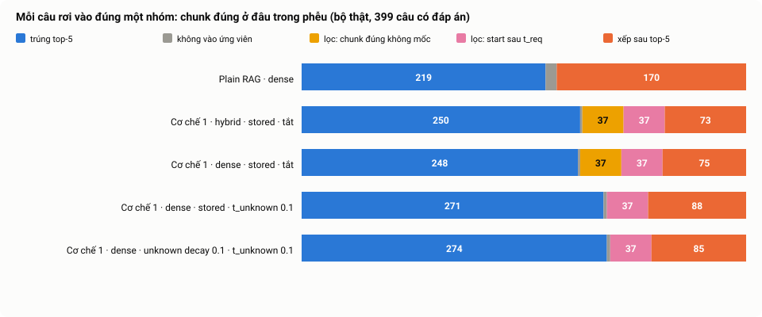
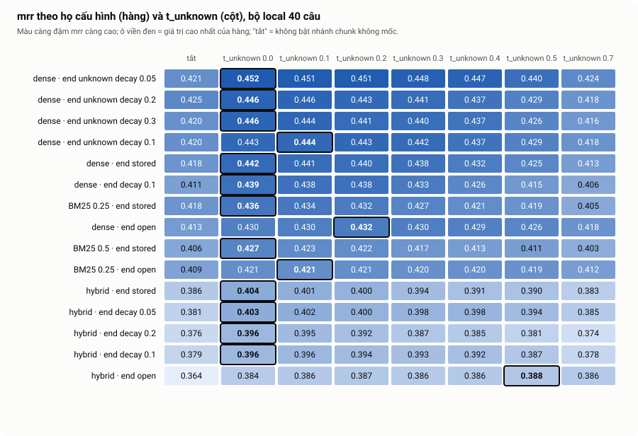
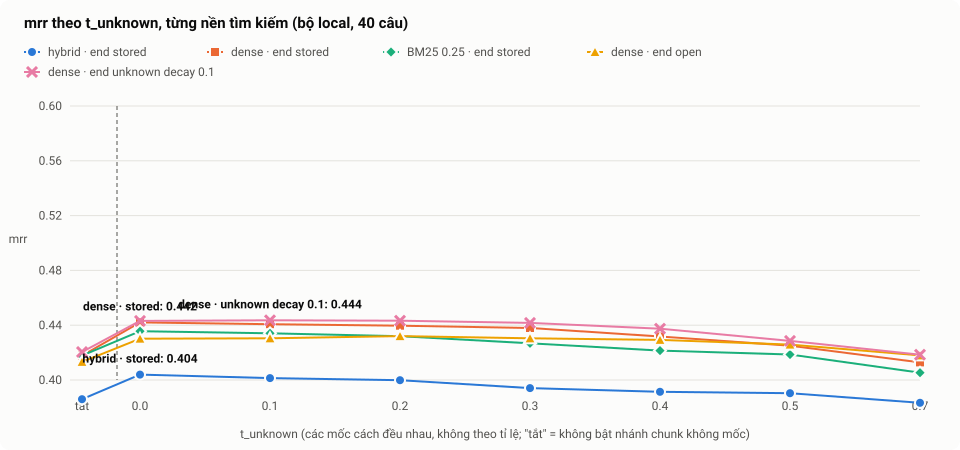
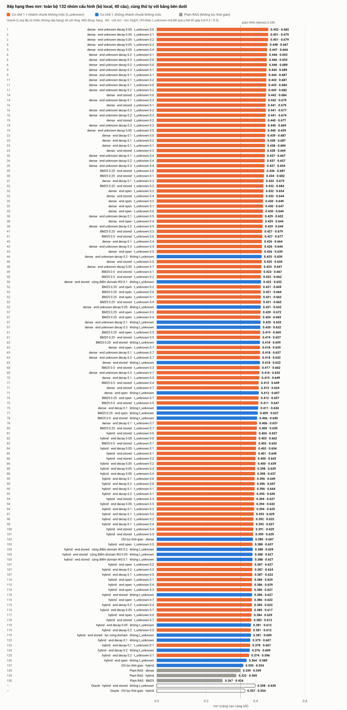

# Kết quả bộ thật (400 câu)

Chạy lại **toàn bộ 142 kịch bản đã chạy ở bộ local** (cùng cấu hình, lấy từ `metrics.json` của từng dòng trong `dataset/eval/results_local.csv`) trên bộ thật 400 câu. Quy ước tên cấu hình xem đầu [`04_TEST_RESULTS.md`](04_TEST_RESULTS.md). Danh sách câu: [`real_subset_cases.csv`](../../dataset/eval/real_subset_cases.csv); câu bị loại và lý do: [`real_subset_dropped.csv`](../../dataset/eval/real_subset_dropped.csv); cách dựng bộ và việc thay 1 câu: [`process/06`](../process/06_EVAL_SUBSET.md).

## 1. Tóm tắt

1. **Cơ chế 1 hơn Plain RAG rõ ràng**: `mrr` 0.339 (Plain RAG dense) lên 0.444 (+0.104 ± 0.036 khi ghép cặp từng câu), và `leakage_rate` từ 0.665 xuống 0. Kết luận của local được giữ.
2. **Điểm tuyệt đối thấp hơn local nhiều**: `mrr` cao nhất 0.452 và `hit@5` cao nhất 0.692 (local: 0.581 và 0.825). Phần lớn do local nhỏ (40 câu, sai số lớn) và dễ hơn; trung bình `mrr` của 140 cấu hình giảm từ 0.482 xuống 0.412.
3. **Thứ hạng các cấu hình chuyển từ local sang bộ thật gần như nguyên vẹn**: tương quan hạng Spearman 0.961 (`mrr`) và 0.806 (`hit@5`). Cấu hình tốt nhất ở local đứng hạng 7/140 ở bộ thật, `mrr` kém cấu hình số 1 chỉ 0.006, nằm trong sai số.
4. **Đúng chiều ở cả hai bộ, nhưng nhỏ hơn ở bộ thật**: bỏ BM25 (+0.03), bật nhánh chunk không mốc (+0.02). **Không còn đúng**: `unknown_decay` hơn `stored` (+0.003 ± 0.010, không phân biệt được).
5. **Mất điểm chủ yếu do xếp hạng trong cùng một trang**, không phải do tìm trượt trang: 21% câu có chunk đúng trong ứng viên nhưng xếp sau top-5, và 94% trong số đó có kết quả hạng 1 là chunk khác của **chính trang đáp án** (thời kỳ khác). 88% các câu này có chunk đúng với khoảng `[start, end]` đã kết thúc trước `t_req`. 9.3% câu bị bộ lọc cứng loại mất chunk đúng, phần lớn do chunk đáp án theo nhãn nói về thời kỳ sau câu hỏi (chunk đáp án theo nhãn nằm sau thời điểm hỏi; đọc tay 21 ca nhóm C cho thấy phần lớn không phải ingestion gán sai `start`, xem mục 7). Chấm theo chuỗi đáp án trong top-5 cho 0.81 thay vì 0.69.

## 2. Thiết lập

| Mục | Giá trị |
|---|---|
| Bộ câu hỏi | `dataset/eval/real_subset.json`: 400 câu (8 domain × 50), 204 trang, 35 câu mượn từ D/train; 399 câu có chunk đáp án trong kho (`n_answerable`) |
| Kho | Qdrant `tam_chunks_dev_real`, 6737 điểm (nạp bằng `--keep-undated`) |
| LLM nạp kho | Gemini 3.5 flash-lite gọi thẳng API Google (có structured output); `output/20261020_143820/extractions.jsonl` |
| LLM Profiler | Gemini 3.1 flash-lite gọi thẳng; `output/20261020_144033/profiler.jsonl`, 400/400 câu, 0 lỗi |
| Chế độ | `e2e` (Profiler lấy `t_req` từ câu hỏi), mức `hard`, `top_k` 5, `top_n` 50 |
| Chạy | `local/run_real_eval.py` (không gọi LLM), 142 lần, 0 lỗi, rồi thêm lưới chunk liền kề 32 lần (`local/run_neighbors.py`); gom bằng `scripts/summarize_runs.py`, vẽ bằng `scripts/plot_results.py`, phễu bằng `scripts/funnel_real.py` |
| Dữ liệu | [`results_real.csv`](../../dataset/eval/results_real.csv) (132 nhóm xếp hạng + 38 nhóm có chunk liền kề), [`results_compare.csv`](../../dataset/eval/results_compare.csv) (local và real cạnh nhau, 170 dòng), [`real_funnel.csv`](../../dataset/eval/real_funnel.csv) |

Khác biệt với local khi so sánh: nạp kho và Profiler của hai bộ không cùng model (local: 3.5 qua 9router cho cả hai; real: 3.5 nạp kho, 3.1 Profiler). Cỡ mẫu: `mrr` có sai số chuẩn khoảng 0.07 ở 40 câu, khoảng 0.02 ở 400 câu, nên chênh lệch dưới ~0.04 ở local không phân biệt được, còn ở bộ thật chỉ khoảng 0.04 là cần thiết (ghép cặp: 0.01–0.04, xem mục 6).

## 3. Giá trị cao nhất của `mrr` và `hit@k`

Trong các cấu hình `e2e` (140 cấu hình; không tính 2 cấu hình `oracle`):

| Chỉ số | Cao nhất ở local | Cấu hình ở local | Cao nhất ở bộ thật | Cấu hình ở bộ thật |
|---|---|---|---|---|
| `mrr` | 0.581 | 1 cấu hình, vd tìm kiếm dense · end unknown decay 0.2 · t_unknown 0.1 | 0.452 | 1 cấu hình, vd tìm kiếm dense · end unknown decay 0.05 · t_unknown 0.0 |
| `hit@1` | 0.425 | 8 cấu hình, vd tìm kiếm dense · end unknown decay 0.2 · t_unknown 0.1 | 0.311 | 4 cấu hình, vd tìm kiếm dense · end unknown decay 0.05 · t_unknown 0.1 |
| `hit@3` | 0.750 | 6 cấu hình, vd tìm kiếm dense · end unknown decay 0.1 · t_unknown 0.4 | 0.571 | 4 cấu hình, vd tìm kiếm dense · end unknown decay 0.05 · t_unknown 0.1 |
| `hit@5` | 0.825 | 6 cấu hình, vd tìm kiếm dense · end unknown decay 0.2 · t_unknown 0.1 | 0.692 | 2 cấu hình, vd tìm kiếm dense · end unknown decay 0.2 · t_unknown 0.1 |

Dòng "vd" là một đại diện; nhiều cấu hình đồng hạng ở `hit@k` vì `hit@k` chỉ nhận giá trị rời rạc (1/40 = 0.025 ở local, 1/399 ở bộ thật). Các cấu hình đứng đầu đều là nền dense, `unknown_decay` và `t_unknown` thấp. Ngoại lệ duy nhất: `hit@3` ở bộ thật có thêm một cấu hình BM25 0.25 đồng hạng; không có cấu hình hybrid hay Plain RAG nào đứng đầu ở chỉ số nào.

Các giá trị `mrr` cao nhất tuyệt đối vẫn thấp (0.45) và `hit@5` chỉ 0.69. Vì sao: xem mục 5.

## 4. Cấu hình tốt nhất ở local có tốt nhất ở bộ thật không?

**Không phải số 1, nhưng nằm trong nhóm đầu và chênh lệch nằm trong sai số.**

| Chỉ số so khớp | Giá trị |
|---|---|
| Tương quan hạng Spearman `mrr`, local so với real (140 cấu hình) | **0.961** |
| Tương quan hạng Spearman `hit@5` | 0.806 |
| `mrr` trung bình của 140 cấu hình | local 0.482, real 0.412 (giảm 0.070) |
| Cấu hình tốt nhất ở local (dense · unknown decay 0.2 · `t_unknown` 0.1, `mrr` 0.581) | ở bộ thật `mrr` 0.446, hạng **7/140**; cấu hình số 1 ở bộ thật là 0.452 |
| 6 cấu hình đứng đầu ở local | hạng ở bộ thật lần lượt 7, 10, 11, 16, 3, 4 (đều trong top 12%) |

Mỗi điểm là một cấu hình; đường nét đứt là y = x. Mọi điểm nằm dưới đường chéo (bộ thật thấp hơn local) và các cụm giữ nguyên thứ tự trên trục: Plain RAG và "chỉ lọc" thấp nhất, rồi hybrid, rồi BM25 một phần, rồi dense. Thứ tự giữa các cấu hình dense gần nhau (0.43–0.45) thì lộn xộn, đúng như dự đoán vì chênh lệch của chúng nhỏ hơn sai số.

Kết luận thực hành: **chọn họ cấu hình** (dense, bật `t_unknown`) bằng local là đúng; **chọn tham số tinh** (`d` của `unknown_decay`, giá trị `t_unknown` trong 0.0–0.3) bằng 40 câu thì không đáng tin, vì các cấu hình đó chênh nhau 0.00–0.01 ở bộ thật.

## 5. Vì sao `mrr` và `hit@5` vẫn thấp: phễu từng câu

Mỗi câu có chunk đáp án (399 câu) rơi vào đúng một nhóm:

| Nhóm | Dense · stored · `t_unknown` 0.1 | Dense · unknown decay 0.1 · `t_unknown` 0.1 | Plain RAG dense |
|---|---|---|---|
| Trúng top-5 (`hit@5`) | 271 (67.9%) | 274 (68.7%) | 219 (54.9%) |
| Không vào 50 ứng viên | 3 | 3 | 10 |
| Bị lọc cứng: chunk đúng không có mốc | 0 (nhánh `t_unknown` cứu) | 0 | không lọc |
| Bị lọc cứng: `start` của chunk đúng **sau** `t_req` | **37 (9.3%)** | **37 (9.3%)** | không lọc |
| Vào ứng viên nhưng xếp sau top-5 | **88 (22.1%)** | **85 (21.3%)** | **170 (42.6%)** |

Ba nguyên nhân, theo mức ảnh hưởng:

1. **Xếp hạng trong cùng một trang (21–22% câu, nguyên nhân lớn nhất).** Trang TimeQA dài, nhiều chunk cùng nói về một thực thể ở các thời kỳ khác nhau, nên chunk đúng và chunk gần-đúng giống nhau về ngữ nghĩa và chỉ khác nhau ở mốc thời gian. Ở cấu hình tốt nhất, trong 85 câu trượt này có 80 câu (94%) có kết quả hạng 1 nằm trên chính trang đáp án, và 65 câu (76%) có cả 5 kết quả đều thuộc trang đó; trung vị hạng của chunk đúng trong danh sách 50 là 2. Plain RAG cũng vậy (176/180 câu, 98%). Nghĩa là hệ **tìm đúng trang nhưng chọn nhầm thời kỳ**; việc của điểm thời gian là chọn đúng thời kỳ, và nó chỉ cứu được một phần (`temporal_helped` 136, `temporal_hurt` 89 câu).
2. **Bộ lọc cứng loại nhầm chunk đúng (9.3% câu).** Xem mục 7. Đây là trần cứng: không cấu hình nào giữ bộ lọc `start_time <= T_req` có thể vượt `hit@5` = (399 − 37) / 399 = **90.7%** (và 81.5% nếu tắt nhánh chunk không mốc, vì thêm 37 chunk không mốc nữa bị loại).
3. **Không vào danh sách ứng viên (≤ 0.8% ở Cơ chế 1, 2.5% ở Plain RAG)**: không đáng kể; truy xuất dense lấy được chunk đúng trong top 50 ở 97.5% câu khi không lọc (Plain RAG).

### 5.1 Vì sao chunk đúng bị xếp sau top-5

Phân tích 75 câu trượt top-5 mà chunk đúng vẫn qua bộ lọc (dense · stored · `t_unknown` 0.1), so điểm thời gian của chunk đúng và chunk hạng 1 (theo nhãn `start`/`end` lúc nạp kho):

| Chunk đúng | Chunk hạng 1 | Số câu |
|---|---|---|
| **đã kết thúc trước `t_req`** (điểm thời gian giảm dần) | khớp `t_req` (điểm 1.0) | 55 |
| đã kết thúc trước `t_req` | không mốc / cũng đã kết thúc | 11 |
| khớp `t_req` (điểm 1.0) | khớp (1.0) hoặc loại khác | 9 |

- **66/75 câu (88%): chunk đúng có khoảng `[start, end]` kết thúc trước `t_req`.** Khoảng cách `t_req − end` có trung vị 7.3 năm: 18 câu dưới 1 năm (sát biên, vd chunk "đầu 1998" gán `end` 31/3/1998, câu hỏi tháng 4/1998), 9 câu 1–3 năm, 39 câu trên 3 năm. Điểm thời gian phạt nó nên chunk khớp `t_req` hơn nhưng sai nội dung vượt lên.
- Chỉ **9 câu** là hòa thật sự về thời gian, tức xếp hạng hoàn toàn do điểm ngữ nghĩa.
- Chunk đúng nằm ở hạng 6–10 (33 câu), 11–20 (33 câu), trên 20 (9 câu): kéo top-k lên 10 là đủ cứu một nửa.
- Nguyên nhân lớn nhất là chunk đáp án theo nhãn của TimeQA là **đoạn có chứa chuỗi đáp án**, không bảo đảm đoạn đó nói về đúng thời kỳ của câu hỏi (xem mục 7), nên dù ingestion gán mốc đúng cho chính đoạn đó, nó vẫn lệch với `t_req`. Phần còn lại là `t_req` của Profiler quá thô (vd "late 1900s" thành 1999-12-31, câu hỏi khoảng "between Aug 2005 and Sep 2006" thành điểm cuối khoảng).

**Hit@k theo độ sâu** (cùng cấu hình tốt nhất, dùng hạng cuối cùng của chunk đúng trong 50 ứng viên):

| k | 1 | 3 | 5 | 10 | 15 | 20 | 30 | 50 |
|---|---|---|---|---|---|---|---|---|
| Cơ chế 1 (dense · unknown decay 0.1 · `t_unknown` 0.1) | 0.296 | 0.569 | 0.687 | 0.789 | 0.855 | 0.877 | 0.895 | 0.900 |
| Plain RAG dense | 0.226 | 0.424 | 0.549 | 0.762 | 0.862 | 0.895 | 0.937 | 0.975 |

Cơ chế 1 hơn rõ ở k nhỏ (≤ 10), nhưng **từ k ≥ 15 Plain RAG bằng và vượt** vì bộ lọc cứng đã loại mất 9.3% chunk đúng; trần của Cơ chế 1 là 0.900 trong khi Plain RAG đạt 0.975 ở k = 50. Top-20 đã gần bão hòa (0.877).

**Nếu chấm bằng chuỗi đáp án thay vì chunk id.** Tỉ lệ câu có chuỗi đáp án (`targets`) xuất hiện trong văn bản của top-5:

| Cấu hình | `hit@5` theo chunk id | Top-5 có chứa chuỗi đáp án |
|---|---|---|
| Plain RAG dense | 0.549 | 0.667 |
| Cơ chế 1 · hybrid · stored · tắt | 0.627 | 0.734 |
| Cơ chế 1 · dense · stored · tắt | 0.622 | 0.752 |
| Cơ chế 1 · dense · stored · `t_unknown` 0.1 | 0.679 | 0.805 |
| Cơ chế 1 · dense · unknown decay 0.1 · `t_unknown` 0.1 | 0.687 | 0.812 |

Chỉ số thứ ba (top-5 có chunk vừa chứa chuỗi đáp án vừa có `[start, end]` bao `t_req`, chỉ tính chunk có mốc): Plain RAG **0.406**, Cơ chế 1 tốt nhất **0.627** (+0.22, so với +0.14 của `hit@5` theo chunk id); tính cả chunk không mốc: 0.486 và 0.689. Định nghĩa, ví dụ đúng và sai, và hạn chế ở [`decisions/07`](../decisions/07_RANKING_AND_TIME_RANGE_PROPOSALS.md) đề xuất 5.

Chênh 12 điểm cho thấy nhiều câu "trượt" thật ra có chunk khác chứa đúng đáp án trong top-5. Đây là cận trên (chuỗi đáp án có thể xuất hiện trong chunk nói về thời kỳ khác); thứ hạng giữa các cấu hình không đổi.

`hit@1` thấp (0.31) vì đa số câu hỏi TimeQA có nhiều chunk "gần-đúng" cùng trang; `ctx_hit` (có chunk đúng trong ngữ cảnh gửi LLM) bằng `hit@5` khi không lấy thêm chunk liền kề (mục 6.5).

## 6. Từng nhóm kịch bản trên bộ thật

Mỗi bảng có cột local để thấy chiều thay đổi. Tên cấu hình theo quy ước ở `04`; toàn bộ 132 nhóm xếp hạng ở phụ lục.

### 6.1 Baseline và "chỉ lọc thời gian" (đợt 1)

| Cấu hình | `hit@1` | `hit@3` | `hit@5` | `mrr` | `hit@5` local | `mrr` local |
|---|---|---|---|---|---|---|
| Plain RAG · dense | 0.226 | 0.424 | 0.549 | **0.339** | 0.500 | 0.340 |
| Plain RAG · hybrid | 0.226 | 0.388 | 0.509 | **0.322** | 0.475 | 0.245 |
| Plain RAG · BM25 | 0.178 | 0.338 | 0.424 | **0.267** | 0.250 | 0.179 |
| Chỉ lọc thời gian · dense | 0.268 | 0.494 | 0.607 | **0.389** | 0.600 | 0.428 |
| Chỉ lọc thời gian · hybrid | 0.226 | 0.444 | 0.554 | **0.350** | 0.575 | 0.323 |

- Plain RAG dense (0.339) tốt hơn hẳn Plain RAG hybrid (0.322) và BM25 (0.267): kết hợp BM25 vào RRF không giúp trên bộ này.
- "Chỉ lọc thời gian" (bỏ điểm thời gian, chỉ giữ bộ lọc `start <= T_req`) đã nâng `mrr` từ 0.339 lên 0.389 (dense) và 0.322 lên 0.350 (hybrid): **bộ lọc cứng một mình đóng góp phần lớn lợi ích**. Điểm thời gian (`W2` = 0.3) cộng thêm 0.03 nữa (0.389 lên 0.418).

### 6.2 Trọng số BM25 và các thành phần trên nền dense (đợt 1b, 1c)

| Cấu hình | `hit@1` | `hit@3` | `hit@5` | `mrr` | `hit@5` local | `mrr` local |
|---|---|---|---|---|---|---|
| hybrid · stored · tắt | 0.241 | 0.509 | 0.627 | **0.386** | 0.650 | 0.420 |
| hybrid · stored · `t_unknown` 0.1 | 0.251 | 0.526 | 0.649 | **0.401** | 0.675 | 0.459 |
| BM25 0.5 · stored · tắt | 0.261 | 0.539 | 0.649 | **0.406** | 0.725 | 0.474 |
| BM25 0.25 · stored · tắt | 0.268 | 0.554 | 0.659 | **0.418** | 0.725 | 0.507 |
| BM25 0.25 · stored · `t_unknown` 0.1 | 0.283 | 0.561 | 0.682 | **0.434** | 0.725 | 0.522 |
| dense · stored · tắt | 0.288 | 0.534 | 0.622 | **0.418** | 0.675 | 0.494 |
| dense · stored · `t_unknown` 0.1 | 0.298 | 0.564 | 0.679 | **0.441** | 0.800 | 0.542 |

- Thứ tự `mrr` khi `t_unknown` tắt: dense (0.418) ≈ BM25 0.25 (0.418) > BM25 0.5 (0.406) > hybrid (0.386); khi `t_unknown` 0.1: dense 0.441 > BM25 0.25 0.434 > hybrid 0.401. Giảm BM25 đều có lợi, bỏ hẳn tốt nhất hoặc ngang bằng; ghép cặp dense so với hybrid: hơn 74 câu, kém 50, +0.032 ± 0.025.
- Bật `t_unknown` 0.1 cải thiện mọi nền (dense +0.023, hybrid +0.015, BM25 0.25 +0.016); ghép cặp dense: hơn 39, kém 19, +0.023 ± 0.016.

### 6.3 Cách chấm `end` (đợt 3, 3d)

| Cách chấm `end` (nền dense) | `t_unknown` | `hit@1` | `hit@3` | `hit@5` | `mrr` | `hit@5` local | `mrr` local |
|---|---|---|---|---|---|---|---|
| stored | tắt | 0.288 | 0.534 | 0.622 | **0.418** | 0.675 | 0.494 |
| stored | 0.1 | 0.298 | 0.564 | 0.679 | **0.441** | 0.800 | 0.542 |
| open | tắt | 0.286 | 0.536 | 0.607 | **0.413** | 0.700 | 0.519 |
| open | 0.1 | 0.293 | 0.561 | 0.647 | **0.430** | 0.725 | 0.525 |
| decay 0.1 | tắt | 0.273 | 0.531 | 0.634 | **0.411** | 0.700 | 0.471 |
| decay 0.1 | 0.1 | 0.293 | 0.556 | 0.684 | **0.438** | 0.800 | 0.544 |
| unknown decay 0.05 | tắt | 0.286 | 0.544 | 0.632 | **0.421** | 0.725 | 0.524 |
| unknown decay 0.05 | 0.1 | 0.311 | 0.571 | 0.679 | **0.451** | 0.800 | 0.575 |
| unknown decay 0.1 | tắt | 0.286 | 0.549 | 0.632 | **0.420** | 0.725 | 0.525 |
| unknown decay 0.1 | 0.1 | 0.296 | 0.569 | 0.687 | **0.444** | 0.825 | 0.580 |
| unknown decay 0.2 | tắt | 0.291 | 0.541 | 0.639 | **0.425** | 0.725 | 0.519 |
| unknown decay 0.2 | 0.1 | 0.301 | 0.571 | 0.692 | **0.446** | 0.825 | 0.581 |
| unknown decay 0.3 | tắt | 0.288 | 0.529 | 0.632 | **0.420** | 0.700 | 0.500 |
| unknown decay 0.3 | 0.1 | 0.301 | 0.566 | 0.689 | **0.444** | 0.825 | 0.554 |

- Thứ tự `mrr` giữ nguyên như local: unknown decay ≥ stored > decay > open, nhưng các giá trị cách nhau 0.002–0.015.
- `open` (coi mọi chunk đang kéo dài, điểm 1.0) kém rõ rệt nhất ở `hit@5` (0.647 so với 0.679 của stored khi `t_unknown` 0.1).
- `unknown_decay` so với `stored` (cùng `t_unknown` 0.1): hơn 19 câu, kém 17, **+0.003 ± 0.010**, tức không có lợi thế. Ở local nó cao nhất, nhưng đó là cận trên của hơn 140 cấu hình trên 40 câu.

Lưới `mrr` của `unknown_decay` theo `d` và `t_unknown` (nền dense, bộ thật):

| `d` (unknown decay) \ `t_unknown` | tắt | 0.0 | 0.1 | 0.2 | 0.3 | 0.4 | 0.5 | 0.7 |
|---|---|---|---|---|---|---|---|---|
| 0.05 | 0.421 | 0.452 | 0.451 | 0.451 | 0.448 | 0.447 | 0.440 | 0.424 |
| 0.1 | 0.420 | 0.443 | 0.444 | 0.443 | 0.442 | 0.437 | 0.429 | 0.418 |
| 0.2 | 0.425 | 0.446 | 0.446 | 0.443 | 0.441 | 0.437 | 0.429 | 0.418 |
| 0.3 | 0.420 | 0.446 | 0.444 | 0.441 | 0.440 | 0.437 | 0.426 | 0.416 |

Khi bật `t_unknown` từ 0.0 đến 0.3, mọi ô nằm trong 0.440–0.452 (chênh 0.012, dưới sai số); `d` = 0.05 nhỉnh hơn một chút nhưng không đáng tin. Không có "cao nguyên" nào tách hẳn khỏi phần còn lại; lưới giảm khi `t_unknown` ≥ 0.5.

### 6.4 Nhánh chunk không mốc `t_unknown` (đợt 4, 4b)

| `t_unknown` (dense · stored) | `hit@5` | `mrr` | `hit@5` local | `mrr` local | `undated_in_results_rate` |
|---|---|---|---|---|---|
| tắt | 0.622 | **0.418** | 0.675 | 0.494 | 0.000 |
| 0.0 | 0.684 | **0.442** | 0.800 | 0.531 | 0.340 |
| 0.1 | 0.679 | **0.441** | 0.800 | 0.542 | 0.403 |
| 0.2 | 0.677 | **0.440** | 0.800 | 0.541 | 0.455 |
| 0.3 | 0.669 | **0.438** | 0.775 | 0.536 | 0.502 |
| 0.4 | 0.644 | **0.432** | 0.775 | 0.534 | 0.562 |
| 0.5 | 0.634 | **0.425** | 0.775 | 0.510 | 0.590 |
| 0.7 | 0.624 | **0.413** | 0.725 | 0.492 | 0.672 |

- `t_unknown` 0.0 đến 0.2 là đỉnh (0.440–0.442 so với 0.418 khi tắt); từ 0.4 trở lên giảm dần và xuống dưới mức tắt ở 0.7 (0.413). Lợi ích chủ yếu đến từ việc **đưa chunk không mốc vào danh sách ứng viên**, không phải từ giá trị điểm cụ thể.
- `undated_in_results_rate` (tỉ lệ câu có chunk không mốc trong top-5) tăng theo `t_unknown`; tăng từ 0.34 ở 0.0 lên 0.67 ở 0.7; ở 0.1 là 0.40, nghĩa là chunk không mốc xuất hiện trong top-5 của khoảng 40% số câu, và vẫn có lợi ròng.

### 6.5 Chunk liền kề (đợt 3b)

| Cấu hình | `hit@5` | `ctx_hit` (ngữ cảnh) | `mrr` | `ctx_hit` local |
|---|---|---|---|---|
| dense · stored · `t_unknown` 0.1, không lấy thêm | 0.679 | **0.679** | 0.441 | 0.800 |
| cùng cấu hình, lấy thêm 1 chunk liền kề | 0.679 | **0.772** | 0.441 | 0.850 |
| dense · stored · tắt, không lấy thêm | 0.622 | **0.622** | 0.418 | 0.675 |
| cùng cấu hình, lấy thêm 1 chunk liền kề | 0.622 | **0.697** | 0.418 | 0.750 |
| hybrid · stored · tắt, không lấy thêm | 0.627 | **0.627** | 0.386 | 0.650 |
| cùng cấu hình, lấy thêm 1 | 0.627 | **0.707** | 0.386 | 0.725 |
| cùng cấu hình, lấy thêm 2 | 0.627 | **0.737** | 0.386 | 0.725 |

**Lưới 32 kịch bản có chunk liền kề (ở mỗi bộ):** nền {dense, hybrid} × cách chấm `end` {stored, open, decay 0.1, unknown decay 0.1} × `t_unknown` {tắt, 0.1} × cửa sổ {1, 2}; thêm vào CSV (38 nhóm ở phụ lục B).

| Bộ | Cửa sổ | `ctx_hit` − `hit@5` (TB 32 lần) | Chunk trong ngữ cảnh (TB) | Câu được cứu thêm (TB) |
|---|---|---|---|---|
| Bộ thật | 1 | +0.082 | 8.4 (so với 5) | 33 |
| Bộ thật | 2 | +0.115 | 10.7 | 46 |
| Local | 1 và 2 | +0.055 | 7.9 / 9.9 | 2 |

Ở cấu hình tốt nhất (dense · unknown decay 0.1 · `t_unknown` 0.1): `hit@5` 0.687 và `mrr` 0.444 **không đổi** với mọi cửa sổ; `ctx_hit` 0.687 lên **0.769** (cửa sổ 1, 8.2 chunk) và **0.789** (cửa sổ 2, 10.4 chunk). Câu nhiều chunk đúng (`ctx_multi_all_hit`) từ 0.167 lên 0.167 (cửa sổ 1) và 0.250 (cửa sổ 2) trên 12 câu. Ở local lợi ích nhỏ vì kho nhỏ (chỉ cứu 2 câu).

Lấy thêm chunk liền kề **không đổi `hit@5` và `mrr`** (xếp hạng không đổi), chỉ tăng `ctx_hit` (chunk đúng có trong ngữ cảnh đưa vào LLM): +0.09 ở dense · `t_unknown` 0.1 (0.679 lên 0.772). Lấy 2 chunk mỗi phía thêm +0.03 so với 1 chunk ở hybrid. Đây là cách tăng độ phủ ngữ cảnh mà không động đến xếp hạng; chi phí là gửi thêm 1–2 chunk mỗi kết quả.

### 6.6 Domain: cộng điểm hay lọc cứng (đợt 5)

| Cấu hình | `hit@1` | `hit@3` | `hit@5` | `mrr` | `hit@5` local | `mrr` local |
|---|---|---|---|---|---|---|
| tìm kiếm dense · end stored · cộng điểm domain W3 0.1 · tắt | 0.291 | 0.541 | 0.632 | **0.422** | 0.675 | 0.494 |
| tìm kiếm hybrid · end stored · cộng điểm domain W3 0.2 · tắt | 0.241 | 0.514 | 0.629 | **0.388** | 0.650 | 0.420 |
| tìm kiếm hybrid · end stored · cộng điểm domain W3 0.05 · tắt | 0.241 | 0.511 | 0.627 | **0.388** | 0.650 | 0.420 |
| tìm kiếm hybrid · end stored · cộng điểm domain W3 0.1 · tắt | 0.241 | 0.514 | 0.627 | **0.388** | 0.650 | 0.420 |
| tìm kiếm hybrid · end stored · lọc cứng domain · tắt | 0.243 | 0.501 | 0.609 | **0.381** | 0.650 | 0.420 |

Không có cấu hình domain nào hơn mức nền: cộng điểm W3 0.1 cho nền dense cho 0.422 (nền: 0.418), còn lọc cứng domain làm giảm (0.381 so với 0.386 của hybrid). `domain_given` chỉ có 140/400 câu (Profiler chỉ trích domain khi câu hỏi nêu rõ), nên thành phần này ít có chỗ tác động. Giữ quyết định domain là điểm cộng mềm ([`decisions/01`](../decisions/01_DOMAIN_AS_SOFT_BOOST.md)), không có lý do bật mặc định.

### 6.7 Oracle (đợt 2): dùng `t_req` từ nhãn thay Profiler

| Cấu hình | `hit@1` | `hit@3` | `hit@5` | `mrr` | `hit@5` local | `mrr` local |
|---|---|---|---|---|---|---|
| Oracle (t_req từ nhãn) · tìm kiếm hybrid · end stored · tắt | 0.253 | 0.536 | 0.639 | **0.398** | 0.700 | 0.458 |
| Oracle (t_req từ nhãn) · Chỉ lọc thời gian (bỏ điểm thời gian) · tìm kiếm hybrid | 0.236 | 0.454 | 0.554 | **0.357** | 0.625 | 0.353 |

`mrr` của oracle hybrid (0.398) chỉ hơn e2e hybrid cùng cấu hình (0.386) 0.012: **Profiler không phải nút thắt**. `t_req` của Profiler nằm trong khoảng nhãn thời gian ở 391/400 câu (97.8%), sai lệch tuyệt đối trung bình 4.5 năm so với mốc nhãn (vì nhãn là khoảng, không phải điểm).

### 6.8 Thử `decay_from: end` (phạt chunk đã hết hạn theo khoảng cách từ `end`)

Tùy chọn mới `retrieval.decay_from` (mặc định `start`, không đổi hành vi); xem [`decisions/07`](../decisions/07_RANKING_AND_TIME_RANGE_PROPOSALS.md) đề xuất 3. 34 kịch bản mỗi bộ, dữ liệu ở `dataset/eval/results_real_decay_from_end.csv` và `results_local_decay_from_end.csv`:

| Cấu hình | `mrr` bộ thật: `start` → `end` | `hit@5` bộ thật | `mrr` local | `hit@5` local |
|---|---|---|---|---|
| dense · stored · tắt | 0.418 → **0.428** | 0.622 → 0.647 | 0.494 → 0.517 | 0.675 → 0.725 |
| dense · stored · t_unknown 0.1 | 0.441 → **0.450** | 0.679 → 0.702 | 0.542 → 0.549 | 0.800 → 0.825 |
| dense · open · t_unknown 0.1 | 0.430 → **0.436** | 0.647 → 0.657 | 0.525 → 0.527 | 0.725 → 0.750 |
| dense · decay 0.1 · t_unknown 0.1 | 0.438 → **0.446** | 0.684 → 0.697 | 0.544 → 0.550 | 0.800 → 0.825 |
| dense · unknown decay 0.1 · t_unknown 0.1 | 0.444 → **0.452** | 0.687 → 0.699 | 0.580 → 0.586 | 0.825 → 0.850 |
| hybrid · stored · tắt | 0.386 → **0.392** | 0.627 → 0.644 | 0.420 → 0.445 | 0.650 → 0.675 |

`mrr` tăng ở 28/28 cặp so được (bộ thật +0.004 đến +0.010, trung bình +0.007; local +0.013). Ghép cặp từng câu ở cấu hình tốt nhất: +0.009 ± 0.009, 15 câu tăng và 14 giảm: mức tăng nhỏ, khoảng 95% chạm 0. Lợi ích có nhưng không phải nguyên nhân chính của các câu xếp sau top-5.

## 7. "Bị lọc nhầm" nghĩa là gì, và bộ có còn đủ 400 câu không

- **Bộ vẫn đủ 400 câu**, trong đó 399 câu có chunk đáp án trong kho (1 câu có chunk đáp án bị bỏ lúc nạp kho). Không câu nào bị loại khỏi mẫu đánh giá vì lọc nhầm; 37 câu chỉ là các câu hệ **không thể trả đúng** khi còn dùng bộ lọc cứng.
- Bộ lọc cứng của Cơ chế 1 giữ chunk có `start_time <= T_req` (không rò rỉ tương lai). "Lọc nhầm" là trường hợp chunk đúng (theo nhãn đáp án) có `start` (do LLM gán lúc nạp kho) **lớn hơn** `t_req` (do Profiler trích từ câu hỏi), nên bị loại trước khi chấm điểm. Hệ không có cơ hội xếp nó dù điểm ngữ nghĩa cao đến đâu.
- Quy mô: **37/399 = 9.3%** câu. Khoảng cách `start` − `t_req` có trung vị 3.1 năm: 13 câu dưới 1 năm, 9 câu từ 1 đến 5 năm, 15 câu trên 5 năm. Ở local con số này chỉ cỡ 2 câu.
- Cùng bộ lọc, **37 câu nữa** có chunk đúng không có `start` (LLM không tìm được mốc trong chunk). Nếu tắt nhánh `t_unknown` thì các chunk đó bị loại (`gold_blocked_by_filter` = 74 = 37 + 37); bật `t_unknown` thì chúng được giữ lại và chỉ còn lỗi xếp hạng.
- **Phân loại 37 câu** theo khoảng nhãn thời gian của câu hỏi (`time_start`–`time_end` trong dữ liệu) so với `start` của chunk đúng:

| Nhóm | Số câu | Ý nghĩa | Ví dụ |
|---|---|---|---|
| A. `start` cùng năm với nhãn, chỉ muộn hơn `t_req` vài tháng | 7 | `t_req` Profiler lấy đầu tháng/năm, chunk bắt đầu giữa năm: lệch độ mịn | Janet Frame 1990: `t_req` 1/1/1990, chunk "6 February 1990" |
| B. `start` trong khoảng nhãn nhưng sau `t_req` | 9 | Câu hỏi hỏi sớm hơn đoạn mô tả | 2AM: hỏi 6/2013, chunk nói về 4/2014 |
| C. `start` **sau cả khoảng nhãn** | 21 | Đoạn có chứa chuỗi đáp án nói về thời kỳ sau thời điểm câu hỏi | Goryachkina: hỏi danh hiệu năm 2012, chunk "Historical achievements" nói về 2018 |

- **Đọc tay 21 đoạn ở nhóm C** (đọc quanh chuỗi đáp án, phân loại thô; vài ca có thể thuộc hai nhóm). Trong cả 21 ca, `start` LLM gán khớp với nội dung có ghi ngày rõ của đoạn; điều không khớp là **đoạn mà ta coi là "chunk đúng"** (đoạn chứa chuỗi đáp án) không nói về thời điểm của câu hỏi:

  | Nhóm | Số ca | Mô tả | Ví dụ |
  |---|---|---|---|
  | C1. Đoạn liệt kê hoặc tổng hợp nhiều thời kỳ; ingestion chỉ gán **một** khoảng cho cả đoạn | 6 | Đây là **giới hạn thiết kế "một chunk một khoảng"**, không phải LLM đọc sai | 4 câu của Office for Foreign Relations (danh sách giám đốc cũ, mốc 2014); Goryachkina: "at the age of 13 ... Woman Grandmaster" (13 tuổi = 2012, không có chữ "2012") cùng "Grandmaster in early 2018" trong một đoạn, chỉ gán 2018; Stauskas (tổng kết "high school years") |
  | C2. Đoạn nói về sự việc ở thời điểm khác, nhắc đáp án như chi tiết phụ | 9 | Sự việc của câu hỏi vẫn đúng nhưng được kể trong đoạn khác thời kỳ | 2AM: hợp đồng với Big Hit "hết hạn tháng 4" (2014); Nora Ephron: hôn nhân 1976–80 nhắc trong đoạn về tiểu thuyết 1983; Mancini: "returned 2014" trong khi hỏi 2007 |
  | C3. Đáp án là từ chung, trùng ngẫu nhiên | 3 | Chuỗi đáp án xuất hiện nhưng không phải là sự việc được hỏi | Keith Emerson: "Emerson, Lake and Palmer" trong đoạn lễ tang 2016; Schörner: "colonel" trong "OKW colonel Meyer-Detring"; Goryachkina: "FIDE" trong "FIDE rating" |
  | C4. Nhãn thời gian của dữ liệu lệch, hoặc đáp án là tên hiện tại | 3 | Không do ingestion hay Profiler | Stommel: nhãn 1961, đoạn ghi 1962; Chicago Red Stars: "SeatGeek Stadium" là tên mới của sân nhưng câu hỏi hỏi 2009; Inter Milan: Simoni bị sa thải 1998 trong khi nhãn là 1983 |

  **Đọc tay 16 đoạn nhóm A và B** (cùng cách đọc, phân loại thô):

  | Nhóm | Số ca | Nguyên nhân | Ví dụ | Đề xuất 1 (khoảng) có cứu không |
  |---|---|---|---|---|
  | A1. Câu hỏi nêu năm/tháng, chunk bắt đầu giữa kỳ đó; `t_req` chỉ là ngày đầu kỳ | 4 | Lệch độ mịn của `t_req` (Profiler) | Janet Frame "in 1990" (chunk 6/2/1990); Luftflotte 5 "in Apr 1940" (12/4/1940); Nana Okada "in 2017" (22/2/2017); USAFE "in Jun 1942" (15/6/1942) | **Có** (`qe` là cuối kỳ) |
  | A2. Câu hỏi "after X" | 2 | Profiler lấy điểm X, bỏ phần mở sau X | Esteban Ocon "after Feb 2016"; Pelican "after Nov 1938" | **Có** (khoảng mở `[X, T_now]`) |
  | A3. Câu hỏi nêu tháng nhưng dữ liệu chỉ có nhãn cấp năm | 1 | Nhiễu dữ liệu: Garnidelia hỏi "Mar 2017", nhãn 2017–2018, sự việc xảy ra 4/2017 | | Không |
  | B. Đoạn nói về thời điểm khác hoặc nhiều thời kỳ, nhắc đáp án như chi tiết phụ | 9 | Giống nhóm C2/C1: 2AM, Central European University, Charles Holden, Jiminy Cricket, GNV Azzurra, Nora Ephron, Nakhimov, Senate of Canada Building, The Dark Eye | | Không |

  Tức là trong 37 câu bị lọc, **khoảng 6 câu (16%) cứu được bằng khoảng thời gian của câu hỏi**; 31 câu còn lại do đoạn nhiều thời kỳ (giới hạn "một chunk một khoảng") hoặc nhiễu dữ liệu. Phân loại là đọc tay, chưa có kiểm tra độc lập.
- Hệ quả cho đánh giá: 9.3% là trần do cách chấm theo chunk id. Một phần là hạn chế thiết kế thật (C1, một chunk một khoảng: `decisions/06` đề xuất 3, và đề xuất 7 của `decisions/07`), phần còn lại là nhiễu của bộ dữ liệu; chấm theo chuỗi đáp án (mục 5.1) thoát khỏi lệch này một phần.

## 8. Kiểm tra thống kê (ghép cặp, 400 câu, khoảng 95%)

| So sánh | Hơn / kém | Δ`mrr` |
|---|---|---|
| Cơ chế 1 (dense, stored, tắt) so với Plain RAG dense | 143 / 79 | **+0.078 ± 0.042** |
| Cơ chế 1 (dense, unknown decay 0.1, `t_unknown` 0.1) so với Plain RAG dense | 143 / 56 | **+0.104 ± 0.036** |
| Dense so với hybrid (stored, tắt) | 74 / 50 | **+0.032 ± 0.025** |
| `t_unknown` 0.1 so với tắt (dense, stored) | 39 / 19 | **+0.023 ± 0.016** |
| `unknown_decay` 0.1 so với `stored` (dense, `t_unknown` 0.1) | 19 / 17 | +0.003 ± 0.010 (không phân biệt được) |

## 9. Việc còn lại

1. Phân loại 37 câu `start` sau `t_req` (nhãn tháng, chunk nhiều sự việc, mốc đăng) để biết cần sửa ingestion hay chấp nhận; đây là trần 9.3% của mọi cấu hình.
2. Hạng đầu `mrr` ở bộ thật chỉ hơn cấu hình mặc định hiện tại khoảng 0.01–0.02, nên **chọn mặc định theo độ đơn giản**: dense + `t_unknown` 0.1 + `end_mode: stored`. Chưa đổi `config.*.yaml`; chờ bạn chốt (cùng quyết định đổi tên `t_unknown`).
3. Quét `decay_lambda`, `W1`/`W2` bằng D/train (đợt 6), loại 35 câu mượn khỏi mẫu tinh chỉnh. Hiện λ = 0.5, `W1`/`W2` = 0.7/0.3 là giá trị cố định chưa được tinh chỉnh.
4. Cải thiện chọn thời kỳ trong cùng một trang (nguyên nhân lớn nhất, mục 5): hướng của `decisions/06` đề xuất 2–3 (LLM ghi loại sự việc, một chunk nhiều khoảng) và Cơ chế 2. Các đề xuất nâng hạng sau bộ thật (khoảng thời gian của câu hỏi + chồng lấn, phạt `end` theo khoảng cách từ `end`, reranker, chỉ số chuỗi đáp án) ghi ở [`decisions/07`](../decisions/07_RANKING_AND_TIME_RANGE_PROPOSALS.md).

## Phụ lục A. Bảng xếp hạng đầy đủ 132 nhóm cấu hình (theo `mrr`)

Các dòng chỉ khác `t_unknown` mà kết quả y hệt được gộp. Hạng bằng nhau khi `mrr` bằng nhau (3 chữ số). Hai cột `ans@5` và `ans_valid@5` là chỉ số theo chuỗi đáp án (`decisions/07` đề xuất 5); thư mục là lần chạy lại ngày 2026-10-20 (có thêm các cột này, `hit@k` và `mrr` giống hệt lần chạy đầu).

| Hạng | Cấu hình | `hit@1` | `hit@3` | `hit@5` | `mrr` | `ans@5` | `ans_valid@5` | `ctx_hit` | `leakage_rate` | Thư mục |
|---|---|---|---|---|---|---|---|---|---|---|
| 1 | Cơ chế 1 · tìm kiếm dense · end unknown decay 0.05 · chunk không mốc t_unknown 0.0 | 0.308 | 0.569 | 0.682 | **0.452** | 0.820 | 0.637 | 0.682 | 0.000 | 20261020_173227 |
| 2 | Cơ chế 1 · tìm kiếm dense · end unknown decay 0.05 · chunk không mốc t_unknown 0.1 | 0.311 | 0.571 | 0.679 | **0.451** | 0.815 | 0.632 | 0.679 | 0.000 | 20261020_173227_3 |
| 2 | Cơ chế 1 · tìm kiếm dense · end unknown decay 0.05 · chunk không mốc t_unknown 0.2 | 0.311 | 0.566 | 0.679 | **0.451** | 0.812 | 0.629 | 0.679 | 0.000 | 20261020_173227_2 |
| 4 | Cơ chế 1 · tìm kiếm dense · end unknown decay 0.05 · chunk không mốc t_unknown 0.3 | 0.311 | 0.566 | 0.667 | **0.448** | 0.799 | 0.622 | 0.667 | 0.000 | 20261020_173227_4 |
| 5 | Cơ chế 1 · tìm kiếm dense · end unknown decay 0.05 · chunk không mốc t_unknown 0.4 | 0.311 | 0.564 | 0.664 | **0.447** | 0.797 | 0.622 | 0.664 | 0.000 | 20261020_173302 |
| 6 | Cơ chế 1 · tìm kiếm dense · end unknown decay 0.2 · chunk không mốc t_unknown 0.1 | 0.301 | 0.571 | 0.692 | **0.446** | 0.820 | 0.637 | 0.692 | 0.000 | 20261020_173303 |
| 6 | Cơ chế 1 · tìm kiếm dense · end unknown decay 0.3 · chunk không mốc t_unknown 0.0 | 0.298 | 0.564 | 0.692 | **0.446** | 0.827 | 0.639 | 0.692 | 0.000 | 20261020_173303_2 |
| 6 | Cơ chế 1 · tìm kiếm dense · end unknown decay 0.2 · chunk không mốc t_unknown 0.0 | 0.298 | 0.571 | 0.689 | **0.446** | 0.827 | 0.639 | 0.689 | 0.000 | 20261020_173303_3 |
| 9 | Cơ chế 1 · tìm kiếm dense · end unknown decay 0.3 · chunk không mốc t_unknown 0.1 | 0.301 | 0.566 | 0.689 | **0.444** | 0.817 | 0.637 | 0.689 | 0.000 | 20261020_173336 |
| 9 | Cơ chế 1 · tìm kiếm dense · end unknown decay 0.1 · chunk không mốc t_unknown 0.1 | 0.296 | 0.569 | 0.687 | **0.444** | 0.817 | 0.634 | 0.687 | 0.000 | 20261020_173337 |
| 11 | Cơ chế 1 · tìm kiếm dense · end unknown decay 0.1 · chunk không mốc t_unknown 0.2 | 0.296 | 0.564 | 0.687 | **0.443** | 0.817 | 0.632 | 0.687 | 0.000 | 20261020_173337_2 |
| 11 | Cơ chế 1 · tìm kiếm dense · end unknown decay 0.1 · chunk không mốc t_unknown 0.0 | 0.293 | 0.566 | 0.684 | **0.443** | 0.822 | 0.637 | 0.684 | 0.000 | 20261020_173337_3 |
| 11 | Cơ chế 1 · tìm kiếm dense · end unknown decay 0.2 · chunk không mốc t_unknown 0.2 | 0.301 | 0.559 | 0.682 | **0.443** | 0.810 | 0.634 | 0.682 | 0.000 | 20261020_173410 |
| 14 | Cơ chế 1 · tìm kiếm dense · end stored · chunk không mốc t_unknown 0.0 | 0.296 | 0.561 | 0.684 | **0.442** | 0.820 | 0.639 | 0.684 | 0.000 | 20261020_173411 |
| 14 | Cơ chế 1 · tìm kiếm dense · end unknown decay 0.1 · chunk không mốc t_unknown 0.3 | 0.298 | 0.559 | 0.679 | **0.442** | 0.807 | 0.624 | 0.679 | 0.000 | 20261020_173411_2 |
| 16 | Cơ chế 1 · tìm kiếm dense · end stored · chunk không mốc t_unknown 0.1 | 0.298 | 0.564 | 0.679 | **0.441** | 0.810 | 0.637 | 0.679 | 0.000 | 20261020_173411_3 |
| 16 | Cơ chế 1 · tìm kiếm dense · end unknown decay 0.3 · chunk không mốc t_unknown 0.2 | 0.301 | 0.554 | 0.677 | **0.441** | 0.805 | 0.634 | 0.677 | 0.000 | 20261020_173445 |
| 16 | Cơ chế 1 · tìm kiếm dense · end unknown decay 0.2 · chunk không mốc t_unknown 0.3 | 0.303 | 0.554 | 0.674 | **0.441** | 0.802 | 0.627 | 0.674 | 0.000 | 20261020_173445_2 |
| 19 | Cơ chế 1 · tìm kiếm dense · end stored · chunk không mốc t_unknown 0.2 | 0.298 | 0.554 | 0.677 | **0.440** | 0.805 | 0.634 | 0.677 | 0.000 | 20261020_173445_4 |
| 19 | Cơ chế 1 · tìm kiếm dense · end unknown decay 0.3 · chunk không mốc t_unknown 0.3 | 0.303 | 0.551 | 0.669 | **0.440** | 0.797 | 0.627 | 0.669 | 0.000 | 20261020_173445_3 |
| 19 | Cơ chế 1 · tìm kiếm dense · end unknown decay 0.05 · chunk không mốc t_unknown 0.5 | 0.301 | 0.561 | 0.659 | **0.440** | 0.789 | 0.617 | 0.659 | 0.000 | 20261020_173519 |
| 22 | Cơ chế 1 · tìm kiếm dense · end decay 0.1 · chunk không mốc t_unknown 0.0 | 0.293 | 0.556 | 0.687 | **0.439** | 0.822 | 0.629 | 0.687 | 0.000 | 20261020_173519_3 |
| 23 | Cơ chế 1 · tìm kiếm dense · end decay 0.1 · chunk không mốc t_unknown 0.2 | 0.296 | 0.554 | 0.687 | **0.438** | 0.812 | 0.624 | 0.687 | 0.000 | 20261020_173519_2 |
| 23 | Cơ chế 1 · tìm kiếm dense · end decay 0.1 · chunk không mốc t_unknown 0.1 | 0.293 | 0.556 | 0.684 | **0.438** | 0.812 | 0.627 | 0.684 | 0.000 | 20261020_173520 |
| 23 | Cơ chế 1 · tìm kiếm dense · end stored · chunk không mốc t_unknown 0.3 | 0.301 | 0.549 | 0.669 | **0.438** | 0.794 | 0.627 | 0.669 | 0.000 | 20261020_173553 |
| 26 | Cơ chế 1 · tìm kiếm dense · end unknown decay 0.1 · chunk không mốc t_unknown 0.4 | 0.298 | 0.551 | 0.667 | **0.437** | 0.799 | 0.622 | 0.667 | 0.000 | 20261020_173554 |
| 26 | Cơ chế 1 · tìm kiếm dense · end unknown decay 0.2 · chunk không mốc t_unknown 0.4 | 0.303 | 0.549 | 0.657 | **0.437** | 0.792 | 0.627 | 0.657 | 0.000 | 20261020_173554_3 |
| 26 | Cơ chế 1 · tìm kiếm dense · end unknown decay 0.3 · chunk không mốc t_unknown 0.4 | 0.303 | 0.546 | 0.654 | **0.437** | 0.789 | 0.627 | 0.654 | 0.000 | 20261020_173554_2 |
| 29 | Cơ chế 1 · tìm kiếm BM25 0.25 · end stored · chunk không mốc t_unknown 0.0 | 0.283 | 0.571 | 0.687 | **0.436** | 0.807 | 0.642 | 0.687 | 0.000 | 20261020_173625 |
| 30 | Cơ chế 1 · tìm kiếm BM25 0.25 · end stored · chunk không mốc t_unknown 0.1 | 0.283 | 0.561 | 0.682 | **0.434** | 0.799 | 0.642 | 0.682 | 0.000 | 20261020_173628 |
| 31 | Cơ chế 1 · tìm kiếm dense · end decay 0.1 · chunk không mốc t_unknown 0.3 | 0.291 | 0.544 | 0.679 | **0.433** | 0.810 | 0.619 | 0.679 | 0.000 | 20261020_173629_2 |
| 32 | Cơ chế 1 · tìm kiếm BM25 0.25 · end stored · chunk không mốc t_unknown 0.2 | 0.278 | 0.556 | 0.684 | **0.432** | 0.794 | 0.642 | 0.684 | 0.000 | 20261020_173629 |
| 32 | Cơ chế 1 · tìm kiếm dense · end open · chunk không mốc t_unknown 0.2 | 0.293 | 0.556 | 0.654 | **0.432** | 0.774 | 0.596 | 0.654 | 0.000 | 20261020_173659 |
| 32 | Cơ chế 1 · tìm kiếm dense · end stored · chunk không mốc t_unknown 0.4 | 0.301 | 0.541 | 0.644 | **0.432** | 0.782 | 0.627 | 0.644 | 0.000 | 20261020_173702 |
| 35 | Cơ chế 1 · tìm kiếm dense · end open · chunk không mốc t_unknown 0.3 | 0.293 | 0.559 | 0.649 | **0.430** | 0.769 | 0.591 | 0.649 | 0.000 | 20261020_173703 |
| 35 | Cơ chế 1 · tìm kiếm dense · end open · chunk không mốc t_unknown 0.1 | 0.293 | 0.561 | 0.647 | **0.430** | 0.772 | 0.596 | 0.647 | 0.000 | 20261020_173703_2 |
| 35 | Cơ chế 1 · tìm kiếm dense · end open · chunk không mốc t_unknown 0.0 | 0.291 | 0.566 | 0.644 | **0.430** | 0.769 | 0.599 | 0.644 | 0.000 | 20261020_173732 |
| 38 | Cơ chế 1 · tìm kiếm dense · end unknown decay 0.1 · chunk không mốc t_unknown 0.5 | 0.291 | 0.546 | 0.652 | **0.429** | 0.784 | 0.617 | 0.652 | 0.000 | 20261020_173735 |
| 38 | Cơ chế 1 · tìm kiếm dense · end open · chunk không mốc t_unknown 0.4 | 0.293 | 0.559 | 0.644 | **0.429** | 0.767 | 0.591 | 0.644 | 0.000 | 20261020_173737 |
| 38 | Cơ chế 1 · tìm kiếm dense · end unknown decay 0.2 · chunk không mốc t_unknown 0.5 | 0.293 | 0.546 | 0.644 | **0.429** | 0.777 | 0.619 | 0.644 | 0.000 | 20261020_173737_2 |
| 41 | Cơ chế 1 · tìm kiếm BM25 0.25 · end stored · chunk không mốc t_unknown 0.3 | 0.276 | 0.556 | 0.679 | **0.427** | 0.787 | 0.639 | 0.679 | 0.000 | 20261020_173808 |
| 41 | Cơ chế 1 · tìm kiếm BM25 0.5 · end stored · chunk không mốc t_unknown 0.0 | 0.276 | 0.564 | 0.677 | **0.427** | 0.794 | 0.639 | 0.677 | 0.000 | 20261020_173811 |
| 43 | Cơ chế 1 · tìm kiếm dense · end decay 0.1 · chunk không mốc t_unknown 0.4 | 0.288 | 0.539 | 0.664 | **0.426** | 0.799 | 0.617 | 0.664 | 0.000 | 20261020_173813 |
| 43 | Cơ chế 1 · tìm kiếm dense · end unknown decay 0.3 · chunk không mốc t_unknown 0.5 | 0.291 | 0.539 | 0.644 | **0.426** | 0.774 | 0.619 | 0.644 | 0.000 | 20261020_173813_2 |
| 43 | Cơ chế 1 · tìm kiếm dense · end open · chunk không mốc t_unknown 0.5 | 0.288 | 0.554 | 0.639 | **0.426** | 0.762 | 0.586 | 0.639 | 0.000 | 20261020_173843 |
| 46 | Cơ chế 1 · tìm kiếm dense · end unknown decay 0.2 · chunk không mốc tắt | 0.291 | 0.541 | 0.639 | **0.425** | 0.767 | 0.644 | 0.639 | 0.000 | 20261020_173846 |
| 46 | Cơ chế 1 · tìm kiếm dense · end stored · chunk không mốc t_unknown 0.5 | 0.293 | 0.539 | 0.634 | **0.425** | 0.769 | 0.622 | 0.634 | 0.000 | 20261020_173847 |
| 48 | Cơ chế 1 · tìm kiếm dense · end unknown decay 0.05 · chunk không mốc t_unknown 0.7 | 0.286 | 0.541 | 0.647 | **0.424** | 0.784 | 0.614 | 0.647 | 0.000 | 20261020_173848 |
| 49 | Cơ chế 1 · tìm kiếm BM25 0.5 · end stored · chunk không mốc t_unknown 0.1 | 0.276 | 0.551 | 0.667 | **0.423** | 0.782 | 0.637 | 0.667 | 0.000 | 20261020_173907 |
| 50 | Cơ chế 1 · tìm kiếm BM25 0.5 · end stored · chunk không mốc t_unknown 0.2 | 0.278 | 0.546 | 0.662 | **0.422** | 0.777 | 0.637 | 0.662 | 0.000 | 20261020_173917 |
| 50 | Cơ chế 1 · tìm kiếm dense · end stored · cộng điểm domain W3 0.1 · chunk không mốc tắt | 0.291 | 0.541 | 0.632 | **0.422** | 0.764 | 0.644 | 0.632 | 0.000 | 20261020_173923 |
| 52 | Cơ chế 1 · tìm kiếm BM25 0.25 · end open · chunk không mốc t_unknown 0.2 | 0.276 | 0.544 | 0.669 | **0.421** | 0.779 | 0.599 | 0.669 | 0.000 | 20261020_173924 |
| 52 | Cơ chế 1 · tìm kiếm BM25 0.25 · end open · chunk không mốc t_unknown 0.0 | 0.278 | 0.544 | 0.664 | **0.421** | 0.784 | 0.604 | 0.664 | 0.000 | 20261020_173946 |
| 52 | Cơ chế 1 · tìm kiếm BM25 0.25 · end open · chunk không mốc t_unknown 0.1 | 0.281 | 0.541 | 0.662 | **0.421** | 0.782 | 0.602 | 0.662 | 0.000 | 20261020_173946_2 |
| 52 | Cơ chế 1 · tìm kiếm BM25 0.25 · end stored · chunk không mốc t_unknown 0.4 | 0.276 | 0.554 | 0.662 | **0.421** | 0.777 | 0.639 | 0.662 | 0.000 | 20261020_173955 |
| 52 | Cơ chế 1 · tìm kiếm dense · end unknown decay 0.05 · chunk không mốc tắt | 0.286 | 0.544 | 0.632 | **0.421** | 0.762 | 0.642 | 0.632 | 0.000 | 20261020_174001 |
| 57 | Cơ chế 1 · tìm kiếm BM25 0.25 · end open · chunk không mốc t_unknown 0.3 | 0.276 | 0.541 | 0.672 | **0.420** | 0.782 | 0.596 | 0.672 | 0.000 | 20261020_174020 |
| 57 | Cơ chế 1 · tìm kiếm BM25 0.25 · end open · chunk không mốc t_unknown 0.4 | 0.276 | 0.546 | 0.669 | **0.420** | 0.782 | 0.596 | 0.669 | 0.000 | 20261020_174021 |
| 57 | Cơ chế 1 · tìm kiếm dense · end unknown decay 0.1 · chunk không mốc tắt | 0.286 | 0.549 | 0.632 | **0.420** | 0.764 | 0.644 | 0.632 | 0.000 | 20261020_174022 |
| 57 | Cơ chế 1 · tìm kiếm dense · end unknown decay 0.3 · chunk không mốc tắt | 0.288 | 0.529 | 0.632 | **0.420** | 0.764 | 0.644 | 0.632 | 0.000 | 20261020_174029 |
| 61 | Cơ chế 1 · tìm kiếm BM25 0.25 · end open · chunk không mốc t_unknown 0.5 | 0.276 | 0.541 | 0.669 | **0.419** | 0.779 | 0.596 | 0.669 | 0.000 | 20261020_174042 |
| 61 | Cơ chế 1 · tìm kiếm BM25 0.25 · end stored · chunk không mốc t_unknown 0.5 | 0.276 | 0.544 | 0.657 | **0.419** | 0.772 | 0.639 | 0.657 | 0.000 | 20261020_174051 |
| 63 | Cơ chế 1 · tìm kiếm BM25 0.25 · end stored · chunk không mốc tắt | 0.268 | 0.554 | 0.659 | **0.418** | 0.774 | 0.652 | 0.659 | 0.000 | 20261020_174054 |
| 63 | Cơ chế 1 · tìm kiếm dense · end open · chunk không mốc t_unknown 0.7 | 0.278 | 0.541 | 0.639 | **0.418** | 0.762 | 0.584 | 0.639 | 0.000 | 20261020_174056 |
| 63 | Cơ chế 1 · tìm kiếm dense · end unknown decay 0.1 · chunk không mốc t_unknown 0.7 | 0.283 | 0.536 | 0.637 | **0.418** | 0.774 | 0.614 | 0.637 | 0.000 | 20261020_174115 |
| 63 | Cơ chế 1 · tìm kiếm dense · end unknown decay 0.2 · chunk không mốc t_unknown 0.7 | 0.286 | 0.526 | 0.632 | **0.418** | 0.767 | 0.617 | 0.632 | 0.000 | 20261020_174116 |
| 63 | Cơ chế 1 · tìm kiếm dense · end stored · chunk không mốc tắt | 0.288 | 0.534 | 0.622 | **0.418** | 0.757 | 0.644 | 0.622 | 0.000 | 20261020_174124 |
| 68 | Cơ chế 1 · tìm kiếm BM25 0.5 · end stored · chunk không mốc t_unknown 0.3 | 0.273 | 0.541 | 0.662 | **0.417** | 0.764 | 0.634 | 0.662 | 0.000 | 20261020_174131 |
| 69 | Cơ chế 1 · tìm kiếm dense · end unknown decay 0.3 · chunk không mốc t_unknown 0.7 | 0.283 | 0.524 | 0.632 | **0.416** | 0.767 | 0.619 | 0.632 | 0.000 | 20261020_174145 |
| 70 | Cơ chế 1 · tìm kiếm dense · end decay 0.1 · chunk không mốc t_unknown 0.5 | 0.278 | 0.531 | 0.649 | **0.415** | 0.789 | 0.612 | 0.649 | 0.000 | 20261020_174150 |
| 71 | Cơ chế 1 · tìm kiếm BM25 0.5 · end stored · chunk không mốc t_unknown 0.4 | 0.273 | 0.534 | 0.649 | **0.413** | 0.762 | 0.632 | 0.649 | 0.000 | 20261020_174151 |
| 71 | Cơ chế 1 · tìm kiếm dense · end stored · chunk không mốc t_unknown 0.7 | 0.281 | 0.521 | 0.624 | **0.413** | 0.759 | 0.619 | 0.624 | 0.000 | 20261020_174204 |
| 71 | Cơ chế 1 · tìm kiếm dense · end open · chunk không mốc tắt | 0.286 | 0.536 | 0.607 | **0.413** | 0.734 | 0.604 | 0.607 | 0.000 | 20261020_174219 |
| 74 | Cơ chế 1 · tìm kiếm BM25 0.25 · end open · chunk không mốc t_unknown 0.7 | 0.271 | 0.536 | 0.657 | **0.412** | 0.762 | 0.581 | 0.657 | 0.000 | 20261020_174224 |
| 75 | Cơ chế 1 · tìm kiếm BM25 0.5 · end stored · chunk không mốc t_unknown 0.5 | 0.273 | 0.531 | 0.647 | **0.411** | 0.759 | 0.632 | 0.647 | 0.000 | 20261020_174225 |
| 75 | Cơ chế 1 · tìm kiếm dense · end decay 0.1 · chunk không mốc tắt | 0.273 | 0.531 | 0.634 | **0.411** | 0.764 | 0.637 | 0.634 | 0.000 | 20261020_174238 |
| 77 | Cơ chế 1 · tìm kiếm BM25 0.25 · end open · chunk không mốc tắt | 0.278 | 0.514 | 0.637 | **0.409** | 0.749 | 0.609 | 0.637 | 0.000 | 20261020_174239 |
| 78 | Cơ chế 1 · tìm kiếm BM25 0.5 · end stored · chunk không mốc tắt | 0.261 | 0.539 | 0.649 | **0.406** | 0.764 | 0.639 | 0.649 | 0.000 | 20261020_174259 |
| 78 | Cơ chế 1 · tìm kiếm dense · end decay 0.1 · chunk không mốc t_unknown 0.7 | 0.273 | 0.511 | 0.637 | **0.406** | 0.779 | 0.609 | 0.637 | 0.000 | 20261020_174300 |
| 80 | Cơ chế 1 · tìm kiếm BM25 0.25 · end stored · chunk không mốc t_unknown 0.7 | 0.263 | 0.536 | 0.639 | **0.405** | 0.752 | 0.627 | 0.639 | 0.000 | 20261020_174300_2 |
| 81 | Cơ chế 1 · tìm kiếm hybrid · end stored · chunk không mốc t_unknown 0.0 | 0.251 | 0.529 | 0.657 | **0.404** | 0.767 | 0.622 | 0.657 | 0.000 | 20261020_174300_3 |
| 82 | Cơ chế 1 · tìm kiếm hybrid · end decay 0.05 · chunk không mốc t_unknown 0.0 | 0.248 | 0.526 | 0.662 | **0.403** | 0.774 | 0.607 | 0.662 | 0.000 | 20261020_174321 |
| 82 | Cơ chế 1 · tìm kiếm BM25 0.5 · end stored · chunk không mốc t_unknown 0.7 | 0.266 | 0.521 | 0.632 | **0.403** | 0.744 | 0.619 | 0.632 | 0.000 | 20261020_174335 |
| 84 | Cơ chế 1 · tìm kiếm hybrid · end decay 0.05 · chunk không mốc t_unknown 0.1 | 0.251 | 0.519 | 0.654 | **0.402** | 0.772 | 0.604 | 0.654 | 0.000 | 20261020_174336 |
| 85 | Cơ chế 1 · tìm kiếm hybrid · end stored · chunk không mốc t_unknown 0.1 | 0.251 | 0.526 | 0.649 | **0.401** | 0.757 | 0.622 | 0.649 | 0.000 | 20261020_174337 |
| 86 | Cơ chế 1 · tìm kiếm hybrid · end stored · chunk không mốc t_unknown 0.2 | 0.253 | 0.524 | 0.642 | **0.400** | 0.752 | 0.622 | 0.642 | 0.000 | 20261020_174357 |
| 86 | Cơ chế 1 · tìm kiếm hybrid · end decay 0.05 · chunk không mốc t_unknown 0.2 | 0.253 | 0.519 | 0.639 | **0.400** | 0.762 | 0.602 | 0.639 | 0.000 | 20261020_174411 |
| 88 | Cơ chế 1 · tìm kiếm hybrid · end decay 0.05 · chunk không mốc t_unknown 0.3 | 0.253 | 0.514 | 0.639 | **0.398** | 0.764 | 0.602 | 0.639 | 0.000 | 20261020_174413 |
| 88 | Cơ chế 1 · tìm kiếm hybrid · end decay 0.05 · chunk không mốc t_unknown 0.4 | 0.256 | 0.504 | 0.637 | **0.398** | 0.754 | 0.602 | 0.637 | 0.000 | 20261020_174413_2 |
| 90 | Cơ chế 1 · tìm kiếm hybrid · end decay 0.1 · chunk không mốc t_unknown 0.0 | 0.246 | 0.521 | 0.649 | **0.396** | 0.759 | 0.602 | 0.649 | 0.000 | 20261020_174433 |
| 90 | Cơ chế 1 · tìm kiếm hybrid · end decay 0.2 · chunk không mốc t_unknown 0.0 | 0.248 | 0.519 | 0.647 | **0.396** | 0.757 | 0.602 | 0.647 | 0.000 | 20261020_174446 |
| 90 | Cơ chế 1 · tìm kiếm hybrid · end decay 0.1 · chunk không mốc t_unknown 0.1 | 0.248 | 0.514 | 0.644 | **0.396** | 0.757 | 0.602 | 0.644 | 0.000 | 20261020_174448 |
| 93 | Cơ chế 1 · tìm kiếm hybrid · end decay 0.2 · chunk không mốc t_unknown 0.1 | 0.251 | 0.514 | 0.639 | **0.395** | 0.757 | 0.599 | 0.639 | 0.000 | 20261020_174448_2 |
| 94 | Cơ chế 1 · tìm kiếm hybrid · end stored · chunk không mốc t_unknown 0.3 | 0.248 | 0.514 | 0.637 | **0.394** | 0.744 | 0.619 | 0.637 | 0.000 | 20261020_174509 |
| 94 | Cơ chế 1 · tìm kiếm hybrid · end decay 0.05 · chunk không mốc t_unknown 0.5 | 0.253 | 0.506 | 0.632 | **0.394** | 0.749 | 0.602 | 0.632 | 0.000 | 20261020_174523 |
| 94 | Cơ chế 1 · tìm kiếm hybrid · end decay 0.1 · chunk không mốc t_unknown 0.2 | 0.253 | 0.511 | 0.629 | **0.394** | 0.747 | 0.596 | 0.629 | 0.000 | 20261020_174525 |
| 97 | Cơ chế 1 · tìm kiếm hybrid · end decay 0.1 · chunk không mốc t_unknown 0.3 | 0.253 | 0.499 | 0.629 | **0.393** | 0.744 | 0.594 | 0.629 | 0.000 | 20261020_174526 |
| 98 | Cơ chế 1 · tìm kiếm hybrid · end decay 0.2 · chunk không mốc t_unknown 0.2 | 0.251 | 0.506 | 0.632 | **0.392** | 0.747 | 0.599 | 0.632 | 0.000 | 20261020_174544 |
| 98 | Cơ chế 1 · tìm kiếm hybrid · end decay 0.1 · chunk không mốc t_unknown 0.4 | 0.253 | 0.499 | 0.627 | **0.392** | 0.742 | 0.594 | 0.627 | 0.000 | 20261020_174557 |
| 100 | Cơ chế 1 · tìm kiếm hybrid · end stored · chunk không mốc t_unknown 0.4 | 0.248 | 0.511 | 0.629 | **0.391** | 0.737 | 0.619 | 0.629 | 0.000 | 20261020_174600 |
| 101 | Cơ chế 1 · tìm kiếm hybrid · end stored · chunk không mốc t_unknown 0.5 | 0.248 | 0.509 | 0.629 | **0.390** | 0.737 | 0.619 | 0.629 | 0.000 | 20261020_174600_2 |
| 102 | Chỉ lọc thời gian (bỏ điểm thời gian) · tìm kiếm dense | 0.268 | 0.494 | 0.607 | **0.389** | 0.722 | 0.534 | 0.607 | 0.000 | 20261020_174619 |
| 103 | Cơ chế 1 · tìm kiếm hybrid · end open · chunk không mốc t_unknown 0.5 | 0.248 | 0.494 | 0.637 | **0.388** | 0.739 | 0.574 | 0.637 | 0.000 | 20261020_174633 |
| 103 | Cơ chế 1 · tìm kiếm hybrid · end stored · cộng điểm domain W3 0.2 · chunk không mốc tắt | 0.241 | 0.514 | 0.629 | **0.388** | 0.742 | 0.624 | 0.629 | 0.000 | 20261020_174636 |
| 103 | Cơ chế 1 · tìm kiếm hybrid · end stored · cộng điểm domain W3 0.05 · chunk không mốc tắt | 0.241 | 0.511 | 0.627 | **0.388** | 0.742 | 0.624 | 0.627 | 0.000 | 20261020_174637 |
| 103 | Cơ chế 1 · tìm kiếm hybrid · end stored · cộng điểm domain W3 0.1 · chunk không mốc tắt | 0.241 | 0.514 | 0.627 | **0.388** | 0.742 | 0.624 | 0.627 | 0.000 | 20261020_174639 |
| 107 | Cơ chế 1 · tìm kiếm hybrid · end open · chunk không mốc t_unknown 0.2 | 0.248 | 0.501 | 0.627 | **0.387** | 0.742 | 0.579 | 0.627 | 0.000 | 20261020_174658 |
| 107 | Cơ chế 1 · tìm kiếm hybrid · end decay 0.2 · chunk không mốc t_unknown 0.3 | 0.248 | 0.501 | 0.624 | **0.387** | 0.742 | 0.596 | 0.624 | 0.000 | 20261020_174658_2 |
| 107 | Cơ chế 1 · tìm kiếm hybrid · end decay 0.1 · chunk không mốc t_unknown 0.5 | 0.246 | 0.499 | 0.622 | **0.387** | 0.734 | 0.594 | 0.622 | 0.000 | 20261020_174701 |
| 110 | Cơ chế 1 · tìm kiếm hybrid · end open · chunk không mốc t_unknown 0.1 | 0.246 | 0.499 | 0.629 | **0.386** | 0.742 | 0.579 | 0.629 | 0.000 | 20261020_174710 |
| 110 | Cơ chế 1 · tìm kiếm hybrid · end open · chunk không mốc t_unknown 0.4 | 0.248 | 0.494 | 0.629 | **0.386** | 0.734 | 0.574 | 0.629 | 0.000 | 20261020_174734 |
| 110 | Cơ chế 1 · tìm kiếm hybrid · end open · chunk không mốc t_unknown 0.3 | 0.248 | 0.501 | 0.627 | **0.386** | 0.734 | 0.574 | 0.627 | 0.000 | 20261020_174734_2 |
| 110 | Cơ chế 1 · tìm kiếm hybrid · end stored · chunk không mốc tắt | 0.241 | 0.509 | 0.627 | **0.386** | 0.739 | 0.624 | 0.627 | 0.000 | 20261020_174736 |
| 110 | Cơ chế 1 · tìm kiếm hybrid · end open · chunk không mốc t_unknown 0.7 | 0.248 | 0.504 | 0.622 | **0.386** | 0.724 | 0.564 | 0.622 | 0.000 | 20261020_174745 |
| 115 | Cơ chế 1 · tìm kiếm hybrid · end decay 0.2 · chunk không mốc t_unknown 0.4 | 0.248 | 0.496 | 0.622 | **0.385** | 0.737 | 0.594 | 0.622 | 0.000 | 20261020_174757 |
| 115 | Cơ chế 1 · tìm kiếm hybrid · end decay 0.05 · chunk không mốc t_unknown 0.7 | 0.248 | 0.496 | 0.617 | **0.385** | 0.739 | 0.589 | 0.617 | 0.000 | 20261020_174809 |
| 117 | Cơ chế 1 · tìm kiếm hybrid · end open · chunk không mốc t_unknown 0.0 | 0.243 | 0.496 | 0.629 | **0.384** | 0.742 | 0.579 | 0.629 | 0.000 | 20261020_174810 |
| 118 | Cơ chế 1 · tìm kiếm hybrid · end stored · chunk không mốc t_unknown 0.7 | 0.243 | 0.506 | 0.612 | **0.383** | 0.727 | 0.604 | 0.612 | 0.000 | 20261020_174820 |
| 119 | Cơ chế 1 · tìm kiếm hybrid · end decay 0.05 · chunk không mốc tắt | 0.241 | 0.501 | 0.612 | **0.381** | 0.729 | 0.609 | 0.612 | 0.000 | 20261020_174832 |
| 119 | Cơ chế 1 · tìm kiếm hybrid · end decay 0.2 · chunk không mốc t_unknown 0.5 | 0.246 | 0.491 | 0.612 | **0.381** | 0.727 | 0.594 | 0.612 | 0.000 | 20261020_174845 |
| 119 | Cơ chế 1 · tìm kiếm hybrid · end stored · lọc cứng domain · chunk không mốc tắt | 0.243 | 0.501 | 0.609 | **0.381** | 0.717 | 0.614 | 0.609 | 0.000 | 20261020_174845_2 |
| 122 | Cơ chế 1 · tìm kiếm hybrid · end decay 0.1 · chunk không mốc tắt | 0.238 | 0.499 | 0.607 | **0.379** | 0.719 | 0.607 | 0.607 | 0.000 | 20261020_174853 |
| 123 | Cơ chế 1 · tìm kiếm hybrid · end decay 0.1 · chunk không mốc t_unknown 0.7 | 0.243 | 0.484 | 0.607 | **0.378** | 0.719 | 0.576 | 0.607 | 0.000 | 20261020_174855 |
| 124 | Cơ chế 1 · tìm kiếm hybrid · end decay 0.2 · chunk không mốc tắt | 0.236 | 0.496 | 0.609 | **0.376** | 0.724 | 0.602 | 0.609 | 0.000 | 20261020_174907 |
| 125 | Cơ chế 1 · tìm kiếm hybrid · end decay 0.2 · chunk không mốc t_unknown 0.7 | 0.243 | 0.479 | 0.596 | **0.374** | 0.717 | 0.579 | 0.596 | 0.000 | 20261020_174914 |
| 126 | Cơ chế 1 · tìm kiếm hybrid · end open · chunk không mốc tắt | 0.231 | 0.474 | 0.589 | **0.364** | 0.704 | 0.581 | 0.589 | 0.000 | 20261020_174921 |
| 127 | Chỉ lọc thời gian (bỏ điểm thời gian) · tìm kiếm hybrid | 0.226 | 0.444 | 0.554 | **0.350** | 0.679 | 0.496 | 0.554 | 0.000 | 20261020_174928 |
| 128 | Plain RAG · dense | 0.226 | 0.424 | 0.549 | **0.339** | 0.664 | 0.409 | 0.549 | 0.665 | 20261020_174930 |
| 129 | Plain RAG · hybrid | 0.226 | 0.388 | 0.509 | **0.322** | 0.624 | 0.373 | 0.509 | 0.680 | 20261020_174942 |
| 130 | Plain RAG · BM25 | 0.178 | 0.338 | 0.424 | **0.267** | 0.539 | 0.313 | 0.424 | 0.675 | 20261020_174948 |
| — | Oracle (t_req từ nhãn) · Cơ chế 1 · tìm kiếm hybrid · end stored · chunk không mốc tắt | 0.253 | 0.536 | 0.639 | **0.398** | 0.764 | 0.612 | 0.639 | 0.000 | 20261020_174948_2 |
| — | Oracle (t_req từ nhãn) · Chỉ lọc thời gian (bỏ điểm thời gian) · tìm kiếm hybrid | 0.236 | 0.454 | 0.554 | **0.357** | 0.682 | 0.466 | 0.554 | 0.000 | 20261020_174951 |

## Phụ lục B. Cấu hình có chunk liền kề (38 nhóm, xếp riêng vì không đổi thứ hạng)

| Cấu hình | `hit@5` | `ctx_hit` | `mrr` | Thư mục |
|---|---|---|---|---|
| Cơ chế 1 · tìm kiếm dense · end decay 0.1 · lấy thêm 2 chunk liền kề · chunk không mốc t_unknown 0.1 | 0.684 | **0.797** | 0.438 | 20261020_175047 |
| Cơ chế 1 · tìm kiếm dense · end stored · lấy thêm 2 chunk liền kề · chunk không mốc t_unknown 0.1 | 0.679 | **0.794** | 0.441 | 20261020_175038 |
| Cơ chế 1 · tìm kiếm dense · end unknown decay 0.1 · lấy thêm 2 chunk liền kề · chunk không mốc t_unknown 0.1 | 0.687 | **0.789** | 0.444 | 20261020_175007 |
| Cơ chế 1 · tìm kiếm hybrid · end stored · lấy thêm 2 chunk liền kề · chunk không mốc t_unknown 0.1 | 0.649 | **0.777** | 0.401 | 20261020_175259 |
| Cơ chế 1 · tìm kiếm dense · end stored · lấy thêm 1 chunk liền kề · chunk không mốc t_unknown 0.2 | 0.677 | **0.774** | 0.440 | 20261020_175045 |
| Cơ chế 1 · tìm kiếm dense · end stored · lấy thêm 1 chunk liền kề · chunk không mốc t_unknown 0.1 | 0.679 | **0.772** | 0.441 | 20261020_175010 |
| Cơ chế 1 · tìm kiếm hybrid · end unknown decay 0.1 · lấy thêm 2 chunk liền kề · chunk không mốc t_unknown 0.1 | 0.644 | **0.772** | 0.401 | 20261020_175308 |
| Cơ chế 1 · tìm kiếm dense · end open · lấy thêm 2 chunk liền kề · chunk không mốc t_unknown 0.1 | 0.647 | **0.769** | 0.430 | 20261020_175124 |
| Cơ chế 1 · tìm kiếm dense · end unknown decay 0.1 · lấy thêm 1 chunk liền kề · chunk không mốc t_unknown 0.1 | 0.687 | **0.769** | 0.444 | 20261020_175002 |
| Cơ chế 1 · tìm kiếm dense · end stored · lấy thêm 1 chunk liền kề · chunk không mốc t_unknown 0.0 | 0.684 | **0.767** | 0.442 | 20261020_175008 |
| Cơ chế 1 · tìm kiếm hybrid · end decay 0.1 · lấy thêm 2 chunk liền kề · chunk không mốc t_unknown 0.1 | 0.644 | **0.767** | 0.396 | 20261020_175335 |
| Cơ chế 1 · tìm kiếm dense · end decay 0.1 · lấy thêm 1 chunk liền kề · chunk không mốc t_unknown 0.1 | 0.684 | **0.764** | 0.438 | 20261020_175045_2 |
| Cơ chế 1 · tìm kiếm dense · end stored · lấy thêm 1 chunk liền kề · chunk không mốc t_unknown 0.3 | 0.669 | **0.764** | 0.438 | 20261020_175115 |
| Cơ chế 1 · tìm kiếm hybrid · end open · lấy thêm 2 chunk liền kề · chunk không mốc t_unknown 0.1 | 0.629 | **0.754** | 0.386 | 20261020_175345 |
| Cơ chế 1 · tìm kiếm dense · end stored · lấy thêm 1 chunk liền kề · chunk không mốc t_unknown 0.4 | 0.644 | **0.752** | 0.432 | 20261020_175122 |
| Cơ chế 1 · tìm kiếm dense · end open · lấy thêm 1 chunk liền kề · chunk không mốc t_unknown 0.1 | 0.647 | **0.747** | 0.430 | 20261020_175122_2 |
| Cơ chế 1 · tìm kiếm dense · end stored · lấy thêm 1 chunk liền kề · chunk không mốc t_unknown 0.5 | 0.634 | **0.744** | 0.425 | 20261020_175152 |
| Cơ chế 1 · tìm kiếm hybrid · end stored · lấy thêm 1 chunk liền kề · chunk không mốc t_unknown 0.1 | 0.649 | **0.744** | 0.401 | 20261020_175251 |
| Cơ chế 1 · tìm kiếm hybrid · end stored · lấy thêm 2 chunk liền kề · chunk không mốc tắt | 0.627 | **0.737** | 0.386 | 20261020_175412 |
| Cơ chế 1 · tìm kiếm hybrid · end decay 0.1 · lấy thêm 2 chunk liền kề · chunk không mốc tắt | 0.607 | **0.732** | 0.379 | 20261020_175440 |
| Cơ chế 1 · tìm kiếm hybrid · end unknown decay 0.1 · lấy thêm 2 chunk liền kề · chunk không mốc tắt | 0.617 | **0.732** | 0.383 | 20261020_175424 |
| Cơ chế 1 · tìm kiếm dense · end decay 0.1 · lấy thêm 2 chunk liền kề · chunk không mốc tắt | 0.634 | **0.729** | 0.411 | 20261020_175245 |
| Cơ chế 1 · tìm kiếm hybrid · end unknown decay 0.1 · lấy thêm 1 chunk liền kề · chunk không mốc t_unknown 0.1 | 0.644 | **0.729** | 0.401 | 20261020_175307 |
| Cơ chế 1 · tìm kiếm dense · end stored · lấy thêm 1 chunk liền kề · chunk không mốc t_unknown 0.7 | 0.624 | **0.727** | 0.413 | 20261020_175222_2 |
| Cơ chế 1 · tìm kiếm dense · end stored · lấy thêm 2 chunk liền kề · chunk không mốc tắt | 0.622 | **0.727** | 0.418 | 20261020_175222 |
| Cơ chế 1 · tìm kiếm dense · end unknown decay 0.1 · lấy thêm 2 chunk liền kề · chunk không mốc tắt | 0.632 | **0.727** | 0.420 | 20261020_175159 |
| Cơ chế 1 · tìm kiếm hybrid · end decay 0.1 · lấy thêm 1 chunk liền kề · chunk không mốc t_unknown 0.1 | 0.644 | **0.727** | 0.396 | 20261020_175327 |
| Cơ chế 1 · tìm kiếm dense · end open · lấy thêm 2 chunk liền kề · chunk không mốc tắt | 0.607 | **0.717** | 0.413 | 20261020_175228 |
| Cơ chế 1 · tìm kiếm hybrid · end open · lấy thêm 1 chunk liền kề · chunk không mốc t_unknown 0.1 | 0.629 | **0.714** | 0.386 | 20261020_175344 |
| Cơ chế 1 · tìm kiếm hybrid · end open · lấy thêm 2 chunk liền kề · chunk không mốc tắt | 0.589 | **0.712** | 0.364 | 20261020_175450 |
| Cơ chế 1 · tìm kiếm hybrid · end stored · lấy thêm 1 chunk liền kề · chunk không mốc tắt | 0.627 | **0.707** | 0.386 | 20261020_175404 |
| Cơ chế 1 · tìm kiếm dense · end unknown decay 0.1 · lấy thêm 1 chunk liền kề · chunk không mốc tắt | 0.632 | **0.699** | 0.420 | 20261020_175158 |
| Cơ chế 1 · tìm kiếm dense · end decay 0.1 · lấy thêm 1 chunk liền kề · chunk không mốc tắt | 0.634 | **0.697** | 0.411 | 20261020_175244 |
| Cơ chế 1 · tìm kiếm dense · end open · lấy thêm 1 chunk liền kề · chunk không mốc tắt | 0.607 | **0.697** | 0.413 | 20261020_175222_3 |
| Cơ chế 1 · tìm kiếm dense · end stored · lấy thêm 1 chunk liền kề · chunk không mốc tắt | 0.622 | **0.697** | 0.418 | 20261020_175159_2 |
| Cơ chế 1 · tìm kiếm hybrid · end unknown decay 0.1 · lấy thêm 1 chunk liền kề · chunk không mốc tắt | 0.617 | **0.692** | 0.383 | 20261020_175423 |
| Cơ chế 1 · tìm kiếm hybrid · end decay 0.1 · lấy thêm 1 chunk liền kề · chunk không mốc tắt | 0.607 | **0.679** | 0.379 | 20261020_175431 |
| Cơ chế 1 · tìm kiếm hybrid · end open · lấy thêm 1 chunk liền kề · chunk không mốc tắt | 0.589 | **0.674** | 0.364 | 20261020_175449 |

## Phụ lục C. So sánh từng cấu hình local và bộ thật

[`results_compare.csv`](../../dataset/eval/results_compare.csv): 170 dòng, cột `mrr`/`hit@1`/`hit@3`/`hit@5` ở hai bộ, `delta_mrr` và thư mục `output/` của từng lần chạy.
