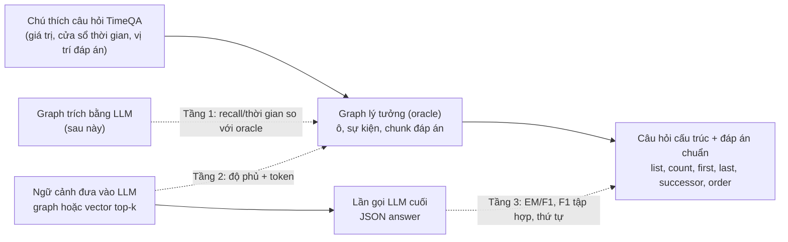

# 08. Thiết kế đo Cơ chế 2 (graph sự kiện): dữ liệu, chỉ số, đầu ra cuối

Ghi ngày 2026-10-27. Bổ sung cho [`decisions/10`](../decisions/10_TIMELINE_GRAPH_AND_VECTOR_LINK.md) (mục "Truy xuất và phương pháp so sánh", "Đánh giá việc trích xuất sự kiện"): file này nói **cụ thể cách dựng dữ liệu đo, đo cái gì ở từng tầng, và đầu ra của lần gọi LLM cuối được chấm ra sao**. Dữ liệu và bộ chấm đã dựng bằng code, **không gọi LLM**; phần kiểm tay còn lại ghi ở mục "Phần phải làm tay".

## Ba tầng đo (tách để biết lỗi nằm ở đâu)



| Tầng | Hỏi gì | Cần LLM? | Mã |
|---|---|---|---|
| 1. Trích xuất | Graph trích ra có đủ và đúng sự kiện so với oracle? | Có (lần trích) | chưa làm; cách chấm ở `decisions/10` |
| 2. Ngữ cảnh | Ngữ cảnh (graph hay top-k) có đủ sự kiện, tốn bao nhiêu token? | Không | `metrics_timeline.event_coverage`, `timeline_gold.count_tokens` |
| 3. Đầu ra cuối | Câu trả lời của LLM sau khi đọc ngữ cảnh có đúng? | Có (lần sinh) | `metrics_timeline.score_answer` |

Graph lý tưởng đưa tầng 1 về 1.0 theo định nghĩa, nên nó cho **cận trên**: nếu graph oracle còn không hơn vector ở tầng 2 hoặc 3 thì graph trích ra cũng không hơn (đây chính là cổng go/no-go ở `decisions/10`).

## Cách tạo dữ liệu (không LLM)

`python scripts/build_timeline_gold.py --subset real` (module `tam.evaluation.timeline_gold`):

1. Lấy mọi câu hỏi `hard` của TimeQA (C và D, mọi split) thuộc các trang của bộ con; mỗi `(page_id, relation, q_index)` một dòng (C và D trùng sự kiện, bỏ trùng).
2. Gộp theo **ô** (trang, quan hệ). Trong ô, gộp theo giá trị đáp án (chuẩn hóa) thành **sự kiện**: `start` = đầu nhỏ nhất, `end` = cuối lớn nhất của các cửa sổ chú thích có giá trị đó; `chunk_ids` = các chunk chứa đáp án (suy từ vị trí ký tự bằng `gold_paragraph_indices`, cùng cách nhãn chunk của Cơ chế 1).
3. Sắp sự kiện theo `(start, end)`. Cờ `complete` = các `q_index` của ô liên tục từ 0.
4. Sinh câu hỏi cấu trúc từ dòng thời gian (ô có ít nhất 2 giá trị):

| Loại | Mẫu câu hỏi | Đáp án chuẩn | Chấm |
|---|---|---|---|
| `list` | List all values of '<quan hệ>' for X in chronological order | danh sách giá trị theo thời gian | F1 tập hợp, thứ tự, đúng hoàn toàn |
| `count` | How many different values … | số nguyên | đúng số |
| `first` | earliest known value | giá trị đầu | EM, F1, contains |
| `last` | latest known value (chỉ ô `complete`) | giá trị cuối | EM, F1, contains |
| `successor` | what came right after '<giá trị>' (chỉ cặp liền kề thật trong ô `complete`) | giá trị kế | EM, F1, contains |
| `order` | which came first: A or B | giá trị đến trước | EM, F1, contains |

Mỗi câu hỏi có sẵn: `gold_answer`, `gold_event_ids`, **`gold_chunk_ids`** (các chunk đáp án), `graph_context` (đúng văn bản graph đưa cho LLM), `ideal_output` và `tokens` (graph / chunk đáp án / cả trang). Ghi ở `dataset/eval/timeline_gold_<subset>.json` (ô, sự kiện) và `timeline_questions_<subset>.jsonl`.

**Đầu ra lý tưởng của lần gọi cuối** là `{"answer": <gold_answer>}`; đầu ra thật của LLM cũng phải theo khuôn này (danh sách cho `list`, số cho `count`, chuỗi cho các loại còn lại). Script tự kiểm: chấm `ideal_output` phải được điểm 1.0 ở mọi chỉ số (hiện 0 lỗi). Chấm thật ở tầng 3:

| Chỉ số | Áp dụng | Cách tính |
|---|---|---|
| `exact`, `f1`, `contains` | đáp án đơn | cách SQuAD của `tam.generation.scoring` (bỏ dấu, bỏ mạo từ); từ chối tính 0 |
| `f1`, `precision`, `recall` | `list` | ghép mỗi giá trị chuẩn với tối đa một giá trị dự đoán (bằng nhau, chứa nhau theo từ, hoặc F1 từ ≥ 0.8) |
| `order` | `list` | trong các giá trị đã ghép, tỉ lệ cặp đúng thứ tự tương đối |
| `exact` | `list` | đúng cả tập lẫn thứ tự |
| `exact` | `count` | số đọc được (`3`, `"three"`, `"3 coaches"`) bằng đáp án |

Báo cáo theo loại câu hỏi, và **chỉ tính câu `reliable`** (ô `complete`) làm kết quả chính.

## Số liệu của dữ liệu đã dựng (bộ `real`, đo 2026-10-27)

- 217 ô, 156 ô `complete`, 721 sự kiện (`decisions/10` ghi 749: cách đếm khác, ở đây gộp các câu trùng giá trị trong cùng ô). Sự kiện mỗi ô: 1→13 ô, 2→60, 3→67, 4→41, 5→17, ≥6→19.
- 1,241 câu hỏi: `list` 204, `count` 204, `first` 204, `order` 167, `last` 146, `successor` 316; 1,019 câu `reliable`.
- Chỉ số sạch (đã có test): `tests/test_timeline_eval.py` (8 test), không cần Qdrant.

**Token trung vị (ô `complete`)**, ước lượng bằng số ký tự chia 4:

| Loại | Graph lý tưởng | Đúng các chunk đáp án | Cả trang |
|---|---:|---:|---:|
| list / count | 46 | 126 | 2,290 |
| first | 19 | 104 | 2,290 |
| last | 20 | 108 | 2,290 |
| successor | 30 | 120 | 2,167 |
| order | 31 | 112 | 2,031 |

Graph nhỏ hơn chunk đáp án ở 95–100% câu. **Không nên đọc đây là bằng chứng:** chunk đáp án là cận dưới lý tưởng của vector (một retriever thật phải lấy thêm chunk không liên quan), còn graph oracle không mất thông tin do trích sai; hai đầu đều lạc quan. So sánh công bằng phải dùng top-k thật (dưới đây) và graph trích bằng LLM.

**Độ phủ của vector top-k (xấp xỉ, bộ `tune`, lần chạy `output/20261024_154840`, ô `complete` có ≥3 sự kiện, 357 lượt):**

| k | Độ phủ chặt | Độ phủ lỏng |
|---|---:|---:|
| 3 | 0.62 | 0.63 |
| 5 | 0.77 | 0.77 |
| 10 | 0.90 | 0.90 |
| 20 | 0.91 | 0.92 |

Giới hạn của số này: (a) xếp hạng lấy từ câu hỏi **điểm thời gian** của ô, không phải câu "liệt kê", nên với câu liệt kê thật vector có thể kém hoặc khác; (b) lần chạy chỉ lưu tối đa 15 chunk nên k=20 thực chất là k≤15; (c) bộ `test_clean` không dùng ở bước này (giữ cho lần chốt duy nhất). Đọc sơ bộ: vector top-5 bỏ sót khoảng 1/4 sự kiện của ô nhiều sự kiện, top-10 gần đủ; khoảng cách này là chỗ graph có thể thắng, nhưng phải đo bằng câu hỏi liệt kê thật trước khi kết luận.

## Phần phải làm tay (không tự sinh được)

Có những thứ đáp án chuẩn không suy được từ chú thích, nên tạo bằng tay hoặc kiểm tay:

| Việc | Vì sao không tự động | Cỡ mẫu đề xuất |
|---|---|---|
| **Thời lượng** ("giữ chức bao lâu") | `start`/`end` của oracle chỉ là biên cửa sổ chú thích, không phải ngày thật | ~30 sự kiện, đọc đoạn gốc ghi ngày thật |
| **Khoảng trống** ("có giai đoạn nào không giữ chức") | 22.5% ô thiếu đoạn (`q_index` không liên tục); không phân biệt trống thật với bị thiếu chú thích | ~30 ô, đọc cả trang xác nhận |
| **Precision của dòng thời gian** | oracle chưa đầy đủ nên "sự kiện thừa" có thể là đúng thật | ~100 nút trích ra mà oracle không có, gán đúng/sai |
| **Câu hỏi ghép hai ô** | chỉ 13/204 trang eval có ≥2 quan hệ | viết tay vài câu để minh họa, không báo thống kê |
| **Kiểm ngẫu nhiên oracle** | biên thời gian xấp xỉ, giá trị gộp theo chuỗi chuẩn hóa | ~40 ô, so oracle với đoạn gốc; ghi tỉ lệ sai |

Khuôn bản ghi tay (một dòng JSON mỗi câu, cùng schema với `timeline_questions_*.jsonl`, thêm `source: "hand"` và `note`):

```json
{"qid": "/wiki/1._FC_Köln#P286#duration-0", "cell_id": "/wiki/1._FC_Köln#P286", "kind": "duration",
 "question": "How long was <tên> head coach of 1. FC Köln?", "gold_answer": "2 years", "answer_type": "entity",
 "gold_chunk_ids": ["/wiki/1._FC_Köln#26"], "reliable": true, "source": "hand", "note": "đọc từ đoạn #26: 2017-2019"}
```

## Thứ tự chạy (phần còn lại)

1. Đã xong: dữ liệu oracle, câu hỏi, bộ chấm (file này).
2. **Go/no-go**: sinh câu trả lời bằng LLM với ngữ cảnh (a) `graph_context` oracle, (b) top-k vector (k = 3, 5, 10; thêm k thích nghi), (c) chunk đáp án làm tham chiếu; chấm tầng 3 theo loại. Dùng bộ `tune`/`real`, **không** dùng `test_clean`. Mỗi lần gọi theo một khuôn đầu ra `{"answer": ...}` (cần thêm prompt cho nhóm câu cấu trúc; sổ prompt ở [`decisions/03`](../decisions/03_PROMPT_CHANGELOG.md)).
3. Nếu oracle hơn rõ vector ở ít nhất một loại có ý nghĩa (liệt kê/đếm/kế nhiệm), làm trích xuất ~20 ô (tầng 1) rồi toàn bộ.
4. Chốt trên bộ giữ riêng, một lần.

Chi phí lần gọi LLM ở bước 2: khoảng 1,019 câu `reliable` × 3 phương án; ngữ cảnh ngắn (vài chục đến vài trăm token), gộp lô được như `scripts/generate_answers.py`.

## Hạn chế

1. Oracle lấy từ chú thích câu hỏi, không phải từ văn bản: sự kiện nào TimeQA không đặt câu hỏi thì không có, nên độ phủ đo được là cận dưới và precision không đo được tự động.
2. Biên thời gian của sự kiện là biên cửa sổ chú thích (độ mịn tháng/năm), không phải ngày thật; các câu về thời lượng/khoảng trống vì thế để phần tay.
3. Giá trị gộp theo chuỗi chuẩn hóa: cùng thực thể viết khác nhau sẽ thành hai sự kiện, và `normalize` bỏ mạo từ nên một giá trị chỉ là "A" sẽ rỗng (chưa gặp trong dữ liệu thật).
4. Token đếm bằng ký tự chia 4, chỉ để so tương đối; tỉ lệ thật phụ thuộc tokenizer của mô hình dùng.
5. Câu hỏi cấu trúc do mẫu cố định sinh ra, đơn điệu hơn câu người dùng thật; router (`temporal`/`timeline`) cần thêm câu diễn đạt đa dạng nếu muốn đo riêng.

## Liên quan

- Thiết kế và giả thuyết: [`decisions/10`](../decisions/10_TIMELINE_GRAPH_AND_VECTOR_LINK.md).
- Mã: `src/tam/evaluation/{timeline_gold,metrics_timeline}.py`, `scripts/build_timeline_gold.py`, `tests/test_timeline_eval.py`.
- Dữ liệu sinh ra: `dataset/eval/timeline_gold_real.json`, `dataset/eval/timeline_questions_real.jsonl`.
