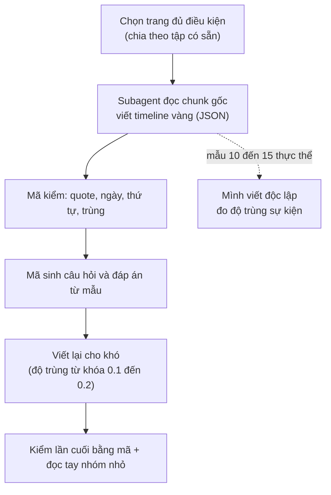

# 10. Thiết kế bộ dữ liệu tự dựng cho Cơ chế 2 (timeline vàng viết từ chunk gốc)

Ghi ngày 2026-11-04. **Trạng thái: đề xuất, chưa làm gì** (chưa viết timeline nào, chưa chạy subagent, chưa sửa code). File này ghi lại các điều đã bàn để khỏi mất; các con số đếm bên dưới là ước lượng thô, có chú thích rõ.

Quan hệ với tài liệu khác: [`08_TIMELINE_EVAL_DESIGN.md`](08_TIMELINE_EVAL_DESIGN.md) thiết kế đo dựa trên chú thích TimeQA (oracle dựng từ nhãn có sẵn, `timeline_gold` có lỗi gold, xem `src/tam/evaluation/timeline_gold.py`); file này là hướng thay thế: **người (hoặc subagent) đọc chunk gốc và viết timeline vàng**, câu hỏi sinh bằng mã. Lý do chọn tự dựng: các bộ công bố (ECT-QA, TLQA, ADQAB, TDBench) đều lệch miền, thiếu gold chunk hoặc thiếu văn bản (xem `research/benchmarks_for_comparison/timeline_summarization/` và `03_EVALUATION_PLAN_BY_MECHANISM.md`).

## 1. Nguồn và quy mô

- **Nguồn:** các trang `real` đã chia sẵn theo trang thành ba tập không trùng nhau: `tune` 203 trang, `valid` 167, `test_clean` 186.
- **Quy mô đề xuất (chưa chốt):** tune 300, valid 300, test 400 câu; khoảng 35, 35, 45 thực thể (mỗi thực thể khoảng 8 đến 9 câu). Mỗi trang là một thực thể chính.
- **Cỡ mẫu thực là số thực thể, không phải số câu**: các câu cùng thực thể dùng chung timeline nên tương quan. Giả định hệ số tương quan trong nhóm ≈ 0.3 (**chưa đo**) thì 400 câu / 45 thực thể tương đương khoảng 109 câu độc lập. Báo cáo phải ghi cả hai số và tính sai số chuẩn gom theo thực thể.
- **Ngưỡng nhận biết khác biệt:** với 100 câu độc lập, hai phương pháp cần lệch khoảng 11 đến 14 câu mới đạt 2 sai số chuẩn; bộ này chỉ phân biệt được chênh lớn (kiểu oracle so với vector top-k), không phân biệt hai biến thể đồ thị lệch vài điểm.
- **Đếm trang đủ điều kiện (bước 0):** chỉ là ước lượng, vì `extractions.jsonl` chỉ lưu 300 ký tự đầu mỗi chunk (`scripts/ingest.py:68`) nên số năm đếm được bị đánh thấp. Với điều kiện "≥3 chunk có ≥2 năm và ≥10 năm khác nhau" còn 154 / 203 (tune), 138 / 167 (valid), 141 / 186 (test_clean). Khi làm thật phải đọc văn bản đầy đủ từ `dataset/full_dataset/pages.jsonl`.

## 2. Quy trình sinh



- **Subagent chỉ viết timeline**, không biết câu hỏi và không biết hệ nào được so. Câu hỏi sinh bằng mã rồi viết lại cho khó (cùng cách với bộ kiểm khả năng ở `eval/09`).
- **Mẫu thử trước khi nhân rộng:** 5 đến 10 thực thể, hai bên (mình và subagent) viết độc lập, đo: sự kiện cả hai cùng có / tổng, ngày khớp, sự kiện chỉ một bên có (đọc tay xem lỗi bên nào). Độ trùng thấp (ví dụ dưới 80%) nghĩa là tiêu chí "thế nào là một sự kiện" chưa rõ, phải sửa hướng dẫn trước.
- **Cỡ việc ước lượng:** trung bình khoảng 30 chunk một trang (5,995 chunk / 203 trang của tune), nên 3 đến 4 trang mỗi subagent (**ước lượng, chưa đo**); khoảng 30 subagent cho 115 trang. Thử 5 trang trước.
- Sự kiện bị bỏ sót là lỗi khó thấy nhất (đếm và liệt kê sai nếu timeline vàng thiếu): chỉ kiểm bằng mã không đủ, nên cần bước so hai bên.

## 3. Cấu trúc timeline vàng

```json
{
  "page_id": "/wiki/Nguyen_Van_A",
  "events": [
    {"id": "e2", "date": "1991", "grain": "year", "track": "affiliation", "label": "club",
     "text": "moved to club Y",
     "evidence": [
       {"chunk_id": "/wiki/Nguyen_Van_A#1", "role": "date",        "quote": "In 1991 he left X and moved"},
       {"chunk_id": "/wiki/Nguyen_Van_A#2", "role": "description", "quote": "to Y, where he stayed for seven seasons"}
     ]}
  ],
  "undated_mentions": ["became a coach (no date given)"]
}
```

(Ví dụ minh họa, tên và chunk bịa.)

| Trường | Ý nghĩa |
|---|---|
| `id` | Nhãn sự kiện **trong trang đó**; khóa toàn cục là `page_id` + `id`. Mã gán sau khi sắp theo ngày; hòa ngày thì đánh dấu |
| `date` | Ngày ISO đúng mức độ văn bản nêu, không bổ sung |
| `grain` | `year`, `month` hoặc `day`; dùng để biết cặp nào so thứ tự được (cùng mức mịn và trùng thì "hòa", loại khỏi câu thứ tự) |
| `track` | Nhóm chủ đề của sự kiện (mục 4) |
| `label` | Nhãn tự do ngắn, tùy chọn; bắt buộc khi `track` là `other` |
| `text` | Mô tả ngắn bằng tiếng Anh, khoảng 10 từ; dùng chấm độ phủ khi câu trả lời là tóm tắt |
| `evidence` | Danh sách chunk chứa bằng chứng |
| `evidence[].role` | `both`: chunk tự có cả ngày và mô tả; `date`: chỉ có ngày; `description`: chỉ có phần mô tả (và không chứa ngày của sự kiện đó) |
| `evidence[].quote` | Trích nguyên văn, phải nằm đúng trong `chunk_id` đi kèm |
| `undated_mentions` | Sự kiện có nhắc nhưng không có ngày; dùng cho nhóm "không đủ thông tin" |

**Gold chunk tối thiểu của một sự kiện** là một chunk `both`, hoặc một cặp `date` + `description`. Nếu nhiều chunk `both` cùng nêu một sự kiện thì chỉ cần một (lựa chọn "hoặc"). Gold chunk của một câu là hợp các nhóm tối thiểu của những sự kiện câu đó dùng; một chunk có thể thuộc nhiều sự kiện, và khi hợp tập thì chỉ tính một lần.

**Ba tình huống một sự kiện trải nhiều chunk:** (1) ngày ở chunk này, mô tả ở chunk sau; (2) mốc bắt đầu và kết thúc ở hai chunk khác nhau; (3) cùng sự kiện nhắc ở hai chunk (tóm tắt rồi chi tiết), ghi một sự kiện nhiều chunk, không đếm hai lần.

**Hai cách chấm khai trước, báo cả hai:** *hit* (có ít nhất một chunk vàng trong kết quả) và *recall* (tỉ lệ chunk vàng tối thiểu có trong kết quả, lựa chọn "hoặc" tính một trong hai).

**Mã kiểm:** `chunk_id` tồn tại; `quote` có nguyên văn trong chunk và chứa ngày (với `date`/`both`); `description` không chứa ngày; sắp theo ngày đúng thứ tự; không trùng sự kiện; trang phải có ≥4 sự kiện trải ≥2 chunk.

## 4. Khung track

Khung dưới dựa trên 64 quan hệ Wikidata của 1,394 câu `real` (tune, valid, test_clean); nhãn quan hệ gán theo trí nhớ về Wikidata, chưa đối chiếu từng mã (không chắc: P4791, P2962, P8047, P559). Tỉ lệ là trước khi gộp.

| Track | Gồm | Ghi chú |
|---|---|---|
| `role` | chức vụ, nhiệm kỳ, người đứng đầu, quân hàm và chỉ huy (nhãn phụ `military`) | trước gộp: role 20.5% + military 9.5% |
| `affiliation` | nơi làm việc, đội, đảng, tổ chức, giải đấu | 18.7% |
| `location` | nơi ở, nơi làm việc, trụ sở, quốc gia | 13.8% |
| `ownership_structure` | sở hữu, vận hành, công ty mẹ, nhà xuất bản, hãng đĩa | 13.6% |
| `work` | **sản phẩm** người đó làm ra (phát hành, trình diễn, dự án) | 11.8% |
| `naming` | tên chính thức, đổi tên | 5.8% |
| `family` | vợ/chồng | 2.5% |
| `education` | học tại | 1.6% |
| `other` | còn lại, bắt buộc kèm `label` | giải thưởng/di sản (2.2%) vào đây hoặc nhóm riêng nếu cần |

- **Phân biệt dễ nhầm:** `work` là sản phẩm; `role` là vị trí giữ ("đạo diễn phim X" là `work`, "giám đốc hãng phim Y" là `role`). Mơ hồ thì ưu tiên `role` > `affiliation` > `work`.
- **Lối thoát:** `label` tự do cho `other`; sau mẫu thử, nếu một `label` chiếm hơn 5% sự kiện thì thành track mới (ngưỡng khai trước).
- Khung khai **trước** khi viết, không sửa theo kết quả. Sau mẫu thử đo tỉ lệ hai bên gán `track` khác nhau trên cùng sự kiện (vì vẫn có nhầm).
- Một trang chỉ có các track nó thực sự có (≥3 sự kiện mỗi track). Sinh và mất thường không thành track.

## 5. Dùng tiêu đề mục để gợi ý track

- `dataset/full_dataset/pages.jsonl`: mỗi trang có `paragraphs` gồm `{title, text}`; `title` là **tên mục** (ví dụ "Early life", "Club career", "Honors and awards"). Trên 127,233 đoạn chỉ 8.9% có tiêu đề trùng tên trang; 4,796 / 4,815 trang có ít nhất một tiêu đề mục.
- `src/tam/ingestion/chunking.py` đã đặt văn bản chunk dạng `"<tên trang> | <tên mục>\n..."`, nên tiêu đề mục đã nằm trong embedding và BM25.
- **Cách dùng:** đưa `title` của mục vào đầu vào của subagent làm gợi ý, và dùng làm kiểm chéo (`track` subagent gán nên khớp nhóm tiêu đề, lệch nhiều thì xem lại). **Không** dùng tiêu đề làm nhãn duy nhất: "History", "Career" chứa nhiều track; có tiêu đề là câu trích dẫn ("Nemtsov said :") do tách đoạn lỗi.
- **Điều cần kiểm lại:** docstring của `chunk_document` ghi "mỗi section thành một chunk", nhưng dữ liệu cho thấy trang Boris Nemtsov có 100 chunk (trung bình khoảng 377 ký tự) và một mục dài bị cắt thành nhiều chunk cùng tiêu đề; chưa kiểm nguyên nhân. Đây cũng là nguồn của tình huống "sự kiện trải nhiều chunk". Chưa kiểm chunk có chồng lấn (overlap) hay không.
- **Cho truy vấn:** lưu `section_title` thành trường payload để lọc hoặc tăng điểm theo track là phương án rẻ nhất (không cần LLM phân loại), nhưng payload hiện chỉ index 4 trường theo thiết kế nên thêm trường là thay đổi thiết kế; chưa nên làm khi chưa có chứng cứ. Cách chọn track lúc truy vấn (cạnh có kiểu hay chỉ thực thể và thời gian) thuộc thiết kế Cơ chế 2, không bị khung track của bộ dữ liệu áp đặt.

## 6. Loại câu hỏi

Quy tắc loại câu: **đáp án phải dùng ≥2 sự kiện** của timeline (nếu một lọc theo mốc lấy được một sự kiện thì đó là Cơ chế 1). Ví dụ "Which club did A join in 1991?" là Cơ chế 1, **không** đưa vào.

| Loại | Gold chunk |
|---|---|
| Liệt kê, đếm | các chunk của mọi sự kiện trong track |
| Thứ tự, khoảng cách | chunk của hai sự kiện |
| Đầu / cuối / kế tiếp | khai trước: tính cả chuỗi (để biết là đầu/cuối), không chỉ chunk chứa đáp án |
| Tóm tắt | chấm bằng độ phủ sự kiện (khớp `text`/`date`), không cần LLM judge (chưa chốt) |
| Không đủ thông tin (nhóm riêng) | sự kiện có `undated_mentions`, hoặc cặp trùng độ mịn, hoặc "sau sự kiện cuối". Đáp án đúng là "kho không nêu" chứ không phải "không có"; khoảng 10 câu mỗi tập; chấm riêng: tỉ lệ từ chối đúng và tỉ lệ bịa đáp án; đọc tay từng câu |

- **Bỏ nhóm `t_now`** (khoảng cách đến hiện tại, "N năm qua"): thuộc tính hạn và hiện tại của Cơ chế 1, không phải gom sự kiện (người dùng quyết 2026-11-04).
- Câu chéo track (ví dụ "lúc chuyển đội Y thì ông ở đâu") để sau, chưa làm đợt đầu.
- Mỗi trang không đều số track, nên "8 đến 9 câu mỗi thực thể" chỉ là trung bình; báo cáo ghi số trang thực dùng.

## 7. So sánh hệ

1. Vector top-k (cấu hình X của `eval/09`), LLM gom sự kiện từ chunk trả về.
2. Oracle đồ thị: đưa timeline vàng vào, đo trần.
3. Đồ thị trích bằng LLM (hệ thật).
4. Nếu còn thời gian: tái hiện DyG-RAG hoặc TG-RAG, chỉ khi (1) và (2) cho thấy còn chỗ để hơn.

Go/no-go: so (2) với (1); oracle không hơn vector top-k rõ rệt thì Cơ chế 2 không có lý do tồn tại ở bộ này.

## 8. Điểm yếu cần ghi nhận

- Một tác giả (mình) ra quy tắc, và model viết timeline cùng họ với mình: giảm bằng mẫu hai bên viết độc lập và, nếu muốn độc lập hơn, một mẫu kiểm bằng model khác họ (ví dụ Gemini).
- Không có số công bố để đặt cạnh, nên chỉ nói "hơn baseline của chính mình trên bộ này".
- Nhỏ và chỉ trong miền Wikipedia.
- Chấm tóm tắt bằng độ phủ sự kiện đo "đủ chưa", không đo văn phong.
- ECT-QA và TLQA có thể chạy một lần làm kiểm tra tổng quát hóa phụ, không dùng để chọn (chưa quyết).

## 9. Quyết định chưa chốt

1. Cỡ bộ (300/300/400 hay nhỏ hơn) sau khi đếm bước 0 bằng văn bản đầy đủ.
2. Có chạy ECT-QA làm kiểm tra phụ không.
3. Tóm tắt chỉ chấm bằng độ phủ sự kiện hay thêm LLM judge.
4. Khung track cuối cùng (gộp `military` vào `role`; xử lý giải thưởng).
