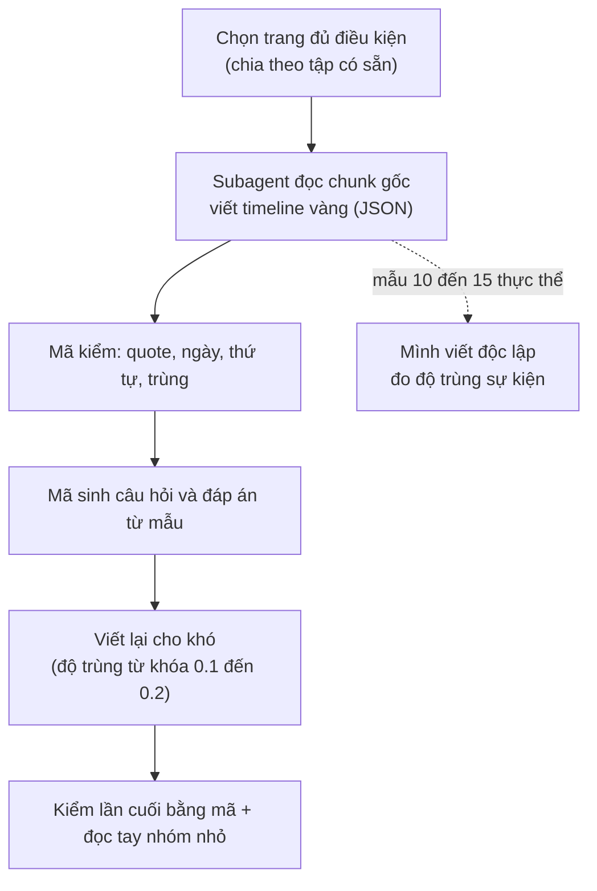

# 10. Thiết kế bộ dữ liệu tự dựng cho Cơ chế 2 (timeline vàng viết từ chunk gốc)

Ghi ngày 2026-11-04. **Trạng thái: thiết kế (mục 1 đến 9) là đề xuất; đã chạy mẫu thử 5 và 10 trang để kiểm quy trình viết timeline (mục 10).** Chưa sinh câu hỏi, chưa chạy hệ nào trên bộ này. Các con số đếm ở mục 1 đến 9 là ước lượng thô, có chú thích rõ.

Quan hệ với tài liệu khác: [`08_TIMELINE_EVAL_DESIGN.md`](08_TIMELINE_EVAL_DESIGN.md) thiết kế đo dựa trên chú thích TimeQA (oracle dựng từ nhãn có sẵn, `timeline_gold` có lỗi gold, xem `src/tam/evaluation/timeline_gold.py`); file này là hướng thay thế: **người (hoặc subagent) đọc chunk gốc và viết timeline vàng**, câu hỏi sinh bằng mã. Lý do chọn tự dựng: các bộ công bố (ECT-QA, TLQA, ADQAB, TDBench) đều lệch miền, thiếu gold chunk hoặc thiếu văn bản (xem `research/benchmarks_for_comparison/timeline_summarization/` và `03_EVALUATION_PLAN_BY_MECHANISM.md`).

## 1. Nguồn và quy mô

- **Nguồn:** các trang `real` đã chia sẵn theo trang thành ba tập không trùng nhau: `tune` 203 trang, `valid` 167, `test_clean` 186.
- **Quy mô đề xuất (chưa chốt):** tune 300, valid 300, test 400 câu; khoảng 35, 35, 45 thực thể (mỗi thực thể khoảng 8 đến 9 câu). Mỗi trang là một thực thể chính.
- **Cỡ mẫu thực là số thực thể, không phải số câu**: các câu cùng thực thể dùng chung timeline nên tương quan. Giả định hệ số tương quan trong nhóm ≈ 0.3 (**chưa đo**) thì 400 câu / 45 thực thể tương đương khoảng 109 câu độc lập. Báo cáo phải ghi cả hai số và tính sai số chuẩn gom theo thực thể.
- **Ngưỡng nhận biết khác biệt:** với 100 câu độc lập, hai phương pháp cần lệch khoảng 11 đến 14 câu mới đạt 2 sai số chuẩn; bộ này chỉ phân biệt được chênh lớn (kiểu oracle so với vector top-k), không phân biệt hai biến thể đồ thị lệch vài điểm.
- **Đếm trang đủ điều kiện (bước 0):** chỉ là ước lượng, vì `extractions.jsonl` chỉ lưu 300 ký tự đầu mỗi chunk (`scripts/ingest.py:68`) nên số năm đếm được bị đánh thấp. Với điều kiện "≥3 chunk có ≥2 năm và ≥10 năm khác nhau" còn 154 / 203 (tune), 138 / 167 (valid), 141 / 186 (test_clean). Khi làm thật phải đọc văn bản đầy đủ từ `dataset/full_dataset/pages.jsonl`.

## 2. Quy trình sinh



- **Subagent chỉ viết timeline**, không biết câu hỏi và không biết hệ nào được so. Câu hỏi sinh bằng mã rồi viết lại cho khó (cùng cách với bộ kiểm khả năng ở `eval/09`).
- **Mẫu thử trước khi nhân rộng:** 5 đến 10 thực thể, hai bên (mình và subagent) viết độc lập, đo: sự kiện cả hai cùng có / tổng, ngày khớp, sự kiện chỉ một bên có (đọc tay xem lỗi bên nào). Độ trùng thấp (ví dụ dưới 80%) nghĩa là tiêu chí "thế nào là một sự kiện" chưa rõ, phải sửa hướng dẫn trước.
- **Cỡ việc ước lượng:** trung bình khoảng 30 chunk một trang (5,995 chunk / 203 trang của tune), nên 3 đến 4 trang mỗi subagent (**ước lượng, chưa đo**); khoảng 30 subagent cho 115 trang. Thử 5 trang trước.
- Sự kiện bị bỏ sót là lỗi khó thấy nhất (đếm và liệt kê sai nếu timeline vàng thiếu): chỉ kiểm bằng mã không đủ, nên cần bước so hai bên.

## 3. Cấu trúc timeline vàng

```json
{
  "page_id": "/wiki/Nguyen_Van_A",
  "events": [
    {"id": "e2", "date": "1991", "grain": "year", "track": "affiliation", "label": "club",
     "text": "moved to club Y",
     "evidence": [
       {"chunk_id": "/wiki/Nguyen_Van_A#1", "role": "date",        "quote": "In 1991 he left X and moved"},
       {"chunk_id": "/wiki/Nguyen_Van_A#2", "role": "description", "quote": "to Y, where he stayed for seven seasons"}
     ]}
  ],
  "undated_mentions": ["became a coach (no date given)"]
}
```

(Ví dụ minh họa, tên và chunk bịa.)

| Trường | Ý nghĩa |
|---|---|
| `id` | Nhãn sự kiện **trong trang đó**; khóa toàn cục là `page_id` + `id`. Mã gán sau khi sắp theo ngày; hòa ngày thì đánh dấu |
| `date` | Ngày ISO đúng mức độ văn bản nêu, không bổ sung |
| `grain` | `year`, `month` hoặc `day`; dùng để biết cặp nào so thứ tự được (cùng mức mịn và trùng thì "hòa", loại khỏi câu thứ tự) |
| `track` | Nhóm chủ đề của sự kiện (mục 4) |
| `label` | Nhãn tự do ngắn, tùy chọn; bắt buộc khi `track` là `other` |
| `text` | Mô tả ngắn bằng tiếng Anh, khoảng 10 từ; dùng chấm độ phủ khi câu trả lời là tóm tắt |
| `evidence` | Danh sách chunk chứa bằng chứng |
| `evidence[].role` | `both`: chunk tự có cả ngày và mô tả; `date`: chỉ có ngày; `description`: chỉ có phần mô tả (và không chứa ngày của sự kiện đó) |
| `evidence[].quote` | Trích nguyên văn, phải nằm đúng trong `chunk_id` đi kèm |
| `undated_mentions` | Sự kiện có nhắc nhưng không có ngày; dùng cho nhóm "không đủ thông tin" |

**Gold chunk tối thiểu của một sự kiện** là một chunk `both`, hoặc một cặp `date` + `description`. Nếu nhiều chunk `both` cùng nêu một sự kiện thì chỉ cần một (lựa chọn "hoặc"). Gold chunk của một câu là hợp các nhóm tối thiểu của những sự kiện câu đó dùng; một chunk có thể thuộc nhiều sự kiện, và khi hợp tập thì chỉ tính một lần.

**Ba tình huống một sự kiện trải nhiều chunk:** (1) ngày ở chunk này, mô tả ở chunk sau; (2) mốc bắt đầu và kết thúc ở hai chunk khác nhau; (3) cùng sự kiện nhắc ở hai chunk (tóm tắt rồi chi tiết), ghi một sự kiện nhiều chunk, không đếm hai lần.

**Hai cách chấm khai trước, báo cả hai:** *hit* (có ít nhất một chunk vàng trong kết quả) và *recall* (tỉ lệ chunk vàng tối thiểu có trong kết quả, lựa chọn "hoặc" tính một trong hai).

**Mã kiểm:** `chunk_id` tồn tại; `quote` có nguyên văn trong chunk và chứa ngày (với `date`/`both`); `description` không chứa ngày; sắp theo ngày đúng thứ tự; không trùng sự kiện; trang phải có ≥4 sự kiện trải ≥2 chunk.

## 4. Khung track

Khung dưới dựa trên 64 quan hệ Wikidata của 1,394 câu `real` (tune, valid, test_clean); nhãn quan hệ gán theo trí nhớ về Wikidata, chưa đối chiếu từng mã (không chắc: P4791, P2962, P8047, P559). Tỉ lệ là trước khi gộp.

| Track | Gồm | Ghi chú |
|---|---|---|
| `role` | chức vụ, nhiệm kỳ, người đứng đầu, quân hàm và chỉ huy (nhãn phụ `military`) | trước gộp: role 20.5% + military 9.5% |
| `affiliation` | nơi làm việc, đội, đảng, tổ chức, giải đấu | 18.7% |
| `location` | nơi ở, nơi làm việc, trụ sở, quốc gia | 13.8% |
| `ownership_structure` | sở hữu, vận hành, công ty mẹ, nhà xuất bản, hãng đĩa | 13.6% |
| `work` | **sản phẩm** người đó làm ra (phát hành, trình diễn, dự án) | 11.8% |
| `naming` | tên chính thức, đổi tên | 5.8% |
| `family` | vợ/chồng | 2.5% |
| `education` | học tại | 1.6% |
| `other` | còn lại, bắt buộc kèm `label` | giải thưởng/di sản (2.2%) vào đây hoặc nhóm riêng nếu cần |

- **Phân biệt dễ nhầm:** `work` là sản phẩm; `role` là vị trí giữ ("đạo diễn phim X" là `work`, "giám đốc hãng phim Y" là `role`). Mơ hồ thì ưu tiên `role` > `affiliation` > `work`.
- **Lối thoát:** `label` tự do cho `other`; sau mẫu thử, nếu một `label` chiếm hơn 5% sự kiện thì thành track mới (ngưỡng khai trước).
- Khung khai **trước** khi viết, không sửa theo kết quả. Sau mẫu thử đo tỉ lệ hai bên gán `track` khác nhau trên cùng sự kiện (vì vẫn có nhầm).
- Một trang chỉ có các track nó thực sự có (≥3 sự kiện mỗi track). Sinh và mất thường không thành track.

## 5. Dùng tiêu đề mục để gợi ý track

- `dataset/full_dataset/pages.jsonl`: mỗi trang có `paragraphs` gồm `{title, text}`; `title` là **tên mục** (ví dụ "Early life", "Club career", "Honors and awards"). Trên 127,233 đoạn chỉ 8.9% có tiêu đề trùng tên trang; 4,796 / 4,815 trang có ít nhất một tiêu đề mục.
- `src/tam/ingestion/chunking.py` đã đặt văn bản chunk dạng `"<tên trang> | <tên mục>\n..."`, nên tiêu đề mục đã nằm trong embedding và BM25.
- **Cách dùng:** đưa `title` của mục vào đầu vào của subagent làm gợi ý, và dùng làm kiểm chéo (`track` subagent gán nên khớp nhóm tiêu đề, lệch nhiều thì xem lại). **Không** dùng tiêu đề làm nhãn duy nhất: "History", "Career" chứa nhiều track; có tiêu đề là câu trích dẫn ("Nemtsov said :") do tách đoạn lỗi.
- **Điều cần kiểm lại:** docstring của `chunk_document` ghi "mỗi section thành một chunk", nhưng dữ liệu cho thấy trang Boris Nemtsov có 100 chunk (trung bình khoảng 377 ký tự) và một mục dài bị cắt thành nhiều chunk cùng tiêu đề; chưa kiểm nguyên nhân. Đây cũng là nguồn của tình huống "sự kiện trải nhiều chunk". Chưa kiểm chunk có chồng lấn (overlap) hay không.
- **Cho truy vấn:** lưu `section_title` thành trường payload để lọc hoặc tăng điểm theo track là phương án rẻ nhất (không cần LLM phân loại), nhưng payload hiện chỉ index 4 trường theo thiết kế nên thêm trường là thay đổi thiết kế; chưa nên làm khi chưa có chứng cứ. Cách chọn track lúc truy vấn (cạnh có kiểu hay chỉ thực thể và thời gian) thuộc thiết kế Cơ chế 2, không bị khung track của bộ dữ liệu áp đặt.

## 6. Loại câu hỏi

Quy tắc loại câu: **đáp án phải dùng ≥2 sự kiện** của timeline (nếu một lọc theo mốc lấy được một sự kiện thì đó là Cơ chế 1). Ví dụ "Which club did A join in 1991?" là Cơ chế 1, **không** đưa vào.

| Loại | Gold chunk |
|---|---|
| Liệt kê, đếm | các chunk của mọi sự kiện trong track |
| Thứ tự, khoảng cách | chunk của hai sự kiện |
| Đầu / cuối / kế tiếp | khai trước: tính cả chuỗi (để biết là đầu/cuối), không chỉ chunk chứa đáp án |
| Tóm tắt | chấm bằng độ phủ sự kiện (khớp `text`/`date`), không cần LLM judge (chưa chốt) |
| Không đủ thông tin (nhóm riêng) | sự kiện có `undated_mentions`, hoặc cặp trùng độ mịn, hoặc "sau sự kiện cuối". Đáp án đúng là "kho không nêu" chứ không phải "không có"; khoảng 10 câu mỗi tập; chấm riêng: tỉ lệ từ chối đúng và tỉ lệ bịa đáp án; đọc tay từng câu |

- **Bỏ nhóm `t_now`** (khoảng cách đến hiện tại, "N năm qua"): thuộc tính hạn và hiện tại của Cơ chế 1, không phải gom sự kiện (người dùng quyết 2026-11-04).
- Câu chéo track (ví dụ "lúc chuyển đội Y thì ông ở đâu") để sau, chưa làm đợt đầu.
- Mỗi trang không đều số track, nên "8 đến 9 câu mỗi thực thể" chỉ là trung bình; báo cáo ghi số trang thực dùng.

## 7. So sánh hệ

1. Vector top-k (cấu hình X của `eval/09`), LLM gom sự kiện từ chunk trả về.
2. Oracle đồ thị: đưa timeline vàng vào, đo trần.
3. Đồ thị trích bằng LLM (hệ thật).
4. Nếu còn thời gian: tái hiện DyG-RAG hoặc TG-RAG, chỉ khi (1) và (2) cho thấy còn chỗ để hơn.

Go/no-go: so (2) với (1); oracle không hơn vector top-k rõ rệt thì Cơ chế 2 không có lý do tồn tại ở bộ này.

## 8. Điểm yếu cần ghi nhận

- Một tác giả (mình) ra quy tắc, và model viết timeline cùng họ với mình: giảm bằng mẫu hai bên viết độc lập và, nếu muốn độc lập hơn, một mẫu kiểm bằng model khác họ (ví dụ Gemini).
- Không có số công bố để đặt cạnh, nên chỉ nói "hơn baseline của chính mình trên bộ này".
- Nhỏ và chỉ trong miền Wikipedia.
- Chấm tóm tắt bằng độ phủ sự kiện đo "đủ chưa", không đo văn phong.
- ECT-QA và TLQA có thể chạy một lần làm kiểm tra tổng quát hóa phụ, không dùng để chọn (chưa quyết).

## 9. Quyết định chưa chốt

1. Cỡ bộ (300/300/400 hay nhỏ hơn) sau khi đếm bước 0 bằng văn bản đầy đủ.
2. Có chạy ECT-QA làm kiểm tra phụ không. **Đề xuất không chạy** (2026-11-04, xem 10.5ab), có thể xem xét lại.
3. Tóm tắt chỉ chấm bằng độ phủ sự kiện hay thêm LLM judge.
4. ~~Khung track cuối cùng~~ **Đã chốt 2026-11-04**: giữ 9 track hiện tại, `military` đã gộp vào `role`, giải thưởng ở lại `other` (`label` = `award`); xem mục 10.5aa.

## 10. Mẫu thử viết timeline (2026-11-04)

Mới làm **bước viết và kiểm timeline vàng**; chưa sinh câu hỏi, chưa chạy hệ nào. Dữ liệu lưu ở `dataset/eval/timeline_pilot/` (xem mục 10.5).

### 10.1 Mẫu 5 trang: mình và subagent haiku viết độc lập

Trang lấy từ tập `tune` (ngẫu nhiên trong các trang 12 đến 25 chunk có ít nhất 12 năm khác nhau, rồi chọn lại cho đa dạng): Mike Bongiorno, Great Tower Neuwerk, World Union for Progressive Judaism, Derek Barton, Ernst Hechler. Hai bên dùng chung `GUIDE_v1.md`; mình viết trước khi xem kết quả subagent; mỗi trang một subagent haiku, được dặn không đọc thư mục của mình (log truy cập: 0 lần).

Khớp sự kiện = cùng `date` và có chung ít nhất một `chunk_id` bằng chứng (nên **chưa đo** được chuyện hai bên ghi lệch ngày cho cùng sự kiện).

| Trang | Mình | Subagent | Khớp | `track` giống nhau |
|---|---|---|---|---|
| Derek Barton | 47 | 47 | 47 | 47/47 |
| Great Tower Neuwerk | 27 | 29 | 27 | 13/27 |
| Mike Bongiorno | 68 | 69 | 68 | 65/68 |
| World Union (WUPJ) | 34 | 34 | 33 | 32/33 |
| Ernst Hechler | 60 | 60 | 57 | 34/57 |
| **Tổng** | 236 | 239 | 232 | 191/232 (82%) |

- Mức sự kiện: 232/236 (mình) và 232/239 (subagent) khớp. `chunk_id` sai: 0; `quote` không nguyên văn: 1.
- Các chỗ lệch, đọc tay: mình sai 3 (ghi trùng một sự kiện, gộp hai huy hiệu cùng ngày, sót Iron Cross 1939); subagent sai 1 rõ (ghi một số đo, cường độ sáng 1952, thành sự kiện) và 1 điểm gây tranh cãi (một kế hoạch chưa xảy ra). Còn lại là cách tách hay gộp sự kiện khác nhau.
- `track` lệch 18%, chủ yếu `work` với `other` (công trình) và các sự kiện quân sự; ba trang còn lại khớp cao. Khung `track` còn mơ hồ.
- Giới hạn: hai bên dùng chung hướng dẫn, subagent cùng họ model với mình, chỉ 5 trang.
- Kết luận: hai bên bỏ sót khác nhau, nên một bên viết và bên kia soát lại tốt hơn mỗi bên một mình; haiku đủ dùng để viết bản nháp.

### 10.2 Mẫu 10 trang: subagent viết, mã kiểm, mình đọc đối chiếu

Quy trình: (1) subagent haiku viết theo `GUIDE_v2.md` (đã thêm quy tắc: ngày mốc thập kỷ không vào `events`, khoảng thời gian tách hai sự kiện, không ghi số đo/kế hoạch/bối cảnh, nguồn mâu thuẫn thì gắn cờ); (2) `check.py` kiểm tự động; (3) mình đọc từng trang cạnh chunk gốc (`view.py`) và sửa vào bản `rev/`; bản gốc của subagent giữ ở `sub/`.

Trang: Carl August Ehrensvärd, John Henry Whitley, Real Audiencia of Guatemala, Regius Professor of Civil Law (Oxford), Butch Levy, Frederick Ralph Sharp, Telekids, Seibu Shinjuku Line, Malvik, Southern Military District.

| | Số lượng | Mã kiểm bắt được |
|---|---|---|
| Sự kiện subagent viết | 289 | |
| Sai bằng chứng hoặc ngày | 7 | 6/7 |
| Không phải sự kiện của thực thể (thống kê, trùng) | 3 | 0/3 |
| Sót sự kiện rõ ràng | 12 | 0/12 |
| Sau khi sửa (bản `rev/`) | 301 | 0 lỗi thật |

- Lỗi sai và thừa: 10/289 (khoảng 3.5%). Sót rõ ràng: 12 (khoảng 4% trên tổng số thật). **Mã kiểm không bắt được lỗi sót nào**, nên bước đọc đối chiếu là bắt buộc.
- Ba trang không cần sửa: Malvik, Seibu Shinjuku Line, Frederick Ralph Sharp (ít sự kiện, cấu trúc đơn giản).
- Lỗi hay gặp của haiku: ghi thống kê theo mùa thành sự kiện; gắn bằng chứng từ chunk nói ngày khác; gán mốc "mùa 1941-42" thành năm 1941; bỏ sót sự kiện ở cuối trang.
- `undated_mentions` của haiku lẫn mô tả chung và mục thực ra có ngày ở chỗ khác; đã dọn (bỏ 11 mục). Còn lại: danh sách huân chương không ngày, mốc thập kỷ, sự kiện không nêu năm.
- Chi phí đọc của mình: chưa đo token; ước chừng mỗi trang 4 đến 10 nghìn token, nên 115 trang cần khoảng 600 đến 800 nghìn token (chia nhiều phiên, ước lượng).
- Chưa biết tỉ lệ lỗi còn lại sau khi mình đọc, vì chưa có người thứ ba (hoặc model khác họ) soát lại.

### 10.3 Quyết định về phạm vi "sự kiện" (người dùng chốt 2026-11-04)

- **Không ghi:** ngày của sắc lệnh hoặc luật chỉ được liệt kê mà không nêu thay đổi gì; ngày sinh con cái (timeline phải về chuỗi thời gian của chính thực thể); tiểu sử cá nhân của người được nhắc trong trang của một chức vụ hoặc tổ chức (chỉ ghi mốc nhậm chức và rời chức); thống kê theo mùa hoặc năm; số đo, kế hoạch chưa xảy ra, bối cảnh của thực thể khác; mốc theo thập kỷ hoặc thế kỷ (vào `undated_mentions`).
- **Ghi:** khoảng thời gian dùng huy hiệu hoặc biểu tượng (hai sự kiện bắt đầu và kết thúc); sự kiện của thực thể tiền thân và các chỉ huy của nó khi trang liệt kê chung.
- Nguồn tự mâu thuẫn: giữ từng mục và gắn `"flag": "source_inconsistent"`; loại các sự kiện đó khỏi câu thứ tự hoặc khoảng cách liên quan.
- `undated_mentions` chỉ chứa sự kiện của thực thể mà văn bản nhắc nhưng không nêu ngày; nếu ngày suy ra được hoặc có ở chỗ khác thì bỏ khỏi danh sách.
- Hai quy tắc đầu (sắc lệnh, con cái) đã được áp lên bản `rev/` của 10 trang; hướng dẫn `GUIDE_v2.md` đã ghi thêm mục "Quyết định bổ sung".

### 10.4 Việc còn lại trước khi nhân rộng

1. Chốt khung `track` (đang lệch 18% giữa hai bên; hoặc không để câu hỏi phụ thuộc `track`).
2. Một lượt soát độc lập (model khác họ, ví dụ Gemini) trên một phần mẫu để ước tỉ lệ lỗi còn lại.
3. Mã kiểm bắt được sai bằng chứng nhưng không bắt được sót: giữ bước đọc đối chiếu cho toàn bộ trang, chia theo lô khoảng 10 đến 15 trang.
4. Sinh câu hỏi từ các timeline đã kiểm và đọc tay mẫu câu hỏi.

### 10.5b Đợt 2: 10 trang nữa (2026-11-04)

Cùng quy trình (haiku viết, mã kiểm, mình đọc đối chiếu từng trang), `GUIDE_v3.md` giữ nguyên nội dung v2. Trang chọn từ `tune` (76 ứng viên còn lại, `random.seed(2027)`): Aero Union, August Maus, CS Aerostar Bacău, First Air Group, Klemzig (South Australia), Lev Polugaevsky, Martín de Gurrea y Aragón, Quelli che… il Calcio, Thomas Fearnley, Toungoo dynasty.

| Chỉ số | Giá trị |
|---|---|
| Sự kiện haiku viết | 242 |
| Sau khi mình sửa (`batch2/rev/`) | 239 |
| Sai hoặc thừa (đã bỏ hoặc sửa) | 22 (9%); 16 trong số đó là các chuyến tàu của Klemzig (không phải sự kiện của thực thể, chính subagent đã tự ghi chú) |
| Sót (đã thêm) | 18 |
| Mã kiểm báo | 8 lỗi: 1 sự kiện sai thật (CS Aerostar, mốc theo mùa), 1 quote không nguyên văn (Lev), 6 báo nhầm do năm viết tắt ("1984–85", "1830–32") |
| Mã kiểm bắt được lỗi sai nội dung | 1/22; sót: 0/18 |

Lỗi mới thấy ở đợt này: haiku ghi cả đánh giá ("extraordinary four-year period") thành sự kiện; ghi nhầm mốc khai mạc giải thưởng ("Iron Cross (1939)", "U-boat War Badge (1939)") thành ngày trao; ghi mốc theo mùa giải ("1993–94") thành một năm; bỏ sót các mốc suy ra được ("the following year", "that August").

**Quy ước mới do mình đặt (chờ người dùng xác nhận):** sự kiện có mốc suy ra được từ câu tương đối ("the following year", "that September") hoặc từ năm viết tắt ("1984–85" kết thúc mùa giải = 1985) được ghi thành sự kiện với `"flag": "derived_date"`. Mã kiểm bỏ qua điều kiện "quote chứa năm" cho các sự kiện này. 12 sự kiện thêm mới và 6 sự kiện cũ mang cờ này. Nếu không muốn dùng, lọc theo cờ.

Chưa kiểm độc lập: cũng như đợt 1, chỉ mình đọc một lượt.

### 10.5c Đợt 3: 10 trang nữa (2026-11-04)

Cùng quy trình; hướng dẫn `GUIDE_v4.md` = v3 + quy ước `derived_date`, bỏ sự kiện của vật mang (tàu, máy bay), bỏ câu đánh giá, năm ở tiêu đề giải thưởng và mốc theo mùa. Trang chọn từ `tune` (66 ứng viên còn lại, `random.seed(2028)`): 2AM (band), Albuquerque Dukes, Breitscheidplatz, David Young (Iowa), D. R. Shackleton Bailey, Fulk (King of Jerusalem), Garnidelia, Lower Norrland Military District, Michael Batty, Vindobona (train).

| Chỉ số | Giá trị |
|---|---|
| Sự kiện haiku viết | 323 |
| Sau khi mình sửa (`batch3/rev/`) | 333 |
| Sai hoặc thừa (đã bỏ) | 10 (3%) |
| Sót (đã thêm) | 20 (6%) |
| Mã kiểm báo | 1 lỗi, báo nhầm (năm viết tắt "1965–70"); bắt sai nội dung 0/10, sót 0/20 |
| Cờ trong `rev/` | 16 `derived_date`, 7 `approximate_date`, 2 `source_inconsistent` |

Lỗi sai/thừa: 4 mục "chủ chức vụ không rõ" (Lower Norrland, khoảng trống trong danh sách); 3 ở Vindobona (bối cảnh Czechoslovakia sau 1969, tuyến EuroCity khác, và một ngày sai: tên "Vindobona" dùng lại cho Railjet sau 12/2018, haiku gán 2014-12-14); 2 ở Michael Batty (giải thưởng "2017-2018" bị tách thành "bắt đầu/kết thúc kỳ", chuyển sang undated); 1 ở Albuquerque (tiểu sử một cầu thủ). Ngoài ra sửa cờ: gỡ `derived_date` khi năm có ghi rõ; thêm `approximate_date` cho mốc "c.", "1118 or 1119", "by 1928", "after 1916", "by 1994".

Sót chủ yếu: nhập ngũ và thông báo nhập ngũ (2AM, 3 mục cuối đoạn), các tour/concert trong danh sách (2AM), mốc cuối đoạn của trang địa danh (1895, 1916, 1928, 1930-04-01, 1961 ở Breitscheidplatz), các phiếu bầu/tuyên bố trong chuỗi mục chính trị (David Young, 3 mục), loạt xuất bản có năm bắt đầu và kết thúc (Shackleton Bailey: OCT 1958–1982). Tỉ lệ sai gần mức đợt 1b, thấp hơn đợt 2 vì không có trang nào nhiều sự kiện của vật mang.

Chưa kiểm độc lập: chỉ mình đọc một lượt.

### 10.5d Quyết định về phạm vi trang (2026-11-04, người dùng)

Mỗi bộ (`tune`, `valid`, `test_clean`) chỉ gồm các trang nó đang có: viết timeline vàng cho **toàn bộ** trang của bộ đó, rồi chỉ sinh câu hỏi từ các trang ấy. Không còn mục tiêu 35/35/45 thực thể cố định; cỡ bộ là số trang thực có (các số 300/300/400 câu ở mục 1 đến 9 chỉ còn là tham khảo).

Số liệu lúc ghi (đếm từ `dataset/eval/tune_subset.json`): `tune` có 203 trang; đã dùng 35 (30 có timeline vàng ở `pilot10/`, `batch2/`, `batch3/`, 5 trang `pilot5/` chỉ để so sánh); còn 168 trang chưa làm, tổng 5383 chunk không rỗng (trung vị 26, tối đa 100, nhỏ nhất 5); 85 trang dài hơn 25 chunk, 10 trang ngắn hơn 10. Ba mẫu thử trước chỉ chọn trang 10 đến 25 chunk nên chưa có kinh nghiệm với trang dài: cần quyết cách chia trang dài cho subagent (mỗi subagent một đoạn chunk, hay giới hạn chunk).

### 10.5e Đợt 4: 10 trang dài (26 đến 45 chunk, 2026-11-04)

Mục đích: thử haiku trên trang dài, vì 168 trang `tune` còn lại có 85 trang dài hơn 25 chunk. Mỗi subagent vẫn nhận nguyên một trang (không chia đoạn). Chọn ngẫu nhiên (`random.seed(2029)`) trong 54 trang `tune` chưa dùng có 26 đến 50 chunk không rỗng.

| | Số |
|---|---|
| Haiku viết (`batch4/sub/`) | 386 |
| Sai hoặc thừa (đã bỏ hoặc sửa nội dung) | 13 (3,4%) |
| Bỏ theo quy ước mới (mốc kết thúc của giải đấu) | 12 |
| Sót, đã thêm | 6 (1,6%) |
| Sau khi mình sửa (`batch4/rev/`) | 367 |
| Mã kiểm bắt được lỗi nội dung | 0/13 sai, 0/6 sót; 3 báo (2 báo nhầm, 1 quote ghép hai chỗ ở TU Leuna) |

Kết luận: haiku làm trang dài không tệ hơn trang vừa (sai/thừa 3,4% so với 3%, sót 1,6% so với 6%), nên chưa cần chia đoạn; cách đọc kiểm vẫn cần vì mã kiểm không bắt được lỗi nội dung. Lỗi hay gặp: gắn cờ `derived_date` cho ngày đã ghi rõ (5 chỗ), ghi phát biểu/bài báo/phim về thực thể thành sự kiện của nó (Monir: sách, phim, phỏng vấn; Meet the Press: chuyện lặt vặt về người dẫn), gộp số liệu thành sự kiện (tuyển 15 cầu thủ, mua cổ phần chung chung), sót mốc ở chỗ nằm sâu (hỏa hoạn 2014 ở đoạn cuối, chồng mất 1991).

Quy ước mình tự đặt thêm (chờ người dùng xác nhận): khoảng thời gian của một giải đấu mà thực thể tham dự (ví dụ "21 February to 1 March") ghi MỘT sự kiện ở ngày bắt đầu, không tách hai mốc, vì tham dự một giải không phải trạng thái bắt đầu và kết thúc (Blübaum bỏ 11 mốc "ended"). Nguyên tắc tách hai mốc vẫn giữ cho chức vụ, thời gian đảm nhiệm, giai đoạn dùng huy hiệu.

### 10.5f Đợt 5: 10 trang, có 2 trang rất dài (61 và 63 chunk, 2026-11-04)

Chọn ngẫu nhiên (`random.seed(2029)`) trong 158 trang `tune` chưa dùng: 8 trang 13 đến 41 chunk và 2 trang trên 45 chunk (The One Show, The Dark Eye) để thử giới hạn của việc đưa nguyên trang cho một subagent.

| | Số |
|---|---|
| Haiku viết (`batch5/sub/`) | 219 |
| Sai hoặc thừa (đã bỏ) | 8 (3,7%) |
| Sót, đã thêm | 7 (3,2%) |
| Sửa cờ hoặc nội dung chữ (không đổi số sự kiện) | 11 (cờ `derived_date` sai, thiếu `approximate_date`, ghi "unnamed" dù nguồn có tên) |
| Sau khi mình sửa (`batch5/rev/`) | 218 |
| Mã kiểm bắt được lỗi nội dung | 0/8 sai, 0/7 sót; 2 báo do mình thêm sự kiện thiếu năm trong quote |

Kết luận: hai trang 61 và 63 chunk không tệ hơn trang ngắn (The One Show: 51 sự kiện, thừa 2, sót 2; The Dark Eye: 27 sự kiện, chỉ thiếu 2 cờ), nên chưa cần chia đoạn dù dài trên 45 chunk. Trang còn lại tối đa 100 chunk vẫn chưa thử.

Lỗi mới thấy: bỏ qua tên người ngay trong câu nguồn (Agenzia: "Unnamed person" trong khi câu có "Giovanni Giovannini"), sót vai trò đi kèm một mốc đã ghi (Cavada là người dẫn đầu tiên ngày 6/1/1975; Antenne 2 đổi tên France 2 cùng ngày với việc giao Paul Amar), sót chương trình mới thêm (20h30 le dimanche), ghi mốc theo kế hoạch (hợp đồng AP 2015 đến 2020), ghi sự kiện một lần của khách (Ronan Keating dẫn một tập).

Quy ước mình tự đặt thêm (chờ người dùng xác nhận): (1) danh sách khách mời theo từng tập (Allsång på Skansen, 36 chunk) không ghi thành sự kiện, vì là liệt kê chứ không phải thay đổi của thực thể; (2) khoảng ngày của một chiến dịch quân sự thực thể tham gia (USS LCS, Gunto 18 đến 30 tháng 6) = MỘT sự kiện ở ngày bắt đầu, cùng nguyên tắc với giải đấu ở 10.5e; (3) mốc chỉ nêu như kế hoạch trong nguồn (thời hạn hợp đồng 2015 đến 2020) không ghi; (4) bài/ý kiến chỉ trích VỀ chương trình (Actuchomage, Bruno Masure) không ghi, nhưng sự cố xảy ra TRONG chương trình (báo động cháy, khiếu nại sau một lời nói trên sóng) vẫn ghi; (5) khi hai nơi trong cùng trang mâu thuẫn mà không rõ bên nào đúng (Chris Evans bắt đầu dẫn thứ Sáu tháng 8 năm 2010 hay "đầu 2011") thì gắn `source_inconsistent` cho mốc không nằm trong danh sách chính.

### 10.5g Đợt 6: 10 trang, có 3 trang 54 đến 72 chunk (2026-11-04)

Chọn ngẫu nhiên (`random.seed(2030)`) trong 148 trang `tune` chưa dùng: 7 trang 19 đến 41 chunk, 2 trang 54 và 62 chunk (D band, Jacqueline Cochran), 1 trang 72 chunk (Eliot Engel). Haiku dùng `GUIDE_v4.md` (chưa có các quy ước của 10.5f).

| | Số |
|---|---|
| Haiku viết (`batch6/sub/`) | 458 |
| Bỏ (`batch6/rev/`) | 90 |
| Sót, đã thêm | 8 (1,7%) |
| Sau khi mình sửa | 376 |
| Mã kiểm bắt được lỗi nội dung | 0/90 bỏ, 0/8 sót; 4 báo ở D band (2 quote không nguyên văn, 2 do cặp `date`+`description`) |

90 mốc bị bỏ tách theo lý do, vì phần lớn không phải haiku sai mà là quy ước chưa nằm trong hướng dẫn:

| Lý do | Số |
|---|---|
| Danh sách khách mời/giám khảo theo từng tập (Minuta slavy, 47 trong 54 mốc) | 47 |
| Tách hai mốc cho một khoảng tham gia (tour, đợt record, chiến dịch) nên gộp một mốc | 8 |
| Phát biểu, phỏng vấn, thư ngỏ, bài báo, kêu gọi của chính thực thể | 8 |
| Tưởng niệm và vinh danh sau khi mất (tem, đài, tên hố thiên thạch, đưa vào hall of fame) | 9 |
| Sự kiện của thực thể khác (luật Sixpack, Operation Midland đóng, cảnh sát bác chỉ trích) | 4 |
| Mơ hồ, trùng hoặc phụ (DFC "period ended", tiếp đón một khách trên YouTube, xếp hạng Forbes, rating HRC, mốc theo mùa) | 14 |

Sót 8: ngày không có năm trong câu nhưng năm rõ từ câu trước (D band: EP New Blood 18/7/2003, hồi phục 27/9/2003, tạp chí 7/8/2005; hết hiatus giữa 2015), người huấn luyện qua đời (Alemannia 1999), sân Old Tivoli xây 1908, từ chức chủ tịch AWS (Buzek), phiếu chống luật miễn trách nhiệm hãng súng 2003 (Engel). Cờ sửa: 15 chỗ (`approximate_date` thiếu cho "early", "circa", "spring", "mid"; `derived_date` sai khi năm đã ghi rõ).

Kết luận: trang 54 đến 72 chunk không làm haiku tệ hơn, và nguồn sai lệch lớn nhất là hướng dẫn thiếu quy ước chứ không phải độ dài trang. Đã viết `GUIDE_v5.md` (trong `batch6/`) gộp các quy ước mới để đợt 7 dùng; số bỏ ở đợt 7 là phép thử xem hướng dẫn mới có giảm lỗi không. Đã đọc đủ 10 trang, chưa đo trang 73 đến 100 chunk.

Quy ước mới này đều do mình đặt, chờ người dùng xác nhận (thêm vào 5 quy ước ở 10.5f): (6) phát biểu, phỏng vấn, bài báo của chính thực thể không ghi; chỉ ghi hành vi chính thức (bỏ phiếu, kiến nghị, thư gửi cơ quan, thông báo quyết định); (7) mốc tưởng niệm sau khi thực thể mất không ghi, vinh danh khi còn sống vẫn ghi; (8) khoảng tham gia của một hoạt động (tour, đợt record) là MỘT mốc ở ngày bắt đầu.

### 10.5h Đợt 7: 10 trang dùng `GUIDE_v5.md`, có Hanover 100 chunk (2026-11-04)

Chọn ngẫu nhiên (`random.seed(2031)`) trong 138 trang `tune` chưa dùng: 7 trang 9 đến 44 chunk, 2 trang 57 và 58 chunk (British Rail Class 40, Veliky Novgorod), 1 trang 100 chunk (Hanover). Đây là đợt đầu haiku đọc `GUIDE_v5.md` (có các quy ước của 10.5f và 10.5g).

| | Số |
|---|---|
| Haiku viết (`batch7/sub/`) | 260 |
| Bỏ | 28 (10,8%) |
| Sót, đã thêm | 13 (5,0%) |
| Sau khi mình sửa (`batch7/rev/`) | 245 |
| Mã kiểm bắt được lỗi nội dung | 0/28 bỏ, 0/13 sót; 16 báo, đều là lỗi quote/chunk hoặc năm dưới 1000 (sửa `check.py` bỏ số 0 đầu của năm như "0859") |

Lý do bỏ 28: sự cố của từng đầu máy trong trang về một lớp đầu máy (13, đều là sự kiện của vật mang), 4 lễ hội/cuộc thi định kỳ tổ chức trong thành phố (Hanover), 4 mốc "tên không nêu" bị lặp ở danh sách chủ tịch mất tên, 7 trùng, vụn hoặc không có ngày. Sót 13, trong đó 8 ở Veliky Novgorod (trang 58 chunk) toàn ở giữa trang (trạm buôn Visby 1080, đặc quyền thương nhân Đức 1229, trận Neva 1240, trận trên băng 1242, đóng kontor Hanse 1494, trạm Đức dựng lại 1603, bảo tàng gỗ 1964, sân bay 2006), còn lại là vợ Leahy mất, Böhme rời vị trí, Expo 2000, Biedroń/ILGA 2013, chuyến tàu khách đầu tiên của Class 40 sau 16 năm.

Kết luận: các loại lỗi mà `GUIDE_v5.md` nhắm tới (danh sách khách mời, phát biểu của chính thực thể, mốc tưởng niệm sau khi mất) không xuất hiện lại trong đợt này, nhưng đợt này gồm loại trang khác (thành phố, loạt đầu máy, chương trình) nên chưa phải phép thử sạch. Lỗi mới thuộc ba loại hướng dẫn chưa có quy ước (sự cố từng chiếc trong trang về cả lớp, sự kiện định kỳ trong trang địa danh, tên người bị mất trong danh sách), đã viết thêm vào `batch7/GUIDE_v6.md`. Sót 13 mốc (5,0%) cao hơn đợt 6 (1,7%), nhưng 8 trong số đó nằm ở một trang 58 chunk, nên chưa đủ để kết luận về độ dài trang. Trang 100 chunk (Hanover) chỉ có 1 mốc sót, nên chưa thấy giới hạn trên. Đã đọc đủ 10 trang.

Quy ước mới này đều do mình đặt, chờ người dùng xác nhận (thêm vào 5 quy ước ở 10.5f và 3 quy ước ở 10.5g): (9) sự cố, hành trình của từng đầu máy hay tàu trong trang về cả lớp là sự kiện của vật mang, không ghi; (10) lễ hội, cuộc thi định kỳ trong trang về địa danh là sự kiện của thực thể khác, không ghi; (11) tên người bị mất trong danh sách thì ghi một mốc "đổi người (không tên)", không ghi cặp "bắt đầu/kết thúc" rỗng.

### 10.5i Đợt 8: 10 trang dùng `GUIDE_v6.md` (2026-11-04)

Chọn ngẫu nhiên (`random.seed(2032)`) trong 128 trang `tune` chưa dùng: 7 trang 15 đến 37 chunk, 2 trang 46 và 67 chunk (Ralph Lauren Corporation, Atlanta Dream), 1 trang 81 chunk (David Hasselhoff). Đây là đợt đầu haiku đọc `GUIDE_v6.md` (đủ 11 quy ước).

| | Số |
|---|---|
| Haiku viết (`batch8/sub/`) | 372 |
| Bỏ | 4 (1,1%) |
| Sót, đã thêm | 18 (4,8%) |
| Sau khi mình sửa (`batch8/rev/`) | 386 |
| Mã kiểm bắt được lỗi nội dung | 0/4 bỏ, 0/18 sót; 5 báo, đều là lỗi quote hoặc cờ (quote cắt cụt, năm lấy từ câu trước, cờ gộp "derived_date; source_inconsistent") |

Lý do bỏ 4: một lần tái phát hành phim đổi tên (Hasselhoff), một lần dự trận bóng rổ, một lời tuyên bố ủng hộ đội bóng (quy ước 6), một lời tố của người khác ("bị sa thải") ghi như sự kiện. Sót 18, phần lớn là mốc đơn ở giữa trang: Hasselhoff (rời Y&R 1982, thông báo vai trong The Producers 2006, Peter Pan 2010, 9 to 5 2019), Atlanta Dream (chuỗi 17 trận thua 2008, chủ cũ tuyên bố bán 2009, chuyển sang Gateway Center 2021), Ralph Lauren (thông báo thay CEO 2015-09, dòng American Living ngừng 2019), Mary Raine (đến Úc, chồng đầu mất 1918), St Luke (thay nhà xứ 1840, Macquarie dự lễ 1820), Fort Tilden (khẩu đội 90 mm 1951-54), Slade Gorton (trung tâm mang tên ông 2010, vợ mất 2013), Amalric (hủy hôn nhân khi lên ngôi).

Kết luận: không còn loại lỗi hệ thống của đợt 5–7 (khách mời, phát biểu của thực thể, mốc tưởng niệm, sự cố từng chiếc, lễ hội định kỳ, tên bị mất); lỗi còn lại là sót mốc đơn và vài chỗ cờ/quote. Tỉ lệ sót 4,8% gần đợt 7 (5,0%), nên 11 quy ước giảm bỏ nhầm (từ 10,8% xuống 1,1%) nhưng không giảm sót. Trang 81 chunk (119 mốc) vẫn chỉ sót 4. Đã đọc đủ 10 trang. Không có quy ước mới.

### 10.5j Đợt 9: 10 trang dùng `GUIDE_v6.md`, có Los Angeles Rams 100 chunk (2026-11-04)

Chọn ngẫu nhiên (`random.seed(2033)`) trong 118 trang `tune` chưa dùng: 7 trang 11 đến 39 chunk, 2 trang 55 và 68 chunk (The Late Late Show, Janet Frame), 1 trang 100 chunk (Los Angeles Rams).

| | Số |
|---|---|
| Haiku viết (`batch9/sub/`) | 335 |
| Bỏ | 18 (5,4%) |
| Sót, đã thêm | 9 (2,8%) |
| Sau khi mình sửa (`batch9/rev/`) | 326 |
| Mã kiểm bắt được lỗi nội dung | 0/18 bỏ, 0/9 sót, 0/1 sai ngày (xem dưới); 5 báo, đều là lỗi quote hoặc thiếu chunk ngày |

Lý do bỏ 18: 8 mốc sau khi Janet Frame mất (xuất bản di cảo, giải thưởng truy tặng; đúng tinh thần quy ước 7 nhưng quy ước chưa nói rõ "xuất bản sau khi mất"), 9 mốc ở Los Angeles Rams (7 kết quả playoff theo mùa, theo quy ước 8, đưa vào `undated_mentions`; biệt danh "Shams" của đội thay thế trong cuộc đình công; một mốc trùng với mốc vào Super Bowl), 1 mốc trùng ở BAMF (khoảng "bê bối 2000-2018" bị tách hai mốc, theo quy ước 2 chỉ giữ mốc đầu). Sót 9: Costa Allegra thuê cho Paquet Cruises 2010, Selvon bỏ học năm 15 tuổi, Late Late Show (thử giọng khách mời 2004, Lassally nghỉ 2015, ban nhạc nhà 2015), Rams (gia nhập AFL 1936, nghỉ mùa 1943, hội đồng Inglewood duyệt sân 2015, họp báo trở về LA 2016). Một lỗi sai ngày mà mã kiểm không bắt: haiku gắn vụ tự tử và buổi trị liệu của Janet Frame vào 1943 (năm bắt đầu học sư phạm) trong khi văn bản nói "later that year" của năm thực tập, tức 1945; đã sửa.

Kết luận: tỉ lệ sót 2,8% thấp nhất từ đợt 5, nhưng tỉ lệ bỏ 5,4% cao hơn đợt 8 (1,1%) do hai trang có khối mốc thuộc quy ước chưa viết (sau khi mất, kết quả playoff theo mùa). Trang 100 chunk (Rams, 81 mốc sau sửa) vẫn không tệ hơn rõ. Đã đọc đủ 10 trang. Quy ước mới do mình đặt, chờ xác nhận: (12) xuất bản di cảo và giải thưởng truy tặng sau khi thực thể mất không ghi (mở rộng quy ước 7). Chưa thêm vào guide; sẽ thêm vào `GUIDE_v7.md` nếu bạn đồng ý.

### 10.5k Session phụ B: thiết lập và kiểm B1, B2 (2026-11-04)

Để làm nhanh hơn, một session Claude khác (tài khoản khác, cùng máy và repo) làm song song các batch `batchB1`, `batchB2`, `batchB3`, ... Cách tránh trùng và va chạm:

- `reserved_B.json`: 53 trang `tune` dành riêng cho session B (chia theo cùng tỉ lệ độ dài, `random.seed(7001)`); session chính chọn trang ngoài danh sách này.
- `tools/mk_batch.py <batch> <seed> reserved_B.json`: chọn 10 trang chưa dùng trong danh sách, dựng `{in,sub,rev}`, chép `GUIDE_v6.md`. Seed của session B là 7100 + N.
- Session B chỉ ghi vào `batchB*/` (kèm `NOTES.md`) và `tools/patch_bB*.py`; không sửa file này. Thống kê gộp vào đây do session chính làm.

Kết quả session B tự báo (đã kiểm lại cấu trúc và đọc mẫu):

| | B1 | B2 | Cộng |
|---|---|---|---|
| Haiku viết | 229 | 538 | 767 |
| Bỏ | 3 (1,3%) | 16 (3,0%) | 19 (2,5%) |
| Sót, đã thêm | 11 (4,8%) | 19 (3,5%) | 30 (3,9%) |
| Sau sửa (`batchB*/rev/`) | 237 | 541 | 778 |

Mình kiểm độc lập: mã kiểm trên `rev/` 0 lỗi; quét cấu trúc 20 trang (778 mốc, đúng số session B báo): cờ chỉ thuộc ba giá trị hợp lệ, không trùng id, cấp độ ngày khớp, thứ tự đúng. Đã đọc kỹ 6 trang (President of Uruguay, Entropa, Real Madrid, Imperial College, Luftflotte 1, Humongous); không thấy lỗi nội dung. Chưa đọc 14 trang còn lại. Các tỉ lệ bỏ/sót là so với phán đoán của chính session B, không phải đo độc lập. Hai điểm lưu ý: Real Madrid giữ 55 mốc "thắng giải giao hữu" lấy từ danh sách (quyết định quy ước, nên nêu rõ trong `NOTES.md`); `tools/view.py` luôn đọc `sub/` dù đặt `DIR=rev` (chỉ `check.py` theo `DIR`).

Hai quy ước session B tự đặt, chờ người dùng xác nhận: (A) danh sách tác phẩm bị mất tên (12 game Humongous) không ghi mốc, chỉ một dòng `undated_mentions` (mình thấy còn tranh cãi vì mỗi mục có năm và tên series); (B) bản dịch có năm trong thư mục (Georges Duby) ghi như mốc `work`.

### 10.5l Kiểm B3, B4 của session phụ B (2026-11-04)

| | B3 | B4 | Cộng B3+B4 |
|---|---|---|---|
| Haiku viết | 319 | 321 | 640 |
| Bỏ | 0 | 1 | 1 |
| Sót, session B đã thêm | 20 | 34 | 54 |
| Sau sửa theo session B | 339 | 354 | 693 |
| Mình thêm sau khi đọc kiểm | 0 | 5 | 5 |
| Cuối cùng (`rev/`) | 339 | 359 | 698 |

Gộp bốn batch B: 40 trang, haiku 1407, session B sửa thành 1471, cộng 5 mốc mình thêm là 1476. Cả hai session: 130 trang, 4267 mốc (2791 + 1476).

Cách kiểm: `check.py` trên `rev/` 0 lỗi cả hai batch; quét cấu trúc (id liên tục, cờ hợp lệ, cấp độ ngày khớp, không trùng mốc) sạch. Đọc tay 9/20 trang: B3 (World Festival, Permanent Secretary, Irene Kharisma, Hugh Scott, Rush Holt), B4 (Counselor, Line 7, Luftflotte 5, Fleetwood). **11 trang chưa đọc**: Milton Friedman, Razorfish, Hsu, First Things, Stommel, Bohemond, Livingstone, Good Game, Oxenstierna, Masters, MMK.

Phát hiện khi đọc, mã kiểm không bắt được:
- Counselor_to_the_President: sót 3 mốc, đều có năm trong câu: Trump tuyên bố chọn Conway và Bannon sau bầu cử 2016 (`derived_date`), Bannon vào Principals Committee 2017-01, Trump đưa Bannon ra khỏi NSC 2017-04.
- Line_7: sót 2 mốc trong mục Timeline: 2008-01-08 tin báo chí về kế hoạch, 2009-07-19 thông báo khởi công cuối tháng 8.
- Sửa bằng `tools/fix_B34.py` (chạy sau `patch_bB4.py`), `check.py` 0 lỗi sau sửa.
- 7 trang còn lại trong số đã đọc (World Festival, Permanent Secretary, Irene, Rush Holt, Hugh Scott, Luftflotte 5, Fleetwood) đúng ngày, không thấy sai; nhận xét nhỏ: Luftflotte 5 `e13` ghi tên đơn vị mới nhưng bỏ "Lofoten thành Ff 5" ở `e12`; Hugh Scott không ghi "dọa ra tranh thống đốc 1962" (loại ủng hộ/đe dọa ứng viên theo quy ước C).

Tỷ lệ sót ở batch B3 là 6,3% và B4 là 10,6% so với haiku (do Livingstone, Good Game, Bohemond có khối liệt kê dài). Con số này là session B tự đếm; qua mẫu 9 trang mình đọc, mình thêm được 5 mốc sót mà session B chưa thấy, tức tỷ lệ sót thật cao hơn một chút so với con số tự báo.

Hai quy ước mới chờ người dùng xác nhận: (D) bài giảng có tên và năm trong danh sách distinctions ghi như mốc `other` (Livingstone, +11 mốc); (E) danh sách triển lãm bảo tàng giữ làm mốc `work` (MMK, khoảng 85 mốc). Còn (A), (B), (C) từ B2, B3 chưa được xác nhận.

### 10.5m Kiểm B5 và chuyển toàn bộ trang còn lại sang session B (2026-11-04)

B5 (10 trang): haiku 278, session B bỏ 3, thêm 33 (11,9% so với haiku), sau sửa 308. `check.py` trên `rev/` 0 lỗi, quét cấu trúc sạch. Mình đọc kỹ 3 trang ngắn (PEN America, Tyne and Wear PTE, C38) và soát cờ `derived_date` của Beugró, Goryachkina: không thấy sai ngày hay sót thêm; `derived_date` của Beugró (28 mốc) hợp lý vì năm lấy từ tiêu đề mục. **7 trang B5 chưa đọc kỹ**. Cả hai session: 140 trang, 4575 mốc (2791 + 1784).

Ba quy ước mới của session B chờ xác nhận: (F) ngày sinh/mất của con ghi là mốc `family`, ngày mất vợ/chồng chỉ ghi khi nhân vật còn sống; (G) rating và peak rating không ghi (thống kê), "lần đầu vào top 10" thì ghi; (H) IM/GM norm ghi là `other` theo năm.

Phân công: `reserved_B.json` mở rộng từ 53 lên 108 trang (bản cũ ở `reserved_B.before_all.json`), nên session B nhận cả 58 trang tune chưa dùng còn lại (khoảng 6 batch: B6 đến B11, seed 7106 trở đi). Session chính chỉ đọc kiểm.

### 10.5n Kiểm B6, B7 của session B (2026-11-04)

| | B6 | B7 |
|---|---|---|
| Haiku viết | 343 | 412 |
| Session B: bỏ / thêm | 4 / 9 | 0 / 16 |
| Sau sửa theo session B | 348 | 428 |
| Mình thêm/bớt sau khi đọc | 0 | +7 (CEU +3, Exxon +4, Mannheim +1, Pelican −1) |
| Cuối cùng (`rev/`) | 348 | 435 |

`check.py` trên `rev/` 0 lỗi cả hai batch; quét cấu trúc sạch. Mình đọc kỹ 12/30 trang của B5–B7 (B5: PEN America, Tyne and Wear, C38; B6: Line 15, Milan Metro Line 3, U-96 một phần; B7: Pelican, Westover, Exxon Valdez, CEU, Archaeologia Cambrensis, Mannheim). Phần còn lại chưa đọc kỹ: B5 bảy trang, B6 bảy trang, B7 bốn trang (Panufnik, Holden, Warrior, News Quiz).

Sửa bằng `tools/fix_B67.py` (chạy SAU `patch_bB7.py`, an toàn khi chạy lại):
- CEU (haiku 13/72 chunk, session B thêm 4): vẫn sót 3 mốc mã kiểm không bắt: đề luật 2017-03-28 nhắm vào CEU, biểu tình ủng hộ CEU 2017-04-02, Tòa Công lý EU phán Lex CEU trái luật EU 2020-10-06. Session B bỏ nhóm "luật 2017 của chính phủ" theo quy ước K, nhưng đề luật này là sự kiện trung tâm của trang nên mình thêm lại.
- Exxon Valdez: session B bỏ cả khối tố tụng; trang có 4 mốc rõ ràng (1994 bồi thẩm đoàn, 2008-06 Tòa tối cao, 2008-08-27 thỏa thuận, 2009-06 tiền lãi), mình thêm lại.
- Pelican: hai mốc "period began/ended" 1936 và 1938 cho một việc mua giữa 1936–1938; gộp thành một mốc `approximate_date` 1936.
- Mannheim: sót Astronomische Gesellschaft thành lập ngày 1863-08-28 (Schönfeld trong ban sáng lập).

Quy ước mới của session B chờ xác nhận: (I) tên tàu/vật bị mất trong nguồn thì không ghi mốc, chỉ một dòng `undated_mentions`; (J) mốc "revised" trong danh mục tác phẩm được giữ; (K) tuổi thọ cha mẹ và sự kiện của người khác không ghi. Nhận xét: (I) bỏ 4 mốc của U-96 (ví dụ "đánh chìm một tàu ngày 1941-01-16", ngày và hành động đều rõ), cùng loại tranh cãi với (A); (J) giữ 22 mốc "revised" riêng của Panufnik (cộng khoảng 17 chú thích trong mốc "composed"); (K) đã làm mất khối tố tụng của Exxon và đề luật 2017 của CEU nên cần giới hạn lại (chỉ loại sự kiện không liên quan thực thể).

Gộp: session B 70 trang, 2567 mốc; session chính 90 trang, 2791 mốc; cả hai 160 trang, 5358 mốc. Còn 38 trang tune chưa dùng (B8 đến B11).

### 10.5o Kiểm B8, B9 và chốt quy ước I–K (2026-11-04)

| | B8 | B9 |
|---|---|---|
| Haiku viết | 262 | 311 |
| Session B: thêm / bỏ | +37 / −1 | +30 / −1 |
| Sau sửa theo session B | 298 | 339 |
| Mình thêm sau khi đọc | +2 (Zambia) | 0 |
| Cuối cùng (`rev/`) | 300 | 339 |

`check.py` trên `rev/` 0 lỗi; quét cấu trúc sạch. Mình đọc 8 trang (Lenin Peak, Carrier Air Group 17, Marc Bohan, Milan Metro 2, Irina Levitina, Zambia, Gethard, Mercury News một phần) và dùng `tools/gap.py` (liệt kê câu có năm mà không mốc nào trích) cho Zambia, Mercury News, Simferopol, Sainz, Rull, Gethard, Ocon: chất lượng tốt hơn B7; chỉ thấy Zambia sót 2 mốc (Livingstone thấy thác Victoria 1855, Burnham tìm đồng 1895), thêm bằng `tools/fix_B89.py`. Các câu có năm còn lại ở Mercury News, Simferopol là số liệu, ranh giới hoặc việc của thực thể khác nên không thêm. Chưa đọc kỹ: Goldberg, Franklin, Downs, Arnulf, Volvo 9700 và vài trang khác.

Quy ước I, J, K đã áp dụng từ B8 (người dùng chọn đề nghị của mình), và mình sửa B6, B7 cho khớp trong `tools/fix_B67.py`: (I) khôi phục 2 mốc mất tên của U-96 (hai mốc còn lại bị bỏ trước đó trùng với mốc có tên nên không khôi phục); (J) xóa 22 mốc "revised" riêng của Panufnik, giữ chú thích "revised" trong mốc "composed"; (K) chỉ loại sự kiện của thực thể khác khi không nhắm vào thực thể của trang.

Quy ước mới của session B ở B8, B9, đã chọn: (L) ngày cưới và ngày mất của con ghi như `family` (cùng quy ước F); (M) giải thưởng từng năm trong danh sách ghi là `award`; (N) kết quả từng trận hoặc ván cờ không ghi, trừ khi đổi chức vô địch hoặc là mốc "lần đầu"; (O) sự kiện của thực thể khác (Maravi 1480, FC TSK 2014) không ghi, cùng giới hạn như K.

Gộp: session B 90 trang, 3186 mốc; session chính 90 trang, 2791 mốc; cả hai 180 trang, 5977 mốc. Còn 18 trang tune chưa dùng (B10 10 trang, B11 8 trang).

### 10.5p Kiểm B10, B11 và hết trang tune (2026-11-04)

B10 (10 trang): haiku 273, sau sửa 291. B11 (8 trang): haiku 103, sau sửa 104; B11 có 5 trang dưới 8 chunk nên `mk_batch.py` bỏ qua, session B dựng `in/` tay. Mình đối chiếu `in/` của cả 18 trang với `pages.jsonl`: đúng tập tune, chỉ số chunk và nội dung khớp 100%. `check.py` trên `rev/` 0 lỗi, quét cấu trúc sạch.

Mình đọc kỹ 7 trang B11 (Charlotte Fitch Roberts, Tyyni Tuulio, Yugoslavia Davis Cup, Casus Belli, Greenbelt, Lassalle, Sastamala) và chạy `gap.py` cho 11 trang còn lại của B10, B11. Thêm 3 mốc bằng `tools/fix_B1011.py`: Sastamala (hai mốc phê chuẩn huy hiệu 1962-11-26 và 1963-02-12, của thực thể tiền thân Karkku), Brian Higgins (đánh giá Best Lawmaker 1993). Phần `gap.py` còn lại là kết quả mùa giải (đã loại theo quy ước N), việc của người khác, hoặc số liệu. Chưa đọc kỹ: Keith Emerson, Lowell, Senate of Canada Building, Eastern Army Division, Karlsøy, Swedish Air Force Flying School, Werner Hartmann, Sarah Palfrey Cooke, Andrew Mellon, Sevilla FC, Brian Higgins (chỉ xem danh sách mốc).

Quy ước mới session B tự đặt ở B10, B11, đã chấp nhận: cụm "mid-1990s", "late 1960s" không có năm cụ thể để `undated_mentions`; hoạt động có "giữa X và Y" của một cơ quan đặt tại nơi nào đó ghi hai mốc đầu và cuối; "ký ủng hộ một luật" không ghi.

**Kết thúc viết timeline cho tập `tune` (203 trang):** 90 trang session chính (batch 2 đến 9 và pilot10), 108 trang session B (B1 đến B11) và 5 trang pilot5. Mốc: session chính 2791, session B 3584, tổng 6375 (chưa tính pilot5). Chất lượng chưa đồng đều: khoảng một nửa số trang chưa ai đọc kỹ từng mốc.

### 10.5q Bắt đầu timeline cho tập `valid` (2026-11-04)

Quy mô: `valid` có 167 trang (khoảng 5063 chunk: 131 trang 8–45 chunk, 21 trang 46–72, 12 trang từ 73, 3 trang dưới 8), ước 17 batch; `test_clean` có 186 trang (5682 chunk), ước 19 batch. Ba tập không trùng trang. `valid` dùng để chọn phương pháp, nên cần timeline trước khi sinh câu hỏi cho nó.

Công cụ: `reserved_valid.json` (167 trang), `GUIDE_v7.md` (gộp mọi quy ước từ đợt B vào hướng dẫn cho haiku: di cảo, mất tên, bản dịch, "revised", hành động lập pháp, bài giảng, triển lãm, giải từng năm, rating, kết quả trận, việc của thực thể khác, "giữa X và Y", mục Timeline nhiều ngày lẻ), `tools/mk_batch.py` (chép `GUIDE_v7.md`, lấy cả trang dưới 8 chunk khi hết trang dài). Batch đặt tên `batchV1`, `batchV2`, ... seed 7201 trở đi; sửa bằng `tools/patch_bV*.py`.

Một mâu thuẫn mình chưa gỡ: quy ước F của session B (ngày sinh con là mốc `family`) trái quyết định cũ của người dùng (không ghi ngày sinh con). `GUIDE_v7.md` theo quyết định cũ: không ghi ngày sinh con, ghi ngày cưới và mất của con. Tập tune (từ B5 trở đi, ví dụ Whitney, Cambridge, Carisbrooke) còn các mốc sinh con đã ghi; có thể lọc bỏ sau bằng `label` hoặc text.

### 10.5r Kiểm V1, V2 (session B làm, 2026-11-04)

Session B làm `batchV1` và `batchV2` (20 trang): V1 haiku 451 → 481 mốc, V2 342 → 355 (thêm 46, bỏ 3). Mình kiểm: `DIR=rev check.py` = 0 lỗi cả hai; số mốc `sub/` và `rev/` khớp bảng của B; `gap.py` các trang mật độ thấp (ECB 300 chunk/38 mốc, Clitheroe, Numedal, Zerelda, Lanier); đọc danh sách mốc Valladolid, ECB, Lanier, Zerelda. Chưa đọc từng chunk của cả 20 trang, nên đây là kiểm mẫu, không phải kiểm hết.

- Các câu `gap.py` còn liệt kê ở ECB (nước gia nhập euro, báo cáo Nghị viện, promissory note Ireland, số liệu QE), Numedal (Sørland 1871, họp 1873) và Zerelda (em trai tự tử 1895) đều đúng theo quy ước đã ghi trong NOTES.md; mình không thấy mốc sót rõ ràng ở mẫu đã xem.
- Valladolid (70 chunk): haiku chỉ 26 mốc, B thêm 19. Danh sách sau sửa hợp lý, nhưng B tự đặt quy ước "ghi công trình, công ty, tuyến tàu, đại học; không ghi lễ hội và CLB thể thao" cho trang thành phố — ngoài GUIDE_v7. Ghi lại để thống nhất cho các trang thành phố sau.
- Quy ước L (ngày mất của con kể cả sau cha/mẹ): B áp nguyên văn, nên Lanier có 5 mốc (1885–1926) và Zerelda 4 mốc (1915–1934) mất sau nhân vật. Việc này chưa được người dùng quyết; người dùng đã chốt giữ nguyên như session B (ghi cả khi con mất sau cha/mẹ), nên không bỏ 9 mốc; đã ghi vào `GUIDE_v7.md`.
- Chỗ B có sửa lỗi của haiku đáng ghi: Numedal e18 (haiku gán 2014-04 cho việc nâng cấp tà vẹt, nguồn chỉ nói "sau vụ trật bánh") và Quaid e36 (text sai).
- Hạn chế như tune: `check.py` không bắt mốc sót hay sai ngày; phần chưa đọc từng chunk có thể còn vài mốc sót mỗi 10 trang.

### 10.5s Kiểm V3, V4 (2026-11-04)

V3 do session B làm xong (NOTES và `patch_bV3.py`); V4: haiku xong nhưng session B hết hạn mức, session chính đọc kiểm và vá (`patch_bV4.py`, +27 mốc, 283 → 310). `DIR=rev check.py` = 0 lỗi cả hai. V4 đọc kỹ cả 10 trang bằng `view.py` và `gap.py`: Chelyabinsk (67 chunk) haiku chỉ ghi 12 mốc nên thêm 11, các trang còn lại thêm 0–6. V3 mình chưa kiểm sâu (chỉ có số liệu từ NOTES của B).

### 10.5t Kiểm V5, V6 (cloud làm, 2026-11-04)

Lần đầu giao việc cho Claude cloud (nhánh `cloud/valid-timelines`): cloud dựng V5, V6 và chạy 20 haiku song song, `check.py` 0 lỗi, không đụng file ngoài phạm vi. Nhưng cloud sửa quá ít (V5 +5, V6 +4/−5) trong khi các trang dài còn nhiều mốc sót. Session chính đọc kiểm và vá bằng `tools/fix_V56.py` (V5 200 → 226, V6 312 → 321): SECR_N_class +19, Flatiron +6, Pérez +7, LB&SCR E4 +8, Gamvik +1, Gleaston +1, Manto −7 (tuyển tập ghi năm 1955 chuyển sang `undated_mentions`). Bài học: với trang dài (trên 40 chunk), phải bắt buộc đọc từng trang và nộp danh sách mốc thêm; số liệu "gap.py đã chạy" của cloud không đủ chứng minh đã đọc.

### 10.5u V7, V8 do session chính làm (2026-11-04)

Session chính dựng V7, V8 và chạy 20 haiku song song, rồi tự đọc kiểm bằng `gap.py` và đọc danh sách mốc; vá bằng `tools/patch_bV78.py`. V7 413 → 425, V8 258 → 266 (+20 ròng), `check.py` 0 lỗi ở cả `sub/` và `rev/`. Haiku làm tốt hơn V5/V6 cloud ở các trang dài (Myanmar, Security Service of Ukraine, Han dynasty gần như đủ). Điểm mới: `gap.py` không thấy năm TCN/CE (Han dynasty), phải dò tay bằng regex "BC|AD|CE". Tổng valid đã làm: V1–V8 (80 trang), còn 87 trang.

### 10.5 Dữ liệu và công cụ

Thư mục `dataset/eval/timeline_pilot/`:

- `pilot5/`: `in/` (chunk gốc, đúng cách `chunk_document` đánh số), `me/` (timeline mình viết: `.dsl` và `.json`), `sub/` (timeline subagent), `GUIDE_v1.md`.
- `pilot10/`: `in/`, `sub/` (bản gốc của subagent), `rev/` (bản sau khi mình đối chiếu, **đây là timeline vàng của 10 trang**), `GUIDE_v2.md`.
- `batch2/`: `in/`, `sub/`, `rev/` (**timeline vàng của 10 trang đợt 2**), `GUIDE_v3.md`; sửa bằng `tools/patch_b2.py`.
- `batch3/`: `in/`, `sub/`, `rev/` (**timeline vàng của 10 trang đợt 3**), `GUIDE_v4.md`; sửa bằng `tools/patch_b3.py`.
- `batch4/`: `in/`, `sub/`, `rev/` (**timeline vàng của 10 trang dài đợt 4**), `GUIDE_v4.md`; sửa bằng `tools/patch_b4.py`.
- `batch5/`: `in/`, `sub/`, `rev/` (**timeline vàng của 10 trang đợt 5**), `GUIDE_v4.md`; sửa bằng `tools/patch_b5.py`.
- `batch6/`: `in/`, `sub/`, `rev/` (**timeline vàng của 10 trang đợt 6**), `GUIDE_v4.md` (đã dùng) và `GUIDE_v5.md` (cho đợt sau); sửa bằng `tools/patch_b6.py`.
- `batch7/`: `in/`, `sub/`, `rev/` (**timeline vàng của 10 trang đợt 7**), `GUIDE_v5.md` (đã dùng) và `GUIDE_v6.md` (cho đợt sau); sửa bằng `tools/patch_b7.py`.
- `batch8/`: `in/`, `sub/`, `rev/` (**timeline vàng của 10 trang đợt 8**), `GUIDE_v6.md` (đã dùng); sửa bằng `tools/patch_b8.py`.
- `batch9/`: `in/`, `sub/`, `rev/` (**timeline vàng của 10 trang đợt 9**), `GUIDE_v6.md` (đã dùng); sửa bằng `tools/patch_b9.py`.
- `batchB1/` … `batchB11/`: do session phụ B tạo, mỗi batch có `in/`, `sub/`, `rev/` (**timeline vàng**), `NOTES.md`; sửa bằng `tools/patch_bB1.py` … `patch_bB4.py` và `tools/fix_B34.py` (5 mốc mình bổ sung). B5 và B6 chưa làm. `reserved_B.json` và `tools/mk_batch.py` xem 10.5k.
- `tools/`: `mk.py` (dựng JSON từ `.dsl` và kiểm quote), `cmp.py` (so hai bên), `check.py` (mã kiểm), `view.py` (xem chunk cạnh sự kiện), `patch.py` (các sửa của mình trên bản `sub/`).

Tất cả là dữ liệu mẫu thử, chưa phải bộ dữ liệu cuối. Các trang nằm trong tập `tune`, nên chưa dùng chung với `valid` hay `test_clean`.

### 10.5v V9, V10 do cloud làm, session chính kiểm (2026-11-04)

- Cloud (nhánh `cloud/valid-timelines`, commit `62ea9f4`) làm V9 (526 → 537) và V10 (558 → 558); `DIR=rev check.py` 0 lỗi. Tôi đọc `gap.py` từng trang dài và đối chiếu NOTES: V9 +12 (549), V10 +14 (572), `tools/fix_V910.py`.
- **Đính chính nhận định ban đầu:** nhìn số dòng `gap.py` (Whitman 33, Schröder 31) tôi tưởng cloud đọc thiếu như V5/V6; sau khi đọc, phần lớn dòng là phát biểu, việc của thực thể khác hoặc thống kê, đúng với quy ước và đã được NOTES của cloud giải thích. Tôi thêm 11 mốc rồi bỏ lại. Phần thiếu thật chủ yếu ở trang thể thao (mùa giải) và vài sự kiện chính thực thể.
- Ba quy ước mới trong `GUIDE_v7.md` (áp dụng từ V11): không ghi tai nạn của từng máy bay trên trang hãng; năm TCN dùng số thiên văn và `check.py` nhận dấu âm; danh hiệu/thăng hạng/đổi HLV theo mùa "1999–2000" ghi ở năm bắt đầu, `approximate_date`. **Hệ quả:** tune và V1–V10 để mùa giải ở `undated_mentions`, chỉ Galatasaray (V10) và vài mốc ở V9 dùng quy ước mới; cần nêu trong phần phương pháp.
- `check.py` sửa để nhận năm âm; Han dynasty (V7) từ 55 lỗi về 0.

### 10.5w V13, V14 do session chính làm (2026-11-04)

- Dựng V13 (seed 7213) và V14 (seed 7214) từ `reserved_valid.json` sau khi dựng V11, V12 (để cloud làm); bốn batch không trùng trang, còn 27 trang valid. 20 haiku song song, `DIR=sub check.py` 0 lỗi cả hai.
- Đọc kiểm bằng `gap.py` trang nào >2 dòng: V13 haiku 190 → 195 (+5: Engels +2, Max_Weber +1, Guy_Whittingham +1, Florida +1), V14 246 → 247 (+1: GER S69). Phần lớn dòng gap là tài liệu tham khảo, tai nạn từng đầu máy (quy ước mới) và việc của thực thể khác. `tools/patch_bV1314.py`.
- Lần này haiku bỏ sót ít hơn các đợt trước (+0,5/trang), phù hợp với quy ước đã chặt hơn (GUIDE_v7 có mục bổ sung). Chưa đọc từng chunk của cả 20 trang, chỉ `gap.py` và danh sách mốc trang có mật độ thấp.

### 10.5x V15, V16 do session chính làm (2026-11-04)

- Dựng V15 (seed 7215) và V16 (seed 7216), 20 haiku song song, `DIR=sub check.py` 0 lỗi. Đọc kiểm bằng `gap.py` (trang >4 dòng) và danh sách mốc: V15 haiku 254 → 258 (+4, British_Rail_Class_15), V16 haiku 243 → 247 (+4: DSB class D, Van Deventer, Villa del Balbianello +2). `tools/patch_bV1516.py`.
- Còn lại: 7 trang valid (V17). V11, V12 do cloud làm, chưa báo kết quả.
- Haiku ở hai batch này bỏ sót ít (+0,4/trang); các dòng `gap.py` còn lại chủ yếu là kết quả trận, tham khảo, hoặc việc của người khác.

### 10.5y V17 và tổng kết valid (2026-11-04)

- V17 (seed 7217, 7 trang cuối, 7 haiku): haiku 172 → 175 (+3, chỉ Teodor_Atanasiu), `tools/patch_bV17.py`, `DIR=rev check.py` 0 lỗi.
- **Valid đã dựng đủ 167 trang** (mk_batch báo hết trang trong `reserved_valid.json`). Trạng thái: V1–V10 xong và đã kiểm; V11, V12 đang chờ cloud báo; V13–V17 xong và đã kiểm. Số mốc: V13 195, V14 247, V15 258, V16 247, V17 175.
- Kiểm bằng `gap.py` và danh sách mốc; chưa đọc từng chunk các trang có 0–2 dòng gap.

### 10.5z V11, V12 do cloud làm, session chính kiểm (2026-11-04)

- Cloud (commit `27225a7`): V11 456 → 456 (+1/−1), V12 537 → 541 (+4); `DIR=rev check.py` 0 lỗi. Tôi đọc `gap.py` các trang nhiều dòng: V11 +9 (465), V12 +3/−1 (543), `tools/fix_V1112.py`.
- Phần thiếu thật: V11 Sonnenschein (cloud +0, 28 dòng gap) thiếu 9 tác phẩm trong thư mục "N editions between X and Y"; V12 Atlético thiếu hai chung kết Champions League (2014, 2015–16) và chung kết Copa 2000. Các trang còn lại là thư mục, kết quả mùa giải hoặc việc người khác.
- Quy ước làm rõ: mốc "sân cũ bị phá" (Calderón 2020, Galatasaray 2011) là việc của chủ sân, không ghi; mốc CLB ngừng chơi ở sân đó vẫn ghi. Mình đã bỏ mốc Galatasaray tôi từng thêm ở 10.5v (V10 còn 571 mốc).
- **Valid hoàn tất:** 167 trang, V1–V17 đã kiểm.

### 10.5aa Chốt khung `track` (2026-11-04, người dùng đồng ý)

- **Khung cuối:** giữ nguyên 9 giá trị của mục 4: `role`, `affiliation`, `location`, `ownership_structure`, `work`, `naming`, `family`, `education`, `other` (`other` bắt buộc kèm `label`). `military` đã gộp vào `role`; thực tế dữ liệu không có track này. `check.py` bắt buộc đúng 9 giá trị.
- **Số liệu lúc chốt** (tính từ các `rev/`, tune không gồm pilot5; valid 5.905 mốc, tune 6.074 mốc): `role` 30% valid và 24% tune; `other` 30% ở cả hai; `work` 16% và 23%; `affiliation` 10% và 8%; `location` 5%; `ownership_structure` 3–4%; `family`, `education`, `naming` mỗi cái khoảng 2%.
- **Giải thưởng:** `award` chiếm 5,4% valid, 4,4% tune_B, 2,9% tune chính, gộp khoảng 4,6%: dưới ngưỡng 5% của mục 4, nên **không tách thành track riêng**. Nếu sau này cần tách thì chạy một script đổi `track` từ `other` sang `award` cho các mốc có `label == "award"`, không phải đọc lại mốc nào.
- **Giới hạn khi sinh câu hỏi:** ranh giới `work` với `other` còn mơ hồ (mẫu thử hai bên gán khác nhau 18%), nên không để loại câu hỏi nào phụ thuộc vào ranh giới này. Câu hỏi theo `track` chỉ dùng cho `role`, `affiliation`, `location`, `family`, `naming`; câu liệt kê/đếm trên `work`/`other` lấy theo `label` hoặc bỏ.
- **test_clean** dùng cùng khung và `GUIDE_v7.md`, không gán lại nhãn cho tune/valid. **Chưa làm test_clean** (186 trang, khoảng 19 batch) theo yêu cầu của người dùng; sẽ làm sau.
- **Còn treo:** quy ước 1–12 và A–H; quy ước F (ngày sinh con) trái với tune từ B5; Flatiron (+6 mốc người thuê), Manto 1955; mùa giải theo quy ước mới chỉ có ở V9–V17 (tune và V1–V8 để `undated_mentions`).

### 10.5ab Đề xuất về bộ câu hỏi và so sánh (2026-11-04, bàn với người dùng, **đề xuất, chưa chốt**)

Mọi mục dưới đây là đề xuất để xem xét lại, chưa chạy, chưa có số liệu kiểm.

**Loại câu hỏi và cỡ bộ.**
- Bốn loại: liệt kê/đếm, thứ tự/khoảng cách, đầu/cuối/kế tiếp, tóm tắt theo chủ đề (sự nghiệp = `role` ∪ `affiliation`; chọn trang có ≥4 sự kiện trong chủ đề; giáo dục bỏ vì quá ít).
- Đề xuất bỏ: tóm tắt toàn trang (trang dài hàng chục đến hàng trăm mốc, độ phủ bị cỡ trang chi phối, không có ranh giới "đủ") và nhóm "không đủ thông tin" (Cơ chế 1 không có nhóm này, từ chối ở đó luôn tính là lỗi nên không so được hai cơ chế; có thể xem lại nếu muốn so prompt).
- Mục tiêu cỡ bộ: tune 350, valid 450, test_clean 450 (SE gộp ≈ 0,027 ở n=350, ≈ 0,024 ở n=450; số mẫu độc lập thực tế thấp hơn vì các câu cùng trang không độc lập). Tỉ lệ tham khảo ở valid: liệt kê/đếm 180, thứ tự 115, đầu/cuối 115, tóm tắt 40. Số cuối phụ thuộc số trang đủ điều kiện; **chưa đếm** (cần script: trang có ≥2 sự kiện cùng track, ≥4 sự kiện trong `role` ∪ `affiliation`).
- Câu theo `track` chỉ cho `role`, `affiliation`, `location`, `family`, `naming`; `family` và `naming` (≈2% mốc) có thể không đủ trang.

**Vai trò các bộ.** Cả `tune` và `valid` đều chạy mọi họ phương pháp. `tune`: chỉnh tham số trong từng họ, giữ cấu hình tốt nhất mỗi họ. `valid`: đo cấu hình tốt nhất của từng họ một lần và chọn giữa các họ (giữ cái cũ trừ khi hơn ≥2 SE; hoặc chọn cái đơn giản nhất trong 1 SE của cái tốt nhất, như `eval/07`). `test_clean`: chạy một lần. Prompt sinh đáp án chọn trên `valid` (theo `eval/07`).

**Cách tạo đồ thị (Cơ chế 2).** Chỉ dùng một cách; không có ngân sách để so nhiều cách trích. Đề xuất cách hai lượt: lượt 1 LLM đọc trang, trả bản dàn ý ngắn (chủ thể, tên khác, nội dung từng mục); lượt 2 trích sự kiện theo mục, kèm dàn ý làm ngữ cảnh chung. Lý do: có ngữ cảnh toàn trang mà không bắt trích dài một lần (tránh loãng ở trang dài). Nút cho phép `date` rỗng kèm `description` (khớp `undated_mentions`). Cạnh `TIẾP_THEO` dựng bằng mã theo ngày. Tiêu đề mục chỉ là gợi ý gom đoạn, không phải `track`. Cách chọn nút vào: cố định một cách đơn giản (top-k chunk), chỉ xem lại nếu đọc lỗi cho thấy sai ở bước này. Ghi vào hạn chế: chỉ thử một cách trích do giới hạn thời gian và chi phí. Đề xuất một lần kiểm recall trên ~40 trang tune (phân tầng theo cỡ, nhiều trang dài) so với timeline vàng, không phải để so cách trích, mà để biết recall đủ dùng trước khi so truy xuất.

**So sánh với phương pháp của bài khác.** Mô phỏng chạy trên dữ liệu của mình, trên `valid` (một lần, cấu hình mặc định) và `test_clean`, cùng LLM sinh đáp án, cùng prompt sinh và cùng số chunk. Ghi rõ đây là mô phỏng, nêu phần đã điều chỉnh cho khớp dữ liệu. Nghiêng về hệ của mình vì được chỉnh trên `tune`: ghi vào hạn chế. Cơ chế 1 áp dụng giống vậy. Bài không công bố tham số tối ưu: có thể chạy một lưới nhỏ trên `tune` với ngân sách tương đương hệ của mình, hoặc dùng mặc định và ghi hạn chế.

**ECT-QA và TLQA.** Đề xuất không chạy: không có đủ cơ chế và không cùng loại dữ liệu (đúng lý do ở mục 1). Có thể xem lại.


**Điều chỉnh cách tạo đồ thị: ba lần gọi LLM (đề xuất, 2026-11-04, thay cho "hai lượt" ở trên).** Một lần gọi gộp "tóm tắt + gán mốc cho chunk" dễ làm cả hai việc tệ đi, và đổi prompt Cơ chế 1 (đã chọn trên valid) thì phải đo lại. Nên tách thành ba lần gọi cho ba mục đích của hai cơ chế:

1. **Gán mốc cho chunk (Cơ chế 1).** Giữ nguyên `ingestion_time_v1` (lô ≤30 chunk). Độc lập với hai lần còn lại nên chạy song song được.
2. **Dàn ý cả trang (Cơ chế 2).** Đọc cả trang, ra chủ thể, tên khác, nội dung từng mục.
3. **Trích sự kiện theo mục (Cơ chế 2).** Mỗi mục một lần gọi, kèm dàn ý làm ngữ cảnh chung; đầu vào có số chunk để nút ghi `Chunk_ID` (nút quay về VectorDB được). Phải đợi lần 2.

Không đưa dàn ý vào lần 1 (sẽ đổi kết quả Cơ chế 1); nếu muốn thử thì làm ablation riêng. Chi phí đầu vào ước ~3 đến 3,5 lần Cơ chế 1 (ước lượng, chưa đo; cần chạy thử vài trang lấy token thật). Production: chỉ bật Cơ chế 1 thì chạy lần 1; lần 2, 3 chỉ cho trang cần đồ thị, băm theo mục để chỉ chạy lại mục đổi. Trường hợp biên: đoạn mở đầu không có tiêu đề coi là một mục; trang một mục có thể bỏ lần 2. Thí nghiệm và production phải dùng cùng cấu hình. Hạn chế: chỉ thử một cách tạo đồ thị.

**Còn treo cho Cơ chế 3 (chưa bàn, để sau).** Khi xử lý xung đột sẽ so khác biệt (diff) giữa hai phiên bản, truy lại `Chunk_ID` và các nút; vì vậy bản dàn ý (lần 2) có lẽ cần được lưu lại (chưa quyết lưu ở đâu: VectorDB payload, GraphDB hay kho riêng).

### 10.5ac Thử lần gọi 2 (dàn ý cả trang) trên 10 trang tune (2026-11-05, **thử nghiệm, chưa chốt**)

Mã và kết quả: `dataset/eval/timeline_pilot/outline_trial/` (`outline_v1.py`, `outline_v2.py`, `out_v1/` 5 trang, `out_v2/` 10 trang). Model: profile `google_31` (Gemini 3.1 flash-lite, gọi thẳng API Google), temperature 0, mỗi trang một lần gọi, không cache, mỗi trang chạy một lần (chưa đo độ ổn định giữa các lần chạy). Đầu vào: trang đã tách mục bằng mã theo tiêu đề trong `Trang | Mục` của chunk; mục là các chunk liên tiếp cùng tiêu đề. Trang thử: B5 (George Cambridge, Schörner, NSW C38, PEN America, Goryachkina), B9 (Levitina, Rezidor), B7 (Mannheim Observatory, HMS Warrior, Central European University), có 10 đến 72 chunk, 4 đến 12 mục.

**Kết quả v1 (5 trang).** Đủ số mục, đúng thứ tự, 0 lỗi định dạng. Lỗi tìm được khi đối chiếu timeline vàng và đọc tay:

| Bước/trường | Lỗi | Bằng chứng |
|---|---|---|
| `has_events` (cờ mục có sự kiện) | Gắn `false` cho mục có sự kiện | 3 mục, 16 trên 149 mốc vàng của 5 trang (Awards and decorations của Schörner: 14 mốc; mục mở đầu PEN America: 1; Publications: 1). Chiều ngược (gắn `true`, 0 mốc) chỉ tốn thêm lần gọi |
| `period` | Suy diễn ngoài văn bản | Mục "Early life" của George Cambridge ghi 1917–1935 trong khi nhân vật sinh năm 1895; chưa kiểm hết |
| `links` (liên hệ giữa mục) | Thưa, có chỗ sai | Có mục trỏ về chính mục mở đầu |
| Độ dài | Dàn ý chiếm ~52% đầu vào ở trang ngắn (George Cambridge: 1.805/3.456 ký tự), ~15% ở trang dài | Trang ngắn gần như không lợi |

**Sửa cho v2:** bỏ `has_events` và `links`; `period` chỉ chép năm mà văn bản mục nêu, không suy từ kiến thức hay mục khác; `entities` chỉ chép tên có trong chính mục đó; `aliases` chỉ chép đúng chữ trong văn bản; `covers` một câu. Thêm kiểm tự động: số mục và tiêu đề khớp, `entities` nằm trong văn bản mục, năm của `period` có trong văn bản mục, `aliases` nằm trong trang, `subject` không chứa năm.

**Kết quả v2 (10 trang).** Đủ mục, đúng tiêu đề, 0 lỗi định dạng. Kiểm tự động báo 3 chỗ; xem tay: 2 là lỗi thật của model, 1 là lỗi của phép kiểm.

| Trang | Báo | Kết luận |
|---|---|---|
| HMS Warrior | `entity` "Christmas Island" không có trong mục 3 | Lỗi thật: tên nằm ở đoạn đầu trang, model gán sang mục khác (rò rỉ giữa các mục) |
| Mannheim Observatory | `period` "1783-1800s", mục chỉ nêu 1788 và 1790 | Lỗi thật: đặt cận trên "1800s" không có trong văn bản |
| Rezidor | alias "Radisson Hospitality, Inc." không có trong trang | Lỗi phép kiểm: văn bản tách token ("Radisson Hospitality , Inc"); cần chuẩn hóa khoảng trắng trước khi so |

Lỗi mà kiểm tự động **không** bắt được, thấy khi đọc: `aliases` của Goryachkina là `['GM', 'WGM', 'WFM', 'WIM', 'IM']` (chữ viết tắt danh hiệu, không phải tên khác của nhân vật). Dàn ý với trang ngắn vẫn dài tương đối so với trang (Levitina: 1.763/3.510 ký tự).

**Chưa kiểm:** `covers` có bịa không (mới đọc, chưa đối chiếu từng câu), độ ổn định giữa các lần chạy, token thật (mới đếm ký tự), và liệu lần 3 có dùng dàn ý tốt hơn không dùng (cần chạy lần 3 và đo recall với timeline vàng, so có/không dàn ý). Việc sửa tiếp (đề xuất): `aliases` là tên của chính chủ thể, không phải danh hiệu hay chữ viết tắt; chuẩn hóa khoảng trắng trong phép kiểm; thêm quy tắc "chỉ chép tên của mục này" và đo lại tỉ lệ rò rỉ; với trang dưới ~15 chunk bỏ lần 2.

**Lần thử v3 (2026-11-05, 5 trang: Goryachkina, HMS Warrior, Mannheim, Rezidor, Levitina; `outline_trial/outline_v3.py`, `out_v3/`).** Dàn ý chỉ còn `subject`, `aliases` (chỉ tên của chính chủ thể, cấm danh hiệu/chữ viết tắt/tên người khác), và `covers` (một câu, không viết năm theo từng mục). Bỏ `page_type`, `period`, `entities`, `has_events`, `links`.

Kiểm tự động: 0 lỗi trên 5 trang (đủ mục, đúng thứ tự và tiêu đề, alias có trong trang, alias không phải chữ viết tắt, `covers` và `subject` không có năm). Dàn ý dài 1.1k đến 1.7k ký tự, bằng 9% (Goryachkina) đến 32% (Levitina) trang gốc. Đã sửa: alias viết tắt của Goryachkina không còn; "Christmas Island" và "1800s" không còn vì không còn hai trường đó.

Đọc tay, còn 2 lỗi mà kiểm tự động không bắt được:

| Trang | Lỗi |
|---|---|
| Rezidor | alias "Radisson Hospitality, Inc." sai: văn bản nói đây là tên mới của công ty *Carlson Hotels, Inc.*, một công ty khác chứ không phải chủ thể. Model gộp hai thực thể khác nhau thành tên khác của nhau |
| Levitina | `covers` mục mở đầu viết "đạt vị thế vô địch thế giới ở cả hai môn"; văn bản chỉ nói cờ vua: ứng viên World Championship năm 1984, bridge: 5 danh hiệu vô địch thế giới. Nói quá |

Đã xác minh là đúng: alias "Brave" của HMS Warrior (tên dự định đặt ban đầu của con tàu, theo văn bản). Alias "Mannheim Observatory" của trang Mannheim trùng tên trang nên vô ích nhưng vô hại. Chưa kiểm hết từng câu `covers` của 5 trang. Quy tắc cần thêm: `aliases` không gồm tên công ty hoặc thực thể khác dù có quan hệ (đổi tên từ, thuộc về).

**Thử lần 3 có và không có dàn ý (2026-11-05, 5 trang, `outline_trial/pass3.py`, `out_p3_levitina/`, `out_p3_four/`).** Mỗi mục một lần gọi `google_31` (temperature 0, mỗi cách chạy một lần). Nhánh A: không có dàn ý. Nhánh B: kèm dàn ý v3 (chủ thể, tên khác, câu `covers` của mọi mục). Đầu ra: danh sách (ngày, câu mô tả, số chunk). Đo: một mốc vàng tính là tìm thấy khi có mốc trích cùng ngày (khớp chuỗi ngày) và cùng chunk với một trong các bằng chứng của nó. Prompt lần 3 chưa nêu các quy ước của GUIDE_v7, nên "trích khớp vàng" thấp một phần do khác quy ước, không phải toàn bộ là sai.

| Trang | Mốc vàng | Tìm thấy A | Tìm thấy B |
|---|---|---|---|
| Goryachkina | 63 | 61 (97%) | 61 (97%) |
| HMS Warrior | 50 | 46 (92%) | 45 (90%) |
| Levitina | 30 | 30 (100%) | 30 (100%) |
| Mannheim | 37 | 32 (86%) | 32 (86%) |
| Rezidor | 30 | 29 (97%) | 29 (97%) |
| **Tổng** | **210** | **198 (94,3%)** | **197 (93,8%)** |

Cả hai nhánh trích 292 và 300 mốc; khoảng 73% số mốc trích khớp một mốc vàng. 27% còn lại chưa phân loại (đúng nhưng ngoài quy ước vàng, hay sai). Không có mục nào lỗi định dạng; mỗi nhánh có 1 mục trả mốc `null`.

**Kết luận thử nghiệm:** dàn ý **không** cho thấy lợi ích trong thử này: chênh 1 mốc trên 210 (nghiêng về A), tập hai nhánh gần như trùng nhau (Levitina trùng hoàn toàn). Mẫu nhỏ, recall nhánh A đã gần trần (94%), nên chưa thể nói dàn ý vô ích nói chung; chỉ có thể nói ở các trang này không có bằng chứng nó giúp. Nhánh B tốn thêm đầu vào: dàn ý lặp lại ở mỗi lần gọi mục, cộng một lần gọi lần 2 mỗi trang.

**Lỗi của lần 3 (cả hai nhánh bỏ sót chung, 12 mốc nhánh A):**
- Bỏ sót nguyên đoạn: Mannheim 5 mốc (1862, 1863, 1866, 1875 ×2) nằm trong các chunk mà lần 3 không trích mốc nào.
- Bỏ sót trong chunk dày ngày: HMS Warrior 4 mốc (1946-03-24, 1946-04, 1947, 1947-08-28 là các chuyến đi/ở Halifax), Goryachkina 2 mốc (2008, 2016).
- Sai định dạng ngày: Rezidor ghi "2017-Q4" (không thuộc `YYYY`, `YYYY-MM`, `YYYY-MM-DD`) nên không khớp mốc vàng 2017.

**Đề xuất tạm:** bỏ lần 2 (dàn ý) khỏi cấu hình mặc định; còn hai lần gọi: lần 1 gán mốc cho chunk (Cơ chế 1), lần 3 trích theo mục không dàn ý. Chỉ giữ lại dàn ý nếu một thử khó hơn (nhiều trang hơn, trang có đổi tên/đại từ chéo giữa các mục) cho thấy lợi ích. Việc phải làm trước: sửa lỗi bỏ sót (đoạn không có mốc, chunk dày ngày) và ép định dạng ngày; thêm quy ước GUIDE_v7 vào prompt rồi đo lại, vì recall 94% chưa tính độ chính xác.

**Thử lần hai, 5 trang khác (2026-11-05; `outline_trial/out_v3_five_more/`, `out_p3_five_more/`).** Cùng cách đo. Trang: Karlsøy (địa danh, 15 mục), Orchard Supply Hardware và Rainier Brewing (công ty đổi chủ/đổi tên), Brian Higgins (chính trị gia, 12 mục), Carlos Sainz Jr. (nhiều đội đua).

| Trang | Mốc vàng | Tìm thấy A (không dàn ý) | Tìm thấy B (có dàn ý) |
|---|---|---|---|
| Brian Higgins | 18 | 17 | 18 |
| Carlos Sainz Jr. | 24 | 22 | 22 |
| Karlsøy | 18 | 18 | 18 |
| Orchard Supply Hardware | 32 | 32 | 32 |
| Rainier Brewing | 31 | 31 | 30 |
| **Tổng** | **123** | **120 (97,6%)** | **120 (97,6%)** |

Gộp 10 trang: A 318/333 (95,5%), B 317/333 (95,2%). Hai nhánh hòa lần nữa; B hơn A ở Higgins, thua ở Rainier. Không mục nào lỗi định dạng. Dàn ý kiểm tự động báo 1 chỗ ("OSH" bị coi là chữ viết tắt) nhưng đó là tên viết tắt của chính công ty nên là lỗi của phép kiểm, không phải của model; alias "Orchard Supply Hardware retail stores" hơi lạ (chưa kiểm).

**Kết luận thử nghiệm:** trên 10 trang (5 + 5), dàn ý không cải thiện recall của trích sự kiện theo mục, kể cả với các trang công ty đổi tên. Giữ đề xuất bỏ dàn ý khỏi cấu hình mặc định. Giới hạn: một Gemini (`google_31`), mỗi cách chạy một lần, độ đo chỉ là recall theo (ngày, chunk), chưa đo độ chính xác; mẫu 10 trang không đủ khẳng định với trang rất dài hay model yếu hơn.

**Kiểm chất lượng các mốc lần gọi trích sự kiện (2026-11-05, 10 trang, nhánh A không dàn ý, 488 mốc; `outline_trial/classify.py`, `rows_A.json`, `sample50.json`).** Đọc tay đối chiếu với văn bản chunk, không dùng LLM chấm.

**1. Cách đo recall trước đó quá lỏng, cần sửa.** Phép "tìm thấy" (cùng ngày và cùng chunk) cho một mốc trích tính cho *mọi* mốc vàng cùng ngày cùng chunk, kể cả khi mốc trích là sự kiện khác. Ví dụ: mốc "Sainz về 18th ở chặng mở màn 2014" được tính là khớp "Chuyển sang DAMS 2014". Ghép một-một (mỗi mốc trích chỉ ghép được một mốc vàng): nhánh A 302/333 (90,7%), nhánh B (có dàn ý) 308/333 (92,5%). Đây vẫn là cận trên vì chưa so nội dung. Như vậy kết luận "hòa" ở trên chỉ đúng với phép đo lỏng; với phép ghép một-một B hơn A 6 mốc (1,8 điểm phần trăm). Mỗi nhánh chạy một lần nên chưa đủ để kết luận dàn ý giúp; đề xuất bỏ dàn ý cần đọc lại với số này.

**2. Phân loại 488 mốc nhánh A theo vàng:** 347 (71%) khớp (ngày, chunk) với một mốc vàng; 56 (11%) cùng ngày với mốc vàng nhưng khác chunk; 13 (3%) cùng năm cùng chunk nhưng khác độ chính xác (ví dụ 2017-Q4 so với 2017); 5 `null`; 66 (14%) có năm trong chunk nhưng không có trong vàng; 1 năm không có trong chunk. Hai nhóm đầu không chứng minh mốc đúng (có thể trùng ngày với mốc khác), nên "71%" không phải độ chính xác.

**3. Đọc tay.** Nhóm 66 mốc không có trong vàng (đọc hết) và mẫu ngẫu nhiên 50 mốc từ phần còn lại (seed 11), mỗi mốc đối chiếu câu trong chunk:

| Nhóm | Số mốc | Kết quả đọc tay |
|---|---|---|
| Mẫu 50 mốc ngẫu nhiên (các nhóm khớp vàng/ngày/null) | 50 | 0 lỗi rõ ràng; 3 mốc yếu (trạng thái "đang là", không phải sự kiện); 7 mốc kiểm lại với văn bản đều đúng |
| 66 mốc không có trong vàng | 66 | 34 đúng và trong phạm vi (sự thật có thật nhưng vàng không ghi: kết quả giải cờ, mốc xếp hạng, phiếu bầu, danh hiệu, ...); 12 sai; 13 đúng nhưng ngoài phạm vi chủ thể (sinh/mất của người khác ở trang địa danh, phim/nhãn hàng nhắc tới sản phẩm, kế hoạch của hải quân Canada); 6 đáng ngờ (trạng thái "là một trong..." lặp, kỷ lục khí hậu, 1 mốc xấp xỉ) |

12 mốc sai gồm: **9 mốc đổi thập niên thành năm** (Rainier và Orchard Supply: "the 1960s" → 1960 và "the 1970s" → 1970, "late 1970s and early 1980s" → 1970 và 1980, "dating back to the 1900s" → 1900, "since the 1950s" → 1950, "early 1960s" → 1960, "In the 1980s" → 1980), **1 mốc lấy năm của tên riêng** (Orchard: "2017 Calendar" thành sự kiện năm 2017), **1 mốc lấy năm của một ấn phẩm làm năm sự kiện** (Mannheim: "star chart of 1782" thành "các sao đôi được quan sát năm 1782"), **1 mốc bịa** (Higgins 2008: "garnered more than 70% of the vote", chunk không có 70%).

**Kết luận về chất lượng (ước lượng, không phải số đo chính xác):** khoảng 12 mốc sai rõ ràng trên 488 (2,5%) ở nhóm đã đọc hết, cộng không có lỗi nào trong mẫu 50 ở phần còn lại; cận trên của tỉ lệ lỗi ở phần còn lại khoảng 6% (3/50), nên tổng độ đúng khoảng 92% đến 97%. Lỗi hệ thống nhất là **đổi thập niên ("the 1970s") thành năm cụ thể** (9 trên 12 lỗi), sửa được bằng prompt ("giữ nguyên độ chính xác: thập niên thì ghi `1970s`, hoặc không ghi") và một kiểm bằng mã (ngày có đúng mẫu `YYYY`/`YYYY-MM`/`YYYY-MM-DD` và có xuất hiện nguyên văn trong chunk không). Khoảng 4% mốc đúng nhưng ngoài phạm vi chủ thể (sinh/mất của người khác, hậu quả văn hóa), nên cần quy ước phạm vi (kiểu GUIDE_v7) trong prompt hoặc lọc ở khâu sau. Chưa kiểm: nhánh B, các mốc khớp vàng ngoài mẫu 50, và tính đúng nghĩa (so nội dung với vàng) của các mốc trong mục "khớp".

**Bản 2 của prompt trích sự kiện, có `end` (2026-11-05; `outline_trial/pass3_v2.py`, `out_p3_v2/`).** Quyết định của người dùng: ingest ghi cả `end`; timeline vàng không dùng `end` thì kệ (chỉ cần chuỗi các mốc bắt đầu). Prompt mới (không dàn ý, `google_31`, 10 trang cũ, mỗi trang một lần): `date` (bắt đầu hoặc xảy ra), `approximate`, `period` (cụm thập niên/thế kỷ chép nguyên văn, khi đó `date` trống), `end` chỉ khi văn bản nói việc đã dừng (sự kiện tức thời thì `end` = `date`), `end_status` ∈ {known, ongoing, unknown} và `ongoing_evidence` chép nguyên văn. Kiểm bằng mã: đúng mẫu `YYYY[-MM[-DD]]`; năm phải xuất hiện như một số đứng riêng trong trang (không tính "1960s"); năm không nằm trong chính chunk thì đánh `derived_date`; `end` sai thì xóa; `ongoing` phải có câu bằng chứng nằm trong trang. Thêm quy ước phạm vi: bỏ tiểu sử người khác, phim/quảng cáo, năm trong tên riêng.

**Kết quả (437 mốc giữ, 7 bị loại):**

| Chỉ số | Bản 1 (nhánh A) | Bản 2 |
|---|---|---|
| Số mốc | 488 | 437 |
| Recall một-một, chỉ theo `date` | 302/333 (90,7%) | 268/333 (80,5%) |
| Recall một-một, theo `date` hoặc `end` | không áp dụng | 287/333 (86,2%) |
| Mốc sai đổi thập niên thành năm | 9 | 0 (8 mốc `date` trống kèm `period`; 6 mốc bị mã loại `year_not_in_page`) |
| Mốc có `date` trống | 5 | 27 |

Giải thích sụt recall: (a) có `end` thì mô hình gộp "bắt đầu" và "kết thúc" thành một trạng thái, ngày kết thúc nằm ở `end` chứ không còn là mốc riêng ("The subsidiary was known as SAS International Hotels" `date` trống, `end` 2001; vàng có mốc đổi tên 2001) nên phải đếm `end` mới công bằng; (b) 25 trong 41 mốc vàng mất so với bản 1 là mô hình bỏ sót trong chunk dày, 9 là chunk không có mốc nào; (c) mỗi bản chạy một lần, chưa tách được ảnh hưởng của prompt khỏi dao động giữa các lần chạy. Phạm vi vẫn còn lọt: các mốc sinh/mất của người khác ở Karlsøy (Marthinsen, Eriksen, Kristoffersen), "Mudhoney photographed with Rainier cans" và "black bear" vẫn xuất hiện; phim (Stand By Me, Twilight, Longmire) và "2017 Calendar" thì đã mất. Mốc bịa "Higgins garnered more than 70% of the vote" vẫn còn (cả 2006 và 2008) và "star chart of 1782" vẫn bị gán thành năm sự kiện.

**Chất lượng `end` (đọc tay):** 346 mốc tức thời (end = date), 35 mốc giai đoạn có `end` khác `date`, 56 mốc `end` trống. `end_status`: known 378, unknown 50, ongoing 9, 1 bị hạ ongoing vì bằng chứng không đạt. Mẫu ngẫu nhiên 24 mốc giai đoạn: 21 đúng rõ ràng (nhiệm kỳ thị trưởng Karlsøy, Warrior mượn Canada 1946–1948, Higgins ở Hạ viện bang 1999–2004, Rezidor "SAS International Hotels until 2001"...), 1 biên (Higgins 2007→2012: `end` là thời hạn của điều luật, không phải kết thúc sự kiện), 2 đáng ngờ (Sainz: `end` 2017 và 2018 mà năm đó không nằm trong chunk, có thể lấy từ ngữ cảnh). Cả 9 mốc `ongoing` đều hợp lý đọc theo văn bản (Higgins "serving since 2005", Karlsøy thị trưởng "2015–present", ...), không mốc nào mâu thuẫn với một sự kiện chết/giải thể trong cùng trang vì không chủ thể nào đã mất; chưa thử được ca đó.

**Việc chưa làm:** đóng `ongoing` bằng sự kiện mất/giải thể (viết ở dạng kiểm bằng mã sau khi có mọi mục) và trường `date_range` cho các cụm có hai đầu rõ (Q4, thập niên) mới ở dạng đề xuất. Chưa đo lại với dàn ý trên bản 2.

### 10.5ad Phạm vi "chỉ xét mốc có ngày" và quy tắc mốc mơ hồ (2026-11-05, bàn với người dùng, **đề xuất, có thể xem lại**)

**Vấn đề.** Vàng chỉ nhận mốc có ngày (`events`); sự kiện không có năm vào `undated_mentions` (2.539 dòng trong 355 trang có `rev/`; 334 trang, tức 94%, có ít nhất một dòng; 1.701 dòng không có số năm nào, 249 dòng chỉ có thập niên hoặc thế kỷ, 589 dòng có một con số năm nhưng vẫn để undated, phần lớn là mùa giải). Các dòng này là chuỗi chữ tự do, không có `chunk_id` hay trích dẫn, nên không biết vị trí trong trang. Ví dụ trang Sérgio Conceição (V9): các CLB Académica, Penafiel, Leça, Felgueiras và lần gia nhập Lazio đầu không có năm. Hệ quả: các câu cần vàng *đầy đủ* (đếm, đầu/cuối/kế tiếp) có thể sai nếu hiểu là "mọi sự kiện thật".

**Đề xuất.** Định nghĩa bộ câu hỏi là về **các mốc có nêu năm** trong văn bản. Mốc không ngày không được xem là thiếu sót của vàng mà là nằm ngoài phạm vi. Không gán track cho `undated_mentions`, không nối mốc không ngày bằng thứ tự tương đối ("nằm giữa hai mốc"); hướng đó (phân loại track, định vị trong trang) tốn công lớn mà chưa chắc nối được các dòng dạng danh sách không thứ tự hoặc trạng thái trôi nổi. Có thể xem lại nếu về sau thấy phạm vi này làm yếu kết quả.

**Hệ quả cho câu hỏi và cách chấm:**
- Câu đếm, đầu/cuối/kế tiếp ghi rõ "trong những mốc có nêu năm" (hoặc tương đương). Câu cho hệ thống trả lời cũng ghi như vậy; đồ thị vẫn có thể giữ nút không ngày nhưng trả lời các câu này chỉ xét nút có ngày.
- Câu liệt kê chấm bằng độ phủ các mục vàng, không phạt mục thêm. Câu tóm tắt chấm bằng độ phủ sự kiện vàng.
- Câu thứ tự, khoảng cách chọn cặp từ mốc có ngày và không có cờ `approximate_date`. Mốc có cờ (`early 2017`, `circa 1920`, `Q4 2017`, `by 1928`) vẫn là sự kiện trong vàng và vẫn dùng ở câu liệt kê, đếm, tóm tắt; câu đầu/cuối/kế tiếp bỏ nếu mốc mơ hồ nằm sát đáp án (cùng năm hoặc sát năm).
- Mốc thập niên ("the 1970s", "mid-1990s") không phải sự kiện của vàng; nếu đồ thị tạo nút cho chúng thì để `date` trống kèm `period`, và các câu trên bỏ qua chúng.
- Nhóm "không đủ thông tin" vẫn đề xuất bỏ (10.5ab), nên `undated_mentions` không dùng trong câu nào.

**Giới hạn cần ghi trong phương pháp:** kết luận chỉ áp dụng cho mốc có ngày; số liệu đếm không đại diện cho "mọi sự kiện trong cuộc đời" của thực thể. Ước lượng mức độ ảnh hưởng (số dòng không ngày cùng track với câu hỏi) chưa làm vì dòng không ngày chưa có nhãn track.

**Bổ sung cho 10.5ad (2026-11-05, đề xuất, có thể xem lại): cấu hình nút khi trích sự kiện (bản 3).**
- **Chỉ `date` (ngày bắt đầu hoặc xảy ra), không `end`.** Kết thúc của một giai đoạn là một nút riêng như vàng. `start_time`/`end_time` của chunk vẫn có ở VectorDB (Cơ chế 1), nút trỏ tới qua `Chunk_ID`. Lý do: ở bản 2 có `end`, mô hình gộp bắt đầu và kết thúc vào một nút, số mốc `date` trống tăng từ 5 lên 27 và recall theo `date` giảm; vàng cũng không đo được `end`.
- **`date_text`:** một trường chứa cụm thời gian chép nguyên văn từ chunk ("24 March 1946", "early 2017", "Q4 2017", "circa 1920", "the 1970s"); thay cho trường `period`. `date` chỉ điền khi cụm có một năm bốn chữ số đứng riêng (kèm cờ `approximate_date` nếu mơ hồ); không có cụm thời gian thì cả hai trống. `date_text` phải xuất hiện nguyên văn trong chunk (kiểm bằng mã).
- **Nút trôi nổi:** nút `date` trống (thập niên, thế kỷ, không nêu thời gian) vẫn được tạo và tìm được bằng vector, nhưng không có cạnh `TIẾP_THEO`. Câu đếm, đầu/cuối/kế tiếp, thứ tự, khoảng cách lọc bỏ chúng bằng mã trước khi đưa cho LLM. Tóm tắt tự do có thể kể chúng riêng ("không rõ năm").
- **Không phải sự kiện thì loại ở prompt:** thông số, mô tả, số liệu (khối lượng tàu, dân số, cách viết tên) không trích.
- **Phạm vi so với vàng:** đồ thị có thể phủ nhiều hơn vàng (nút trôi nổi, mốc có ngày vàng không ghi theo quy ước). Độ phủ vượt vàng này không được ghi nhận bởi phép chấm tóm tắt (chấm bằng độ phủ sự kiện vàng), nên không dùng làm bằng chứng cho "toàn diện hơn vàng" nếu không có đo riêng (đọc tay một mẫu).
- **Câu đếm:** đang bàn, **chưa chốt**. Trên 10 trang, mốc có ngày sớm nhất và muộn nhất của đồ thị trùng vàng 9/10 trang, còn tổng số mốc trùng 0/10 trang (trích nhiều hơn vàng 10% đến 90%); đề xuất bỏ đếm hoặc chuyển thành tập chẩn đoán nhỏ ngoài kết quả chính.

**Kế hoạch chứng minh bản 3 không bịa, và giới hạn của vàng (2026-11-05, đề xuất, có thể xem lại).**

*Chứng minh không bịa.* Không chứng minh được "không bao giờ bịa", chỉ đo được tỉ lệ bịa và chặn bớt bằng mã. Ba lớp:
1. Kiểm bằng mã khi trích: `date_text` phải xuất hiện nguyên văn trong chunk; năm của `date` phải đứng riêng trong chunk; mọi con số trong `text` ("70%", "36 cans") phải có trong chunk (bắt được ca "Higgins garnered more than 70% of the vote" mà kiểm năm không bắt được); tên riêng (cụm viết hoa) trong `text` phải có trong trang.
2. Đọc tay một mẫu khoảng 100 đến 120 mốc ngẫu nhiên phân tầng theo trang, mỗi mốc đối chiếu chunk: bịa/sai, đúng nhưng ngoài vàng, đúng và trong vàng. Nếu 0 mốc bịa trên 100 mốc thì chỉ nói được tỉ lệ bịa tối đa khoảng 3% ("quy tắc ba", độ tin cậy 95%), không nói bằng 0.
3. So cùng 10 trang với bản 1 (khoảng 12 mốc sai rõ ràng trên 488, trong đó 9 mốc đổi thập niên thành năm, 1 mốc 70% bịa) và bản 2. Bản 3 phải thấp hơn rõ rệt.
Kế hoạch đánh giá chung (`research/benchmarks_for_comparison/03_EVALUATION_PLAN_BY_MECHANISM.md` §2.2) cũng dự định đọc tay khoảng 100 mốc trích mà oracle không có để đo precision.

*Giới hạn của timeline vàng (ghi vào phần phương pháp).* Vàng là tham chiếu có giới hạn đã biết, không phải chân lý:
- Do haiku làm rồi rà; người rà (session chính) đọc kỹ khoảng 40 đến 50% trang của đợt B, còn lại kiểm bằng `gap.py` và mẫu; sau rà vẫn còn vài mốc sót mỗi 10 trang.
- Cố ý chỉ nhận mốc có ngày và theo quy ước (không ngày sinh con, không tiểu sử người khác, mùa giải ở `undated_mentions` với tune và V1–V10, mốc thập niên ở `undated_mentions`).
- Khi đọc 66 mốc trích không có trong vàng, 34 mốc là sự thật đúng mà vàng không ghi, một phần là vàng sót chứ không chỉ do quy ước.
- **Rủi ro vòng tròn:** vàng do mô hình ngôn ngữ làm (haiku, rồi rà), phần trích sự kiện cũng do mô hình ngôn ngữ làm; hai bên có thể cùng bỏ sót một kiểu mốc, khi đó recall đo theo vàng cao hơn thực tế. Cách giảm: kiểm độc lập bằng một mô hình khác (việc "soát độc lập Gemini" đang treo) và/hoặc đọc tay một mẫu trang, ghi số mốc sót phát hiện.

*Các bài khác có tự nêu vấn đề dữ liệu không (kiểm 2026-11-05, đọc bản HTML/ar5iv của từng bài qua công cụ tải trang; trích dẫn do công cụ rút lại, chưa đối chiếu nguyên PDF).*

| Bài | Tự nêu giới hạn dữ liệu | Cách kiểm chất lượng | Không thấy |
|---|---|---|---|
| TimeQA (2108.06314) | Có: cặp tự sinh "relatively noisy"; nguồn lỗi gồm "the WikiData annotation is erroneous"; phụ lục A.1.2: "There could have some potential noise of question or answer annotation"; thời điểm kết thúc "commonly unmentioned" nên phải suy | Người kiểm: khoảng 41,6% đoạn bị sửa; lấy mẫu 2 HIT mỗi lô, tỉ lệ chấp nhận 85 đến 90% | độ đồng thuận giữa người chú thích, tỉ lệ sai của nhãn cuối, độ đầy đủ của Wikidata |
| TLQA (2506.21783) | Một phần: quy ước "năm kết thúc trống = hiện còn giữ" có thể gây nhiễu nhãn; câu theo mẫu có "limited temporal variability" | 100 câu lấy mẫu phân tầng, thang Likert, κ = 0,67 và 0,74 | mục Limitations; nhận định về sự đầy đủ của danh sách đáp án hay của infobox; tỉ lệ sai |
| ECT-QA (2510.13590) | Không có mục Limitations | "LLM-assisted synthesis and human review"; bằng chứng chất lượng chủ yếu từ một LLM chấm (0,902 đúng, 0,075 sai) | số câu người xem, tỉ lệ sai, gold thiếu hay nhiễu (đọc khoảng 100 nghìn trong 118 nghìn ký tự) |
| TA-RAG / ADQAB (2507.22917) | Một phần: phụ thuộc vào khả năng suy luận thời gian của LLM | Người xem ngẫu nhiên 20% cặp đã qua VLM; 94% đạt | số người xem, độ đồng thuận |
| MRAG / TempRAGEval (2412.15540) | **Có, rõ nhất về gold thiếu:** "ER@k acts as a conservative lower bound, potentially overlooking other relevant but unannotated passages"; người chú thích chấm top-20 của Contriever (thiên về retriever) | Hai người xác nhận mới giữ | độ đồng thuận, tỉ lệ sai; mục Limitations không nói về thiên lệch gold |
| TEMPO (2601.09523) | Có mục Limitations: "temporal annotations ... may contain errors" | GPT-4o chú thích; hai chuyên gia kiểm mẫu 200 truy vấn (11,6%), κ 0,78 đến 0,85 | độ đầy đủ của tài liệu vàng (đọc khoảng một nửa bài) |

Nhận xét: nhiều bài có tự nêu nhiễu hoặc giới hạn, rõ nhất về gold thiếu là MRAG và TimeQA; đa số kiểm bằng lấy mẫu (20%, 100 câu, 200 truy vấn, 2 HIT mỗi lô) và báo tỉ lệ chấp nhận hoặc κ, hiếm bài báo tỉ lệ sai. Kế hoạch đọc tay 100 đến 120 mốc và báo cận trên tỉ lệ bịa của đồ án vì vậy ngang hoặc rõ hơn thông lệ. Chưa đọc: DyG-RAG, TempRetriever và các bài ngoài timeline.

*Bộ khác có cùng vấn đề.* Chú thích TimeQA dùng làm oracle (1.241 câu) đã được ghi trong repo là "chưa đầy đủ, sự kiện thừa có thể đúng thật" và "22,5% ô thiếu đoạn, không phân biệt trống thật với bị thiếu chú thích" (`eval/08`, `03_EVALUATION_PLAN_BY_MECHANISM.md`); số 22,5% do đồ án tự đo trên chú thích, **chưa kiểm xem bài gốc có tự nêu giới hạn này không**. Gold chưa đầy đủ là vấn đề phổ biến (ví dụ đánh giá tìm kiếm dựa trên tập mẫu của TREC; dữ liệu rút từ Wikidata theo giả định thế giới mở); đây là kiến thức chung, chưa đối chiếu lại với tài liệu.

*Ảnh hưởng đến kết quả nghiên cứu.* Lỗi vàng làm sai lệch con số tuyệt đối (recall thật có thể khác), nhưng ảnh hưởng đến so sánh giữa các phương pháp nhỏ hơn nếu lỗi vàng không thiên về phương pháp nào: các phương pháp cùng chấm trên cùng vàng và cùng bộ câu hỏi (so sánh cặp), lỗi ngẫu nhiên chỉ thêm nhiễu. Rủi ro chính là lỗi có hệ thống (vàng và hệ thống chung điểm mù, hoặc quy ước vàng thiên về cách làm của đồ án). Vì vậy: báo cáo kèm khoảng tin cậy, ghi giới hạn vàng, nêu số kiểm độc lập, và không tuyên bố "vàng là chân lý".
