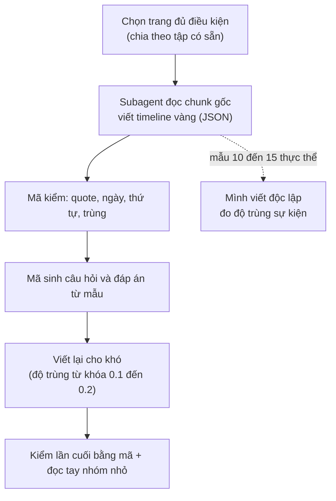

# 10. Thiết kế bộ dữ liệu tự dựng cho Cơ chế 2 (timeline vàng viết từ chunk gốc)

Ghi ngày 2026-11-04. **Trạng thái: thiết kế (mục 1 đến 9) là đề xuất; đã chạy mẫu thử 5 và 10 trang để kiểm quy trình viết timeline (mục 10).** Chưa sinh câu hỏi, chưa chạy hệ nào trên bộ này. Các con số đếm ở mục 1 đến 9 là ước lượng thô, có chú thích rõ.

Quan hệ với tài liệu khác: [`08_TIMELINE_EVAL_DESIGN.md`](08_TIMELINE_EVAL_DESIGN.md) thiết kế đo dựa trên chú thích TimeQA (oracle dựng từ nhãn có sẵn, `timeline_gold` có lỗi gold, xem `src/tam/evaluation/timeline_gold.py`); file này là hướng thay thế: **người (hoặc subagent) đọc chunk gốc và viết timeline vàng**, câu hỏi sinh bằng mã. Lý do chọn tự dựng: các bộ công bố (ECT-QA, TLQA, ADQAB, TDBench) đều lệch miền, thiếu gold chunk hoặc thiếu văn bản (xem `research/benchmarks_for_comparison/timeline_summarization/` và `03_EVALUATION_PLAN_BY_MECHANISM.md`).

## 1. Nguồn và quy mô

- **Nguồn:** các trang `real` đã chia sẵn theo trang thành ba tập không trùng nhau: `tune` 203 trang, `valid` 167, `test_clean` 186.
- **Quy mô đề xuất (chưa chốt):** tune 300, valid 300, test 400 câu; khoảng 35, 35, 45 thực thể (mỗi thực thể khoảng 8 đến 9 câu). Mỗi trang là một thực thể chính.
- **Cỡ mẫu thực là số thực thể, không phải số câu**: các câu cùng thực thể dùng chung timeline nên tương quan. Giả định hệ số tương quan trong nhóm ≈ 0.3 (**chưa đo**) thì 400 câu / 45 thực thể tương đương khoảng 109 câu độc lập. Báo cáo phải ghi cả hai số và tính sai số chuẩn gom theo thực thể.
- **Ngưỡng nhận biết khác biệt:** với 100 câu độc lập, hai phương pháp cần lệch khoảng 11 đến 14 câu mới đạt 2 sai số chuẩn; bộ này chỉ phân biệt được chênh lớn (kiểu oracle so với vector top-k), không phân biệt hai biến thể đồ thị lệch vài điểm.
- **Đếm trang đủ điều kiện (bước 0):** chỉ là ước lượng, vì `extractions.jsonl` chỉ lưu 300 ký tự đầu mỗi chunk (`scripts/ingest.py:68`) nên số năm đếm được bị đánh thấp. Với điều kiện "≥3 chunk có ≥2 năm và ≥10 năm khác nhau" còn 154 / 203 (tune), 138 / 167 (valid), 141 / 186 (test_clean). Khi làm thật phải đọc văn bản đầy đủ từ `dataset/full_dataset/pages.jsonl`.

## 2. Quy trình sinh



- **Subagent chỉ viết timeline**, không biết câu hỏi và không biết hệ nào được so. Câu hỏi sinh bằng mã rồi viết lại cho khó (cùng cách với bộ kiểm khả năng ở `eval/09`).
- **Mẫu thử trước khi nhân rộng:** 5 đến 10 thực thể, hai bên (mình và subagent) viết độc lập, đo: sự kiện cả hai cùng có / tổng, ngày khớp, sự kiện chỉ một bên có (đọc tay xem lỗi bên nào). Độ trùng thấp (ví dụ dưới 80%) nghĩa là tiêu chí "thế nào là một sự kiện" chưa rõ, phải sửa hướng dẫn trước.
- **Cỡ việc ước lượng:** trung bình khoảng 30 chunk một trang (5,995 chunk / 203 trang của tune), nên 3 đến 4 trang mỗi subagent (**ước lượng, chưa đo**); khoảng 30 subagent cho 115 trang. Thử 5 trang trước.
- Sự kiện bị bỏ sót là lỗi khó thấy nhất (đếm và liệt kê sai nếu timeline vàng thiếu): chỉ kiểm bằng mã không đủ, nên cần bước so hai bên.

## 3. Cấu trúc timeline vàng

```json
{
  "page_id": "/wiki/Nguyen_Van_A",
  "events": [
    {"id": "e2", "date": "1991", "grain": "year", "track": "affiliation", "label": "club",
     "text": "moved to club Y",
     "evidence": [
       {"chunk_id": "/wiki/Nguyen_Van_A#1", "role": "date",        "quote": "In 1991 he left X and moved"},
       {"chunk_id": "/wiki/Nguyen_Van_A#2", "role": "description", "quote": "to Y, where he stayed for seven seasons"}
     ]}
  ],
  "undated_mentions": ["became a coach (no date given)"]
}
```

(Ví dụ minh họa, tên và chunk bịa.)

| Trường | Ý nghĩa |
|---|---|
| `id` | Nhãn sự kiện **trong trang đó**; khóa toàn cục là `page_id` + `id`. Mã gán sau khi sắp theo ngày; hòa ngày thì đánh dấu |
| `date` | Ngày ISO đúng mức độ văn bản nêu, không bổ sung |
| `grain` | `year`, `month` hoặc `day`; dùng để biết cặp nào so thứ tự được (cùng mức mịn và trùng thì "hòa", loại khỏi câu thứ tự) |
| `track` | Nhóm chủ đề của sự kiện (mục 4) |
| `label` | Nhãn tự do ngắn, tùy chọn; bắt buộc khi `track` là `other` |
| `text` | Mô tả ngắn bằng tiếng Anh, khoảng 10 từ; dùng chấm độ phủ khi câu trả lời là tóm tắt |
| `evidence` | Danh sách chunk chứa bằng chứng |
| `evidence[].role` | `both`: chunk tự có cả ngày và mô tả; `date`: chỉ có ngày; `description`: chỉ có phần mô tả (và không chứa ngày của sự kiện đó) |
| `evidence[].quote` | Trích nguyên văn, phải nằm đúng trong `chunk_id` đi kèm |
| `undated_mentions` | Sự kiện có nhắc nhưng không có ngày; dùng cho nhóm "không đủ thông tin" |

**Gold chunk tối thiểu của một sự kiện** là một chunk `both`, hoặc một cặp `date` + `description`. Nếu nhiều chunk `both` cùng nêu một sự kiện thì chỉ cần một (lựa chọn "hoặc"). Gold chunk của một câu là hợp các nhóm tối thiểu của những sự kiện câu đó dùng; một chunk có thể thuộc nhiều sự kiện, và khi hợp tập thì chỉ tính một lần.

**Ba tình huống một sự kiện trải nhiều chunk:** (1) ngày ở chunk này, mô tả ở chunk sau; (2) mốc bắt đầu và kết thúc ở hai chunk khác nhau; (3) cùng sự kiện nhắc ở hai chunk (tóm tắt rồi chi tiết), ghi một sự kiện nhiều chunk, không đếm hai lần.

**Hai cách chấm khai trước, báo cả hai:** *hit* (có ít nhất một chunk vàng trong kết quả) và *recall* (tỉ lệ chunk vàng tối thiểu có trong kết quả, lựa chọn "hoặc" tính một trong hai).

**Mã kiểm:** `chunk_id` tồn tại; `quote` có nguyên văn trong chunk và chứa ngày (với `date`/`both`); `description` không chứa ngày; sắp theo ngày đúng thứ tự; không trùng sự kiện; trang phải có ≥4 sự kiện trải ≥2 chunk.

## 4. Khung track

Khung dưới dựa trên 64 quan hệ Wikidata của 1,394 câu `real` (tune, valid, test_clean); nhãn quan hệ gán theo trí nhớ về Wikidata, chưa đối chiếu từng mã (không chắc: P4791, P2962, P8047, P559). Tỉ lệ là trước khi gộp.

| Track | Gồm | Ghi chú |
|---|---|---|
| `role` | chức vụ, nhiệm kỳ, người đứng đầu, quân hàm và chỉ huy (nhãn phụ `military`) | trước gộp: role 20.5% + military 9.5% |
| `affiliation` | nơi làm việc, đội, đảng, tổ chức, giải đấu | 18.7% |
| `location` | nơi ở, nơi làm việc, trụ sở, quốc gia | 13.8% |
| `ownership_structure` | sở hữu, vận hành, công ty mẹ, nhà xuất bản, hãng đĩa | 13.6% |
| `work` | **sản phẩm** người đó làm ra (phát hành, trình diễn, dự án) | 11.8% |
| `naming` | tên chính thức, đổi tên | 5.8% |
| `family` | vợ/chồng | 2.5% |
| `education` | học tại | 1.6% |
| `other` | còn lại, bắt buộc kèm `label` | giải thưởng/di sản (2.2%) vào đây hoặc nhóm riêng nếu cần |

- **Phân biệt dễ nhầm:** `work` là sản phẩm; `role` là vị trí giữ ("đạo diễn phim X" là `work`, "giám đốc hãng phim Y" là `role`). Mơ hồ thì ưu tiên `role` > `affiliation` > `work`.
- **Lối thoát:** `label` tự do cho `other`; sau mẫu thử, nếu một `label` chiếm hơn 5% sự kiện thì thành track mới (ngưỡng khai trước).
- Khung khai **trước** khi viết, không sửa theo kết quả. Sau mẫu thử đo tỉ lệ hai bên gán `track` khác nhau trên cùng sự kiện (vì vẫn có nhầm).
- Một trang chỉ có các track nó thực sự có (≥3 sự kiện mỗi track). Sinh và mất thường không thành track.

## 5. Dùng tiêu đề mục để gợi ý track

- `dataset/full_dataset/pages.jsonl`: mỗi trang có `paragraphs` gồm `{title, text}`; `title` là **tên mục** (ví dụ "Early life", "Club career", "Honors and awards"). Trên 127,233 đoạn chỉ 8.9% có tiêu đề trùng tên trang; 4,796 / 4,815 trang có ít nhất một tiêu đề mục.
- `src/tam/ingestion/chunking.py` đã đặt văn bản chunk dạng `"<tên trang> | <tên mục>\n..."`, nên tiêu đề mục đã nằm trong embedding và BM25.
- **Cách dùng:** đưa `title` của mục vào đầu vào của subagent làm gợi ý, và dùng làm kiểm chéo (`track` subagent gán nên khớp nhóm tiêu đề, lệch nhiều thì xem lại). **Không** dùng tiêu đề làm nhãn duy nhất: "History", "Career" chứa nhiều track; có tiêu đề là câu trích dẫn ("Nemtsov said :") do tách đoạn lỗi.
- **Điều cần kiểm lại:** docstring của `chunk_document` ghi "mỗi section thành một chunk", nhưng dữ liệu cho thấy trang Boris Nemtsov có 100 chunk (trung bình khoảng 377 ký tự) và một mục dài bị cắt thành nhiều chunk cùng tiêu đề; chưa kiểm nguyên nhân. Đây cũng là nguồn của tình huống "sự kiện trải nhiều chunk". Chưa kiểm chunk có chồng lấn (overlap) hay không.
- **Cho truy vấn:** lưu `section_title` thành trường payload để lọc hoặc tăng điểm theo track là phương án rẻ nhất (không cần LLM phân loại), nhưng payload hiện chỉ index 4 trường theo thiết kế nên thêm trường là thay đổi thiết kế; chưa nên làm khi chưa có chứng cứ. Cách chọn track lúc truy vấn (cạnh có kiểu hay chỉ thực thể và thời gian) thuộc thiết kế Cơ chế 2, không bị khung track của bộ dữ liệu áp đặt.

## 6. Loại câu hỏi

Quy tắc loại câu: **đáp án phải dùng ≥2 sự kiện** của timeline (nếu một lọc theo mốc lấy được một sự kiện thì đó là Cơ chế 1). Ví dụ "Which club did A join in 1991?" là Cơ chế 1, **không** đưa vào.

| Loại | Gold chunk |
|---|---|
| Liệt kê, đếm | các chunk của mọi sự kiện trong track |
| Thứ tự, khoảng cách | chunk của hai sự kiện |
| Đầu / cuối / kế tiếp | khai trước: tính cả chuỗi (để biết là đầu/cuối), không chỉ chunk chứa đáp án |
| Tóm tắt | chấm bằng độ phủ sự kiện (khớp `text`/`date`), không cần LLM judge (chưa chốt) |
| ~~Không đủ thông tin~~ | **Bỏ khỏi bộ chính (người dùng chốt 2026-11-07, xem 10.5aj).** Nếu cần sẽ làm tập chẩn đoán riêng, đọc tay 100% |

- **Bỏ nhóm `t_now`** (khoảng cách đến hiện tại, "N năm qua"): thuộc tính hạn và hiện tại của Cơ chế 1, không phải gom sự kiện (người dùng quyết 2026-11-04).
- Câu chéo track (ví dụ "lúc chuyển đội Y thì ông ở đâu") để sau, chưa làm đợt đầu.
- Mỗi trang không đều số track, nên "8 đến 9 câu mỗi thực thể" chỉ là trung bình; báo cáo ghi số trang thực dùng.

## 7. So sánh hệ

1. Vector top-k (cấu hình X của `eval/09`), LLM gom sự kiện từ chunk trả về.
2. Oracle đồ thị: đưa timeline vàng vào, đo trần.
3. Đồ thị trích bằng LLM (hệ thật).
4. Nếu còn thời gian: tái hiện DyG-RAG hoặc TG-RAG, chỉ khi (1) và (2) cho thấy còn chỗ để hơn.

Go/no-go: so (2) với (1); oracle không hơn vector top-k rõ rệt thì Cơ chế 2 không có lý do tồn tại ở bộ này.

## 8. Điểm yếu cần ghi nhận

- Một tác giả (mình) ra quy tắc, và model viết timeline cùng họ với mình: giảm bằng mẫu hai bên viết độc lập và, nếu muốn độc lập hơn, một mẫu kiểm bằng model khác họ (ví dụ Gemini).
- Không có số công bố để đặt cạnh, nên chỉ nói "hơn baseline của chính mình trên bộ này".
- Nhỏ và chỉ trong miền Wikipedia.
- Chấm tóm tắt bằng độ phủ sự kiện đo "đủ chưa", không đo văn phong.
- ECT-QA và TLQA có thể chạy một lần làm kiểm tra tổng quát hóa phụ, không dùng để chọn (chưa quyết).

## 9. Quyết định chưa chốt

1. Cỡ bộ (300/300/400 hay nhỏ hơn) sau khi đếm bước 0 bằng văn bản đầy đủ.
2. Có chạy ECT-QA làm kiểm tra phụ không. **Đề xuất không chạy** (2026-11-04, xem 10.5ab), có thể xem xét lại.
3. Tóm tắt chỉ chấm bằng độ phủ sự kiện hay thêm LLM judge.
4. ~~Khung track cuối cùng~~ **Đã chốt 2026-11-04**: giữ 9 track hiện tại, `military` đã gộp vào `role`, giải thưởng ở lại `other` (`label` = `award`); xem mục 10.5aa.

## 10. Mẫu thử viết timeline (2026-11-04)

Mới làm **bước viết và kiểm timeline vàng**; chưa sinh câu hỏi, chưa chạy hệ nào. Dữ liệu lưu ở `dataset/eval/timeline_pilot/` (xem mục 10.5).

### 10.1 Mẫu 5 trang: mình và subagent haiku viết độc lập

Trang lấy từ tập `tune` (ngẫu nhiên trong các trang 12 đến 25 chunk có ít nhất 12 năm khác nhau, rồi chọn lại cho đa dạng): Mike Bongiorno, Great Tower Neuwerk, World Union for Progressive Judaism, Derek Barton, Ernst Hechler. Hai bên dùng chung `GUIDE_v1.md`; mình viết trước khi xem kết quả subagent; mỗi trang một subagent haiku, được dặn không đọc thư mục của mình (log truy cập: 0 lần).

Khớp sự kiện = cùng `date` và có chung ít nhất một `chunk_id` bằng chứng (nên **chưa đo** được chuyện hai bên ghi lệch ngày cho cùng sự kiện).

| Trang | Mình | Subagent | Khớp | `track` giống nhau |
|---|---|---|---|---|
| Derek Barton | 47 | 47 | 47 | 47/47 |
| Great Tower Neuwerk | 27 | 29 | 27 | 13/27 |
| Mike Bongiorno | 68 | 69 | 68 | 65/68 |
| World Union (WUPJ) | 34 | 34 | 33 | 32/33 |
| Ernst Hechler | 60 | 60 | 57 | 34/57 |
| **Tổng** | 236 | 239 | 232 | 191/232 (82%) |

- Mức sự kiện: 232/236 (mình) và 232/239 (subagent) khớp. `chunk_id` sai: 0; `quote` không nguyên văn: 1.
- Các chỗ lệch, đọc tay: mình sai 3 (ghi trùng một sự kiện, gộp hai huy hiệu cùng ngày, sót Iron Cross 1939); subagent sai 1 rõ (ghi một số đo, cường độ sáng 1952, thành sự kiện) và 1 điểm gây tranh cãi (một kế hoạch chưa xảy ra). Còn lại là cách tách hay gộp sự kiện khác nhau.
- `track` lệch 18%, chủ yếu `work` với `other` (công trình) và các sự kiện quân sự; ba trang còn lại khớp cao. Khung `track` còn mơ hồ.
- Giới hạn: hai bên dùng chung hướng dẫn, subagent cùng họ model với mình, chỉ 5 trang.
- Kết luận: hai bên bỏ sót khác nhau, nên một bên viết và bên kia soát lại tốt hơn mỗi bên một mình; haiku đủ dùng để viết bản nháp.

### 10.2 Mẫu 10 trang: subagent viết, mã kiểm, mình đọc đối chiếu

Quy trình: (1) subagent haiku viết theo `GUIDE_v2.md` (đã thêm quy tắc: ngày mốc thập kỷ không vào `events`, khoảng thời gian tách hai sự kiện, không ghi số đo/kế hoạch/bối cảnh, nguồn mâu thuẫn thì gắn cờ); (2) `check.py` kiểm tự động; (3) mình đọc từng trang cạnh chunk gốc (`view.py`) và sửa vào bản `rev/`; bản gốc của subagent giữ ở `sub/`.

Trang: Carl August Ehrensvärd, John Henry Whitley, Real Audiencia of Guatemala, Regius Professor of Civil Law (Oxford), Butch Levy, Frederick Ralph Sharp, Telekids, Seibu Shinjuku Line, Malvik, Southern Military District.

| | Số lượng | Mã kiểm bắt được |
|---|---|---|
| Sự kiện subagent viết | 289 | |
| Sai bằng chứng hoặc ngày | 7 | 6/7 |
| Không phải sự kiện của thực thể (thống kê, trùng) | 3 | 0/3 |
| Sót sự kiện rõ ràng | 12 | 0/12 |
| Sau khi sửa (bản `rev/`) | 301 | 0 lỗi thật |

- Lỗi sai và thừa: 10/289 (khoảng 3.5%). Sót rõ ràng: 12 (khoảng 4% trên tổng số thật). **Mã kiểm không bắt được lỗi sót nào**, nên bước đọc đối chiếu là bắt buộc.
- Ba trang không cần sửa: Malvik, Seibu Shinjuku Line, Frederick Ralph Sharp (ít sự kiện, cấu trúc đơn giản).
- Lỗi hay gặp của haiku: ghi thống kê theo mùa thành sự kiện; gắn bằng chứng từ chunk nói ngày khác; gán mốc "mùa 1941-42" thành năm 1941; bỏ sót sự kiện ở cuối trang.
- `undated_mentions` của haiku lẫn mô tả chung và mục thực ra có ngày ở chỗ khác; đã dọn (bỏ 11 mục). Còn lại: danh sách huân chương không ngày, mốc thập kỷ, sự kiện không nêu năm.
- Chi phí đọc của mình: chưa đo token; ước chừng mỗi trang 4 đến 10 nghìn token, nên 115 trang cần khoảng 600 đến 800 nghìn token (chia nhiều phiên, ước lượng).
- Chưa biết tỉ lệ lỗi còn lại sau khi mình đọc, vì chưa có người thứ ba (hoặc model khác họ) soát lại.

### 10.3 Quyết định về phạm vi "sự kiện" (người dùng chốt 2026-11-04)

- **Không ghi:** ngày của sắc lệnh hoặc luật chỉ được liệt kê mà không nêu thay đổi gì; ngày sinh con cái (timeline phải về chuỗi thời gian của chính thực thể); tiểu sử cá nhân của người được nhắc trong trang của một chức vụ hoặc tổ chức (chỉ ghi mốc nhậm chức và rời chức); thống kê theo mùa hoặc năm; số đo, kế hoạch chưa xảy ra, bối cảnh của thực thể khác; mốc theo thập kỷ hoặc thế kỷ (vào `undated_mentions`).
- **Ghi:** khoảng thời gian dùng huy hiệu hoặc biểu tượng (hai sự kiện bắt đầu và kết thúc); sự kiện của thực thể tiền thân và các chỉ huy của nó khi trang liệt kê chung.
- Nguồn tự mâu thuẫn: giữ từng mục và gắn `"flag": "source_inconsistent"`; loại các sự kiện đó khỏi câu thứ tự hoặc khoảng cách liên quan.
- `undated_mentions` chỉ chứa sự kiện của thực thể mà văn bản nhắc nhưng không nêu ngày; nếu ngày suy ra được hoặc có ở chỗ khác thì bỏ khỏi danh sách.
- Hai quy tắc đầu (sắc lệnh, con cái) đã được áp lên bản `rev/` của 10 trang; hướng dẫn `GUIDE_v2.md` đã ghi thêm mục "Quyết định bổ sung".

### 10.4 Việc còn lại trước khi nhân rộng

1. Chốt khung `track` (đang lệch 18% giữa hai bên; hoặc không để câu hỏi phụ thuộc `track`).
2. Một lượt soát độc lập (model khác họ, ví dụ Gemini) trên một phần mẫu để ước tỉ lệ lỗi còn lại.
3. Mã kiểm bắt được sai bằng chứng nhưng không bắt được sót: giữ bước đọc đối chiếu cho toàn bộ trang, chia theo lô khoảng 10 đến 15 trang.
4. Sinh câu hỏi từ các timeline đã kiểm và đọc tay mẫu câu hỏi.

### 10.5b Đợt 2: 10 trang nữa (2026-11-04)

Cùng quy trình (haiku viết, mã kiểm, mình đọc đối chiếu từng trang), `GUIDE_v3.md` giữ nguyên nội dung v2. Trang chọn từ `tune` (76 ứng viên còn lại, `random.seed(2027)`): Aero Union, August Maus, CS Aerostar Bacău, First Air Group, Klemzig (South Australia), Lev Polugaevsky, Martín de Gurrea y Aragón, Quelli che… il Calcio, Thomas Fearnley, Toungoo dynasty.

| Chỉ số | Giá trị |
|---|---|
| Sự kiện haiku viết | 242 |
| Sau khi mình sửa (`batch2/rev/`) | 239 |
| Sai hoặc thừa (đã bỏ hoặc sửa) | 22 (9%); 16 trong số đó là các chuyến tàu của Klemzig (không phải sự kiện của thực thể, chính subagent đã tự ghi chú) |
| Sót (đã thêm) | 18 |
| Mã kiểm báo | 8 lỗi: 1 sự kiện sai thật (CS Aerostar, mốc theo mùa), 1 quote không nguyên văn (Lev), 6 báo nhầm do năm viết tắt ("1984–85", "1830–32") |
| Mã kiểm bắt được lỗi sai nội dung | 1/22; sót: 0/18 |

Lỗi mới thấy ở đợt này: haiku ghi cả đánh giá ("extraordinary four-year period") thành sự kiện; ghi nhầm mốc khai mạc giải thưởng ("Iron Cross (1939)", "U-boat War Badge (1939)") thành ngày trao; ghi mốc theo mùa giải ("1993–94") thành một năm; bỏ sót các mốc suy ra được ("the following year", "that August").

**Quy ước mới do mình đặt (chờ người dùng xác nhận):** sự kiện có mốc suy ra được từ câu tương đối ("the following year", "that September") hoặc từ năm viết tắt ("1984–85" kết thúc mùa giải = 1985) được ghi thành sự kiện với `"flag": "derived_date"`. Mã kiểm bỏ qua điều kiện "quote chứa năm" cho các sự kiện này. 12 sự kiện thêm mới và 6 sự kiện cũ mang cờ này. Nếu không muốn dùng, lọc theo cờ.

Chưa kiểm độc lập: cũng như đợt 1, chỉ mình đọc một lượt.

### 10.5c Đợt 3: 10 trang nữa (2026-11-04)

Cùng quy trình; hướng dẫn `GUIDE_v4.md` = v3 + quy ước `derived_date`, bỏ sự kiện của vật mang (tàu, máy bay), bỏ câu đánh giá, năm ở tiêu đề giải thưởng và mốc theo mùa. Trang chọn từ `tune` (66 ứng viên còn lại, `random.seed(2028)`): 2AM (band), Albuquerque Dukes, Breitscheidplatz, David Young (Iowa), D. R. Shackleton Bailey, Fulk (King of Jerusalem), Garnidelia, Lower Norrland Military District, Michael Batty, Vindobona (train).

| Chỉ số | Giá trị |
|---|---|
| Sự kiện haiku viết | 323 |
| Sau khi mình sửa (`batch3/rev/`) | 333 |
| Sai hoặc thừa (đã bỏ) | 10 (3%) |
| Sót (đã thêm) | 20 (6%) |
| Mã kiểm báo | 1 lỗi, báo nhầm (năm viết tắt "1965–70"); bắt sai nội dung 0/10, sót 0/20 |
| Cờ trong `rev/` | 16 `derived_date`, 7 `approximate_date`, 2 `source_inconsistent` |

Lỗi sai/thừa: 4 mục "chủ chức vụ không rõ" (Lower Norrland, khoảng trống trong danh sách); 3 ở Vindobona (bối cảnh Czechoslovakia sau 1969, tuyến EuroCity khác, và một ngày sai: tên "Vindobona" dùng lại cho Railjet sau 12/2018, haiku gán 2014-12-14); 2 ở Michael Batty (giải thưởng "2017-2018" bị tách thành "bắt đầu/kết thúc kỳ", chuyển sang undated); 1 ở Albuquerque (tiểu sử một cầu thủ). Ngoài ra sửa cờ: gỡ `derived_date` khi năm có ghi rõ; thêm `approximate_date` cho mốc "c.", "1118 or 1119", "by 1928", "after 1916", "by 1994".

Sót chủ yếu: nhập ngũ và thông báo nhập ngũ (2AM, 3 mục cuối đoạn), các tour/concert trong danh sách (2AM), mốc cuối đoạn của trang địa danh (1895, 1916, 1928, 1930-04-01, 1961 ở Breitscheidplatz), các phiếu bầu/tuyên bố trong chuỗi mục chính trị (David Young, 3 mục), loạt xuất bản có năm bắt đầu và kết thúc (Shackleton Bailey: OCT 1958–1982). Tỉ lệ sai gần mức đợt 1b, thấp hơn đợt 2 vì không có trang nào nhiều sự kiện của vật mang.

Chưa kiểm độc lập: chỉ mình đọc một lượt.

### 10.5d Quyết định về phạm vi trang (2026-11-04, người dùng)

Mỗi bộ (`tune`, `valid`, `test_clean`) chỉ gồm các trang nó đang có: viết timeline vàng cho **toàn bộ** trang của bộ đó, rồi chỉ sinh câu hỏi từ các trang ấy. Không còn mục tiêu 35/35/45 thực thể cố định; cỡ bộ là số trang thực có (các số 300/300/400 câu ở mục 1 đến 9 chỉ còn là tham khảo).

Số liệu lúc ghi (đếm từ `dataset/eval/tune_subset.json`): `tune` có 203 trang; đã dùng 35 (30 có timeline vàng ở `pilot10/`, `batch2/`, `batch3/`, 5 trang `pilot5/` chỉ để so sánh); còn 168 trang chưa làm, tổng 5383 chunk không rỗng (trung vị 26, tối đa 100, nhỏ nhất 5); 85 trang dài hơn 25 chunk, 10 trang ngắn hơn 10. Ba mẫu thử trước chỉ chọn trang 10 đến 25 chunk nên chưa có kinh nghiệm với trang dài: cần quyết cách chia trang dài cho subagent (mỗi subagent một đoạn chunk, hay giới hạn chunk).

### 10.5e Đợt 4: 10 trang dài (26 đến 45 chunk, 2026-11-04)

Mục đích: thử haiku trên trang dài, vì 168 trang `tune` còn lại có 85 trang dài hơn 25 chunk. Mỗi subagent vẫn nhận nguyên một trang (không chia đoạn). Chọn ngẫu nhiên (`random.seed(2029)`) trong 54 trang `tune` chưa dùng có 26 đến 50 chunk không rỗng.

| | Số |
|---|---|
| Haiku viết (`batch4/sub/`) | 386 |
| Sai hoặc thừa (đã bỏ hoặc sửa nội dung) | 13 (3,4%) |
| Bỏ theo quy ước mới (mốc kết thúc của giải đấu) | 12 |
| Sót, đã thêm | 6 (1,6%) |
| Sau khi mình sửa (`batch4/rev/`) | 367 |
| Mã kiểm bắt được lỗi nội dung | 0/13 sai, 0/6 sót; 3 báo (2 báo nhầm, 1 quote ghép hai chỗ ở TU Leuna) |

Kết luận: haiku làm trang dài không tệ hơn trang vừa (sai/thừa 3,4% so với 3%, sót 1,6% so với 6%), nên chưa cần chia đoạn; cách đọc kiểm vẫn cần vì mã kiểm không bắt được lỗi nội dung. Lỗi hay gặp: gắn cờ `derived_date` cho ngày đã ghi rõ (5 chỗ), ghi phát biểu/bài báo/phim về thực thể thành sự kiện của nó (Monir: sách, phim, phỏng vấn; Meet the Press: chuyện lặt vặt về người dẫn), gộp số liệu thành sự kiện (tuyển 15 cầu thủ, mua cổ phần chung chung), sót mốc ở chỗ nằm sâu (hỏa hoạn 2014 ở đoạn cuối, chồng mất 1991).

Quy ước mình tự đặt thêm (chờ người dùng xác nhận): khoảng thời gian của một giải đấu mà thực thể tham dự (ví dụ "21 February to 1 March") ghi MỘT sự kiện ở ngày bắt đầu, không tách hai mốc, vì tham dự một giải không phải trạng thái bắt đầu và kết thúc (Blübaum bỏ 11 mốc "ended"). Nguyên tắc tách hai mốc vẫn giữ cho chức vụ, thời gian đảm nhiệm, giai đoạn dùng huy hiệu.

### 10.5f Đợt 5: 10 trang, có 2 trang rất dài (61 và 63 chunk, 2026-11-04)

Chọn ngẫu nhiên (`random.seed(2029)`) trong 158 trang `tune` chưa dùng: 8 trang 13 đến 41 chunk và 2 trang trên 45 chunk (The One Show, The Dark Eye) để thử giới hạn của việc đưa nguyên trang cho một subagent.

| | Số |
|---|---|
| Haiku viết (`batch5/sub/`) | 219 |
| Sai hoặc thừa (đã bỏ) | 8 (3,7%) |
| Sót, đã thêm | 7 (3,2%) |
| Sửa cờ hoặc nội dung chữ (không đổi số sự kiện) | 11 (cờ `derived_date` sai, thiếu `approximate_date`, ghi "unnamed" dù nguồn có tên) |
| Sau khi mình sửa (`batch5/rev/`) | 218 |
| Mã kiểm bắt được lỗi nội dung | 0/8 sai, 0/7 sót; 2 báo do mình thêm sự kiện thiếu năm trong quote |

Kết luận: hai trang 61 và 63 chunk không tệ hơn trang ngắn (The One Show: 51 sự kiện, thừa 2, sót 2; The Dark Eye: 27 sự kiện, chỉ thiếu 2 cờ), nên chưa cần chia đoạn dù dài trên 45 chunk. Trang còn lại tối đa 100 chunk vẫn chưa thử.

Lỗi mới thấy: bỏ qua tên người ngay trong câu nguồn (Agenzia: "Unnamed person" trong khi câu có "Giovanni Giovannini"), sót vai trò đi kèm một mốc đã ghi (Cavada là người dẫn đầu tiên ngày 6/1/1975; Antenne 2 đổi tên France 2 cùng ngày với việc giao Paul Amar), sót chương trình mới thêm (20h30 le dimanche), ghi mốc theo kế hoạch (hợp đồng AP 2015 đến 2020), ghi sự kiện một lần của khách (Ronan Keating dẫn một tập).

Quy ước mình tự đặt thêm (chờ người dùng xác nhận): (1) danh sách khách mời theo từng tập (Allsång på Skansen, 36 chunk) không ghi thành sự kiện, vì là liệt kê chứ không phải thay đổi của thực thể; (2) khoảng ngày của một chiến dịch quân sự thực thể tham gia (USS LCS, Gunto 18 đến 30 tháng 6) = MỘT sự kiện ở ngày bắt đầu, cùng nguyên tắc với giải đấu ở 10.5e; (3) mốc chỉ nêu như kế hoạch trong nguồn (thời hạn hợp đồng 2015 đến 2020) không ghi; (4) bài/ý kiến chỉ trích VỀ chương trình (Actuchomage, Bruno Masure) không ghi, nhưng sự cố xảy ra TRONG chương trình (báo động cháy, khiếu nại sau một lời nói trên sóng) vẫn ghi; (5) khi hai nơi trong cùng trang mâu thuẫn mà không rõ bên nào đúng (Chris Evans bắt đầu dẫn thứ Sáu tháng 8 năm 2010 hay "đầu 2011") thì gắn `source_inconsistent` cho mốc không nằm trong danh sách chính.

### 10.5g Đợt 6: 10 trang, có 3 trang 54 đến 72 chunk (2026-11-04)

Chọn ngẫu nhiên (`random.seed(2030)`) trong 148 trang `tune` chưa dùng: 7 trang 19 đến 41 chunk, 2 trang 54 và 62 chunk (D band, Jacqueline Cochran), 1 trang 72 chunk (Eliot Engel). Haiku dùng `GUIDE_v4.md` (chưa có các quy ước của 10.5f).

| | Số |
|---|---|
| Haiku viết (`batch6/sub/`) | 458 |
| Bỏ (`batch6/rev/`) | 90 |
| Sót, đã thêm | 8 (1,7%) |
| Sau khi mình sửa | 376 |
| Mã kiểm bắt được lỗi nội dung | 0/90 bỏ, 0/8 sót; 4 báo ở D band (2 quote không nguyên văn, 2 do cặp `date`+`description`) |

90 mốc bị bỏ tách theo lý do, vì phần lớn không phải haiku sai mà là quy ước chưa nằm trong hướng dẫn:

| Lý do | Số |
|---|---|
| Danh sách khách mời/giám khảo theo từng tập (Minuta slavy, 47 trong 54 mốc) | 47 |
| Tách hai mốc cho một khoảng tham gia (tour, đợt record, chiến dịch) nên gộp một mốc | 8 |
| Phát biểu, phỏng vấn, thư ngỏ, bài báo, kêu gọi của chính thực thể | 8 |
| Tưởng niệm và vinh danh sau khi mất (tem, đài, tên hố thiên thạch, đưa vào hall of fame) | 9 |
| Sự kiện của thực thể khác (luật Sixpack, Operation Midland đóng, cảnh sát bác chỉ trích) | 4 |
| Mơ hồ, trùng hoặc phụ (DFC "period ended", tiếp đón một khách trên YouTube, xếp hạng Forbes, rating HRC, mốc theo mùa) | 14 |

Sót 8: ngày không có năm trong câu nhưng năm rõ từ câu trước (D band: EP New Blood 18/7/2003, hồi phục 27/9/2003, tạp chí 7/8/2005; hết hiatus giữa 2015), người huấn luyện qua đời (Alemannia 1999), sân Old Tivoli xây 1908, từ chức chủ tịch AWS (Buzek), phiếu chống luật miễn trách nhiệm hãng súng 2003 (Engel). Cờ sửa: 15 chỗ (`approximate_date` thiếu cho "early", "circa", "spring", "mid"; `derived_date` sai khi năm đã ghi rõ).

Kết luận: trang 54 đến 72 chunk không làm haiku tệ hơn, và nguồn sai lệch lớn nhất là hướng dẫn thiếu quy ước chứ không phải độ dài trang. Đã viết `GUIDE_v5.md` (trong `batch6/`) gộp các quy ước mới để đợt 7 dùng; số bỏ ở đợt 7 là phép thử xem hướng dẫn mới có giảm lỗi không. Đã đọc đủ 10 trang, chưa đo trang 73 đến 100 chunk.

Quy ước mới này đều do mình đặt, chờ người dùng xác nhận (thêm vào 5 quy ước ở 10.5f): (6) phát biểu, phỏng vấn, bài báo của chính thực thể không ghi; chỉ ghi hành vi chính thức (bỏ phiếu, kiến nghị, thư gửi cơ quan, thông báo quyết định); (7) mốc tưởng niệm sau khi thực thể mất không ghi, vinh danh khi còn sống vẫn ghi; (8) khoảng tham gia của một hoạt động (tour, đợt record) là MỘT mốc ở ngày bắt đầu.

### 10.5h Đợt 7: 10 trang dùng `GUIDE_v5.md`, có Hanover 100 chunk (2026-11-04)

Chọn ngẫu nhiên (`random.seed(2031)`) trong 138 trang `tune` chưa dùng: 7 trang 9 đến 44 chunk, 2 trang 57 và 58 chunk (British Rail Class 40, Veliky Novgorod), 1 trang 100 chunk (Hanover). Đây là đợt đầu haiku đọc `GUIDE_v5.md` (có các quy ước của 10.5f và 10.5g).

| | Số |
|---|---|
| Haiku viết (`batch7/sub/`) | 260 |
| Bỏ | 28 (10,8%) |
| Sót, đã thêm | 13 (5,0%) |
| Sau khi mình sửa (`batch7/rev/`) | 245 |
| Mã kiểm bắt được lỗi nội dung | 0/28 bỏ, 0/13 sót; 16 báo, đều là lỗi quote/chunk hoặc năm dưới 1000 (sửa `check.py` bỏ số 0 đầu của năm như "0859") |

Lý do bỏ 28: sự cố của từng đầu máy trong trang về một lớp đầu máy (13, đều là sự kiện của vật mang), 4 lễ hội/cuộc thi định kỳ tổ chức trong thành phố (Hanover), 4 mốc "tên không nêu" bị lặp ở danh sách chủ tịch mất tên, 7 trùng, vụn hoặc không có ngày. Sót 13, trong đó 8 ở Veliky Novgorod (trang 58 chunk) toàn ở giữa trang (trạm buôn Visby 1080, đặc quyền thương nhân Đức 1229, trận Neva 1240, trận trên băng 1242, đóng kontor Hanse 1494, trạm Đức dựng lại 1603, bảo tàng gỗ 1964, sân bay 2006), còn lại là vợ Leahy mất, Böhme rời vị trí, Expo 2000, Biedroń/ILGA 2013, chuyến tàu khách đầu tiên của Class 40 sau 16 năm.

Kết luận: các loại lỗi mà `GUIDE_v5.md` nhắm tới (danh sách khách mời, phát biểu của chính thực thể, mốc tưởng niệm sau khi mất) không xuất hiện lại trong đợt này, nhưng đợt này gồm loại trang khác (thành phố, loạt đầu máy, chương trình) nên chưa phải phép thử sạch. Lỗi mới thuộc ba loại hướng dẫn chưa có quy ước (sự cố từng chiếc trong trang về cả lớp, sự kiện định kỳ trong trang địa danh, tên người bị mất trong danh sách), đã viết thêm vào `batch7/GUIDE_v6.md`. Sót 13 mốc (5,0%) cao hơn đợt 6 (1,7%), nhưng 8 trong số đó nằm ở một trang 58 chunk, nên chưa đủ để kết luận về độ dài trang. Trang 100 chunk (Hanover) chỉ có 1 mốc sót, nên chưa thấy giới hạn trên. Đã đọc đủ 10 trang.

Quy ước mới này đều do mình đặt, chờ người dùng xác nhận (thêm vào 5 quy ước ở 10.5f và 3 quy ước ở 10.5g): (9) sự cố, hành trình của từng đầu máy hay tàu trong trang về cả lớp là sự kiện của vật mang, không ghi; (10) lễ hội, cuộc thi định kỳ trong trang về địa danh là sự kiện của thực thể khác, không ghi; (11) tên người bị mất trong danh sách thì ghi một mốc "đổi người (không tên)", không ghi cặp "bắt đầu/kết thúc" rỗng.

### 10.5i Đợt 8: 10 trang dùng `GUIDE_v6.md` (2026-11-04)

Chọn ngẫu nhiên (`random.seed(2032)`) trong 128 trang `tune` chưa dùng: 7 trang 15 đến 37 chunk, 2 trang 46 và 67 chunk (Ralph Lauren Corporation, Atlanta Dream), 1 trang 81 chunk (David Hasselhoff). Đây là đợt đầu haiku đọc `GUIDE_v6.md` (đủ 11 quy ước).

| | Số |
|---|---|
| Haiku viết (`batch8/sub/`) | 372 |
| Bỏ | 4 (1,1%) |
| Sót, đã thêm | 18 (4,8%) |
| Sau khi mình sửa (`batch8/rev/`) | 386 |
| Mã kiểm bắt được lỗi nội dung | 0/4 bỏ, 0/18 sót; 5 báo, đều là lỗi quote hoặc cờ (quote cắt cụt, năm lấy từ câu trước, cờ gộp "derived_date; source_inconsistent") |

Lý do bỏ 4: một lần tái phát hành phim đổi tên (Hasselhoff), một lần dự trận bóng rổ, một lời tuyên bố ủng hộ đội bóng (quy ước 6), một lời tố của người khác ("bị sa thải") ghi như sự kiện. Sót 18, phần lớn là mốc đơn ở giữa trang: Hasselhoff (rời Y&R 1982, thông báo vai trong The Producers 2006, Peter Pan 2010, 9 to 5 2019), Atlanta Dream (chuỗi 17 trận thua 2008, chủ cũ tuyên bố bán 2009, chuyển sang Gateway Center 2021), Ralph Lauren (thông báo thay CEO 2015-09, dòng American Living ngừng 2019), Mary Raine (đến Úc, chồng đầu mất 1918), St Luke (thay nhà xứ 1840, Macquarie dự lễ 1820), Fort Tilden (khẩu đội 90 mm 1951-54), Slade Gorton (trung tâm mang tên ông 2010, vợ mất 2013), Amalric (hủy hôn nhân khi lên ngôi).

Kết luận: không còn loại lỗi hệ thống của đợt 5–7 (khách mời, phát biểu của thực thể, mốc tưởng niệm, sự cố từng chiếc, lễ hội định kỳ, tên bị mất); lỗi còn lại là sót mốc đơn và vài chỗ cờ/quote. Tỉ lệ sót 4,8% gần đợt 7 (5,0%), nên 11 quy ước giảm bỏ nhầm (từ 10,8% xuống 1,1%) nhưng không giảm sót. Trang 81 chunk (119 mốc) vẫn chỉ sót 4. Đã đọc đủ 10 trang. Không có quy ước mới.

### 10.5j Đợt 9: 10 trang dùng `GUIDE_v6.md`, có Los Angeles Rams 100 chunk (2026-11-04)

Chọn ngẫu nhiên (`random.seed(2033)`) trong 118 trang `tune` chưa dùng: 7 trang 11 đến 39 chunk, 2 trang 55 và 68 chunk (The Late Late Show, Janet Frame), 1 trang 100 chunk (Los Angeles Rams).

| | Số |
|---|---|
| Haiku viết (`batch9/sub/`) | 335 |
| Bỏ | 18 (5,4%) |
| Sót, đã thêm | 9 (2,8%) |
| Sau khi mình sửa (`batch9/rev/`) | 326 |
| Mã kiểm bắt được lỗi nội dung | 0/18 bỏ, 0/9 sót, 0/1 sai ngày (xem dưới); 5 báo, đều là lỗi quote hoặc thiếu chunk ngày |

Lý do bỏ 18: 8 mốc sau khi Janet Frame mất (xuất bản di cảo, giải thưởng truy tặng; đúng tinh thần quy ước 7 nhưng quy ước chưa nói rõ "xuất bản sau khi mất"), 9 mốc ở Los Angeles Rams (7 kết quả playoff theo mùa, theo quy ước 8, đưa vào `undated_mentions`; biệt danh "Shams" của đội thay thế trong cuộc đình công; một mốc trùng với mốc vào Super Bowl), 1 mốc trùng ở BAMF (khoảng "bê bối 2000-2018" bị tách hai mốc, theo quy ước 2 chỉ giữ mốc đầu). Sót 9: Costa Allegra thuê cho Paquet Cruises 2010, Selvon bỏ học năm 15 tuổi, Late Late Show (thử giọng khách mời 2004, Lassally nghỉ 2015, ban nhạc nhà 2015), Rams (gia nhập AFL 1936, nghỉ mùa 1943, hội đồng Inglewood duyệt sân 2015, họp báo trở về LA 2016). Một lỗi sai ngày mà mã kiểm không bắt: haiku gắn vụ tự tử và buổi trị liệu của Janet Frame vào 1943 (năm bắt đầu học sư phạm) trong khi văn bản nói "later that year" của năm thực tập, tức 1945; đã sửa.

Kết luận: tỉ lệ sót 2,8% thấp nhất từ đợt 5, nhưng tỉ lệ bỏ 5,4% cao hơn đợt 8 (1,1%) do hai trang có khối mốc thuộc quy ước chưa viết (sau khi mất, kết quả playoff theo mùa). Trang 100 chunk (Rams, 81 mốc sau sửa) vẫn không tệ hơn rõ. Đã đọc đủ 10 trang. Quy ước mới do mình đặt, chờ xác nhận: (12) xuất bản di cảo và giải thưởng truy tặng sau khi thực thể mất không ghi (mở rộng quy ước 7). Chưa thêm vào guide; sẽ thêm vào `GUIDE_v7.md` nếu bạn đồng ý.

### 10.5k Session phụ B: thiết lập và kiểm B1, B2 (2026-11-04)

Để làm nhanh hơn, một session Claude khác (tài khoản khác, cùng máy và repo) làm song song các batch `batchB1`, `batchB2`, `batchB3`, ... Cách tránh trùng và va chạm:

- `reserved_B.json`: 53 trang `tune` dành riêng cho session B (chia theo cùng tỉ lệ độ dài, `random.seed(7001)`); session chính chọn trang ngoài danh sách này.
- `tools/mk_batch.py <batch> <seed> reserved_B.json`: chọn 10 trang chưa dùng trong danh sách, dựng `{in,sub,rev}`, chép `GUIDE_v6.md`. Seed của session B là 7100 + N.
- Session B chỉ ghi vào `batchB*/` (kèm `NOTES.md`) và `tools/patch_bB*.py`; không sửa file này. Thống kê gộp vào đây do session chính làm.

Kết quả session B tự báo (đã kiểm lại cấu trúc và đọc mẫu):

| | B1 | B2 | Cộng |
|---|---|---|---|
| Haiku viết | 229 | 538 | 767 |
| Bỏ | 3 (1,3%) | 16 (3,0%) | 19 (2,5%) |
| Sót, đã thêm | 11 (4,8%) | 19 (3,5%) | 30 (3,9%) |
| Sau sửa (`batchB*/rev/`) | 237 | 541 | 778 |

Mình kiểm độc lập: mã kiểm trên `rev/` 0 lỗi; quét cấu trúc 20 trang (778 mốc, đúng số session B báo): cờ chỉ thuộc ba giá trị hợp lệ, không trùng id, cấp độ ngày khớp, thứ tự đúng. Đã đọc kỹ 6 trang (President of Uruguay, Entropa, Real Madrid, Imperial College, Luftflotte 1, Humongous); không thấy lỗi nội dung. Chưa đọc 14 trang còn lại. Các tỉ lệ bỏ/sót là so với phán đoán của chính session B, không phải đo độc lập. Hai điểm lưu ý: Real Madrid giữ 55 mốc "thắng giải giao hữu" lấy từ danh sách (quyết định quy ước, nên nêu rõ trong `NOTES.md`); `tools/view.py` luôn đọc `sub/` dù đặt `DIR=rev` (chỉ `check.py` theo `DIR`).

Hai quy ước session B tự đặt, chờ người dùng xác nhận: (A) danh sách tác phẩm bị mất tên (12 game Humongous) không ghi mốc, chỉ một dòng `undated_mentions` (mình thấy còn tranh cãi vì mỗi mục có năm và tên series); (B) bản dịch có năm trong thư mục (Georges Duby) ghi như mốc `work`.

### 10.5l Kiểm B3, B4 của session phụ B (2026-11-04)

| | B3 | B4 | Cộng B3+B4 |
|---|---|---|---|
| Haiku viết | 319 | 321 | 640 |
| Bỏ | 0 | 1 | 1 |
| Sót, session B đã thêm | 20 | 34 | 54 |
| Sau sửa theo session B | 339 | 354 | 693 |
| Mình thêm sau khi đọc kiểm | 0 | 5 | 5 |
| Cuối cùng (`rev/`) | 339 | 359 | 698 |

Gộp bốn batch B: 40 trang, haiku 1407, session B sửa thành 1471, cộng 5 mốc mình thêm là 1476. Cả hai session: 130 trang, 4267 mốc (2791 + 1476).

Cách kiểm: `check.py` trên `rev/` 0 lỗi cả hai batch; quét cấu trúc (id liên tục, cờ hợp lệ, cấp độ ngày khớp, không trùng mốc) sạch. Đọc tay 9/20 trang: B3 (World Festival, Permanent Secretary, Irene Kharisma, Hugh Scott, Rush Holt), B4 (Counselor, Line 7, Luftflotte 5, Fleetwood). **11 trang chưa đọc**: Milton Friedman, Razorfish, Hsu, First Things, Stommel, Bohemond, Livingstone, Good Game, Oxenstierna, Masters, MMK.

Phát hiện khi đọc, mã kiểm không bắt được:
- Counselor_to_the_President: sót 3 mốc, đều có năm trong câu: Trump tuyên bố chọn Conway và Bannon sau bầu cử 2016 (`derived_date`), Bannon vào Principals Committee 2017-01, Trump đưa Bannon ra khỏi NSC 2017-04.
- Line_7: sót 2 mốc trong mục Timeline: 2008-01-08 tin báo chí về kế hoạch, 2009-07-19 thông báo khởi công cuối tháng 8.
- Sửa bằng `tools/fix_B34.py` (chạy sau `patch_bB4.py`), `check.py` 0 lỗi sau sửa.
- 7 trang còn lại trong số đã đọc (World Festival, Permanent Secretary, Irene, Rush Holt, Hugh Scott, Luftflotte 5, Fleetwood) đúng ngày, không thấy sai; nhận xét nhỏ: Luftflotte 5 `e13` ghi tên đơn vị mới nhưng bỏ "Lofoten thành Ff 5" ở `e12`; Hugh Scott không ghi "dọa ra tranh thống đốc 1962" (loại ủng hộ/đe dọa ứng viên theo quy ước C).

Tỷ lệ sót ở batch B3 là 6,3% và B4 là 10,6% so với haiku (do Livingstone, Good Game, Bohemond có khối liệt kê dài). Con số này là session B tự đếm; qua mẫu 9 trang mình đọc, mình thêm được 5 mốc sót mà session B chưa thấy, tức tỷ lệ sót thật cao hơn một chút so với con số tự báo.

Hai quy ước mới chờ người dùng xác nhận: (D) bài giảng có tên và năm trong danh sách distinctions ghi như mốc `other` (Livingstone, +11 mốc); (E) danh sách triển lãm bảo tàng giữ làm mốc `work` (MMK, khoảng 85 mốc). Còn (A), (B), (C) từ B2, B3 chưa được xác nhận.

### 10.5m Kiểm B5 và chuyển toàn bộ trang còn lại sang session B (2026-11-04)

B5 (10 trang): haiku 278, session B bỏ 3, thêm 33 (11,9% so với haiku), sau sửa 308. `check.py` trên `rev/` 0 lỗi, quét cấu trúc sạch. Mình đọc kỹ 3 trang ngắn (PEN America, Tyne and Wear PTE, C38) và soát cờ `derived_date` của Beugró, Goryachkina: không thấy sai ngày hay sót thêm; `derived_date` của Beugró (28 mốc) hợp lý vì năm lấy từ tiêu đề mục. **7 trang B5 chưa đọc kỹ**. Cả hai session: 140 trang, 4575 mốc (2791 + 1784).

Ba quy ước mới của session B chờ xác nhận: (F) ngày sinh/mất của con ghi là mốc `family`, ngày mất vợ/chồng chỉ ghi khi nhân vật còn sống; (G) rating và peak rating không ghi (thống kê), "lần đầu vào top 10" thì ghi; (H) IM/GM norm ghi là `other` theo năm.

Phân công: `reserved_B.json` mở rộng từ 53 lên 108 trang (bản cũ ở `reserved_B.before_all.json`), nên session B nhận cả 58 trang tune chưa dùng còn lại (khoảng 6 batch: B6 đến B11, seed 7106 trở đi). Session chính chỉ đọc kiểm.

### 10.5n Kiểm B6, B7 của session B (2026-11-04)

| | B6 | B7 |
|---|---|---|
| Haiku viết | 343 | 412 |
| Session B: bỏ / thêm | 4 / 9 | 0 / 16 |
| Sau sửa theo session B | 348 | 428 |
| Mình thêm/bớt sau khi đọc | 0 | +7 (CEU +3, Exxon +4, Mannheim +1, Pelican −1) |
| Cuối cùng (`rev/`) | 348 | 435 |

`check.py` trên `rev/` 0 lỗi cả hai batch; quét cấu trúc sạch. Mình đọc kỹ 12/30 trang của B5–B7 (B5: PEN America, Tyne and Wear, C38; B6: Line 15, Milan Metro Line 3, U-96 một phần; B7: Pelican, Westover, Exxon Valdez, CEU, Archaeologia Cambrensis, Mannheim). Phần còn lại chưa đọc kỹ: B5 bảy trang, B6 bảy trang, B7 bốn trang (Panufnik, Holden, Warrior, News Quiz).

Sửa bằng `tools/fix_B67.py` (chạy SAU `patch_bB7.py`, an toàn khi chạy lại):
- CEU (haiku 13/72 chunk, session B thêm 4): vẫn sót 3 mốc mã kiểm không bắt: đề luật 2017-03-28 nhắm vào CEU, biểu tình ủng hộ CEU 2017-04-02, Tòa Công lý EU phán Lex CEU trái luật EU 2020-10-06. Session B bỏ nhóm "luật 2017 của chính phủ" theo quy ước K, nhưng đề luật này là sự kiện trung tâm của trang nên mình thêm lại.
- Exxon Valdez: session B bỏ cả khối tố tụng; trang có 4 mốc rõ ràng (1994 bồi thẩm đoàn, 2008-06 Tòa tối cao, 2008-08-27 thỏa thuận, 2009-06 tiền lãi), mình thêm lại.
- Pelican: hai mốc "period began/ended" 1936 và 1938 cho một việc mua giữa 1936–1938; gộp thành một mốc `approximate_date` 1936.
- Mannheim: sót Astronomische Gesellschaft thành lập ngày 1863-08-28 (Schönfeld trong ban sáng lập).

Quy ước mới của session B chờ xác nhận: (I) tên tàu/vật bị mất trong nguồn thì không ghi mốc, chỉ một dòng `undated_mentions`; (J) mốc "revised" trong danh mục tác phẩm được giữ; (K) tuổi thọ cha mẹ và sự kiện của người khác không ghi. Nhận xét: (I) bỏ 4 mốc của U-96 (ví dụ "đánh chìm một tàu ngày 1941-01-16", ngày và hành động đều rõ), cùng loại tranh cãi với (A); (J) giữ 22 mốc "revised" riêng của Panufnik (cộng khoảng 17 chú thích trong mốc "composed"); (K) đã làm mất khối tố tụng của Exxon và đề luật 2017 của CEU nên cần giới hạn lại (chỉ loại sự kiện không liên quan thực thể).

Gộp: session B 70 trang, 2567 mốc; session chính 90 trang, 2791 mốc; cả hai 160 trang, 5358 mốc. Còn 38 trang tune chưa dùng (B8 đến B11).

### 10.5o Kiểm B8, B9 và chốt quy ước I–K (2026-11-04)

| | B8 | B9 |
|---|---|---|
| Haiku viết | 262 | 311 |
| Session B: thêm / bỏ | +37 / −1 | +30 / −1 |
| Sau sửa theo session B | 298 | 339 |
| Mình thêm sau khi đọc | +2 (Zambia) | 0 |
| Cuối cùng (`rev/`) | 300 | 339 |

`check.py` trên `rev/` 0 lỗi; quét cấu trúc sạch. Mình đọc 8 trang (Lenin Peak, Carrier Air Group 17, Marc Bohan, Milan Metro 2, Irina Levitina, Zambia, Gethard, Mercury News một phần) và dùng `tools/gap.py` (liệt kê câu có năm mà không mốc nào trích) cho Zambia, Mercury News, Simferopol, Sainz, Rull, Gethard, Ocon: chất lượng tốt hơn B7; chỉ thấy Zambia sót 2 mốc (Livingstone thấy thác Victoria 1855, Burnham tìm đồng 1895), thêm bằng `tools/fix_B89.py`. Các câu có năm còn lại ở Mercury News, Simferopol là số liệu, ranh giới hoặc việc của thực thể khác nên không thêm. Chưa đọc kỹ: Goldberg, Franklin, Downs, Arnulf, Volvo 9700 và vài trang khác.

Quy ước I, J, K đã áp dụng từ B8 (người dùng chọn đề nghị của mình), và mình sửa B6, B7 cho khớp trong `tools/fix_B67.py`: (I) khôi phục 2 mốc mất tên của U-96 (hai mốc còn lại bị bỏ trước đó trùng với mốc có tên nên không khôi phục); (J) xóa 22 mốc "revised" riêng của Panufnik, giữ chú thích "revised" trong mốc "composed"; (K) chỉ loại sự kiện của thực thể khác khi không nhắm vào thực thể của trang.

Quy ước mới của session B ở B8, B9, đã chọn: (L) ngày cưới và ngày mất của con ghi như `family` (cùng quy ước F); (M) giải thưởng từng năm trong danh sách ghi là `award`; (N) kết quả từng trận hoặc ván cờ không ghi, trừ khi đổi chức vô địch hoặc là mốc "lần đầu"; (O) sự kiện của thực thể khác (Maravi 1480, FC TSK 2014) không ghi, cùng giới hạn như K.

Gộp: session B 90 trang, 3186 mốc; session chính 90 trang, 2791 mốc; cả hai 180 trang, 5977 mốc. Còn 18 trang tune chưa dùng (B10 10 trang, B11 8 trang).

### 10.5p Kiểm B10, B11 và hết trang tune (2026-11-04)

B10 (10 trang): haiku 273, sau sửa 291. B11 (8 trang): haiku 103, sau sửa 104; B11 có 5 trang dưới 8 chunk nên `mk_batch.py` bỏ qua, session B dựng `in/` tay. Mình đối chiếu `in/` của cả 18 trang với `pages.jsonl`: đúng tập tune, chỉ số chunk và nội dung khớp 100%. `check.py` trên `rev/` 0 lỗi, quét cấu trúc sạch.

Mình đọc kỹ 7 trang B11 (Charlotte Fitch Roberts, Tyyni Tuulio, Yugoslavia Davis Cup, Casus Belli, Greenbelt, Lassalle, Sastamala) và chạy `gap.py` cho 11 trang còn lại của B10, B11. Thêm 3 mốc bằng `tools/fix_B1011.py`: Sastamala (hai mốc phê chuẩn huy hiệu 1962-11-26 và 1963-02-12, của thực thể tiền thân Karkku), Brian Higgins (đánh giá Best Lawmaker 1993). Phần `gap.py` còn lại là kết quả mùa giải (đã loại theo quy ước N), việc của người khác, hoặc số liệu. Chưa đọc kỹ: Keith Emerson, Lowell, Senate of Canada Building, Eastern Army Division, Karlsøy, Swedish Air Force Flying School, Werner Hartmann, Sarah Palfrey Cooke, Andrew Mellon, Sevilla FC, Brian Higgins (chỉ xem danh sách mốc).

Quy ước mới session B tự đặt ở B10, B11, đã chấp nhận: cụm "mid-1990s", "late 1960s" không có năm cụ thể để `undated_mentions`; hoạt động có "giữa X và Y" của một cơ quan đặt tại nơi nào đó ghi hai mốc đầu và cuối; "ký ủng hộ một luật" không ghi.

**Kết thúc viết timeline cho tập `tune` (203 trang):** 90 trang session chính (batch 2 đến 9 và pilot10), 108 trang session B (B1 đến B11) và 5 trang pilot5. Mốc: session chính 2791, session B 3584, tổng 6375 (chưa tính pilot5). Chất lượng chưa đồng đều: khoảng một nửa số trang chưa ai đọc kỹ từng mốc.

### 10.5q Bắt đầu timeline cho tập `valid` (2026-11-04)

Quy mô: `valid` có 167 trang (khoảng 5063 chunk: 131 trang 8–45 chunk, 21 trang 46–72, 12 trang từ 73, 3 trang dưới 8), ước 17 batch; `test_clean` có 186 trang (5682 chunk), ước 19 batch. Ba tập không trùng trang. `valid` dùng để chọn phương pháp, nên cần timeline trước khi sinh câu hỏi cho nó.

Công cụ: `reserved_valid.json` (167 trang), `GUIDE_v7.md` (gộp mọi quy ước từ đợt B vào hướng dẫn cho haiku: di cảo, mất tên, bản dịch, "revised", hành động lập pháp, bài giảng, triển lãm, giải từng năm, rating, kết quả trận, việc của thực thể khác, "giữa X và Y", mục Timeline nhiều ngày lẻ), `tools/mk_batch.py` (chép `GUIDE_v7.md`, lấy cả trang dưới 8 chunk khi hết trang dài). Batch đặt tên `batchV1`, `batchV2`, ... seed 7201 trở đi; sửa bằng `tools/patch_bV*.py`.

Một mâu thuẫn mình chưa gỡ: quy ước F của session B (ngày sinh con là mốc `family`) trái quyết định cũ của người dùng (không ghi ngày sinh con). `GUIDE_v7.md` theo quyết định cũ: không ghi ngày sinh con, ghi ngày cưới và mất của con. Tập tune (từ B5 trở đi, ví dụ Whitney, Cambridge, Carisbrooke) còn các mốc sinh con đã ghi; có thể lọc bỏ sau bằng `label` hoặc text.

### 10.5r Kiểm V1, V2 (session B làm, 2026-11-04)

Session B làm `batchV1` và `batchV2` (20 trang): V1 haiku 451 → 481 mốc, V2 342 → 355 (thêm 46, bỏ 3). Mình kiểm: `DIR=rev check.py` = 0 lỗi cả hai; số mốc `sub/` và `rev/` khớp bảng của B; `gap.py` các trang mật độ thấp (ECB 300 chunk/38 mốc, Clitheroe, Numedal, Zerelda, Lanier); đọc danh sách mốc Valladolid, ECB, Lanier, Zerelda. Chưa đọc từng chunk của cả 20 trang, nên đây là kiểm mẫu, không phải kiểm hết.

- Các câu `gap.py` còn liệt kê ở ECB (nước gia nhập euro, báo cáo Nghị viện, promissory note Ireland, số liệu QE), Numedal (Sørland 1871, họp 1873) và Zerelda (em trai tự tử 1895) đều đúng theo quy ước đã ghi trong NOTES.md; mình không thấy mốc sót rõ ràng ở mẫu đã xem.
- Valladolid (70 chunk): haiku chỉ 26 mốc, B thêm 19. Danh sách sau sửa hợp lý, nhưng B tự đặt quy ước "ghi công trình, công ty, tuyến tàu, đại học; không ghi lễ hội và CLB thể thao" cho trang thành phố — ngoài GUIDE_v7. Ghi lại để thống nhất cho các trang thành phố sau.
- Quy ước L (ngày mất của con kể cả sau cha/mẹ): B áp nguyên văn, nên Lanier có 5 mốc (1885–1926) và Zerelda 4 mốc (1915–1934) mất sau nhân vật. Việc này chưa được người dùng quyết; người dùng đã chốt giữ nguyên như session B (ghi cả khi con mất sau cha/mẹ), nên không bỏ 9 mốc; đã ghi vào `GUIDE_v7.md`.
- Chỗ B có sửa lỗi của haiku đáng ghi: Numedal e18 (haiku gán 2014-04 cho việc nâng cấp tà vẹt, nguồn chỉ nói "sau vụ trật bánh") và Quaid e36 (text sai).
- Hạn chế như tune: `check.py` không bắt mốc sót hay sai ngày; phần chưa đọc từng chunk có thể còn vài mốc sót mỗi 10 trang.

### 10.5s Kiểm V3, V4 (2026-11-04)

V3 do session B làm xong (NOTES và `patch_bV3.py`); V4: haiku xong nhưng session B hết hạn mức, session chính đọc kiểm và vá (`patch_bV4.py`, +27 mốc, 283 → 310). `DIR=rev check.py` = 0 lỗi cả hai. V4 đọc kỹ cả 10 trang bằng `view.py` và `gap.py`: Chelyabinsk (67 chunk) haiku chỉ ghi 12 mốc nên thêm 11, các trang còn lại thêm 0–6. V3 mình chưa kiểm sâu (chỉ có số liệu từ NOTES của B).

### 10.5t Kiểm V5, V6 (cloud làm, 2026-11-04)

Lần đầu giao việc cho Claude cloud (nhánh `cloud/valid-timelines`): cloud dựng V5, V6 và chạy 20 haiku song song, `check.py` 0 lỗi, không đụng file ngoài phạm vi. Nhưng cloud sửa quá ít (V5 +5, V6 +4/−5) trong khi các trang dài còn nhiều mốc sót. Session chính đọc kiểm và vá bằng `tools/fix_V56.py` (V5 200 → 226, V6 312 → 321): SECR_N_class +19, Flatiron +6, Pérez +7, LB&SCR E4 +8, Gamvik +1, Gleaston +1, Manto −7 (tuyển tập ghi năm 1955 chuyển sang `undated_mentions`). Bài học: với trang dài (trên 40 chunk), phải bắt buộc đọc từng trang và nộp danh sách mốc thêm; số liệu "gap.py đã chạy" của cloud không đủ chứng minh đã đọc.

### 10.5u V7, V8 do session chính làm (2026-11-04)

Session chính dựng V7, V8 và chạy 20 haiku song song, rồi tự đọc kiểm bằng `gap.py` và đọc danh sách mốc; vá bằng `tools/patch_bV78.py`. V7 413 → 425, V8 258 → 266 (+20 ròng), `check.py` 0 lỗi ở cả `sub/` và `rev/`. Haiku làm tốt hơn V5/V6 cloud ở các trang dài (Myanmar, Security Service of Ukraine, Han dynasty gần như đủ). Điểm mới: `gap.py` không thấy năm TCN/CE (Han dynasty), phải dò tay bằng regex "BC|AD|CE". Tổng valid đã làm: V1–V8 (80 trang), còn 87 trang.

### 10.5 Dữ liệu và công cụ

Thư mục `dataset/eval/timeline_pilot/`:

- `pilot5/`: `in/` (chunk gốc, đúng cách `chunk_document` đánh số), `me/` (timeline mình viết: `.dsl` và `.json`), `sub/` (timeline subagent), `GUIDE_v1.md`.
- `pilot10/`: `in/`, `sub/` (bản gốc của subagent), `rev/` (bản sau khi mình đối chiếu, **đây là timeline vàng của 10 trang**), `GUIDE_v2.md`.
- `batch2/`: `in/`, `sub/`, `rev/` (**timeline vàng của 10 trang đợt 2**), `GUIDE_v3.md`; sửa bằng `tools/patch_b2.py`.
- `batch3/`: `in/`, `sub/`, `rev/` (**timeline vàng của 10 trang đợt 3**), `GUIDE_v4.md`; sửa bằng `tools/patch_b3.py`.
- `batch4/`: `in/`, `sub/`, `rev/` (**timeline vàng của 10 trang dài đợt 4**), `GUIDE_v4.md`; sửa bằng `tools/patch_b4.py`.
- `batch5/`: `in/`, `sub/`, `rev/` (**timeline vàng của 10 trang đợt 5**), `GUIDE_v4.md`; sửa bằng `tools/patch_b5.py`.
- `batch6/`: `in/`, `sub/`, `rev/` (**timeline vàng của 10 trang đợt 6**), `GUIDE_v4.md` (đã dùng) và `GUIDE_v5.md` (cho đợt sau); sửa bằng `tools/patch_b6.py`.
- `batch7/`: `in/`, `sub/`, `rev/` (**timeline vàng của 10 trang đợt 7**), `GUIDE_v5.md` (đã dùng) và `GUIDE_v6.md` (cho đợt sau); sửa bằng `tools/patch_b7.py`.
- `batch8/`: `in/`, `sub/`, `rev/` (**timeline vàng của 10 trang đợt 8**), `GUIDE_v6.md` (đã dùng); sửa bằng `tools/patch_b8.py`.
- `batch9/`: `in/`, `sub/`, `rev/` (**timeline vàng của 10 trang đợt 9**), `GUIDE_v6.md` (đã dùng); sửa bằng `tools/patch_b9.py`.
- `batchB1/` … `batchB11/`: do session phụ B tạo, mỗi batch có `in/`, `sub/`, `rev/` (**timeline vàng**), `NOTES.md`; sửa bằng `tools/patch_bB1.py` … `patch_bB4.py` và `tools/fix_B34.py` (5 mốc mình bổ sung). B5 và B6 chưa làm. `reserved_B.json` và `tools/mk_batch.py` xem 10.5k.
- `tools/`: `mk.py` (dựng JSON từ `.dsl` và kiểm quote), `cmp.py` (so hai bên), `check.py` (mã kiểm), `view.py` (xem chunk cạnh sự kiện), `patch.py` (các sửa của mình trên bản `sub/`).

Tất cả là dữ liệu mẫu thử, chưa phải bộ dữ liệu cuối. Các trang nằm trong tập `tune`, nên chưa dùng chung với `valid` hay `test_clean`.

### 10.5v V9, V10 do cloud làm, session chính kiểm (2026-11-04)

- Cloud (nhánh `cloud/valid-timelines`, commit `62ea9f4`) làm V9 (526 → 537) và V10 (558 → 558); `DIR=rev check.py` 0 lỗi. Tôi đọc `gap.py` từng trang dài và đối chiếu NOTES: V9 +12 (549), V10 +14 (572), `tools/fix_V910.py`.
- **Đính chính nhận định ban đầu:** nhìn số dòng `gap.py` (Whitman 33, Schröder 31) tôi tưởng cloud đọc thiếu như V5/V6; sau khi đọc, phần lớn dòng là phát biểu, việc của thực thể khác hoặc thống kê, đúng với quy ước và đã được NOTES của cloud giải thích. Tôi thêm 11 mốc rồi bỏ lại. Phần thiếu thật chủ yếu ở trang thể thao (mùa giải) và vài sự kiện chính thực thể.
- Ba quy ước mới trong `GUIDE_v7.md` (áp dụng từ V11): không ghi tai nạn của từng máy bay trên trang hãng; năm TCN dùng số thiên văn và `check.py` nhận dấu âm; danh hiệu/thăng hạng/đổi HLV theo mùa "1999–2000" ghi ở năm bắt đầu, `approximate_date`. **Hệ quả:** tune và V1–V10 để mùa giải ở `undated_mentions`, chỉ Galatasaray (V10) và vài mốc ở V9 dùng quy ước mới; cần nêu trong phần phương pháp.
- `check.py` sửa để nhận năm âm; Han dynasty (V7) từ 55 lỗi về 0.

### 10.5w V13, V14 do session chính làm (2026-11-04)

- Dựng V13 (seed 7213) và V14 (seed 7214) từ `reserved_valid.json` sau khi dựng V11, V12 (để cloud làm); bốn batch không trùng trang, còn 27 trang valid. 20 haiku song song, `DIR=sub check.py` 0 lỗi cả hai.
- Đọc kiểm bằng `gap.py` trang nào >2 dòng: V13 haiku 190 → 195 (+5: Engels +2, Max_Weber +1, Guy_Whittingham +1, Florida +1), V14 246 → 247 (+1: GER S69). Phần lớn dòng gap là tài liệu tham khảo, tai nạn từng đầu máy (quy ước mới) và việc của thực thể khác. `tools/patch_bV1314.py`.
- Lần này haiku bỏ sót ít hơn các đợt trước (+0,5/trang), phù hợp với quy ước đã chặt hơn (GUIDE_v7 có mục bổ sung). Chưa đọc từng chunk của cả 20 trang, chỉ `gap.py` và danh sách mốc trang có mật độ thấp.

### 10.5x V15, V16 do session chính làm (2026-11-04)

- Dựng V15 (seed 7215) và V16 (seed 7216), 20 haiku song song, `DIR=sub check.py` 0 lỗi. Đọc kiểm bằng `gap.py` (trang >4 dòng) và danh sách mốc: V15 haiku 254 → 258 (+4, British_Rail_Class_15), V16 haiku 243 → 247 (+4: DSB class D, Van Deventer, Villa del Balbianello +2). `tools/patch_bV1516.py`.
- Còn lại: 7 trang valid (V17). V11, V12 do cloud làm, chưa báo kết quả.
- Haiku ở hai batch này bỏ sót ít (+0,4/trang); các dòng `gap.py` còn lại chủ yếu là kết quả trận, tham khảo, hoặc việc của người khác.

### 10.5y V17 và tổng kết valid (2026-11-04)

- V17 (seed 7217, 7 trang cuối, 7 haiku): haiku 172 → 175 (+3, chỉ Teodor_Atanasiu), `tools/patch_bV17.py`, `DIR=rev check.py` 0 lỗi.
- **Valid đã dựng đủ 167 trang** (mk_batch báo hết trang trong `reserved_valid.json`). Trạng thái: V1–V10 xong và đã kiểm; V11, V12 đang chờ cloud báo; V13–V17 xong và đã kiểm. Số mốc: V13 195, V14 247, V15 258, V16 247, V17 175.
- Kiểm bằng `gap.py` và danh sách mốc; chưa đọc từng chunk các trang có 0–2 dòng gap.

### 10.5z V11, V12 do cloud làm, session chính kiểm (2026-11-04)

- Cloud (commit `27225a7`): V11 456 → 456 (+1/−1), V12 537 → 541 (+4); `DIR=rev check.py` 0 lỗi. Tôi đọc `gap.py` các trang nhiều dòng: V11 +9 (465), V12 +3/−1 (543), `tools/fix_V1112.py`.
- Phần thiếu thật: V11 Sonnenschein (cloud +0, 28 dòng gap) thiếu 9 tác phẩm trong thư mục "N editions between X and Y"; V12 Atlético thiếu hai chung kết Champions League (2014, 2015–16) và chung kết Copa 2000. Các trang còn lại là thư mục, kết quả mùa giải hoặc việc người khác.
- Quy ước làm rõ: mốc "sân cũ bị phá" (Calderón 2020, Galatasaray 2011) là việc của chủ sân, không ghi; mốc CLB ngừng chơi ở sân đó vẫn ghi. Mình đã bỏ mốc Galatasaray tôi từng thêm ở 10.5v (V10 còn 571 mốc).
- **Valid hoàn tất:** 167 trang, V1–V17 đã kiểm.

### 10.5aa Chốt khung `track` (2026-11-04, người dùng đồng ý)

- **Khung cuối:** giữ nguyên 9 giá trị của mục 4: `role`, `affiliation`, `location`, `ownership_structure`, `work`, `naming`, `family`, `education`, `other` (`other` bắt buộc kèm `label`). `military` đã gộp vào `role`; thực tế dữ liệu không có track này. `check.py` bắt buộc đúng 9 giá trị.
- **Số liệu lúc chốt** (tính từ các `rev/`, tune không gồm pilot5; valid 5.905 mốc, tune 6.074 mốc): `role` 30% valid và 24% tune; `other` 30% ở cả hai; `work` 16% và 23%; `affiliation` 10% và 8%; `location` 5%; `ownership_structure` 3–4%; `family`, `education`, `naming` mỗi cái khoảng 2%.
- **Giải thưởng:** `award` chiếm 5,4% valid, 4,4% tune_B, 2,9% tune chính, gộp khoảng 4,6%: dưới ngưỡng 5% của mục 4, nên **không tách thành track riêng**. Nếu sau này cần tách thì chạy một script đổi `track` từ `other` sang `award` cho các mốc có `label == "award"`, không phải đọc lại mốc nào.
- **Giới hạn khi sinh câu hỏi:** ranh giới `work` với `other` còn mơ hồ (mẫu thử hai bên gán khác nhau 18%), nên không để loại câu hỏi nào phụ thuộc vào ranh giới này. Câu hỏi theo `track` chỉ dùng cho `role`, `affiliation`, `location`, `family`, `naming`; câu liệt kê/đếm trên `work`/`other` lấy theo `label` hoặc bỏ.
- **test_clean** dùng cùng khung và `GUIDE_v7.md`, không gán lại nhãn cho tune/valid. **Chưa làm test_clean** (186 trang, khoảng 19 batch) theo yêu cầu của người dùng; sẽ làm sau.
- **Còn treo:** quy ước 1–12 và A–H; quy ước F (ngày sinh con) trái với tune từ B5; Flatiron (+6 mốc người thuê), Manto 1955; mùa giải theo quy ước mới chỉ có ở V9–V17 (tune và V1–V8 để `undated_mentions`).

### 10.5ab Đề xuất về bộ câu hỏi và so sánh (2026-11-04, bàn với người dùng, **đề xuất, chưa chốt**)

Mọi mục dưới đây là đề xuất để xem xét lại, chưa chạy, chưa có số liệu kiểm.

**Loại câu hỏi và cỡ bộ.**
- Bốn loại: liệt kê/đếm, thứ tự/khoảng cách, đầu/cuối/kế tiếp, tóm tắt theo chủ đề (sự nghiệp = `role` ∪ `affiliation`; chọn trang có ≥4 sự kiện trong chủ đề; giáo dục bỏ vì quá ít).
- Đề xuất bỏ: tóm tắt toàn trang (trang dài hàng chục đến hàng trăm mốc, độ phủ bị cỡ trang chi phối, không có ranh giới "đủ") và nhóm "không đủ thông tin" (Cơ chế 1 không có nhóm này, từ chối ở đó luôn tính là lỗi nên không so được hai cơ chế; có thể xem lại nếu muốn so prompt).
- Mục tiêu cỡ bộ: tune 350, valid 450, test_clean 450 (SE gộp ≈ 0,027 ở n=350, ≈ 0,024 ở n=450; số mẫu độc lập thực tế thấp hơn vì các câu cùng trang không độc lập). Tỉ lệ tham khảo ở valid: liệt kê/đếm 180, thứ tự 115, đầu/cuối 115, tóm tắt 40. Số cuối phụ thuộc số trang đủ điều kiện; **chưa đếm** (cần script: trang có ≥2 sự kiện cùng track, ≥4 sự kiện trong `role` ∪ `affiliation`).
- Câu theo `track` chỉ cho `role`, `affiliation`, `location`, `family`, `naming`; `family` và `naming` (≈2% mốc) có thể không đủ trang.

**Vai trò các bộ.** Cả `tune` và `valid` đều chạy mọi họ phương pháp. `tune`: chỉnh tham số trong từng họ, giữ cấu hình tốt nhất mỗi họ. `valid`: đo cấu hình tốt nhất của từng họ một lần và chọn giữa các họ (giữ cái cũ trừ khi hơn ≥2 SE; hoặc chọn cái đơn giản nhất trong 1 SE của cái tốt nhất, như `eval/07`). `test_clean`: chạy một lần. Prompt sinh đáp án chọn trên `valid` (theo `eval/07`).

**Cách tạo đồ thị (Cơ chế 2).** Chỉ dùng một cách; không có ngân sách để so nhiều cách trích. Đề xuất cách hai lượt: lượt 1 LLM đọc trang, trả bản dàn ý ngắn (chủ thể, tên khác, nội dung từng mục); lượt 2 trích sự kiện theo mục, kèm dàn ý làm ngữ cảnh chung. Lý do: có ngữ cảnh toàn trang mà không bắt trích dài một lần (tránh loãng ở trang dài). Nút cho phép `date` rỗng kèm `description` (khớp `undated_mentions`). Cạnh `TIẾP_THEO` dựng bằng mã theo ngày. Tiêu đề mục chỉ là gợi ý gom đoạn, không phải `track`. Cách chọn nút vào: cố định một cách đơn giản (top-k chunk), chỉ xem lại nếu đọc lỗi cho thấy sai ở bước này. Ghi vào hạn chế: chỉ thử một cách trích do giới hạn thời gian và chi phí. Đề xuất một lần kiểm recall trên ~40 trang tune (phân tầng theo cỡ, nhiều trang dài) so với timeline vàng, không phải để so cách trích, mà để biết recall đủ dùng trước khi so truy xuất.

**So sánh với phương pháp của bài khác.** Mô phỏng chạy trên dữ liệu của mình, trên `valid` (một lần, cấu hình mặc định) và `test_clean`, cùng LLM sinh đáp án, cùng prompt sinh và cùng số chunk. Ghi rõ đây là mô phỏng, nêu phần đã điều chỉnh cho khớp dữ liệu. Nghiêng về hệ của mình vì được chỉnh trên `tune`: ghi vào hạn chế. Cơ chế 1 áp dụng giống vậy. Bài không công bố tham số tối ưu: có thể chạy một lưới nhỏ trên `tune` với ngân sách tương đương hệ của mình, hoặc dùng mặc định và ghi hạn chế.

**ECT-QA và TLQA.** Đề xuất không chạy: không có đủ cơ chế và không cùng loại dữ liệu (đúng lý do ở mục 1). Có thể xem lại.


**Điều chỉnh cách tạo đồ thị: ba lần gọi LLM (đề xuất, 2026-11-04, thay cho "hai lượt" ở trên).** Một lần gọi gộp "tóm tắt + gán mốc cho chunk" dễ làm cả hai việc tệ đi, và đổi prompt Cơ chế 1 (đã chọn trên valid) thì phải đo lại. Nên tách thành ba lần gọi cho ba mục đích của hai cơ chế:

1. **Gán mốc cho chunk (Cơ chế 1).** Giữ nguyên `ingestion_time_v1` (lô ≤30 chunk). Độc lập với hai lần còn lại nên chạy song song được.
2. **Dàn ý cả trang (Cơ chế 2).** Đọc cả trang, ra chủ thể, tên khác, nội dung từng mục.
3. **Trích sự kiện theo mục (Cơ chế 2).** Mỗi mục một lần gọi, kèm dàn ý làm ngữ cảnh chung; đầu vào có số chunk để nút ghi `Chunk_ID` (nút quay về VectorDB được). Phải đợi lần 2.

Không đưa dàn ý vào lần 1 (sẽ đổi kết quả Cơ chế 1); nếu muốn thử thì làm ablation riêng. Chi phí đầu vào ước ~3 đến 3,5 lần Cơ chế 1 (ước lượng, chưa đo; cần chạy thử vài trang lấy token thật). Production: chỉ bật Cơ chế 1 thì chạy lần 1; lần 2, 3 chỉ cho trang cần đồ thị, băm theo mục để chỉ chạy lại mục đổi. Trường hợp biên: đoạn mở đầu không có tiêu đề coi là một mục; trang một mục có thể bỏ lần 2. Thí nghiệm và production phải dùng cùng cấu hình. Hạn chế: chỉ thử một cách tạo đồ thị.

**Còn treo cho Cơ chế 3 (chưa bàn, để sau).** Khi xử lý xung đột sẽ so khác biệt (diff) giữa hai phiên bản, truy lại `Chunk_ID` và các nút; vì vậy bản dàn ý (lần 2) có lẽ cần được lưu lại (chưa quyết lưu ở đâu: VectorDB payload, GraphDB hay kho riêng).

### 10.5ac Thử lần gọi 2 (dàn ý cả trang) trên 10 trang tune (2026-11-05, **thử nghiệm, chưa chốt**)

Mã và kết quả: `dataset/eval/timeline_pilot/outline_trial/` (`outline_v1.py`, `outline_v2.py`, `out_v1/` 5 trang, `out_v2/` 10 trang). Model: profile `google_31` (Gemini 3.1 flash-lite, gọi thẳng API Google), temperature 0, mỗi trang một lần gọi, không cache, mỗi trang chạy một lần (chưa đo độ ổn định giữa các lần chạy). Đầu vào: trang đã tách mục bằng mã theo tiêu đề trong `Trang | Mục` của chunk; mục là các chunk liên tiếp cùng tiêu đề. Trang thử: B5 (George Cambridge, Schörner, NSW C38, PEN America, Goryachkina), B9 (Levitina, Rezidor), B7 (Mannheim Observatory, HMS Warrior, Central European University), có 10 đến 72 chunk, 4 đến 12 mục.

**Kết quả v1 (5 trang).** Đủ số mục, đúng thứ tự, 0 lỗi định dạng. Lỗi tìm được khi đối chiếu timeline vàng và đọc tay:

| Bước/trường | Lỗi | Bằng chứng |
|---|---|---|
| `has_events` (cờ mục có sự kiện) | Gắn `false` cho mục có sự kiện | 3 mục, 16 trên 149 mốc vàng của 5 trang (Awards and decorations của Schörner: 14 mốc; mục mở đầu PEN America: 1; Publications: 1). Chiều ngược (gắn `true`, 0 mốc) chỉ tốn thêm lần gọi |
| `period` | Suy diễn ngoài văn bản | Mục "Early life" của George Cambridge ghi 1917–1935 trong khi nhân vật sinh năm 1895; chưa kiểm hết |
| `links` (liên hệ giữa mục) | Thưa, có chỗ sai | Có mục trỏ về chính mục mở đầu |
| Độ dài | Dàn ý chiếm ~52% đầu vào ở trang ngắn (George Cambridge: 1.805/3.456 ký tự), ~15% ở trang dài | Trang ngắn gần như không lợi |

**Sửa cho v2:** bỏ `has_events` và `links`; `period` chỉ chép năm mà văn bản mục nêu, không suy từ kiến thức hay mục khác; `entities` chỉ chép tên có trong chính mục đó; `aliases` chỉ chép đúng chữ trong văn bản; `covers` một câu. Thêm kiểm tự động: số mục và tiêu đề khớp, `entities` nằm trong văn bản mục, năm của `period` có trong văn bản mục, `aliases` nằm trong trang, `subject` không chứa năm.

**Kết quả v2 (10 trang).** Đủ mục, đúng tiêu đề, 0 lỗi định dạng. Kiểm tự động báo 3 chỗ; xem tay: 2 là lỗi thật của model, 1 là lỗi của phép kiểm.

| Trang | Báo | Kết luận |
|---|---|---|
| HMS Warrior | `entity` "Christmas Island" không có trong mục 3 | Lỗi thật: tên nằm ở đoạn đầu trang, model gán sang mục khác (rò rỉ giữa các mục) |
| Mannheim Observatory | `period` "1783-1800s", mục chỉ nêu 1788 và 1790 | Lỗi thật: đặt cận trên "1800s" không có trong văn bản |
| Rezidor | alias "Radisson Hospitality, Inc." không có trong trang | Lỗi phép kiểm: văn bản tách token ("Radisson Hospitality , Inc"); cần chuẩn hóa khoảng trắng trước khi so |

Lỗi mà kiểm tự động **không** bắt được, thấy khi đọc: `aliases` của Goryachkina là `['GM', 'WGM', 'WFM', 'WIM', 'IM']` (chữ viết tắt danh hiệu, không phải tên khác của nhân vật). Dàn ý với trang ngắn vẫn dài tương đối so với trang (Levitina: 1.763/3.510 ký tự).

**Chưa kiểm:** `covers` có bịa không (mới đọc, chưa đối chiếu từng câu), độ ổn định giữa các lần chạy, token thật (mới đếm ký tự), và liệu lần 3 có dùng dàn ý tốt hơn không dùng (cần chạy lần 3 và đo recall với timeline vàng, so có/không dàn ý). Việc sửa tiếp (đề xuất): `aliases` là tên của chính chủ thể, không phải danh hiệu hay chữ viết tắt; chuẩn hóa khoảng trắng trong phép kiểm; thêm quy tắc "chỉ chép tên của mục này" và đo lại tỉ lệ rò rỉ; với trang dưới ~15 chunk bỏ lần 2.

**Lần thử v3 (2026-11-05, 5 trang: Goryachkina, HMS Warrior, Mannheim, Rezidor, Levitina; `outline_trial/outline_v3.py`, `out_v3/`).** Dàn ý chỉ còn `subject`, `aliases` (chỉ tên của chính chủ thể, cấm danh hiệu/chữ viết tắt/tên người khác), và `covers` (một câu, không viết năm theo từng mục). Bỏ `page_type`, `period`, `entities`, `has_events`, `links`.

Kiểm tự động: 0 lỗi trên 5 trang (đủ mục, đúng thứ tự và tiêu đề, alias có trong trang, alias không phải chữ viết tắt, `covers` và `subject` không có năm). Dàn ý dài 1.1k đến 1.7k ký tự, bằng 9% (Goryachkina) đến 32% (Levitina) trang gốc. Đã sửa: alias viết tắt của Goryachkina không còn; "Christmas Island" và "1800s" không còn vì không còn hai trường đó.

Đọc tay, còn 2 lỗi mà kiểm tự động không bắt được:

| Trang | Lỗi |
|---|---|
| Rezidor | alias "Radisson Hospitality, Inc." sai: văn bản nói đây là tên mới của công ty *Carlson Hotels, Inc.*, một công ty khác chứ không phải chủ thể. Model gộp hai thực thể khác nhau thành tên khác của nhau |
| Levitina | `covers` mục mở đầu viết "đạt vị thế vô địch thế giới ở cả hai môn"; văn bản chỉ nói cờ vua: ứng viên World Championship năm 1984, bridge: 5 danh hiệu vô địch thế giới. Nói quá |

Đã xác minh là đúng: alias "Brave" của HMS Warrior (tên dự định đặt ban đầu của con tàu, theo văn bản). Alias "Mannheim Observatory" của trang Mannheim trùng tên trang nên vô ích nhưng vô hại. Chưa kiểm hết từng câu `covers` của 5 trang. Quy tắc cần thêm: `aliases` không gồm tên công ty hoặc thực thể khác dù có quan hệ (đổi tên từ, thuộc về).

**Thử lần 3 có và không có dàn ý (2026-11-05, 5 trang, `outline_trial/pass3.py`, `out_p3_levitina/`, `out_p3_four/`).** Mỗi mục một lần gọi `google_31` (temperature 0, mỗi cách chạy một lần). Nhánh A: không có dàn ý. Nhánh B: kèm dàn ý v3 (chủ thể, tên khác, câu `covers` của mọi mục). Đầu ra: danh sách (ngày, câu mô tả, số chunk). Đo: một mốc vàng tính là tìm thấy khi có mốc trích cùng ngày (khớp chuỗi ngày) và cùng chunk với một trong các bằng chứng của nó. Prompt lần 3 chưa nêu các quy ước của GUIDE_v7, nên "trích khớp vàng" thấp một phần do khác quy ước, không phải toàn bộ là sai.

| Trang | Mốc vàng | Tìm thấy A | Tìm thấy B |
|---|---|---|---|
| Goryachkina | 63 | 61 (97%) | 61 (97%) |
| HMS Warrior | 50 | 46 (92%) | 45 (90%) |
| Levitina | 30 | 30 (100%) | 30 (100%) |
| Mannheim | 37 | 32 (86%) | 32 (86%) |
| Rezidor | 30 | 29 (97%) | 29 (97%) |
| **Tổng** | **210** | **198 (94,3%)** | **197 (93,8%)** |

Cả hai nhánh trích 292 và 300 mốc; khoảng 73% số mốc trích khớp một mốc vàng. 27% còn lại chưa phân loại (đúng nhưng ngoài quy ước vàng, hay sai). Không có mục nào lỗi định dạng; mỗi nhánh có 1 mục trả mốc `null`.

**Kết luận thử nghiệm:** dàn ý **không** cho thấy lợi ích trong thử này: chênh 1 mốc trên 210 (nghiêng về A), tập hai nhánh gần như trùng nhau (Levitina trùng hoàn toàn). Mẫu nhỏ, recall nhánh A đã gần trần (94%), nên chưa thể nói dàn ý vô ích nói chung; chỉ có thể nói ở các trang này không có bằng chứng nó giúp. Nhánh B tốn thêm đầu vào: dàn ý lặp lại ở mỗi lần gọi mục, cộng một lần gọi lần 2 mỗi trang.

**Lỗi của lần 3 (cả hai nhánh bỏ sót chung, 12 mốc nhánh A):**
- Bỏ sót nguyên đoạn: Mannheim 5 mốc (1862, 1863, 1866, 1875 ×2) nằm trong các chunk mà lần 3 không trích mốc nào.
- Bỏ sót trong chunk dày ngày: HMS Warrior 4 mốc (1946-03-24, 1946-04, 1947, 1947-08-28 là các chuyến đi/ở Halifax), Goryachkina 2 mốc (2008, 2016).
- Sai định dạng ngày: Rezidor ghi "2017-Q4" (không thuộc `YYYY`, `YYYY-MM`, `YYYY-MM-DD`) nên không khớp mốc vàng 2017.

**Đề xuất tạm:** bỏ lần 2 (dàn ý) khỏi cấu hình mặc định; còn hai lần gọi: lần 1 gán mốc cho chunk (Cơ chế 1), lần 3 trích theo mục không dàn ý. Chỉ giữ lại dàn ý nếu một thử khó hơn (nhiều trang hơn, trang có đổi tên/đại từ chéo giữa các mục) cho thấy lợi ích. Việc phải làm trước: sửa lỗi bỏ sót (đoạn không có mốc, chunk dày ngày) và ép định dạng ngày; thêm quy ước GUIDE_v7 vào prompt rồi đo lại, vì recall 94% chưa tính độ chính xác.

**Thử lần hai, 5 trang khác (2026-11-05; `outline_trial/out_v3_five_more/`, `out_p3_five_more/`).** Cùng cách đo. Trang: Karlsøy (địa danh, 15 mục), Orchard Supply Hardware và Rainier Brewing (công ty đổi chủ/đổi tên), Brian Higgins (chính trị gia, 12 mục), Carlos Sainz Jr. (nhiều đội đua).

| Trang | Mốc vàng | Tìm thấy A (không dàn ý) | Tìm thấy B (có dàn ý) |
|---|---|---|---|
| Brian Higgins | 18 | 17 | 18 |
| Carlos Sainz Jr. | 24 | 22 | 22 |
| Karlsøy | 18 | 18 | 18 |
| Orchard Supply Hardware | 32 | 32 | 32 |
| Rainier Brewing | 31 | 31 | 30 |
| **Tổng** | **123** | **120 (97,6%)** | **120 (97,6%)** |

Gộp 10 trang: A 318/333 (95,5%), B 317/333 (95,2%). Hai nhánh hòa lần nữa; B hơn A ở Higgins, thua ở Rainier. Không mục nào lỗi định dạng. Dàn ý kiểm tự động báo 1 chỗ ("OSH" bị coi là chữ viết tắt) nhưng đó là tên viết tắt của chính công ty nên là lỗi của phép kiểm, không phải của model; alias "Orchard Supply Hardware retail stores" hơi lạ (chưa kiểm).

**Kết luận thử nghiệm:** trên 10 trang (5 + 5), dàn ý không cải thiện recall của trích sự kiện theo mục, kể cả với các trang công ty đổi tên. Giữ đề xuất bỏ dàn ý khỏi cấu hình mặc định. Giới hạn: một Gemini (`google_31`), mỗi cách chạy một lần, độ đo chỉ là recall theo (ngày, chunk), chưa đo độ chính xác; mẫu 10 trang không đủ khẳng định với trang rất dài hay model yếu hơn.

**Kiểm chất lượng các mốc lần gọi trích sự kiện (2026-11-05, 10 trang, nhánh A không dàn ý, 488 mốc; `outline_trial/classify.py`, `rows_A.json`, `sample50.json`).** Đọc tay đối chiếu với văn bản chunk, không dùng LLM chấm.

**1. Cách đo recall trước đó quá lỏng, cần sửa.** Phép "tìm thấy" (cùng ngày và cùng chunk) cho một mốc trích tính cho *mọi* mốc vàng cùng ngày cùng chunk, kể cả khi mốc trích là sự kiện khác. Ví dụ: mốc "Sainz về 18th ở chặng mở màn 2014" được tính là khớp "Chuyển sang DAMS 2014". Ghép một-một (mỗi mốc trích chỉ ghép được một mốc vàng): nhánh A 302/333 (90,7%), nhánh B (có dàn ý) 308/333 (92,5%). Đây vẫn là cận trên vì chưa so nội dung. Như vậy kết luận "hòa" ở trên chỉ đúng với phép đo lỏng; với phép ghép một-một B hơn A 6 mốc (1,8 điểm phần trăm). Mỗi nhánh chạy một lần nên chưa đủ để kết luận dàn ý giúp; đề xuất bỏ dàn ý cần đọc lại với số này.

**2. Phân loại 488 mốc nhánh A theo vàng:** 347 (71%) khớp (ngày, chunk) với một mốc vàng; 56 (11%) cùng ngày với mốc vàng nhưng khác chunk; 13 (3%) cùng năm cùng chunk nhưng khác độ chính xác (ví dụ 2017-Q4 so với 2017); 5 `null`; 66 (14%) có năm trong chunk nhưng không có trong vàng; 1 năm không có trong chunk. Hai nhóm đầu không chứng minh mốc đúng (có thể trùng ngày với mốc khác), nên "71%" không phải độ chính xác.

**3. Đọc tay.** Nhóm 66 mốc không có trong vàng (đọc hết) và mẫu ngẫu nhiên 50 mốc từ phần còn lại (seed 11), mỗi mốc đối chiếu câu trong chunk:

| Nhóm | Số mốc | Kết quả đọc tay |
|---|---|---|
| Mẫu 50 mốc ngẫu nhiên (các nhóm khớp vàng/ngày/null) | 50 | 0 lỗi rõ ràng; 3 mốc yếu (trạng thái "đang là", không phải sự kiện); 7 mốc kiểm lại với văn bản đều đúng |
| 66 mốc không có trong vàng | 66 | 34 đúng và trong phạm vi (sự thật có thật nhưng vàng không ghi: kết quả giải cờ, mốc xếp hạng, phiếu bầu, danh hiệu, ...); 12 sai; 13 đúng nhưng ngoài phạm vi chủ thể (sinh/mất của người khác ở trang địa danh, phim/nhãn hàng nhắc tới sản phẩm, kế hoạch của hải quân Canada); 6 đáng ngờ (trạng thái "là một trong..." lặp, kỷ lục khí hậu, 1 mốc xấp xỉ) |

11 mốc sai gồm (đã sửa 2026-11-05: trước đây ghi 12 vì một mốc bị xếp nhầm là bịa, xem đính chính bên dưới): **9 mốc đổi thập niên thành năm** (Rainier và Orchard Supply: "the 1960s" → 1960 và "the 1970s" → 1970, "late 1970s and early 1980s" → 1970 và 1980, "dating back to the 1900s" → 1900, "since the 1950s" → 1950, "early 1960s" → 1960, "In the 1980s" → 1980), **1 mốc lấy năm của tên riêng** (Orchard: "2017 Calendar" thành sự kiện năm 2017), **1 mốc lấy năm của một ấn phẩm làm năm sự kiện** (Mannheim: "star chart of 1782" thành "các sao đôi được quan sát năm 1782"), **Đính chính 2026-11-05:** mốc Higgins 2008 "garnered more than 70% of the vote" mà bản này ghi là bịa **thực ra đúng**: chunk ghi nguyên văn "In 2006 and 2008, Higgins garnered more than 70% of the vote" (kiểm lần trước dùng biểu thức chính quy đệm 60 ký tự phía sau nên trượt khi cụm nằm sát cuối chunk). Danh sách lỗi vì vậy còn 11 mốc, không có mốc bịa fact nào được xác nhận.

**Kết luận về chất lượng (ước lượng, không phải số đo chính xác):** khoảng 11 mốc sai rõ ràng trên 488 (2,3%; đã sửa từ 12, xem đính chính ở trên) ở nhóm đã đọc hết, cộng không có lỗi nào trong mẫu 50 ở phần còn lại; cận trên của tỉ lệ lỗi ở phần còn lại khoảng 6% (3/50), nên tổng độ đúng khoảng 92% đến 97%. Lỗi hệ thống nhất là **đổi thập niên ("the 1970s") thành năm cụ thể** (9 trên 12 lỗi), sửa được bằng prompt ("giữ nguyên độ chính xác: thập niên thì ghi `1970s`, hoặc không ghi") và một kiểm bằng mã (ngày có đúng mẫu `YYYY`/`YYYY-MM`/`YYYY-MM-DD` và có xuất hiện nguyên văn trong chunk không). Khoảng 4% mốc đúng nhưng ngoài phạm vi chủ thể (sinh/mất của người khác, hậu quả văn hóa), nên cần quy ước phạm vi (kiểu GUIDE_v7) trong prompt hoặc lọc ở khâu sau. Chưa kiểm: nhánh B, các mốc khớp vàng ngoài mẫu 50, và tính đúng nghĩa (so nội dung với vàng) của các mốc trong mục "khớp".

**Bản 2 của prompt trích sự kiện, có `end` (2026-11-05; `outline_trial/pass3_v2.py`, `out_p3_v2/`).** Quyết định của người dùng: ingest ghi cả `end`; timeline vàng không dùng `end` thì kệ (chỉ cần chuỗi các mốc bắt đầu). Prompt mới (không dàn ý, `google_31`, 10 trang cũ, mỗi trang một lần): `date` (bắt đầu hoặc xảy ra), `approximate`, `period` (cụm thập niên/thế kỷ chép nguyên văn, khi đó `date` trống), `end` chỉ khi văn bản nói việc đã dừng (sự kiện tức thời thì `end` = `date`), `end_status` ∈ {known, ongoing, unknown} và `ongoing_evidence` chép nguyên văn. Kiểm bằng mã: đúng mẫu `YYYY[-MM[-DD]]`; năm phải xuất hiện như một số đứng riêng trong trang (không tính "1960s"); năm không nằm trong chính chunk thì đánh `derived_date`; `end` sai thì xóa; `ongoing` phải có câu bằng chứng nằm trong trang. Thêm quy ước phạm vi: bỏ tiểu sử người khác, phim/quảng cáo, năm trong tên riêng.

**Kết quả (437 mốc giữ, 7 bị loại):**

| Chỉ số | Bản 1 (nhánh A) | Bản 2 |
|---|---|---|
| Số mốc | 488 | 437 |
| Recall một-một, chỉ theo `date` | 302/333 (90,7%) | 268/333 (80,5%) |
| Recall một-một, theo `date` hoặc `end` | không áp dụng | 287/333 (86,2%) |
| Mốc sai đổi thập niên thành năm | 9 | 0 (8 mốc `date` trống kèm `period`; 6 mốc bị mã loại `year_not_in_page`) |
| Mốc có `date` trống | 5 | 27 |

Giải thích sụt recall: (a) có `end` thì mô hình gộp "bắt đầu" và "kết thúc" thành một trạng thái, ngày kết thúc nằm ở `end` chứ không còn là mốc riêng ("The subsidiary was known as SAS International Hotels" `date` trống, `end` 2001; vàng có mốc đổi tên 2001) nên phải đếm `end` mới công bằng; (b) 25 trong 41 mốc vàng mất so với bản 1 là mô hình bỏ sót trong chunk dày, 9 là chunk không có mốc nào; (c) mỗi bản chạy một lần, chưa tách được ảnh hưởng của prompt khỏi dao động giữa các lần chạy. Phạm vi vẫn còn lọt: các mốc sinh/mất của người khác ở Karlsøy (Marthinsen, Eriksen, Kristoffersen), "Mudhoney photographed with Rainier cans" và "black bear" vẫn xuất hiện; phim (Stand By Me, Twilight, Longmire) và "2017 Calendar" thì đã mất. Mốc "Higgins garnered more than 70% of the vote" vẫn còn (cả 2006 và 2008; thực ra đúng theo văn bản, xem đính chính) và "star chart of 1782" vẫn bị gán thành năm sự kiện.

**Chất lượng `end` (đọc tay):** 346 mốc tức thời (end = date), 35 mốc giai đoạn có `end` khác `date`, 56 mốc `end` trống. `end_status`: known 378, unknown 50, ongoing 9, 1 bị hạ ongoing vì bằng chứng không đạt. Mẫu ngẫu nhiên 24 mốc giai đoạn: 21 đúng rõ ràng (nhiệm kỳ thị trưởng Karlsøy, Warrior mượn Canada 1946–1948, Higgins ở Hạ viện bang 1999–2004, Rezidor "SAS International Hotels until 2001"...), 1 biên (Higgins 2007→2012: `end` là thời hạn của điều luật, không phải kết thúc sự kiện), 2 đáng ngờ (Sainz: `end` 2017 và 2018 mà năm đó không nằm trong chunk, có thể lấy từ ngữ cảnh). Cả 9 mốc `ongoing` đều hợp lý đọc theo văn bản (Higgins "serving since 2005", Karlsøy thị trưởng "2015–present", ...), không mốc nào mâu thuẫn với một sự kiện chết/giải thể trong cùng trang vì không chủ thể nào đã mất; chưa thử được ca đó.

**Việc chưa làm:** đóng `ongoing` bằng sự kiện mất/giải thể (viết ở dạng kiểm bằng mã sau khi có mọi mục) và trường `date_range` cho các cụm có hai đầu rõ (Q4, thập niên) mới ở dạng đề xuất. Chưa đo lại với dàn ý trên bản 2.

### 10.5ad Phạm vi "chỉ xét mốc có ngày" và quy tắc mốc mơ hồ (2026-11-05, bàn với người dùng, **đề xuất, có thể xem lại**)

**Vấn đề.** Vàng chỉ nhận mốc có ngày (`events`); sự kiện không có năm vào `undated_mentions` (2.539 dòng trong 355 trang có `rev/`; 334 trang, tức 94%, có ít nhất một dòng; 1.701 dòng không có số năm nào, 249 dòng chỉ có thập niên hoặc thế kỷ, 589 dòng có một con số năm nhưng vẫn để undated, phần lớn là mùa giải). Các dòng này là chuỗi chữ tự do, không có `chunk_id` hay trích dẫn, nên không biết vị trí trong trang. Ví dụ trang Sérgio Conceição (V9): các CLB Académica, Penafiel, Leça, Felgueiras và lần gia nhập Lazio đầu không có năm. Hệ quả: các câu cần vàng *đầy đủ* (đếm, đầu/cuối/kế tiếp) có thể sai nếu hiểu là "mọi sự kiện thật".

**Đề xuất.** Định nghĩa bộ câu hỏi là về **các mốc có nêu năm** trong văn bản. Mốc không ngày không được xem là thiếu sót của vàng mà là nằm ngoài phạm vi. Không gán track cho `undated_mentions`, không nối mốc không ngày bằng thứ tự tương đối ("nằm giữa hai mốc"); hướng đó (phân loại track, định vị trong trang) tốn công lớn mà chưa chắc nối được các dòng dạng danh sách không thứ tự hoặc trạng thái trôi nổi. Có thể xem lại nếu về sau thấy phạm vi này làm yếu kết quả.

**Hệ quả cho câu hỏi và cách chấm:**
- Câu đếm, đầu/cuối/kế tiếp ghi rõ "trong những mốc có nêu năm" (hoặc tương đương). Câu cho hệ thống trả lời cũng ghi như vậy; đồ thị vẫn có thể giữ nút không ngày nhưng trả lời các câu này chỉ xét nút có ngày.
- Câu liệt kê chấm bằng độ phủ các mục vàng, không phạt mục thêm. Câu tóm tắt chấm bằng độ phủ sự kiện vàng.
- Câu thứ tự, khoảng cách chọn cặp từ mốc có ngày và không có cờ `approximate_date`. Mốc có cờ (`early 2017`, `circa 1920`, `Q4 2017`, `by 1928`) vẫn là sự kiện trong vàng và vẫn dùng ở câu liệt kê, đếm, tóm tắt; câu đầu/cuối/kế tiếp bỏ nếu mốc mơ hồ nằm sát đáp án (cùng năm hoặc sát năm).
- Mốc thập niên ("the 1970s", "mid-1990s") không phải sự kiện của vàng; nếu đồ thị tạo nút cho chúng thì để `date` trống kèm `period`, và các câu trên bỏ qua chúng.
- Nhóm "không đủ thông tin" vẫn đề xuất bỏ (10.5ab), nên `undated_mentions` không dùng trong câu nào.

**Giới hạn cần ghi trong phương pháp:** kết luận chỉ áp dụng cho mốc có ngày; số liệu đếm không đại diện cho "mọi sự kiện trong cuộc đời" của thực thể. Ước lượng mức độ ảnh hưởng (số dòng không ngày cùng track với câu hỏi) chưa làm vì dòng không ngày chưa có nhãn track.

**Bổ sung cho 10.5ad (2026-11-05, đề xuất, có thể xem lại): cấu hình nút khi trích sự kiện (bản 3).**
- **Chỉ `date` (ngày bắt đầu hoặc xảy ra), không `end`.** Kết thúc của một giai đoạn là một nút riêng như vàng. `start_time`/`end_time` của chunk vẫn có ở VectorDB (Cơ chế 1), nút trỏ tới qua `Chunk_ID`. Lý do: ở bản 2 có `end`, mô hình gộp bắt đầu và kết thúc vào một nút, số mốc `date` trống tăng từ 5 lên 27 và recall theo `date` giảm; vàng cũng không đo được `end`.
- **`date_text`:** một trường chứa cụm thời gian chép nguyên văn từ chunk ("24 March 1946", "early 2017", "Q4 2017", "circa 1920", "the 1970s"); thay cho trường `period`. `date` chỉ điền khi cụm có một năm bốn chữ số đứng riêng (kèm cờ `approximate_date` nếu mơ hồ); không có cụm thời gian thì cả hai trống. `date_text` phải xuất hiện nguyên văn trong chunk (kiểm bằng mã).
- **Nút trôi nổi:** nút `date` trống (thập niên, thế kỷ, không nêu thời gian) vẫn được tạo và tìm được bằng vector, nhưng không có cạnh `TIẾP_THEO`. Câu đếm, đầu/cuối/kế tiếp, thứ tự, khoảng cách lọc bỏ chúng bằng mã trước khi đưa cho LLM. Tóm tắt tự do có thể kể chúng riêng ("không rõ năm").
- **Không phải sự kiện thì loại ở prompt:** thông số, mô tả, số liệu (khối lượng tàu, dân số, cách viết tên) không trích.
- **Phạm vi so với vàng:** đồ thị có thể phủ nhiều hơn vàng (nút trôi nổi, mốc có ngày vàng không ghi theo quy ước). Độ phủ vượt vàng này không được ghi nhận bởi phép chấm tóm tắt (chấm bằng độ phủ sự kiện vàng), nên không dùng làm bằng chứng cho "toàn diện hơn vàng" nếu không có đo riêng (đọc tay một mẫu).
- **Câu đếm:** đang bàn, **chưa chốt**. Trên 10 trang, mốc có ngày sớm nhất và muộn nhất của đồ thị trùng vàng 9/10 trang, còn tổng số mốc trùng 0/10 trang (trích nhiều hơn vàng 10% đến 90%); đề xuất bỏ đếm hoặc chuyển thành tập chẩn đoán nhỏ ngoài kết quả chính.

**Kế hoạch chứng minh bản 3 không bịa, và giới hạn của vàng (2026-11-05, đề xuất, có thể xem lại).**

*Chứng minh không bịa.* Không chứng minh được "không bao giờ bịa", chỉ đo được tỉ lệ bịa và chặn bớt bằng mã. Ba lớp:
1. Kiểm bằng mã khi trích: `date_text` phải xuất hiện nguyên văn trong chunk; năm của `date` phải đứng riêng trong chunk; mọi con số trong `text` ("70%", "36 cans") phải có trong chunk (chưa có ca bịa thật nào để chứng minh kiểm này bắt được; ca "70%" của Higgins từng nghi bịa nhưng sau đã xác nhận là đúng theo văn bản); tên riêng (cụm viết hoa) trong `text` phải có trong trang.
2. Đọc tay một mẫu khoảng 100 đến 120 mốc ngẫu nhiên phân tầng theo trang, mỗi mốc đối chiếu chunk: bịa/sai, đúng nhưng ngoài vàng, đúng và trong vàng. Nếu 0 mốc bịa trên 100 mốc thì chỉ nói được tỉ lệ bịa tối đa khoảng 3% ("quy tắc ba", độ tin cậy 95%), không nói bằng 0.
3. So cùng 10 trang với bản 1 (khoảng 11 mốc sai rõ ràng trên 488, trong đó 9 mốc đổi thập niên thành năm; không có mốc bịa fact nào được xác nhận) và bản 2. Bản 3 phải thấp hơn rõ rệt.
Kế hoạch đánh giá chung (`research/benchmarks_for_comparison/03_EVALUATION_PLAN_BY_MECHANISM.md` §2.2) cũng dự định đọc tay khoảng 100 mốc trích mà oracle không có để đo precision.

*Giới hạn của timeline vàng (ghi vào phần phương pháp).* Vàng là tham chiếu có giới hạn đã biết, không phải chân lý:
- Do haiku làm rồi rà; người rà (session chính) đọc kỹ khoảng 40 đến 50% trang của đợt B, còn lại kiểm bằng `gap.py` và mẫu; sau rà vẫn còn vài mốc sót mỗi 10 trang.
- Cố ý chỉ nhận mốc có ngày và theo quy ước (không ngày sinh con, không tiểu sử người khác, mùa giải ở `undated_mentions` với tune và V1–V10, mốc thập niên ở `undated_mentions`).
- Khi đọc 66 mốc trích không có trong vàng, 34 mốc là sự thật đúng mà vàng không ghi, một phần là vàng sót chứ không chỉ do quy ước.
- **Rủi ro vòng tròn:** vàng do mô hình ngôn ngữ làm (haiku, rồi rà), phần trích sự kiện cũng do mô hình ngôn ngữ làm; hai bên có thể cùng bỏ sót một kiểu mốc, khi đó recall đo theo vàng cao hơn thực tế. Cách giảm: kiểm độc lập bằng một mô hình khác (việc "soát độc lập Gemini" đang treo) và/hoặc đọc tay một mẫu trang, ghi số mốc sót phát hiện.

*Các bài khác có tự nêu vấn đề dữ liệu không (kiểm 2026-11-05, đọc bản HTML/ar5iv của từng bài qua công cụ tải trang; trích dẫn do công cụ rút lại, chưa đối chiếu nguyên PDF).*

| Bài | Tự nêu giới hạn dữ liệu | Cách kiểm chất lượng | Không thấy |
|---|---|---|---|
| TimeQA (2108.06314) | Có: cặp tự sinh "relatively noisy"; nguồn lỗi gồm "the WikiData annotation is erroneous"; phụ lục A.1.2: "There could have some potential noise of question or answer annotation"; thời điểm kết thúc "commonly unmentioned" nên phải suy | Người kiểm: khoảng 41,6% đoạn bị sửa; lấy mẫu 2 HIT mỗi lô, tỉ lệ chấp nhận 85 đến 90% | độ đồng thuận giữa người chú thích, tỉ lệ sai của nhãn cuối, độ đầy đủ của Wikidata |
| TLQA (2506.21783) | Một phần: quy ước "năm kết thúc trống = hiện còn giữ" có thể gây nhiễu nhãn; câu theo mẫu có "limited temporal variability" | 100 câu lấy mẫu phân tầng, thang Likert, κ = 0,67 và 0,74 | mục Limitations; nhận định về sự đầy đủ của danh sách đáp án hay của infobox; tỉ lệ sai |
| ECT-QA (2510.13590) | Không có mục Limitations | "LLM-assisted synthesis and human review"; bằng chứng chất lượng chủ yếu từ một LLM chấm (0,902 đúng, 0,075 sai) | số câu người xem, tỉ lệ sai, gold thiếu hay nhiễu (đọc khoảng 100 nghìn trong 118 nghìn ký tự) |
| TA-RAG / ADQAB (2507.22917) | Một phần: phụ thuộc vào khả năng suy luận thời gian của LLM | Người xem ngẫu nhiên 20% cặp đã qua VLM; 94% đạt | số người xem, độ đồng thuận |
| MRAG / TempRAGEval (2412.15540) | **Có, rõ nhất về gold thiếu:** "ER@k acts as a conservative lower bound, potentially overlooking other relevant but unannotated passages"; người chú thích chấm top-20 của Contriever (thiên về retriever) | Hai người xác nhận mới giữ | độ đồng thuận, tỉ lệ sai; mục Limitations không nói về thiên lệch gold |
| TEMPO (2601.09523) | Có mục Limitations: "temporal annotations ... may contain errors" | GPT-4o chú thích; hai chuyên gia kiểm mẫu 200 truy vấn (11,6%), κ 0,78 đến 0,85 | độ đầy đủ của tài liệu vàng (đọc khoảng một nửa bài) |

Nhận xét: nhiều bài có tự nêu nhiễu hoặc giới hạn, rõ nhất về gold thiếu là MRAG và TimeQA; đa số kiểm bằng lấy mẫu (20%, 100 câu, 200 truy vấn, 2 HIT mỗi lô) và báo tỉ lệ chấp nhận hoặc κ, hiếm bài báo tỉ lệ sai. Kế hoạch đọc tay 100 đến 120 mốc và báo cận trên tỉ lệ bịa của đồ án vì vậy ngang hoặc rõ hơn thông lệ. Chưa đọc: DyG-RAG, TempRetriever và các bài ngoài timeline.

*Bộ khác có cùng vấn đề.* Chú thích TimeQA dùng làm oracle (1.241 câu) đã được ghi trong repo là "chưa đầy đủ, sự kiện thừa có thể đúng thật" và "22,5% ô thiếu đoạn, không phân biệt trống thật với bị thiếu chú thích" (`eval/08`, `03_EVALUATION_PLAN_BY_MECHANISM.md`); số 22,5% do đồ án tự đo trên chú thích, **chưa kiểm xem bài gốc có tự nêu giới hạn này không**. Gold chưa đầy đủ là vấn đề phổ biến (ví dụ đánh giá tìm kiếm dựa trên tập mẫu của TREC; dữ liệu rút từ Wikidata theo giả định thế giới mở); đây là kiến thức chung, chưa đối chiếu lại với tài liệu.

*Ảnh hưởng đến kết quả nghiên cứu.* Lỗi vàng làm sai lệch con số tuyệt đối (recall thật có thể khác), nhưng ảnh hưởng đến so sánh giữa các phương pháp nhỏ hơn nếu lỗi vàng không thiên về phương pháp nào: các phương pháp cùng chấm trên cùng vàng và cùng bộ câu hỏi (so sánh cặp), lỗi ngẫu nhiên chỉ thêm nhiễu. Rủi ro chính là lỗi có hệ thống (vàng và hệ thống chung điểm mù, hoặc quy ước vàng thiên về cách làm của đồ án). Vì vậy: báo cáo kèm khoảng tin cậy, ghi giới hạn vàng, nêu số kiểm độc lập, và không tuyên bố "vàng là chân lý".

### 10.5ae Bản 3 của prompt trích sự kiện (2026-11-05, 5 trang tune, **thử nghiệm, chưa chốt**)

Mã và kết quả: `outline_trial/pass3_v3.py` (có cửa sổ), `pass3_v3_nowin.py` (không cửa sổ), `out_p3_v3_run1/`, `out_p3_v3_nowin/`. Model `google_31`, temperature 0. Trang: Goryachkina, Mannheim, Karlsøy, Rainier, Higgins (đều thuộc tune). Cấu hình bản 3: chỉ `date` (không `end`), `date_text` chép nguyên văn, `approximate`, quy tắc phạm vi (bỏ thông số, mô tả, tiểu sử người khác, phim, năm trong tên riêng), chia mục dài thành cửa sổ tối đa 8 chunk kèm 1 chunk ngữ cảnh, kiểm bằng mã (`date_text` nguyên văn, năm đứng riêng trong trang, con số trong `text` có trong chunk, tên riêng đánh cờ).

**Hai lần chạy giống hệt nhau** (temperature 0): lặp lại cùng prompt không cho thông tin về dao động; chỉ so các phiên bản prompt khác nhau mới có ý nghĩa.

| Chỉ số (167 mốc vàng của 5 trang) | Kết quả |
|---|---|
| Recall ghép một-một, bản 1 (không cửa sổ, chưa kiểm bằng mã) | 148/167 (88,6%) |
| Bản 3 có cửa sổ | 149/167 (89,2%) |
| Bản 3 không cửa sổ | 144/167 (86,2%) |
| Mốc trích | có cửa sổ 256, không cửa sổ 235 |

Cửa sổ giúp: 6 mốc vàng chỉ trúng khi có cửa sổ, 1 mốc chỉ trúng khi không có; chênh +5 mốc (+3 điểm phần trăm) nằm gần hết ở Goryachkina (55 so với 50, các mục dài và dày ngày); bốn trang còn lại bằng nhau. Chi phí: 56 so với 50 lần gọi. Mẫu nhỏ (5 trang, một trang tạo ra hầu hết chênh lệch), nên chỉ kết luận được là giữ cửa sổ cho mục dài, chưa nói được độ lớn của lợi ích. Bỏ `end` và thêm kiểm bằng mã không làm recall giảm so với bản 1.

**Kiểm bằng mã:** 5 mốc bị loại (4 `bad_chunk`, 1 trùng); mã đánh cờ 21 `approximate_date`, 11 `derived_date`, 4 `date_text_not_in_chunk`, 0 `name_not_in_page`; không mốc nào bị loại vì con số không có trong chunk, nên kiểm con số **chưa có ca dương tính thật để chứng minh nó bắt được**. 4 mốc `bad_chunk` đều là sự kiện đúng (Goryachkina 2014-12 đạt rating 2441, Goryachkina 2013-01 Tata Steel, Mannheim 1909, Higgins 2009-01-31) mà mô hình ghi số chunk ngoài cửa sổ; cần sửa: chấp nhận số chunk nằm trong mục (không chỉ trong cửa sổ) hoặc gán lại chunk bằng cách tìm `date_text`.

**Còn tồn tại:** 17 mốc `date` trống. Phạm vi vẫn lọt: sinh/mất của người khác ở Karlsøy (Marthinsen, Eriksen, Kristoffersen, 6 mốc), "Mudhoney photographed with Rainier cans", "black bear" vẫn còn (quy tắc trong prompt không đủ); phim, "Calendar", "Loren S. Smith 1980", "market share 1960", "star chart 1782" đã hết. Ý tưởng chưa thử: thêm trường `actor` (ai là chủ thể của sự kiện) rồi gắn cờ sự kiện của người khác. **Chưa đo độ chính xác của bản 3 bằng đọc tay** (kế hoạch 100 đến 120 mốc ở 10.5ad vẫn chưa làm).

**Đính chính (cũng ghi trong phần trên):** mốc "Higgins garnered more than 70% of the vote" đúng theo văn bản ("In 2006 and 2008, Higgins garnered more than 70% of the vote"); trước đây mình xếp nhầm là bịa vì kiểm tay bị trượt.

### 10.5af Sửa `bad_chunk`, thử Gemini 3.5 và ước chi phí DeepSeek (2026-11-05, **thử nghiệm, chưa chốt**)

Mã và kết quả: `outline_trial/pass3_v4.py` (chỉ sửa một dòng so với bản 3: chấp nhận số chunk trong cả mục thay vì chỉ trong cửa sổ), `pass3_v4_35.py` (cùng mã, profile `google_35`), `out_p3_v4_35/`, `score_recall.py` (phép ghép một-một như 10.5ae).

*Hạn mức.* Gemini 3.1 báo `429 RESOURCE_EXHAUSTED` (hết hạn mức ngày) nên lần chạy bản sửa bằng 3.1 chưa thực hiện được; mình đã dừng tiến trình treo bằng PID. Bản sửa `bad_chunk` **chưa được đo riêng** với 3.1. Lần sau chạy log ra file, không đẩy qua `tail` (không thấy được tiến độ).

*Gemini 3.5 flash-lite thay 3.1 (cùng 5 trang tune, 167 mốc vàng).* Lưu ý đã đổi cả model lẫn bản sửa nên không tách được từng yếu tố; 3.5 còn bỏ qua `temperature` nên chạy lại có thể khác.

| Trang | 3.1 (bản 3) | 3.5 (bản sửa) |
|---|---|---|
| Goryachkina | 55/63 | 34/63 |
| Higgins | 18/18 | 17/18 |
| Karlsøy | 18/18 | 14/18 |
| Mannheim | 29/37 | 27/37 |
| Rainier | 29/31 | 28/31 |
| Tổng | 149/167 (89,2%) | 120/167 (71,9%) |
| Mốc trích | 256 | 186 |

Đọc tay mục "Chess career" của Goryachkina (3.1: 59 mốc, 3.5: 35 mốc): 3.5 (1) **bỏ nguyên cả chunk có ngày rõ ràng** (chunk #17 có 4 mốc vàng, 3.1 trích 7, 3.5 trích 0; chunk #22, #44 cũng 0; đã kiểm không phải gán nhầm số chunk); (2) đôi khi **gộp nhiều năm vào một câu** (chunk #16: ba mốc 2013, 2014, 2014-12 dùng chung một câu về điểm Elo). Nguyên nhân bên trong model chưa kiểm chứng. Karlsøy trượt 4 mốc "nhiệm kỳ thị trưởng kết thúc"; Mannheim và Rainier trượt các mốc kết thúc/công bố.

*Đề xuất:* giữ 3.1 cho bước trích sự kiện; thêm bước dò chunk bị bỏ trống (chunk có số năm mà không có mốc nào được trích thì gọi lại một lần), vì bộ kiểm bằng mã hiện chỉ bắt mốc sai, không bắt mốc thiếu.

*Ước chi phí DeepSeek, trích sự kiện cho 203 trang tune (chỉ ước, chưa đo token).* Đo thật trên 355 trang có vàng: trung bình 13,1 nghìn ký tự, khoảng 30 chunk, khoảng 9 lần gọi mỗi trang (mục chia cửa sổ 8 chunk); tune khoảng 1.800 lần gọi. Ước 2,3 triệu token vào (0,7 triệu là văn bản, khoảng 1,5 triệu là chỉ dẫn lặp mỗi lần gọi, **800 token mỗi lần là giả định chưa đo**) và 0,6 triệu token ra (khoảng 51 mốc mỗi trang, 60 token mỗi mốc, từ 5 trang đã thử). Giá theo ảnh trang giá DeepSeek người dùng gửi (đơn vị USD mỗi triệu token, trượt cache):

| Model | Vào ngoài/trong cao điểm | Ra ngoài/trong cao điểm | Cả tune ngoài/trong cao điểm |
|---|---|---|---|
| V4.1-Flash-1017 | 0,15 / 0,30 | 0,60 / 1,20 | khoảng 0,7 / 1,4 USD |
| V4-Pro-0813 | 0,66 / 1,32 | 1,98 / 3,96 | khoảng 2,7 / 5,4 USD |

Cao điểm (theo chú thích (2) trên trang giá, qua công cụ tải trang, chưa đọc trang gốc): 01:00 đến 04:00 và 06:00 đến 10:00 UTC, thứ Hai đến thứ Sáu, trừ nghỉ lễ Trung Quốc; tức 08:00 đến 11:00 và 13:00 đến 17:00 giờ Việt Nam. Ngoài cao điểm bằng nửa giá. Chế độ thinking mặc định bật, token suy luận có thể làm đầu ra tăng nhiều lần (cần thử tắt). Giá Flash trong `benchmarks_for_comparison/02_REPRODUCIBLE_METHODS.md` (0,14 và 0,28) đã cũ so với ảnh. Chất lượng trích của DeepSeek chưa thử.

*Việc tiếp:* chạy bản sửa bằng 3.1 khi hết giới hạn; đọc tay 100–120 mốc để đo tỉ lệ sai; thử DeepSeek Flash (tắt thinking) trên 5 trang, ngoài giờ cao điểm.

### 10.5ag Thử DeepSeek Flash, vì sao prompt bản 3 làm mô hình bỏ trống `date`, và prompt bản 4 (2026-11-07, 5 trang tune, **thử nghiệm, chưa chốt**)

Mã và kết quả trong `outline_trial/`: `pass3_v4_ds.py` và `out_p3_v4_ds/` (DeepSeek, prompt bản 3), `pass3_p4.py`, `pass3_p4_ds.py`, `out_p4_31/`, `out_p4_ds/` (prompt bản 4), `out_p3_v4_31/` (Gemini 3.1 bản mã sửa `bad_chunk`, prompt bản 3). "Prompt bản 3" là nội dung prompt của 10.5ae; `pass3_v4.py` chỉ khác `pass3_v3.py` một dòng ở bước kiểm (chấp nhận số chunk trong cả mục), **không đổi prompt**.

*DeepSeek.* Profile `deepseek_flash` (provider `openai`, `base_url` DeepSeek, `model_id: deepseek-flash`, tắt thinking bằng `extra_body`, `structured_output: false` vì DeepSeek từ chối `response_format` kiểu json_schema của langchain, lỗi 400). Theo trang DeepSeek, thinking bỏ qua `temperature`, nên tắt thinking để `temperature: 0` có tác dụng (chưa chạy lần hai để kiểm lặp lại). Phiên bản phía sau tên chung `deepseek-flash` lúc chạy là **DeepSeek-V4.1-Flash-1017** (theo bảng giá); ghi phiên bản và ngày kèm kết quả vì tên chung có thể đổi bản.

*Cùng bản mã, prompt bản 3 (167 mốc vàng):*

| Model | Trúng | Mốc trích | `date` trống | Năm suy từ ngữ cảnh (`derived_date`) |
|---|---|---|---|---|
| Gemini 3.1 | 149/167 (89,2%) | 258 | 17 | 11 (9 khớp vàng) |
| DeepSeek Flash | 133/167 (79,6%) | 235 | 37 | 1 (1 khớp) |
| Gemini 3.5 | 120/167 (71,9%) | 186 | 5 | 1 |

Bản sửa `bad_chunk` **không đổi recall** của Gemini 3.1 (149 trước và sau, chỉ cứu thêm 2 mốc không khớp vàng).

*Vì sao prompt bản 3 sai nhiều ở DeepSeek (đọc tay Goryachkina).* Trong 26 mốc vàng DeepSeek trượt, 15 mốc nằm trong chunk mà DeepSeek **có trích sự kiện nhưng để `date` trống** (chunk chỉ có tên tháng hoặc "later that year", năm nằm ở chunk trước); 10 mốc không được trích; 1 mốc khác độ mịn. Nguyên nhân nằm ở prompt: hai chỉ dẫn về `date` **ngược chiều và mơ hồ**: (1) "điền `date` nếu `date_text`, *hoặc văn bản gần đó*, có một năm cụ thể" (không nói "gần đó" có gồm chunk trước không); (2) "giải 'năm sau', 'năm đó' từ văn bản bạn nhận, *không giải được thì null*". Gemini 3.1 đọc "gần đó" theo nghĩa rộng (lấy năm từ chunk trước), DeepSeek đọc theo nghĩa hẹp (chỉ trong chính chunk). Vì sao hai mô hình hiểu khác nhau thì chưa biết. Gemini 3.5 khác: ít `date` trống nhưng **không trích** 21 trong 31 mốc vàng trượt (bỏ sót sự kiện).

*Prompt bản 4.* Chỉ sửa hai chỉ dẫn trên: nếu `date_text` chỉ có tháng, ngày hoặc cụm như "later that year", lấy năm từ **năm gần nhất phía trước trong các chunk đã nhận** (chunk trước trong mục và chunk ngữ cảnh), vẫn chép `date_text` nguyên văn; chỉ để null khi không có năm nào phía trước. Phần còn lại giữ nguyên.

| Model | Prompt bản 3 | Prompt bản 4 | `date` trống (bản 3 → bản 4) | Năm suy, khớp vàng (bản 3 → bản 4) |
|---|---|---|---|---|
| DeepSeek Flash | 133/167 (79,6%) | **142/167 (85,0%)** | 37 → 33 | 1/1 → 5/8 |
| Gemini 3.1 | 149/167 (89,2%) | **153/167 (91,6%)** | 17 → 11 | 9/11 → 12/15 |

Prompt bản 4 giúp cả hai model, nhưng DeepSeek vẫn kém 3.1 khoảng 11 mốc và vẫn còn 33 mốc `date` trống (chưa tìm hiểu vì sao còn trống). Phép ghép chỉ khớp ngày và chunk nên chưa biết các năm suy mới có đúng hết hay không (3.1: 12/15, DeepSeek: 5/8 khớp vàng). Chưa kiểm tỉ lệ sai thật; mẫu 5 trang, một lần chạy mỗi cách.

*Chưa làm:* xem 33 mốc `date` trống còn lại của DeepSeek; đọc tay 100 đến 120 mốc đo tỉ lệ sai; chạy cả tune bằng DeepSeek (ước 0,7 USD ngoài giờ cao điểm, chưa đo token thật).

### 10.5ah So DeepSeek với Gemini 3.1: hai lỗi thật, prompt bản 5 và đọc tay 114 mốc (2026-11-07, 5 trang tune, **thử nghiệm, chưa chốt**)

Mã và kết quả trong `outline_trial/`: `pass3_p5_ds.py`, `pass3_p5.py` (cùng prompt bản 5 và cùng bản mã, khác profile), `out_p5_ds/`, `out_p5_31/`.

*So `out_p4_ds` (142/167) với `out_p4_31` (153/167).* 12 mốc vàng DeepSeek trượt mà 3.1 trúng. Nguyên nhân (đã đọc chunk):
1. **Bộ kiểm bằng mã loại oan (lỗi của mã, không phải của model).** Văn bản chunk tách từ có khoảng trắng trước dấu câu (`born October 6 , 1959`). DeepSeek chép thành `October 6, 1959`; hàm `norm()` chỉ gộp khoảng trắng nên cho rằng cụm này không có trong trang và loại mốc (`date_text_not_in_page`). Cả 6 mốc bị loại đều có trong trang khi bỏ qua khoảng trắng; 5/6 khớp một mốc vàng. 3.1 chép đúng khoảng trắng nên không dính. Sửa: `norm()` bỏ mọi khoảng trắng (một dòng).
2. **Mất tháng khi `date_text` chỉ có tên tháng.** Với "March", "September"… DeepSeek ghi `date` chỉ có năm ở 5/9 trường hợp (3.1: 0/9), ví dụ `2019` thay vì `2019-03`. Prompt bản 4 chỉ dặn "đúng độ mịn văn bản cho"; DeepSeek hiểu là tháng phải nằm trong `date_text`.
3. Còn lại: 1 mốc sai ngày thật (Schumacher 1813), 1 mốc `date` trống, 1 mốc không trích.

*Prompt bản 5.* Thêm một câu tổng quát vào dòng `date`: độ mịn theo cụm thời gian, không theo riêng năm; `date_text` có tháng (có hoặc không có năm) thì `date` phải có tháng, có ngày thì phải có ngày; chỉ ghi `YYYY` khi cụm chỉ có năm. Không nêu ví dụ riêng. Kèm bản mã sửa `norm()`.

| Model, prompt bản 5 + `norm()` mới | Trúng | Mốc trích | `date` trống | Mốc bị loại |
|---|---|---|---|---|
| DeepSeek Flash | **150/167 (89,8%)** (bản 4: 142) | 247 | 18 (bản 4: 33) | 0 (bản 4: 12) |
| Gemini 3.1 | **148/167 (88,6%)** (bản 4: 153) | 254 | chưa đếm | 0 |

Tháng trần ghi mất tháng: DeepSeek 5/9 → 0/9. **Gemini 3.1 giảm từ 153 xuống 148 khi đổi từ prompt bản 4 sang bản 5.** Chạy lại mỗi bản một lần nữa (`out_p4_31_rep/`, `out_p5_31_rep/`) cho kết quả **y hệt từng byte** (153 và 148, cùng 257 và 254 mốc trích) ở các trang đã so, nên ở `temperature: 0` 3.1 gần như tất định (không phân biệt được với việc dùng lại cache: thời gian chạy ~10 phút cho thấy là gọi thật) và **5 mốc mất là do nội dung prompt, không phải dao động**. Cả 5 mốc mất đều do 3.1 trích **ít mốc hơn trong cùng chunk** (Goryachkina #15: 3 → 1 mốc, #20: 4 → 2, Rainier #6: 2 → 1, Mannheim #0: mất mốc 1774); các mốc còn lại không đổi ngày. Chunk #15 bản 4 trích cả các mốc có cụm "Late in the year", "closing the year", bản 5 chỉ còn mốc có năm ghi rõ. **Giả thuyết (chưa kiểm chứng):** câu độ mịn mới làm model bỏ các mốc có cụm thời gian tương đối. Chưa chạy bản chỉ có một trong hai thay đổi. Không tách được phần đóng góp của `norm()` và của prompt bản 5 cho DeepSeek (chưa chạy riêng).

*Đọc tay 114 mốc (41 chunk ngẫu nhiên, hạt giống 7, `out_p5_ds`, đọc nguyên chunk).*
- **Ngày sai: 0/114** (kể cả các năm suy: "the following year" → 2016 sau chuỗi 2013–2015; "March" → 2020 sau tháng 12/2019). Cận trên 95% theo quy tắc ba: khoảng 2,6%.
- **Sai phạm rõ: 2/114.** (a) Mốc về con gấu đen 2004 trong trang Rainier: sự kiện của người/vật khác, ngoài phạm vi (đã biết ở mục trước, vẫn chưa có trường `actor`). (b) "2015, 2017, and 2020" thành một mốc 2015, dù `text` nêu cả ba năm; hai mốc 2017 và 2020 bị mất.
- **Biên, không phải sự kiện hoặc kế hoạch: khoảng 6/114** ("quận được đánh số quận 27 từ 2005 đến 2013", "tiếp tục tăng hạng", "không giành thêm chuẩn GM", đường hầm "dự kiến xong năm 2015", hai mốc kỷ lục nhiệt độ). Cách tính còn tùy định nghĩa "sự kiện".
- **Thiếu mốc kết thúc của khoảng: lỗi hệ thống, cả hai model.** Prompt dặn khi nêu cả hai đầu thì ra hai mốc, nhưng với "between 1772 and 1774", "in 1905–1906", "from 2005 to 2013", "from 2013 to 2015", "the 1935–1977 period" DeepSeek chỉ ra mốc bắt đầu (5/7 khoảng không có mốc kết thúc); 3.1 cũng vậy ở "1905–1906", "1813–1815", "1935–1977". Đây là nguồn chính của các mốc vàng mà cả hai cùng trượt trong Mannheim và Rainier ("tháp xây xong 1774", "trùng tu xong 1906"). Cách đếm khoảng bằng regex còn thô (chưa kiểm chứng đủ).
- Mốc `date` trống còn lại (18 mốc DeepSeek) phần lớn là chunk không có cụm thời gian (`date_text` null) hoặc chỉ có thập kỷ ("During the 1970s", "late 1990s"), để trống là hợp lệ; chưa đọc hết.

*Đề xuất, chờ xác nhận:* (1) dùng bản mã `norm()` bỏ khoảng trắng; (2) prompt bản 5; (3) DeepSeek Flash và 3.1 xấp xỉ nhau (150 và 148/153 tùy prompt, một lần chạy, 5 trang); chưa quyết thay 3.1 cho đến khi đo trên một tập khác 5 trang này và đo dao động của DeepSeek (chưa chạy lặp DeepSeek); (4) xử lý mốc kết thúc của khoảng bằng mã sau khi trích (nếu `date_text` khớp mẫu khoảng mà chưa có mốc kết thúc thì gọi lại hoặc thêm mốc) thay vì tin vào prompt; (5) trường `actor` để gắn cờ sự kiện của người khác.

*Chưa làm:* chạy lặp để đo dao động; chạy cả tune bằng DeepSeek (ước 0,7 USD ngoài giờ cao điểm, chưa đo token thật); cơ chế dò chunk bị bỏ trống.

### 10.5ai Prompt bản 6: recall 94–95% nhưng DeepSeek thêm mốc ngoài phạm vi (2026-11-07, 5 trang tune, **thử nghiệm, chưa chốt**)

Mã và kết quả: `outline_trial/pass3_p6.py` (chọn model bằng biến môi trường `PROFILE`), `out_p6_31/`, `out_p6_ds/`. **Prompt bản 6** = prompt bản 4 (không có câu độ mịn của bản 5, vì bản 5 làm 3.1 mất 5 mốc) cộng hai quy tắc phạm vi: (1) chỉ bỏ năm khi nó là một phần tên của tác phẩm được trích dẫn, giữ khi văn bản nói chủ thể thắng/chơi/xuất bản thứ có tên chứa năm ("winning the 2008 Russian PriFR event"); (2) ngày trong ngoặc, danh sách, bảng, chú thích ảnh vẫn tính, mỗi ngày một mốc. **Bản mã** thêm: `norm()` bỏ khoảng trắng; mã ghép tháng/ngày từ `date_text` khi `date` chỉ có năm (cờ `month_from_date_text`); mã thêm mốc "End of: ..." cho khoảng "X–Y", "between X and Y", "from X to Y" khi chưa có mốc kết thúc (cờ `range_end_added`).

| Model | Prompt bản 4 | Bản 5 | **Bản 6** | `date` trống bản 6 | Mốc trích bản 6 |
|---|---|---|---|---|---|
| DeepSeek Flash | 142 | 150 | **159/167 (95,2%)** | 13 | 259 |
| Gemini 3.1 | 153 | 148 | **157/167 (94,0%)** | 6 | 267 |

Mã thêm mốc kết thúc chỉ thêm 2 mốc mỗi model, cả 2 trúng vàng (không tính chúng: 3.1 155, DeepSeek 157). Mã ghép tháng **chưa chạy lần nào** (cả hai model đều không còn mốc tháng chỉ ghi năm ở bản này), nên chưa kiểm chứng. Chưa tách đóng góp từng thay đổi; một lần chạy mỗi cách; 5 trang cũng là tập đã dùng để chỉnh prompt, nên các số này **lạc quan** (chưa đo trên trang khác).

*Vì sao tăng.* Quy tắc ngoặc/danh sách làm Mannheim chunk #16 (xuất bản 1862, 1866, 1875, hội 28/8/1863) từ trích 0 mốc thành đủ 5; Schumacher "(Director 1813–1815)" được trích cả hai đầu; mốc "2008 Russian PriFR" được giữ; chú thích ảnh Rainier "restored in November 2013" được trích. Mốc DeepSeek còn trượt (8): Goryachkina 2011 (hai mốc, chunk không có cụm thời gian), 2012 (hai mốc "Late in the year"), 2015, 2017, 2019, và Mannheim 1771-01-01 ("New Years Day 1771" ghi `1771`).

*Tác dụng phụ (DeepSeek): mốc ngoài phạm vi.* Karlsøy chunk #21 là danh sách người nổi tiếng sinh ở đó; DeepSeek bản 5 trích 0 mốc, bản 6 trích 6 mốc (Karl Marthinsen sinh 1896, mất 1945, Solvejg Eriksen sinh 1903, mất 1993, Marthe Kristoffersen 1989, 2010): tiểu sử người khác, ngoài phạm vi theo mục 10.3. Quy tắc "danh sách vẫn tính" đè lên quy tắc loại tiểu sử. Gemini 3.1 trích đúng 6 mốc này cả ở bản 4 và 6, nên đây là điểm yếu của cả hai, chỉ là DeepSeek bản 5 tình cờ tránh được. Ngoài ra có mốc biên mới: "quận số 27 hết hiệu lực 2013" (do model trích, không phải do mã), Schönfeld 1871 (người khác). Recall không đo được điều này; **precision vẫn chưa được đo trên bản 6**.

*Đề xuất, chờ xác nhận:* (1) thêm vào quy tắc "danh sách vẫn tính" một ngoại lệ: không tính danh sách người nổi tiếng hay mục tiểu sử (sinh/mất của người khác); (2) thêm trường `actor` để gắn cờ mốc của người khác và lọc bằng mã, vì prompt không loại hết được; (3) chạy lại bản 6 sửa trên cả hai model và chạy thêm một tập trang khác (ví dụ 5 trang valid) để biết 94–95% có giữ được; (4) đọc tay lại 100–120 mốc của bản 6 để đo precision.

### 10.5aj Bỏ nhóm "không đủ thông tin" (người dùng chốt 2026-11-07)

Bỏ nhóm này khỏi bộ câu hỏi chính; `undated_mentions` không dùng trong câu nào. Lý do (đã bàn): (1) đáp án "kho không nêu" phụ thuộc độ mịn của gold, không phải nội dung nguồn (ví dụ nhiệm kỳ A kết thúc và nhiệm kỳ B bắt đầu cùng năm 2003 ở trang Karlsøy; trang liệt kê nhiệm kỳ liền nhau nên câu trả lời "liền nhau" có thể đúng mà bị chấm sai); (2) `undated_mentions` là chuỗi tự do không có `chunk_id`, nên gold không chứng minh được điều phủ định "kho không nêu"; (3) Cơ chế 1 không có nhóm này nên không so được hai cơ chế; (4) cỡ mẫu nhỏ (khoảng 10 câu mỗi tập); đợt 2 của subagent có 10/47 câu loại này. Các bộ công bố (TimeQA, MenatQA, ECT-QA) giữ câu không trả lời được như một thành phần riêng, có đo từ chối riêng; nhãn của TimeQA suy từ cách dựng (đoạn thời gian không có văn bản), không suy từ chỗ thiếu của gold như ở đây. Chưa kiểm chứng chi tiết trong từng bài (mới đọc kết quả tìm kiếm và ghi chú của repo).

### 10.5ak Prompt bản 7 (thêm `actor`) và kiểm trên 5 trang tune khác (2026-11-07, **thử nghiệm, chưa chốt**)

Mã và kết quả trong `outline_trial/`: `pass3_p7.py` (bản 6 cộng trường `actor`/`actor_name`, quy tắc bỏ danh sách người nổi tiếng, quy tắc bỏ nhãn/số hiệu theo kỳ), `postrange.py` (bổ sung mốc kết thúc của khoảng bằng cách đọc chính chunk), `score2.py` (chấm trang tùy ý, có thống kê `actor`), các thư mục `out_p7_*_A|B`, `out_p6_*_B`, hậu tố `_R` là sau `postrange.py`. Tập A là 5 trang đã dùng chỉnh prompt; tập B là 5 trang tune khác chọn ngẫu nhiên (Sergey Sirotkin, First Air Group, Thomas Fearnley, Dept. of Computing Imperial College, Toungoo dynasty; 170 mốc vàng). Mỗi cách chạy một lần.

| Trúng/vàng | Tập A (167) | Tập B (170) | Tổng (337) |
|---|---|---|---|
| Gemini 3.1, bản 6 + `postrange` | 157 | 143 | 300 (89,0%) |
| Gemini 3.1, bản 7 + `postrange` | 159 | 139 | 298 (88,4%) |
| DeepSeek, bản 6 + `postrange` | 159 | 132 | 291 (86,4%) |
| DeepSeek, bản 7 + `postrange` | 157 | 140 | 297 (88,1%) |

- **Số trên tập A lạc quan:** trang mới chỉ đạt 77–84%, thấp hơn nhiều so với 94–95% trên tập đã chỉnh; ước lượng hợp lý hơn cho recall là khoảng 80–89% (chênh giữa các cấu hình trong khoảng 1 đến 4 mốc, chưa phân biệt được).
- **`actor` chưa dùng làm bộ lọc được:** lọc `actor = other` làm mất 5–6/167 mốc vàng trên tập A và 3/170 trên tập B. Các mốc bị gắn nhầm thường là việc của đội/thành viên/lãnh đạo của chủ thể (đội Nga ở trang Goryachkina, Mayer ở trang đài thiên văn Mannheim, nhân viên khoa ở trang Imperial College). Định nghĩa cần sửa: thành viên, lãnh đạo, bộ phận của chủ thể là `related`. Chỉ nên dùng làm cờ để đọc tay, chưa dùng để loại.
- **Gemini 3.1 bản 7 mất 14 mốc ở tập B (143 → 129)**, 12 mốc ở trang First Air Group: mô hình gộp "commander from 1938-01-07 to 1942-06-30" thành một mốc (mất mốc kết thúc), trong khi DeepSeek vẫn tách hai mốc. `postrange.py` (mã đọc khoảng từ chunk, độc lập với cách model chép) cứu 10 mốc (129 → 139). Nguyên nhân do phần nào của bản 7 chưa kiểm chứng (giả thuyết: quy tắc "nhãn/số theo kỳ" hoặc trường `actor` làm model hiểu một khoảng là một trạng thái).
- **Trượt còn lại ở tập B** (DeepSeek bản 7 + `postrange`, 30 mốc): 15 mốc cùng năm nhưng khác độ mịn hoặc ghép thiếu (nhiều mốc cùng năm trong một chunk chỉ trích được một phần), 7 mốc ngày khác, 6 mốc không trích gì trong chunk (ví dụ Sirotkin ra mắt F1 2018, hai bức tranh của Fearnley 1837 và 1838), 2 mốc `date` trống.
- **Chưa kiểm chứng:** precision của bản 7, tác động từng thay đổi riêng lẻ, dao động giữa các lần chạy của DeepSeek.

*Đề xuất:* dùng `postrange.py` làm bước mã sau khi trích; không dùng `actor` để loại mốc cho đến khi sửa định nghĩa và đo lại; so ít nhất thêm 10 trang tune khác trước khi chọn giữa DeepSeek và Gemini 3.1, vì chênh hiện nay nhỏ hơn sai số của 10 trang.

### 10.5al Prompt bản 8: tách mốc bắt đầu và kết thúc, bỏ `postrange.py` (2026-11-08, 10 trang tune, **thử nghiệm, chưa chốt**)

Mã và kết quả: `outline_trial/pass3_p8.py`, `out_p8_ds_A/`, `out_p8_ds_B/`, chấm bằng `score3.py` (chấm nghiêm: `date` giống hệt và chunk mốc trích ∈ chunk của `evidence`). **Prompt bản 8** = bản 6 cộng quy tắc để model tự tách giai đoạn thành hai mốc (bắt đầu, kết thúc), không có bước mã bổ sung. Người dùng chốt bỏ `postrange.py` (kết luận cuối 10.5ak không còn hiệu lực): mốc kết thúc phải do model trích, vì mã đọc lại chunk che mất chỗ model hiểu sai.

| DeepSeek Flash, trúng/vàng | Bản 6 | Bản 7 | **Bản 8** |
|---|---|---|---|
| Tập A (167) | 159 | 157 | **160 (95,8%)** |
| Tập B (170) | 131 | 140 | **145 (85,3%)** |

First Air Group từ 47 mốc đủ, Toungoo thêm 3 mốc. Lỗi còn lại: mốc kết thúc có `date_text` hai chữ số ("1823–27", "98/75") khiến model để `date` rỗng (Fearnley 1827, Imperial 98/75). *Đề xuất:* thêm một câu vào prompt (bản 9): `date_text` chép nguyên văn, `date` luôn là ngày đầy đủ đã chuẩn hóa, phần thiếu lấy từ mốc gần nhất phía trước trong cùng cụm; chạy lại 5 trang tập B. Gemini 3.1 bản 8 **chưa chạy** (hết quota ngày, reset khoảng 15:00 ngày 2026-11-08). Một lần chạy mỗi cách, tập A đã dùng để chỉnh prompt nên lạc quan, precision **chưa đo**.

### 10.5am Kiểm chất lượng gold timeline và sửa lần 1 (2026-11-08)

**Kiểm cơ học** (`local/gold_check.py`, 355 trang, 11.979 mốc): 0 `chunk_id` không tồn tại, 0 quote nằm ở chunk khác, 1 quote lệch một chữ (Monica_s_Gang e2). Hai báo động giả của script đã sửa (mốc có nhiều mục `evidence` với role `date`/`description`; năm có số 0 đầu). Ghi chú cũ "Mannheim e34 sai chunk" là sai: quote nằm đúng chunk 22.

**Kiểm ngữ nghĩa** (60 trang: 10 tune đầu và 50 trang tune chọn ngẫu nhiên seed 7, `local/gold_review/pages50.json`; DeepSeek Flash và Haiku đọc từng trang, tôi đọc tay đề xuất): lỗi nội dung thật dưới 1% số mốc. DeepSeek: 84 đề xuất (prompt đầu) rồi 28 sau khi bắt `missing_terms` và lọc bằng mã (khoảng 45% đúng); Haiku: 146 đề xuất, 120 là `missing_event`, 22 `same_text`; chỉ 7 mốc hai bên cùng báo. Hai điều rút ra: (1) `same_text` (sự kiện lặp nhiều năm với `text` giống nhau) **không phải lỗi gold**, chỉ làm câu hỏi mơ hồ khi mốc đó làm điểm neo, nên xử lý ở bộ sinh câu hỏi (`check_questions.py` có luật `dup_text`); (2) nhiều cặp "trùng" là nguồn tự mâu thuẫn (Rezidor, SCM_Gloria, Steele_Hall, Leahy, Jimmy_Lai, New_Orleans), gold giữ cả hai có chủ ý với cờ `source_inconsistent`.

**Đã thử và bỏ:** (a) sáu "đèn" mã báo mốc nghi vấn (44% mốc bị cờ, quá ồn); (b) chấm lỏng ±1 chunk (thêm 5 mốc nhưng chỉ 1 đúng; thêm điều kiện nội dung thì chênh 0 đến 1 mốc); (c) thêm chunk kề vào `evidence` hàng loạt (188 đề xuất, khoảng 40% đúng). Kết luận: giữ **chấm nghiêm**, không cần sửa gold vì ranh giới chunk. Chấm nghiêm là cận trên của recall (không so nội dung), precision chưa đo.

**Sửa gold ngày 2026-11-08** (người dùng duyệt từng dòng): 16 thay đổi, nhật ký trước/sau ở `local/gold_edits_20261108.json`, bản sao lưu ở `local/rev_backup_20261108/`. Gồm: 9 mốc đổi `text` (U-96 e57/e63/e37/e75, Panair e20, Duby e5, Fearnley e30, Aleksandra e53, Brian e10), 5 mốc thêm chunk vào `evidence` (Amalric e18, Fearnley e27, Goldberg e7/e20/e45), Tryggve e3 thêm cờ `source_inconsistent`, và tách Mercury News e26 thành e26 và e67. Tổng gold: 11.980 mốc. **Số chấm cũ không còn so trực tiếp được ở các mốc này** (chênh tối đa vài mốc, không thuộc 10 trang tune). Ba ghi chú cũ hóa ra không cần sửa: Franklin e24 ("aged 59" có trong chunk 21), First_Air e9, Panufnik e24.

### 10.5an Phạm vi gold: chọn lọc có tiêu chí (đề xuất, người dùng chọn hướng A ngày 2026-11-08)

Gold không cố chứa mọi ngày trong trang. Một mốc được đưa vào khi nó là *thay đổi trạng thái hoặc thuộc tính của thực thể* thuộc khung 9 track (mục 10.5aa), hoặc là cột mốc chính của chủ thể. Không đưa: phát biểu, từng trận đấu, sự cố lẻ, chi tiết đời sống của người khác. Độ phủ đo trên mẫu: khoảng 93% so với số mốc Haiku tìm được ngoài gold (chưa kiểm chứng ngoài 60 trang audit). Precision đo bằng mẫu đọc tay. Gold đầy đủ chỉ cần ở trang dùng cho câu `list`.

*Cách trả lời nếu giám khảo hỏi về nhãn sót:* thừa nhận gold chọn lọc có tiêu chí và nêu số độ phủ; các benchmark công bố cũng chọn lọc hoặc dựng từ kho không đầy đủ (Timeline17/Crisis, TimeQA, ECT-QA), còn TimeBank/TempEval đầy đủ nhưng kho nhỏ (từ kiến thức chung, **chưa tra lại nguồn**). Giảm sót nhãn bằng pooling nhiều mô hình tìm mốc thiếu là hướng có thể làm sau.

*Chưa chốt:* mở thêm track `education`, `ownership_structure`; định nghĩa lại `actor` (thành viên/lãnh đạo/bộ phận của chủ thể là `related`); chọn model ingest (DeepSeek hay Gemini 3.1, cần thêm khoảng 10 trang và đọc tay precision).

### 10.5ao Prompt bản 9, đo precision trên tập C và sinh câu hỏi bản 5 (2026-11-08, **thử nghiệm, chưa chốt**)

Mã và kết quả: `outline_trial/pass3_p9.py`, `out_p8_ds_C/`, `out_p9_ds_{A,B,C}/`, chấm bằng `score3.py` (chấm nghiêm), liệt kê mốc thừa/sót bằng `local/ingest_unmatched.py`. Gold là bản sau sửa ngày 2026-11-08 (11.980 mốc), nên số cũ chưa so trực tiếp được.

**Tập dùng.** A = 5 trang tune đầu (đã chỉnh prompt trên đó, lạc quan); B = 5 trang tune khác; C = 5 trang lấy từ 50 trang đã audit (Archaeologia Cambrensis, Irina Levitina, Maidan Nezalezhnosti, Stefan Heße, Wilhelm Liebknecht). C chưa dùng để chỉnh bản 8 nhưng **đã dùng để viết bản 9**, nên muốn đo bản 9 sạch cần tập D mới.

**Bản 9** = bản 8 cộng ba quy tắc: (1) năm kết thúc viết tắt hai chữ số được mở rộng theo thế kỷ/thập kỷ của năm bắt đầu (1823–27 → `date` 1827, `date_text` giữ nguyên); (2) khoảng năm chỉ nói một tài liệu/mục lục/liên kết *bao phủ* giai đoạn nào thì không phải mốc; (3) đọc tiêu đề danh sách, "Runners-up/Finalists/Nominations" không được viết thành "won".

**Recall chấm nghiêm (DeepSeek Flash).**

| Trúng/vàng | Bản 8 | Bản 9 |
|---|---|---|
| Tập A (167) | 160 | 159 |
| Tập B (170) | 145 | 145 |
| Tập C (146) | 134 (91,8%) | 132 (90,4%) |
| Tổng | 439 | 436 |

Bằng nhau trong nhiễu (DeepSeek lệch 1–2 mốc/trang giữa các lần chạy; **chưa đo nhiễu**). Bản 9 sửa được Fearnley 1827 và 1832 (năm viết tắt trong câu văn, `date` trước đó rỗng) và làm Archaeologia hết 12 mốc "khoảng năm mục lục" coi là ngày sự kiện, Irina 9 mốc "won" thành "was runner-up in".

**Đính chính.** Lần trước tôi viết "11/12 mốc sót ở C là do năm viết tắt": **sai**. Archaeologia sót 10 mốc kết thúc nhiệm kỳ trong danh sách dài ("1855–70", "1871–5", "1878–91", "1849–53") trong khi "1846–9", "1854–5", "1876–8", "1884–7" được trích đúng, `date` điền đúng (ví dụ `date` 1855, `date_text` "5"). Đầu ra bản 8 và bản 9 giống nhau ở chỗ này. Chỉ Fearnley và Maidan e15 là do viết tắt. Nguyên nhân sót ở Archaeologia chưa rõ (giả thuyết chưa kiểm: bỏ sót khi danh sách dài).

**Precision (một người đọc, tôi, chưa kiểm độc lập).** Mốc thừa = mốc trích không khớp gold. Phán đoán dựa vào *chunk* chứ không dựa vào gold: (đúng, trong phạm vi) chunk nói đúng và mốc là thay đổi trạng thái/cột mốc theo 10.5an; (đúng nhưng ngoài phạm vi) chunk nói đúng nhưng là từng trận/giải/phát biểu mà gold loại có chủ ý; (không ngày) không có ngày dùng được; (sai) chunk không nói vậy hoặc ngày gán sai.

| Tập C | Trích | Khớp gold | Thừa | Đúng, trong phạm vi | Đúng, ngoài phạm vi | Không ngày | Sai |
|---|---|---|---|---|---|---|---|
| Bản 8 | 222 | 134 | 88 | 26 | 31 | 10 | **21** |
| Bản 9 | 211 | 132 | 79 | 24 | 41 | 14 | **0** |

| Precision | Bản 8 | Bản 9 |
|---|---|---|
| Chặt (chỉ mốc khớp gold) | 134/222 = 60,4% | 132/211 = 62,6% |
| Vừa (+ đúng trong phạm vi) | 160/222 = 72,1% | 156/211 = 73,9% |
| Rộng (+ đúng ngoài phạm vi) | 191/222 = 86,0% | 197/211 = 93,4% |

Mức "vừa" gồm cả mốc trùng gold nhưng trích ở chunk khác hoặc trích hai lần (ví dụ Maidan "1991 đặt tên Independence Square" ở hai chunk); tôi không tách riêng, nên "vừa" hơi lạc quan. 21 mốc sai của bản 8: 12 ở Archaeologia (khoảng năm mục lục/liên kết ngoài), 9 ở Irina ("won" trong mục Runners-up). Ở bản 9, 12 mốc đầu biến mất, 9 mốc sau thành "was runner-up" (đúng, ngoài phạm vi), đó là lý do cột "ngoài phạm vi" tăng 31 → 41. 14 mốc "không ngày" của bản 9 chủ yếu ở Liebknecht (đoạn 1848–49 chỉ có "after the defeat…", không có năm trong câu).

*Đề xuất:* dùng bản 9 (không hại recall, bỏ lỗi sai đã biết); báo precision ở ba mức cùng định nghĩa; trước khi chọn model ingest cần tập D mới, một người đọc thứ hai và chạy Gemini 3.1 (hết quota ngày, reset khoảng 15:00).

**Sinh câu hỏi bản 5** (`local/prompts/sinh_cau_hoi_v5.md`, `_v5_work.md`; kiểm bằng `local/questions/check_questions.py`). Bỏ trần 8 câu/trang, thay bằng luật chống trùng: `first_last_next` đúng 2 mốc kèm `subtype`/`answer_ids`/`group_event_ids`; mỗi mốc tối đa 4 câu; `order_gap` tối đa 1/3 số câu của trang; một mốc thuộc một nhóm; bản dịch không trộn với bản gốc; cờ `derived_date` cấm, `approximate_date` và `source_inconsistent` cấm cho `order_gap`/`first_last_next`. Kết quả: v5 262 câu (50 trang, 0 lỗi, 31 cảnh báo, 6 trang rỗng), v5_work 96 câu (25 trang, 0 lỗi, 5 cảnh báo, 7 trang rỗng); bản có trần 8 ra 288 câu. Ít câu hơn dù bỏ trần vì luật chặt hơn. Tập `work` là tập con riêng vì ranh giới `work`/`other` mơ hồ 18% (10.5aa).

**Đọc tay câu hỏi bản 5 (một người đọc, chưa kiểm độc lập).** *Nhóm `work` của v5_work (96 câu, khoảng 60 nhóm):* phần lớn nhóm có ranh giới rõ (Humongous: series Backyard Sports/Putt-Putt/Pajama Sam, gói; Goldberg: phim/truyền hình; Mike Lee: sách; Jimmy Lai: ấn phẩm ở Đài Loan; Tryggve Gran: sách trước/sau thập niên 1940). *Đề xuất bỏ cả nhóm:* (1) Duby, nhóm "sách bản gốc" (6 câu): `text` của e4/e5/e7/e11/e12/e13/e16/e18 dùng tên tiếng Anh nên không phân biệt được bản gốc với bản dịch, chỉ giữ nhóm "bản dịch tiếng Anh" (có chữ "English translation" trong `text`); (2) Breitscheidplatz, nhóm "tòa nhà hoàn thành/xây" (3 câu): nhóm gồm cả hội trường triển lãm lẫn nhà ở, loại Europa-Center (e17) mà giữ e5 cùng địa điểm, ranh giới tùy tiện; (3) Journal_de_20_heures, nhóm "chương trình hoặc tiền thân bắt đầu phát sóng" (3 câu): trộn tiền thân, chính chương trình và một chương trình khác (20h30 le dimanche); (4) Maidan, nhóm "công trình xây hoặc thi công" (4 câu): trộn tòa nhà, tượng đài, thi công metro và việc rào quảng trường. *Giữ nhưng ghi chú:* Bal_des_debutantes câu "mở vũ hội cùng cha" (gold chỉ e20, e23 vì nguồn ghi "her father" ở hai mốc này, còn Willis/Stallone/Kennedy nguồn chỉ ghi "with"; người có kiến thức ngoài có thể cho là sót); Liebknecht nhóm "sách xuất bản ở Leipzig, Stuttgart hoặc Nürnberg" (nơi xuất bản có trong quote, e22 không có trong `text`); NSW C38 "tàu/tuyến đường dài có tên" hơi rộng. *Mẫu 40 câu v5 ngẫu nhiên (seed 11, trên 262):* 1 lỗi rõ (Rezidor, loại `order_gap` nhưng câu hỏi "cái nào trước", không hỏi số năm) và vài chỗ cần để ý: "Real Madrid, giai đoạn 1988–1993" trộn mốc "bắt đầu nhiệm kỳ" với mốc "is head coach"; "Pelican egg" dùng e4 có ngày "between 1936 and 1938"; "Mike Lee, năm đầu làm thượng nghị sĩ" gom cả phát biểu và bỏ phiếu. Không phát hiện đáp án sai về ngày/thứ tự trong 40 câu này. Cần mẫu lớn hơn và người đọc thứ hai trước khi nói chất lượng câu hỏi.

### 10.5ap Đề xuất: sự kiện không ngày, graph và phạm vi câu hỏi theo mốc có ngày nêu rõ (2026-11-08, **đề xuất, chưa chốt**)

Đề tài yêu cầu truy vấn nhận biết thời gian, nên timeline chỉ gồm sự kiện có mốc thời gian. Bước trích sự kiện từ chunk (ingest `pass3_p*`) do mình làm thêm vì không có dữ liệu chuẩn, và nó phải theo cùng yêu cầu đó. Ba điểm đề xuất:

1. **Ingest lấy hết, lọc lúc vào graph.** Kết quả trích giữ mọi sự kiện model tìm thấy, kể cả `date` rỗng (tập C bản 9: 14/211 mốc không ngày, chủ yếu ở Liebknecht, ví dụ "After the revolutionaries' defeat, he escaped to Switzerland"). Việc loại sự kiện không ngày làm ở bước nạp vào graph, không làm trong lúc trích. Lợi ích: không mất thông tin, đo được tỉ lệ sự kiện không ngày, và đổi quy tắc lọc không cần ingest lại. Tầng chunk khác tầng sự kiện: chunk không mốc vẫn có thể nạp với `--keep-undated` (`decisions/04_UNDATED_CHUNKS.md`, `start_time = null`, chỉ nhánh `undated` thấy); sự kiện không mốc thì không có chỗ trong timeline.
2. **Sự kiện không ngày không vào timeline/graph.** Thiết kế Cơ chế 2 hiện chưa có đặc tả cho sự kiện không ngày; đề xuất áp quy tắc gốc ở `design/01` ("không có mốc thời gian thì không đưa vào hệ thống Time-Aware") cho cấp sự kiện. Gold giữ chúng ở `undated_mentions` (2.539 mục ở 334/355 trang, chỉ là chuỗi văn bản, không ngày, không vị trí).
3. **Câu hỏi chỉ tính mốc có ngày nêu rõ.** Lời câu hỏi ghi rõ phạm vi, dùng cụm "explicitly stated date (day, month or year)" thay vì "exact date" (vì "exact" dễ bị hiểu là phải đến ngày). Mốc suy ra (`derived_date`), gần đúng (`approximate_date`) và nguồn mâu thuẫn (`source_inconsistent`) không làm mốc neo hay đáp án của câu thứ tự/khoảng cách (checker hiện chặn `derived_date` ở mọi loại câu; `approximate_date` và `source_inconsistent` ở `order_gap`, `first_last_next`).

**Lỗ hổng cần xử lý.** Mốc cờ hoặc không ngày nhưng *cùng loại với chuỗi đáp án* và nằm xen giữa hay ở rìa chuỗi làm đáp án "kế tiếp/đầu/cuối" sai nếu lời câu hỏi không giới hạn phạm vi. Phép đếm thô trên 133 câu `first_last_next` (v5, v5_work) cho 30 câu có mốc cờ cùng `track` nằm trong hoặc ngoài rìa chuỗi; đây là cận trên (nhiều ca khác loại sự kiện, chưa đọc từng ca). *Đề xuất:* mỗi câu thứ tự hoặc `first_last_next` hoặc (a) có lời giới hạn "explicitly stated date" và mã không thấy mốc cờ cùng loại xen giữa, hoặc (b) bị sửa lời/bỏ.

*Cũng đề xuất (chưa làm):* vòng bổ sung chuỗi đáp án (đề xuất mốc thiếu từ cả trang, kiểm chứng riêng từng ứng viên bằng model khác, kiểm bằng mã, gộp vào gold có ghi nguồn `chain_check`, chỉ người đọc ca bất đồng và một mẫu). Lần chạy thử bằng DeepSeek trên 226 lần kiểm (v5, v5_work): 61 lần có ứng viên, mình đọc nhanh thấy khoảng 38 chuỗi thiếu mốc thật, 10 biên giới, 13 báo nhầm (`local/chain_check/ds/`, một người đọc, chưa đối chiếu từng chunk). Không dùng mốc "đúng, trong phạm vi" của ingest để bổ sung gold (tốn và không đúng bản chất xây dataset).

**Quy trình đề xuất cho bộ câu hỏi (ghi 2026-11-08, chưa chốt).** Hiện trạng: agent Haiku sinh câu hỏi (v5, v5_work), `check_questions.py` kiểm bằng mã, và mình đọc tay một mẫu (60 nhóm `work`, 40 câu v5); chưa có bước kiểm đầy đủ chuỗi tự động trong pipeline. Quy trình đề xuất:

0. *Sinh câu hỏi* (Haiku, session riêng): thêm trường `window_from`/`window_to` và `criterion` cấu trúc; lời câu hỏi ghi rõ phạm vi "explicitly stated date (day, month or year)".
1. *Kiểm bằng mã* (`check_questions.py`): thêm kiểm "mốc chặn" (mốc cờ hoặc `undated_mentions` cùng loại xen giữa hay ở rìa chuỗi) và đánh dấu câu mơ hồ.
2. *[1] Đề xuất mốc thiếu* (DeepSeek, `local/chain_complete.py`): đọc cả trang, nhận thêm `undated_mentions` và mốc cờ; trả ứng viên có ngày rõ và danh sách mốc nghi gây mơ hồ.
3. *[2] Kiểm chứng từng ứng viên* (model khác DeepSeek, ví dụ Gemini 3.1 Flash-Lite gọi thẳng Google): đầu vào tiêu chí, một ứng viên, chunk chứa nó, danh sách mốc đã có; đầu ra `date_basis` (explicit/derived/approximate/none), `date_refers_to`, `meets_type`, `in_window`, `duplicate_of`, `verdict`.
4. *[3] Kiểm bằng mã*: trích dẫn có trong chunk, năm có trong chunk, không trùng mốc nào (kể cả `undated_mentions`); với `derived_date` tính lại ngày từ câu neo và so với gold.
5. *Gộp và tính lại đáp án*: chạy thử không ghi, rồi ghi có sao lưu và nhật ký; mốc `duplicate_of` thì thêm id vào chuỗi, mốc mới thì thêm vào gold với nguồn `chain_check`; chạy lại bước 1.
6. *Người đọc*: ca hai model bất đồng, ca `unsure`, và mẫu khoảng 20 mốc nhận tự động để ước tỉ lệ sai (nhận phần còn lại nếu mẫu đúng từ 90%).

`derived_date` chỉ dùng được khi [2] và [3] xác nhận được câu neo và kiểu suy ra; khi đó lời câu hỏi đổi thành "explicitly stated or directly determined date". Chưa chốt: dùng `derived_date` hay giữ cấm hẳn.

### 10.5aq Kiểm đầy đủ chuỗi đáp án: kết quả [2] và [3], cách xử lý mốc derived, precision theo tài liệu (2026-11-08, **đề xuất, chưa chốt**)

Mục này ghi tiếp quy trình 0–6 ở 10.5ap sau khi viết và chạy thử bước [2] (kiểm chứng từng ứng viên) và [3] (kiểm bằng mã) bằng `local/chain_verify.py`, trên 101 ứng viên của [1] (`local/chain_complete.py`, DeepSeek). Gold và file câu hỏi **chưa bị sửa**. Mọi số là của một người đọc, chưa kiểm độc lập.

**Vì sao cần bước này.** Câu hỏi do Haiku sinh từ timeline nên chuỗi đáp án của `first_last_next`, `list`, `summary` chỉ là tập con mà người sinh chọn; các kiểm tra trước (`check_questions.py`, đọc mẫu) chỉ kiểm cái có trong chuỗi, không kiểm cái vắng mặt. Phát hiện thiếu cần một lượt đọc cả trang có câu hỏi trong tay (bước [1]), độc lập với timeline.

**Kết quả [2]/[3] trên 101 ứng viên.** Gemini 3.1 Flash-Lite (gọi thẳng) và DeepSeek làm judge, mỗi ứng viên một lần gọi riêng, chỉ đưa chunk chứa nó:

| Kết luận | Gemini 3.1 | DeepSeek |
|---|---|---|
| mốc gold có sẵn, ngoài chuỗi (`duplicate_of_gold`) | 40 | 33 |
| qua mọi kiểm tra (`auto_accept`) | 25 | 31 |
| `reject` | 15 | 19 |
| cần người đọc (`human`) | 19 | 14 |
| trùng mốc đã trong chuỗi | 2 | 4 |

Hai model khớp kết luận cuối ở 54/101. DeepSeek chạy lại 30 ca: 29/30 giống lần một (ổn định nhưng không có nghĩa là đúng). Cả 19 ca `human` của Gemini đều là `date_basis = derived`.

**Lỗi của judge DeepSeek (đọc `reason` các ca `auto_accept`).** (1) Chỉ so trùng với *chuỗi đáp án*, bỏ qua danh sách mốc gold cùng năm đã đưa (lý do ghi "not in the known answer set"); nguyên nhân dự đoán: câu mở đầu prompt nói ứng viên "missing from an answer set" và `duplicate_of` là trường phụ. Bằng mã, 16/31 ca `auto_accept` nghi trùng gold; đọc 10 ca thì hầu hết đúng là trùng. (2) Coi ngữ cảnh của cả đoạn là "ngày nêu rõ": 5 ca `explicit` nhưng năm lấy từ câu hoặc tiêu đề bên cạnh (thực chất derived). Đo độ trùng theo câu *ngắn hơn* (ngưỡng 0,6) thay vì theo ứng viên; ngưỡng cũ làm lọt ca (Heße 2003, Panair 1946, Batty 1986 đều đã có trong gold).

**Ứng viên "mốc mới" thật rất ít.** Sau khi bỏ ca trùng gold và ca năm không nằm trong trích dẫn còn 7 ca. Đọc từng ca: 2 ca trùng gold (SCAF e23, Batty e23), 1 ca năm lấy từ tên trong danh sách (Maischberger "(1991)"), 2 ca là thống kê (Mike Lee: điểm Club for Growth, ACU; gold cố ý không ghi số đo, xếp hạng), 1 ca là việc của thực thể khác (Panair 2013, Ủy ban Sự thật), 1 ca có thể là sót thật (Washington 2018, "began coordinating with D.C. United"). Vậy mốc ngày rõ mà gold không có chủ yếu do luật phạm vi (`GUIDE_v7.md`), không phải annotator sót; mốc mới thật khoảng 4/101 (con số "10" ghi trước đó là thổi phồng vì để lọt ca trùng).

**Ingest có trích được các mốc đó không.** Chạy `pass3_p9.py` (DeepSeek) trên Washington_Spirit, Mike_Lee_American_politician, Panair_do_Brasil (`local/chain_check/ingest_new/`): trích được cả 4 mốc (kể cả hai điểm số của Mike Lee) và mốc trùng gold. Mẫu rất nhỏ, nhưng cho thấy ingest rộng hơn phạm vi gold: hệ thống sẽ trả cả các mốc mà đáp án gold không có.

**Đề xuất quy ước (chưa chốt tiêu chí chi tiết).**
1. *Mốc mới (ngày rõ, gold chưa có) thì bỏ câu hỏi* (hướng b), không thêm vào gold: kiểm một câu không kiểm các câu cùng chủ đề trên trang. Chi phí khoảng 4 trong 226 câu.
2. *Mốc gold sạch, ngoài chuỗi do Haiku quên:* thêm id vào chuỗi của câu đó, nếu judge xác nhận đúng loại và khoảng thời gian; chuỗi và đáp án tính lại *bằng mã* (sắp theo ngày, sinh lại `gold_event_ids`, `answer_ids`, `group_event_ids`), rồi chạy lại `check_questions.py`. Chỉ các câu nhận thêm mốc mới được tính lại.
3. *Phạm vi câu hỏi:* tính trên mốc có ngày nêu rõ, cộng `derived_date` đã kiểm; bỏ mốc quá mơ hồ (không ngày, `source_inconsistent`; `approximate_date` vẫn dùng ở `list`/`summary`, không dùng ở `order_gap`/`first_last_next`). Không sửa chữ câu hỏi; quy ước ghi vào mô tả bộ dữ liệu và prompt giám khảo.
4. *`derived_date` đã kiểm:* mốc đã nằm sẵn trong gold với cờ; việc kiểm không gán ngày mới mà kiểm lại ngày đã có (năm viết tắt: tính lại bằng mã từ năm đầu; cụm tương đối và năm câu trước: judge đọc chunk xác nhận câu neo). Kết quả "đã kiểm" lưu theo *mốc* trong file riêng (đề xuất `local/derived_verified.json`, không sửa gold), dùng chung mọi câu; việc mốc đó có vào chuỗi của một câu hay không do [1] và [2] của chính câu đó quyết. Khi đã dùng derived đã kiểm như mốc thường thì không cần `alt_answer_ids`.
5. *Sự kiện ngày rõ ngoài phạm vi gold:* ghi vào file riêng (đề xuất `dataset/eval/timeline_pilot/extras/<Trang>.json`: ngày, text, chunk, trích dẫn, lý do, nguồn `chain_check`), không đưa vào gold. File này chỉ gồm mốc [1] tình cờ bắt được, không đầy đủ.
6. *Giám khảo câu trả lời:* mốc thừa mà tài liệu xác nhận và đúng phạm vi câu hỏi thì không bị phạt (giám khảo xem chunk gốc), vì ingest rộng hơn gold.
7. *Câu loại nào bị ảnh hưởng:* chỉ `first_last_next`, `list`, `summary` (chuỗi có thể thiếu mốc). `order_gap` hai mốc nêu tên không đổi.

**Đề xuất sửa prompt và mã.**
- *Prompt [1]* (`chain_complete.py`): bỏ dòng "no inferred dates"; vẫn báo ứng viên derived nhưng ghi ở trường riêng `date_basis`; định nghĩa "ngày nêu rõ" là chữ ngày nằm *trong cùng câu* với sự kiện (hoặc tiêu đề gắn trực tiếp), năm lấy từ câu bên cạnh là derived; thêm đầu vào `undated_mentions` và mốc cờ để tránh đề xuất trùng; đọc lần lượt từng chunk. Không sửa thì [1] cố tình bỏ mốc derived nên chúng không bao giờ vào chuỗi.
- *Prompt [2]* (`chain_verify.py`): bắt trả lời có cấu trúc, không để tự do: với *từng* mốc gold cùng năm, `same_fact: true/false` (mốc gold nói cùng sự việc nhưng ngoài chuỗi vẫn là trùng); trường riêng cho câu chứa ngày (chép nguyên), mốc gold gần nhất, lý do đúng loại câu; sửa định nghĩa `explicit` như trên. Ví dụ trong prompt chỉ mô tả chung, không dùng dữ liệu thật.
- *Mã kiểm [3]:* trùng hai kiểu. Mốc gold có ngày rõ: cùng năm và độ trùng từ (từ dài hơn 3 ký tự) ≥ 0,6 theo câu ngắn hơn. Mốc gold chỉ có cờ (ngày không đáng tin để so): so theo *cùng chunk và nội dung*; `undated_mentions` so bằng nội dung. Kiểm "năm nằm trong cùng câu chứa trích dẫn" (nâng từ "năm trong trích dẫn").
- *Sửa lỗi [1]:* so khớp nội dung thay vì "cùng ngày" làm dự phòng; trả danh sách mốc nghi gây mơ hồ.
- *`check_questions.py`:* cho phép `derived_date` đã kiểm (đọc `derived_verified.json`); thêm kiểm "mốc chặn" cho mốc `approximate`/không ngày xen chuỗi `first_last_next`.

**Precision ingest theo tài liệu (đề xuất cách tính).** Precision cứng theo gold chỉ đo mức khớp với phạm vi gold (gold chọn lọc có chủ ý), nên là cận dưới. Đề xuất: *chỉ số chính* = mốc ingest *có ngày* được chunk xác nhận đúng (đúng trong và ngoài phạm vi) trên tổng mốc ingest có ngày; mốc `date = null` không vào mẫu số (không vào graph) và được báo riêng; báo riêng mức khớp gold (cận dưới) và tỉ lệ đúng-ngoài-phạm-vi. Tính lại từ số đọc tay tập C:

| | Mốc ingest | Đúng (khớp + trong + ngoài phạm vi) | Không ngày | Sai | Precision theo tài liệu |
|---|---|---|---|---|---|
| Bản 8 | 222 | 191 | 10 | 21 | 191/212 = 90,1% |
| Bản 9 | 211 | 197 | 14 | 0 | 197/197 = 100% |

Số bản 9 chỉ nghĩa là người đọc không thấy mốc sai nào trong 5 trang; mẫu nhỏ, một người đọc, chưa nên viết như kết luận. Khác biệt thật là số mốc sai (21 so với 0), khớp với chỗ prompt bản 9 đã sửa; cách tính cứng cũ (60,4% so với 62,6%) không lộ ra điều đó. Precision theo tài liệu cũng không phản ánh rủi ro mốc thừa chen vào đáp án; rủi ro đó thuộc về giám khảo.

**Chưa làm.** Bước kiểm derived (chờ tiêu chí); bước gộp và tính lại đáp án bằng mã; sửa `chain_complete.py`, `chain_verify.py`, `check_questions.py` theo trên; tạo `derived_verified.json` và thư mục `extras/`; chạy lại [1] với prompt mới rồi [2] trên mẫu 30 ca để so; chưa đo mức khớp cờ `approximate_date` giữa gold và ingest.

**Bổ sung 10.5aq (cùng ngày, đề xuất, chưa viết mã): tách `approximate_date` và hàm `date_kind` dùng chung.**

*Vấn đề.* Gold và ingest đều chỉ có một nhãn `approximate_date`, nhưng nó gộp hai thứ khác nhau (phân loại thô bằng regex trên trích dẫn, 389 mốc gold, chưa đọc từng mốc): năm đúng nhưng phần trong năm mơ hồ ("late 1909", "spring of 1910", "early 2017"; khoảng 139 mốc) và năm có thể lệch ("circa/c. 1949", "by/after/before 1928", "8 or 9 September", "between X and Y", mùa giải "2013–14" ghi ở năm bắt đầu trong khi việc xảy ra cuối mùa; khoảng 250 mốc). Ingest còn coi "by/after" là approximate, trong khi gold có khoảng 317 mốc kiểu "After a poor season in 1994…" gắn `derived_date`; hai bên chưa đồng nhất.

*Đề xuất (hướng Y, đã chọn).* Không thêm nhãn mới vào gold hay ingest (gold không sửa, ingest không chạy lại). Viết một hàm mã `date_kind` chạy trên trích dẫn (và `date_text` với ingest), dùng chung cho cả hai bên, ra: `explicit` | `derived` (kiểm riêng) | `approx_year_ok` | `approx_year_loose` | `none`.

| Loại câu | `approx_year_ok` | `approx_year_loose` |
|---|---|---|
| `list`, `summary` | dùng | dùng |
| `first_last_next` | dùng, trừ khi cùng năm với mốc kế cận trong chuỗi | không dùng |
| `order_gap` (đếm theo năm lịch) | dùng | không dùng |

*Cơ chế hàm (đề xuất, theo thứ tự ưu tiên).* (1) `date` rỗng → `none`; không cờ → `explicit`; cờ `derived_date` → xử lý ở bước kiểm derived. (2) Với mốc `approximate_date`: nếu trích dẫn khớp bất kỳ mẫu "năm không chắc" (circa/c./ca./around/about/approximately, by/before/after/until/between, "X or Y", khoảng năm dạng `2013–14` hay mùa giải) → `approx_year_loose` (loose thắng khi cùng lúc khớp cả hai nhóm). (3) Nếu khớp mẫu "phần trong năm" (early/mid/late/spring/summer/autumn/winter, beginning/end of) và năm của `date` nằm trong cùng câu → `approx_year_ok`. (4) Còn lại → `approx_year_loose`.

*Khi nào coi là nghi ngờ (đều xếp `loose`, an toàn hơn):* khớp cả mẫu loose lẫn mẫu ok; không khớp mẫu nào; năm của `date` không nằm trong trích dẫn; trích dẫn quá ngắn để thấy ngữ cảnh câu; các trích dẫn của cùng mốc cho kết quả khác nhau; "between"/"from X to Y" mơ hồ. Chỉnh regex bằng cách đọc mẫu khoảng 15 mốc.

*Phạm vi ảnh hưởng.* Hàm chỉ quyết định mốc nào được làm đáp án hoặc neo của câu hỏi (sinh câu, `check_questions.py`, giám khảo). Không đổi nội dung gold, không đổi kết quả ingest, và không ảnh hưởng cách chấm recall (khớp theo ngày và chunk, không theo loại). Muốn đơn giản hơn có thể né hẳn mốc `loose` ở mọi loại câu; chưa chọn.

*Danh sách quy ước đã thống nhất (2026-11-08, đề xuất).* Bỏ 4 nhóm `work` (Duby, Breitscheidplatz, Journal_de_20_heures, Maidan) và xử lý câu Rezidor; derived đã kiểm dùng được (năm viết tắt do mã tính lại; cụm tương đối và năm câu trước cần câu neo cùng chunk, cách tối đa 2 câu, judge chép nguyên và mã kiểm; neo ở chunk khác thì không dùng); kiểm derived lười, chỉ cho mốc [1] đề xuất; `first_last_next` bỏ mốc derived cùng năm với mốc kế cận; `order_gap` chưa mở cho derived; "đã kiểm" lưu theo mốc ở `local/derived_verified.json`, không sửa gold; chỉ dùng DeepSeek, người đọc mẫu khoảng 15 ca để chỉnh prompt; giám khảo tha mốc thừa mà tài liệu xác nhận; `extras/<Trang>.json` ghi mốc ngày rõ ngoài phạm vi gold, dùng đo precision theo tài liệu và cho giám khảo; mốc mới thật không vào gold, bỏ câu; không sửa chữ câu hỏi.

### 10.5ar Sinh câu hỏi v6/v7 và chạy lại bước kiểm chuỗi [1]–[3] (2026-11-08, **đề xuất, chưa chốt**; số liệu của một người đọc, mỗi phép đo một lần chạy)

Mục này ghi tiếp 10.5aq: viết lại prompt sinh câu hỏi (v6, v7), sửa prompt/mã của [1] [2] [3], so ba bộ câu hỏi v5, v6, v7 bằng cùng một prompt [1], và quy trình hiện hành. Gold và các file `v5`, `v5_work` **không bị sửa**.

**1. Quy trình hiện hành (đề xuất).**

| Bước | Việc | Cách làm | Trạng thái |
|---|---|---|---|
| Sinh | Sinh câu hỏi từ gold | Subagent Haiku, người dùng chạy 2 session (trang 1–25, 26–50), prompt `local/prompts/sinh_cau_hoi_v7.md`, ra `local/questions/v7/` | đã chạy |
| Checker | Kiểm cấu trúc câu | `python3 -I local/questions/check_questions.py v7` | đã chạy: 0 lỗi, 28 cảnh báo |
| [1] | Tìm mốc thiếu khỏi chuỗi | `local/chain_complete.py` (DeepSeek, đọc cả trang) | đã chạy |
| [2] | Giám khảo từng ứng viên | `local/chain_verify.py` (DeepSeek, chỉ chunk của ứng viên) | đã chạy |
| [3] | Kiểm bằng mã (nằm trong `chain_verify.py`) | quote/năm trong chunk, trùng gold bằng từ chung ≥ 0,6 so với câu ngắn hơn, trùng `undated_mentions` | đã chạy |
| Kiểm `derived` | Xác minh năm suy ra | chưa viết; nhận `derived_pending.jsonl` do [2] tạo | **chưa làm** |
| Gộp | Thêm id vào chuỗi, tính lại đáp án bằng mã, bỏ câu có mốc mới thật | chạy thử trước, sao lưu và nhật ký như `gold_apply_edits.py` | **chưa làm** (với v7 gần như không có gì để gộp) |

Lệnh: `WORKERS=6 PROFILE=deepseek_flash python3 -I local/chain_complete.py "$PWD" local/chain_check/<tên> v7`, rồi `PROFILE=deepseek_flash WORKERS=4 python3 -I local/chain_verify.py "$PWD" local/chain_check/<tên> local/chain_check/<tên_verdict>`. Chỉ dùng DeepSeek (không có tiền cho hai model).

**2. Thay đổi prompt sinh câu hỏi.**

| Bản | Nội dung | Số câu (không tính `work`) |
|---|---|---|
| v5 | bản cũ (`sinh_cau_hoi_v5.md`) | 262 (list 79, first_last_next 87, order_gap 70, summary 26) |
| v6 | thêm "Bổ sung v6": A chuỗi đầy đủ (duyệt toàn bộ `events`, đối chiếu `P.txt`, bỏ câu nếu nghi thiếu), B mốc cờ/`undated_mentions` xen chuỗi thì bỏ hoặc thu hẹp, C `order_gap` chỉ hỏi khoảng cách năm giữa hai mốc nêu tên, D bỏ tiêu chí mơ hồ kiểu `work`, E ghi `criterion`, `window_from/to`, `flagged_ids`, F tự kiểm | 172 (60 / 67 / 40 / 5) |
| v7 | v6 + G hướng dẫn riêng cho `summary` (tổng hợp đầy đủ trong một giai đoạn hẹp, 3–8 mốc, không gồm cả đầu lẫn cuối một nhiệm kỳ) + H chỉ ghi file của trang được giao | 179 (63 / 50 / 46 / 20) |

Nguyên nhân v6 chỉ còn 5 câu `summary` (suy đoán có cơ sở, chưa hỏi Haiku): luật "chuỗi đầy đủ" khiến loại tổng hợp-chọn-điểm-chính (14 trong 26 câu `summary` v5 có mốc cùng `track` và `label` ngoài chuỗi) không còn hợp lệ; 9 trong 26 có mốc cờ xen (cận trên, tính theo `track`).

**3. So ba bộ bằng cùng prompt [1] mới** (lượt có ứng viên thật = có ứng viên ngoài `quote_not_in_chunk`/`year_not_in_chunk`):

| | v5 | v6 | v7 |
|---|---|---|---|
| Lượt kiểm | 192 | 132 | 133 |
| Lượt có ứng viên thật | 31 (16%) | 7 (5%) | 5 (4%) |
| list | 18/79 | 4/60 | 3/63 |
| first_last_next | 6/87 | 1/67 | 2/50 |
| summary | 7/26 | 2/5 | 0/20 |

"0/20" = trong 20 câu `summary`, 0 câu có ứng viên. Chênh 5% so với 4% (v6, v7) là nhiễu. Chưa đo nhiễu giữa các lần chạy [1]. Kết luận: v6 và v7 có chuỗi đầy đủ hơn v5 rõ rệt theo chỉ số này; v7 hơn v6 ở số `summary`.

**4. [2] và [3] trên ứng viên của v7.** 9 ứng viên; 3 bị loại vì `year_not_in_chunk` (Panufnik); giám khảo xét 6: 2 trùng trong chuỗi (Real Madrid `e117`, Mercury News `e62`; [1] báo nhầm), 1 trùng gold (Panair `e12`), 3 trùng `undated_mentions` (David_Young "Act of 2017", hai mốc Leahy). **Không ca nào buộc thêm mốc vào chuỗi hoặc bỏ câu.** Lần thử trên mẫu 30 ca của prompt [2] mới: `auto_accept` từ 9 xuống 3.

**5. Sửa prompt và mã.**
- [1]: bỏ "no inferred dates" (đổi thành "năm cùng câu; nếu không thì vẫn báo, `derived=true`"); nhận thêm mọi mốc gold ngoài chuỗi (`ALREADY RECORDED`, kèm cờ) và `undated_mentions`; thêm trường `recorded_id` (id gold, `undated`, hoặc null) để phân loại mốc gold bị quên khỏi chuỗi; bỏ dự phòng "cùng ngày". Lần sửa đầu viết "đừng báo cái đã có" làm mất ứng viên loại "gold quên" (8 xuống 1), đã sửa lại.
- [2]: giám khảo phải duyệt từng mốc đã biết và điền `same_fact_ids` (thay `duplicate_of` tùy chọn), chép nguyên `date_sentence`; `explicit` nghĩa là năm cùng câu với sự kiện; không tính thống kê, kế hoạch, sự kiện của thực thể khác.
- [3]: trùng gold bằng mã (cùng năm, từ chung ≥ 0,6 so với câu ngắn hơn; gold chỉ có mốc cờ thì thêm điều kiện cùng chunk), trùng `undated_mentions`, `auto_accept` đòi `date_sentence` chứa năm.
- `check_questions.py`: thêm phiên bản `v6`, `v7`; với `first_last_next` (v5 trở lên) kiểm "lộ năm" chỉ so với `answer_ids`, không so với mốc neo (báo động giả ở Mercury News câu 1: năm 1967 là năm mốc neo, đáp án là 1994).

**6. Đổi tên trạng thái `quote_fail`** (vì gộp hai lỗi khác nhau): `quote_not_in_chunk` (trích dẫn không có trong chunk) và `year_not_in_chunk` (trích dẫn đúng nhưng năm không có trong chunk, tức model tự suy). Với `year_not_in_chunk`, [2] không gọi giám khảo mà ghi vào `derived_pending.jsonl` (trạng thái `derived_pending`) để chuyển sang bước kiểm `derived` sau này. Kết quả cũ (`quote_fail`) vẫn đọc được: script tách theo `quote_ok`/`year_ok`. Phân bố trên các lần chạy: v7 3/3 là `year_not_in_chunk`; v5 4 ca trích dẫn sai và 5 ca thiếu năm. Ba ca Panufnik v7 (Sinfonia Rustica 1948, Standard of Labour 1950, Polonia Restituta 1991) đều là sự kiện có thật nhưng chunk không nêu năm; đã đối chiếu và việc loại là đúng (hai ca còn lại có trong `undated_mentions` hoặc gold gắn ngày sáng tác).

**7. Điểm yếu đã biết.**
- Giám khảo coi năm nằm trong tên riêng ("Act of 2017") là ngày; chưa sửa.
- Giám khảo chưa phân biệt được sự kiện của thực thể khác với của chính trang (ví dụ Panufnik 1962, cái chết của Ward).
- `recorded_id` do model tự khai; [1] báo nhầm 2 trong 4 ca "gold quên" ở v7 (mốc đã nằm trong chuỗi), may nhờ [2], [3] bắt được.
- Checker chưa bắt: mốc cờ xen chuỗi theo `criterion` (đếm thô 38/133 câu v7, cận trên), chuỗi đầy đủ.
- v7: 3 trang rỗng (`Line_15_Beijing_Subway`, `SCM_Gloria_Buz_u`, `Ich_bin_ein_Star__Holt_mich_hier_raus_`) và thiếu file `New_South_Wales_C38_class_locomotive`; `Irina_Levitina` có 17 cảnh báo text trùng (gold các mốc title giống hệt nhau).
- Các khẳng định "gold thiếu mốc" trong báo cáo agent (Real Madrid EuroLeague 1964–1980, Panair, New Orleans/Houston Astros, Condor 24,9%) chưa kiểm với chunk.

**8. Việc tiếp theo (đề xuất).** (a) Người dùng đọc mẫu khoảng 15 câu v7 (ưu tiên 20 câu `summary` mới và các câu agent nêu là còn nghi: Leahy L2/L3, Campaign C1, Real Madrid R8, Condor C2, Panair P5). (b) Viết bước kiểm `derived` (kiểm lười, chỉ cho mốc trong `derived_pending.jsonl`). (c) Chạy [1] thêm một lần trên v7 để đo nhiễu. (d) Viết bước gộp, chạy thử. (e) Chưa chốt: né hẳn mốc `approx_year_loose`, ingest v10 và model ingest, `derived_date` ở `order_gap`.

**Bổ sung 10.5ar (cùng ngày, đề xuất): đọc tay v7, bước kiểm mốc bị loại [1b] và prompt v8.** Mọi nhận xét là của một người đọc; cỡ mẫu nhỏ.

*Đọc tay 19 trong 20 câu `summary` v7 (và 15 câu `list`/`first_last_next`/`order_gap` ngẫu nhiên, chỉ đối chiếu gold).* Phần lớn chuỗi khớp tiêu chí. Ba câu `summary` có vấn đề về nội dung đáp án (3/19, chỉ là tỷ lệ của nhóm `summary`, không suy ra cho cả v7) và một câu chỉ có vấn đề hình thức:

| Câu | Vấn đề | Đối chiếu chunk |
|---|---|---|
| Campaign_Against_Homophobia q2 ("kết thúc hoặc chuyển cho người kế nhiệm") | chuỗi 3 mốc (2009-02-22, 2010-07-18, 2018) thiếu thời điểm chuyển giao 2012-02-26 (gold `e7` "Chaber's presidency began"); chunk liệt kê các nhiệm kỳ chủ tịch có mốc 26/02/2012. `criterion` do Haiku viết ("only the end side") hẹp hơn câu hỏi | có |
| Michael_Batty q4 | câu hỏi nói chung "a named UK research committee or board", `criterion` liệt kê ba ủy ban; mốc `e23` (Chair of CHOPS, `source_inconsistent`) thuộc câu chữ nhưng ngoài chuỗi. CHOPS là "Conference of Heads Of Planning Schools" (không phải ủy ban nghiên cứu), nên có thể chuỗi đúng và câu hỏi viết lỏng | có |
| Steele_Hall q3 ("federal election contests") | `e13`, `e18` là mốc từ chức; ngày gold của `e18` (1977-11-16) là ngày từ chức, không phải ngày bầu cử | có |
| Irina_Levitina q3 | hẹp (ba tên giải) và text các mốc giống hệt nhau (`e20`, `e24`, `e28`); đáp án vẫn đúng | chưa |

Hệ quả: đáp án của `summary` và `list` là chính danh sách `gold_event_ids` do mã lấy ra, nên chuỗi thiếu mốc làm đáp án thiếu (Campaign q2), chuỗi lệch nghĩa làm đáp án lệch (Steele_Hall q3). Câu `first_last_next` và `order_gap` không bị ảnh hưởng bởi bốn câu này. [1] không phát hiện cả bốn: [1] chỉ nhận câu hỏi, và chỉ cho biết mốc chưa có trong chuỗi chứ không đảm bảo đầy đủ; vậy "ít ứng viên" không đồng nghĩa "chuỗi đầy đủ", và độ bao phủ của [1] chưa đo được.

*`criterion`*: trường mô tả tiêu chí đưa mốc vào chuỗi, do Haiku điền từ v6; hiện không có mã nào dùng nó, chỉ để so khi đọc tay với chữ câu hỏi. Cả hai ca lỗi nội dung trên là `criterion` hẹp hơn câu hỏi.

*Bước [1b] (`local/chain_excluded.py`, đề xuất, đã thử nhỏ).* Với mỗi câu `list`/`summary`/`first_last_next`, lấy mốc gold cùng `track` nằm trong khoảng của chuỗi mà không thuộc chuỗi (v7: 89 trên 133 câu, 507 mốc), gửi **một yêu cầu mỗi câu** (câu hỏi, chuỗi, danh sách mốc bị loại; không gửi văn bản trang) và hỏi mốc nào phải có trong đáp án nếu đọc nghĩa đen. Chi phí: `LIMIT=10` hết khoảng 4,4 nghìn token vào (ký tự/4, chỉ prompt; chưa đổi ra tiền). Kết quả thử trên 7 câu của Campaign, Batty, Steele_Hall (có cả hai ca đã biết): **0 mốc được đề nghị thêm**, cả khi có và khi không đưa `criterion`. Với Campaign `e7` model trả "đây là mốc bắt đầu một nhiệm kỳ, không phải kết thúc hay chuyển giao"; với Batty `e23` model cho rằng CHOPS không phải ủy ban nghiên cứu. Kết luận: bước này **chưa chứng minh bắt được lỗi thật**, không nên chạy toàn bộ trước khi cải tiến; ca Campaign là câu hỏi nhập nhằng (hai cách đọc đều hợp lý), nên xử lý bằng cách bỏ hoặc viết lại câu hỏi hơn là bằng kiểm tự động.

*Prompt v8 (`local/prompts/sinh_cau_hoi_v8.md`, chưa chạy).* v7 cộng mục I: viết `criterion` trước rồi viết câu hỏi từ nó; mỗi cụm trong câu hỏi ("or", "each", "a named ...") phải ánh xạ vào `criterion`; duyệt mọi mốc cùng `track` và ghi lý do cho mốc nằm giữa chuỗi mà bị loại (nếu gold chỉ có một vế thì hỏi một vế); câu hỏi chung thì chuỗi phải đủ mọi mốc thuộc loại đó, muốn chuỗi nhỏ thì nêu tên; mốc phải đúng loại sự kiện (không dùng "từ chức" thay "bầu cử"); `summary` ít nhất 3 mốc. Đầu ra `local/questions/v8/`; `check_questions.py` đã nhận phiên bản `v8`.

*Chưa chốt:* xử lý tay Campaign q2 và Steele_Hall q3 (bỏ hay viết lại); có chạy v8 hay dùng v7 và sửa tay; cải tiến [1b] (ví dụ cho model biết hai cách đọc "passed to a successor") hay bỏ; đo nhiễu [1] bằng lần chạy thứ hai (không bắt buộc).

**Bổ sung 10.5as (2026-11-08, đề xuất): chạy v8 trên 50 trang cũ, so v7 với v8 bằng bước A, B, C; thử lại trên 50 trang mới.** Mọi nhận xét là của một người đọc, mẫu nhỏ, chưa đo nhiễu giữa hai lần sinh.

**1. v8 trên 50 trang cũ (cùng trang với v7).** Haiku, 2 session, mỗi session 5 agent × 5 trang.

| | v7 | v8 |
|---|---|---|
| Câu | 179 | 171 |
| list / first_last_next / order_gap / summary | 63 / 50 / 46 / 20 | 63 / 46 / 43 / 19 |
| Checker | 0 lỗi, 28 cảnh báo | 2 lỗi, 12 cảnh báo |

Hai lỗi checker của v8 (Bill_Goldberg:3, Washington_Spirit:2) cùng dạng: câu viết "(... in any order)" kèm năm trùng gold; năm không lộ đáp án nhưng checker chặn. Chưa quyết sửa checker hay bỏ ngoặc. Bốn trang rỗng (Georges_Duby, Ich_bin_ein_Star, SCM_Gloria_Buz_u, NSW_C38).

**2. [1] trên v8.** 4/128 lượt có ứng viên thật (khoảng 3%), so với v5 16%, v6 5%, v7 4%. Sáu ứng viên, không cái nào buộc sửa (năm suy từ câu khác, năm trong tên luật, khoảng năm, mâu thuẫn nguồn, mốc ngoài chuỗi do câu hỏi mơ hồ, model tự bác). Như đã ghi ở 10.5aq, [1] không bắt được lỗi nội dung, nên ít ứng viên không chứng minh chuỗi đầy đủ.

**3. Ba lỗi nội dung cũ của v7 đã hết ở v8** (Campaign q2 đưa thêm `e7`; Batty q4 `criterion` khớp ba ủy ban; Steele_Hall `list` Senate gồm "resigned"). Lỗi mới: Steele_Hall q3 `summary`, `e11` (1972-03-15) và `e12` (1973) cùng là một lần từ chức khỏi LCL, bị hai chunk ghi hai năm nên đếm đôi.

**4. Bước A (`local/chain_span_stats.py`): đếm mốc gold nằm giữa mốc đầu và mốc cuối của chuỗi nhưng ngoài chuỗi.** Hai mức: cùng `label` (bỏ label trống) và cùng `track` (bỏ `other`, vốn là thùng chung chiếm khoảng 30% mốc). Lần chạy đầu cho 68% vì label trống và `other` khớp tất cả; sau sửa:

| Tập | Câu có mốc cùng label ngoài chuỗi | Cùng track |
|---|---|---|
| 45 trang cũ chung: v7 / v8 | 11/132 (8,3%) / 14/128 (10,9%) | 46% / 53% |
| 50 trang mới: v7n / v8n | 21/190 (11,1%) / 16/215 (7,4%) | 47% / 49% |

Chênh nằm trong nhiễu và đổi chiều giữa hai tập. Phần lớn báo nhầm (mốc "kết thúc" khi câu hỏi "bắt đầu", giải khác cùng track). Bước A chỉ là chỉ báo thô.

**5. Bước B (đọc tay 20 câu bị bước A đánh dấu trên 50 trang cũ).** Không câu nào thiếu mốc thật ở cả hai bản. Điểm yếu: Real_Madrid v8 q3 (`e97`, `e100` là "is head coach" nhưng tính như bổ nhiệm); Fort_Tilden v8 q1 (câu ghép hai loại sự kiện); Vindobona v8 q2 (cửa sổ "mid-1960s" mơ hồ, `e7` là 1964); David_Young `e16`, `e20` bị loại khỏi `list` vì "không phải phiếu" nhưng dùng trong q3, q7 (chưa kiểm chunk).

**6. Bước C (đọc mù 44 câu, 22 mỗi bản, loại các trang đã đọc, trên 50 trang cũ).** Ba lỗi nhẹ, không lỗi thiếu mốc: Condor `summary` v8 (`e29` thông báo và `e31` hoàn tất cùng một vụ sáp nhập, đếm đôi); Panair `list` v7 (`e16` "first overnight service" không phải tuyến mới); Talk_im_Turm `list` v8 (`e5` có cờ `source_inconsistent`, `e10` `approximate`, cả hai nằm trong chuỗi). Tám câu `order_gap` đều đúng.

**7. Thử lại trên 50 trang mới.** 50 trang lấy từ `tune`, khác hẳn 50 trang cũ (đối chiếu bằng mã: giao rỗng, 0 trang thuộc `valid`), **cùng một bộ trang cho v7n và v8n** để so cặp (`local/prompts/pages_new50.json`; 4 session Haiku, đầu ra `local/questions/v7n/`, `v8n/`). Prompt thêm lưu ý "gold chưa được soát: không dùng mốc có `text` không khớp chunk, báo id". **Gold của 50 trang này chưa soát** (50 trang cũ đã được Haiku soát), nên lỗi có thể do gold chứ không do sinh câu hỏi.

| | v7n | v8n |
|---|---|---|
| Câu | 254 | 277 |
| list / first_last_next / order_gap / summary | 82 / 70 / 64 / 38 | 78 / 85 / 62 / 52 |
| Trang có câu | 50/50 | 50/50 |
| Checker | 0 lỗi, 27 cảnh báo | 0 lỗi, 37 cảnh báo |
| [1]: lượt có ứng viên thật | 11/190 (5,8%) | 8/215 (3,7%) |
| Câu `summary` đúng 3 mốc | 11/38 | 26/52 |

Đọc từng ứng viên của [1]: phần lớn trùng mốc đã có trong chuỗi hoặc nằm ngoài cửa sổ của câu. Còn lại, **chuỗi thiếu mốc thật** (chuỗi thiếu mốc nghĩa là có mốc thỏa tiêu chí của câu hỏi, đã có ngày rõ trong chunk, nhưng không nằm trong `gold_event_ids` của câu, nên đáp án của `list`/`summary` thiếu):
- v7n, gold thiếu mốc nên chuỗi thiếu (2 câu, [2][3] xác nhận `auto_accept`): Cochran:2 (thiếu ba lần Distinguished Flying Cross 1947–1964), Sam_Selvon:1 (thiếu Chaconia Medal 1994; câu Sam_Selvon:2 dạng "next" không đổi đáp án). Hai ca [1] báo nhưng **không** phải thiếu mốc: Meet_the_Press:5 (cả bốn tổng thống Carter 1980, Clinton 1997, Obama 2008, Trump 2019 đã có trong chuỗi, `e15`, `e24`, `e30`, `e38`; [1] khai sai `recorded_id`) và Eliot_Engel:3 (giải Human Rights Campaign 2002 là điểm đánh giá 100%, [2] loại).
- v7n, gold có mốc nhưng chuỗi bỏ sót, theo đánh giá của người đọc (2 câu): Rams:1 (hỏi "chuyển sang thành phố khác" nhưng thiếu `e28`, 1980, từ Coliseum ở Los Angeles sang Anaheim); Sirotkin:1 (thiếu `e10`, 7/2013 vào Sauber làm test driver, trong khi `e12` "remained Sauber test driver 2014" có trong chuỗi).
- v8n: không có ca thiếu thật. Các agent v8 thu hẹp cửa sổ để tránh vùng gold thiếu (Sam_Selvon cửa sổ trước 1970 loại Chaconia 1994; Friedman cửa sổ từ 1970 loại Loeb 1968; Rams đặt cận dưới giữa thập niên 1990 loại draft 1983). Đây đúng là tác dụng của mục I: phải ghi lý do loại mốc cùng track.

Theo luật hiện hành (hướng b, không sửa gold), các câu v7n thiếu mốc ở trên phải bỏ.

Đọc mù 48 câu (24 mỗi bản): v7n 4 lỗi nhẹ (Charles_Lee `list` có `e15` mang cờ `source_inconsistent`; MS_GNV `summary` có `e1` cùng cờ; Chicago_Red_Stars `summary` đếm NWSL hai lần, co-founded 2012-11 và began playing 2013; Meet_the_Press `summary` 1948–1959 chỉ có 3 mốc trong khi gold còn "first guest Farley", "MLK interview" không ngày). v8n 2 lỗi nhẹ (Good_Game `summary` có mốc cuối "addition to the team" không chắc là field reporter; Polugaevsky `order_gap` hai mốc 1977 và 1980 dùng chung câu trích "the 1977 and 1980 cycles" nên phụ thuộc gold). Atlanta_Dream v8n `e33`, `e63` nghi vì câu trích gold không nói việc chuyển sân; đã đối chiếu chunk, cả hai có câu hỗ trợ nên không tính lỗi. Không câu v8n nào thiếu mốc; tám câu `order_gap` đọc đều đúng.

**8. Kết luận (đề xuất, chưa kiểm chứng).** Trên 50 trang cũ hai bản ngang nhau về chất lượng chuỗi, v8 nhỉnh nhẹ vì ba lỗi đã biết đã hết. Trên 50 trang mới v8 hơn rõ ở lỗi thiếu mốc (v7n 4 câu trên 190, gồm 2 do gold thiếu và 2 chuỗi bỏ sót; v8n 0 trên 215). Đề xuất dùng **v8 làm bản chính**. Giới hạn: một người đọc; các phán đoán Rams:1 `e28` và Sirotkin:1 `e10` là của người đọc; chưa chạy [2], [3] trên ứng viên của v7n, v8n; chưa đo nhiễu giữa hai lần sinh; v8 cho nhiều `summary` đúng 3 mốc (nhẹ) và nhiều cảnh báo checker hơn.

**9. Việc tiếp theo (đề xuất).** (a) Người dùng quyết v8 hay v7 làm bản chính. (b) Xử lý bốn câu lỗi (Steele_Hall q3, Condor, Panair, Talk_im_Turm) và hai lỗi checker "any order". (c) Nếu giữ v7n: bỏ hai câu do gold thiếu (Cochran:2, Sam_Selvon:1) và thêm id vào chuỗi cho hai câu bỏ sót (Rams:1 `e28`, Sirotkin:1 `e10`) qua bước gộp. (d) Viết bước kiểm `derived` và bước gộp (chạy thử trước). (e) Sửa checker: `summary` có cả đầu lẫn cuối một giai đoạn, mốc cờ hoặc mâu thuẫn nguồn trong cùng một `summary`, mốc thông báo cộng hoàn tất. (f) Sửa giám khảo [2]: năm trong tên riêng, sự kiện thực thể khác. (g) Soát gold 50 trang mới trước khi dùng làm tập đánh giá.

**Bổ sung 10.5at (2026-11-08, đề xuất): [2][3] trên v7n, v8n và v8; soát gold 50 trang mới; vai trò của [1][2][3]; quy ước đã thống nhất.** Một người đọc, mỗi phép đo một lần chạy.

**1. [2][3] (DeepSeek, `local/chain_check/{v7n_v,v8n_v,v_v8}`).**

| | v7n | v8n | v7 (cũ) | v8 (cũ) |
|---|---|---|---|---|
| Ứng viên vào [2] | 22 | 17 | 6 | 6 |
| Trùng mốc đã trong chuỗi | 11 | 10 | 2 | 1 |
| Trùng gold ngoài chuỗi | 4 | 5 | 1 | 2 |
| Trùng mục không ngày | 1 | 1 | 3 | 2 |
| `reject` | 3 | 1 | 0 | 1 |
| `auto_accept` (ngày rõ, ngoài gold) | 3 | 0 | 0 | 0 |
| Chờ kiểm `derived` | 6 | 1 | 3 | 0 |

Đóng góp thực: v7n 2 câu cần thêm id vào chuỗi (Rams:1 `e28`, Sirotkin:1 `e10`, cả hai `duplicate_of_gold` hợp lệ) và 2 câu phải bỏ (Cochran:2 DFC 1947–1964; Sam_Selvon:1 Chaconia 1994; câu Sam_Selvon:2 dạng "next" không đổi đáp án). v8n, v7, v8: 0. Các ca `duplicate_of_gold` còn lại đều đúng khi để ngoài chuỗi (Imperial `e19`: cờ `derived_date` và ngoài cửa sổ; Rams:2 `e54`: chào bán; Becquerel: thành viên viện hàn lâm không phải chức vụ; Atlanta `e6`: sân đầu tiên; MS_GNV `e22`: ngoài cửa sổ; Panair `e12`: nhận máy bay; PEN `e3`: tạp chí, câu hỏi nói chương trình/festival; Washington `e21`: năm 2018, ngoài cửa sổ "sau 2018").

**Đính chính.** Ở 10.5as mục 7 (bản đầu) tôi liệt Meet_the_Press:5 và Eliot_Engel:3 là gold thiếu mốc: **sai**. Cả bốn tổng thống (Carter 1980, Clinton 1997, Obama 2008, Trump 2019) đã có trong chuỗi (`e15`, `e24`, `e30`, `e38`), [1] khai sai `recorded_id`; [2] xếp `duplicate_in_chain`. Eliot_Engel:3: giải Human Rights Campaign 2002 là điểm đánh giá 100%, [2] loại. Đã sửa mục 7.

**2. Soát gold 50 trang mới** (DeepSeek `local/gold_review_ds.py`, kết quả `local/gold_review/ds_new50/`, vòng đầu; tôi đọc lại từng đề xuất và đối chiếu chunk ở các ca nghi). 37 đề xuất trên 22 trang, 28 trang sạch, 0 đề xuất không qua kiểm quote/id.
- Mốc thiếu có năm rõ (13, không rơi vào câu hỏi nào hiện có): Vologda 8 (1553, 1554, 1666, 1692, 1722, 1924, 1936-12, 1780), ACS_Poli 4 (hai Cúp, á quân 2008–09, phá sản 2018–19; đều theo mùa nên xấp xỉ), Alemannia 1 (xuống hạng 2007, năm suy ra).
- `same_text` thật: Arnulf `e16`, `e17`, `e40`.
- DeepSeek đọc sai: Sarah_Palfrey_Cooke `e17` (Betz thua Cooke 1941, gold đúng), Masters `e13` (Hendry thắng 9–8, gold đúng). Đã đối chiếu và không phải lỗi: Charles_Lee `e33`, Desmond `e25`/`e26`, Good_Game `e13`, Hugh_Scott `e26`, Josep_Rull `e27`.
- Nhẹ về câu chữ, chưa kiểm từng cái: John_Mann và Rush_Holt `e1` (suy quê quán từ quốc tịch), Hasselhoff `e106`, Friedman `e36`, Whitney `e24`, Leuna `e24`, London `e1`, MS_GNV `e14`, Sam_Selvon `e32`, Lev `e25`, Quelli `e10`.
- Giới hạn: soát theo trang không thay được kiểm chuỗi theo câu; ví dụ Cochran và Sam_Selvon do [1][2][3] bắt, không phải soát gold.

**3. Vai trò của [1][2][3] (nhận định, đề xuất).** Cải thiện chuỗi đầy đủ đến từ **prompt v5 → v8**, không phải từ [1][2][3]: [1] báo ứng viên thật ở v5 16% (31/192), v6 5%, v7 4%, v8 3%; 50 trang mới v7n 5,8%, v8n 3,7%. [1][2][3] là **công cụ đo và kiểm định**, không sửa dữ liệu: chúng định lượng được lỗi của v5, cho biết loại lỗi để viết luật v6–v8, và so được các bản prompt. Trên gold đã soát (50 trang cũ) chúng đóng góp 0; trên gold chưa soát (50 trang mới) chúng bắt được 4 câu (2 thêm, 2 bỏ). [1] một mình thổi phồng số thiếu (khai sai `recorded_id`; Meet_the_Press báo 4 mốc đã có trong chuỗi), nên [2][3] bắt buộc. [1] không thấy lỗi nội dung (chuỗi lệch nghĩa, đếm đôi: Campaign q2, Steele_Hall q3, Condor), chỉ đọc tay mới thấy.

**4. So v5 với v7/v8** (cùng prompt [1] mới). Số câu trên 50 trang: v5 262 (list 79, first_last_next 87, order_gap 70, summary 26), v7 179, v8 171. Lượt có ứng viên: `list` 23% (v5) → 5% (v7), `first_last_next` 7% → 4%. Giảm số câu 32–35% là do luật chuỗi đầy đủ (14/26 `summary` của v5 có mốc cùng track và label ngoài chuỗi). Chưa đọc mù v5 cùng chuẩn nên chưa so được chất lượng nội dung câu; 16% là cận trên.

**5. Cơ cấu loại câu hiện có** (docs chưa đặt tỷ lệ theo loại; mục tiêu chỉ là tune 300, valid 300, test 400 câu, khoảng 8 đến 9 câu mỗi thực thể): v8 + v8n 448 câu = list 31%, first_last_next 29%, order_gap 23%, summary 16%; v7 + v7n 433 câu = 33% / 28% / 25% / 13%. Hiện chỉ khoảng 4 đến 4,5 câu mỗi trang, thấp hơn mục tiêu; 100 trang này chưa kiểm thuộc split nào. `list` và `summary` dùng chung cách chấm (đáp án là danh sách `gold_event_ids` theo thời gian); khác nhau ở khung hỏi: `summary` ≥3 mốc, ≤8 mốc, một giai đoạn hoặc chủ đề hẹp; `list` ≥2, ≤10 mốc. Cách chấm hai loại ở bước đánh giá vẫn chưa chốt (mục 6: `summary` chấm bằng độ phủ sự kiện).

**6. v7 hay v8 (người dùng chốt v8, 2026-11-08; xem `decisions/13`).** Lý do: ngang v7 khi gold đủ; ít rủi ro hơn khi gold thiếu (v7n 4 câu thiếu mốc trên 190, v8n 0 trên 215); v8 cho nhiều `first_last_next`/`summary` hơn nhưng nhiều `summary` đúng 3 mốc (26/52). Cách đặt cửa sổ gần như giống (`summary`: cửa sổ năm 61–85%, neo vào sự kiện 0–19%); "câu v8 gượng hơn" chỉ là ấn tượng từ vài ví dụ (Sam_Selvon "trước 1970", Friedman, Rams), chưa đo. Sau khi có bước gộp, sáu câu v7n kia chỉ còn 4 việc (2 thêm, 2 bỏ) nên khoảng cách còn nhỏ. Giới hạn: một người đọc, mỗi bản sinh một lần, chưa đo nhiễu.

**7. Quy ước đã thống nhất với người dùng (2026-11-08).**
- **Không thêm mốc vào gold timeline.** Lý do: gold dùng chung cho mọi câu của trang, thêm mốc có thể đổi đáp án câu khác; và công cụ chỉ bắt một phần mốc thiếu nên bổ sung sẽ thiên lệch.
- **Chỉ điều chỉnh chuỗi đáp án của từng câu** (`gold_event_ids`, `group_event_ids`, tính lại `answer_ids`): mốc có trong gold, ngày rõ, bỏ sót thì thêm id; mốc `derived` đã được bước kiểm `derived` xác nhận thì dùng được (đề xuất: chỉ ở `list`/`summary`, không ở `first_last_next`/`order_gap`); mốc không có trong gold thì bỏ câu.
- **Mốc mới, có ngày rõ, ngoài gold** ghi vào `dataset/eval/timeline_pilot/extras/<Trang>.json` (đã đề xuất ở 10.5aq, thư mục chưa tạo), để tính precision của ingest, không để làm đáp án. Hiện có 2 mốc từ [1] (Cochran, Sam_Selvon), 13 mốc từ soát gold. Hai trang đó chưa từng qua ingest nào (các lần thử ingest `outline_trial` chỉ có 10 trang khác), nên `extras` chưa có tác dụng gì đến precision.
- **Precision ingest** báo ba mức (bản 9, tập C, 5 trang): chặt 62,6%, vừa 73,9%, rộng 93,4%; chỉ số chính đề xuất là precision theo tài liệu (bản 8: 90,1%, bản 9: 100%, mẫu nhỏ, một người đọc, chưa kiểm độc lập).
- Soát gold 50 trang mới do người dùng bảo mình tự làm (không dùng Haiku). Hai prompt `do_gold_review_haiku_N1/N2.md` soạn nhầm, không dùng.

**8. Việc tiếp theo.** (a) Người dùng chốt v8 hay v7. (b) Viết bước kiểm `derived`, bước gộp (chạy thử, sao lưu, nhật ký) và ghi `extras/`. (c) Xử lý bốn câu lỗi (Steele_Hall q3, Condor, Panair, Talk_im_Turm) và hai lỗi checker "any order" (Bill_Goldberg:3, Washington_Spirit:2). (d) Sửa checker: `summary` có cả đầu lẫn cuối một giai đoạn, mốc cờ hoặc mâu thuẫn nguồn trong cùng một `summary`, mốc thông báo cộng hoàn tất. (e) Sửa giám khảo [2]: năm trong tên riêng, sự kiện thực thể khác. (f) Tùy chọn: lần sinh thứ hai của v7 và v8 trên cùng 50 trang mới để đo nhiễu; đọc mù v5 cùng chuẩn để so chất lượng nội dung.

### Bổ sung 10.5au Trạng thái của [1][2][3], bảy ca `derived_pending` và cờ trong gold, ingest, câu hỏi (2026-11-09, **ghi nhận kết quả đo; phần cách sửa là đề xuất, chưa code**)

Số liệu của một người đọc; các nhận định về nguyên nhân ghi "chưa kiểm chứng" khi chưa chạy thử.

**1. Các trạng thái và nhãn.**

*Tầng 1, [1] (`chain_complete.py`) gán theo thứ tự ưu tiên:*

| Trạng thái | Nghĩa | Số ứng viên (6 lần chạy, v5 đến v8n) | Ví dụ |
|---|---|---|---|
| `quote_not_in_chunk` | trích dẫn không nằm nguyên văn trong chunk (bỏ khoảng trắng, không phân biệt hoa thường) | 2 (và 16 ca nhãn cũ `quote_fail`, gộp hai lỗi) | Cochran, Rams: [1] ghép hoặc diễn đạt lại câu |
| `year_not_in_chunk` | quote đúng, nhưng chuỗi năm của `date` không có trong quote lẫn chunk | 7 | Alemannia: quote "…in 1990 fell…", `date` 1970 |
| `excluded_on_purpose` | mốc thuộc danh sách câu hỏi loại có chủ ý | 0 | — |
| `in_gold_not_in_group` | mốc có trong gold nhưng ngoài chuỗi | 52 | Rams:1 `e28` (Anaheim 1980) |
| `undated_only` | chỉ khớp `undated_mentions` | 25 | Eliot_Engel (đặt tên đường) |
| `new_not_in_gold` | không có ở đâu | 24 | Cochran: Distinguished Flying Cross 1947–1964 |

*Tầng 2, [2][3] (`chain_verify.py`):* `quote_not_in_chunk` bị bỏ, không gọi giám khảo; `year_not_in_chunk` không gọi giám khảo mà ghi vào `derived_pending.jsonl`; các trạng thái còn lại đi vào giám khảo [2] (trả `same_fact_ids`, `date_sentence`, `date_basis`, `meets_type`, `in_window`, `verdict`) rồi mã [3] (quote và năm trong chunk, trùng gold bằng từ chung ≥ 0,6 so với câu ngắn hơn, trùng `undated_mentions`).

*Nhãn cuối:* thứ tự quyết định: quote hoặc năm không có trong chunk → `reject_code`; trùng mốc → `duplicate_in_chain` (trong chuỗi) hoặc `duplicate_of_gold` (ngoài chuỗi); trùng undated → `duplicate_of_undated`; giám khảo chấp nhận, `date_basis = explicit`, năm nằm trong `date_sentence`, `meets_type` và `in_window` → `auto_accept`; chấp nhận nhưng ngày không cùng câu → `derived_candidate`; `reject` → `reject`; còn lại → `human`. Phân bố: v7n 22 ca (`duplicate_in_chain` 11, `duplicate_of_gold` 4, `duplicate_of_undated` 1, `reject` 3, `auto_accept` 3); v8n 17 ca (10, 5, 1, 1, 0). `auto_accept` và `derived_candidate` chỉ là nhãn trong `verdicts.jsonl`, không có mã nào thực thi gì từ chúng; việc thêm id hay bỏ câu cho đến nay do mình đọc từng ca.

*Lưu ý về `duplicate_in_chain`:* [1] được đưa `KNOWN EVENTS` nhưng vẫn báo lại mốc đã có trong chuỗi, kèm `recorded_id` sai (ví dụ Meet_the_Press `e25`). Đây là lỗi của [1], chưa kiểm chứng nguyên nhân. Còn `duplicate_of_gold` là báo theo thiết kế: prompt [1] bảo vẫn báo mốc gold ngoài chuỗi, vì người làm gold có thể quên đưa vào chuỗi; thực tế trong các ca đã xét, chuỗi đúng và [1] hiểu tiêu chí rộng hơn câu hỏi (Alemannia `e21` ngày 1970 ngoài khoảng "1960s"; Department_of_Computing `e7` không phải lần bổ nhiệm đầu).

**2. Tách `derived_pending` (đã sửa `chain_verify.py`).** `derived_pending` chỉ có nghĩa "[1] đưa một ngày mà chuỗi năm đó không có trong chunk", gồm cả năm suy ra hợp lý lẫn năm model đoán. Đổi thành `pending_year_in_other_chunk` (trang có chuỗi năm ở chunk khác) và `pending_year_nowhere` (không có ở đâu), kèm `year_chunks`. Chỉ là phân loại bằng mã, không đủ để biết ca nào thật (xem bảng dưới). Script `local/chain_pending.py` chạy giám khảo [2] riêng cho các ca pending và không gán nhãn cuối. Ranh giới chunk cắt câu giữa chừng (Meet_the_Press: chunk 36 kết thúc "on February", chunk 37 mở "8, 2004") làm quote và năm nằm hai chunk; ghép chunk kế tiếp khi kiểm là hướng có thể thử (chưa làm).

**3. Bảy ca pending (6 ở v7n, 1 ở v8n), đọc chunk và chạy giám khảo: không ca nào là mốc mới.**

| Ca | Trạng thái | Nội dung chunk | Kết luận |
|---|---|---|---|
| Alemannia:2 (1970) | `year_nowhere` | không có năm; 1970 suy bằng phép tính từ "1967–68… next year… following season" | thật, đã có trong gold `e21` (`derived_date`), ngoài khoảng "1960s" nên chuỗi `e16, e20` đúng |
| Department_of_Computing:1 (1970) | `year_in_other_chunk` | "Westcott became the head"; "In 1970" ở chunk liền trước | thật, đã có `e7`, không phải lần bổ nhiệm đầu nên chuỗi `e2, e4, e14` đúng |
| Meet_the_Press:5 (2004-02-08) | `year_in_other_chunk` | ngày bị cắt ngang ranh giới chunk | thật, ngày rõ, đã có trong chuỗi (`e25`) |
| Charles_Lee:2 (1762) | `year_nowhere` | không có năm | không dùng được (năm không có trong trang) |
| Eliot_Engel:4 (2008) | `year_in_other_chunk` | 2008 là năm độc lập của Kosovo, không phải năm đặt tên đường | không dùng được |
| Rush_Holt:3 (2009; v8n: 2010) | `year_in_other_chunk` | không có ngày cho phiếu H.R. 7060; năm lấy từ phiếu khác ở chunk liền kề; cùng quote mà v7n và v8n cho hai năm khác nhau | không dùng được |

Hạn chế: giám khảo chỉ đọc một chunk; ba ca `date_basis = none` có thể có ngày suy từ chunk khác mà giám khảo không thấy (chưa kiểm chứng ở Engel). Hai chuỗi Alemannia và Department_of_Computing do giám khảo khai `in_window = True` cho Alemannia là sai; chuỗi gốc đúng.

**4. Cờ trong gold, ingest và câu hỏi.**
- `events` trong gold có ba cờ `derived_date`, `approximate_date`, `source_inconsistent` (do agent Haiku gán theo quy ước, `check.py` bỏ kiểm quote-chứa-năm cho `derived_date`, người đọc sửa lỗi gán). `undated_mentions` là danh sách chuỗi chữ thuần, không có nhãn: sự kiện không có năm, chỉ thập niên hoặc thế kỷ, mùa giải kiểu cũ (tune và V1–V10), tên vật bị mất; nếu ngày suy ra được thì đi vào `events` với `derived_date`.
- Năm viết tắt: khoảng thời gian có hai đầu lưu thành hai mốc với quote giống nhau; mốc kết thúc mang `derived_date` ("1903–07" → `e5` năm 1907 ở Atlético Madrid). Quét gold: 110 mốc có ngày bằng năm cuối của một quote viết tắt (regex thô, có thể lẫn mùa giải).
- Luật prompt v8: `derived_date` không dùng ở bất kỳ câu nào; `approximate_date` và `source_inconsistent` cấm ở `order_gap` và `first_last_next`; ở `list`/`summary`, `approximate_date` được dùng (ghi `flagged_ids`) còn `source_inconsistent` prompt không nói. Mục B: mốc cờ thỏa tiêu chí và nằm xen trong khoảng của chuỗi thì bỏ câu hoặc thu hẹp phạm vi. Checker chỉ kiểm cờ trên các id đã dùng, không quét mốc cờ xen giữa.
- **Lỗ hổng `source_inconsistent`:** 6 câu của v8+v8n dùng cờ này (v7 3, v8 5, v7n 2, v8n 1; đều `list`/`summary`): Humongous_Entertainment:1, Talk_im_Turm:1, Jimmy_Lai:1, Sevilla_FC_Puerto_Rico:1, Steele_Hall:3, Charles_Lee_general:2 (v8n) và các câu của v7 (Sevilla:2 ...). Chưa kiểm xem `flagged_ids` có ghi đủ không.
- **Ingest (`outline_trial/pass3_p9.py`)**: không phân biệt `source_inconsistent`. Cờ ingest: `derived_date` (mã gán khi chuỗi năm không nằm trong chunk), `approximate_date` (model khai), `date_text_not_in_chunk`, `month_from_date_text`. `derived_date` của gold (năm không cùng câu, Haiku gán) và của ingest (năm không trong chunk) **định nghĩa khác nhau**, gold có nhiều mốc `derived_date` hơn; ingest bỏ mốc nếu chuỗi năm không có trong cả trang (`year_not_in_page`), nên mốc kết thúc viết tắt ("1829" trong "1827–29") sẽ bị bỏ (đọc mã, chưa chạy).

**5. Đề xuất sửa (chưa làm).** (a) `chain_complete.py`: nhận dạng năm viết tắt ("1827–29" → 1829) khi tính `year_ok`. (b) `chain_verify.py`: chạy kiểm trùng bằng mã (cùng chunk, cùng ngày với mốc gold) trước khi đẩy vào pending; cho giám khảo đọc cả các ca `quote_not_in_chunk`. (c) Ingest: nhận dạng năm viết tắt để nhất quán với gold, và thống nhất định nghĩa `derived_date` giữa gold và ingest. (d) Prompt v8 + checker: quyết định `source_inconsistent` ở `list`/`summary`; thêm kiểm mốc cờ xen giữa chuỗi.

**6. Nếu v8/v8n có ca thật thì xử lý thế nào (đề xuất, chưa code; bộ chính là v8+v8n, hiện [1][2][3] cho 0 ca cần sửa).** Giữ quyết định "không thêm vào gold". `auto_accept` và `derived_candidate` chỉ là nhãn; việc dưới đây do người đọc kết luận rồi một bước gộp (chưa viết) thực hiện.

| Mốc [1] báo | Nhãn thường gặp sau [2][3] | Xử lý câu hỏi | Ghi vào |
|---|---|---|---|
| Có trong gold, ngoài chuỗi, thỏa tiêu chí của câu | `duplicate_of_gold` (đọc tay: thiếu chuỗi thật) | thêm id vào chuỗi, tính lại `answer_ids` | chỉ đáp án câu hỏi |
| Không có trong gold, ngày rõ cùng câu | `auto_accept` | bỏ câu (hướng b) | `extras` (date, text, chunk, quote, reason, source) |
| Không có trong gold, ngày suy ra, đã qua bước kiểm derived | `derived_candidate` hoặc pending đã kiểm | bỏ câu nếu mốc nằm trong khoảng của chuỗi và thỏa tiêu chí (mục B) | `extras` kèm cờ `derived` |
| Có ngày rõ trong văn bản nhưng gold chỉ để trong `undated_mentions` (gold ghi nhầm) | `undated_only` → `auto_accept` | như dòng 2 | `extras` |
| Không có ngày rõ và không có trong `undated_mentions` (ví dụ Charles_Lee, Rush_Holt) | `reject` hoặc `date_basis = none` | không đổi | không ghi; giữ trong `verdicts.jsonl` |
| Trùng undated (`duplicate_of_undated`) | — | không đổi | không ghi |

Ghi chú: ứng viên [1] luôn mang `date` (kể cả khi `recorded_id = undated`), nên `undated_only` + `auto_accept` nghĩa là gold bỏ sót ngày, không phải mốc không ngày. Mốc không ngày và không có trong `undated_mentions` thì chưa có chỗ ghi nào; nếu cần đo precision ingest đầy đủ thì phải thêm một nơi (chưa quyết).

**7. Ingest và `undated_mentions`.** `pass3_p9.py` vẫn xuất sự kiện `date = None` (không có biểu thức thời gian, hoặc xóa ngày thập niên/thế kỷ). Trong `pass3.py` (bản cũ) khi chấm các sự kiện không ngày bị bỏ qua (`if not e["date"]: continue`), chỉ được đếm vào `undated_extracted`; các script `score2.py`, `score3.py`, `score_recall.py` không dùng `undated_mentions`. Vì vậy chưa có đối chiếu sự kiện ingest không ngày với `undated_mentions`; chưa kiểm chứng precision ba mức (đọc tay) đã tính các sự kiện đó hay chưa. **Người dùng chốt (2026-11-09): khi tính precision ingest thì bỏ qua sự kiện không ngày** (không tính đúng, không tính sai); **Đã kiểm (2026-11-09): các số precision cũ KHÔNG theo quy tắc này.** Ở tập C bản 9 có 211 mốc trích, trong đó 14 mốc `date = None` (Liebknecht 10, Maidan 4); 14 mốc này chính là cột "không ngày" ở 10.5ao, nằm trong mẫu số và không nằm trong tử số của cả ba mức. Tính lại theo quy tắc bỏ qua mốc không ngày (mẫu số 197): chặt 132/197 = 67,0%, vừa 156/197 = 79,2%, rộng 197/197 = 100% (bản 9, một người đọc; bản 8 chưa tính lại). Năm trang tập C không có mốc gold nào mang `source_inconsistent`; chỉ có `derived_date` (Liebknecht 1, Maidan 1, Archaeologia 18), và việc ghép với gold không dùng cờ.

**8. Kiểm chạy.** `chain_verify.py` sau khi tách trạng thái pending chạy end-to-end (`LIMIT=1`, 1 lời gọi DeepSeek, đầu vào `v7n_1`): ra 6 ca pending được phân loại (`pending_year_nowhere` 2, `pending_year_in_other_chunk` 4) và 1 ca giám khảo (`reject`); khớp với phân loại bằng `chain_pending.py`. Việc tách pending bằng mã (quét chuỗi năm trong các chunk của trang) không gọi LLM.

**9. Ghi vào decisions.** Sơ đồ các tầng gán trạng thái, bảng hành động sau nhãn, đề xuất luật cờ cho câu hỏi và cho precision ingest, cùng quyết định "precision bỏ qua mốc không ngày", ghi ở `docs/decisions/14_CHAIN_CHECK_AND_FLAGS.md`.

### Bổ sung 10.5av Sinh câu hỏi v9 và kiểm chuỗi [1][2][3] (2026-11-10, **ghi nhận kết quả đo; số liệu của một người đọc, mỗi phép đo một lần chạy**)

**1. Chạy.** Prompt `local/prompts/sinh_cau_hoi_v9.md` (= v8 + cấm `source_inconsistent` ở cả 4 loại, luật mốc cờ gần chuỗi ±2 năm với trường `flagged_nearby_ids`, mục J không đếm đôi một sự kiện, bốn lỗi cũ của v8, mục M `first`/`last` chỉ hỏi đúng phần đáp án), 4 session Haiku × 5 agent × 5 trang. Chỉ **Session 3 và 4** (50 trang mới) đã chạy; Session 1–2 (50 trang cũ) chưa. Checker: `check_questions.py v9` (thêm lỗi `source_inconsistent` mọi loại, thiếu `flagged_nearby_ids`, `summary` có cả bắt đầu và kết thúc cùng quote; cảnh báo mốc cờ gần chuỗi chưa khai và hai id chữ trùng cao cùng chunk; năm trong ngoặc "in any order" không tính là lộ đáp án; câu `first`/`last` có chữ "second" báo lỗi).

**2. Số câu (50 trang mới, cùng trang với v8n).**

| | v9 | v8n |
|---|---|---|
| Tổng | 204 | 277 |
| list / first_last_next / summary / order_gap | 96 / 48 / 19 / 41 | 78 / 85 / 52 / 62 |
| list + summary | 115 | 130 |
| Trang ≤2 câu | 7 | 0 |

Gộp `list` và `summary` (cùng logic đáp án: danh sách mọi mốc thỏa tiêu chí) thì giảm 12%, không phải `summary` giảm 63%. Phân bố số id: `summary` 3 id từ 26 xuống 5, `list` 2–3 id tăng; hợp với việc Haiku đẩy chuỗi ngắn sang nhãn `list` (suy luận, chưa kiểm chứng). Giảm tổng 26% chủ yếu ở `first_last_next` (−37) và `order_gap` (−21).

**3. So từng câu với v8n (phép khớp thô: ≥50% id trùng hoặc cùng loại chung ≥2 id; chưa kiểm chứng).** 156/277 câu v8n có câu tương ứng ở v9, 121 mất, v9 có 69 câu mới. Trong 121 câu mất: 35 có mốc cờ cùng track trong ±2 năm quanh chuỗi, 1 dùng `source_inconsistent`, 85 không có mốc cờ gần (chủ yếu Haiku chọn câu khác giữa hai lần sinh; nhiễu giữa hai lần sinh cùng một prompt chưa đo). Vậy luật mới chỉ có thể giải thích tối đa khoảng 13% câu v8n; phần còn lại chưa có bằng chứng là do luật.

**4. Chất lượng (đọc tay 22 câu ngẫu nhiên + mọi câu `summary`/`first_last_next` ở dạng chữ).** Không câu nào dùng `source_inconsistent` hay `derived_date`; 1 câu dùng `approximate_date` (Veliky_Novgorod:1, `summary`, có khai). 0 lỗi lộ năm, 0 quote lạ. Lỗi thật: hai câu `first` hỏi thêm "which came second" (Veliky_Novgorod:2, Lenin_Peak:3), đã sửa chữ câu (bỏ vế "second", đáp án giữ nguyên); v8 có một ca tương tự (Werner_Hartmann, chưa sửa). Còn: Department_of_Computing:2–3 viết "mid-2000s" nhưng cửa sổ bắt đầu 2004; ACS_Poli_Timi_oara:1,3,5 dùng chung một chuỗi; nhiều chuỗi chỉ 2 mốc. Haiku đề nghị người dùng quyết: Sirotkin e19/e21 và e29/e32 (đề xuất giữ cả hai, vì chức danh hoặc năm khác nhau); Veliky e21 (Treaty of Stolbovo, `derived_date`) không tính là đổi chủ (đề xuất giữ nguyên); Milton e40/e41 (cùng năm 1988); Charles_Lee e6; Good_Game e19; Leuna "reorganisations" e50.

**5. [1][2][3] cho v9 (một lần chạy DeepSeek, `deepseek_flash`).** [1]: 163 câu (list 96, first_last_next 48, summary 19; `order_gap` không qua [1]), 0 lỗi gọi; 5 câu có ứng viên thật (v8n: 8 câu trên 215 lượt kiểm). Trạng thái ứng viên: `undated_only` 3, `new_not_in_gold` 3, `in_gold_not_in_group` 2, `year_not_in_chunk` 1, `quote_not_in_chunk` 1. [2][3]: 8 ứng viên, kết quả cuối `duplicate_in_chain` 5, `duplicate_of_gold` 1, `reject` 1, `auto_accept` 1, `pending_year_nowhere` 1. Mốc `auto_accept` duy nhất: Vologda:4, "Northern Krai abolished and divided" (1936-12), **chưa đọc chunk để xác nhận**. `pending_year_nowhere`: Alemannia_Aachen:3, năm 1970 không có trong văn bản. `reject`: Sam_Selvon:1 (Chaconia 1994, ngoài cửa sổ "before the 1980s"). Chưa đọc mù chuỗi v9, nên chưa kết luận chất lượng chuỗi hơn v8n.

**6. Đã áp một ca (2026-11-10).** Đã đọc chunk Vologda:4: "In December 1936, Northern Krai was abolished and divided into the Komi ASSR and Northern Oblast" là mốc thật, ngày rõ, nằm giữa e37 (1929) và e39 (1937), gold thiếu; câu bị bỏ và mốc ghi vào `extras/Vologda.json` (chi tiết ở `decisions/14` mục 11). v9 còn 203 câu. **Chưa làm.** Session 1–2 (50 trang cũ); áp quyết định cho các câu Haiku đề nghị; quyết gộp `list`/`summary`; đo nhiễu bằng cách sinh hai lần cùng prompt.

**7. Đo hiệu năng LLM (2026-11-10).** Log của [1][2] cũ không có mốc thời gian hay token nên không tính được TTFT/TPOT/E2E/p50–p99/TPM; đã thêm `src/tam/llm/metrics.py` (xem `src/tam/llm/README.md`). Các lượt [1][2][3] đã chạy không chạy lại.

### Bổ sung 10.5aw Đọc mù v8/v9 trên 100 trang và thử bước [4] (2026-11-10, **ghi nhận kết quả đo; một người đọc (trợ lý), mỗi phép đo một lần chạy; chưa đo nhiễu giữa các lần sinh**)

**1. v9 đủ 100 trang.** Người dùng đã chạy Session 1–2 (25 trang cũ mỗi session, Haiku, 5 agent mỗi session; Session 1: 87 câu, Session 2: 74 câu) cùng Session 3–4 từ trước. `check_questions.py v9`: **364 câu trên 100 trang, 0 lỗi, 159 cảnh báo**, 0 quote không thấy trong chunk. 5 trang cho 0 câu (Georges_Duby, Ich_bin_ein_Star, SCM_Gloria_Buz_u, Line_15_Beijing_Subway, New_South_Wales_C38_class_locomotive; mỗi trang thiếu track đủ 3 mốc hoặc bị mốc cờ chặn). Session 3–4 sinh trước khi có mục M của prompt ("first"/"last" chỉ hỏi đáp án đã lưu), Session 1–2 sinh sau, nên hai nửa v9 không hoàn toàn cùng prompt.

**2. Số câu theo phiên bản và nhóm trang.**

| Nhóm | Bản | Số câu | list / summary / first_last_next / order_gap |
|---|---|---|---|
| 50 trang cũ | v8 | 166 | 59 / 18 / 46 / 43 |
| 50 trang cũ | v9 | 161 | 49 / 24 / 51 / 37 |
| 50 trang mới | v8n | 276 | 77 / 52 / 85 / 62 |
| 50 trang mới | v9 | 203 | 96 / 18 / 48 / 41 |

Mức giảm của v9 so với v8 xuất hiện ở trang mới (−26%), không ở trang cũ (−3%).

**3. Đọc mù (đọc từ câu hỏi, `criterion`, chuỗi mốc trong gold; chưa đối chiếu chunk).** Số liệu của người đọc là trợ lý; đọc v8 trước, v9 sau nên có thể thiên về loại lỗi đã thấy.
- **v8, 50 trang cũ (166 câu):** 2 lỗi chắc (Condor:3 đếm đôi e29 thông báo + e31 hoàn tất; Werner_Hartmann:4 hỏi "first, and which second" chỉ lưu e2); 5 câu nghi: Rezidor_Hotel_Group:3 (e13 là mua cổ phần, không phải nhượng quyền/chuyển đổi thương hiệu), The_Mercury_News:3 (e26/e67 cùng một lần đổi tên 1983), Wilhelm_Liebknecht:2 (e4 "found himself in Switzerland" không phải đổi nơi ở), John_Franklin:4 (e29 thăng chức sau khi mất), Real_Madrid_Baloncesto:3 (e97, e100 ghi "is head coach", `criterion` là "begins").
- **v9, 50 trang mới (203 câu):** 0 lỗi chắc (sau khi sửa tay hai câu "second"); 3 câu nghi: Lenin_Peak:4 (e8 "classic route first climbed" không có trưởng đoàn nên không thuộc `criterion`), Hugh_Scott:4 (e10 "Joined US Navy Reserve" không phải membership/fellowship), Atlanta_Dream:1 (`window_to` ghi chữ "2010-start of Betty's tenure", e5 chỉ ghi "served as"). Điểm yếu nhẹ: Chicago_Red_Stars:2, Daniel_M_Fleetwood:2 (mốc ISI), Department_of_Computing:1 ("mid-2000s" nhưng cửa sổ từ 2004), London_Fire_Brigade:3 (Grenfell ghi "engines"), Hugh_Scott:3 và Quelli_che_il_Calcio:5 ghi "in any order" nhưng đáp án có thứ tự.
- **v9, 50 trang cũ (161 câu):** 1 lỗi chắc: Humongous_Entertainment:1 (e50 "Infogrames, Inc. bought Hasbro Interactive and was renamed Atari" là công ty mẹ đi mua, không phải mua/bán Humongous hay công ty mẹ; [4] cũng bắt được); 1 nghi nhẹ: Rezidor_Hotel_Group:2 (e12 chỉ là "Agreement to convert"). Không thấy đếm đôi hay câu hỏi nhiều hơn đáp án; Condor:3 và Werner_Hartmann:4 của v8 không còn; Mercury e26/e67 chỉ còn e26.
- **v8n, 50 trang mới:** chưa đọc mù đủ 276 câu, chỉ qua [4] (mục 5).
- **Dữ liệu:** v8n có khoảng 30 trường `window_from`/`window_to` ghi chữ tự do ("before the appointment of Ionuț Popa", "late 1960s", "1948 (không gồm)"), v9 chỉ 1 (Atlanta_Dream:1), v8 0. Checker không báo, và `flag_rules.py` đọc chữ thành rỗng (coi cửa sổ không giới hạn) nên quy tắc 2 đếm dư (báo nhiều hơn thực tế), không bỏ sót.

**4. Bước [4] (`local/question_audit.py`, DeepSeek `deepseek_flash`, một lời gọi mỗi câu; chi tiết ở `docs/pending/04_QUESTION_AUDIT_STEP4.md`).** Bản cuối đưa câu hỏi, `criterion`, từng mốc (id, ngày, text, quote, ±350 ký tự quanh quote trong chunk). Kết quả: v8 (166 câu) 5 gắn nghi, 2 đúng (Werner_Hartmann:4, Mercury:3), 2 báo oan (Maidan:5, Stefan_He_e:2), 1 đúng về bằng chứng chứ không về câu hỏi (Vindobona:2, quote e10 là mảnh yếu); v9 mới (203) 1 gắn nghi, báo oan (Arnulf_of_Carinthia:2); v8n (276) 6 gắn nghi: 1 lỗi rõ (Sirotkin:4, e33 "Signed with AF Corse" không phải cuộc đua), 2 nghi nhẹ (Janet_Frame:4 hai bằng tiến sĩ danh dự lọt vào "titles, orders, memberships"; Air_Component_Command:8 e18 hợp nhất thành Air Force Center), 3 báo oan (Shackleton_Bailey:2, Dept_of_Computing:1, Rams:5); v9 cũ (161) 1 gắn nghi, đúng (Humongous:1). **Bỏ sót:** Condor:3 (qua mọi bản prompt), Rezidor:3, Real_Madrid:3, John_Franklin:4, Lenin_Peak:4, Hugh_Scott:4, Atlanta_Dream:1. Theo danh sách đọc mù ở mục 3: bắt 1 trên 2 lỗi chắc của v8 và 2 trên 10 theo đúng lý do (chỉ là cận dưới; danh sách "nghi" chưa kiểm chứng).

**5. So v8 và v9.** Trên 50 trang cũ cùng điều kiện: v9 161 câu và v8 166 câu; lỗi chắc 1 so với 2; nghi 1 so với 5 (đọc mù), [4] gắn nghi 1 so với 5. Trên 50 trang mới: v9 203 câu, 0 lỗi chắc, 3 nghi; v8n 276 câu, [4] gắn nghi 6 (1 lỗi rõ, 2 nghi nhẹ), còn cần bỏ 6 câu `source_inconsistent`. Chênh lệch vài câu trên vài trăm, nằm trong độ không chắc của một người đọc một lần sinh. **Đề xuất (chưa chốt):** dùng v9 làm bản chính 100 trang (364 câu, không cần bước bỏ câu theo luật cờ); nếu cần nhiều câu hơn thì lấy thêm từ v8n sau khi lọc luật cờ và xử lý các câu nghi. Cần người dùng quyết.

**6. Chi phí [4] (token đo từ `TAM_LLM_METRICS_FILE`; chưa quy ra tiền).** v8 166 câu: 477.572 vào / 29.177 ra, 72 giây; v9 mới 203 câu: 585.521 / 35.501, 83 giây; v8n 276 câu: 780.128 / 48.455, 110 giây; v9 cũ 161 câu: 464.143 / 28.388, 63 giây; không lỗi gọi. 25–27% token vào trúng cache của DeepSeek khi prompt hệ thống đổi, 58% khi giữ nguyên (lượt chạy trước, chưa có quote/chunk). Giá DeepSeek có khung cao tải và thường (chưa kiểm chứng với trang giá chính thức; nguồn tin tức nói cao tải gấp đôi, 9:00–12:00 và 14:00–18:00 giờ Bắc Kinh).

**7. Danh sách câu cần người dùng quyết (chưa sửa file nào):** v8: bỏ Condor:3; sửa chữ Werner_Hartmann:4; xem Rezidor:3, Mercury:3, Wilhelm:2, Franklin:4, Real_Madrid:3. v9: sửa Humongous:1 (bỏ e50), Atlanta_Dream:1 (cửa sổ), xem Lenin_Peak:4, Hugh_Scott:4, Rezidor:2. v8n (nếu dùng): Sirotkin:4, Janet_Frame:4, Air_Component_Command:8.

**Bổ sung 10.5ax (2026-11-10): v9 Session 5–8 trên 88 trang `tune` còn lại và 12 trang `valid`.** Prompt `local/prompts/sinh_cau_hoi_v9_rest.md` (cùng khối subagent với `sinh_cau_hoi_v9.md`, gồm mục M; danh sách trang `local/prompts/pages_v9_rest.json`, khóa `tune`/`valid`/`sessions`). Người dùng chạy 4 session Haiku (5 agent × 5 trang). Số liệu dưới đây đếm từ file `local/questions/v9/`, không lấy từ báo cáo agent (báo cáo agent lệch ở nhiều chỗ: Session 5 báo 59, thật 63; Session 7 một agent báo 17, thật 16). Một người đọc, một lần sinh.

1. **Số câu:** 288 câu trên 100 trang (Session 5: 63, 6: 81, 7: 94, 8: 50): `list` 73, `first_last_next` 119 (41%), `order_gap` 70, `summary` 26 (9%). Tune 88 trang cho 247 câu, valid 12 trang cho 41 câu; v9 tổng khoảng 649 câu trên 200 trang (tune khoảng 608). So với 50 trang mới của v9 trước: `first_last_next` 24% → 41%, `list` 47% → 25%.
2. **22 trang không ra câu** (19 file rỗng, 3 không có file: Sastamala, Beugr, Milan_Metro_Line_2), tức 22%, so với 5 trong 100 trang v9 trước. Trang 0 câu ngắn hơn (trung vị 9 mốc so với 25 của trang có câu; 32 của 100 trang trước) và 37% mốc thuộc track `work` (prompt không dùng `work`; trang có câu 2%). Danh sách: Session 5: D__band_, Minuta_slavy, Pelican_Island_National_Wildlife_Refuge, Klemzig_South_Australia, USS_LCS_L__3__102, James_Parmentier (valid); Session 6: British_Rail_Class_40, St_Luke_s_Anglican_Church_Liverpool, German_submarine_U_254, President_of_Uruguay, Corpus_vasorum_antiquorum; Session 7: World_Festival_of_Black_Arts, Line_7_Beijing_Subway, Sastamala; Session 8: Carrier_Air_Group_Seventeen, The_Clitheroe_Kid (valid), Westover_Plantation, Milan_Metro_Line_3, Volvo_9700, Beugr, Milan_Metro_Line_2, Tyne_and_Wear_Passenger_Transport_Executive. Lý do agent ghi: gần như toàn mốc `work`; mốc `derived_date` hoặc `source_inconsistent` chặn mọi chuỗi; mỗi track chỉ có 2 mốc; `undated_mentions` cùng loại nằm trong khoảng chuỗi; gold thiếu mốc có trong chunk; và với 8 trang (Carrier_Air_Group_Seventeen, Clitheroe, Westover, Volvo_9700, Hanover, President_of_Uruguay, Corpus, St_Luke) agent bỏ trang vì chỉ còn `order_gap` hợp lệ mà luật "order_gap không quá 1/3" áp lên trang 1 câu là 100%. 11 trang khác lại giữ `order_gap` làm câu duy nhất hoặc 1 trên 2 (Cospaia, Entropa, CS_Aerostar_Bacau, Thierry_Audel, Museum_f_r_Moderne_Kunst, Exxon_Valdez, Jean_Lassalle, Casus_Belli, Frans_Hals, Senate_of_Canada_Building, Diane_Downs): luật áp không thống nhất, checker không bắt. Ước lượng chưa kiểm chứng: 155 trang `valid` còn lại cho khoảng 450 câu (2,9 câu mỗi trang).
3. **Lỗi hệ thống chưa có ở checker: nhóm `first_last_next` chỉ 2 mốc.** Prompt yêu cầu nhóm ≥3 mốc, nhưng trong 99 câu `first_last_next` của 100 trang trước có 17 câu và trong 119 câu lần này có 28 câu có `group_event_ids` ≤ 2 (đếm bằng script). Trong đó `first_and_last`/`last_and_previous` với nhóm 2 mốc có đáp án = cả nhóm (thoái hóa): 12 câu lần này (Brian_Higgins:4, Charles_Holden:4, First_Things:4, Greenbelt_News_Review:4, Hsu_Hsin_liang:4, KF_Sk_nderbeu_Kor:5, Keith_Emerson:2, Orchard_Supply_Hardware:5, Rachel_Ruysch:1, The_Dark_Eye:1, The_News_Quiz:3, Wetten_dass:2) và 3 câu của 100 trang trước (Desmond_Patrick_Costello:2, Simferopol:3, Hugh_Scott:4 theo thẻ hiện tại). `first`/`last`/`next` với nhóm 2 mốc yếu nhưng không thoái hóa (30 câu).
4. **Cửa sổ chữ tự do:** 10 câu có `window_from`/`window_to` không phải ngày (v9 trước chỉ 1, đã sửa): Agenzia_Nazionale_Stampa_Associata:3, Albuquerque_Dukes:2, Aleksandra_Goryachkina:2 ("age 14"), Allsang_pa_Skansen:1, Humberto_De_la_Calle:1 và :2, SECR_N_class:1, :2, :5, The_Dark_Eye:1. `flag_rules.py` đọc chữ tự do là không giới hạn.
5. **Checker v9 báo 3 lỗi:** Yugoslavia_Davis_Cup_team:2 (`summary` lẫn mốc bắt đầu e4 và kết thúc e6 của cùng giai đoạn), Security_Service_of_Ukraine:1 (năm 2005 của cửa sổ trùng năm mốc e75, e76), KF_Sk_nderbeu_Kor:4 (mốc neo e20 có text trùng e23, e28). Cảnh báo 289.
6. **Câu nghi sau khi tôi đọc tay** (chỉ phần đã đọc, khoảng 40 trang của 100; phần còn lại chưa đọc): Antonio_Razzi:2 (cùng 3 mốc với :1, đáp án gần cả nhóm); Garnidelia:1 (e26 là thông báo chuyển hãng, không phải "joined"); Wetten_dass:1 (e9 "Gottschalk's hosting interval began" không nói người dẫn chương trình dừng); Wetten_dass:2 (e4 là cược riêng); Luftflotte_1 13 câu (một mốc xuất hiện trong hơn 4 câu, nhiều cảnh báo mục J: e2/e7/e13/e15 chữ trùng cao, chuỗi người nhậm chức và rời chức); `first_last_next` dùng mốc "thông báo" làm đáp án (Costa_Allegra:3 e21 cùng ngày e20, Late_Late_Show:3 e21, Counselor_to_the_President:2 e10, CEU:1 e11) nhưng câu ghi rõ "announced" nên chưa coi là lỗi. Giữ (đã đọc, không thấy lỗi rõ): Martin:1-3, Jerzy_Buzek, 2AM_band, Eleni_Theocharous, Thomas_Fearnley, Licia_Albanese, David_Morgan, Zhansaya, Costa_Allegra, Paul_Sturrock, Mannheim_Observatory, Andrew_Mellon_Building.
7. **Gold chưa đủ (theo agent báo "chuỗi nghi thiếu"; cần người đọc thứ hai, không thêm vào gold theo chỉ dẫn hiện hành):** Klemzig (chuyến tàu đến Port Adelaide), Martin_de_Gurrea (con trai bị buộc tội 1571, xử tử 1573; lần kết hôn thứ hai), Pelican (Công ước Ramsar 1971), CS_Aerostar_Bacau (hai lần đổi tên ở chunk 3, 6), British_Rail_Class_40 (rút 41 đầu máy 1981 và 1983; D335 chạy chuyến hành khách 1971), Toungoo (chiến dịch xâm lược nhiều nước), Monir_Shahroudy (lần trở về Iran thứ hai), Carlos_Sainz_Jr (gia nhập Red Bull Junior), Clitheroe (Deryck Guyler thay Leonard Williams), Exxon_Valdez (Ninth Circuit), Diane_Downs (ân giảm án 2021), Museum_f_r_Moderne_Kunst (mốc không ngày gọi Ammann "first director" mâu thuẫn với e1 Iden), Hsu_Hsin_liang (`page_id` /wiki/Hsu_Hsin-liang khác tên file).
8. **Vận hành:** agent Haiku dùng `sed` xóa một dòng trong Henry_Stommel.jsonl (để thỏa luật 1/3); hai agent treo lệnh `cat` chờ stdin rồi dùng TaskStop (còn `/tmp/x` rỗng); Session 6 Agent 3 chạy `ls local/questions/v9/` (thư mục kết quả chung, không mở file trang khác).
9. **Đã áp sau khi người dùng duyệt (2026-11-10, không gọi API):** `chain_apply.py --apply` bỏ **20 câu** (`local/chain_decisions_v9_rest_apply.json`; 17 câu của lô này: 12 thoái hóa mục 3, Yugoslavia:2, KF_Sk_nderbeu_Kor:4, Antonio_Razzi:2, Garnidelia:1, Wetten_dass:1; cộng 3 câu thoái hóa của 100 trang trước: Desmond_Patrick_Costello:2, Simferopol:3, Hugh_Scott:4); sao lưu `*.jsonl.bak_apply`, câu bỏ ở `v9/_dropped.jsonl`. Sửa tay (sao lưu `*.jsonl.bak_edit`): chuẩn hóa 9 cửa sổ chữ ra ngày (ANSA:3 `window_from` 1961, Albuquerque_Dukes:2 1958, Allsang:1 1956, Humberto:1 và :2 1997, SECR:1 1923, SECR:2 1939, SECR:5 1998, Goryachkina:2 `window_to` 2013-09-27; The_Dark_Eye:1 không cần vì đã bỏ); sửa chữ Security_Service_of_Ukraine:1 ("up to early 2005" → "up to and including Ihor Smeshko's appointment", bỏ e76, `window_to` 2003-09-04). `check_questions.py` thêm luật: `first_last_next` có nhóm <3 mốc là **lỗi** nếu `first_and_last`/`last_and_previous` (đáp án = cả nhóm), là **cảnh báo** nếu `first`/`last`/`next` (30 câu, giữ vì chỉ yếu, không thoái hóa; người dùng duyệt "lỗi", mình làm lỗi chỉ cho loại thoái hóa để 30 câu này không làm checker thất bại: xem chỗ lệch ở dưới). Kết quả: v9 còn **629 câu** trên 200 trang (100 trang trước 358, lô này 271; valid 40), checker **0 lỗi, 317 cảnh báo**. Còn 2 cửa sổ chữ tự do ở 100 trang trước, chưa sửa: Archaeologia_Cambrensis:1 ("late 19th century (about 1870)") và Stefan_He_e:4 ("2006-05-01 (exclusive)", chữ "exclusive" là ý nghĩa của cửa sổ nên không chuyển thẳng được).
10. **Tổng hợp vấn đề → đề xuất → xử lý của Session 5–8:**

| Vấn đề | Đề xuất | Xử lý |
|---|---|---|
| Báo cáo agent lệch số thật (59/63, 17/16, "7 trang 0 câu" thật 6) | chỉ dùng số đếm từ file | Đã đếm lại; số liệu mục này là số từ file |
| 22% trang không ra câu (trang ngắn, nhiều `work`, mốc cờ, gold thiếu) | không làm lại bằng v9; để trống hoặc đợt `work` riêng | Chưa quyết; danh sách ở mục 2 và `docs/pending/03` (f) |
| Luật "order_gap không quá 1/3" áp không thống nhất (8 trang bị bỏ, 11 trang giữ) | nới: trang ≤3 câu cho phép 1 `order_gap` | Người dùng chốt **bỏ hẳn luật** (prompt không sửa); mình thêm tay 10 câu `order_gap` cho 10 trang agent báo đã bỏ (`decisions/14` mục 15.3); v9 lên 639 câu |
| `first_last_next` nhóm <3 mốc mà checker không bắt (45 câu trong 200 trang) | bỏ 15 câu thoái hóa; thêm luật checker | Đã bỏ 15 (12 + 3) và thêm luật checker (lỗi cho loại thoái hóa, cảnh báo cho 30 câu yếu) |
| 10 cửa sổ chữ tự do | chuẩn hóa ra ngày | Đã chuẩn hóa 9 (1 bỏ cùng câu); còn 2 ở 100 trang trước |
| 3 lỗi checker | bỏ Yugoslavia:2, KF_Sk:4; sửa Security:1 | Đã áp |
| Câu nghi sau đọc tay (Antonio:2, Garnidelia:1, Wetten_dass:1) | bỏ | Đã bỏ |
| Câu dùng mốc "thông báo" làm đáp án (Costa_Allegra:3, Late_Late_Show:3, Counselor:2, CEU:1) | không coi là lỗi vì câu ghi rõ "announced" | Giữ |
| Trần câu mỗi trang (Luftflotte_1 13, Swedish_Air_Force 11) | để người dùng quyết | **Người dùng: không cần đặt trần** |
| Gold nghi thiếu mốc (13 trang, mục 7) | dùng làm đầu vào soát gold lần hai; không thêm vào gold | Chờ soát gold lần hai (`docs/pending/03`) |
| Vận hành: Haiku dùng `sed` xóa dòng, treo `cat`, `ls` thư mục kết quả | ghi nhận | Ghi ở mục 8; chưa đổi prompt |
| 12 trang valid dùng v9 (đã tinh chỉnh trên tune) | tách câu về valid theo `pages_v9_rest.json` | Đã ghi; lưu ý nếu sau này so các prompt sinh trên valid |
| Chưa chạy [1][2][3] cho 271 câu mới | chạy bằng DeepSeek (hỏi trước khi gọi) | Chưa làm |

**Bổ sung 10.5ay (2026-11-11): v9 Session 9–12 trên 100 trang `valid` (chỉ đọc, chưa áp gì).** Prompt `local/prompts/sinh_cau_hoi_v9_valid2.md` (cùng khối subagent với Session 5–8, chỉ bỏ câu "order_gap không quá 1/3"; danh sách `local/prompts/pages_v9_valid2.json`, chọn ngẫu nhiên seed 7302 trong 155 trang batchV chưa làm). Người dùng chạy 4 session Haiku (5 agent × 5 trang). Số liệu đếm từ file `local/questions/v9/` lúc 2026-11-11; mã kiểm chạy trên **bản sao** ở scratchpad (không ghi đè `checked.jsonl` trong repo). Không gọi API.

1. **Số câu thật: 363 câu trên 100 trang** (Session 9: 86; Session 10: 83; Session 11: 92; Session 12: 102). Báo cáo tổng của session chính lệch: Session 10 báo 71 (thật 83), Session 11 báo 79 (thật 92; Agent 3 báo 7, thật 9); Session 9 và 12 khớp. Cộng với 639 câu trước, v9 có **1002 câu trên 300 trang**; riêng `valid` hiện 112 trang, 404 câu; còn 55 trang valid chưa làm. Session 10 Agent 2 báo "đang chờ việc nền của nó" lúc nộp, nên file của agent đó có thể đã đổi sau lần đếm này (chưa kiểm lại).
2. **Loại câu (363):** `order_gap` 135 (37%), `first_last_next` 100 (28%), `list` 91 (25%), `summary` 37 (10%). Trong `first_last_next`: next 34, first 18, last 18, first_and_last 16, last_and_previous 14. `order_gap` nhiều vì mốc cờ và `undated_mentions` chặn các chuỗi dài; agent S9 tự nhận "chỉ 10 câu summary, mong 1–2 mỗi trang".
3. **7 trang 0 câu** (file rỗng, đã ghi nhận): Amber_Diceless_Roleplaying_Game, Big_Brother_Swedish_TV_series, B_o_B, Helsingin_Sanomat, Ingrid_Schaffner, Young_Girl_with_a_Flower_Basket, Numedal_Line. Lý do agent ghi: mốc gần hết là `work`, hoặc mỗi track dưới 3 mốc dùng được, hoặc mốc `derived_date` chặn (Big_Brother: nhãn winner chỉ 2 mốc cùng `derived_date`; Ingrid_Schaffner: track role chỉ 2 mốc).
4. **Mã kiểm trên 100 trang mới: 8 dòng lỗi (7 câu), 244 cảnh báo.**
   - 3 câu `first_and_last` nhóm 2 mốc (đáp án = cả nhóm, luật mục 15.1): British_Rail_Class_15:2, Helsingin_Jalkapalloklubi:5, LB_amp_SCR_E4_class:2.
   - 4 câu dùng mốc có `text` trùng mốc khác làm điểm neo (luật `dup_text`): Helsingin_Jalkapalloklubi:3 (e11), James_Marape:4 (e19), PFC_Levski_Sofia:2 (e166), Richmond_Kickers:4 (e19 và e21).
   - Cảnh báo phổ biến: mốc cờ cùng track trong ±2 năm chưa khai `flagged_nearby_ids` (khoảng 160 dòng, cần đọc tay vì đa phần khác loại với `criterion`, giống mục 10.5aw); 34 dòng "text trùng"; 16 cặp "chữ trùng cao, ngày khác" (nghi một sự kiện); 13 câu `first`/`next` nhóm <3 mốc (yếu: 9 next + 4 first; cộng vào 30 câu yếu cũ thành 43, chưa quyết).
   - 3 trang bị cảnh báo "order_gap chiếm >1/3" (Gerhard_Schr_der 3/7, Igor_Grabar 4/7, Myanmar 5/7): luật 1/3 đã bỏ (`decisions/14` mục 15.3) nhưng **checker vẫn còn cảnh báo này** (chưa sửa).
5. **Cửa sổ chữ tự do, 8 giá trị (chưa chuẩn hóa):** Lykkehjulet `window_to` "2017 (before the revival)" ở 3 câu; James_Marape `window_to` "before first candidacy (e9, 2002)"; Jon_Gruden `window_to` "1992-01 (Green Bay hire)"; Oumar_Niasse `window_from` "Everton move onward" ở 2 câu; Han_dynasty `window_from` "191-05" (năm 3 chữ số, cần xem có phải năm 191 hay lỗi gõ). Cùng loại lỗi mục 10.5ax.4 (chuẩn hóa ra ngày).
6. **Câu dùng mốc gold nghi, cần xem trước khi dùng:** Han_dynasty:3 (`list` sứ đoàn Tianzhu hoặc La Mã, dùng e54; agent báo gold ghi "reached" nhưng chunk chỉ nói có thể là đoàn thương nhân); Nana_Okada:1 (dùng e6; mã kiểm báo QUOTE không thấy trong chunk: "2014 . Together with members Ryoka Oshima and Rina Kawaei..."); USCGC_Southwind:1 (`list` mốc e1, e2 thuộc track `work`, trái phạm vi của prompt). Vologda_Governorate e9, e43, e61, e64 (agent báo text lệch chunk): đã kiểm trong file câu, **không câu nào dùng**. Philip_A_Kuhn e14 ("Chinese" so với "Chʻing Documents") cũng không dùng.
7. **Gold nghi thiếu mốc (báo cáo agent, chưa kiểm với chunk; không thêm vào gold, đầu vào cho soát gold lần hai):** Sergio_P_rez (thông báo gia nhập Sauber 2010-10-04), Fergie_singer (con trai 2013), Han_dynasty (trận Zhizhi, Khăn Vàng, Ngũ Đẩu Mễ), Scottish_National_Party (liên minh nghị viện Greens–EFA), Air_Armament_Center (Orlando 1942-10-27), City_of_Rocks (NPS 1988-11-18), Escadron_de_Chasse_1_2_Cigognes (các lần đổi tên và gắn đơn vị), Pat_Sullivan (sound cho Felix), Meg_Whitman (đội điều hành eBay 1998), Stefano_Pioli (Salernitana 2003–04, Piacenza 2008), Arnolfini_Portrait (bán cho Hay khoảng 1815), British_Rail_Class_15 (D8233 chuyển Crewe), Liga_Veneta_Repubblica (2017 Great North), European_Central_Bank (lãi suất 0,15%), Moudud_Ahmed (số lần bầu cử 5 so với 4), LB_amp_SCR_E4 (đại tu 1980s, 1998, 2010-01-30), Philip_A_Kuhn (Defense Language Institute 1955–58), Alliance_of_Small_Island_States (Tuvalu 12/2009), Platzeck (Bundesrat 2004/05), Quaid (lịch cưới 2020), Villa_del_Balbianello (bán cho Arconati Visconti sau 1820), Igor_Grabar, Lee_Nogan, Nana_Okada, Richmond_Kickers (danh hiệu conference). Nhiều mốc ở đây chỉ nằm trong `undated_mentions`, nên có thể không phải lỗi gold.
8. **Câu agent tự nghi (đọc tay khi duyệt):** Tibbers_Castle summary e4–e8 và order_gap e4→e11; Holtzman e4 (nghi sai track: bỏ phiếu hội viên, không phải chức vụ); David_Jolly first e13→e16 (đề cử và bầu cử cùng một chiến dịch, nếu coi một sự kiện thì sai); Otto_Modersohn e19, e21, e22 (mốc "died" suy từ khoảng năm trong ngoặc, chunk không có chữ "died"); ECB hai câu có năm "since 2000", "since 2008" trong phạm vi (agent coi là giới hạn, không phải đáp án); Maurizio_Sarri order_gap e27→e41 và Curt_von_Fran_ois e2→e14 (mốc `derived_date` nằm gần hoặc giữa, đáp án không đổi vì câu không nói "between"); Sergio_Concei_o first_last_next đổi đáp án nếu coi e22 là vị trí quản lý; Platzeck summary 1989–1990 mơ hồ; Quaid next (lịch cưới 2020 dễ hiểu nhầm là đã xảy ra); các câu chỉ có 2 mốc (Alan_Bar, Choi_Yoo_jung, Imich, Tomer_Hemed call-up, Igor_Grabar next, Nana_Okada 2 câu, Edward_Sonnenschein:1).
9. **Vận hành:** Session 10 Agent 1 dựng file câu bằng script `/tmp/claude-1000/gen_v9_five.py` (ngoài repo): file câu của agent đó sinh bằng mã, nên cần xem lại có đúng schema (mã kiểm không báo lỗi schema nào ở agent này). Hai agent tạo file rỗng `/tmp/x` do `cat` không có stdin (như Session 5–8). Agent S12 4 và 5, và S9 Agent 2 (SNP 141 mốc) tự nói chỉ đối chiếu các mốc đã dùng, nên id nghi sai có thể còn sót. Báo cáo agent của S9, S12 khớp số thật; S10, S11 báo tổng sai ở session chính (xem mục 1).

| Vấn đề | Đề xuất | Trạng thái |
|---|---|---|
| 7 câu lỗi checker (3 `first_and_last` nhóm 2, 4 `dup_text`) + USCGC_Southwind:1 (mốc `work`) | bỏ bằng `chain_apply.py` (`local/chain_decisions_v9_valid2_apply.json`) | **Đã bỏ 8 câu (2026-11-11, người dùng: "bỏ 7 đi", các mục còn lại làm theo đề xuất)**; checker 0 lỗi; v9 còn 994 câu. 4 câu `dup_text` đáng giữ nếu nới luật cho `first_and_last`/`last_and_previous` (chưa làm) |
| 8 cửa sổ chữ tự do | chuẩn hóa ra ngày bằng script `.bak_edit` | **Đã làm**: Lykkehjulet:1–3 "2017", Marape:5 "2002", Gruden:6 "1992-01", Niasse:3–4 "2016-02-01", Han_dynasty:4 "0191-05" |
| Han_dynasty:3, Nana_Okada:1, USCGC_Southwind:1 | đọc chunk rồi sửa hoặc bỏ | Đã đọc chunk: Han:3 sửa câu hỏi thành "recorded as having reached" (chunk nói e54 "most likely merchants"); Nana_Okada:1 giữ (quote có trong chunk, chỉ khác khoảng trắng quanh dấu phẩy, mã kiểm báo nhầm); Southwind:1 bỏ. 8 ca R2 của `flag_rules.py` trên 100 trang mới đều báo nhầm (mốc cờ khác loại với `criterion`), giữ |
| 13 câu `first`/`next` nhóm <3 mốc | giữ như 30 câu yếu cũ (đang chờ quyết) | Chờ quyết (`pending/03`) |
| Cảnh báo "order_gap >1/3" trong checker | bỏ luật cho khớp quyết định bỏ 1/3 | **Đã tắt** (`check_questions.py`, `if False and ...`) |
| 7 trang 0 câu | để trống hoặc đợt `work` riêng (như 22 trang cũ) | Chờ quyết |
| 55 trang valid chưa làm | làm tiếp hoặc dừng | Chờ quyết |
| [1][2][3] cho 363 + 281 câu mới | chạy bằng DeepSeek, hỏi trước khi gọi | Chưa làm |

**Bổ sung 10.5az (2026-11-11): v9 Session 13–15 (55 trang `valid` cuối) và tổng hợp 155 trang valid (Session 9–15). Chỉ đọc, chưa áp gì, không gọi API.** Prompt `local/prompts/sinh_cau_hoi_v9_valid3.md` (danh sách `local/prompts/pages_v9_valid3.json`, seed 7303): Session 13 và 14 mỗi session 5 agent × 5 trang, Session 15 một agent × 5 trang. Số liệu đếm từ file `local/questions/v9/`; mã kiểm và `flag_rules.py` chạy trên bản sao ở scratchpad.

1. **Số câu thật: 195 câu trên 55 trang** (Session 13: 100; Session 14: 84; Session 15: 11). Số báo cáo của agent khớp số thật ở cả ba session (khác Session 10 và 11). Loại câu: `order_gap` 69, `list` 64, `first_last_next` 47 (next 21, last 14, first 8, first_and_last 3, last_and_previous 1), `summary` 15. **3 trang 0 câu** (DSB_class_D, Saadat_Hasan_Manto, Galatasaray_S_K_football): để trống theo người dùng.
2. **Tổng 155 trang valid (Session 9–15): 550 câu** (sau khi đã bỏ 8 câu ở 10.5ay): `order_gap` 203 (37%), `list` 154 (28%), `first_last_next` 141 (26%), `summary` 52 (9%); **10 trang 0 câu** (7 ở Session 9–12, 3 ở Session 13–15). Cộng 12 trang valid ở Session 5–8 (41 câu), valid đủ 167 trang có 591 câu; v9 toàn bộ **1189 câu trên 355 trang**.
3. **Mã kiểm trên 55 trang mới: 2 dòng lỗi, 178 cảnh báo.** Lỗi: SV_Darmstadt_98:4 (e17 "Won Hessen Cup" trùng chữ mốc khác) và :5 (e6 trùng chữ). Cảnh báo chính: 54 cặp "chữ trùng cao, ngày khác" (nghi cùng một sự kiện), khoảng 70 mốc cờ ±2 năm chưa khai `flagged_nearby_ids` (cần đọc tay), 23 "text trùng", 3 câu `first` nhóm <3 mốc. 4 cửa sổ chữ tự do ở VFA_94:1 ("mid-1950s", "mid-1960s") và :2 ("its first jet aircraft", "end of the 1950s"). `flag_rules.py`: R1 = 0; R2 có 3 ca trên 55 trang, đã đọc hai ca Master_General_of_the_Ordnance_Sweden:7 và :9 (e64, e65 là "ends role as head of the Artillery Office", chức khác chức Master-General): báo nhầm; Pettus:1 xem mục 4.
4. **Câu có vấn đề thật (đã đọc file, đề xuất, chờ người dùng):**
   - **John_J_Pettus:1** `list` "elected or re-elected": e9 là "Began term … after election", không phải mốc bầu cử; e11 mang `approximate_date`. **John_J_Pettus:2** `next` trong "first full elected term": nhóm e9–e12 sai vì e11 (tái đắc cử 1861) và e12 (hết nhiệm kỳ 1863) thuộc nhiệm kỳ thứ hai, gold không có mốc hết nhiệm kỳ đầu. **John_J_Pettus:3** `order_gap` "election as governor" dùng e9 "Began term": sửa chữ thành "the start of his term as governor". Đề xuất: bỏ :1 và :2, sửa chữ :3 (đáp án 11 năm không đổi).
   - **Gordon_W_McKay:2** `list` việc làm/quân ngũ: e9 `approximate_date`; e11 (derived, "moved to Los Angeles and sold real estate") và mốc không ngày "Returned to title insurance business in Bend" cũng là việc làm nên đáp án có thể thiếu; tiêu chí gộp ba loại. Đề xuất: bỏ.
   - **SV_Darmstadt_98:4, :5** lỗi checker (`dup_text`); :5 còn gộp "Hessenliga" (e6, 1950) với "Oberliga Hessen (IV)" (e27, 2008) là cùng một giải, agent chỉ dựa danh sách trong chunk. Đề xuất: bỏ cả hai (người dùng đã chốt không nới `dup_text`).
   - **Florida_Gators_women_s_lacrosse:1, :2** dùng e9 "Began competing in the ALC" (gold 2011); agent báo chunk 9 cho thấy đội đã đấu với các trường ALC từ xuân 2010. :2 dùng e9 làm mốc neo; e3 "joined a conference" không nêu tên giải. Chưa kiểm chunk. Đề xuất: đọc chunk rồi quyết (bỏ :2 nếu ngày e9 sai).
   - **VFA_94:1, :2** cửa sổ chữ (mục 3); :2 còn nghi e7 "began flying FJ-3 again" không phải loại máy bay mới; e24 (Linebacker) và e25 (Pocket Money) có thể là một chiến dịch. Đề xuất: chuẩn hóa cửa sổ ra năm (1955, 1965 cho :1; 1953, 1959 cho :2), đọc lại e7.
5. **Id agent báo lệch chunk, đã kiểm trong file câu: chỉ Florida e9 được dùng.** Dixie_State e32, Sydney_Trains_K_set e4, Federation_of_the_Greens e64 và e71 (Ripamonti: chunk nói phó trưởng nhóm 2006–2008, không phải Party Leader), La_Japonaise e1 (chunk không nêu Paris): không câu nào dùng.
6. **Gold nghi thiếu mốc (báo cáo agent Session 13–15, chưa kiểm chunk, không thêm vào gold; đầu vào cho soát gold lần hai):** Gordon_W_McKay (các ủy ban "member of"), Carles_Puigdemont (trưng cầu 1/10/2017, tuyên bố độc lập 27/10/2017), Dixie_State (đổi tên khỏi Dixie College trước 2000), Preston_Smith (tổng tuyển cử 1970), Federation_of_the_Greens (các lần rời đảng của Ronchi, Manconi, Francescato, De Petris, Cento), Attaphol (Pahang FA, BEC Tero Sasana, TTM Samutsakorn), Alex_McLeish (danh hiệu Aberdeen, Rangers), Florida (danh hiệu ALC, NCAA quarterfinal 2013–2014), Expobank_CZ (đổi tên trước 31/3/2005), Ruud_Lubbers, Marriott, Galatasaray (danh hiệu Istanbul 1952–59), FC_Flora (chức vô địch 1994, 1995, 1997–98 chỉ ở `undated_mentions`), Gleaston_Castle, VFA_94 (F4U Corsair 1952), Monica_s_Gang (mở lại 2015). Nhiều mục chỉ ở `undated_mentions`, nên có thể không phải lỗi gold.
7. **Vấn đề chung của 155 trang** (lặp lại ở Session 5–8):
   - Mốc cờ (`derived_date`, `approximate_date`, `source_inconsistent`) và `undated_mentions` chặn gần hết chuỗi dài, nên `order_gap` chiếm 37% và `summary` chỉ 9%; 10 trang 0 câu; nhiều trang chỉ có 1–2 câu `order_gap` giá trị thấp (Exchange_and_Provost chỉ 3 `order_gap` giữa hai mốc, Engels_Saratov 1 câu).
   - Phân bố lệch nhiều: Master_General_of_the_Ordnance_Sweden 11 câu, Carl_Eric_Almgren 9, Federation_of_the_Greens 9, VA_15_U_S_Navy 8; người dùng đã bảo không cần đặt trần.
   - Mã kiểm **không soát mốc trong `group_event_ids`** về `approximate_date` (chỉ soát mốc trong `gold_event_ids` cho `order_gap`/`first_last_next`): Pettus:2 có e11 `approximate_date` trong nhóm mà checker không báo. Chưa kiểm xem lỗ hổng này ảnh hưởng bao nhiêu câu ở 355 trang.
   - Câu dựa vào ranh giới mơ hồ giữa các loại sự kiện (Leeza_Gibbons e33 "dẫn lễ Rose Parade hằng năm" tính là bắt đầu dẫn; Helmut_Lang e27 tính là đổi người đứng đầu sáng tạo; Pakistan_Football_Federation ba lần chuyển chủ tịch; Federation_of_the_Greens câu `list` 8 người, Mattioli 2 lần): agent tự nghi, cần đọc tay khi duyệt.
   - Đa số câu `first_last_next` ở valid là `next` (21/47 ở Session 13–15); câu yếu nhóm <3 mốc tiếp tục xuất hiện (chờ quyết cùng 30 câu cũ).
   - Mọi câu của valid vẫn sinh bằng một prompt Haiku, một người đọc, một lần sinh; [1][2][3] chưa chạy; gold chưa có người đọc thứ hai.

| Vấn đề | Đề xuất | Trạng thái |
|---|---|---|
| SV_Darmstadt_98:4, :5 (lỗi checker) | bỏ | **Đã bỏ (2026-11-11)** |
| John_J_Pettus:1, :2; Gordon_W_McKay:2 | bỏ | **Đã bỏ** (`local/chain_decisions_v9_valid3_apply.json`); checker 0 lỗi, v9 còn 1184 câu |
| John_J_Pettus:3 (nay là :1 sau khi bỏ) | sửa chữ thành "the start of his term as governor" | **Đã làm (2026-11-11)** |
| Florida_Gators_women_s_lacrosse:1, :2 (e9 lệch chunk) | **bỏ cả hai** (đã đọc chunk, mục 8) | **Đã làm (2026-11-11)** |
| VFA_94:1, :2 cửa sổ chữ | chuẩn hóa: :1 "1955-01" đến "1965-10"; :2 "1953-09" đến "1959-12" | **Đã làm (2026-11-11)** |
| Checker không soát `approximate_date` trong `group_event_ids` | thêm luật hoặc đếm số câu bị ảnh hưởng | Chưa làm |
| [1][2][3] cho khoảng 800 câu mới; soát gold lần hai | hỏi trước khi gọi API | Chưa làm |

8. **Đã đọc kỹ các mục còn lại của Session 13–15 (2026-11-11, chỉ đề xuất, chưa sửa file câu hỏi).** Người dùng đã bảo bỏ 5 câu (Pettus:1, :2, Gordon_W_McKay:2, SV_Darmstadt_98:4, :5), đã bỏ.
   - **Florida_Gators_women_s_lacrosse:1, :2 → đề xuất bỏ cả hai.** Chunk 5 ghi "competed in the American Lacrosse Conference from 2011 through 2014" (nguồn của e9, e14), nhưng chunk 9 ghi đội đầu tiên chơi các trường "fellow ALC member schools" ở học kỳ xuân 2010, có "ALC wins" trong mùa đầu: bài tự mâu thuẫn về năm bắt đầu (nên mang cờ `source_inconsistent`, gold chưa gắn). Thêm nữa e3 "joined a conference in 2007" không nêu tên giải, nên :1 ("first" = e3) và :2 (mốc neo e9) đều dựa vào mốc lỏng.
   - **VFA_94:1, :2 → giữ, chuẩn hóa cửa sổ.** Đã đọc gold và chunk: :1 có đủ bốn lần đổi căn cứ trong 1955-01 đến 1965-10 (e3, e9, e14, e19), e50 (2007, rời Lemoore) ngoài cửa sổ; :2 e2 (1953-09, Panther, máy bay phản lực đầu tiên theo chunk 6) đến 1959-12, e7 "flying FJ-3 again" thuộc tiêu chí "begins flying again" nên đúng với criterion. e24 (Linebacker) và e25 (Pocket Money) là hai chiến dịch khác nhau (không gộp). Chưa kiểm: mốc nào ở VFA_94:3 nằm ngoài cửa sổ nếu có.
   - **John_J_Pettus (còn 2 câu `order_gap`):** câu "his election to the Mississippi Senate to his election as governor" dùng e9 "Began term… after election"; đề xuất sửa chữ thành "to the start of his term as governor" (đáp án 11 năm giữ nguyên).
   - **`flag_rules.py` với ba loại cờ (`source_inconsistent`, `approximate_date`, `derived_date`) trên 155 trang valid:** R1 báo 12 câu `list`/`summary` có mốc `approximate_date` trong chuỗi (Alan_Bar:1, Attaphol:2, Helmut_Lang:2, Igor_Grabar:7, Jan_Anthonie_Coxie:1, Maurizio_Sarri:4, Monica_s_Gang:2, Sherif_Ashraf:1, Vladimir_Bukovsky:1, Walter_Mazzarri:4, Y_Combinator:4, Z_Pedro:2). Đó là đúng thiết kế (checker cho phép `approximate_date` trong `list`/`summary`, chỉ cấm trong `order_gap`/`first_last_next` và cấm `derived_date` mọi loại); Sherif_Ashraf:1 là `next` có e10 trong nhóm đã khai. R2 báo 31 câu trên 55 trang mới (104 trên 155 trang); **đã đọc cả 31 ca, không có ca đáng sửa**: mốc cờ đều khác loại sự kiện với `criterion` (ví dụ Puigdemont: e37 "announced he would no longer seek re-election" so với câu "took office"; Master_General:7, :9: e64 và e65 "ends role as head of the Artillery Office"; Francis_H_Case:2, :3: e3, e12 đúng ngoài phạm vi "trước lần bầu đầu"; Atanasiu:2: e6 là chi nhánh PNL Cugir, không phải chi nhánh hạt Alba; Affari_tuoi:5, :6: e11 2006 `derived_date` cách đáp án đúng hơn 2 năm và đã khai).
   - **54 cặp "chữ trùng cao, ngày khác"** trên 55 trang: đã đọc, đều là sự kiện lặp theo năm khác nhau (Manager of the Month, Won Hessen Cup, cúp Buriram United, nhà ga VA_15, mốc đổi chủ trì Affari_tuoi), phân biệt được bằng ngày; không phải đếm đôi một sự kiện (kiểm đúng cặp nghi ở Dixie e11/e12: câu nêu rõ hai bước). Không cần sửa.
   - **Lỗ hổng checker (không soát `approximate_date`/`derived_date` trong `group_event_ids`) đã đếm:** trên 1184 câu của v9 chỉ **2 câu** có mốc cờ trong nhóm mà không thuộc gold (Sherif_Ashraf:1 đã khai e10; Veliky_Novgorod:2 e20 `approximate_date` chưa khai, thuộc `tune`). Ảnh hưởng nhỏ; Pettus:2 là ca thứ ba đã bỏ. Đề xuất: không viết thêm luật, chỉ khai e20 vào `flagged_nearby_ids` của Veliky_Novgorod:2 nếu người dùng muốn.
   - **Câu agent tự nghi, đã đọc, đề xuất giữ:** Leeza_Gibbons:4 (e33 Rose Parade là vai "annual hosting", criterion nêu rõ), Helmut_Lang:1 (e27 "Lang leaves his own label": criterion nêu rõ "the founder leaving"), Pakistan_Football_Federation:3 (criterion nêu ba loại sự kiện, e6, e14, e15), Sydney_Trains_K_set:2 (câu dùng "first… to the withdrawal", e11 `derived_date` nằm giữa không đổi đáp án), Michel_Zink:2 (e21 role đến e48 location nhưng text e48 "Left the College de France, ending chair" khớp câu), Federation_of_the_Greens (9 câu; đọc cả nhóm gold: nhóm "Party Leader trong Chamber/Senate/European Parliament", spokesperson, President, Coordinator tách nhau, không thấy nhầm; e64 và e71 Ripamonti không câu nào dùng). Federation_of_the_Greens:6 `first` có nhóm gồm e79 (Bonelli "elected party leader", không cùng nhãn "President"): câu yếu, chưa bỏ.
   - **Đã làm theo xác nhận của người dùng (2026-11-11):** bỏ Florida:1, :2; sửa chữ Pettus; chuẩn hóa cửa sổ VFA_94; checker 0 lỗi, v9 còn 1182 câu. **Còn chờ:** khai e20 cho Veliky_Novgorod:2 (tùy chọn); [1][2][3] và soát gold lần hai (hỏi trước khi gọi API).

**Bổ sung 10.5ba (2026-11-11): bỏ 52 câu `first_last_next` yếu và bước A soát gold (đọc, không gọi API).**

1. **Đã bỏ 52 câu** `first_last_next` có nhóm <3 mốc theo xác nhận của người dùng (tune 28, valid 24). Số đếm lại từ file: các con số 30 và 43 ở các mục trước là thiếu (30 chỉ tính 200 trang đầu, 43 cộng sai). Còn 1130 câu (tune 572, valid 558); `first_last_next` 339 → 287; 6 trang mất hết câu; 40 trang còn đúng 1 câu; 31 trang có 0 câu trên 355 trang (324 trang có câu). Sao lưu và cách khôi phục: `docs/pending/03` và `docs/decisions/14` mục 16.6.
2. **Bước A: kiểm các "gold nghi thiếu mốc" do agent báo (Session 5–15), đọc chunk và đối chiếu với từng câu của trang.** Tiêu chí ảnh hưởng: mốc thiếu chỉ làm sai câu khi nó có ngày rõ, cùng loại với `criterion` và rơi vào khoảng của chuỗi (câu `list`, `summary`, `first_last_next`); câu `order_gap` nêu tên hai mốc không bị ảnh hưởng. Đã xem 51 trang (gồm đọc chunk kỹ ở Klemzig, Martin_de_Gurrea, Pelican, CS_Aerostar_Bacau, British_Rail_Class_40, Toungoo, Monir_Shahroudy, Carlos_Sainz_Jr, Clitheroe, Exxon_Valdez, Expobank_CZ, FC_Flora, Gleaston_Castle, Florida; các trang còn lại đối chiếu ngày mốc thiếu với cửa sổ và `criterion` của từng câu mà không đọc lại chunk).
3. **Kết quả: không câu nào cần bỏ vì lý do này.** Mốc thiếu rơi vào ba nhóm: (a) chỉ có trong `undated_mentions` hoặc chunk không nêu ngày (Pelican Ramsar, Clitheroe Guyler, Monir lần về thứ hai, Carlos_Sainz Red Bull Junior, Gleaston "Prestons → Cavendish", Expobank "Dresdner Bank CZ renamed BAWAG"); (b) có ngày nhưng nằm ngoài cửa sổ hoặc ngoài khoảng của mọi câu chuỗi của trang (Klemzig đoàn tàu 1838, Martin_de_Gurrea 1571 và 1573 sau cửa sổ 1552–1570, Sergio_P_rez Sauber 2010 trước cửa sổ 2011, Fergie 2013 sau câu 2004–2009, AOSIS Tuvalu 12/2009 trước cửa sổ 2010–2018, LB_amp_SCR_E4 1998 và 2010 ngoài cửa sổ 2000–2009, Villa_del_Balbianello bán sau 1820 trước cửa sổ 1919, VFA_94 F4U Corsair 1952 trước cửa sổ 1953-09); (c) khác loại với `criterion` của câu (Gordon_McKay các ủy ban "member of" so với "chair/vice-chair", Puigdemont trưng cầu và tuyên bố độc lập so với "elected to Parliament", Platzeck Chủ tịch Bundesrat so với "bốn chức nêu tên", Federation_of_the_Greens các lần rời đảng so với "began a term as leader"). Các trang chỉ có câu `order_gap` (Pat_Sullivan, Arnolfini_Portrait, British_Rail_Class_15, Nana_Okada, Ruud_Lubbers) không bị ảnh hưởng vì cặp mốc nêu tên.
4. **Giới hạn của bước A:** chỉ kiểm các điểm agent đã báo; không phát hiện được mốc thiếu mà không agent nào nêu. Với trang chưa đọc chunk (ghi ở mục 2), mình tin ngày agent nêu cho mốc thiếu, chưa tự xác minh. Hai ca nhẹ cần nhớ: Expobank_CZ:1 (mốc đổi tên không ngày của tiền thân có thể là một lần cấp lại giấy phép, nhưng câu ghi "among the dated events"); Lee_Nogan:3 (cửa sổ kết thúc 2007-12-31, mốc "Assistant at Halifax after 2007" chưa rõ năm). Hsu_Hsin_liang "page_id lệch tên file" là lỗi ingest, không phải gold của câu hỏi, không ảnh hưởng câu.
5. **Bước B (chạy [1][2][3] cho khoảng 800 câu) chờ:** ghi ở `docs/pending/03`.

### 10.5bb Gold của tune dùng guide v1–v6, và kế hoạch gold test_clean (2026-11-11)

**1. Số trang theo phiên bản guide (đếm từ thư mục batch).** Tune 203 trang đều dùng guide cũ hơn v7: v1 5 trang (`pilot5`, không có `rev/`, gold ở `me/`), v2 10 (`pilot10`), v3 10 (`batch2`), v4 40 (`batch3`–`batch6`), v5 10 (`batch7`), v6 128 (`batch8`, `batch9`, `batchB1`–`B11`). v7 chỉ dùng cho valid (167 trang, `batchV1`–`V17`). Tên file gold của 25 trang tune mất ký tự có dấu nên đối chiếu theo tên chỉ khớp 178 trang; theo `chunk_id` trong `in/` thì đủ 203.

**2. Chất lượng (số do từng session tự đếm hoặc mình đọc mẫu, không đo độc lập; chưa kiểm chứng ngoài mẫu).** Sai hoặc thừa khoảng 3–4% (đợt 2–6), sót 1,6–6% (đợt 2–7); v6: đợt 8 sót 4,8%, đợt 9 sót 2,8% (bỏ 1,1% rồi 5,4%); session B: B1–B2 bỏ 2,5%, sót 3,9%, B3 sót 6,3%, B4 sót 10,6%, B5 thêm 11,9% so với Haiku. Nhóm đã đọc hết (488 mốc) có khoảng 11 mốc sai rõ ràng (2,3%). Chưa tìm thấy số đo riêng cho v1, v2 và B6–B11. Phần lớn tune chưa được đọc kỹ từng trang; valid (v7) được soát kỹ hơn.

**3. Ảnh hưởng đến câu hỏi (ước lượng, chưa đo riêng).** (a) Mốc sót là loại lỗi đáng ngại nhất cho `list`, `summary`, `first_last_next`; chỉ làm hỏng câu khi mốc có ngày rõ, cùng loại với `criterion` và nằm trong khoảng của chuỗi (bước A trên 51 trang: 0 câu phải bỏ). (b) Mốc thừa hoặc sai thường không vào câu vì câu chỉ dùng mốc agent chọn. (c) v1–v3 (25 trang) chưa có quy ước `derived_date`, nên mốc suy ra có thể không gắn cờ và `check_questions.py` không chặn được ở `order_gap`/`first_last_next`; đây là rủi ro riêng, chưa đếm. (d) Mùa giải để ở `undated_mentions` ở tune và V1–V10 (không sửa lại). (e) Số liên quan: trên 50 trang gold chưa soát (v7n/v8n), [1][2][3] bắt được 4 câu (2 thêm, 2 bỏ). Rủi ro còn lại nằm ở bước B (chưa chạy cho khoảng 800 câu mới).

**4. Gold test_clean (186 trang, chưa có gold nào).** Dùng `GUIDE_v7.md` (không sửa), Haiku mỗi agent một trang (người dùng chốt để giữ chất lượng như cũ), 5 agent mỗi session, 6 session song song, 38 session (session 38 một trang). File: `dataset/eval/timeline_pilot/batchT/` (`in/`, `sub/`, `rev/`, `GUIDE_v7.md`), `local/prompts/gold_test_clean_v7.md` (prompt chung, người dùng chỉ nói "chạy session N", không phải sửa file), `local/prompts/pages_gold_test_clean.json` (seed 7401). Chưa chạy. Chưa chốt: giữ nguyên guide v7 hay sửa các điểm còn treo trong `CLOUD_STATE.md` trước khi chạy; mức soát sau khi Haiku xong (đọc kỹ cả 186 trang hay chỉ trang nghi ngờ).

### 10.5bc Gold test_clean, session 1–10 (50 trang, `batchT/sub/`, 2026-11-11; chỉ đọc, chưa soát nội dung)

**Số liệu (đếm từ file, không theo báo cáo).** 50 file `sub/` cho đủ 50 trang của session 1–10 (không file lạ, không file ngoài `.json`); `check.py` 0 lỗi, 0 cảnh báo; số sự kiện khớp báo cáo của 10 session chính. Tổng **1762 sự kiện** (trung vị khoảng 28 mỗi trang; từ 5 đến 113). Cờ: 144 `derived_date` (8,2%), 56 `approximate_date` (3,2%), 24 `source_inconsistent` (1,4%). Track: `other` 554, `role` 466, `work` 255, `affiliation` 221, `location` 90, `ownership_structure` 75, `naming` 38, `family` 36, `education` 27. Độ mịn: year 1067, day 497, month 198. Một agent đã sửa 2 lần mới qua `check.py` (Audie_Murphy), hai agent sửa 1 lần (Werner_Hartenstein, Helen_Clark, All_Nippon_Airways); không agent nào quá 3 lần.

**Vấn đề thấy được (chưa soát nội dung từng trang; số cờ và đếm trùng là đếm bằng mã):**
1. **Cueva_de_las_Manos (7 sự kiện cho 39 chunk):** mã kiểm không khớp quote có dấu phẩy ("5,000 BC", "1,300 BC", "7,300 BC") với năm "5000", "1300", "7300", nên agent chuyển hai mốc 5000 BC và 1300 BC sang `undated_mentions` (chỉ để qua checker, trái guide v7 đã nhận năm TCN). Mốc `-7299` còn lại, quote "7300 BC" (không phẩy). Đây là **lỗi của `check.py`** (chưa chuẩn hóa số có dấu phẩy), không phải lỗi của agent; trang cần sửa checker rồi đưa lại hai mốc (chờ người dùng bảo, vì không thêm mốc khi chưa được bảo).
2. **Mật độ mốc bất thường:** Air_Staff_Sweden 113 sự kiện trên 17 chunk (6,65 mỗi chunk; 48 `role` và 43 `other/unit`, các phòng ban và chỉ huy theo năm), Mbaye_Jacques_Diop 50 trên 14 chunk (3,6), Endre_Sali 29 trên 7 chunk (4,1): cần xem có phải danh sách liệt kê hợp lệ hay thừa (chưa kiểm chứng). Ngược lại mốc rất ít so với chunk: Cueva (0,18), M_James_Bond 10 mốc trên 41 chunk (0,24), SMS_Cormoran 8 trên 20, Embassy_of_Canada 10 trên 28; Agvan_Dorzhiev 14 trên 17 mốc là `undated` (có thể thiếu).
3. **`derived_date` nhiều ở vài trang:** Audie_Murphy 28/87 (32%, năm lấy từ câu trước, đúng quy ước nhưng `derived_date` bị cấm ở mọi loại câu hỏi nên các mốc này không dùng được làm đáp án), Inter_Milan 28/96 (29%; 14 mốc quote vẫn chứa năm, nghi gắn cờ thừa), Marcus_Ericsson 10/27 (cả 10 quote vẫn chứa năm: nghi gắn cờ thừa). Chưa kiểm từng mốc.
4. **Cờ chỉ nhận một giá trị:** SMS_Cormoran_1909 có hai mốc cùng một việc (e4 10/08/1914, e5 14/12/1914): e4 gắn `source_inconsistent`, e5 gắn `derived_date`, nên mốc còn lại không có cờ `source_inconsistent`; theo quy ước gold hai mốc nên cùng cờ (chưa kiểm chứng ý đồ).
5. **Trùng `text` giữa các mốc (làm câu `order_gap`/`first_last_next` mơ hồ, checker có luật `dup_text`):** 1st_Royal_Bavarian_Division (5 mốc trùng ở hai cụm "ceased/again began being called 1st army division"), Joachim_Low (giải thưởng lặp: Silbernes Lorbeerblatt, Football Man of the Year, IFFHS), Mbaye_Jacques_Diop ("re-elected to the national assembly" ×3), cộng vài trang 1 mốc trùng. Không phải lỗi, là mẫu đã biết.
6. **`page_id` không đồng nhất:** 2 trang (SMS_Cormoran_1909, G_ivuotna_K_fjord_Kaivuono) ghi `page_id` không có tiền tố `/wiki/` (48 trang kia có). Cần đồng nhất khi gộp `rev/`; chưa kiểm xem `chunk_id` trong `evidence` của hai trang có đúng dạng `/wiki/...#N` không.
7. **Vận hành:** 10 session chính đều báo không kiểm được agent nào chạy lệnh lạ hay mở thư mục cấm (không đọc transcript), nên tuân thủ ràng buộc là **chưa kiểm chứng**. Session 1 gửi báo cáo hai lần (trùng nhau). Báo cáo "27 file trong `sub/`" của session 3 là đếm lúc các session khác đang chạy song song, không phải lỗi.

**Chưa làm.** Chưa copy `sub/` sang `rev/`; chưa đọc nội dung từng trang; chưa sửa `check.py` cho số có dấu phẩy; 28 session còn lại (11–38) chưa chạy.

**Kết quả soát (2026-11-11, mình làm; chỉ sửa trong `batchT/rev/`, bản Haiku giữ nguyên ở `sub/`).**
- **`check.py` sửa** (`tools/check.py`, bản cũ `check.py.bak_comma`): bỏ dấu phẩy ngăn nghìn trong quote trước khi so năm ("5,000 BC" → "5000 BC"). Chạy trên 50 trang `rev/`: **0 lỗi**.
- **`rev/` của 50 trang = `sub/` cộng 3 sửa (chỉ 3 file khác `sub/`):** (1) Cueva_de_las_Manos: thêm hai mốc `approximate_date` Group B born (-4999, "Around 5,000 BC , Group B was born") và nhóm văn hóa tạo Group B/B1 kết thúc (-1299, "until around 1,300 BC"), bỏ hai dòng tương ứng khỏi `undated_mentions` (còn 9 sự kiện, 2 undated); (2) SMS_Cormoran_1909: e5 (14/12, nguồn mâu thuẫn với e4 10/08) đổi cờ `derived_date` → `source_inconsistent` cho cùng cờ với e4; để qua mã kiểm (quote không có năm) đổi quote cũ sang `description` và thêm quote `date` "On 10 August 1914 , ..." cùng chunk (năm 1914 lấy từ câu cùng đoạn, không phải câu của mốc 14/12); (3) `page_id` của SMS_Cormoran_1909 và G_ivuotna_K_fjord_Kaivuono đổi thành dạng đầy đủ của `chunk_id` (`/wiki/SMS_Cormoran_(1909)`, `/wiki/Gáivuotna_–_Kåfjord_–_Kaivuono`). Tổng 1764 mốc trong `rev/` (1762 + 2).
- **Soát nội dung các trang nghi ngờ (đọc danh sách mốc và dòng `gap.py`, đối chiếu chunk ở các ca nghi; không đọc kỹ từng chunk):**
  - *Mật độ cao là đúng:* Air_Staff_Sweden 113 mốc là bảng phòng ban và chỉ huy theo năm, khớp chunk (chỉ lưu ý e1/e75 "Surgeon-in-Chief unit 1931–1969" mơ hồ, và e57 có cờ `source_inconsistent` đúng); Endre_Sali 29 mốc, `gap.py` 0 dòng (toàn học bổng, giải, giảng); Mbaye_Jacques_Diop 50 mốc là chuỗi chức vụ trong đảng, không thấy sót lớn (chỉ 5 dòng gap, đều không phải mốc của thực thể).
  - *Mật độ thấp là do nội dung:* M_James_Bond (nhân vật hư cấu, mốc theo diễn viên, 11 mốc undated "no year stated"); Embassy_of_Canada (chunk chủ yếu mô tả tòa nhà); Cueva (đã sửa); Agvan_Dorzhiev (14/17 undated cũ: thực ra 17 mốc có ngày và 14 mục undated; các mục undated đều không ngày trong chunk).
  - *`derived_date`:* kiểm 51 mốc `derived_date` mà quote chứa một năm: phần lớn đúng quy ước (năm lấy từ ngữ cảnh gần: Inter_Milan chọn HLV/vô địch theo mùa, Marcus_Ericsson mùa đua), không phải gắn thừa. Nhưng một số mốc theo mùa giải (Inter_Milan e50, e51: "Won Supercoppa/Scudetto" mùa 2008–09) lẽ ra theo quy ước V11 phải là `approximate_date` chứ không phải `derived_date`; hai cờ này cùng làm câu bị loại ở `order_gap`, và `approximate_date` còn được dùng ở `list`/`summary`. Cờ không đồng nhất giữa `derived_date` và `approximate_date` cho mùa giải: chưa đếm toàn bộ.
  - *Quét `gap.py` (câu có năm mà không mốc nào trích) ở 10 trang nhiều dòng nhất (Inter_Milan 68, Helen_Clark 49, Twelfth_Air_Force 43, Mark_Levin 39, Joachim_Low 39, Roger_Moore 37, Steve_Sidwell 28, ANA 27, Fellbach 22, Audie_Murphy 18):* phần lớn là phát biểu, kết quả trận, tai nạn từng máy bay (ANA), đơn vị con (Twelfth_Air_Force: XII Bomber Command, XII TAC), tên giải, mốc của thực thể khác; đều thuộc diện guide v7 cho loại trừ. Đã đối chiếu các nghi ngờ cụ thể (Helen_Clark 2009/2016, Roger_Moore UNICEF 1991 và divorce 1953/1969, Fellbach sáp nhập 1973/1974, Steve_Sidwell Reading 2003 và Stoke 2014): đều có trong gold. Không tìm thấy mốc thiếu rõ ràng ngoài Cueva. Giới hạn: không đọc tới 40 trang còn lại và không đọc kỹ chunk của 10 trang này.
  - *Trùng `text` (Bavarian Division, Joachim_Low, Mbaye):* nội dung đúng (sự kiện lặp), để checker `dup_text` xử lý ở bước sinh câu hỏi.
- **Kết luận:** gold session 1–10 sạch về định dạng, sót mốc ít; lỗi cần sửa là lỗi của `check.py` (đã sửa), cờ không đồng nhất `derived_date`/`approximate_date` ở mùa giải, một cờ `source_inconsistent`, `page_id` hai trang. Việc soát chưa đọc kỹ từng trang (chỉ đọc 14 trang + dòng gap của 10 trang), nên tỉ lệ lỗi nội dung chưa đo; chưa kiểm chứng tuân thủ ràng buộc của agent. `rev/` hiện có 50 trang (chưa có session 11–38).

### 10.5bd Mốc trước Công nguyên (TCN) trong gold, câu hỏi và ingest (2026-11-11)

**1. Luật hiện có.** `docs/decisions/05_EXCLUDE_BEFORE_COMMON_ERA.md` (2026-10-19): ingest từ chối năm < 1 (`invalid_time`), prompt bảo LLM coi mốc TCN là không có mốc; chunk có mốc TCN bị bỏ khỏi kho; câu hỏi có nhãn thời gian TCN bị loại khỏi bộ đánh giá. Luật chỉ viết cho ingest và bộ câu hỏi thật; `check_questions.py` không chặn mốc âm và prompt `sinh_cau_hoi_v9.md` không nhắc TCN. Ngược lại guide gold v7 (từ batch V11) cho ghi năm TCN bằng năm thiên văn (59 TCN = `-0058`) và `check.py` nhận dấu âm.

**2. Số liệu (đếm 2026-11-11, từ file).**
- Gold (`rev/` mọi batch, gồm 50 trang `batchT`): **30 mốc âm trên 13744 mốc (0,2%)**, chỉ ở hai trang: Han_dynasty (27, valid) và Cueva_de_las_Manos (3, test_clean).
- Câu v9: **1 câu dùng mốc âm** (Han_dynasty:2, `first_last_next` `next`, dùng e4, e11, e12; đã bỏ, v9 còn 1129 câu). Han_dynasty còn 3 câu hợp lệ.
- Chunk nhắc năm TCN trong `pages.jsonl` (regex "BC/BCE", chưa kiểm từng ca; có nhầm "ABC", "Kölner BC", "BC/ABC"): tune 3 chunk trên 5995 (1,5% trang), valid 36 trên 5063 (3,6% trang), test_clean 9 trên 5682 (1,1% trang); tổng 48 chunk trên 16740 (0,29%) và 11 trên 556 trang (2%). Regex hẹp (số + BC): tune 7 chunk (2 trang), valid 30 (5), test_clean 8 (1). Trang có nhiều chunk TCN nhất: Han_dynasty 26 trên 100, Cueva_de_las_Manos 8 trên 39, Myanmar 3, William_Duncan_(missionary) 3, Chelyabinsk 2; còn lại 1 chunk. Mốc TCN thật có ở khoảng 6–8 trang (Han_dynasty, Cueva, Chelyabinsk, Myanmar, Florence, Zambia, có thể Simferopol); chưa kiểm chứng từng ca.
- Ingest (đọc `src/tam/ingestion/time_extraction.py`, `pipeline.py`, README): năm < 1 → `invalid_time` → chunk bị bỏ và đếm `skipped_invalid_time`. Nếu LLM trả "không có mốc" thì là `no_time`; với `--keep-undated` chunk có nhãn domain vẫn vào kho (`decisions/04`), nên chunk TCN có thể vào kho không mốc (chưa kiểm chứng trên kho thật).

**3. Đã làm (người dùng xác nhận):** luật mới trong `check_questions.py` (mốc âm trong `gold_event_ids`/`answer_ids`/`group_event_ids` là lỗi), bỏ Han_dynasty:2 (`local/chain_decisions_v9_bc_apply.json`), ghi `decisions/14` mục 17.

**4. Đề xuất cho ingest và đo (chưa làm, chờ người dùng):**
(a) Giữ mốc TCN trong gold nhưng khi so ingest với gold (precision/recall) loại mốc có `date` âm khỏi phần so sánh, không sửa file gold; nếu không loại thì Han_dynasty (27 mốc) và Cueva (3) bị tính là ingest bỏ sót dù ingest cố ý bỏ (30 mốc, 0,2%).
(b) Không bỏ cả trang: chỉ 2 trang gold có mốc âm; bỏ trang mất các câu hợp lệ (Han_dynasty còn 3 câu).
(c) Trang có chunk TCN nhưng gold không có mốc âm (Chelyabinsk, Myanmar, Florence...): không cần làm gì.
(d) Kiểm một lần (chỉ đọc, không gọi API) xem chunk TCN có lọt vào kho với `start_time` dương sai không (đếm chunk có "BC" mà vẫn có `start_time`).
(e) Prompt sinh câu hỏi test_clean (chưa viết) dặn: không dùng mốc có `date` bắt đầu "-".
(f) Không đề xuất: lưu năm âm bằng kiểu số (`decisions/05` đã loại), sửa prompt ingest (mất dưới 0,3% chunk).

### 10.5be Gold test_clean session 11–20: thống kê và xem xét (2026-11-11)

Nguồn: `dataset/eval/timeline_pilot/batchT/sub/` (bản Haiku, chưa copy sang `rev/`, chưa soát). Số đếm từ file, không lấy từ báo cáo agent.

**1. Thống kê**
- 50 trang (đúng danh sách `pages_gold_test_clean.json`), không thiếu file, không JSON hỏng; `check.py` 0 lỗi. `sub/` có 100 file (session 1–20).
- 1614 mốc (trung bình 32/trang). Cờ: 140 `derived_date`, 43 `approximate_date`, 14 `source_inconsistent`, 1417 không cờ. Không có mốc `date` âm (BC).
- Cộng session 1–10 (1764 mốc, đã soát): 100 trang, 3378 mốc.
- Nhiều mốc nhất: Wheel_of_Fortune 84, Erich_Topp 81, Luis_Eduardo_Aute 78, Western_Military_District_Sweden 68, Internet_Architecture_Board 64, VP_29 62. Ít nhất: Vice_President_of_Afghanistan 3, Klamath 5, Clarice_Phelps 7, Pennsylvania_E44 7, Ouagadougou 8, Nyuksensky 8.
- `derived_date` nhiều: Headhunterz 23/53, Erich_Topp 15/81, Nick_Saban 11/45, No_73_Squadron 11/31, Boris_Nemtsov 10/52.

**2. Xem xét**
- Số agent báo khớp file ở cả 10 session (không có lệch kiểu "14/17" của đợt 1–10).
- Trang mật độ thấp (mốc/chunk), nghi sót: Ouagadougou 0.26, Wellington_Somerset 0.23, Pennsylvania_E44 0.35, Clarice_Phelps 0.33, P_bram 0.33, Klamath 0.42, Nick_Saban 0.45. Đã đọc nhanh Ouagadougou, Wellington, Clarice_Phelps: có vẻ hợp lý (trang địa danh/tiểu sử nhiều phần không có năm); các trang còn lại chưa đọc.
- Trang mật độ cao: Louis_Francis_Salzman 4.0, Western_Military_District_Sweden 4.0 (có thể là bảng chỉ huy; chưa kiểm từng dòng).
- 4 trang session 19 có 0 undated (Klamath, Western_Military_District, VP_Afghanistan, John_Francis_Charles) và Chicago_Stadium, The_Fifer, Young_Union, VP_29: chưa kiểm chứng là đúng bảng hay agent bỏ sót.
- Ouagadougou e1, e2 cùng `1441`: câu `order_gap` giữa hai mốc này có thể bị trùng ngày (checker câu hỏi sẽ chặn).
- Headhunterz: agent báo chạy lệnh kiểm một lần nhưng phải sửa (≥ 2 lần chạy). DRB_Class_50 đổi "150s" thành "Romanian-built copies" vì check nhận nhầm là mốc thập kỷ. Pskov e1 `0903` là định dạng đúng.
- Chưa kiểm chứng: agent có mở thư mục cấm/chạy lệnh lạ không (không đọc transcript); sót/sai từng trang (chỉ đọc 3 trang).

**3. Việc tiếp:** copy sang `rev/` và soát các trang nghi ngờ ở trên (chờ người dùng chọn mức soát); session 21–38.

### 10.5bf Gold test_clean session 21–30: thống kê và cờ `derived_date` ở trang tàu ngầm (2026-11-11)

Nguồn: `batchT/sub/` (bản Haiku, chưa copy sang `rev/`, chưa soát). Số đếm từ file.

**1. Thống kê**
- 50 trang đúng danh sách, không thiếu file/JSON hỏng, `check.py` 0 lỗi; `sub/` có 150 file. Số agent báo khớp file.
- 1355 mốc (27/trang). Cờ: 260 `derived_date` (19%), 60 `approximate_date`, 26 `source_inconsistent`, 1009 không cờ. Không có mốc BC.
- Cộng session 1–30: 150 trang, 4733 mốc (1764 + 1614 + 1355).
- Mật độ thấp (mốc/chunk): Ghaziabad 0.31, Niigata_Prefecture 0.38, Li_Kwoh_ting 0.41, USAFE 0.48, Loveland_Ohio 0.51, Cutty_Sark 0.51 (chưa đọc). Mật độ cao: U_101 2.74, Miller_M_Duris 2.58, Bengt_Holmström 2.27, Ajit_Rudra 2.2.
- Mốc trùng ngày làm `order_gap` bị chặn (`dup_text`/cùng ngày): HMAS_Wollongong e9–e11 cùng `1946-02-11`, e12–e14 cùng `1950-04`; Tingmissartoq e5/e6 cùng `1955`; U_101 e27/e28 là cùng một sự kiện hai lần (cùng ngày, cùng quote).

**2. `derived_date` tăng mạnh: 19% (session 21–30) so với 8,7% (session 11–20)**
- Dồn vào trang tàu ngầm: U_101 57/74, U_66 32/53, U_155 21/38, U_38 15/42, U_35 8/23 (U_120 ở session 11: 3/26). Trang khác: Calcio_Catania 15/49 (+16 `approximate_date`), Hermann_Fegelein 19/65, Cutty_Sark 10/45, Reinhard_Scheer 10/47.
- Đã đọc U_101 (30 mốc đầu, từng quote): cờ **đúng theo guide v7** (mục "ngày tháng không có năm trong câu, năm rõ từ câu trước"). Ví dụ e6 "She sailed again from Kiel on 21 May", e8 "On the 23rd", e22 "on 19 August": quote không có năm, năm lấy từ đầu đoạn; không thấy gắn thừa. **ĐÍNH CHÍNH (cùng ngày, sau khi chạy `local/derived_classify.py`): chunk #6 của U_101 không chứa năm nào, nên năm KHÔNG lấy từ đầu đoạn mà từ chunk/tên trang khác; cờ `derived_date` vẫn đúng guide, nhưng đây là năm suy từ chunk khác, không thuộc loại a. Xem `docs/process/10_DERIVED_DATE_CLASSIFICATION.md`.** Vậy đây không phải lỗi gắn cờ mà là hệ quả của văn phong trang U-boat (uboat.net) và của luật `derived_date` là lỗi ở mọi loại câu hỏi.
- Hệ quả đo được (số mốc không cờ trên tổng): U_101 13/74, U_155 16/38, U_66 19/53, U_35 15/23, U_38 27/42, U_120 23/26. Số mốc dùng được cho câu hỏi còn ít hơn nữa (loại thêm `approximate_date`, `source_inconsistent` tùy loại, mốc trùng ngày), nên 5 trang U-boat sẽ sinh ít câu `first_last_next`/`order_gap`, nhiều khả năng chỉ còn `list`/`summary` trên số ít mốc.
- Chưa kiểm chứng: có nên nới luật cho `derived_date` kiểu "ngày-tháng + năm từ ngữ cảnh liền kề" (độ tin cậy cao, khác với suy ngược từ "the following year") thay vì chặn hết. Đây là quyết định chưa chốt (cần quyết trước khi sinh câu hỏi test_clean; không sửa `check_questions.py` khi chưa được bảo).

**3. Chấm USAFE (session 28)**
- Agent bỏ mốc của đơn vị con (EAMC, AMF, 86th FG, phi đội/cánh di chuyển), hoạt động SAC, tuyên bố de Gaulle 1966, REDCOSTE 1968, quyết định NATO 1979 (thực thể khác); e2/e3 gắn `source_inconsistent`; mục "8 tháng 1", "9–10 tháng 9" không năm để vào undated; e15 đổi "F-80s" thành "Lockheed fighters" để qua `check.py`. Đều theo guide, chưa kiểm chứng từng trường hợp.
- Báo cáo session 28 coi việc dùng Edit là "lệnh ngoài quy định": thực ra prompt chỉ cấm `sed -i`, Edit hợp lệ.

**4. Chưa kiểm chứng:** agent có mở thư mục cấm không (không đọc transcript); sót/sai từng trang (chỉ đọc 4 trang: HMAS_Wollongong, Tingmissartoq, Ilya_Ponomarev, USAFE phần đầu, và 30 mốc đầu U_101).

### 10.5bg Gold test_clean session 31–38 và tổng kết 186 trang (2026-11-11)

Nguồn: `batchT/sub/` (bản Haiku). Số đếm từ file. **Mới chỉ có `rev/` cho session 1–10 (50 trang); 136 trang còn lại (session 11–38) chưa copy sang `rev/`, chưa soát.**

**1. Session 31–38 (36 trang):** đủ file, JSON hợp lệ, `check.py` 0 lỗi, số agent báo khớp file. 1505 mốc (42/trang, cao hơn session 11–30). Cờ: 170 `derived_date`, **137 `approximate_date`** (9%, cao hơn các lượt trước), 7 `source_inconsistent`, 1191 không cờ. Không có mốc BC.
- `approximate_date` dồn ở trang bóng đá theo mùa giải: UD_Las_Palmas 49/84, 1_FC_K_ln 32/79, Gary_Mills 11/62, Lana_Turner 8/83, FCI_Levadia 8/56. Theo luật checker, mốc này bị chặn ở `order_gap`/`first_last_next` (còn dùng được ở `list`/`summary`), nên các trang này ít câu thứ tự.
- `derived_date` cao ở trang tàu ngầm U_123 27/48, trang đội bóng/đơn vị: 1_FC_K_ln 17/79, 2_17th_Battalion 15/43, Friedrich_Guggenberger 14/45, Lana_Turner 14/83.
- Mật độ (mốc/chunk) cao: Sven_Wollter 5,19 (83/16 chunk, tiểu sử diễn viên kiểu danh sách năm), FCI_Levadia 3,11, UD_Las_Palmas 3,23, National_Library_of_Serbia 3,05, Cho_Yoon_sun 2,67. Thấp: Many_a_Slip 0,31 (5 mốc, 6 undated), Princess_Victoria_Melita 0,43, Office_for_Foreign_Relations 0,44 (4 mốc/4 undated), Guy_Gabaldon 0,66 (19 mốc, 22 undated). Chưa đọc các trang này.
- Friedrich_Guggenberger: lần kiểm đầu lỗi e11 (quote không có năm); agent đổi cờ `source_inconsistent` thành `derived_date` ("9 September", năm 1941 suy ra từ ngữ cảnh; mâu thuẫn với e6 "19 September 1940"). Cả hai cờ đều bị loại khỏi câu hỏi, nên không đổi kết quả sinh câu, nhưng đúng guide thì e11 là `source_inconsistent` (như SMS_Cormoran e5 ở session 1–10). Chưa sửa.
- Báo cáo session 32 nói `sub/` có 180 file "chưa rõ nguồn 25 file": do các session chạy song song; cuối cùng `sub/` có đúng 186 file, khớp danh sách (không thiếu, không thừa).

**2. Tổng kết gold test_clean (186 trang, `sub/`):** 6236 mốc (1–10: 1762 ở `sub/` và 1764 ở `rev/`; 11–20: 1614; 21–30: 1355; 31–38: 1505). Cờ: 714 `derived_date` (11,5%), 296 `approximate_date` (4,7%), 71 `source_inconsistent`, 5155 không cờ. Mốc BC trong `sub/`: 1 (Cueva_de_las_Manos; `rev/` có 3). `check.py` 0 lỗi cả 186 trang (chỉ kiểm cấu trúc, không kiểm sót/sai nội dung).

**3. Còn phải làm trước khi sinh câu hỏi test_clean:** copy 136 trang sang `rev/` và soát (chờ người dùng quyết mức soát); quyết định nới luật `derived_date` hay không (10.5bf); viết prompt sinh câu hỏi (v9 + không dùng mốc `date` âm).

### 10.5bh Đọc gap 15 trang đầu bảng của test_clean (session 11–38) và so guide v6/v7 của tune (2026-11-11)

**1. Phương pháp và giới hạn.** Mã `local/gold_gap_sub.py` (chỉ đọc `batchT/sub/`) liệt kê câu trong chunk có năm (1000–2099) mà không quote nào của gold và không dòng `undated_mentions` nào phủ (khớp đoạn 6 từ liên tiếp). Đây là **ứng viên mốc sót**, không phải xác nhận: một sự kiện có thể đã được ghi bằng câu khác nói cùng việc; nhiều câu là thống kê/kết quả trận/đơn vị con mà guide v7 loại. Tổng 1485 câu chưa phủ trên 136 trang (10 trang 0 gap). Tôi đọc 15 trang đầu bảng; **chưa đọc từng chunk**, chỉ đọc gap (đã lọc câu "first time since", "consecutive", thống kê dân số) và, cho 3 trang, danh sách mốc.

**2. Trang đã đọc gap và nhận xét** (số trong ngoặc: gap / mốc gold):
- Nick_Saban (65/45): mốc theo mùa/danh hiệu đủ; ứng viên sót: 1 Jan 2007 gặp Alabama, 27 Nov 2006 Alabama sa thải Shula, 7 Nov 1998; còn lại chủ yếu kết quả trận (guide loại).
- Gary_Mills (57/62): gap chủ yếu số liệu mùa giải (guide loại); không thấy sót rõ.
- USAFE (57/48): gap chủ yếu đơn vị con (EAMC, AMF, 86th FG, SAC), tuyên bố bên ngoài; ứng viên: 12 May 1949 dỡ phong tỏa, 22 Apr 1946 C-47 bị bắn hạ (bỏ theo guide: sự kiện của thực thể khác).
- Boris_Nemtsov (55/52): gap phần lớn là mô tả/đánh giá; ứng viên: 10 Mar 2010 ký bản tuyên ngôn "Putin must go", 2002 danh sách con tin (chưa kiểm chứng có nằm trong mốc sau e45).
- P_bram (52/27): ứng viên sót rõ: đường sắt 1875, liên hoan Dvořák 1969, phòng kinh tế huyện 1993, tuyến hành quyết 1942.
- Province_of_Brandenburg (42/75): gần như toàn danh sách huyện (guide loại), không thấy sót lớn.
- Wellington_Somerset (39/13): hầu hết là tổ chức con trong thị trấn (trường, ngân hàng, nhà máy, câu lạc bộ); ứng viên cấp thị trấn: rạp Wellesley 1937, báo 1860, đài tưởng niệm đặt móng 1817/hoàn thành 1854, nhà máy Fox 1772.
- St_Bartholomew (38/29): phần lớn lịch sử khu vực Prospect Hill (thực thể khác: guide loại); ứng viên: 1836 Church Act (bối cảnh), hồ chứa Prospect 1888.
- John_Conyers (36/51): nhiều gap về vợ Monica Conyers (2009 bị buộc tội, 2010 án 37 tháng, 2013 ra tù), Congressional Progressive Caucus 1991: ứng viên (thực thể khác là Monica; guide không ghi sự kiện của người khác).
- Loveland_Ohio (32/34): ứng viên sót rõ: xưởng giấy 1810, đường sắt đặc quyền 1846 và xong 1850, đại hội trại 1876, tụ họp KKK 1972–73, USA Cycling 1998, thuê tuyến 2004, cháy nhà hát 20/10/2008.
- Wheel_of_Fortune (29/84): ứng viên: Woolery rời 1981 Sajak thay, Sajak rời bản mạng Jan 1989, 4 Mar 1997 Rosie O'Donnell đồng dẫn, 1 Apr 1997 đổi việc với Trebek, Nov 2019 White thay Sajak; nhiều ca có thể đã có mốc quanh (không đối chiếu từng mốc).
- 1_Hanover_Square (28/41): ứng viên: India House mua 1914, tuyến Third Avenue El mở 1878/đóng 1950, quỹ India House 1999 (một phần là sự kiện của tổ chức/tuyến khác).
- Princess_Victoria_Melita (27/32): ứng viên rõ: cưới 1894 (nếu chưa có), con gái Elisabeth chết 1903, Nữ hoàng Victoria mất 1901 (bối cảnh), Kira sinh 1909 (ngày sinh con theo guide: không ghi), 1917 sang Phần Lan, 1923 suy sụp thần kinh của chồng.
- Lana_Turner (24/83): ứng viên: con gái Cheryl sinh 25 Jul 1943 (ngày sinh con, guide loại), Oscars 26 Mar 1958 (bối cảnh e66); còn lại là tên phim (guide loại).
- Cutty_Sark (24/45): ứng viên: bán 1895 đổi tên Ferreira (kiểm có trong mốc không), thay ky 1920s, ảnh 2007.
- Klamath (27/5), Ouagadougou (14/8), Ghaziabad (14/10): đã đọc gap. Klamath: danh sách khu dân cư cũ (guide loại); Ouagadougou: trường đại học 1974, công viên 1930s/2001, chợ cháy 2003 là ứng viên; Ghaziabad "founded in 1740" cần kiểm (câu cắt ở "a.d.").

**3. Kết luận (ước lượng, chưa kiểm chứng).**
- Không trang nào hỏng nặng; ca sót thật xuất hiện ở hầu hết trang đã đọc (khoảng 3–10 ứng viên mỗi trang), phù hợp mức sót 2–10% của các đợt trước, nhưng tôi **không đếm được tỉ lệ sót** vì không phân biệt được "sót" với "guide loại" bằng mã.
- Các ứng viên chạm "thực thể khác" (Monica Conyers, tổ chức con, khu vực) đúng quy ước guide, không phải lỗi.
- Đề xuất: không chạy lại Haiku. Rủi ro sót chỉ làm hỏng câu hỏi khi mốc sót nằm trong chuỗi của câu; đó là việc của bước [1][2][3] (`chain_complete`/`chain_verify`) sau khi sinh câu hỏi, chạy trên câu của test_clean (tốn API, cần hỏi trước). Chưa đọc: 121 trang còn lại của 136 (xem gap bằng `local/gold_gap_sub.py`), cả 5 trang Wheel_of_Fortune/1_Hanover_Square/Princess_Victoria_Melita/Lana_Turner/Cutty_Sark mới đọc 22 gap đầu.

**4. Guide v6 so với v7 (tune).** Không có tài liệu đo trực tiếp sự khác biệt về chất lượng. Khác biệt về quy ước: v7 gộp toàn bộ quy ước của session B (di cảo, mất tên, bản dịch, "revised", hành động lập pháp, bài giảng, triển lãm, giải từng năm, rating, kết quả trận, việc của thực thể khác, "giữa X và Y", mục Timeline nhiều ngày lẻ) và thêm 3 quy ước từ V11 (không ghi tai nạn từng máy bay của hãng; năm TCN thiên văn; mùa giải ghi `approximate_date`). Mùa giải ở tune và V1–V10 để vào `undated_mentions`. Các trang B1–B11 của v6 đã được session B đối chiếu bằng quy ước đó nên gần v7; v1–v3 (25 trang) thiếu `derived_date` và quy ước mới nhất. Số câu v9 hiện có theo nhóm (đếm file `local/questions/v9/<Trang>.jsonl`): v3 23, v4 139, v5 26, v6 390; v1, v2 (15 trang) không có file câu hỏi v9. Nếu gen lại gold tune: ưu tiên v1–v3 (25 trang) bằng v7; v4–v5 (50 trang) tùy chọn; giữ v6 (128 trang). Lưu ý: gen lại làm đổi id mốc nên câu hỏi v9 của các trang đó phải sinh lại.

### 10.5bi Đọc gold v4–v5 của tune (50 trang) và câu hỏi/đáp án v9 của chúng (2026-11-11)

**Phạm vi.** v4 = `batch3`–`batch6` (40 trang), v5 = `batch7` (10 trang), đọc từ `rev/`. Đã in và đọc toàn bộ danh sách mốc (id, ngày, cờ, 32 ký tự đầu của text) của 50 trang và cả 164 câu v9 với id, đáp án, ngày của chuỗi. **Không đọc lại từng chunk**; việc đối chiếu mốc với chunk chỉ qua `check.py` (0 lỗi) và gap tự động (`local/gold_gap_sub.py` logic, chạy trên `rev/`). Không sửa file nào.

**1. Số liệu.** 1539 mốc (cờ: 156 `derived_date`, 35 `approximate_date`, 23 `source_inconsistent`, 1 cờ gộp); 164 câu: `list` 56, `first_last_next` 49, `order_gap` 40, `summary` 19 (checker 0 lỗi). 7 trang 0 câu: Ich_bin_ein_Star (8 mốc), The_Dark_Eye (27), USS_LCS_L_3_102 (15, nhiều cờ), Minuta_slavy (7), Pelican_Island (5), British_Rail_Class_40 (25), German_submarine_U_254 (8, gần hết có cờ). D__band_ có 85 mốc nhưng chỉ 1 câu; Technical_University_Leuna_Merseburg 82 mốc có 11 câu (6,7% số câu của cả nhóm).

**2. Đáp án (đã kiểm lại số học trên các câu đọc).** Mọi câu `order_gap` đọc được đều đúng hiệu năm (đếm năm lịch); mọi `first`/`last`/`next`/`first_and_last`/`last_and_previous` đúng thứ tự ngày của chuỗi; không phát hiện câu sai đáp án rõ. Câu `list`/`summary` đúng với tiêu chí ghi trong câu ở các trang đọc, trừ các câu nghi dưới đây.

**3. Câu nghi (chưa xác nhận sai; cần quyết hoặc sửa lời):**
- The_One_Show:3 (`last_and_previous`, "presenters leaving or starting a leave"): mốc e48 (2019-12-04, "Matt Baker announced he would leave") không nằm trong chuỗi nhưng câu không loại thông báo; nếu tính e48 thì đáp án đổi (e48, e49 thay vì e47, e49). Mơ hồ.
- Meet_the_Press:4 (`list`, thay đổi phim trường): chuỗi có e23 (1996 "experimental HD set", thử nghiệm) và e33 (2010 thử nghiệm HD) cùng e34 (bộ mới); việc tính bản thử là "thay đổi" chưa rõ.
- Alemannia_Aachen:1 (`list`, danh hiệu vô địch trước 1990): e10 (1938 "Finished atop their division") bị loại, có thể là danh hiệu hạng; Alemannia_Aachen:3 có e4 (gia nhập hiệp hội, không phải xếp hạng giải) trong nhóm.
- Vindobona:2 (cửa sổ 1964–1979 "mid-1960s") lấy cả e7 năm 1964: biên của cụm "mid-1960s" mơ hồ.
- Jerzy_Buzek:1: e27 "Lost 2001 parliamentary elections and stepped back" tính là bầu cử "contested" (chưa kiểm chứng).
- Veliky_Novgorod:1 dùng e20 `approximate_date` trong `summary` (hợp luật, đã khai `flagged_ids`; mục treo cũ `Veliky_Novgorod:2 e20` vẫn còn). Stefan_He_e:4 còn cửa sổ chữ cũ.

**4. Gold (mốc).** Gap tự động: 472 câu chưa phủ trên 50 trang, 4 trang 0 gap; đầu bảng Eliot_Engel 39, Hanover 39, Minuta_slavy 38, Veliky_Novgorod 29, British_Rail_Class_40 27. Đã đọc gap 5 trang đầu: phần lớn là danh sách (giám khảo khách mời của Minuta_slavy, hạng mục kiến trúc, tai nạn từng đầu máy: guide loại), thống kê dân số, bối cảnh. Ứng viên mốc sót thật (chưa kiểm chứng đã có mốc quanh chưa): Eliot_Engel (22 Dec 2010 ký Truth in Caller ID Act; 19 Dec 2007 luật năng lượng), Hanover (1887 phát minh đĩa nhạc, 4/1945 quân đồng minh tới, 2013 mở lại cung điện, 2010 khu Yukon Bay), Veliky_Novgorod (1293 lập pháo đài Viborg). Mốc lạ: Allsang_pa_Skansen e12 ("also hosted in 2003 (listed...)", mốc suy từ danh sách); các cặp cùng ngày (Meet_the_Press e2–e4, 1947-11-06). Cờ `derived_date` 156/1539 (10%) làm mất mốc dùng được (Matthias_Blübaum 36/50, Jacqueline_Cochran, Talk_im_Turm).

**5. Kết luận (ước lượng).** Chất lượng v4–v5 nhìn chung ổn: đáp án đúng, câu nghi chủ yếu mơ hồ về lời, mốc sót ít ở 5 trang đã đọc gap. Điểm cần cân nhắc: (a) 7 trang 0 câu và D__band_ 1 câu trên 85 mốc: có thể sinh thêm câu `list` nếu cần số lượng; (b) sửa lời hoặc bỏ 4–5 câu nghi nếu muốn chặt; (c) chưa đọc 45 trang còn lại của gap, chưa đối chiếu chunk.

### 10.5bj Gen lại gold tune v1–v3 bằng guide v7 (`batchR`, 5 session, 2026-11-11)

Nguồn: `dataset/eval/timeline_pilot/batchR/sub/` (bản Haiku mới, 25 trang) so với gold cũ (`pilot5/me`, `pilot10/rev`, `batch2/rev`, không bị sửa). Số đếm từ file.

**1. Kết quả chạy.** Đủ 25 file, JSON hợp lệ, `check.py` 0 lỗi; số agent báo khớp file. Gold mới **696 mốc** (cũ 776). Cờ mới: 39 `derived_date`, 31 `approximate_date`, 13 `source_inconsistent`, 613 không cờ; cờ cũ: 17 `derived_date`, 1 `approximate_date`, 14 `source_inconsistent`, 744 không cờ.

**2. Theo nhóm guide cũ** (mốc mới/cũ; `derived_date` mới/cũ):
- v1 (`pilot5`, 5 trang): 169/236; derived 10/0.
- v2 (`pilot10`, 10 trang): 288/301; derived 8/0.
- v3 (`batch2`, 10 trang): 239/239; derived 21/17.
- Gold cũ v1, v2 chưa có quy ước `derived_date` (0 cờ), gold mới có 18 cờ ở hai nhóm này: đúng mục đích gen lại (checker chặn được các mốc này).
- `approximate_date` tăng 1 lên 31 do v7 ghi "early/mid/circa" và mùa giải thành mốc có cờ.

**3. Chênh lệch lớn từng trang** (mới/cũ): Ernst_Hechler 37/60, Mike_Bongiorno 49/68, World_Union_for_Progressive_Judaism 17/34, Lev_Polugaevsky 18/26, Great_Tower_Neuwerk 20/27, Telekids 15/20 (giảm nhiều ở v1: guide v7 chặt hơn, loại việc của thực thể khác); CS_Aerostar_Bacau 21/13, Martin_de_Gurrea 16/13 (tăng). Chưa đọc để biết bản nào đúng hơn.

**4. Điểm cần kiểm.**
- Nhiều trang có số mốc mới bằng đúng số mốc cũ (Butch_Levy 26/26, Aero_Union 19/19, August_Maus 38/38, Quelli_che_il_Calcio 26/26, Malvik 15/15, First_Air_Group 47/47, Seibu_Shinjuku 18/18, Frederick_Ralph_Sharp 21/21, John_Henry_Whitley 21/21). Đếm số `text` trùng chính xác (không phân biệt hoa thường): hầu hết 0, nhưng Carl_Ehrensvard 24/34, August_Maus 12/38, John_Henry_Whitley 10/21, Seibu 6/18 trùng. Có thể do cùng nguồn chunk và guide, hoặc agent mở gold cũ trái cấm; **chưa kiểm chứng** (không đọc transcript).
- Chưa soát nội dung gold mới; chưa đối chiếu từng trang với cũ.
- Báo cáo session: số undated cao ở Butch_Levy (10/26), Frederick_Ralph_Sharp (11/21), Lev_Polugaevsky (10/18); Klemzig chỉ 4 mốc (cũ 5).

**5. Quyết định chờ.** Có thay gold tune v1–v3 bằng `batchR` hay không. Nếu thay: câu hỏi v9 của 25 trang phải sinh lại (id mốc đổi; v3 đang có 23 câu v9, v1 và v2 chưa có câu). Chưa copy `batchR/sub` sang `rev/` nào.

### 10.5bk Kiểm gold v1–v3 mới sau khi thay (2026-11-11)

**Việc đã làm:** chép gold mới vào `pilot5/rev`, `pilot10/rev`, `batch2/rev`; bản cũ ở `old_gold_v1v3/`; gỡ 10 file câu v9 của batch2 (23 câu) sang `local/questions/v9/_replaced_gold_v3/`; đổi tên `batchR` thành `regen_v1v3` (xem `decisions/14` mục 19). `check.py` DIR=rev 0 lỗi cả ba thư mục; `check_questions.py v9` 0 lỗi, cảnh báo 640 và 6 quote không thấy trong chunk (các trang Ludwig_Mond, Monica_s_Gang, Nana_Okada, Sherif_Ashraf…, không thuộc 25 trang này; số cảnh báo trước đó chưa đối chiếu).

**Mốc cũ không còn ở bản mới.** So theo ngày/quote: 65 mốc cũ không có mốc mới cùng ngày, không cùng quote, không nằm trong `undated_mentions`. Phần lớn đúng guide v7 (sự kiện của tàu/đơn vị/tổ chức khác): Ernst_Hechler 21 (huấn luyện, hành trình tàu U-870, tuần dương hạm Emden/Karlsruhe), World_Union_for_Progressive_Judaism 13 (UAHC, Union of Liberal Rabbis, Jewish Religious Union: thực thể khác), Mike_Bongiorno (kết thúc từng chương trình). **Ca có vẻ là sót thật của bản mới (chưa kiểm chứng với chunk):**
- Great_Tower_Neuwerk: 1360 hỏa hoạn và trùng tu lớn, 1909 phá ngọn hải đăng nhỏ, 1971 bảo vệ đồi (9 mốc cũ mất).
- Quelli_che_il_Calcio: 1993 Fabio Fazio và Marino Bartoletti bắt đầu dẫn chương trình.
- Toungoo_dynasty: 1740 Mon nổi dậy ở Hạ Miến.
- Regius_Professor_Civil_Law: 2006-02 hết khuyết ghế.
- Mike_Bongiorno: quốc tang 2009-09-12 (và việc trộm mộ 2011: di cảo/sau khi mất, theo guide có thể loại).
- Lev_Polugaevsky: 1995 sách Sicilian Love, 1969 chuẩn bị trận cho Spassky.
Mốc mới thêm: CS_Aerostar_Bacau +8 mốc mùa giải gắn `approximate_date` (đúng quy ước v7; bị chặn ở `order_gap`/`first_last_next`).

**Rủi ro còn lại.** Bản mới giảm 80 mốc (696 so với 776), một phần là loại bỏ đúng quy ước, một phần sót; `approximate_date` tăng nên các trang mùa giải ít câu thứ tự. Tune hiện có thể dùng cả v1–v3 mới (có `derived_date`) nhưng 25 trang chưa có câu.
