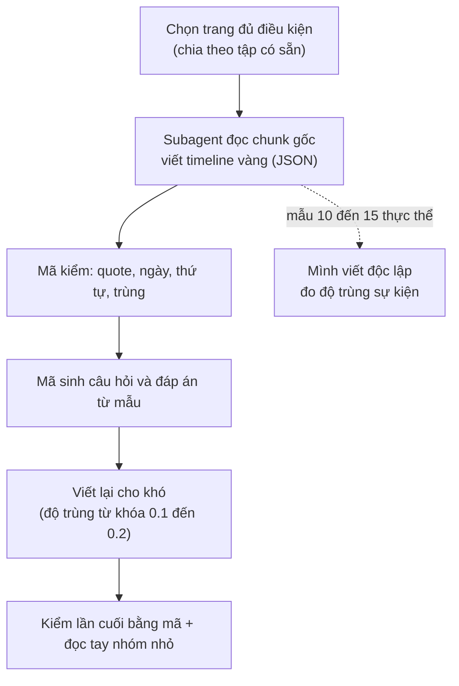

# 10. Thiết kế bộ dữ liệu tự dựng cho Cơ chế 2 (timeline vàng viết từ chunk gốc)

Ghi ngày 2026-11-04. **Trạng thái: thiết kế (mục 1 đến 9) là đề xuất; đã chạy mẫu thử 5 và 10 trang để kiểm quy trình viết timeline (mục 10).** Chưa sinh câu hỏi, chưa chạy hệ nào trên bộ này. Các con số đếm ở mục 1 đến 9 là ước lượng thô, có chú thích rõ.

Quan hệ với tài liệu khác: [`08_TIMELINE_EVAL_DESIGN.md`](08_TIMELINE_EVAL_DESIGN.md) thiết kế đo dựa trên chú thích TimeQA (oracle dựng từ nhãn có sẵn, `timeline_gold` có lỗi gold, xem `src/tam/evaluation/timeline_gold.py`); file này là hướng thay thế: **người (hoặc subagent) đọc chunk gốc và viết timeline vàng**, câu hỏi sinh bằng mã. Lý do chọn tự dựng: các bộ công bố (ECT-QA, TLQA, ADQAB, TDBench) đều lệch miền, thiếu gold chunk hoặc thiếu văn bản (xem `research/benchmarks_for_comparison/timeline_summarization/` và `03_EVALUATION_PLAN_BY_MECHANISM.md`).

## 1. Nguồn và quy mô

- **Nguồn:** các trang `real` đã chia sẵn theo trang thành ba tập không trùng nhau: `tune` 203 trang, `valid` 167, `test_clean` 186.
- **Quy mô đề xuất (chưa chốt):** tune 300, valid 300, test 400 câu; khoảng 35, 35, 45 thực thể (mỗi thực thể khoảng 8 đến 9 câu). Mỗi trang là một thực thể chính.
- **Cỡ mẫu thực là số thực thể, không phải số câu**: các câu cùng thực thể dùng chung timeline nên tương quan. Giả định hệ số tương quan trong nhóm ≈ 0.3 (**chưa đo**) thì 400 câu / 45 thực thể tương đương khoảng 109 câu độc lập. Báo cáo phải ghi cả hai số và tính sai số chuẩn gom theo thực thể.
- **Ngưỡng nhận biết khác biệt:** với 100 câu độc lập, hai phương pháp cần lệch khoảng 11 đến 14 câu mới đạt 2 sai số chuẩn; bộ này chỉ phân biệt được chênh lớn (kiểu oracle so với vector top-k), không phân biệt hai biến thể đồ thị lệch vài điểm.
- **Đếm trang đủ điều kiện (bước 0):** chỉ là ước lượng, vì `extractions.jsonl` chỉ lưu 300 ký tự đầu mỗi chunk (`scripts/ingest.py:68`) nên số năm đếm được bị đánh thấp. Với điều kiện "≥3 chunk có ≥2 năm và ≥10 năm khác nhau" còn 154 / 203 (tune), 138 / 167 (valid), 141 / 186 (test_clean). Khi làm thật phải đọc văn bản đầy đủ từ `dataset/full_dataset/pages.jsonl`.

## 2. Quy trình sinh



- **Subagent chỉ viết timeline**, không biết câu hỏi và không biết hệ nào được so. Câu hỏi sinh bằng mã rồi viết lại cho khó (cùng cách với bộ kiểm khả năng ở `eval/09`).
- **Mẫu thử trước khi nhân rộng:** 5 đến 10 thực thể, hai bên (mình và subagent) viết độc lập, đo: sự kiện cả hai cùng có / tổng, ngày khớp, sự kiện chỉ một bên có (đọc tay xem lỗi bên nào). Độ trùng thấp (ví dụ dưới 80%) nghĩa là tiêu chí "thế nào là một sự kiện" chưa rõ, phải sửa hướng dẫn trước.
- **Cỡ việc ước lượng:** trung bình khoảng 30 chunk một trang (5,995 chunk / 203 trang của tune), nên 3 đến 4 trang mỗi subagent (**ước lượng, chưa đo**); khoảng 30 subagent cho 115 trang. Thử 5 trang trước.
- Sự kiện bị bỏ sót là lỗi khó thấy nhất (đếm và liệt kê sai nếu timeline vàng thiếu): chỉ kiểm bằng mã không đủ, nên cần bước so hai bên.

## 3. Cấu trúc timeline vàng

```json
{
  "page_id": "/wiki/Nguyen_Van_A",
  "events": [
    {"id": "e2", "date": "1991", "grain": "year", "track": "affiliation", "label": "club",
     "text": "moved to club Y",
     "evidence": [
       {"chunk_id": "/wiki/Nguyen_Van_A#1", "role": "date",        "quote": "In 1991 he left X and moved"},
       {"chunk_id": "/wiki/Nguyen_Van_A#2", "role": "description", "quote": "to Y, where he stayed for seven seasons"}
     ]}
  ],
  "undated_mentions": ["became a coach (no date given)"]
}
```

(Ví dụ minh họa, tên và chunk bịa.)

| Trường | Ý nghĩa |
|---|---|
| `id` | Nhãn sự kiện **trong trang đó**; khóa toàn cục là `page_id` + `id`. Mã gán sau khi sắp theo ngày; hòa ngày thì đánh dấu |
| `date` | Ngày ISO đúng mức độ văn bản nêu, không bổ sung |
| `grain` | `year`, `month` hoặc `day`; dùng để biết cặp nào so thứ tự được (cùng mức mịn và trùng thì "hòa", loại khỏi câu thứ tự) |
| `track` | Nhóm chủ đề của sự kiện (mục 4) |
| `label` | Nhãn tự do ngắn, tùy chọn; bắt buộc khi `track` là `other` |
| `text` | Mô tả ngắn bằng tiếng Anh, khoảng 10 từ; dùng chấm độ phủ khi câu trả lời là tóm tắt |
| `evidence` | Danh sách chunk chứa bằng chứng |
| `evidence[].role` | `both`: chunk tự có cả ngày và mô tả; `date`: chỉ có ngày; `description`: chỉ có phần mô tả (và không chứa ngày của sự kiện đó) |
| `evidence[].quote` | Trích nguyên văn, phải nằm đúng trong `chunk_id` đi kèm |
| `undated_mentions` | Sự kiện có nhắc nhưng không có ngày; dùng cho nhóm "không đủ thông tin" |

**Gold chunk tối thiểu của một sự kiện** là một chunk `both`, hoặc một cặp `date` + `description`. Nếu nhiều chunk `both` cùng nêu một sự kiện thì chỉ cần một (lựa chọn "hoặc"). Gold chunk của một câu là hợp các nhóm tối thiểu của những sự kiện câu đó dùng; một chunk có thể thuộc nhiều sự kiện, và khi hợp tập thì chỉ tính một lần.

**Ba tình huống một sự kiện trải nhiều chunk:** (1) ngày ở chunk này, mô tả ở chunk sau; (2) mốc bắt đầu và kết thúc ở hai chunk khác nhau; (3) cùng sự kiện nhắc ở hai chunk (tóm tắt rồi chi tiết), ghi một sự kiện nhiều chunk, không đếm hai lần.

**Hai cách chấm khai trước, báo cả hai:** *hit* (có ít nhất một chunk vàng trong kết quả) và *recall* (tỉ lệ chunk vàng tối thiểu có trong kết quả, lựa chọn "hoặc" tính một trong hai).

**Mã kiểm:** `chunk_id` tồn tại; `quote` có nguyên văn trong chunk và chứa ngày (với `date`/`both`); `description` không chứa ngày; sắp theo ngày đúng thứ tự; không trùng sự kiện; trang phải có ≥4 sự kiện trải ≥2 chunk.

## 4. Khung track

Khung dưới dựa trên 64 quan hệ Wikidata của 1,394 câu `real` (tune, valid, test_clean); nhãn quan hệ gán theo trí nhớ về Wikidata, chưa đối chiếu từng mã (không chắc: P4791, P2962, P8047, P559). Tỉ lệ là trước khi gộp.

| Track | Gồm | Ghi chú |
|---|---|---|
| `role` | chức vụ, nhiệm kỳ, người đứng đầu, quân hàm và chỉ huy (nhãn phụ `military`) | trước gộp: role 20.5% + military 9.5% |
| `affiliation` | nơi làm việc, đội, đảng, tổ chức, giải đấu | 18.7% |
| `location` | nơi ở, nơi làm việc, trụ sở, quốc gia | 13.8% |
| `ownership_structure` | sở hữu, vận hành, công ty mẹ, nhà xuất bản, hãng đĩa | 13.6% |
| `work` | **sản phẩm** người đó làm ra (phát hành, trình diễn, dự án) | 11.8% |
| `naming` | tên chính thức, đổi tên | 5.8% |
| `family` | vợ/chồng | 2.5% |
| `education` | học tại | 1.6% |
| `other` | còn lại, bắt buộc kèm `label` | giải thưởng/di sản (2.2%) vào đây hoặc nhóm riêng nếu cần |

- **Phân biệt dễ nhầm:** `work` là sản phẩm; `role` là vị trí giữ ("đạo diễn phim X" là `work`, "giám đốc hãng phim Y" là `role`). Mơ hồ thì ưu tiên `role` > `affiliation` > `work`.
- **Lối thoát:** `label` tự do cho `other`; sau mẫu thử, nếu một `label` chiếm hơn 5% sự kiện thì thành track mới (ngưỡng khai trước).
- Khung khai **trước** khi viết, không sửa theo kết quả. Sau mẫu thử đo tỉ lệ hai bên gán `track` khác nhau trên cùng sự kiện (vì vẫn có nhầm).
- Một trang chỉ có các track nó thực sự có (≥3 sự kiện mỗi track). Sinh và mất thường không thành track.

## 5. Dùng tiêu đề mục để gợi ý track

- `dataset/full_dataset/pages.jsonl`: mỗi trang có `paragraphs` gồm `{title, text}`; `title` là **tên mục** (ví dụ "Early life", "Club career", "Honors and awards"). Trên 127,233 đoạn chỉ 8.9% có tiêu đề trùng tên trang; 4,796 / 4,815 trang có ít nhất một tiêu đề mục.
- `src/tam/ingestion/chunking.py` đã đặt văn bản chunk dạng `"<tên trang> | <tên mục>\n..."`, nên tiêu đề mục đã nằm trong embedding và BM25.
- **Cách dùng:** đưa `title` của mục vào đầu vào của subagent làm gợi ý, và dùng làm kiểm chéo (`track` subagent gán nên khớp nhóm tiêu đề, lệch nhiều thì xem lại). **Không** dùng tiêu đề làm nhãn duy nhất: "History", "Career" chứa nhiều track; có tiêu đề là câu trích dẫn ("Nemtsov said :") do tách đoạn lỗi.
- **Điều cần kiểm lại:** docstring của `chunk_document` ghi "mỗi section thành một chunk", nhưng dữ liệu cho thấy trang Boris Nemtsov có 100 chunk (trung bình khoảng 377 ký tự) và một mục dài bị cắt thành nhiều chunk cùng tiêu đề; chưa kiểm nguyên nhân. Đây cũng là nguồn của tình huống "sự kiện trải nhiều chunk". Chưa kiểm chunk có chồng lấn (overlap) hay không.
- **Cho truy vấn:** lưu `section_title` thành trường payload để lọc hoặc tăng điểm theo track là phương án rẻ nhất (không cần LLM phân loại), nhưng payload hiện chỉ index 4 trường theo thiết kế nên thêm trường là thay đổi thiết kế; chưa nên làm khi chưa có chứng cứ. Cách chọn track lúc truy vấn (cạnh có kiểu hay chỉ thực thể và thời gian) thuộc thiết kế Cơ chế 2, không bị khung track của bộ dữ liệu áp đặt.

## 6. Loại câu hỏi

Quy tắc loại câu: **đáp án phải dùng ≥2 sự kiện** của timeline (nếu một lọc theo mốc lấy được một sự kiện thì đó là Cơ chế 1). Ví dụ "Which club did A join in 1991?" là Cơ chế 1, **không** đưa vào.

| Loại | Gold chunk |
|---|---|
| Liệt kê, đếm | các chunk của mọi sự kiện trong track |
| Thứ tự, khoảng cách | chunk của hai sự kiện |
| Đầu / cuối / kế tiếp | khai trước: tính cả chuỗi (để biết là đầu/cuối), không chỉ chunk chứa đáp án |
| Tóm tắt | chấm bằng độ phủ sự kiện (khớp `text`/`date`), không cần LLM judge (chưa chốt) |
| Không đủ thông tin (nhóm riêng) | sự kiện có `undated_mentions`, hoặc cặp trùng độ mịn, hoặc "sau sự kiện cuối". Đáp án đúng là "kho không nêu" chứ không phải "không có"; khoảng 10 câu mỗi tập; chấm riêng: tỉ lệ từ chối đúng và tỉ lệ bịa đáp án; đọc tay từng câu |

- **Bỏ nhóm `t_now`** (khoảng cách đến hiện tại, "N năm qua"): thuộc tính hạn và hiện tại của Cơ chế 1, không phải gom sự kiện (người dùng quyết 2026-11-04).
- Câu chéo track (ví dụ "lúc chuyển đội Y thì ông ở đâu") để sau, chưa làm đợt đầu.
- Mỗi trang không đều số track, nên "8 đến 9 câu mỗi thực thể" chỉ là trung bình; báo cáo ghi số trang thực dùng.

## 7. So sánh hệ

1. Vector top-k (cấu hình X của `eval/09`), LLM gom sự kiện từ chunk trả về.
2. Oracle đồ thị: đưa timeline vàng vào, đo trần.
3. Đồ thị trích bằng LLM (hệ thật).
4. Nếu còn thời gian: tái hiện DyG-RAG hoặc TG-RAG, chỉ khi (1) và (2) cho thấy còn chỗ để hơn.

Go/no-go: so (2) với (1); oracle không hơn vector top-k rõ rệt thì Cơ chế 2 không có lý do tồn tại ở bộ này.

## 8. Điểm yếu cần ghi nhận

- Một tác giả (mình) ra quy tắc, và model viết timeline cùng họ với mình: giảm bằng mẫu hai bên viết độc lập và, nếu muốn độc lập hơn, một mẫu kiểm bằng model khác họ (ví dụ Gemini).
- Không có số công bố để đặt cạnh, nên chỉ nói "hơn baseline của chính mình trên bộ này".
- Nhỏ và chỉ trong miền Wikipedia.
- Chấm tóm tắt bằng độ phủ sự kiện đo "đủ chưa", không đo văn phong.
- ECT-QA và TLQA có thể chạy một lần làm kiểm tra tổng quát hóa phụ, không dùng để chọn (chưa quyết).

## 9. Quyết định chưa chốt

1. Cỡ bộ (300/300/400 hay nhỏ hơn) sau khi đếm bước 0 bằng văn bản đầy đủ.
2. Có chạy ECT-QA làm kiểm tra phụ không.
3. Tóm tắt chỉ chấm bằng độ phủ sự kiện hay thêm LLM judge.
4. Khung track cuối cùng (gộp `military` vào `role`; xử lý giải thưởng).

## 10. Mẫu thử viết timeline (2026-11-04)

Mới làm **bước viết và kiểm timeline vàng**; chưa sinh câu hỏi, chưa chạy hệ nào. Dữ liệu lưu ở `dataset/eval/timeline_pilot/` (xem mục 10.5).

### 10.1 Mẫu 5 trang: mình và subagent haiku viết độc lập

Trang lấy từ tập `tune` (ngẫu nhiên trong các trang 12 đến 25 chunk có ít nhất 12 năm khác nhau, rồi chọn lại cho đa dạng): Mike Bongiorno, Great Tower Neuwerk, World Union for Progressive Judaism, Derek Barton, Ernst Hechler. Hai bên dùng chung `GUIDE_v1.md`; mình viết trước khi xem kết quả subagent; mỗi trang một subagent haiku, được dặn không đọc thư mục của mình (log truy cập: 0 lần).

Khớp sự kiện = cùng `date` và có chung ít nhất một `chunk_id` bằng chứng (nên **chưa đo** được chuyện hai bên ghi lệch ngày cho cùng sự kiện).

| Trang | Mình | Subagent | Khớp | `track` giống nhau |
|---|---|---|---|---|
| Derek Barton | 47 | 47 | 47 | 47/47 |
| Great Tower Neuwerk | 27 | 29 | 27 | 13/27 |
| Mike Bongiorno | 68 | 69 | 68 | 65/68 |
| World Union (WUPJ) | 34 | 34 | 33 | 32/33 |
| Ernst Hechler | 60 | 60 | 57 | 34/57 |
| **Tổng** | 236 | 239 | 232 | 191/232 (82%) |

- Mức sự kiện: 232/236 (mình) và 232/239 (subagent) khớp. `chunk_id` sai: 0; `quote` không nguyên văn: 1.
- Các chỗ lệch, đọc tay: mình sai 3 (ghi trùng một sự kiện, gộp hai huy hiệu cùng ngày, sót Iron Cross 1939); subagent sai 1 rõ (ghi một số đo, cường độ sáng 1952, thành sự kiện) và 1 điểm gây tranh cãi (một kế hoạch chưa xảy ra). Còn lại là cách tách hay gộp sự kiện khác nhau.
- `track` lệch 18%, chủ yếu `work` với `other` (công trình) và các sự kiện quân sự; ba trang còn lại khớp cao. Khung `track` còn mơ hồ.
- Giới hạn: hai bên dùng chung hướng dẫn, subagent cùng họ model với mình, chỉ 5 trang.
- Kết luận: hai bên bỏ sót khác nhau, nên một bên viết và bên kia soát lại tốt hơn mỗi bên một mình; haiku đủ dùng để viết bản nháp.

### 10.2 Mẫu 10 trang: subagent viết, mã kiểm, mình đọc đối chiếu

Quy trình: (1) subagent haiku viết theo `GUIDE_v2.md` (đã thêm quy tắc: ngày mốc thập kỷ không vào `events`, khoảng thời gian tách hai sự kiện, không ghi số đo/kế hoạch/bối cảnh, nguồn mâu thuẫn thì gắn cờ); (2) `check.py` kiểm tự động; (3) mình đọc từng trang cạnh chunk gốc (`view.py`) và sửa vào bản `rev/`; bản gốc của subagent giữ ở `sub/`.

Trang: Carl August Ehrensvärd, John Henry Whitley, Real Audiencia of Guatemala, Regius Professor of Civil Law (Oxford), Butch Levy, Frederick Ralph Sharp, Telekids, Seibu Shinjuku Line, Malvik, Southern Military District.

| | Số lượng | Mã kiểm bắt được |
|---|---|---|
| Sự kiện subagent viết | 289 | |
| Sai bằng chứng hoặc ngày | 7 | 6/7 |
| Không phải sự kiện của thực thể (thống kê, trùng) | 3 | 0/3 |
| Sót sự kiện rõ ràng | 12 | 0/12 |
| Sau khi sửa (bản `rev/`) | 301 | 0 lỗi thật |

- Lỗi sai và thừa: 10/289 (khoảng 3.5%). Sót rõ ràng: 12 (khoảng 4% trên tổng số thật). **Mã kiểm không bắt được lỗi sót nào**, nên bước đọc đối chiếu là bắt buộc.
- Ba trang không cần sửa: Malvik, Seibu Shinjuku Line, Frederick Ralph Sharp (ít sự kiện, cấu trúc đơn giản).
- Lỗi hay gặp của haiku: ghi thống kê theo mùa thành sự kiện; gắn bằng chứng từ chunk nói ngày khác; gán mốc "mùa 1941-42" thành năm 1941; bỏ sót sự kiện ở cuối trang.
- `undated_mentions` của haiku lẫn mô tả chung và mục thực ra có ngày ở chỗ khác; đã dọn (bỏ 11 mục). Còn lại: danh sách huân chương không ngày, mốc thập kỷ, sự kiện không nêu năm.
- Chi phí đọc của mình: chưa đo token; ước chừng mỗi trang 4 đến 10 nghìn token, nên 115 trang cần khoảng 600 đến 800 nghìn token (chia nhiều phiên, ước lượng).
- Chưa biết tỉ lệ lỗi còn lại sau khi mình đọc, vì chưa có người thứ ba (hoặc model khác họ) soát lại.

### 10.3 Quyết định về phạm vi "sự kiện" (người dùng chốt 2026-11-04)

- **Không ghi:** ngày của sắc lệnh hoặc luật chỉ được liệt kê mà không nêu thay đổi gì; ngày sinh con cái (timeline phải về chuỗi thời gian của chính thực thể); tiểu sử cá nhân của người được nhắc trong trang của một chức vụ hoặc tổ chức (chỉ ghi mốc nhậm chức và rời chức); thống kê theo mùa hoặc năm; số đo, kế hoạch chưa xảy ra, bối cảnh của thực thể khác; mốc theo thập kỷ hoặc thế kỷ (vào `undated_mentions`).
- **Ghi:** khoảng thời gian dùng huy hiệu hoặc biểu tượng (hai sự kiện bắt đầu và kết thúc); sự kiện của thực thể tiền thân và các chỉ huy của nó khi trang liệt kê chung.
- Nguồn tự mâu thuẫn: giữ từng mục và gắn `"flag": "source_inconsistent"`; loại các sự kiện đó khỏi câu thứ tự hoặc khoảng cách liên quan.
- `undated_mentions` chỉ chứa sự kiện của thực thể mà văn bản nhắc nhưng không nêu ngày; nếu ngày suy ra được hoặc có ở chỗ khác thì bỏ khỏi danh sách.
- Hai quy tắc đầu (sắc lệnh, con cái) đã được áp lên bản `rev/` của 10 trang; hướng dẫn `GUIDE_v2.md` đã ghi thêm mục "Quyết định bổ sung".

### 10.4 Việc còn lại trước khi nhân rộng

1. Chốt khung `track` (đang lệch 18% giữa hai bên; hoặc không để câu hỏi phụ thuộc `track`).
2. Một lượt soát độc lập (model khác họ, ví dụ Gemini) trên một phần mẫu để ước tỉ lệ lỗi còn lại.
3. Mã kiểm bắt được sai bằng chứng nhưng không bắt được sót: giữ bước đọc đối chiếu cho toàn bộ trang, chia theo lô khoảng 10 đến 15 trang.
4. Sinh câu hỏi từ các timeline đã kiểm và đọc tay mẫu câu hỏi.

### 10.5b Đợt 2: 10 trang nữa (2026-11-04)

Cùng quy trình (haiku viết, mã kiểm, mình đọc đối chiếu từng trang), `GUIDE_v3.md` giữ nguyên nội dung v2. Trang chọn từ `tune` (76 ứng viên còn lại, `random.seed(2027)`): Aero Union, August Maus, CS Aerostar Bacău, First Air Group, Klemzig (South Australia), Lev Polugaevsky, Martín de Gurrea y Aragón, Quelli che… il Calcio, Thomas Fearnley, Toungoo dynasty.

| Chỉ số | Giá trị |
|---|---|
| Sự kiện haiku viết | 242 |
| Sau khi mình sửa (`batch2/rev/`) | 239 |
| Sai hoặc thừa (đã bỏ hoặc sửa) | 22 (9%); 16 trong số đó là các chuyến tàu của Klemzig (không phải sự kiện của thực thể, chính subagent đã tự ghi chú) |
| Sót (đã thêm) | 18 |
| Mã kiểm báo | 8 lỗi: 1 sự kiện sai thật (CS Aerostar, mốc theo mùa), 1 quote không nguyên văn (Lev), 6 báo nhầm do năm viết tắt ("1984–85", "1830–32") |
| Mã kiểm bắt được lỗi sai nội dung | 1/22; sót: 0/18 |

Lỗi mới thấy ở đợt này: haiku ghi cả đánh giá ("extraordinary four-year period") thành sự kiện; ghi nhầm mốc khai mạc giải thưởng ("Iron Cross (1939)", "U-boat War Badge (1939)") thành ngày trao; ghi mốc theo mùa giải ("1993–94") thành một năm; bỏ sót các mốc suy ra được ("the following year", "that August").

**Quy ước mới do mình đặt (chờ người dùng xác nhận):** sự kiện có mốc suy ra được từ câu tương đối ("the following year", "that September") hoặc từ năm viết tắt ("1984–85" kết thúc mùa giải = 1985) được ghi thành sự kiện với `"flag": "derived_date"`. Mã kiểm bỏ qua điều kiện "quote chứa năm" cho các sự kiện này. 12 sự kiện thêm mới và 6 sự kiện cũ mang cờ này. Nếu không muốn dùng, lọc theo cờ.

Chưa kiểm độc lập: cũng như đợt 1, chỉ mình đọc một lượt.

### 10.5c Đợt 3: 10 trang nữa (2026-11-04)

Cùng quy trình; hướng dẫn `GUIDE_v4.md` = v3 + quy ước `derived_date`, bỏ sự kiện của vật mang (tàu, máy bay), bỏ câu đánh giá, năm ở tiêu đề giải thưởng và mốc theo mùa. Trang chọn từ `tune` (66 ứng viên còn lại, `random.seed(2028)`): 2AM (band), Albuquerque Dukes, Breitscheidplatz, David Young (Iowa), D. R. Shackleton Bailey, Fulk (King of Jerusalem), Garnidelia, Lower Norrland Military District, Michael Batty, Vindobona (train).

| Chỉ số | Giá trị |
|---|---|
| Sự kiện haiku viết | 323 |
| Sau khi mình sửa (`batch3/rev/`) | 333 |
| Sai hoặc thừa (đã bỏ) | 10 (3%) |
| Sót (đã thêm) | 20 (6%) |
| Mã kiểm báo | 1 lỗi, báo nhầm (năm viết tắt "1965–70"); bắt sai nội dung 0/10, sót 0/20 |
| Cờ trong `rev/` | 16 `derived_date`, 7 `approximate_date`, 2 `source_inconsistent` |

Lỗi sai/thừa: 4 mục "chủ chức vụ không rõ" (Lower Norrland, khoảng trống trong danh sách); 3 ở Vindobona (bối cảnh Czechoslovakia sau 1969, tuyến EuroCity khác, và một ngày sai: tên "Vindobona" dùng lại cho Railjet sau 12/2018, haiku gán 2014-12-14); 2 ở Michael Batty (giải thưởng "2017-2018" bị tách thành "bắt đầu/kết thúc kỳ", chuyển sang undated); 1 ở Albuquerque (tiểu sử một cầu thủ). Ngoài ra sửa cờ: gỡ `derived_date` khi năm có ghi rõ; thêm `approximate_date` cho mốc "c.", "1118 or 1119", "by 1928", "after 1916", "by 1994".

Sót chủ yếu: nhập ngũ và thông báo nhập ngũ (2AM, 3 mục cuối đoạn), các tour/concert trong danh sách (2AM), mốc cuối đoạn của trang địa danh (1895, 1916, 1928, 1930-04-01, 1961 ở Breitscheidplatz), các phiếu bầu/tuyên bố trong chuỗi mục chính trị (David Young, 3 mục), loạt xuất bản có năm bắt đầu và kết thúc (Shackleton Bailey: OCT 1958–1982). Tỉ lệ sai gần mức đợt 1b, thấp hơn đợt 2 vì không có trang nào nhiều sự kiện của vật mang.

Chưa kiểm độc lập: chỉ mình đọc một lượt.

### 10.5d Quyết định về phạm vi trang (2026-11-04, người dùng)

Mỗi bộ (`tune`, `valid`, `test_clean`) chỉ gồm các trang nó đang có: viết timeline vàng cho **toàn bộ** trang của bộ đó, rồi chỉ sinh câu hỏi từ các trang ấy. Không còn mục tiêu 35/35/45 thực thể cố định; cỡ bộ là số trang thực có (các số 300/300/400 câu ở mục 1 đến 9 chỉ còn là tham khảo).

Số liệu lúc ghi (đếm từ `dataset/eval/tune_subset.json`): `tune` có 203 trang; đã dùng 35 (30 có timeline vàng ở `pilot10/`, `batch2/`, `batch3/`, 5 trang `pilot5/` chỉ để so sánh); còn 168 trang chưa làm, tổng 5383 chunk không rỗng (trung vị 26, tối đa 100, nhỏ nhất 5); 85 trang dài hơn 25 chunk, 10 trang ngắn hơn 10. Ba mẫu thử trước chỉ chọn trang 10 đến 25 chunk nên chưa có kinh nghiệm với trang dài: cần quyết cách chia trang dài cho subagent (mỗi subagent một đoạn chunk, hay giới hạn chunk).

### 10.5e Đợt 4: 10 trang dài (26 đến 45 chunk, 2026-11-04)

Mục đích: thử haiku trên trang dài, vì 168 trang `tune` còn lại có 85 trang dài hơn 25 chunk. Mỗi subagent vẫn nhận nguyên một trang (không chia đoạn). Chọn ngẫu nhiên (`random.seed(2029)`) trong 54 trang `tune` chưa dùng có 26 đến 50 chunk không rỗng.

| | Số |
|---|---|
| Haiku viết (`batch4/sub/`) | 386 |
| Sai hoặc thừa (đã bỏ hoặc sửa nội dung) | 13 (3,4%) |
| Bỏ theo quy ước mới (mốc kết thúc của giải đấu) | 12 |
| Sót, đã thêm | 6 (1,6%) |
| Sau khi mình sửa (`batch4/rev/`) | 367 |
| Mã kiểm bắt được lỗi nội dung | 0/13 sai, 0/6 sót; 3 báo (2 báo nhầm, 1 quote ghép hai chỗ ở TU Leuna) |

Kết luận: haiku làm trang dài không tệ hơn trang vừa (sai/thừa 3,4% so với 3%, sót 1,6% so với 6%), nên chưa cần chia đoạn; cách đọc kiểm vẫn cần vì mã kiểm không bắt được lỗi nội dung. Lỗi hay gặp: gắn cờ `derived_date` cho ngày đã ghi rõ (5 chỗ), ghi phát biểu/bài báo/phim về thực thể thành sự kiện của nó (Monir: sách, phim, phỏng vấn; Meet the Press: chuyện lặt vặt về người dẫn), gộp số liệu thành sự kiện (tuyển 15 cầu thủ, mua cổ phần chung chung), sót mốc ở chỗ nằm sâu (hỏa hoạn 2014 ở đoạn cuối, chồng mất 1991).

Quy ước mình tự đặt thêm (chờ người dùng xác nhận): khoảng thời gian của một giải đấu mà thực thể tham dự (ví dụ "21 February to 1 March") ghi MỘT sự kiện ở ngày bắt đầu, không tách hai mốc, vì tham dự một giải không phải trạng thái bắt đầu và kết thúc (Blübaum bỏ 11 mốc "ended"). Nguyên tắc tách hai mốc vẫn giữ cho chức vụ, thời gian đảm nhiệm, giai đoạn dùng huy hiệu.

### 10.5f Đợt 5: 10 trang, có 2 trang rất dài (61 và 63 chunk, 2026-11-04)

Chọn ngẫu nhiên (`random.seed(2029)`) trong 158 trang `tune` chưa dùng: 8 trang 13 đến 41 chunk và 2 trang trên 45 chunk (The One Show, The Dark Eye) để thử giới hạn của việc đưa nguyên trang cho một subagent.

| | Số |
|---|---|
| Haiku viết (`batch5/sub/`) | 219 |
| Sai hoặc thừa (đã bỏ) | 8 (3,7%) |
| Sót, đã thêm | 7 (3,2%) |
| Sửa cờ hoặc nội dung chữ (không đổi số sự kiện) | 11 (cờ `derived_date` sai, thiếu `approximate_date`, ghi "unnamed" dù nguồn có tên) |
| Sau khi mình sửa (`batch5/rev/`) | 218 |
| Mã kiểm bắt được lỗi nội dung | 0/8 sai, 0/7 sót; 2 báo do mình thêm sự kiện thiếu năm trong quote |

Kết luận: hai trang 61 và 63 chunk không tệ hơn trang ngắn (The One Show: 51 sự kiện, thừa 2, sót 2; The Dark Eye: 27 sự kiện, chỉ thiếu 2 cờ), nên chưa cần chia đoạn dù dài trên 45 chunk. Trang còn lại tối đa 100 chunk vẫn chưa thử.

Lỗi mới thấy: bỏ qua tên người ngay trong câu nguồn (Agenzia: "Unnamed person" trong khi câu có "Giovanni Giovannini"), sót vai trò đi kèm một mốc đã ghi (Cavada là người dẫn đầu tiên ngày 6/1/1975; Antenne 2 đổi tên France 2 cùng ngày với việc giao Paul Amar), sót chương trình mới thêm (20h30 le dimanche), ghi mốc theo kế hoạch (hợp đồng AP 2015 đến 2020), ghi sự kiện một lần của khách (Ronan Keating dẫn một tập).

Quy ước mình tự đặt thêm (chờ người dùng xác nhận): (1) danh sách khách mời theo từng tập (Allsång på Skansen, 36 chunk) không ghi thành sự kiện, vì là liệt kê chứ không phải thay đổi của thực thể; (2) khoảng ngày của một chiến dịch quân sự thực thể tham gia (USS LCS, Gunto 18 đến 30 tháng 6) = MỘT sự kiện ở ngày bắt đầu, cùng nguyên tắc với giải đấu ở 10.5e; (3) mốc chỉ nêu như kế hoạch trong nguồn (thời hạn hợp đồng 2015 đến 2020) không ghi; (4) bài/ý kiến chỉ trích VỀ chương trình (Actuchomage, Bruno Masure) không ghi, nhưng sự cố xảy ra TRONG chương trình (báo động cháy, khiếu nại sau một lời nói trên sóng) vẫn ghi; (5) khi hai nơi trong cùng trang mâu thuẫn mà không rõ bên nào đúng (Chris Evans bắt đầu dẫn thứ Sáu tháng 8 năm 2010 hay "đầu 2011") thì gắn `source_inconsistent` cho mốc không nằm trong danh sách chính.

### 10.5 Dữ liệu và công cụ

Thư mục `dataset/eval/timeline_pilot/`:

- `pilot5/`: `in/` (chunk gốc, đúng cách `chunk_document` đánh số), `me/` (timeline mình viết: `.dsl` và `.json`), `sub/` (timeline subagent), `GUIDE_v1.md`.
- `pilot10/`: `in/`, `sub/` (bản gốc của subagent), `rev/` (bản sau khi mình đối chiếu, **đây là timeline vàng của 10 trang**), `GUIDE_v2.md`.
- `batch2/`: `in/`, `sub/`, `rev/` (**timeline vàng của 10 trang đợt 2**), `GUIDE_v3.md`; sửa bằng `tools/patch_b2.py`.
- `batch3/`: `in/`, `sub/`, `rev/` (**timeline vàng của 10 trang đợt 3**), `GUIDE_v4.md`; sửa bằng `tools/patch_b3.py`.
- `batch4/`: `in/`, `sub/`, `rev/` (**timeline vàng của 10 trang dài đợt 4**), `GUIDE_v4.md`; sửa bằng `tools/patch_b4.py`.
- `batch5/`: `in/`, `sub/`, `rev/` (**timeline vàng của 10 trang đợt 5**), `GUIDE_v4.md`; sửa bằng `tools/patch_b5.py`.
- `tools/`: `mk.py` (dựng JSON từ `.dsl` và kiểm quote), `cmp.py` (so hai bên), `check.py` (mã kiểm), `view.py` (xem chunk cạnh sự kiện), `patch.py` (các sửa của mình trên bản `sub/`).

Tất cả là dữ liệu mẫu thử, chưa phải bộ dữ liệu cuối. Các trang nằm trong tập `tune`, nên chưa dùng chung với `valid` hay `test_clean`.
