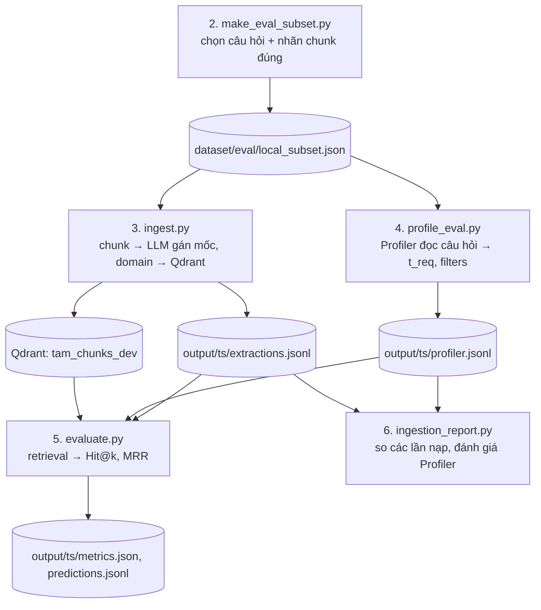

# Chạy lại từ ingestion đến đánh giá (bộ local)

Mọi lệnh chạy ở thư mục gốc của repo. Python 3.10, đã `pip install -r requirements.txt`. Giải thích kết quả: [`../eval/`](../eval/). Quyết định thiết kế: [`../decisions/`](../decisions/).

## 0. Chuẩn bị

1. `.env` (copy từ `.env.example`): `APP_ENV=dev`, key của LLM đang dùng (`NINE_ROUTER_API_KEY`, `NINE_ROUTER_URL`; hoặc `ANTHROPIC_API_KEY`), `QDRANT_URL`.
2. Chọn LLM trong `configs/config.dev.yaml`, mục `llm.roles`: `ingestion_time` (gán mốc và domain cho chunk), `time_extractor` (Profiler). Hiện hai role đều trỏ `9router`, combo `basic-gemini-3.5-flash-lite` (chỉ chứa một model Gemini, nên không còn đổi model ngầm; combo lỗi thì chờ tối đa 32 giây rồi dừng, xem mục "Khi LLM lỗi giữa chừng"). Các lần chạy ngày 2026-10-19 trong `docs/eval/` dùng combo cũ `basic-llm`.
3. Bật Qdrant: `docker compose up -d qdrant` (kiểm tra: `curl localhost:6333/collections` trả 200).

## 1. Sơ đồ các bước



## 2. Các bước

### Bước 2 (tùy chọn). Chọn bộ câu hỏi

```
python scripts/make_eval_subset.py --subset local --seed 42
```

Đọc `dataset/full_dataset/D/test.*.jsonl`, lấy 8 domain × 5 câu, ghi `dataset/eval/local_subset.json` (câu hỏi easy và hard, các trang cần nạp, `gold_chunk_ids`). File này đã có sẵn trong repo; chạy lại chỉ khi đổi seed, số câu hay cách nhóm. `--subset real` là cấu hình cũ, chưa dùng.

### Bước 3. Nạp dữ liệu

```
python scripts/ingest.py --recreate            # nạp thật vào Qdrant
python scripts/ingest.py --dry-run             # chỉ gọi LLM và ghi extractions.jsonl, không đụng Qdrant
python scripts/ingest.py --recreate --limit-pages 1   # thử nhanh 1 trang
```

Mỗi trang Wikipedia tách thành chunk theo đoạn của dataset, mỗi trang một lần gọi LLM (tối đa 30 chunk). LLM gán `start`, `end`, `ongoing`, `domain` kèm lý do. Chunk không có `start` bị bỏ.

- `--recreate`: xóa và tạo lại collection. **Bắt buộc** khi đổi model embedding hoặc muốn kho sạch. Không có thì ghi đè theo `chunk_id` (không nhân đôi).
- Đầu ra: `output/<timestamp>/extractions.jsonl` (từng chunk kể cả chunk bị bỏ), `run.log`, `config.resolved.yaml`.
- Kiểm tra: in `{docs, chunks_total, ingested, skipped_no_time, ...}`. Bộ local: 37 trang, 1275 chunk.

### Bước 4. Chạy Profiler

```
python scripts/profile_eval.py                 # câu hỏi mức hard
python scripts/profile_eval.py --level easy
# Cache Profiler: khóa không chứa ngày (prompt chưa thay {t_now}), nên câu có thời gian tuyệt đối trúng cache qua các ngày.
# Câu phụ thuộc "bây giờ" (LLM đặt use_t_now = true: tương đối, now/current/latest, hoặc không nhắc thời gian; hoặc t_req rỗng) thì không cache.
# Mỗi dòng profiler.jsonl ghi thêm `t_now` (ngày chạy) để biết "hiện tại" được hiểu là ngày nào.
```

Với mỗi câu hỏi, LLM tách `semantic_query`, `t_req` (mốc tuyệt đối), `filters`. Đầu ra: `output/<timestamp>/profiler.jsonl`. Không cần Qdrant.

### Bước 5. Đo retrieval

```
python scripts/evaluate.py --mode oracle --profiler output/<ts>/profiler.jsonl --extractions output/<ts>/extractions.jsonl
python scripts/evaluate.py --mode e2e    --profiler output/<ts>/profiler.jsonl --extractions output/<ts>/extractions.jsonl
```

Thêm tùy chọn để chạy các cấu hình khác:

| Cờ | Ý nghĩa |
|---|---|
| `--mode oracle` | `t_req` lấy từ nhãn dataset (điểm giữa khoảng nhãn); đo riêng chất lượng retrieval |
| `--mode e2e` | `t_req` do Profiler tạo; đo cả hệ thống |
| `--no-temporal` | Bỏ điểm thời gian (`W1=1, W2=0`); lọc cứng "không rò rỉ tương lai" vẫn bật |
| `--facets domain` | Lọc **cứng** theo domain Profiler điền (chỉ với `e2e`) |
| `--facets boost --w3 0.1` | Domain của Profiler chỉ **cộng điểm** `W3·Domain_Match` (chỉ với `e2e`) |
| `--end-mode open\|decay\|stored` | Cách chấm chunk `ongoing`/`unknown`: A / B / C ([`decisions/02`](../decisions/02_END_TIME_ONGOING.md)); cần kho có `end_status` (nạp lại bằng `ingest.py`; cache LLM hiện gần như trống nên sẽ gọi LLM thật cho 37 trang, sau đó các lần nạp lại đọc từ cache) |
| `--open-decay 0.1` | Độ giảm của cách B |
| `--method dense\|bm25\|hybrid` | Baseline plain RAG: không lọc thời gian, không điểm thời gian, không loại tin giả (`leakage_rate` đo mức rò rỉ); mặc định `temporal` = Cơ chế 1 |
| `--t-unknown 0.5` | Bật nhánh chunk không mốc với điểm thời gian cố định; kho phải nạp bằng `ingest.py --keep-undated` |
| `--neighbors 1` | Lấy thêm 1 chunk liền kề mỗi phía của Top-K làm ngữ cảnh; `metrics.json` báo `ctx_*`, `rescued_by_neighbors`, `ctx_size_mean` |
| `--level easy` | Dùng câu hỏi mức easy |

`metrics.json` còn có số đo từng bước (`stage_*`, `cand_recall_*`, `hit@k_pre`, `mrr_pre`/`mrr_post`, `temporal_helped/hurt/same`, `gold_blocked_by_filter`) và, ở chế độ e2e, chất lượng Profiler (`t_req_abs_error_years_mean`, `t_req_in_label_range`, `domain_in_gold_chunk`). `metrics.json` còn có `recall@k`, `n_multi_gold`, `multi_all_hit@k`, `multi_recall@k` cho câu cần từ 2 chunk trở lên (bộ local có 1/40 câu như vậy). `--extractions` giúp Hit@k chỉ tính trên các câu mà chunk đáp án còn trong kho. Đầu ra: `output/<timestamp>/metrics.json` và `predictions.jsonl` (chunk nào được trả về cho từng câu). Hit@k, MRR là gì: xem [`../eval/02_RETRIEVAL_LOCAL.md`](../eval/02_RETRIEVAL_LOCAL.md).

### Bước 6. Báo cáo ingestion và Profiler

```
python scripts/ingestion_report.py lan1=output/<ts1> lan2=output/<ts2> --profiler output/<ts>/profiler.jsonl --out report.json
```

In bảng so các lần nạp cạnh nhau: số chunk vào kho, số `ongoing`, chunk đáp án còn sống, domain khớp, độ đúng mốc so với nhãn. Thư mục truyền vào phải có `extractions.jsonl`.

## 3. Đổi gì thì chạy lại từ đâu

Thứ tự các bước luôn như trên. Kịch bản khác nhau ở **bước nào phải chạy lại** và **tham số**, không phải ở file nào được gọi.

| Bạn đổi | Chạy lại |
|---|---|
| `W1, W2, λ, top_n, top_k, rrf_k` (config) hoặc cờ của bước 5 | Chỉ bước 5 (và 6 nếu cần) |
| Prompt hoặc LLM của Profiler (`time_extractor_v1.md`, role `time_extractor`) | Bước 4, 5 |
| Prompt hoặc LLM gán mốc (`ingestion_time_v1.md`, role `ingestion_time`), danh sách domain | Bước 3 (`--recreate`), 4 nếu muốn, 5, 6 |
| Model embedding | Bước 3 với `--recreate` (đổi số chiều vector), rồi 5 |
| Bộ câu hỏi (seed, số câu, cách nhóm) | Bước 2, rồi 3 trở đi |

## 4. Cache LLM

Bước 3 và 4 lưu kết quả LLM vào hai file song song trong `data/llm_cache/` (bị gitignore): `cache.sqlite` là **nguồn sự thật** (code chỉ đọc từ đây, truy vấn được để phân tích) và `cache.json` là **bản xem nhanh** (một file `{hash: {schema, model, created_at, preview, value}}`, mở bằng trình soạn thảo; mất hoặc lệch thì tự dựng lại từ SQLite khi mở cache, và chỉnh tay file này không ảnh hưởng kết quả). `cache.json` được ghi ra đĩa mỗi 20 lần ghi và khi chương trình kết thúc, nên có thể chậm hơn SQLite vài mục khi đang chạy. Mã: `src/tam/llm/cache.py` (`SqliteCache`, `JsonViewCache`, ghép bằng `MirroredCache`, tạo bằng `open_cache`). Cùng prompt, cùng model trong config và cùng nội dung chunk thì lần sau dùng lại, không gọi LLM: nạp 1 trang từ 21.7 giây xuống 0.9 giây, kết quả giống hệt. Cuối lệnh in `Cache LLM: X lần dùng lại, Y lần gọi LLM`.

- Đổi prompt hay đổi `model_id` trong config thì khóa cache đổi, tự gọi lại.
- `--no-cache`: không dùng cache. `--refresh-cache`: bỏ cache cũ, gọi lại và ghi đè. Xóa hẳn: `rm data/llm_cache/cache.sqlite* data/llm_cache/cache.json` (hai thư mục con hai ký tự `17/`, `b1/` là cache định dạng cũ, bỏ được).
- **Lưu ý model drift:** khóa cache dùng tên model trong config (vd combo `basic-gemini-3.5-flash-lite`), không phải model thật phía sau. Combo của 9router có thể đổi model giữa các ngày; cache giữ kết quả cũ. Muốn đo với model hiện tại thì `--refresh-cache`.
- Chỉ kết quả hợp lệ được ghi cache; lần gọi lỗi định dạng không bị lưu.
- Phân tích bằng SQL, ví dụ số mục theo model: `SELECT model, schema, COUNT(*) FROM cache GROUP BY 1, 2;` (mở `cache.sqlite` bằng tab Database của PyCharm hoặc `sqlite3`).

## 5. Lỗi thường gặp

| Triệu chứng | Nguyên nhân và cách xử lý |
|---|---|
| `401 Invalid API key` | Sai `NINE_ROUTER_API_KEY` trong `.env`; lấy lại ở dashboard 9router |
| `410 ... has been deprecated` giữa lúc nạp | Model phía sau combo bị ngừng. Chạy lại (có cache nên các trang đã xong không tốn thêm); nếu lặp lại thì đổi combo hoặc profile trong `llm.roles` |
| Kết nối Qdrant bị từ chối | `docker compose up -d qdrant` |
| Profiler hay `ingest` báo "Structured output lỗi" rồi vẫn chạy tiếp | Bình thường với `basic-llm`: combo không tuân theo structured output nên code đọc JSON từ văn bản và thử lại tối đa 3 lần (`src/tam/llm/structured.py`) |
| `skipped_llm_error > 0` | Lô chunk đó hỏng sau 3 lần thử; chạy lại, phần đã xong lấy từ cache |
| Số chunk vào kho thay đổi giữa các lần chạy | Model phía sau combo đổi (không phải lỗi code). So sánh các lần chạy phải tính tới điều này |

## 6. Kiểm tra code

`pytest tests/` (cần Qdrant chạy cho vài test) và `ruff check src scripts tests`.

## Khi LLM (9router) lỗi giữa chừng

Lỗi tạm thời (mạng, 429, 5xx, 410 do model sau combo bị ngừng) được chờ 1, 2, 4, 8, 16, 32 giây rồi thử lại (`tam/llm/structured.py`). Hết 32 giây vẫn lỗi thì `scripts/ingest.py` dừng với mã thoát 2 và in thông báo. Khi LLM phục hồi, **chạy lại đúng lệnh cũ**: các lô đã xong đọc từ cache (`data/llm_cache/`), chỉ lô chưa xong mới gọi LLM. Lỗi 401/403/400 không được chờ, báo ngay. Chỉ áp dụng cho ingestion; `profile_eval.py` dùng cùng hàm nên cũng chờ, nhưng chưa bắt `LlmUnavailable` để in thông báo.
