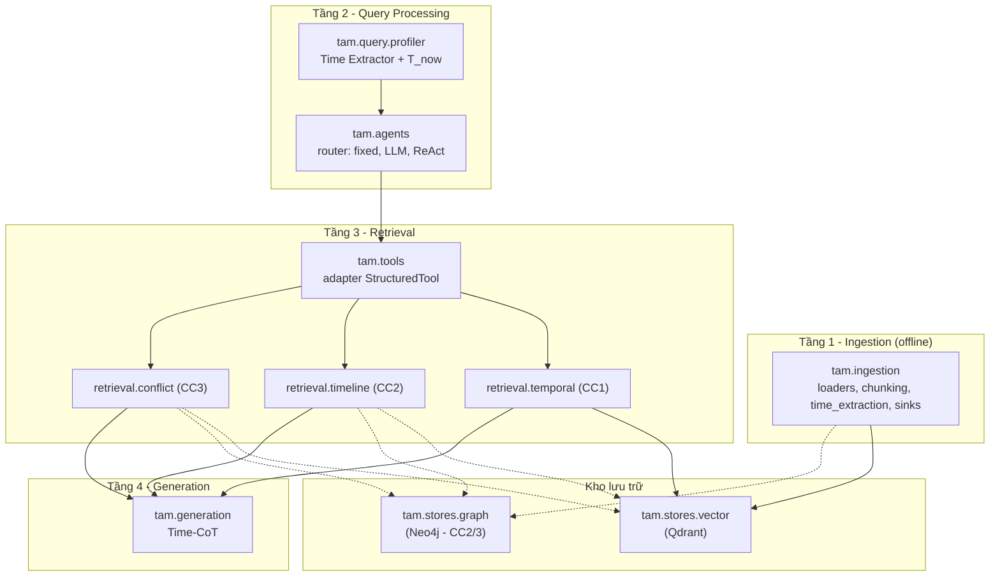

# Kế hoạch tổng quan triển khai (cả 3 cơ chế)

Tài liệu này là bản đồ "sẽ làm gì, theo thứ tự nào, nối với nhau ra sao" cho toàn đồ án. Phạm vi: `docs/scope/01_PROJECT_SCOPE.md`. Thiết kế: `docs/design/`. Kế hoạch chi tiết cho tuần này (Cơ chế 1): [`01_TEMPORAL_RETRIEVAL_IMPLEMENTATION.md`](01_TEMPORAL_RETRIEVAL_IMPLEMENTATION.md).

---

## 1. Mục tiêu

Xây hệ thống RAG **nhận thức thời gian** (Time-Aware Agentic Memory) và chứng minh nó tốt hơn RAG thường (không phân biệt thời gian) trên bộ câu hỏi nhạy cảm thời gian (TimeQA enriched). Phần time-aware (metadata thời gian, lọc cứng, chấm điểm thời gian, đồ thị tiến hóa) là **đóng góp chính**, tự viết, không phụ thuộc framework có sẵn.

### 1.1. Hai phần chính của đồ án (2026-10-25)

Đồ án chia hai phần, làm theo thứ tự:

1. **Nghiên cứu phương pháp.** Hai cơ chế truy vấn là Temporal Retrieval (`temporal`) và Timeline (`timeline`), cùng Cơ chế 3 chạy ngầm lúc nạp dữ liệu (cập nhật, xử lý thay thế; không có nhánh truy vấn riêng). So sánh các phương án (vector thuần với k cố định hoặc thích nghi, graph, graph bổ trợ Cơ chế 1), đo bằng tập tune và valid, chạy `test_clean` một lần khi chốt. Kết quả là **phương pháp tốt nhất** theo số đo.
2. **Triển khai hệ thống.** Bắt đầu **sau khi** có phương pháp tốt nhất, không làm song song với việc chọn phương pháp. Hệ thống là một ứng dụng chatbot hỏi đáp trên bộ nhớ đã xây:
   - nhiều đoạn hội thoại, đăng nhập và đăng xuất ở mức đơn giản;
   - hiển thị dẫn chứng (câu trích dẫn, chunk gốc) và dòng thời gian;
   - kiểm thử mã nguồn và đo tải: xem mục 1.2;
   - triển khai bằng Docker (đã có `docker-compose.yml`).

**Phạm vi dữ liệu của ứng dụng:**
- Dữ liệu chỉ là TimeQA. Câu hỏi "hiện nay" được trả theo nội dung bộ dữ liệu; `T_now` vẫn là thời gian thật hiện tại, không đóng cứng ở năm 2021.
- Không làm cảnh báo mốc dữ liệu, không làm nút cập nhật trực tiếp từ Wikipedia. Cơ chế 3 vẫn được nghiên cứu và đánh giá ở phần 1.

**Chưa quyết, từ từ:** có cần người dùng thử thật hay không (khảo sát vài người), phụ thuộc yêu cầu của thầy hoặc cô.

**Đề xuất chưa chốt:** thêm một bộ nhỏ khoảng 50 đến 100 ca kiểm thử chức năng viết tay kiểu người dùng, có cả câu ngoài phạm vi (hệ thống phải trả lời không có dữ liệu); đây là ca kiểm thử trong mã, không phải thí nghiệm đánh giá. Các hạng mục hội thoại nhiều lượt, ReAct, LangChain, LangGraph xem mục 4.1.

### 1.2. Kiểm thử (2026-10-25)

Phần hệ thống được xác nhận bằng **kiểm thử mã nguồn**, không dùng thí nghiệm đánh giá như phần nghiên cứu (phần nghiên cứu vẫn dùng tune, valid và `test_clean`).

**Hiện có (đo ngày 2026-10-25):** 21 file test; 212 test chạy được không cần Qdrant, mất 3.28 giây; 7 test cần Qdrant thật (marker `qdrant`, chạy bằng `docker compose up -d qdrant`); 4 test `xfail` có chủ đích (lỗi min-max khuếch đại hòa nghĩa, `tests/test_temporal_retriever.py`). Test dùng LLM và embedding giả, cùng corpus giả 11 ca (`tests/fixtures/temporal_corpus.json`) để kiểm bất biến (không rò rỉ tương lai, không trả chunk đã `invalidated_at`). Phủ: tính điểm, hợp nhất xếp hạng, bộ lọc, khoảng thời gian, Profiler, ingestion, cache và factory của LLM, schema, các độ đo. Chưa có: CI, Makefile, đo độ phủ mã, test cho API hay giao diện.

**Cần thêm khi làm Cơ chế 2 và cập nhật (phần nghiên cứu, là mã thuần):**

| Nhóm | Nội dung |
|---|---|
| Phép toán khoảng thời gian | Chồng lấn, khoảng trống, kế nhiệm, thời lượng, đếm, lâu nhất; ca biên: đang diễn ra (`end` rỗng), cùng `start`, chồng lấn, độ mịn năm và tháng |
| Cắt cửa sổ và so sánh | Nối các cửa sổ lại ra đúng đoạn; cắt lại là idempotent; cửa sổ trùng thì giữ chunk cũ |
| Bảng 15 trường hợp chunk (`decisions/09`) | Mỗi trường hợp một test, kiểm chunk nào giữ, chunk nào `invalidated_at` |
| Đối chiếu nút khi cập nhật | Giữ, sửa, xóa, thêm; kiểm chứng câu trích dẫn (chuẩn hóa, nằm nguyên văn trong đoạn); chỉ mục ngược; dựng lại `TIẾP_THEO` |
| Bất biến | Không rò rỉ tương lai; lọc `invalidated_at` trước khi lấy top; thăng tiến không đóng `end_time` của nút trước |
| Phần phụ thuộc LLM (LLM giả hoặc phản hồi đã ghi) | Đầu ra đúng schema; vòng thử lại khi câu trích dẫn sai (đủ N lần thì dừng); router nghiêng về `timeline` khi không chắc |
| Tích hợp | Qdrant thật cho bộ lọc payload; kho graph trong bộ nhớ |

**Cần thêm khi làm ứng dụng (phần hệ thống):**

| Nhóm | Nội dung |
|---|---|
| API | Điểm cuối, kiểm tra đầu vào, mã lỗi |
| Đăng nhập, phiên | Đăng nhập, đăng xuất, hết hạn phiên; người dùng không đọc được hội thoại của người khác |
| Hội thoại | Lưu và nạp lịch sử, nhiều đoạn chat, phát hiện đổi chủ đề, câu ngoài phạm vi trả lời không có dữ liệu |
| Đầu cuối | Luồng chat qua API với LLM giả; giao diện thử khói nếu có |
| Chịu lỗi | LLM quá thời gian, 429, JSON sai; Qdrant ngắt kết nối; trả thông báo thân thiện, không sập |
| Idempotent | Nạp cùng một trang hai lần không tạo bản sao; cập nhật lặp lại không đổi kết quả |
| Bảo mật cơ bản | Khóa API không lọt vào log; giới hạn độ dài đầu vào; văn bản trong chunk không điều khiển được hệ thống |
| **Đo tải** | Nhiều người dùng đồng thời (công cụ như Locust hoặc k6); đo p50, p95, p99 của thời gian phản hồi, thông lượng, **tỉ lệ lỗi** (phần trăm yêu cầu thất bại), chi phí LLM mỗi câu, **tỉ lệ cache** (phần trăm lời gọi LLM, embedding, reranker được trả từ bộ nhớ đệm), CPU và bộ nhớ; chạy tăng dần, chạy đột biến và chạy dài (soak) |

Đo tải dùng **LLM giả có độ trễ lấy từ phân phối đã đo** để tách chi phí của hệ thống khỏi độ trễ nhà cung cấp, vì hạn mức API (429) không cho đo tải thật bằng LLM thật; riêng đường truy xuất (không gọi LLM) đo được trực tiếp.

**Công cụ:** thêm marker `integration`, `e2e`, `load`; CI (ví dụ GitHub Actions) chạy test không cần Qdrant và test Qdrant bằng container dịch vụ; báo cáo độ phủ mã bằng `pytest-cov`; `ruff` đã có trong cấu hình.

## 2. Ba cơ chế

| | Cơ chế 1 — Temporal Retrieval | Cơ chế 2 — Timeline Summarization | Cơ chế 3 — Conflict Resolution |
|---|---|---|---|
| Câu hỏi mẫu | "Năm 2020 luật xây dựng quy định gì?" | "Tóm tắt sự nghiệp ông A từ 2005 đến nay" | "Báo A nói bị bắt, báo B nói chỉ bị triệu tập, cái nào đúng?" |
| Kho dùng | **VectorDB** (không cần Graph) | VectorDB tìm node vào → **GraphDB** đi dọc thời gian (Boomerang) | VectorDB (credibility) + **GraphDB** (cạnh Evolution) |
| Kỹ thuật lõi | Hybrid dense+BM25 (RRF) → hard filter → `W1·Sem + W2·Temp` (half-life decay) | Time-traversal ra triplets (<1K token); `Chunk_ID` quay về VectorDB lấy text khi cần | `Final = W1·Sem + W2·Decay + W3·Cred`; cạnh `SUPERSEDES`/`CORRECTS`/`BÁC_BỎ`; `invalidated_at` |
| Dataset | TimeQA enriched (có sẵn) | TimeQA (câu nhiều mốc) | Cần dữ liệu đa nguồn (StreamingQA, ChronoQA…) hoặc tự tạo |
| Trạng thái | **Tuần 3 (đang làm)** | Dự kiến | Dự kiến; scope cho phép chỉ đi sâu 2/3 |

### Bất biến phải giữ xuyên suốt

- **Evolution ≠ Falsehood.** Trạng thái từng đúng rồi đổi → đóng `end_time` (vẫn trả về khi hỏi quá khứ). Sai từ gốc → `invalidated_at` (CC1 lọc cứng; câu trả lời lịch sử phải cảnh báo). Cáo buộc trích thành `(Authority)-[SUSPECTS]->(A)`, không phải sự thật.
- **Timeline ≠ Conflict.** Thăng tiến sự nghiệp nối bằng cạnh next-event, **không** đóng `end_time` sự kiện trước; chỉ đính chính/thay thế mới đóng.
- **Không rò rỉ tương lai:** `start_time <= T_req`. TH1 (`T_req ∈ [start, end]`, `end = NULL` là còn hiệu lực) → `Temporal = 1.0`; TH2 (lùi về quá khứ gần nhất) → `exp(-λ·Δyears)`.
- **Thời gian tương đối** quy đổi bằng cách tiêm `T_now` (đồng hồ server) vào system prompt.
- **Structural chunking + content hashing** lúc ingestion; hash trùng là no-op.
- **Payload index đúng 4 trường:** `start_time`, `invalidated_at`, `domain_features.domain`, `domain_features.country`.
- Tài liệu không có mốc thời gian (kể cả fallback ngày đăng) thì không vào kho time-aware.

## 3. Kiến trúc hệ thống ↔ kiến trúc code

Hệ thống có 4 tầng (design 01). Mỗi tầng map vào một nhóm package trong `src/tam/`.

> **`tam`** = **T**ime-**A**ware **M**emory, viết tắt từ tên đề tài *Time-Aware Agentic Memory* (bỏ "Agentic" cho gọn).



Nét liền = làm tuần này. Nét đứt, `R2`, `R3`, `GS` = làm sau, **nhưng chỗ đặt đã có sẵn** nên thêm vào không phải dời code cũ.

### Quy tắc phụ thuộc

```
schemas  <-  stores, retrieval  <-  tools  <-  agents, pipeline  <-  scripts
```

- `retrieval/*` là logic thuần Python, **không** import langchain/langgraph: dễ test, dễ giải thích khi bảo vệ.
- `tools/` là lớp mỏng bọc Retriever thành tool cho LLM.
- `agents/` là nơi duy nhất quyết định "dùng cơ chế nào": đổi từ cố định sang LLM sang agent chỉ sửa ở đây.

Layout đầy đủ từng thư mục: mục 3 của file 01.

## 4. Orchestration: từ pipeline cố định đến Agent

Thiết kế 01 có Routing Agent và Ingestion Agent, nên nâng lên agent là đúng hướng. Làm 3 nấc, mỗi nấc chỉ thay lớp `agents/` và đăng ký thêm tool:

| Nấc | Khi nào | Orchestration | Quyết định cơ chế |
|---|---|---|---|
| A | Tuần 3 (CC1) | LangGraph `StateGraph` cố định `profile → route → retrieve → generate` | `route` trả hằng `temporal` |
| B | Có CC2 | Cùng graph, `route` thành **conditional edge** | LLM phân loại có cấu trúc: `temporal / timeline / conflict` |
| C | Có CC3, hoặc cần "Luồng Tích hợp" CC2+CC3 | Node `agent` = LLM tool-calling (ReAct) gọi lặp các tool | LLM tự chọn và kết hợp tool |

Vì sao chưa làm agent ngay: pipeline cố định cho kết quả **tái lập được** (cần để so EM/F1 với baseline), rẻ token, dễ debug. Agent chỉ đáng giá khi có ≥2 cơ chế để chọn. Cách nối cụ thể: mục 7 của file 01.

### 4.1. Đề xuất cập nhật (2026-10-25, chưa chốt)

Bảng ở trên là kế hoạch ban đầu. Nhãn `conflict` ở nấc B và việc dùng LangGraph ở nấc A đã lỗi thời: Cơ chế 3 không có nhánh truy vấn riêng (chạy ngầm lúc nạp, xem [`decisions/09`](../decisions/09_CONFLICT_RESOLUTION_SCOPE.md)), nên truy vấn chỉ còn hai nhãn `temporal` và `timeline` ([`decisions/10`](../decisions/10_TIMELINE_GRAPH_AND_VECTOR_LINK.md)). Các hạng mục dưới đây là đề xuất, ghi để cân nhắc, chưa phải quyết định.

| Hạng mục | Đề xuất | Lý do | Đổi ý khi |
|---|---|---|---|
| LangChain Core | **Có**, giữ ở mức hiện tại (lớp gọi LLM) | Đã dùng và ổn: giao diện `BaseChatModel` chung cho nhiều nhà cung cấp, đầu ra có cấu trúc; đổi model chỉ đổi cấu hình. Không dùng chain hay agent của LangChain | Muốn bỏ phụ thuộc: thay bằng client trực tiếp (tốn công, ít lợi) |
| LangGraph | **Chưa làm** | Chỉ có hai nhánh cộng quay về vector; vòng thử lại ngắn viết bằng `for`; trạng thái hội thoại là một đối tượng nhỏ; thêm một khung là thêm phụ thuộc và lỗi khó đọc hơn, trong khi kế hoạch cần kết quả tái lập được | Có ReAct thật sự (số bước phụ thuộc kết quả), cần checkpoint và chạy tiếp cho tác vụ rất dài, hoặc nhiều nhánh song song |
| Router | **Có**: một lần phân loại bằng LLM với đầu ra có cấu trúc, hai nhãn `temporal` / `timeline`, kèm trường `operation` trong nhánh `timeline`; viết bằng hàm Python | Một quyết định đơn, không cần vòng lặp. Nghiêng về `timeline` khi không chắc (nhầm sang `temporal` làm thiếu sự kiện, nhầm ngược lại chỉ tốn token) | Router nhầm nhiều: thêm ví dụ vào prompt hoặc chạy cả hai nhánh |
| Vòng thử lại khi kiểm chứng không hợp lệ (định dạng sai, câu trích dẫn không có trong đoạn) | **Có**, vòng cố định tối đa N lần, nhắn lại LLM kèm lý do | Luồng biết trước nên không phải agent; `tam/llm/structured.py` đã làm phần định dạng | Không |
| ReAct (LLM tự chọn công cụ) | **Tùy chọn**, chỉ khi bộ đánh giá có câu ghép nhiều bước (ví dụ "ai kế nhiệm người giữ chức lâu nhất?") | Chỗ duy nhất bước đi phụ thuộc kết quả trước. Rủi ro: không tất định, nhiều lời gọi LLM mỗi câu, cần giới hạn số bước; phải so với router cố định trên cùng bộ câu ghép | Không có loại câu ghép nào trong bộ đánh giá: bỏ |
| Hội thoại nhiều lượt | **Tùy chọn**, một lớp riêng ở tầng xử lý truy vấn, không đổi bên trong các cơ chế | Giữ trạng thái ô đang xét (và ngăn xếp vài ô gần nhất), nhận ra đổi chủ đề; khi không chắc thì coi là chủ đề mới, vì dùng nhầm ô sai mà không ai biết còn tệ hơn mất phần tiết kiệm. Đối thủ công bằng: viết lại câu hỏi rồi tìm vector. Đo độ nhận ra đổi chủ đề, tỉ lệ dùng nhầm ô, token | Không nằm trong phạm vi đồ án: bỏ. Tiết kiệm thời gian chỉ nhỏ (truy vấn vector khoảng 0.14 giây), chủ yếu tiết kiệm token ngữ cảnh |
| Tên gọi "agentic" | Đặt ở **bộ nhớ tự quản lý**: LLM quyết định giữ, sửa hay xóa từng nút khi đoạn đổi (kèm kiểm chứng câu trích dẫn bằng code), cộng router. Không cần ReAct để xứng với tên | Khớp tên đề tài; phần đóng góp nằm ở bộ nhớ, không ở hội thoại | Thầy hoặc cô muốn hệ thống có vòng tác tử phía truy vấn |

## 5. Lộ trình theo tuần (dự kiến, điều chỉnh theo tiến độ)

| Tuần | Nội dung | Kiểm chứng được |
|---|---|---|
| 1–2 | Nghiên cứu, scope, thiết kế 01–02, chốt dataset | Tài liệu `docs/` |
| **3** | **CC1:** khung `src/`, Qdrant + schema, scoring/fusion/filter, Time Extractor, ingestion TimeQA bộ local, generation, baseline plain RAG, eval bộ local | Hỏi "luật 2020" ra bản 2018 (TH2); EM/F1 CC1 vs baseline trên bộ local |
| 4 | Tinh chỉnh CC1 (λ, W1/W2, top-N/K), eval bộ thật 300 câu + per-time-slice; dựng `GraphStore` + `GraphSink` | Bảng kết quả CC1; Neo4j chạy được |
| 5 | **CC2:** triplets + cạnh next-event, `retrieval/timeline`, Boomerang, `timeline_tool`; router lên nấc B | Timeline <1K token; coverage |
| 6 | **CC3** (hoặc đào sâu CC2 nếu chọn 2/3): bỏ credibility đa nguồn; pipeline cập nhật có phiên bản (ghép mờ chunk, phân loại bản sửa, đóng `end_time`/`invalidated_at`, cạnh Evolution); làm theo thứ tự đo chi phí, giữ lịch sử, phân loại bản sửa, câu hỏi thay đổi, đính chính, xem [`decisions/09`](../decisions/09_CONFLICT_RESOLUTION_SCOPE.md) | Chi phí cập nhật và Historical retention so với replace-all; test Evolution vs Falsehood |
| 7 | Nấc C (ReAct) nếu cần Luồng Tích hợp; eval toàn bộ | Bảng so sánh tổng |
| 8+ | Ablation, viết luận văn, dọn code | — |

Quyết định "2 trong 3" chốt sau tuần 4, dựa trên kết quả CC1 và chất lượng dữ liệu cho CC3.

## 6. Đánh giá

So hệ time-aware với **plain RAG** (`tam.baselines.plain_rag`, cùng embedding và LLM, không filter, không temporal score):

- **EM / F1** theo đáp án chuẩn đúng khung thời gian được hỏi.
- **Accuracy theo time slice**: phát hiện hệ thiên lệch về "mới nhất" hay "cũ nhất".
- **Temporal Freshness**: phục hồi sau khi có thông tin cập nhật (CC3).
- **Coverage** (CC2) và **Token efficiency**: context RAG đầy đủ vs triplets <1K token.

Dữ liệu: bộ local 40 câu (8 domain × 5, 37 trang) chỉ để kiểm tra chạy được (không so điểm); bộ thật hiện có quyết định tạm 8 domain × 50 câu từ `D/test` (bù từ `D/train`), chưa code, kế hoạch cũ là 300 câu (xem `dataset/full_dataset/EVAL_PLAN.md` và `docs/process/06_EVAL_SUBSET.md`).

## 7. Rủi ro và quyết định còn mở

| Vấn đề | Hướng xử lý |
|---|---|
| Stack chưa chốt (VectorDB/GraphDB) | Mặc định Qdrant + Neo4j; truy cập qua ABC nên đổi chỉ sửa 1 file store |
| Chi phí LLM khi ingestion (trích `start_time` mỗi chunk) | Chạy bộ local trước; cache kết quả trích xuất vào `data/processed/` |
| Mốc thời gian chỉ-năm, trước 1970 trong TimeQA | Chuẩn hóa `YYYY-01-01`, dùng kiểu datetime hỗ trợ giá trị âm |
| Dữ liệu đa nguồn cho CC3 hiếm | Đã quyết: bỏ đa nguồn, giữ Evolution và Falsehood, tự tạo bộ từ lịch sử Wikidata/Wikipedia; xem [`decisions/09`](../decisions/09_CONFLICT_RESOLUTION_SCOPE.md) |
| Hiệu quả decay phụ thuộc λ, W1/W2 | Quét tham số trên bộ local, kiểm chứng trên bộ thật |
| Có dùng LangGraph, ReAct, lớp hội thoại hay không | Đề xuất ở mục 4.1, chưa chốt; phụ thuộc phạm vi đồ án và bộ câu hỏi đánh giá |
