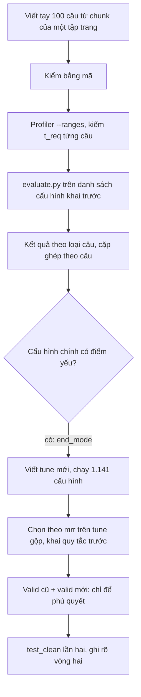

# Nhật ký triển khai 09: bộ kiểm khả năng và vòng chọn cấu hình thứ hai

Tiếp nối [`08_RANGE_PROFILER_AND_ANSWER_METRICS.md`](08_RANGE_PROFILER_AND_ANSWER_METRICS.md). Giai đoạn 2026-11-03. Kết quả ở [`../eval/09_CAPABILITY_PROBE_RESULTS.md`](../eval/09_CAPABILITY_PROBE_RESULTS.md); lý do ở [`../decisions/11_EVOLUTION_FALSEHOOD_ALIGNMENT.md`](../decisions/11_EVOLUTION_FALSEHOOD_ALIGNMENT.md) mục 1.3.

## Vì sao làm

Đo từ 1,394 câu của bộ `real` (xem `research/benchmarks_for_comparison/03_EVALUATION_PLAN_BY_MECHANISM.md` mục 1.2): 86% câu có tháng và năm, **không câu nào hỏi tới ngày**, gần như không có thời gian tương đối hay câu không nêu mốc. Các bộ công bố khác (theo khảo sát ở `benchmarks_for_comparison`) cũng không phủ các loại này. Thiết kế có xử lý chúng (đổi "5 năm trước" thành ngày bằng `T_now`, mặc định "mới nhất", `end_time` mở) nhưng chưa từng được đo. Nên viết bốn bộ nhỏ để đo, với danh sách cấu hình khai trước.

## Đã làm

| Nhóm | File | Việc |
|---|---|---|
| Dữ liệu (đã commit hoặc sẽ commit) | `dataset/eval/capability_probe/questions.jsonl`, `questions_v2.jsonl`, `tune_questions.jsonl`, `valid_questions.jsonl` | 100 câu mỗi bộ: 31 `day`, 34 `relative`, 18 `no_anchor`, 17 `open_end`; mỗi câu có `id`, `question`, `answer` (danh sách phương án), `t_now`, `note` (ngày đã suy ra cho "N năm trước"), `gold_chunk_ids` |
| | `dataset/eval/capability_probe_subset.json`, `capability_probe_v2_subset.json`, `capability_probe_tune_subset.json`, `capability_probe_valid_subset.json` | Định dạng `*_subset.json` mà `scripts/profile_eval.py` và `scripts/evaluate.py` đọc; `time_start`/`time_end` chỉ là năm tham chiếu để script cũ không lỗi, không phải nhãn khoảng hiệu lực |
| Tài liệu | `docs/eval/09_CAPABILITY_PROBE_RESULTS.md`, file này, mục 1.3 và 1.4 của `decisions/11`, mục 1.2 của `03_EVALUATION_PLAN_BY_MECHANISM.md` | Kết quả, quy trình, khai trước |
| Chạy (trong `local/`, gitignore) | `local/scripts/run_replay_probe.py`, `run_replay_probe_tune.py`, `run_replay_probe_valid.py` | Bản sao của `run_replay.py`, đổi ba chỗ: kho và lần nạp theo bộ, không dùng server GPU (bge-reranker-v2-m3-int8 chạy CPU), chạy song song 3 luồng. Mọi lượt đều dùng cùng cờ `evaluate.py` của cấu hình cũ |
| | `local/scripts/profile_*.sh` | Chạy Profiler (`scripts/profile_eval.py --ranges`) có vòng thử lại |
| | `local/results/probe_*.tsv`, `mainunk_*.tsv`, `probe_*_summary.json` | Nhãn cấu hình, thư mục `output/<ts>/`, tổng hợp |

**Không sửa `src/`, `scripts/` hay `configs/`**: mọi thứ chạy bằng script sao chép trong `local/` và các cờ `evaluate.py` đã có.

## Quy trình

### Viết và kiểm câu hỏi

1. **Nguồn:** chunk trong kho của từng tập (`output/<ts>/extractions.jsonl` có `start`, `end`, `ongoing`). Bộ kiểm lấy trang `test_clean`, tune mới lấy trang `tune`, valid mới lấy trang `valid`; **không trùng trang giữa các bộ**.
2. **Loại câu:** `day` (mốc đến ngày, gồm cả ngày đầu và cuối của một nhiệm kỳ), `relative` ("hiện tại", "N năm trước" với `t_now` = 2026-11-03), `no_anchor` (không từ chỉ thời gian; đáp án là trạng thái mới nhất), `open_end` (mốc năm hoặc tháng nằm trong khoảng chunk còn hiệu lực).
3. **Kiểm bằng mã** (mọi bộ): đáp án có trong chunk gold; chunk gold có `start` (chunk không mốc không vào kho thời gian); mốc hỏi nằm trong `[start, end]` hoặc chunk đang mở; "N năm trước" rơi **bên trong** khoảng của đáp án, không sát biên; **không chunk nào khác cùng trang chứa chuỗi đáp án mà còn hợp lệ tại mốc hỏi**.
4. **Độ khó:** đo tỉ lệ từ khóa của câu hỏi (bỏ tên thực thể và con số) có trong chunk gold, so với 0.10 của `test_clean`. Bản 1 quá dễ (0.45), nên viết lại (bản 2: 0.20) và tune mới, valid mới viết ngay ở mức 0.17 đến 0.18. Chỉnh theo độ khớp chữ, **không** theo cấu hình nào thắng.
5. **Lỗi đã bắt:** câu không nêu mốc nhưng lại chứa "since 1932" bị Profiler coi 1932 là mốc (sửa câu và chạy lại 1 request); câu thiếu tên thực thể (mơ hồ); đáp án quá chung ("fire", "prime minister") làm chunk khác cũng khớp.

### Profiler

Chạy `scripts/profile_eval.py --subset <bộ> --ranges`, rồi so `t_req` từng câu với ngày tham chiếu. Model Profiler ghi ở `output/<ts>/config.resolved.yaml` của lần chạy. `t_now` lấy từ đồng hồ máy (script không có cờ riêng), nên **các lượt phải chạy trong ngày 2026-11-03**.

### Chạy cấu hình

- `evaluate.py --mode e2e` với `--profiler`, `--extractions` và kho của tập (chunk bị bỏ lúc nạp thì tính là trượt). Bộ kiểm dùng kho `tam_chunks_dev_test_clean`; tune mới dùng `tam_chunks_dev_tune`; valid mới dùng `tam_chunks_dev_valid`.
- **Danh sách khai trước (bộ kiểm):** 28 cấu hình của `test_clean` (`eval/07` mục 5: Plain RAG, Temporal, xuất phát, ablation), báo tất cả, chạy một lần.
- **Tune mới:** 1,141 cấu hình = 888 cấu hình cũ + 240 cấu hình quét + 13 cấu hình ablation của `test_clean` (bỏ trùng).
- **Valid:** 120 cấu hình (danh sách ngắn theo tune gộp, 56 cấu hình đã qua valid cũ, 15 cấu hình quét đã xác nhận, 28 cấu hình test, cấu hình chính, X) trên valid mới; 51 cấu hình thiếu kết quả valid cũ được chạy bổ sung.
- **A và B:** hai cấu hình mới giữ nguyên mọi tham số của cấu hình chính, chỉ đổi `end_mode` sang `unknown_decay`, chạy trên 6 bộ (tune cũ, tune mới, valid cũ, valid mới, bộ kiểm bản 1, bản 2).
- Điểm cross-encoder được cache (`data/model/reranker/score_cache.sqlite`) và dùng lại giữa các cấu hình cùng bộ câu, nên 1,063 cấu hình còn lại chạy trong khoảng một giờ (ước lượng thô lúc đầu 3.6 giờ là quá bi quan).

### Quy tắc chọn khai trước

Chọn theo `mrr` trên tune gộp (595 + 100); valid chỉ để phủ quyết (thua chính từ 2 sai số chuẩn ở valid cũ hoặc thua ở valid mới thì loại); hòa dưới 1 sai số chuẩn thì chọn ít thay đổi nhất; cấu hình thắng chạy `test_clean` lần hai. Rò rỉ phải bằng 0.

## Bài học khi chạy

- **Không thử lại dồn dập khi dịch vụ LLM đang lỗi.** Ngày 2026-11-03 gói miễn phí báo giới hạn theo ngày; mình gửi hơn 1,200 request mà chỉ khoảng 200 thành công (phần còn lại bị từ chối 429/503 và bị thử lại). Nên dừng sau lần thất bại đầu tiên và chờ, thay vì để vòng thử lại đập vào hạn mức. Hạn mức tính riêng theo model và dự án.
- **Kill tiến trình theo PID cụ thể**, không dùng `pkill -f`.
- **Đừng so "cấu hình mới" với "cấu hình chính" nếu chúng khác nhiều tham số:** cấu hình tốt nhất trên tune gộp (X) khác cấu hình chính ở hơn chục tham số, nên phải tạo thêm A và B (chỉ đổi `end_mode`) để tách riêng hiệu ứng.
- **Không cần GPU** cho đợt này: bge-reranker-v2-m3 bản int8 chạy CPU ổn (khoảng 91 giây mỗi cấu hình ở lần chạy 78 cấu hình đầu, 9 giây khi đã có cache). CPU của máy đã bão hòa (tải gấp đôi số nhân) nên thêm luồng không nhanh hơn.
- **Một sự kiện lặp ở nhiều câu** (cùng chunk gold cho 4 đến 8 câu) làm số câu đúng khác số sự kiện đúng; khi báo cáo nên ghi số chunk gold.

## Còn lại

Chưa quyết cấu hình chính mới (A hay X); chưa chạy `test_clean` lần hai; chưa cập nhật `configs/*.yaml` và `eval/07`. Chi tiết ở mục 9 của [`eval/09`](../eval/09_CAPABILITY_PROBE_RESULTS.md).
