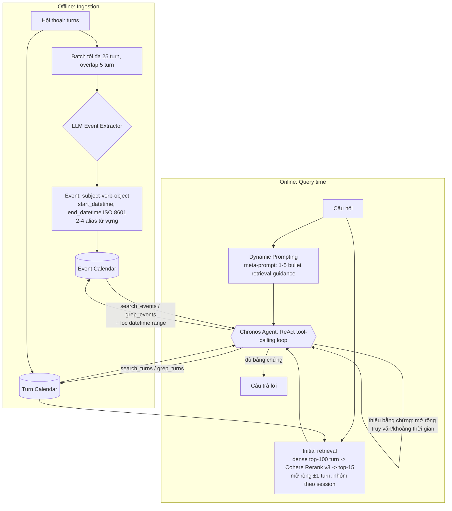

# Phân tích bài báo: Chronos – Temporal-Aware Conversational Agents with Structured Event Retrieval (2603.16862)

> Lưu ý tránh nhầm: đây **không** phải bài Chronos về Knowledge Drift (2604.05096) trong `conflict_resolution/03_Chronos_Knowledge_Drift.md`. Hai bài chỉ trùng tên.

## 1. Thông tin chung & Tài nguyên (Links)
- **Tiêu đề:** Chronos: Temporal-Aware Conversational Agents with Structured Event Retrieval for Long-Term Memory
- **Mã arXiv:** [2603.16862](https://arxiv.org/abs/2603.16862) (v1, 03/2026, cs.CL)
- **Tác giả:** Sahil Sen, Elias Lumer, Anmol Gulati, Vamse Kumar Subbiah (PwC)
- **Mã nguồn (GitHub):** chưa rõ. Bản HTML không có link code của Chronos (chỉ có link repo benchmark LongMemEval).
- **Dataset:** [LongMemEval](https://github.com/xiaowu0162/LongMemEval), bản LongMemEvalS: 500 câu hỏi, 6 nhóm (KU, MS, SSA, SSP, SSU, TR). LoCoMo chỉ được nhắc ở related work, không được đánh giá.
- **Ghi chú nguồn đọc:** bản PDF bị lỗi text layer, nội dung dưới đây lấy từ bản HTML của arXiv (qua công cụ trích xuất tự động). Các số liệu nên được đối chiếu lại với bản gốc trước khi trích dẫn chính thức.

## 2. Vấn đề giải quyết (Problem Statement)
Bộ nhớ hội thoại dài hạn cho agent hiện có hai hướng đều có điểm yếu:
- Xây knowledge graph toàn diện: chi phí ingest cao và gây "context entropy".
- Truy xuất ở mức turn: thiếu temporal grounding.

Các tác giả cho rằng chưa có cách nào thực hiện *query-conditioned selective extraction* chỉ riêng thông tin thời gian.

> **Ví dụ (trong bài):** *"What did I do the week after my vacation?"*, *"When did I start that medication?"*. Câu trả lời phụ thuộc vào việc biết sự kiện xảy ra khi nào (không chỉ khi nào được nhắc tới trong hội thoại), và cần so sánh/đếm nhiều sự kiện nằm rải rác ở nhiều session.

## 3. Cơ chế cốt lõi (Core Mechanisms)

### 3.1. Event extraction và hai chỉ mục (ingestion)
- LLM trích event dạng ⟨subject, verb, object⟩ kèm `start_datetime` và `end_datetime` (ISO 8601). Cụm mơ hồ như "recently" được chuyển thành một cửa sổ quanh timestamp của cuộc hội thoại.
- Mỗi event có 2–4 alias từ vựng khác nhau (vd "bought Fitbit" -> "picked up a fitness tracker") để tăng khả năng khớp.
- Xử lý theo batch tối đa 25 turn, overlap 5 turn.
- Event và turn được embed bằng text-embedding-3-large, lưu ở hai index riêng: **event calendar** (gọn, có cấu trúc thời gian) và **turn calendar** (giữ nguyên ngữ cảnh hội thoại).

### 3.2. Dynamic prompting (lúc truy vấn)
Một meta-prompt phân tích câu hỏi (đối tượng, thuộc tính, ràng buộc thời gian, phép toán) rồi sinh 1–5 bullet "retrieval guidance", chạy một lần cho mỗi câu hỏi (Gemini 3 Flash) và được chèn vào system prompt của agent.

### 3.3. Initial retrieval
Dense search top 100 turn -> Cohere Rerank v3 giữ top 15 -> mỗi turn mở rộng thêm 1 turn trước và 1 turn sau cùng session -> nhóm theo session với header ngày, vd "Session 1 (2024-02-15)".

### 3.4. Chronos Agent (tool-calling loop, kiểu ReAct)
- Tool: `search_turns`, `search_events` (vector) và `grep_turns`, `grep_events` (khớp text chính xác).
- Agent tự chọn top-k; rerank chạy từ k=100 và dùng **câu hỏi gốc**, không dùng query agent tự viết lại.
- Agent có thể: **ràng buộc tìm kiếm theo khoảng datetime**, đối chiếu event với đoạn hội thoại gốc, và **mở rộng tìm kiếm khi bằng chứng chưa đủ**.
- Tool call chạy bất đồng bộ, có tự động retry.

## 4. Kết quả chính
Thiết lập: Chronos Low dùng GPT-4o (để so công bằng với baseline); Chronos High dùng Claude Opus 4.6. Embedding text-embedding-3-large, temperature 0, chấm bằng LLM judge của LongMemEval. Metric chính là accuracy (%).

**Bảng 1 (Chronos Low vs baseline), overall; KU / MS / SSA / SSP / SSU / TR**

| Hệ thống | Overall | KU | MS | SSA | SSP | SSU | TR |
|---|---|---|---|---|---|---|---|
| Chronos Low | 92.60 | 96.15 | 91.73 | 100.00 | 80.00 | 94.29 | 90.23 |
| Honcho† | 90.40 | 94.87 | 84.96 | 96.43 | 90.00 | 94.29 | 88.72 |
| EmergenceMem Internal | 86.00 | 83.33 | 81.20 | 100.00 | 60.00 | 98.57 | 85.71 |
| Mastra | 84.80 | 85.90 | 79.70 | 82.14 | 73.33 | 98.57 | 85.71 |
| Hindsight‡ | 83.60 | 84.60 | 79.70 | 94.60 | 66.70 | 95.70 | 79.70 |
| Supermemory | 81.60 | 88.50 | 71.40 | 96.40 | 70.00 | 97.10 | 76.70 |
| Zep | 71.20 | 83.30 | 57.90 | 80.40 | 56.70 | 92.90 | 62.40 |
| Full-context | 60.20 | 78.20 | 44.30 | 94.60 | 20.00 | 81.40 | 45.10 |

† Honcho chạy trên Claude Haiku 4.5, không so sánh trực tiếp được. ‡ Hindsight dùng OSS-20B làm actor, OSS-120B làm judge.

**Bảng 2 (hệ thống dùng LLM mạnh hơn):** Chronos High 95.60 (KU 100.00, MS 88.72, SSA 100.00, SSP 100.00, SSU 98.57, TR 95.50); Mastra 92.80; Honcho 92.60 (không báo cáo theo nhóm); Hindsight 91.40; Supermemory 85.20.

**Cải thiện tương đối (theo bài):** Chronos Low 7.67% so với EmergenceMem Internal (86%), 2.43% so với Honcho; Chronos High 3.02% so với Mastra (92.80%). Chronos Low yếu nhất ở SSP (80.00 so với 90.00 của Honcho); tác giả cho rằng do Honcho dùng model mạnh hơn.

**Bảng so sánh model (phụ lục, overall):** Claude Opus 4.6 95.60; GPT-5-mini 94.20; Claude Sonnet 4.5 94.20; Claude Haiku 4.5 94.00; GPT-5.2 93.80; GPT-4o 92.60; Claude Code Sonnet 88.60. (Abstract nói 8 LLM nhưng bảng chỉ liệt kê 7.)

**Ablation (mẫu phân tầng 116 câu, overall)**

| Cấu hình | Chronos High | Chronos Low |
|---|---|---|
| Full Chronos | 94.8 | 93.1 |
| Bỏ initial retrieval | 91.4 | 76.7 |
| Bỏ dynamic prompting | 94.8 | 78.4 |
| Bỏ rerank | 92.2 | 81.0 |
| Bỏ date filter | 92.2 | 78.4 |
| Chỉ grep (không vector) | 87.1 | 77.6 |
| Chỉ vector (không grep) | 83.6 | 80.2 |
| Chỉ turns (không events) | 92.2 | 58.6 |

- Bỏ event index là mức giảm lớn nhất với Chronos Low (34.5 điểm), tác giả viết là "almost halved accuracy". Abstract nêu event calendar đóng góp "58.9% gain on the baseline", các thành phần khác từ 15.5% đến 22.3%.
- Bỏ **date filter** làm Low giảm 93.1 -> 78.4 và High giảm 94.8 -> 92.2.
- Dynamic prompting không ảnh hưởng với Chronos High.

**Phân tích lỗi (mục 4.3):** lỗi truy xuất (retrieval failure) là loại phổ biến nhất ở cả hai model; chuyển Low -> High giảm một nửa lỗi đếm/số học; fabrication không cải thiện, chủ yếu ở câu hỏi abstention.

## 5. Hạn chế (theo tác giả)
1. Hai index (turn + event) tốn storage hơn hệ thống chỉ có turn.
2. Chi phí offline cho việc trích event bằng LLM (giảm bằng batching có overlap và model nhỏ).
3. Độ phức tạp lúc truy vấn: truy xuất song song turn và event tăng chi phí inference.
4. Benchmark có nhiễu: câu 6d550036 có đáp án tham chiếu mâu thuẫn với lịch sử; câu 75f70248 bị chấm sai dù trả lời hợp lý (biến thiên của LLM-as-judge).
5. Hướng tương lai: học từ event trace, thao tác bộ nhớ hiệu quả hơn, lịch sử event dùng chung cho multi-agent/multi-user.

## 6. Áp dụng vào đồ án

Chronos là bằng chứng thực nghiệm cho hướng "agent tự gọi tool để truy xuất theo thời gian" thay vì pipeline truy xuất một lượt. Cần lưu ý nó đánh giá trên **hội thoại cá nhân** (LongMemEval), khác với kho tài liệu của đồ án.

### Liên hệ đồ án

**a) Tool-calling agent.** Chronos dùng ReAct loop với bốn tool (vector và grep, trên hai index). Điều này khớp hướng Routing Agent của đồ án: expose truy xuất thành tool để agent tự quyết định số lần gọi, loại tool và top-k. Gợi ý map: `search_turns` ~ tìm chunk trong VectorDB (hybrid dense + BM25 đã có, BM25 đóng vai trò tương đương `grep`); `search_events` ~ tra các event/node trong GraphDB (Cơ chế 2). Ablation cho thấy cả vector lẫn grep đều cần (bỏ một trong hai giảm điểm ở cả hai model), ủng hộ việc giữ hybrid dense + BM25. Chi tiết "rerank dùng câu hỏi gốc thay vì query agent viết lại" là điểm nhỏ nhưng đáng bắt chước để tránh agent làm lệch ý định.

**b) Lọc theo khoảng datetime.** Chronos cho agent truyền một khoảng `[start, end]` vào tool và lọc theo `start_datetime`/`end_datetime` của event. Đồ án hiện hard-filter `start_time <= T_req` và chấm `Temporal_Score` (Case 1: `T_req` nằm trong `[start_time, end_time]` thì 1.0). Khác biệt cần cân nhắc:
- Chronos lọc theo **khoảng** do agent chọn (hai đầu), phù hợp câu hỏi "tuần sau kỳ nghỉ", "trong năm 2007"; đồ án mới tối ưu cho **một điểm** `T_req` (đồng thời hợp với timeline/range ở Cơ chế 2).
- Có thể thêm tham số `time_from`, `time_to` cho tool VectorDB, vẫn giữ `start_time <= T_req` làm chặn trên để không rò rỉ tương lai khi hỏi tại một thời điểm. Chronos không có khái niệm này (bài chưa nêu cơ chế chống future leakage).
- Ablation "bỏ date filter" giảm 14.7 điểm (Low) và 2.6 điểm (High) trên mẫu 116 câu, ủng hộ việc coi filter thời gian là thành phần chính, nhưng lưu ý mẫu nhỏ và chỉ chạy trên LongMemEval.
- Payload index của đồ án chỉ có 4 trường (`start_time`, `invalidated_at`, `domain`, `country`); `end_time` cố ý không index. Nếu mở lọc theo khoảng, cần cân nhắc lọc `start_time` ở DB rồi kiểm `end_time` ở hậu xử lý, thay vì thêm index.

**c) Mở rộng khi thiếu bằng chứng so với Cơ chế 1.** Cơ chế 1 hiện chạy một lượt: hybrid search -> hard filter -> re-rank `W1·Semantic + W2·Temporal`, và Case 2 là fallback sang quá khứ gần nhất với `exp(-λ·Δyears)`. Chronos thêm vòng lặp: agent tự đánh giá bằng chứng chưa đủ rồi **mở rộng** (nới khoảng thời gian, đổi sang grep, gọi thêm tool, đối chiếu event với turn gốc). So sánh:

| Khía cạnh | Cơ chế 1 (hiện tại) | Chronos |
|---|---|---|
| Số lượt truy xuất | Một lượt, cố định | Nhiều lượt, agent quyết định |
| Khi thiếu kết quả | Fallback Case 2 theo decay, quy tắc cố định | Agent nới khoảng/đổi tool dựa trên nội dung đã đọc |
| Điều kiện dừng | Top-K | Agent tự đánh giá đủ bằng chứng (chưa rõ tiêu chí cụ thể, ngân sách số vòng) |
| Chi phí | Thấp, dự đoán được | Cao hơn (tác giả nêu rõ ở hạn chế) |

Đề xuất: giữ Cơ chế 1 làm tool tất định bên trong agent (đảm bảo hard filter, `invalidated_at`), và để agent chỉ điều khiển phần "mở rộng" có ràng buộc (nới khoảng thời gian trong giới hạn `T_req`, thêm lượt BM25), kèm trần số vòng để kiểm soát chi phí.

**d) Các ý khác có thể dùng.**
- *Event calendar kèm alias*: tương ứng node graph của Cơ chế 2 (triplet có `Chunk_ID` trỏ về VectorDB, mô hình "Boomerang"). Alias từ vựng là cách rẻ để cải thiện recall cho BM25/dense. Ablation: bỏ event index làm Chronos Low rơi 93.1 -> 58.6, cho thấy lớp có cấu trúc thời gian có giá trị lớn khi model yếu (với model mạnh chỉ giảm 94.8 -> 92.2).
- *Dynamic prompting* (retrieval guidance theo câu hỏi) gần với Query Profiler của đồ án; hiệu quả phụ thuộc model (không ảnh hưởng ở Chronos High, giảm 14.7 điểm ở Low).
- *Giải quyết thời gian mơ hồ* ("recently" -> cửa sổ quanh timestamp hội thoại) tương tự việc đồ án tiêm `T_now` để ra `T_req` tuyệt đối.
- **Không** có xử lý conflict/supersede/invalidation trong bài: các bài toán Evolution vs Falsehood (Cơ chế 3) phải lấy từ nguồn khác (xem `conflict_resolution/`).

**e) Lưu ý khi dùng làm baseline/so sánh.** Chronos không có code public (theo bản HTML đã đọc), nên việc tái hiện phải tự cài đặt; LongMemEval đã có ghi chú trong `docs/research/benchmarks_for_comparison/conflict_resolution/02_LongMemEval.md`. Mọi lần chạy LLM trong đồ án vẫn phải qua cache theo quy ước của repo.
