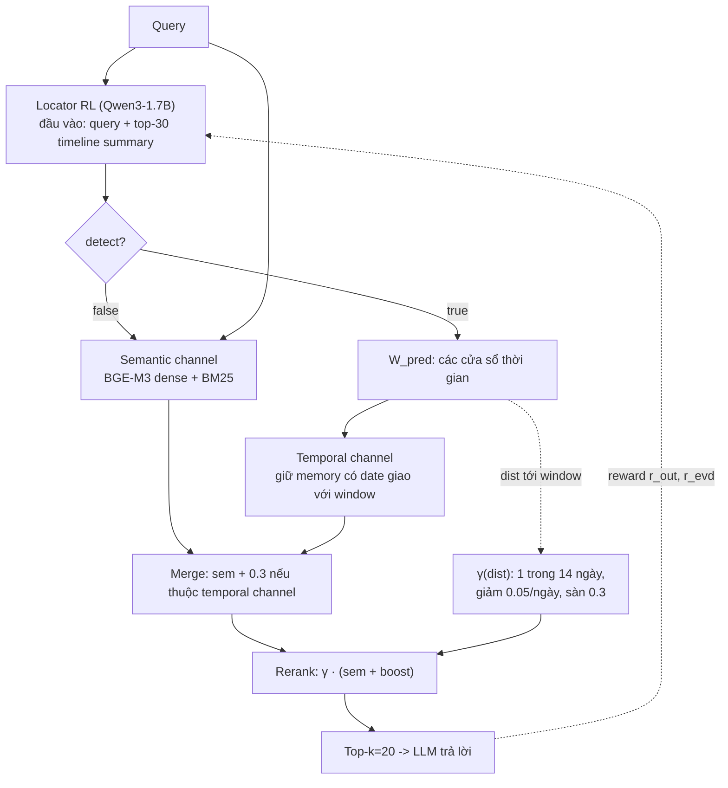

# Phân tích bài báo: TIDER (2610.23598)

## 1. Thông tin chung & Tài nguyên
- **Tiêu đề:** RL-Guided Temporal Localization for Dual-Channel Retrieval in Long-Horizon Agent Memory
- **Tên phương pháp:** TIDER (Temporal Interval-driven Dual-channel Evidence Retrieval)
- **Tác giả:** Dabin Sheng, Zhe Wu, Jinming Zhao, Junliang Xing, Yuanchun Shi
- **Mã arXiv:** [2610.23598](https://arxiv.org/abs/2610.23598) ([PDF](https://arxiv.org/pdf/2610.23598), [HTML](https://arxiv.org/html/2610.23598v1))
- **Công bố:** NeurIPS 2026 (theo trang arXiv)
- **GitHub:** chưa rõ (trang arXiv không liệt kê; phần đọc được của bài không có link code)
- **Dataset:** LifeBench (đánh giá chính), LoCoMo (zero-shot generalization). Trang arXiv không cung cấp link dataset.
- **Ghi chú phạm vi đọc:** bản đọc bị cắt giữa Appendix C. Chưa đọc Appendix H (latency/cost) và Appendix I (limitations đầy đủ). Mọi chỗ liên quan ghi "chưa rõ".

## 2. Vấn đề giải quyết
Bộ nhớ dài hạn của agent chứa rất nhiều sự kiện giống nhau về ngữ nghĩa nhưng xảy ra ở thời điểm khác nhau (ví dụ "had dinner with family"). Retrieval thuần lexical/semantic để các candidate sai thời điểm lấn át bằng chứng đúng. Bài báo nêu 80-90% câu hỏi trong LifeBench và ATM-Bench có biểu thức thời gian, và cho rằng các công trình trước chỉ thêm tín hiệu thời gian ở khâu tổ chức bộ nhớ hoặc khâu sinh câu trả lời, chưa đưa vào khâu **chọn candidate**.

**Ví dụ (từ bài):** "What did I have for lunch after returning from Japan?" Muốn trả lời, phải suy ra trước *khoảng thời gian nào* (sau khi về từ Nhật) rồi mới tìm bữa trưa trong khoảng đó; tìm theo ngữ nghĩa "lunch" sẽ trả về vô số bữa trưa ở mọi thời điểm.

## 3. Cơ chế cốt lõi

### 3.1 Memory pool
Dialogue turn được gom thành cluster; mỗi cluster có date span `d_i`, summary `s_i` do LLM sinh, và tập raw item. Tham số gom cụm: dung sai 7 ngày, ngưỡng semantic 0.85, tối đa 40 item/cluster.

### 3.2 Locator (RL-trained)
- Model Qwen3-1.7B, nhận **query + top-30 timeline summary**, xuất JSON gồm `detect` (true/false: câu hỏi có cần thời gian không) và tập cửa sổ thời gian `W_pred`.
- Huấn luyện: SFT cold-start để học JSON schema, sau đó GRPO (veRL), KL `β = 0.1`, group size `G = 8`. Rollout không parse được nhận `R_min` và bỏ qua judge. Rollout được phân tầng độ khó theo số gold window.
- Reward tổng hợp `R = w_det·r_det + w_win·r_win + w_evd·r_evd + w_out·r_out` (tổng trọng số = 1):
  - `r_det`: +1 nếu `detect` khớp nhu cầu thời gian thật, ngược lại -1.
  - `r_win`: IoU best-match hai chiều giữa window dự đoán và gold; bằng 0 với câu không cần thời gian hoặc dự đoán rỗng.
  - `r_evd`: tỉ lệ gold evidence được LLM judge xác nhận là nằm trong top-k.
  - `r_out`: Exact Match với multiple-choice; với câu mở là đa số của 3 lần judge LLM.

### 3.3 Dual-channel retrieval + rerank
- **Semantic channel:** BGE-M3 dense (cosine) + BM25.
- **Temporal channel:** chỉ mở khi `detect = true`; giữ các memory có date giao với một window dự đoán. Nếu `detect = false` thì đóng kênh, chỉ còn semantic.
- **Merge + rerank:**
  `Score_i = γ(dist_i) · [ sem_i + λ_boost · 1[i ∈ temporal channel] ]`, với `λ_boost = 0.3`.
  `γ` bằng 1 trong buffer `τ_buf = 14` ngày quanh window, sau đó giảm tuyến tính `ρ = 0.05`/ngày, sàn `γ_min = 0.3`. Lấy top-`k = 20` đưa cho LLM downstream.

## 4. Kết quả chính
Mỗi kết quả là mean ± SD trên 3 lần chạy; answer/judge model cố định giữa các phương pháp (GPT-5-mini cho LifeBench, GPT-4o-mini cho LoCoMo).

**LifeBench** (user-0 và user-1, 408 câu; user 2-9 dùng sinh dữ liệu train, không trùng user eval):

| Method | Overall | F1 |
|---|---|---|
| TIDER | 61.52 ± 0.86 | 69.23 |
| NeSTR | 52.70 ± 0.65 | 61.25 |
| Mem0 | 51.80 ± 1.26 | 51.94 |
| MemOS | 47.30 ± 0.88 | 45.90 |
| TsContriever | 27.21 ± 0.42 | 49.36 |
| Oracle (cận trên, không so sánh trực tiếp) | 83.33 ± 0.74 | 76.79 |

TIDER hơn NeSTR 8.82 điểm. Zep và TiMem cũng là baseline nhưng số trên LifeBench chưa đọc được.

**LoCoMo** (1,540 câu, bỏ adversarial, zero-shot): TIDER 78.96 ± 0.30, TiMem 75.30 ± 0.16, NeSTR 73.48 ± 0.23 (hơn TiMem 3.66). Tuy nhiên TIDER thấp hơn TiMem ở category Temporal (71.65 so với 77.63) và F1 (51.72 so với 54.40). Tác giả giải thích do window coverage: window dự đoán phủ 76.25% gold date trên LoCoMo, so với 93.77% trên LifeBench. Với oracle window, Temporal tăng từ 71.65 lên 79.13, F1 từ 51.72 lên 57.83.

**Retrieval (LifeBench pool, LLM-judged):** Recall@20 48.36 (semantic 39.35); nDCG@20 48.67 (semantic 37.21); Recall@10 gần nhau (33.18 so với 32.74).

**Ablation module (Overall):** đầy đủ 61.52; bỏ decay rerank 57.60; bỏ temporal channel 52.21; bỏ summary (semantic) 51.45.

**Ablation reward:** bỏ đồng thời `r_det` và `r_win` mất 5.64 overall (15.22 trên TKU); bỏ `r_out` mất 2.45; bỏ `r_evd` mất 1.96.

**Thay locator:** không GRPO (Qwen3-1.7B) 55.64; zero-shot Qwen3-1.7B 53.19; zero-shot GPT-5.2 57.84 (thấp hơn TIDER 3.68); oracle window chỉ +1.70 so với TIDER (vì window dự đoán đã phủ 93.77% gold date).

**Khác:** accuracy không đơn điệu theo `k`; ở `k = 20` TIDER đạt 61.52, vượt kết quả semantic-only tốt nhất ở `k = 100` là 3.79. Trên câu không cần thời gian, TIDER hơn baseline mạnh nhất 0.67 điểm; trên câu cần thời gian hơn trung bình 9.78 điểm, riêng multi-window +14.8.

**Chưa rõ:** latency và chi phí train/inference (Appendix H), limitations đầy đủ (chỉ thấy tiêu đề: dữ liệu cá nhân tổng hợp, phụ thuộc memory item upstream, phạm vi ngôn ngữ).

---

## 5. Liên hệ đồ án

### 5.1 Suy luận cửa sổ thời gian (locator) so với Query Profiler / `T_req`
- Đồ án hiện suy ra một mốc tuyệt đối `T_req` từ câu hỏi (inject `T_now` vào system prompt để giải quyết relative time). TIDER suy ra **tập cửa sổ** `[start, end]`, kể cả khi câu hỏi chỉ định neo bằng sự kiện ("sau khi về từ Nhật"), và có cổng `detect` để câu không cần thời gian không bị ép lọc.
- Điểm đáng lấy: (a) đầu ra dạng **interval/nhiều interval** thay vì một điểm, phù hợp câu về khoảng/so sánh nhiều giai đoạn (Cơ chế 2); (b) cổng `detect` tương ứng nhánh "non-temporal" của Routing Agent; (c) locator được cấp **timeline summary** làm ngữ cảnh để giải anchor theo sự kiện, tương ứng việc agent tra GraphDB/Vector trước khi chốt window.
- Đồ án không cần RL: ablation cho thấy GPT-5.2 zero-shot (57.84) chỉ kém TIDER 3.68, nên locator bằng prompt LLM có thể là điểm khởi đầu hợp lý. Đây là suy luận của ghi chú, không phải khẳng định của bài.
- Rủi ro cần thừa nhận: coverage window giảm khi timeline thưa (76.25% trên LoCoMo), và `r_win`/coverage là nút thắt chất lượng.

### 5.2 Kênh thời gian + kênh ngữ nghĩa so với hard filter + re-rank
| Khía cạnh | TIDER | Thiết kế đồ án (Cơ chế 1) |
|---|---|---|
| Lọc thời gian | Kênh riêng giữ memory giao với window; là **boost**, không loại | Hard filter `start_time <= T_req`, `invalidated_at` NULL |
| Điểm | `γ(dist) · [sem + 0.3·1[in temporal]]` (nhân) | `Final = W1·Semantic + W2·Temporal` (cộng tuyến tính) |
| Temporal score | `γ`: 1 trong buffer 14 ngày, giảm tuyến tính 0.05/ngày, sàn 0.3 | Case 1 = 1.0 nếu `T_req` trong `[start_time, end_time]`; Case 2 = `exp(-λ·Δyears)` |
| Tín hiệu | Khoảng cách tới window (đối xứng, hai phía) | Chỉ quá khứ (chống future leakage), half-life decay |
| Tìm kiếm | Dense + BM25 | Hybrid dense + BM25 |

Nhận xét:
- Hai thiết kế cùng triết lý "thời gian là tín hiệu riêng, ghép với semantic", nhưng TIDER **không có hard filter**; candidate sai thời điểm chỉ bị giảm điểm (sàn `γ_min = 0.3`). Đồ án giữ hard filter vì yêu cầu no future leakage và `invalidated_at`; không nên bỏ.
- Điểm TIDER bổ sung mà `W2·Temporal` chưa có: **kênh thời gian đóng góp candidate** (recall), không chỉ re-rank candidate đã có từ semantic. Trong thiết kế đồ án, nếu bằng chứng đúng không lọt top-N của dense/BM25 thì re-rank không cứu được; có thể thêm một truy vấn thuần filter theo window rồi hợp nhất (gần với RRF ở `temporal_retrieval/05_RRF.md`).
- Ablation hỗ trợ cả hai nửa: bỏ temporal channel mất ~9.3 điểm (61.52 -> 52.21), bỏ decay rerank mất ~3.9 điểm (61.52 -> 57.60). Nghĩa là candidate generation theo thời gian đóng góp nhiều hơn re-rank trong bài này (kết quả trên LifeBench, dữ liệu cá nhân tổng hợp, chưa chắc chuyển sang văn bản pháp luật/tin tức).
- `λ_boost`, buffer, `ρ`, `γ_min` là siêu tham số; tương tự `W1`, `W2`, `λ` của đồ án nên cần tune/ablate trên split riêng.

### 5.3 Các ý đưa vào thiết kế
1. Locator xuất **danh sách interval + cờ `detect`**, thay vì chỉ một `T_req`; hỗ trợ anchor theo sự kiện bằng cách đọc timeline summary.
2. Thêm **kênh thời gian sinh candidate** (filter theo window) cạnh kênh semantic, rồi merge và re-rank, thay vì chỉ re-rank sau semantic.
3. Giữ hard filter của đồ án, nhưng thêm vùng đệm quanh window (`τ_buf`) để tránh bỏ sót khi window dự đoán lệch; đo window coverage làm chỉ số chẩn đoán.

### 5.4 Hạn chế khi áp dụng
- Bài hướng tới bộ nhớ hội thoại cá nhân (LifeBench tổng hợp, LoCoMo); không đề cập conflict resolution (`SUPERSEDES`/`invalidated_at`), nên không thay thế Cơ chế 3.
- Huấn luyện GRPO cần gold window và LLM judge, tốn tài nguyên; chi phí chưa rõ.
