# Các phương pháp có thể tái dựng trên bộ dữ liệu của đồ án, theo từng cơ chế

> Ghi 2026-11-01. Nguồn: (1) bản HTML arXiv của từng bài, đọc qua công cụ tóm tắt tự động, chưa đối chiếu PDF; (2) **mã nguồn của repo công khai, đã tải về và đọc (không chạy)**. Chỗ bài báo không nêu tham số thì mình tra trong mã. Chỗ mã lệch với bài thì ghi rõ cả hai.
>
> Chỉ chọn các bài **không cần huấn luyện** và có mã công khai. Chưa kiểm giấy phép từng repo.

## Dùng các bài này làm baseline cho đồ án: được không, và tham số không rõ thì làm sao

- **Được.** Cài lại 1 đến 2 bài mỗi cơ chế làm baseline phương pháp rồi chạy trên bộ dữ liệu của mình là cách làm thông thường trong luận văn. Nếu chỉ cài lại **một** bài và chỉ chạy trên dữ liệu của mình (không chạy trên bộ của họ) thì vẫn được, với điều kiện ghi là "bản cài lại theo bài X và mã chính thức", **không** nói là "tái hiện kết quả của X".
- **Kết quả chỉ mang tính tương đối.** Số của bản cài lại không đặt cạnh số trong bài gốc được (khác LLM, khác dữ liệu). Giá trị của nó là so với hệ của bạn **trên cùng dữ liệu, cùng LLM, cùng cách chấm**.
- **"Mã chính thức" là gì, và cài lại nghĩa là gì.** Mã chính thức là repo GitHub do chính tác giả bài báo công bố. Mình **đọc nó như bản đặc tả**: lấy logic, cách tổ chức dữ liệu, cách truy vấn và giá trị tham số. Còn **bản chạy là bạn tự viết trong package `tam`**, dùng Qdrant, Neo4j và LLM của bạn, không clone rồi sửa. Lý do: các repo phụ thuộc vào kho, mô hình và thư viện riêng (MRAG cần vLLM và chỉ mục 33.1M đoạn; DyG-RAG cần NanoVectorDB và NetworkX; TG-RAG cần đúng định dạng dữ liệu của họ), và đồ án cần dùng chung bộ lưu trữ của mình. Chỉ nên clone nguyên để **chạy kiểm thử** trên mẫu nhỏ (xem mục "Kiểm tra cho yên tâm").
- **"Mã lệch bài" là gì.** Là chỗ mã trong repo làm khác điều bài báo viết. Đã gặp: DyG-RAG (bài ghi trọng số cạnh là Jaccard nhân giảm dần theo thời gian; mã dùng tổng có trọng số 0.75 và 0.25), TG-RAG (bài ghi top-K = 20, cấu hình mặc định là 50), MRAG (bài nói LLM tách câu hỏi, mã đọc nhãn có sẵn trong dữ liệu). Khi cài lại phải **chọn một bên và ghi lại**.
- **Tham số bài không nêu thì xử lý theo thứ tự:** (1) lấy từ mã chính thức nếu repo có (mình đã làm cho 6 repo, xem bảng "Tham số" trong từng mục); (2) nếu mã cũng không có thì coi là **siêu tham số** và chọn trên tập `tune` của đồ án, đúng quy tắc "tune chọn tham số, valid chọn phương pháp"; (3) ghi rõ trong báo cáo từng tham số lấy từ đâu (bài, mã, hay tự tune).
- **Kiểm tra cho yên tâm (tùy chọn):** chạy bản cài lại trên một mẫu nhỏ của bộ dữ liệu gốc của họ; nếu số cùng bậc với số trong bài thì cài đặt không sai nặng. Không bắt buộc, và không chờ khớp tuyệt đối.
- **Hai cái bẫy:** (a) mã lệch bài (đã thấy ở DyG-RAG, TG-RAG), nên phải chọn một và ghi lại; (b) các bài đồ thị tốn nhiều lời gọi LLM lúc nạp, dễ chạm hạn mức; xem mục chi phí.

## 0. Bài nào thuộc cơ chế nào

Xếp theo bộ dữ liệu mà bài đi kèm (khớp `01_SUMMARY_BY_MECHANISM.md`).

| Cơ chế | Bài (phương pháp) | Bộ dữ liệu đi kèm | Mã nguồn (đã đọc) | Cần huấn luyện? |
|---|---|---|---|---|
| **1. Temporal Retrieval** | **MRAG** | TempRAGEval | `siyue-zhang/MRAG` (`metriever.py`) | Không |
| | **DyG-RAG** | TimeQA (cùng TempReason, ComplexTR) | `RingBDStack/DyG-RAG` | Không |
| **2. Timeline Summarization** | **TA-RAG** | ADQAB | `kwunhang/TA-RAG` (`experiment/src/ta_rag_full.py`) | Không |
| | **TG-RAG** | ECT-QA | `hanjiale/Temporal-GraphRAG` | Không |
| **3. Conflict Resolution** | **Khung của LongMemEval** | LongMemEval (`knowledge-update`) | `xiaowu0162/LongMemEval` | Không |
| | **VersionRAG** | VersionQA | `danielhuwiler/versionrag` | Không |

**File này chỉ gồm các bài có phương pháp riêng.** LongMemEval là bài benchmark nhưng có thêm một khung tối ưu do chính bài đề xuất nên được giữ. Các bài benchmark thuần (TEMPO, TLQA, FactConsolidation, HoH, Conflicts) không nằm ở đây; xem `01_SUMMARY_BY_MECHANISM.md`. **Có phương pháp riêng nhưng phải huấn luyện, không tái dựng:** TempRetriever (Cơ chế 1; repo trống).

Quy ước trong các bảng tham số: "Bài" là điều bài báo nêu; "Mã" là điều đọc được trong mã.

---

## Cơ chế 1: Temporal Retrieval

### 1.1. MRAG (bộ TempRAGEval)

**Dùng vector hay graph:** vector (Contriever tìm theo nghĩa trên kho Wikipedia có sẵn) cộng chấm điểm từ khóa. **Không có graph**, và **không có bước nạp riêng** (kho đã dựng sẵn).

**Ví dụ.** Đoạn dữ liệu (lấy từ ví dụ mẫu trong `prompts.py` của repo): *"Houston Rockets | The Houston Rockets have won the NBA championship twice in their history. Their first win came in 1994, ... in 1995, they claimed their second title ..."*. Câu hỏi: *"When did the Houston Rockets win the NBA championship?"* Câu tóm tắt LLM tạo ra trong ví dụ đó: *"The Houston Rockets have won the NBA championship in 1994 and 1995."* Câu hỏi có ràng buộc thời gian (ví dụ trong bài): *"Who won the latest America's Next Top Model by May 8, 2021?"*, đáp án Kyla Coleman; ở đây TC là `last`, `before`, 2021.

LLM tách câu hỏi thành **nội dung (MC)** và **ràng buộc thời gian (TC)**. Nội dung dùng để tìm, thời gian dùng để chấm một điểm riêng; hai điểm nhân với nhau ở mức **câu**.

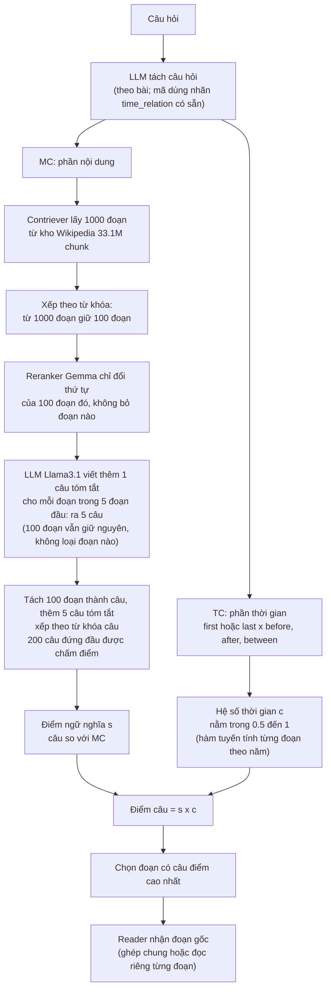

**Các bước cụ thể** (theo mã `metriever.py`; ví dụ là mình đặt ra để minh họa): câu hỏi "Đội nào là đội đầu tiên của cầu thủ A trước năm 1981?".

1. **Tách câu hỏi.** Tách thành nội dung MC ("đội đầu tiên của cầu thủ A") và ràng buộc thời gian TC (loại `first`, `before`, năm 1981). Bài nói do LLM làm; **trong mã thì không**: mã đọc cột `time_relation` có sẵn trong dữ liệu (do người gán nhãn), cắt câu hỏi tại từ đó và lấy năm bằng biểu thức chính quy. Mã chỉ gọi LLM để rút từ khóa và tóm tắt.
2. **Lấy 100 đoạn.** Dùng MC để Contriever lấy 1000 đoạn Wikipedia, lọc theo từ khóa còn 100, rồi reranker ngữ nghĩa xếp lại 100 đoạn đó. **Lúc này chưa xét thời gian.**
3. **Tóm tắt 5 đoạn đầu.** Với 5 đoạn xếp đầu, LLM viết mỗi đoạn thành một câu trả lời cho câu hỏi, dặn ghi cả ngày nếu đoạn có nhắc (ví dụ "Cầu thủ A gia nhập đội B năm 1975"). Chỉ 5 đoạn để tiết kiệm lời gọi LLM.
4. **Tạo kho câu.** Tách cả 100 đoạn thành từng câu, thêm 5 câu tóm tắt vào cùng kho. Mỗi câu nhớ nó thuộc đoạn nào. Xếp mọi câu theo điểm từ khóa; 200 câu đứng đầu được chấm điểm ở bước sau, các câu còn lại không bị bỏ mà xếp sau 200 câu đó. (Đơn vị khác nhau: bước 2 đếm **đoạn**, bước này đếm **câu**; 100 đoạn chứa vài trăm đến vài nghìn câu.)
5. **Chấm điểm từng câu.** Điểm ngữ nghĩa s (câu so với MC) nhân với hệ số thời gian c (câu nhắc năm nào, năm đó hợp với "first before 1981" đến đâu; không có năm thì c = 0.5).
6. **Xếp lại đoạn.** Mỗi đoạn lấy điểm của câu cao nhất thuộc nó; xếp 100 đoạn theo đó.
7. **Đưa cho reader.** Lấy các đoạn đứng đầu (bản gốc, không phải bản tóm tắt) cho LLM đọc và trả lời.

Tóm tắt giải quyết vấn đề gì: điểm thời gian chấm theo **câu**, nhưng trong đoạn gốc câu chứa đáp án và câu chứa năm thường là hai câu khác nhau. Câu tóm tắt gộp cả hai nên được điểm cao, và đưa đoạn của nó lên cao hơn. Đây là suy luận của mình từ mã và prompt, chưa đọc lời giải thích của bài.

**Hỏi đáp thêm về MRAG.**

- **Dữ liệu của mục 1.1 là gì.** TempRAGEval là **TimeQA test cộng SituatedQA test** (mỗi bộ 500 câu, 1,000 câu tổng; một phần câu gốc, phần còn lại do người viết lại để đổi mốc thời gian hay cách hỏi), kho là **Wikipedia dump tháng 12/2021**. Vậy cả mục 1.1 lẫn 1.2 đều là Wikipedia; 1.2 là TimeQA, 1.1 là TimeQA cộng SituatedQA.
- **Lấy 1000 đoạn từ 33.1M đoạn là dùng gì.** Contriever là mô hình **tìm theo nghĩa** (bi-encoder: câu hỏi và mỗi đoạn đều đổi thành vector, so độ giống). Vector của 33.1M đoạn được tính sẵn một lần và đặt trong chỉ mục, nên lúc hỏi chỉ cần một phép tìm gần nhất. Việc này **rất rẻ cho mỗi đoạn nhưng không tinh**.
- **Từ 1000 xuống 100 là dùng gì, có phải BM25 không.** Cùng ý "tìm theo từ khóa" nhưng **không phải BM25**. BM25 tính điểm có trọng số IDF (từ hiếm nặng hơn) và chuẩn hóa theo độ dài đoạn. Cách của MRAG đơn giản hơn và gồm ba việc:
  1. **LLM chỉ rút danh sách từ khóa** từ câu hỏi (đã cắt phần thời gian ra; ví dụ bỏ "by May 8, 2021").
  2. **Loại của từ khóa do luật gán, không phải LLM** (`expand_keywords` trong `utils.py`): từ khóa **bắt đầu bằng chữ hoa** là `special` (tên riêng); từ chỉ số là `numeric`; từ là **tính từ** (nhãn từ loại bắt đầu bằng J) mà kết thúc bằng "-est" hoặc là "most" thì `superlative`, tính từ khác là `adjective`; còn lại là `general`. Từ khóa `general` còn được mở rộng thêm các dạng từ khác (win, wins, winning, won).
  3. **Điểm đoạn** = tổng trọng số của các loại có từ khóa xuất hiện trong đoạn (tiêu đề cộng nội dung): `special` 1.0, `superlative` 0.7, `numeric` 0.5, `general` và `adjective` 0.4. Từ khóa `general` khớp bằng chuỗi con; các loại còn lại khớp theo từ.
  - **Ví dụ** (do mình đặt theo ví dụ trong bài): câu hỏi *"Who won the latest America's Next Top Model by May 8, 2021?"*. Sau khi cắt "by May 8, 2021", LLM rút ba từ khóa: `won`, `latest`, `America's Next Top Model`. Luật gán loại: `America's Next Top Model` (chữ hoa đầu) là `special` (1.0); `latest` (tính từ, kết thúc "-est") là `superlative` (0.7); `won` (động từ) là `general` (0.4, mở rộng thêm "win", "winning"...). Ba đoạn:

    | Đoạn | Có từ khóa nào | Điểm |
    |---|---|---|
    | A: "America's Next Top Model cycle 24 was **won** by Kyla Coleman" | `America's Next Top Model` và `won` | 1.0 + 0.4 = **1.4** |
    | B: "The **latest** season of a modeling show aired in 2021" | `latest` | **0.7** |
    | C: "Tyra Banks hosted the show for many years" | không | **0** |

    A xếp trên B, B xếp trên C. Tên riêng nặng nhất nên đoạn nhắc đúng tên chương trình lên trước, và đoạn không nhắc gì xuống cuối. Cắt lấy 100 đoạn điểm cao nhất.
- **Sao lại nhiều tầng như vậy.** Đây là kiểu **phễu theo chi phí**: tầng đầu rẻ và rộng để không bỏ sót, các tầng sau đắt và tinh hơn nhưng chỉ chạy trên số ít. Dense (33.1M, vector tính sẵn), từ khóa (1000, quét chuỗi), reranker Gemma (100, chạy mô hình), chấm câu có thời gian (200 câu, chạy mô hình), tóm tắt bằng LLM (chỉ 5 đoạn). Mình **không thấy bài giải thích vì sao đúng số tầng và số lượng đó**; đó là lựa chọn thiết kế, không có chứng minh là tối ưu.
- **Áp dụng cho bộ `real` khi không có "last/first" thì sao.** Có hai chuyện:
  1. Trong mã, câu hỏi kiểu "in/on/during" (loại `other`) **không được chấm điểm thời gian**, chỉ dùng điểm ngữ nghĩa. Theo đếm trong decision 07 trên 400 câu test: "in Month YYYY" 142 câu, "between/from X to Y" 136, "after" 35, "early/late/mid" 33, "before" 31, "in YYYY" 20 (số câu hỏi thuộc loại `other` trong mã MRAG là nhóm "in Month YYYY" và "in YYYY", khoảng 162 trên 400). Nghĩa là **MRAG gốc gần như không dùng thành phần thời gian trên phần lớn câu của bộ `real`**.
  2. Không có điều kiện ngầm "first/last" trong `real`. Khi cài lại nên bỏ phần dốc theo năm, chỉ giữ ý chính: hệ số 1 nếu năm trong câu nằm trong khoảng hỏi, 0.5 nếu ngoài khoảng hoặc không có năm; khoảng hỏi lấy từ `bound`, `t_start`, `t_end` của Profiler. Đây là **biến thể do mình đề xuất**, không còn là MRAG nguyên bản, nên ghi rõ.
- **Cài lại trên bộ `real` theo kiểu "cứ chunk rồi chạy như phương pháp gốc, sau đó so điểm".** **Làm được, và đó là cách trung thực nhất**, vì MRAG vốn không dùng trường ngày. Việc cần làm: chia chunk của bạn thành câu, chạy đúng các bước 1 đến 7, lấy `hit@k`, `mrr`, EM/F1 cùng cách chấm với hệ của bạn. Bốn điều cần ghi lại: (1) mốc thời gian cho TC lấy từ Profiler của bạn (`bound`, `t_start`, `t_end`) thay cho nhãn `time_relation` có sẵn; (2) với câu "in Month YYYY" và "in YYYY" thì **MRAG gốc không chấm điểm thời gian** (loại `other`), nên trên khoảng 162 trong 400 câu nó chỉ còn ngữ nghĩa cộng từ khóa; khoảng 202 câu before, after, between thì có điểm thời gian; (3) nên báo thêm một **biến thể "MRAG cộng exact"** (áp hệ số cả cho câu exact) và ghi là biến thể của mình; (4) chunk của bạn dài hơn passage Wikipedia, nên số câu mỗi chunk nhiều hơn, điểm thời gian chấm theo câu vẫn dùng được.
- **Vì sao không lọc cứng, và "kho không có trường ngày" nghĩa là gì.** Mỗi đoạn trong kho của đồ án là một bản ghi có **trường ngày**: `start_time` và `end_time`, do bước nạp gán, nên bộ lọc cứng so được `start_time <= T_req` mà không cần đọc chữ. Mỗi đoạn trong kho Wikipedia của MRAG thì **chỉ có `id`, tiêu đề và văn bản** (theo mã, `metriever.py` chỉ dùng ba thứ này). Không có trường nào cho biết "đoạn này đúng vào thời điểm nào". Muốn biết phải **đọc chữ trong đoạn** và tìm năm bằng biểu thức chính quy; đoạn không có năm thì không biết gì, nên MRAG cho hệ số trung tính 0.5 chứ không loại. Bài không nêu lý do; đây là suy luận của mình. Nó **không** phải do sợ bước nạp gán sai (MRAG không có bước nạp).

**Tham số bài không nêu, lấy từ mã (`metriever.py`):**

| Tham số | Bài | Mã |
|---|---|---|
| Hình dạng "spline" | Gọi là spline, không nêu tham số | **Hàm tuyến tính từng đoạn** (`scipy interp1d`, `kind='linear'`), không phải spline cong |
| Giá trị thấp nhất trong khoảng | Không nêu | `low = 0.6`; tối đa 1 |
| Độ rộng khoảng khi câu chỉ có một mốc | Không nêu | `span = 50` năm (với "before": từ mốc − 50 đến mốc; "after": từ mốc đến mốc + 50) |
| Câu hỏi "between A và B" | Không nêu | Khoảng từ A đến B |
| Hướng đường dốc | Không nêu | "first": 1 giảm dần xuống 0.6 theo năm; còn lại: 0.6 tăng dần lên 1 |
| Câu không có năm hoặc năm ngoài khoảng | Không nêu | Hệ số **0.5** |
| Độ mịn thời gian | Không nêu | **Chỉ năm** (tìm năm trong câu bằng `year_identifier`; chọn năm gần nhất phù hợp) |
| Ai tách MC và TC | LLM | **Không phải LLM:** dùng cột `time_relation` (nhãn người gán) có sẵn trong TempRAGEval, cắt câu hỏi tại từ đó, lấy năm bằng regex. Khi cài lại, thay bằng `T_req` của đồ án |
| Xếp theo từ khóa | Không nêu | LLM chỉ rút danh sách từ khóa; loại từ khóa gán bằng luật (chữ hoa đầu là tên riêng, số, tính từ -est hoặc most là so sánh nhất...); điểm đoạn = tổng trọng số các loại có từ khóa xuất hiện: tên riêng 1.0, so sánh nhất 0.7, số 0.5, từ chung và tính từ 0.4 |
| Cách gộp | "Nhân hai điểm" | `final = base x s + (1 − base) x s x c`, tham số `--hybrid-base` mặc định **0**, tức là đúng `s x c` |

- **Chi phí:** thêm 1 lần gọi LLM tách câu hỏi và 5 lần gọi LLM tóm tắt đoạn cho mỗi câu hỏi; không có chi phí lúc nạp (dùng kho Wikipedia có sẵn).
- **Điểm yếu cần biết:** độ mịn chỉ đến năm; trong khi thiết kế của đồ án dùng ngày ISO.
- **Ánh xạ vào đồ án:** đồ án lọc cứng `start_time <= T_req` rồi xếp; MRAG chấm mềm (câu tương lai vẫn có hệ số 0.5, không bị loại). Cài lại dễ: dùng `T_req` sẵn có làm TC, thêm hệ số theo năm.

### 1.2. DyG-RAG (bộ TimeQA)

> **Lưu ý:** phương pháp này hợp với Cơ chế 2 (chuỗi sự kiện) hơn Cơ chế 1. Mình xếp ở đây chỉ vì bộ TimeQA là kiểu câu hỏi tại một mốc. Thiết kế Cơ chế 1 của đồ án chỉ dùng VectorDB, không dùng đồ thị.

**Dùng vector hay graph: cả hai, cộng một kho chunk.** Vector dùng để tìm điểm xuất phát (sự kiện giống câu hỏi), đồ thị dùng để đi từ đó sang các sự kiện liên quan, kho chunk dùng để lấy lại văn bản gốc. Chi tiết ở sơ đồ bên dưới.

**Nút và cạnh của đồ thị này là gì.** **Chỉ có nút sự kiện.** Thực thể **không** phải nút: mỗi sự kiện chỉ giữ một danh sách tên thực thể (do mô hình NER `bert-base-NER` tìm sau khi trích sự kiện). **Cạnh** nối hai sự kiện khi chúng **chung ít nhất một thực thể** (so khớp bằng chuỗi giống hệt). Vì vậy sự kiện của các chunk khác nhau, thậm chí tài liệu khác nhau, vẫn được nối nếu nhắc cùng một tên (ví dụ cùng là "Alice Smith"). Không có bước nhập nhằng tên: "Alice Smith" và "Dr. Smith" sẽ không nối. Mình chưa kiểm xem lần nạp sau có nối sang sự kiện của lần nạp trước không; mã tính cạnh trên tập sự kiện của lần nạp hiện tại.

**Ví dụ cụ thể về nút và cạnh** (dữ liệu do mình đặt; trọng số tính đúng theo công thức trong mã: `0.75 × min(1, 0.3 × số thực thể chung) + 0.25 × exp(−0.02 × số ngày)`):

Giả sử nạp 3 tài liệu, mỗi sự kiện sau khi trích có mốc và danh sách thực thể:

| Sự kiện (nút) | Từ đâu | Mốc | Thực thể (chỉ là danh sách chữ trong nút) |
|---|---|---|---|
| E1: "Alice Smith joined OpenAI as research lead." | Tài liệu A | 2021-03-01 | Alice Smith, OpenAI |
| E2: "Alice Smith presented the results at NeurIPS." | Tài liệu B | 2024-02-25 | Alice Smith, NeurIPS |
| E3: "OpenAI released the source code." | Tài liệu B | 2024-02-24 | OpenAI |
| E4: "Dr. Smith received an award." | Tài liệu C | 2024-03-10 | Dr. Smith |
| E5: "Alice Smith left OpenAI." | Tài liệu A | 2024-06-01 | Alice Smith, OpenAI |

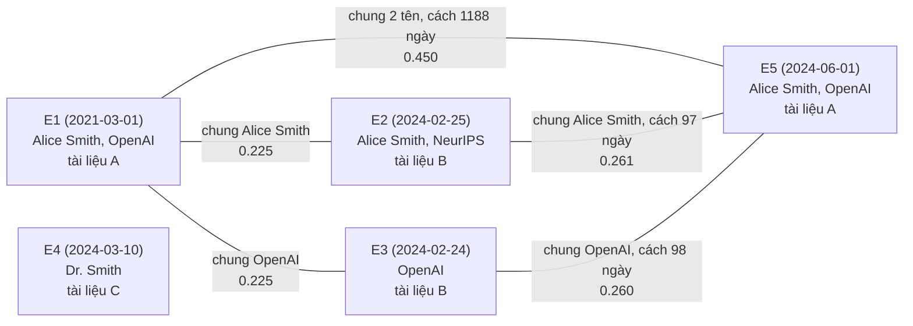

Cách đọc ví dụ:
- **Nút** chỉ là 5 sự kiện. "Alice Smith" và "OpenAI" **không** phải nút; chúng chỉ là chữ nằm trong danh sách của từng sự kiện.
- **Cạnh** xuất hiện khi hai danh sách có chữ giống hệt nhau. E1 và E2 (khác tài liệu, cách nhau 3 năm) vẫn nối vì cùng có "Alice Smith". E2 và E3 **không** nối vì danh sách không có tên chung ("NeurIPS" so với "OpenAI").
- **E4 đứng riêng**: "Dr. Smith" khác chuỗi "Alice Smith" nên không nối với ai, dù thực ra có thể là cùng một người. Đó là ý "không có bước nhập nhằng tên".
- **Không có ngưỡng thời gian cứng:** E1 và E5 cách nhau hơn 3 năm vẫn có cạnh mạnh nhất (0.450) vì chung 2 tên. Thời gian chỉ cộng thêm tối đa 0.25 điểm: càng gần càng nhiều (E2 và E5 cách 97 ngày được 0.036), cách xa vài năm thì phần này gần bằng 0.
- **Mỗi nút giữ tối đa 6 cạnh mạnh nhất.** Ở ví dụ nhỏ này chưa nút nào chạm 6.
- **Đi bộ ngẫu nhiên:** nếu hạt giống là E2 (câu hỏi "Alice Smith ... February 2024"), E2 có hai nút kề là E1 (0.225) và E5 (0.261). Bước đầu chọn E1 với xác suất 0.225 / (0.225 + 0.261) ≈ **46%** và E5 với xác suất ≈ **54%**. Hai bước tiếp theo từ đó có thể kéo thêm E3 (qua E1 hoặc E5), nên E3 ("OpenAI released...") được gom dù không giống câu hỏi.

**Ví dụ đầu vào.** Ví dụ mẫu có sẵn trong prompt của repo (`prompt.py`, "Example 1"): chunk gồm *"The OpenAI research team, supported by the Frontier AI Program, published its findings on 10 February 2024 after a two-year study ... Two weeks later, they released the source code under an MIT license ... The day after the code release, lead author Alice Smith presented the results at NeurIPS ..."*. Câu hỏi minh họa (mình đặt ra): *"Where did Alice Smith present the results in February 2024?"*

**Quá trình nạp: mỗi bước nhận gì, ra gì** (ví dụ lấy từ prompt mẫu; các giá trị tính toán là mình minh họa):

| Bước | Nhận | Ra |
|---|---|---|
| 1. Cắt chunk | Văn bản tài liệu | Các chunk 1200 token, mỗi chunk chồng 64 token với chunk trước, kèm dòng tiêu đề tài liệu |
| 2. Trích sự kiện (LLM) | 1 chunk | Danh sách sự kiện dạng JSON. Mỗi sự kiện: `sentence` (câu tự đủ nghĩa, không đại từ), `context` (tối đa 80 token), `time`. Ví dụ E1: *"The OpenAI research team published its findings on 10 February 2024 ..."*, time `2024-02-10`; E2: *"The OpenAI research team released the source code on 24 February 2024 ..."*, time `2024-02-24`; E3: *"Alice Smith presented the results at NeurIPS on 25 February 2024."*, time `2024-02-25`. Chunk không có sự kiện hoặc không gỡ được đại từ thì trả danh sách rỗng |
| 3. Tìm thực thể (NER) | Câu sự kiện | Danh sách thực thể, ví dụ E1: ["OpenAI research team", "Frontier AI Program"]; E3: ["Alice Smith", "NeurIPS"] |
| 4. Tính cạnh | Mọi sự kiện có mốc và có thực thể | Mỗi sự kiện giữ tối đa 6 cạnh mạnh nhất. Ví dụ E1 và E2 chung "OpenAI research team", cách nhau 14 ngày: trọng số = 0.75 × min(1, 0.3 × 1) + 0.25 × exp(−0.02 × 14) = 0.225 + 0.189 ≈ **0.41** |
| 5. Lập chỉ mục | Câu sự kiện + mốc | Vector = BGE-M3 của "câu (Time: 2024-02-10)" nối với mã hóa Fourier 16 chiều của mốc; lưu vào kho vector kèm `event_id`, `source_id` |
| 6. Lưu nút và chunk | Sự kiện, chunk | Nút đồ thị (câu, mốc, thực thể, `source_id`) và kho chunk (id chunk, văn bản) |

**Quá trình truy vấn: vào đâu trước, ra cái gì, rẽ nhánh thế nào.** Sơ đồ dưới có cả ba kho và các nhánh (có thời gian hay không, có kết quả hay không, lấy chunk lỗi):

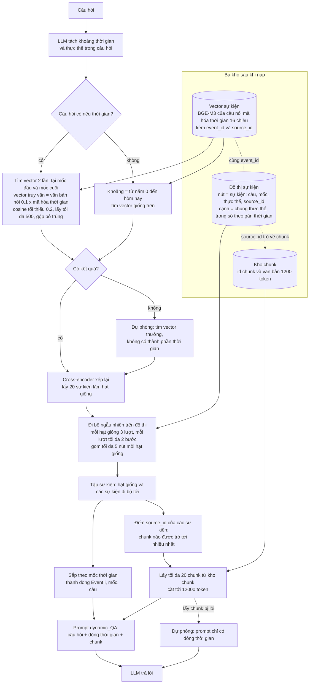

**"Vector truy vấn = văn bản nối 0.1 × mã hóa thời gian" nghĩa là gì.** Vector của một sự kiện trong kho được ghép từ hai phần: (a) vector nghĩa của câu sự kiện (BGE-M3, 1024 số) và (b) 16 số mã hóa ngày của sự kiện (dùng các hàm sin và cos nhiều tần số, nên hai ngày gần nhau cho hai dãy 16 số giống nhau). Khi truy vấn, vector câu hỏi cũng được ghép theo cùng khuôn: 1024 số nghĩa của câu hỏi và 16 số mã hóa **mốc thời gian của câu hỏi nhân với 0.1**. Cosine tính trên cả 1040 số, nên sự kiện cùng nghĩa **và** gần mốc hỏi sẽ cao hơn một chút. Hệ số 0.1 làm phần thời gian chỉ "đẩy nhẹ", phần nghĩa vẫn chiếm chính. Đây là chấm điểm mềm, không loại sự kiện nào.

Biến văn bản thành **đơn vị sự kiện có thời gian (DEU)**, nối các sự kiện chung thực thể và gần nhau về thời gian thành đồ thị, rồi đi bộ ngẫu nhiên trên đồ thị để gom một chuỗi sự kiện theo thứ tự.

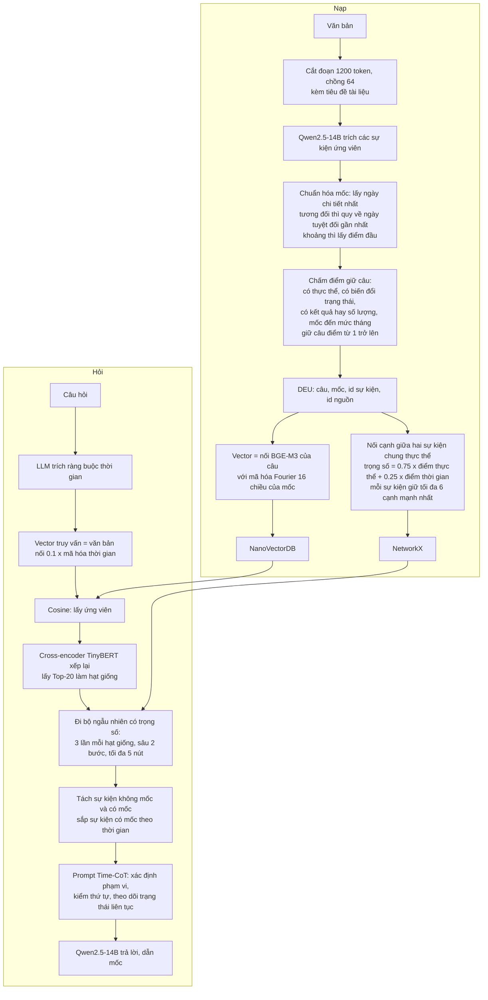

**Ba kho dữ liệu và chúng lưu gì** (theo mã). Hai khái niệm dễ nhầm:
- **Chunk:** đoạn 1200 token cắt từ tài liệu, khoảng vài chục câu.
- **Sự kiện (event, DEU):** *một câu* mà LLM rút ra từ chunk, gắn mốc thời gian. Một chunk cho ra nhiều sự kiện; mỗi sự kiện nhớ nó đến từ chunk nào qua `source_id`.

| Kho | Lưu gì | Dùng để làm gì |
|---|---|---|
| `text_chunks` (kho khóa-giá trị) | Chunk gốc: mã chunk và văn bản 1200 token | Lấy lại văn bản gốc ở cuối để đưa cho LLM |
| `events_vdb` (vector, NanoVectorDB) | Vector của từng **sự kiện** (câu sự kiện + dòng "(Time: ...)", ghép mã hóa thời gian), kèm câu, mốc, ngữ cảnh, `source_id` | **Tìm nhanh** các sự kiện giống câu hỏi: chọn hạt giống |
| `event_dynamic_graph` (đồ thị, NetworkX) | Mỗi nút là một sự kiện (câu, mốc, thực thể, `source_id`); mỗi cạnh là "hai sự kiện liên quan" kèm trọng số | **Đi từ hạt giống sang các sự kiện kề** (đi bộ ngẫu nhiên) |

Vì sao cần cả vector lẫn đồ thị: đồ thị không biết "giống câu hỏi" là gì, nó chỉ biết ai nối với ai; vector mới trả lời được "sự kiện nào giống câu hỏi nhất" để làm điểm xuất phát. Việc sao chép câu sự kiện vào cả hai kho chỉ để tiện truy cập, không phải hai kho làm cùng một việc.

**So với Boomerang của đồ án:** Boomerang giữ *chunk* trong vector và nút đồ thị chỉ giữ con trỏ `Chunk_ID`. DyG-RAG tìm trên *sự kiện* (không phải chunk) rồi mới quay về chunk gốc qua `source_id`, cũng là "đi vòng rồi quay lại lấy văn bản" nhưng đơn vị tìm kiếm nhỏ hơn.

**Hỏi đáp thêm về DyG-RAG.**

- **Chia chunk khi nào, cơ chế gì.** Dữ liệu đầu vào là **văn bản nguyên tài liệu, chưa chia sẵn**. Khi nạp, mã tự cắt bằng cửa sổ trượt trên token (`chunking_by_token_size`, thư viện tiktoken): chunk dài 1200 token, mỗi chunk bắt đầu lùi 64 token so với điểm kết thúc của chunk trước. "Chồng 64" nghĩa là 64 token cuối chunk trước lặp lại ở đầu chunk sau. Hệ quả: cùng một sự kiện có thể bị LLM trích hai lần từ hai chunk chồng nhau. Mã xử lý bằng **mã sự kiện = băm của (câu sự kiện, mốc đã chuẩn hóa)**; hai sự kiện cùng câu và cùng mốc được gộp thành một nút, danh sách thực thể của chúng được hợp lại.
- **Một nút là một sự kiện trong một chunk à.** Gần đúng: một nút là một sự kiện LLM trích từ chunk, nhưng nếu sự kiện trùng ở chunk khác thì gộp và nút giữ nhiều `source_id` (mỗi chunk gốc một con trỏ).
- **Việc nối cạnh phục vụ việc gì.** Để **từ một sự kiện tìm được, kéo theo các sự kiện liên quan** (cùng thực thể, gần thời gian), kể cả những sự kiện không giống câu hỏi. Với dữ liệu kiểu Wikipedia một trang nói về một chủ thể thì phần lớn cạnh nằm **trong cùng một trang** (mọi sự kiện đều nhắc tên chủ thể). Cạnh giữa các trang chỉ có khi hai trang nhắc chung một tên.
- **Bộ dữ liệu của DyG-RAG giao với `real` bao nhiêu.** DyG-RAG dùng "TimeQA hard mode" gồm **2,613 câu**. Con số này **đúng bằng** số câu của `C/test.hard.jsonl` trong bộ `full_dataset` của bạn (2,613 câu, 738 trang). Mình suy ra hai bộ là một, nhưng **chưa xác nhận** vì dữ liệu của họ nằm trên Google Drive (`datasets/link.txt`) chưa tải, và bài ghi 3,159 tài liệu trong khi mình đếm 738 trang (có thể họ đếm theo đơn vị khác). Giả định chúng giống nhau thì: bộ `real` có 556 trang, **249 trang (45%)** nằm trong 738 trang đó; riêng `test_clean` 186 trang thì **123 trang (66%)** nằm trong đó. Nguyên nhân khác biệt: `real` lấy chủ yếu từ `D/test` (câu do người viết), còn DyG-RAG dùng `C/test` (câu sinh theo mẫu).
- **Không có bước nhập nhằng tên, có cách nào khắc phục.** Bộ của bạn có sẵn văn bản trang Wikipedia (`pages.jsonl`: `page_id`, `context`, `paragraphs`) nên làm được. Các cách:
  1. **Chuẩn hóa chuỗi:** viết thường, bỏ danh xưng ("Dr.", "Sir"), bỏ dấu câu. Rẻ, nhưng chỉ gộp được biến thể chữ, không gộp "Alice Smith" với "Smith".
  2. **Lấy thực thể chủ thể từ chính trang:** trang `/wiki/Alice_Smith` nói về Alice Smith, nên mọi "she", "Dr. Smith", "Smith" trong trang đó được gán về một mã thực thể duy nhất là `page_id`. Đây là cách **rẻ và chính xác nhất cho chủ thể**, và là cách đồ án đã dùng khi nhóm sự kiện theo ô (trang, quan hệ) ở decision 10.
  3. **Liên kết thực thể khác:** tên một người hay tổ chức khác được nhắc trong trang, ví dụ "Harold Macmillan", khớp với trang Wikipedia cùng tên nếu trang đó có trong bộ. Cần bảng tên và tên thay thế (alias); `pages.jsonl` không kèm siêu liên kết nên phải khớp theo tên.
  4. **Nhờ LLM hoặc embedding gộp:** tên nào giống nhau thì hỏi LLM có phải cùng một thực thể không. Linh hoạt nhưng tốn lời gọi và có thể gộp nhầm.
  - **Ưu điểm** của việc gộp: kéo được nhiều sự kiện liên quan hơn, bớt đồ thị rời rạc. **Nhược điểm:** gộp nhầm (hai người cùng tên) làm đi bộ ngẫu nhiên lạc sang sự kiện của người khác; tốn công; kết quả phụ thuộc chất lượng alias.
- **Vì sao giữ 6 cạnh mà không nhiều hơn, bài có nói không.** **Bài không giải thích.** Bài chỉ nói "mỗi nút giữ Top-K cạnh, K chỉnh được", không đưa giá trị và không thử nhiều giá trị K; mã đặt 6. Lý do hợp lý (suy luận của mình): đồ thị thưa thì đi bộ ngẫu nhiên không bị loãng, và số cạnh tăng bình phương theo số sự kiện chung một thực thể.
- **Có dữ liệu mới thì nút cũ có cập nhật cạnh không.** **Có, và đắt.** Mỗi lần nạp, mã lấy **toàn bộ** nút hiện có trong đồ thị (`get_all_nodes`) rồi **tính lại cạnh cho tất cả** và ghi đè. Nên thêm dữ liệu mới thì mọi nút cũ có thể có thêm cạnh mới hoặc đổi cạnh top-6, và chi phí tính cạnh tăng theo số nút. Bài chỉ nói chung rằng nút mới nối vào qua thực thể, "không nói rõ cạnh cũ có tính lại không".
- **Từ top-20 trong vector làm sao tìm đúng nút trong đồ thị.** Bằng **`event_id`**: mỗi sự kiện có một mã, kho vector và nút đồ thị dùng cùng mã đó (mã = băm của câu sự kiện và mốc). Kết quả vector trả `id`, đồ thị tra nút theo `id` đó.
- **"Hạt giống", "lượt", "bước", "5 nút" nghĩa là gì, và chọn cạnh bằng công thức nào.**
  - **Hạt giống:** 20 sự kiện xuất phát (kết quả sau bước tìm vector và xếp lại).
  - **Với mỗi hạt giống** (20 lần, độc lập nhau): đi **3 lượt**. Mỗi lượt **bắt đầu lại từ chính hạt giống**, rồi đi **tối đa 2 bước**.
  - **Một bước** = đi qua một cạnh từ nút hiện tại sang một nút kề. Bước 1: từ hạt giống sang nút A. Bước 2: từ A sang nút B (qua một cạnh khác của A), với B chưa nằm trong đường đi của lượt này. Vậy một lượt đi qua **tối đa 2 cạnh**, dừng sớm nếu nút hiện tại không còn hàng xóm chưa đi qua.
  - **"3 lượt là ít nhất 3 cạnh" thì không.** 3 lượt không cộng dồn thành 3 cạnh; mỗi lượt độc lập, có thể đi cùng đường với lượt trước, và hạt giống không có cạnh nào thì lượt đi 0 bước. Mã gom các nút đã đi qua trong cả 3 lượt vào **một tập** (trùng nhau thì chỉ tính một lần).
  - **"Tối đa 5 nút mỗi hạt giống":** tập đó khởi đầu bằng chính hạt giống, nên khi đủ 5 nút (hạt giống cộng 4 nút mới) thì dừng, không đi tiếp.
  - **Công thức chọn cạnh:** ở mỗi bước, lấy các cạnh kề (loại `event_temporal_proximity`) dẫn tới nút chưa nằm trong đường đi của lượt này; **xác suất chọn cạnh i = trọng số cạnh i chia cho tổng trọng số các cạnh còn chọn được**. Trọng số cạnh là điểm tính lúc nạp: `0.75 × min(1, 0.3 × số thực thể chung) + 0.25 × exp(−0.02 × số ngày cách nhau)`. Nếu tổng trọng số bằng 0 thì chọn đều. Ví dụ ở mục ví dụ trên: từ E2, hai cạnh có trọng số 0.225 (sang E1) và 0.261 (sang E5), nên xác suất là 46% và 54%.
  - **Kết quả:** hợp của các tập từ 20 hạt giống là tập sự kiện cuối cùng đưa vào bước tiếp.
- **Sau đó: đếm `source_id`, lấy chunk.** Đúng như bạn mô tả: gom các `source_id` của mọi sự kiện thu được, đếm chunk nào được trỏ tới nhiều nhất, lấy tối đa 20 chunk đứng đầu, cắt vừa 12,000 token.
- **"Lấy chunk bị lỗi" và "prompt chỉ có dòng thời gian".** Mã bọc việc lấy chunk trong khối `try`. Nếu lấy chunk **ném lỗi** (ví dụ mã chunk không có trong kho), nó chuyển sang **prompt dự phòng** `short_answer` chỉ gồm dòng thời gian sự kiện, không có văn bản chunk gốc. Đây là nhánh xử lý lỗi, bình thường không chạy.
- **"Sắp xếp theo mốc" và prompt cuối cùng gồm những gì.** Sự kiện thu được từ đồ thị được chia hai nhóm: **không có mốc** ("Static") xếp trước, **có mốc** xếp theo ngày tăng dần. Mỗi sự kiện in thành một dòng `Event #i [mốc]: câu sự kiện` (phần `context` bị tắt trong mã). Rồi ghép với 20 chunk dạng `## Chunk i` và câu hỏi vào mẫu `dynamic_QA` (khoảng 1,200 token chỉ dẫn) để gửi LLM. Vậy đáp án của bạn đúng: **dòng thời gian của các câu sự kiện (câu đã viết lại, không phải tóm tắt dài) + top-20 chunk + câu hỏi**, ra một câu trả lời.
- **Bài có nói gì về việc gán mốc có thể sai.** **Không phân tích.** Bài không đo lỗi của LLM khi trích hay chuẩn hóa mốc, không báo tỉ lệ sai. Chỉ nêu quy tắc dự phòng: mốc tương đối được quy về "ngày tuyệt đối gần nhất trong ngữ cảnh", sự kiện không neo được thì gán `static` (xem như thông tin không gắn thời gian). Bài cũng không có mục hạn chế; điều duy nhất được nêu là tốc độ cần tối ưu. Điều này đáng ghi nhận khi so với đồ án: đồ án có phân tích lỗi gán mốc (nhóm câu mất mốc hay sai mốc), DyG-RAG thì không.

**Đánh giá của mình về ý tưởng DyG-RAG cho đồ án.** Hướng "vector tìm trên **sự kiện** rồi nối đồ thị, rồi quay về chunk bằng con trỏ" **hợp với thiết kế Boomerang** của bạn và nhiều điểm trong decision 10 (nút là sự kiện, liên kết `Chunk_ID`). Điểm hay nhất cho đồ án: mỗi sự kiện có **mốc riêng**, nên chunk chứa nhiều thời điểm không còn chỉ khớp một mốc; điểm thời gian của chunk có thể lấy từ sự kiện tốt nhất. Đây chính là vấn đề của đề xuất 8 trong decision 07 (một chunk nhiều khoảng thời gian), và là cách làm thứ ba bên cạnh "liệt kê khoảng ở bước nạp" và "chấm câu lúc hỏi" của MRAG. Kết hợp ontology thì rất ăn khớp: ontology cho **loại thực thể, loại quan hệ và alias**, thay cho việc so khớp chuỗi thô của DyG-RAG. Cơ chế 1 dùng thêm metadata như đã tính (lọc `start_time` trên sự kiện) cũng hợp lý. Những điều cần cẩn thận: (1) tốn LLM mọi chunk lúc nạp (khoảng 1,350 đến 1,900 lời gọi cho bộ test, xem mục chi phí); (2) câu sự kiện bị LLM viết lại nên có thể mất chi tiết đáp án, nên vẫn phải quay về chunk gốc; (3) DyG-RAG chỉ có **một mốc cho mỗi sự kiện**, không có khoảng `[start, end]`, nên không biểu diễn được việc "đã đóng" (`end_time`) của đồ án; (4) đồ án đã có thử nghiệm Cơ chế 1 cộng graph (decision 07, ghi chú 2026-10-24), nên cần đối chiếu kết quả đó trước khi làm thêm.

**Tham số bài không nêu, lấy từ mã (`graphrag/graphrag.py`, `_op.py`, `_storage/vdb_timestamp.py`). Các script `reproduce/` không ghi đè những giá trị mặc định này (theo tìm kiếm trong mã):**

| Tham số | Bài | Mã |
|---|---|---|
| Ngưỡng Δt để nối cạnh | Không nêu | **Không có ngưỡng cứng.** Chỉ cần chung ít nhất một thực thể, rồi lấy tối đa `max_links = 6` cạnh có điểm cao nhất; sự kiện không có mốc ("static") bị bỏ |
| Trọng số cạnh | Jaccard thực thể × exp(−α · Δt) | **Khác bài:** `0.75 × min(1, 0.3 × số thực thể chung) + 0.25 × exp(−0.02 × số ngày)` |
| α (tốc độ giảm theo thời gian) | Không nêu | `0.02` mỗi **ngày** |
| K (số cạnh mỗi nút) | Không nêu | 6 |
| λ (trọng số thời gian khi truy vấn) | Không nêu | `0.1` |
| Số chiều mã hóa Fourier | Không nêu | 16 (tần số 2^k · π, thời gian chuẩn hóa `(năm − 1900) / 200`) |
| Đi bộ ngẫu nhiên | Độ dài L, không nêu | Độ sâu 2, 3 lần mỗi hạt giống, tối đa 5 nút mỗi hạt giống |
| Số ứng viên cosine ban đầu | Top-20 | Mặc định `topk1 = 500` (class tham số), rồi cross-encoder lấy Top-20 |
| Ngưỡng độ giống | Không nêu | Có: `cosine_better_than_threshold = 0.2` (kết quả cosine thấp hơn bị loại; cấu hình `query_better_than_threshold` ghi đè được). Vậy số hạt giống có thể **ít hơn 20** |

- **Chi phí:** LLM chạy trên **mọi đoạn** lúc nạp (TimeQA: 3,159 bài, khoảng 1.82M token).
- **Điểm yếu cần biết:** mã tính thời gian tới **ngày**, Fourier chuẩn hóa theo khoảng 1900 đến 2100.
- **Ánh xạ vào đồ án:** DEU ≈ chunk có `start_time`. Đồ thị nối theo "chung thực thể và gần thời gian", khác cạnh next-event của Cơ chế 2. Có thể làm đối thủ phương pháp cho Cơ chế 2.

---

## Cơ chế 2: Timeline Summarization

### 2.1. TA-RAG (bộ ADQAB, bài "Reading Between the Timelines")

**Dùng vector hay graph:** vector (Faiss) cộng một **cây khoảng thời gian** (NCLS) để lọc nhanh. Cây khoảng chỉ là chỉ mục thời gian, không phải đồ thị. **Không có graph.**

**Bộ ADQAB là trắc nghiệm, vậy "summarization" nằm ở đâu.** Câu hỏi kiểu *"Describe the stock price trend for Company B from May 2015 to January 2016"* đòi hỏi LLM phải **tổng hợp nhiều bài tin rải trong cả khoảng thời gian** để kết luận xu hướng. Dạng trắc nghiệm chỉ để chấm điểm dễ (không phải so hai đoạn văn dài). Phần tổng hợp đó **do LLM đọc ngữ cảnh làm ngầm**; bài không có bước tóm tắt riêng.

**Ví dụ.** Câu hỏi (từ bài): *"Describe the stock price trend for Company B from May 2015 to January 2016."* Dữ liệu: một bài tin tài chính (kho gồm 23,737 bài tin thật và 3,300 bài tổng hợp); ví dụ minh họa của mình: *"Shares of Company B rose 8% on Tuesday after quarterly results beat estimates"*, đăng khoảng giữa năm 2015.

**Quá trình nạp: nhận gì, ra gì** (giá trị ví dụ do mình minh họa):

| Bước | Nhận | Ra |
|---|---|---|
| 1. Ước ngày đăng (LLaMA-3.1-7B) | Đầu và cuối bài tin | Ngày đăng ước lượng, ví dụ `2015-06-02`, cùng tóm tắt 1-2 câu của bài |
| 2. Cắt chunk (SpaCy) | Bài tin | Chunk tối đa 2048 token, không chồng nhau |
| 3. Trích khoảng thời gian (LLaMA-3.1-7B) | Chunk + ngày đăng + tóm tắt bài | Danh sách khoảng thời gian của sự kiện trong chunk, ví dụ `[2015-06-02, 2015-06-03)` |
| 4. Lập chỉ mục | Chunk, khoảng thời gian | Vector nomic-embed-text-v1.5 vào Faiss, các khoảng vào cây NCLS, ngày đăng lưu kèm chunk |

**Quá trình hỏi:** (1) LLM 70B tách câu hỏi thành câu viết lại không có thời gian ("stock price trend of Company B") và khoảng `[2015-05-01, 2016-01-31]`; (2) tạo 9 câu "search_query: In May 2015, ...", ..., "In January 2016, ..." rồi lấy trung bình vector; (3) cây NCLS giữ chunk có khoảng giao với khoảng hỏi; (4) xếp các chunk đó theo cosine với vector trung bình, lấy top-k (5 đến 50); (5) sắp theo ngày đăng và đưa cho LLM chọn đáp án.

**Vì sao mình bảo cách truy xuất của bài gần Cơ chế 1 dù bài nằm ở Cơ chế 2:** cách truy xuất (gán khoảng thời gian cho chunk, lọc theo giao khoảng, rồi xếp theo nghĩa) giống chuỗi "lọc cứng rồi xếp" của Cơ chế 1. Còn **bài toán** của bộ ADQAB (xu hướng giá qua nhiều tháng, nhiều bài tin) thuộc Cơ chế 2. Có một ý lạ đáng thử: **embedding giả định theo thời gian**.

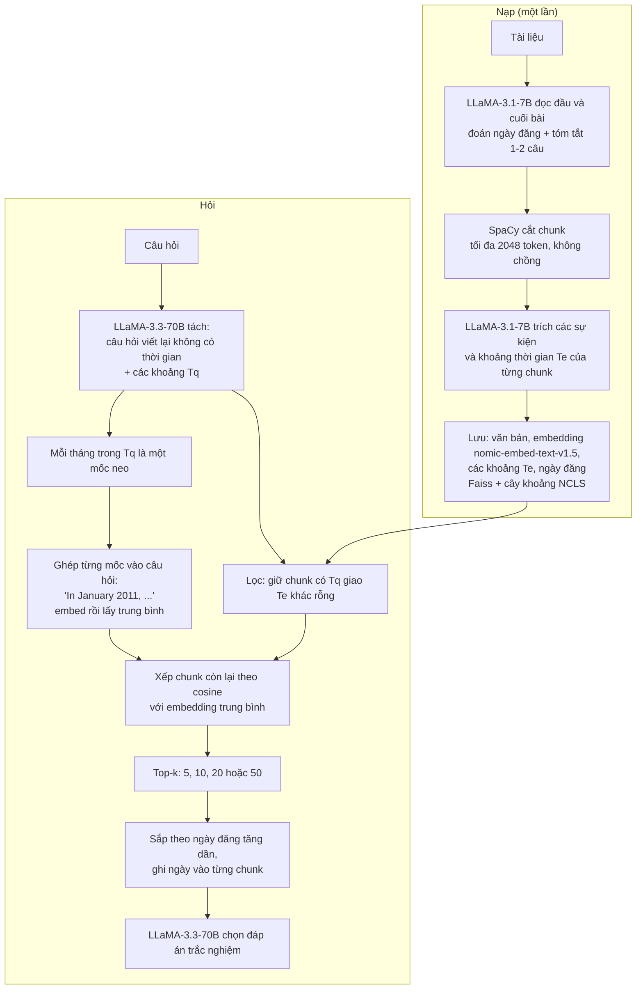

**Một câu hỏi thật của ADQAB, kèm 4 đáp án** (lấy từ `DQABench/dqabench_MCQA.json`, câu `DQABench_00001`):

- Câu hỏi: *"What was the general stock price movement for AGG during 2021?"* (loại "Specific Time Period", mức Year, nhãn thời gian 2021)
- A: giá đi ngang ổn định cả năm.
- B: mở đầu giảm mạnh, rồi phục hồi và dao động, nhiều lần lên đỉnh, cuối năm giảm nhẹ.
- C: tăng mạnh từ đầu năm, tăng đều và kết thúc năm tăng đáng kể.
- D: giảm mạnh nửa đầu năm, rồi hồi phục mạnh, cuối năm tăng đáng kể.
- Đáp án đúng: **B**. Mỗi câu có đúng 4 lựa chọn, nên đoán mò đúng 25%. Mỗi câu còn có `plot_time_bounds` (khoảng thời gian của đồ thị giá, ví dụ 2021-01-01 đến 2021-12-31).

**"Ngày đăng ước lượng" là gì và vì sao phải ước lượng.** Nhiều bài tin không ghi ngày đăng rõ ràng, nên LLM đọc bài và **đoán ngày đăng** (prompt ưu tiên ngày ghi sẵn; nếu không có thì suy từ nội dung). Ví dụ trong prompt của repo: bài nói "Banco Bradesco sẽ giao dịch không hưởng cổ tức từ 3/10/2016" được ước lượng đăng ngày `2016-09-30` (trước ngày đó vài ngày). Ngày đăng dùng để sắp các chunk theo thứ tự trước khi đưa cho LLM, và làm mốc tham chiếu khi đổi các cách nói tương đối ("last week").

**Tạo 9 câu truy vấn là sao, vì sao 9, vì sao theo tháng.**
- Mỗi câu truy vấn là **một tháng trong khoảng thời gian câu hỏi nhắc**. Ví dụ "from May 2015 to January 2016" có 9 tháng (5/2015 đến 1/2016) nên có 9 câu: "In May 2015, ...", "In June 2015, ...", ..., "In January 2016, ...". Số 9 chỉ là ví dụ này; câu hỏi dài hơn thì nhiều câu hơn. Mỗi câu được embed riêng rồi **lấy trung bình** thành một vector truy vấn duy nhất, nên vẫn chỉ một lần tìm, không phải 9 lần.
- **Vì sao tháng, và có phải đặc thù của bộ dữ liệu không.** **Có, đây là lựa chọn gắn với ADQAB** và được cứng trong mã (`freq='MS'`), không phải tham số tự điều chỉnh theo câu hỏi. Bài viết "mịn hơn khoảng hỏi một cấp" nhưng mã đơn giản hóa thành tháng. Lý do hợp lý (suy luận): câu hỏi của ADQAB có mức Year và Month, và 3,300 bài tin tổng hợp là **mỗi mã cổ phiếu mỗi tháng một bài**, nên tháng là đơn vị tự nhiên của kho.
- **Với bộ `real`:** hợp. Đếm trên 1,394 câu của bộ `real` (dạng hard): **1,201 câu (86%) có "tháng + năm"**, 1,285 câu (92%) có năm, và **không câu nào hỏi tới ngày** (chỉ 5 câu có ngày cụ thể, đều là ngày sinh nằm trong mô tả người, không phải mốc hỏi). Nên làm mốc neo theo tháng là đủ; câu chỉ có năm (như "in 2014") thì 12 mốc tháng của năm đó.

**Vector của TA-RAG lưu gì.** Lưu **nguyên văn chunk**, không viết lại và không trích sự kiện: văn bản embed là `"search_document: " + chunk_text` (tiền tố của nomic-embed). Phần thông tin thời gian (khoảng thời gian, ngày đăng ước lượng, tóm tắt bài) là **metadata đi kèm**, không đổi nội dung chunk.

**Cần bao nhiêu chunk để trả lời câu trắc nghiệm.** Nhiều hơn 1 nhiều. Kết quả công bố cho TA-RAG: **k = 5: 71.7%, k = 10: 84.8%, k = 20: 88.2%, k = 50: 88.0%**. Với Naive RAG: k = 5: 44.3%, k = 50: 74.8%. Một chunk như Cơ chế 1 hiện tại chắc chắn không đủ, vì câu hỏi cần xu hướng cả năm hoặc nhiều tháng, mà mỗi bài tin chỉ nói một ngày (bài không báo kết quả k = 1).

**Tham số lấy từ mã (`experiment/src/ta_rag_full.py`):**

| Tham số | Bài | Mã |
|---|---|---|
| Số mốc neo n | Không nêu | **Mỗi tháng** trong khoảng hỏi (`pd.date_range(freq='MS')`); khoảng không có đầu mút thì lấy đến hôm nay; sàn là 1/2012 |
| Độ mịn mốc neo | "Mịn hơn khoảng hỏi một cấp" | Mã luôn dùng **tháng** |
| Dạng câu ghép | Ví dụ "In January 2011, ..." | `"search_query: In {Tháng Năm}, {câu hỏi viết lại}"` (tiền tố của nomic-embed) |
| Câu hỏi không có thời gian | Không nêu | Tìm toàn bộ chỉ mục (ghi log lỗi) |
| Chỉ mục khoảng | Cây khoảng | Thư viện NCLS (`find_overlap`) |
| Thứ tự trước khi đưa LLM | Theo ngày đăng | Khớp bài: sắp theo `estimate_doc_create_date`, ngày thiếu xếp cuối |

- **Đính chính:** bài **không có** bước "Timeline Summary" do LLM tóm tắt, như mình ghi nhầm ở bản trước.
- **Kết quả bài:** độ chính xác cao nhất ở k = 20 (88.23%), k = 50 là 88.00%.
- **Ánh xạ vào đồ án:** khoảng `Te` ≈ `[start_time, end_time]`; lọc giao khoảng ≈ Case 1 của Cơ chế 1. Đáng thử thêm embedding trung bình theo tháng (chi phí thấp: thêm vài lần embed khi hỏi).

### 2.2. TG-RAG (bộ ECT-QA)

**Dùng vector hay graph: cả hai.** Đồ thị (hai tầng: đồ thị tri thức có thời gian và cây thời gian) giữ cấu trúc và báo cáo; vector (text-embedding-3-small) giữ embedding của thực thể và quan hệ để tìm điểm xuất phát; chunk văn bản gốc lưu kèm để lấy lại.

**"Cắt đoạn 1200 token, chồng 100" nghĩa là gì.** Cửa sổ trượt: chunk 1 gồm token 1 đến 1200, chunk 2 bắt đầu ở token 1101 (lùi 100 token) nên chunk 2 gồm token 1101 đến 2300, và 100 token cuối chunk 1 cũng nằm ở đầu chunk 2. "Chồng" là phần dùng chung này. Mục đích: một câu hoặc một sự kiện nằm đúng chỗ cắt không bị mất ngữ cảnh.

**"Mốc chuẩn hóa" trong bộ tứ là gì.** Bộ tứ là (thực thể 1, thực thể 2, quan hệ, τ). τ là biểu thức thời gian trong văn bản đã được **đổi về dạng chuẩn** để so sánh và đặt vào cây thời gian: "Q3 2022" hay "third quarter of 2022" thành `2022-Q3` (khoảng 1/7 đến 30/9/2022, mức quý); "last quarter" thì cần ngày tham chiếu rồi mới đổi được. Mã (`temporal/normalizer.py`) hỗ trợ năm, quý, tháng, tuần, ngày và lưu cả khoảng ngày đầu, ngày cuối.

**Ví dụ.** Câu hỏi (từ bài): *"Which quarter saw the highest deferred revenue growth for Autodesk Inc from Q3 2022 to Q3 2023?"* Dữ liệu minh họa của mình: chunk từ bản ghi họp thu nhập: *"In Q3 2022, Autodesk's deferred revenue grew 12% year over year ..."*

**Quá trình nạp: nhận gì, ra gì** (ví dụ do mình minh họa):

| Bước | Nhận | Ra |
|---|---|---|
| 1. Cắt chunk | Văn bản | Chunk 1200 token, chồng 100 |
| 2. Trích (Gemini-2.5-flash-lite) | Chunk | Nút thời gian (`2022-Q3`), thực thể (`Autodesk`, `deferred revenue`), quan hệ gắn mốc: (Autodesk, deferred revenue, "grew 12%", `2022-Q3`) |
| 3. Dựng tầng dưới | Các bộ tứ | Đồ thị tri thức: cùng cặp thực thể ở quý khác thành cạnh song song khác |
| 4. Dựng tầng trên | Mốc chuẩn hóa | Cây thời gian: `2022` gồm `2022-Q1` đến `2022-Q4`; nút `2022-Q3` nối với cạnh quan hệ đang hiệu lực |
| 5. Viết báo cáo (LLM) | Quan hệ gắn nút, báo cáo của nút con | Báo cáo từng nút thời gian, từ lá lên gốc (ví dụ báo cáo năm 2022 gộp 4 báo cáo quý) |
| 6. Embedding | Thực thể, quan hệ | Vector vào kho vector |

**Quá trình hỏi:** (1) LLM trích biểu thức thời gian "from Q3 2022 to Q3 2023" và logic `between`, ra tập nút `2022-Q3` đến `2023-Q3`; (2) lấy các cạnh quan hệ giống câu hỏi nhất; (3) giữ cạnh có mốc trong khoảng; (4) **local:** PageRank cá nhân hóa từ các thực thể đó, chấm điểm chunk, nhồi vào 12K token; **global:** thêm báo cáo của các nút thời gian trong khoảng; (5) LLM trả lời.

Đồ thị **hai tầng**: tầng dưới là đồ thị tri thức có thời gian (thực thể, quan hệ gắn mốc); tầng trên là **cây thời gian** (năm, quý, tháng, ngày), mỗi nút thời gian có một **báo cáo** do LLM viết.

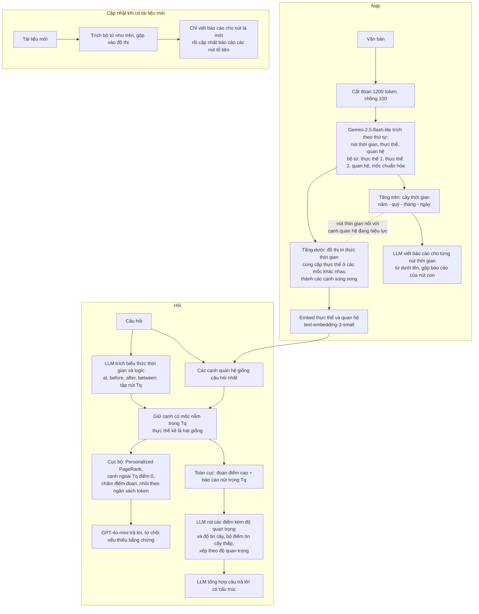

**Hỏi đáp thêm về TG-RAG và ECT-QA.**

- **"Nút thời gian" là gì.** Là một nút trong **cây thời gian** ở tầng trên: có nút **năm** (`2022`), nút **quý** (`2022-Q3`), nút **tháng**, nút **ngày**. Nút con thuộc nút cha (`2022-Q3` thuộc `2022`). Mỗi nút thời gian nối với các cạnh quan hệ ở tầng dưới mà mốc rơi vào nút đó.
- **"Viết báo cáo" là gì, nhận gì, ra gì.** Với mỗi nút thời gian, LLM được nhờ viết **một báo cáo về giai đoạn đó**. Đầu vào là danh sách thực thể (id, tên, loại, mô tả) và danh sách quan hệ **có mốc nằm trong nút đó** (id, ngày, nguồn, đích, mô tả); nút cha còn nhận thêm báo cáo của các nút con. Đầu ra là JSON gồm tiêu đề, tóm tắt, điểm mức độ quan trọng (0 đến 10), lời giải thích điểm, và **5 đến 10 "findings"**, mỗi finding có một câu tóm tắt và vài đoạn giải thích. Ví dụ trong prompt của repo (`temporal_community_report`):
  - **Vào (rút gọn):** thực thể: CivicAlliance (tổ chức vận động nhà ở), CityCouncil, Mayor Johnson, NewsDaily. Quan hệ: `2024-03-02, CivicAlliance → CityCouncil: nộp kiến nghị đòi kiểm soát giá thuê`; `2024-03-10: CivicAlliance tổ chức biểu tình trên 5,000 người`; `2024-03-12: CityCouncil họp điều trần`; `2024-03-21: CityCouncil công bố thí điểm trợ cấp thuê nhà`.
  - **Ra (rút gọn):** `{"title": "March 2024 Housing Activism and Policy Response in Capital City", "summary": "...chuỗi sự kiện biểu tình, đối thoại chính trị và phản hồi chính sách...", "rating": 6.9, "rating_explanation": "...", "findings": [{"summary": "CivicAlliance launched a housing justice campaign", "explanation": "On March 2, 2024, CivicAlliance submitted a petition ... On March 10 they organized a major protest ..."}, ...]}`
- **Vì sao tốn nhiều.** Ba lý do: (1) **một lời gọi cho mỗi nút thời gian**, và dữ liệu có nhiều ngày khác nhau thì nhiều nút (nút năm, quý, tháng, ngày đều có); (2) **đầu ra dài**: 5 đến 10 finding, mỗi cái vài đoạn, khoảng 800 đến 1,500 token cho một báo cáo, đắt hơn đầu vào nhiều (giá token ra gấp đôi); (3) cập nhật: dữ liệu mới thì báo cáo nút lá mới và **mọi nút tổ tiên** phải viết lại. Ngoài ra còn lời gọi trích bộ tứ cho mọi chunk.
- **ECT-QA có hợp Cơ chế 2 hơn ADQAB không.** **Có, hợp hơn.** Lý do: câu hỏi cần **tổng hợp nhiều mốc** (321 câu multi-time, 462 câu liệt kê), có kho văn bản lẫn bằng chứng từng câu (`evidence_list`), và kiến trúc TG-RAG (cây thời gian cộng báo cáo) thiết kế chính cho việc này. ADQAB thì đáp án đến từ đồ thị giá, không từ chữ trong tin, nên truy xuất đúng bài chưa chắc trả lời đúng.
- **Trắc nghiệm có vấn đề gì.** (Với ADQAB.) Có ba điểm: LLM có thể **đoán đúng nhờ kiến thức sẵn có** hoặc nhờ loại trừ đáp án vô lý mà không cần tài liệu; đáp án chỉ có 4 lựa chọn nên khó phân biệt "truy xuất đúng" với "đoán đúng"; và không đo được **chất lượng bản tóm tắt**, chỉ đo chọn đúng hay sai. Nếu bạn muốn xem hệ thống có tóm tắt đúng không thì **ECT-QA hợp hơn** vì có đáp án dạng văn bản; còn cách "chạy thử rồi so với đáp án đúng" thì dùng được cho cả hai bộ.
- **Đáp án ECT-QA là gì, kiểm đúng sai thế nào.** Mỗi câu hỏi cụ thể có một **đáp án văn bản** và danh sách bằng chứng. Ví dụ thật trong dữ liệu: *"What was EOG Resources, Inc.'s free cash flow in each quarter for 2021-Q4, 2022-Q1, and 2022-Q2?"* → đáp án `"$2 billion, $2.3 billion, and nearly $1.3 billion."` (kiểu liệt kê, 3 bước suy luận, mỗi quý một bằng chứng lấy từ đúng bản ghi họp thu nhập của quý đó). 261 trong 1,005 câu có đáp án `"unanswerable"` (hệ thống phải từ chối). Cách chấm của bài: LLM chấm tách đáp án thành từng ý và phân loại **Correct / Refusal / Incorrect**; ngoài ra có **ROUGE-L** và **token F1**. Với đồ án tự tính được token F1 và ROUGE-L, còn LLM judge phải dùng prompt và model của họ (xem mục 6 trong file 01).
- **Số câu của ECT-QA.** Đã kiểm file dữ liệu: `local_base` 656 + `local_new` 349 = **1,005 câu cụ thể**; `global_base` 72 + `global_new` 28 = **100 câu trừu tượng** (không có đáp án chuẩn, chỉ có vai người dùng và loại câu); tổng **1,105**. Số 1,105 trong bài **không phải lỗi in** như mình từng ghi nhầm: đó là tổng của hai nhóm.

**Hai sơ đồ kết nối hai tầng của TG-RAG.**

Sơ đồ 1: cấu trúc và cách hai tầng nối nhau (mỗi quan hệ vẽ thành một hộp riêng để thấy cạnh nối từ nút thời gian tới quan hệ):

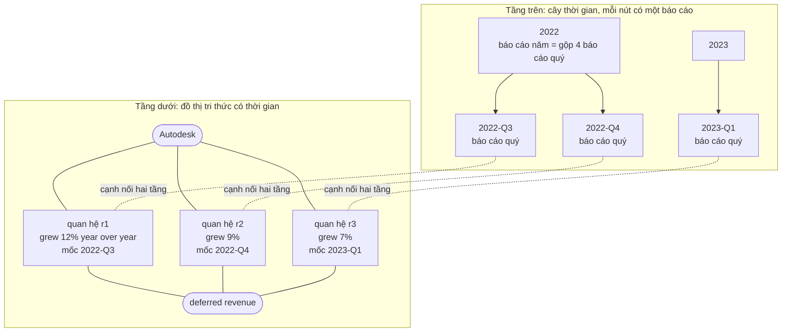

Cặp thực thể "Autodesk" và "deferred revenue" xuất hiện ba lần ở ba quý nên có **ba cạnh song song** (r1, r2, r3), mỗi cạnh một mốc; nhờ vậy một sự kiện theo từng quý không bị trộn thành một.

Sơ đồ 2: đường đi khi hỏi *"Which quarter saw the highest deferred revenue growth for Autodesk from Q3 2022 to Q3 2023?"*:

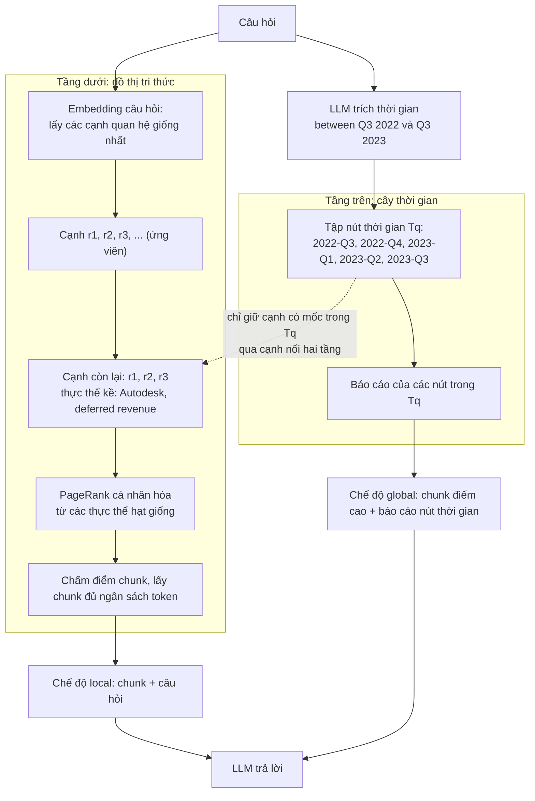

**Làm một cơ chế chung rồi chạy trên cả ADQAB và ECT-QA.** **Được, và đáng làm.** Cả hai bộ đều có kho văn bản và câu hỏi, đáp án có thể chấm đơn giản (ADQAB: chọn đáp án; ECT-QA: token F1, ROUGE-L). Một cơ chế 2 chung (ví dụ lọc theo khoảng cộng gom theo mốc rồi tổng hợp) chạy trên cả hai sẽ cho hai số so sánh với chính baseline cài lại. **Tham số công bố đã rõ chưa:** ADQAB thì rõ (LLaMA-3.3-70B, nomic-embed, chunk 2048 token, k = 5, 10, 20, 50, 5 lần chạy, kết quả theo từng k). ECT-QA thì rõ một phần: chunk 1200 và chồng 100, LLM index Gemini-2.5-flash-lite, LLM hỏi GPT-4o-mini trong bài, nhưng top-K (20 trong bài, 50 trong cấu hình mặc định của mã) và ngân sách token chưa thống nhất giữa bài và mã.

**Tham số bài không nêu, lấy từ mã (`tgrag/configs/config.yaml`, `tgrag/src/core/querying.py`):**

| Tham số | Bài | Mã |
|---|---|---|
| Hệ số damping của PageRank | Không nêu | `0.85` |
| Số cạnh quan hệ lấy ban đầu | Top-K = 20 | Cấu hình mặc định `top_k: 50` (**lệch bài**; chưa rõ giá trị nào tạo ra số trong bài) |
| Ngân sách token | 12K (cục bộ), 24K (toàn cục) | Mặc định: đoạn gốc cục bộ 4000, ngữ cảnh thực thể-quan hệ 6000, báo cáo cục bộ 2000; báo cáo toàn cục 16384; naive 12000 (**cũng lệch bài**, cấu hình chỉnh được) |
| Chunk | 1200 / 100 | Khớp (1200 / 100) |
| LLM index và hỏi | Gemini-2.5-flash-lite / GPT-4o-mini | Cấu hình mặc định index `gemini-2.5-flash-lite`, hỏi `gemini-2.5-flash` |
| Cập nhật tăng dần | Có | Có cờ `enable_incremental` (mặc định `false`) |

- **Chi phí:** LLM chạy trên mọi đoạn **và** cho mọi nút thời gian lúc nạp; ECT-QA (1.58M token) là mức trung bình đến cao.
- **Ánh xạ vào đồ án:** cây thời gian + báo cáo ≈ Cơ chế 2 (timeline) nhưng viết sẵn lúc nạp; đồ án (Boomerang) duyệt đồ thị lúc hỏi rồi lấy chunk. Cạnh song song theo mốc ≈ trạng thái đóng `end_time`.

---

## Cơ chế 3: Conflict Resolution

### 3.1. Khung của LongMemEval (bộ `knowledge-update`; phần `temporal-reasoning` thuộc Cơ chế 1)

**Dùng vector hay graph:** chỉ một chỉ mục phẳng, chọn một trong `flat-bm25`, `flat-contriever`, `flat-stella`, `flat-gte`; không graph. Phần "mở rộng chỉ mục" (tóm tắt phiên, từ khóa, fact của người dùng, sự kiện có thời gian) chỉ là chạy LLM tạo thêm nội dung để thêm vào khóa tìm kiếm.

**Ví dụ (từ bài, bộ `knowledge-update`).** Phiên cũ: người dùng kể kỳ nghỉ ở Hawaii. Phiên mới: *"I'm actually thinking of going to Paris. We just went there as a family last week."* Câu hỏi: *"Where did I go on my most recent family trip?"* Đáp án: Paris.

**Quá trình nạp: nhận gì, ra gì** (mình minh họa theo mô tả trong mã):

| Bước | Nhận | Ra |
|---|---|---|
| 1. Tách lượt | Một phiên hội thoại | Từng lượt (user và assistant) |
| 2. Rút fact (LLM) | Các tin nhắn của người dùng | Danh sách fact cá nhân, ví dụ "went on a family trip to Paris last week" |
| 3. Lập khóa | Nội dung lượt + fact | Khóa tìm kiếm = nội dung + fact; giá trị = lượt hoặc phiên; kèm ngày của phiên |

**Quá trình hỏi:** (1) LLM đọc ngày hỏi và câu hỏi, trả khoảng thời gian `{start, end}` dạng `YYYY/MM/DD` hoặc `N/A` nếu câu hỏi không có tham chiếu thời gian; (2) lọc kết quả truy xuất theo ngày phiên; (3) LLM đọc các lượt còn lại và trả lời.

Ghi theo ghi chú `conflict_resolution/02_LongMemEval.md` (đã đọc PDF) và mã `src/index_expansion/`.

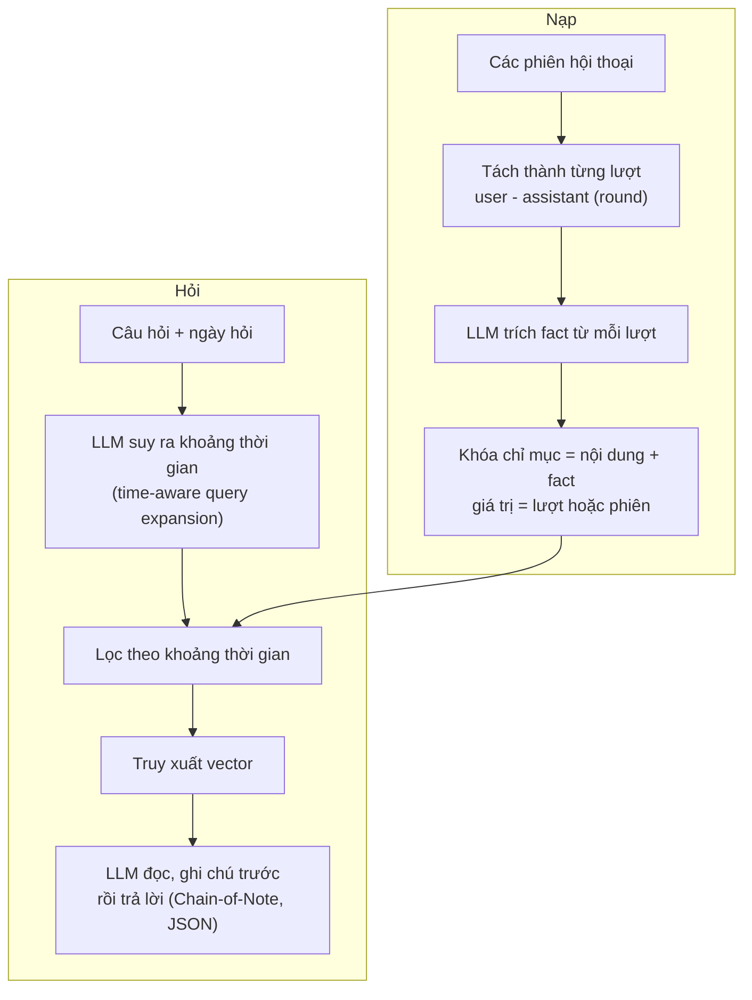

**Chi tiết từ mã (`temp_query_search_pruning.py`):** prompt đưa ngày hỏi và câu hỏi cho LLM, yêu cầu trả JSON `{start, end}` dạng `YYYY/MM/DD`; kèm 10 ví dụ mẫu, trong đó 4 ví dụ trả `N/A` (câu hỏi không có tham chiếu thời gian thì **không** đoán). Mã lọc kết quả truy xuất theo ngày của phiên bằng bảng `event_date_to_sid` và đo `recall_all@5/10`, `ndcg_any@5/10`.

- **Kết quả bài báo:** mở rộng khóa bằng fact tăng trung bình 9.4% recall@k; mở rộng truy vấn theo thời gian tăng recall 11.3% (giá trị = lượt) **chỉ khi LLM trích khoảng thời gian là GPT-4o**; Llama 3.1 8B làm bước này kém, hay bỏ sót hoặc bịa mốc.
- **Ánh xạ vào đồ án:** tương ứng bước tìm `T_req`. Bài học thực tế: LLM nhỏ trích mốc kém, nên bước này cần LLM đủ mạnh hoặc kiểm tra.
- **Lưu ý cho Cơ chế 3:** khung này lọc theo thời gian để tìm đúng phiên, nhưng KU chấm đúng cả khi trả lẫn giá trị cũ; nó **không** đóng `end_time`.

**Hỏi đáp thêm về khung LongMemEval.**

- **"Khóa chỉ mục = nội dung + fact" có phải mã băm không.** **Không.** "Khóa" ở đây là **đoạn chữ dùng để tìm kiếm** (đưa vào BM25 hoặc embedding), không phải mã định danh hay băm. Mã (`index_expansion_utils.py`) có ba cách ghép: `merge` (chữ khóa = fact + dấu cách + nội dung gốc, nối chuỗi), `separate` (nội dung gốc và fact là hai mục tìm kiếm riêng cùng trỏ về một phiên) và `replace` (chỉ dùng fact). Định danh của mục **vẫn là mã phiên hoặc mã lượt gốc** (`corpus_id`), nên không cần nội dung và fact "giống y hệt nhau": fact là thông tin **bổ sung** để câu hỏi có thêm cách khớp. Khác với content hashing của đồ án, vốn dùng băm để nhận biết nội dung trùng.
- **Mỗi câu hỏi có những thông tin gì.** Mỗi mục dữ liệu LongMemEval có: `question_id`, `question_type`, `question`, `answer`, **`question_date`** (thời điểm người dùng hỏi), `haystack_dates` (ngày của từng phiên), `haystack_session_ids`, `haystack_sessions` (nội dung hội thoại), `answer_session_ids` (phiên chứa bằng chứng). **Thời gian câu hỏi hướng tới không có sẵn** dưới dạng trường; nó được LLM **suy ra** từ câu hỏi và `question_date` (ví dụ hỏi ngày 2023/04/10 "last week" thì khoảng là 2023/04/03 đến 2023/04/09).

### 3.2. VersionRAG (bộ VersionQA)

**Dùng vector hay graph: cả hai.** Neo4j giữ đồ thị 5 mức (loại, tài liệu, phiên bản, nội dung, thay đổi); Milvus Lite giữ vector của các chunk nội dung (512 token) kèm metadata phiên bản. Câu hỏi được định tuyến sang đồ thị hay vector tùy ý định.

**Không áp dụng được cho bộ `real` của đồ án** (trang Wikipedia không có "phiên bản"). Hợp với VersionQA, và có thể với HoH (trang bị sửa theo thời gian).

**Ví dụ (từ bài, bộ VersionQA).** Dữ liệu: các tài liệu release notes của Node.js, Apache Spark... theo từng phiên bản. Câu hỏi: *"What is the stability level of assert.CallTracker in Node.js version 20.19.0?"* (đáp án "Stability: 0 - Deprecated"); *"When was assert.deepEqual() removed?"* (hỏi thay đổi ngầm).

**Quá trình nạp: nhận gì, ra gì** (ví dụ do mình minh họa):

| Bước | Nhận | Ra |
|---|---|---|
| 1. Đọc thuộc tính (LLM) | Ít nhất 10 trang đầu của tài liệu | Tên, phiên bản, loại (changelog hay tài liệu chung), ví dụ {Node.js, 20.19.0, changelog} |
| 2. Gom nhóm (LLM) | Tên và mô tả các danh mục | Các cụm cùng chủ đề (bỏ qua số phiên bản) |
| 3. Dựng đồ thị | Tài liệu đã gom | Nút loại, tài liệu, phiên bản, cạnh thứ tự phiên bản |
| 4. Tìm thay đổi | Hai phiên bản liên tiếp (so từng dòng) và changelog | Nút "thay đổi", mỗi nút có mô tả bằng lời do LLM viết |
| 5. Chunk và embedding | Nội dung từng phiên bản | Chunk 512 token, vector kèm phiên bản, vào Milvus |

**Quá trình hỏi:** (1) LLM phân loại ý định (liệt kê phiên bản, thay đổi, nội dung) và trích loại, tài liệu, phiên bản; (2) liệt kê thì duyệt đồ thị tới nút phiên bản; thay đổi thì tìm trên nút thay đổi; nội dung thì tìm vector có lọc phiên bản; (3) LLM trả lời.

Đồ thị **5 mức** (loại, tài liệu, phiên bản, nội dung, thay đổi). Thay đổi giữa phiên bản được tính bằng so sánh từng dòng rồi LLM mô tả. Câu hỏi được định tuyến theo 3 ý định.

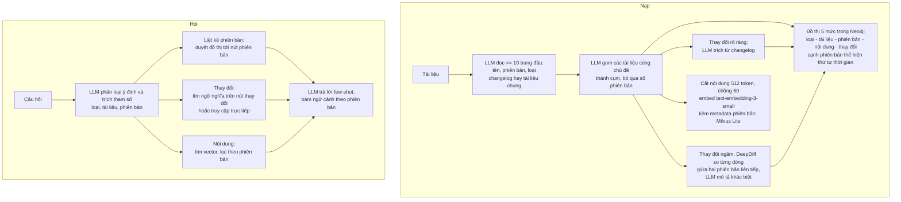

**Tham số bài không nêu, lấy từ mã (`src/indexing/`, `src/retrieval/`, `src/util/constants.py`):**

| Tham số | Bài | Mã |
|---|---|---|
| Cách gom các tài liệu cùng chủ đề | "Giống nghĩa" (ngưỡng không nêu) | **Không có ngưỡng.** LLM nhận tên và mô tả của các danh mục rồi trả JSON các cụm (prompt dặn bỏ qua thông tin phiên bản) |
| Số kết quả nội dung | Không nêu | `entity_limit = 15` mặc định; một đường truy xuất khác dùng 150; baseline Naive RAG `MILVUS_BASELINE_SOURCE_COUNT = 15` |
| Chunk | 512 / 50 | Mã baseline GraphRAG (`kg_indexer.py`) dùng 512 / 100; chunk của chính VersionRAG chưa tra |

- **Chi phí nạp:** bài báo cáo đồ thị 896 nút và 922 quan hệ, 186K token đầu vào, khoảng 0.17 USD (với DeepSeek-R1 70B).
- **Còn không nêu:** cấu trúc chính xác của nút thay đổi, prompt trả lời (chưa tra hết mã).
- **Ánh xạ vào đồ án:** DeepDiff giữa hai phiên bản ≈ băm nội dung (content hashing) của đồ án: khác thì tạo chunk mới và đóng `end_time` chunk cũ, giống thì bỏ qua. Đồ án đã có Neo4j và Qdrant, nên thay Milvus Lite bằng Qdrant. Phiên bản không phải thời gian thật, cần quy đổi sang `start_time` (ngày phát hành) trước.

---

**Hỏi đáp thêm về VersionRAG và VersionQA.**

- **"5 mức" có phải 5 loại nút không.** Đúng. Theo mã (`versionrag_indexer_graph.py`) các loại nút là `Category`, `Documentation`, `Version`, `Content`, `Changes` (nút gom) và `Change`; bài ghi 5 mức vì `Changes` chỉ là hộp chứa các `Change`. Các cạnh: `CONTAINS` (loại chứa tài liệu), `HAS_VERSION`, `NEXT_VERSION` (nối hai phiên bản liền nhau), `HAS_CONTENT`, `HAS_CHANGES`, `INCLUDES`. Sơ đồ bên dưới.
- **Đồ thị và vector nối nhau thế nào.** **Không nối bằng mã định danh.** Nút `Content` trong đồ thị chỉ giữ tên file; kho vector (Milvus) giữ từng chunk 512 token kèm các trường `category`, `documentation`, `version`, `type`, `file`, `page`. Lúc hỏi, LLM trích loại, tài liệu, phiên bản từ câu hỏi, rồi **tìm vector có bộ lọc** theo các trường đó (ví dụ `documentation == "assert nodejs" and version like "20.19.0%"`). Đồ thị dùng để chuẩn hóa tên (tìm danh mục khớp) và để liệt kê phiên bản; vector dùng để lấy nội dung.
- **Mỗi câu hỏi của VersionQA có thông tin gì.** File `evaluation_set.csv` chỉ có ba cột: `Type`, `Question`, `Answer`. **Không có thời gian hỏi và không có thời gian hướng tới**; phiên bản nằm ngay trong chữ câu hỏi (ví dụ "in Node.js version 20.19.0"). 100 câu: Content Retrieval 20, Content Retrieval Complex 20, Version-Specific Content Retrieval 20, Version Listing and Inquiry 20, Change Retrieval (rõ) 10, Change Retrieval (ngầm) 10.
- **VersionQA có thời gian của các phiên bản không.** **Chủ yếu là số phiên bản thuần túy**, dạng semver (`20.19.0`, `5.3.1`), nằm trong tên file. Ngày phát hành chỉ có **đôi khi trong nội dung** (ví dụ trang release của Bootstrap ghi "released this Jul 26, 2023"), không có trường ngày chuẩn. Muốn có `start_time` phải tra ngày phát hành bên ngoài hoặc trích từ nội dung.
- **"Ít nhất 10 trang đầu của tài liệu" là sao, dataset có tài liệu không.** Có, **dataset có tài liệu**: `data/raw` gồm 28 file `.md` và 6 file `.pdf` (Node.js `assert` và `errors`, Bootstrap releases, Spark releases). "Trang" là **trang PDF**: với PDF, mã đọc trang 1 (đoạn ngắn) và tối đa 10 trang đầu (đoạn dài) để LLM đoán tên, phiên bản, loại tài liệu. Với file `.md` không có trang nên mã chỉ lấy **200 và 300 ký tự đầu**. Nên "10 trang" chỉ đúng với PDF.
- **Làm sao biết các tài liệu cùng chủ đề.** **Không có danh sách sẵn.** Mã gọi LLM với tên và mô tả của từng tài liệu, yêu cầu gom thành cụm theo chủ đề và **bỏ qua số phiên bản** (ví dụ "assert nodejs" và "errors nodejs" có thể vào cùng loại Node.js). Cách này phụ thuộc chất lượng LLM, không có ngưỡng.
- **Cơ chế VersionRAG có áp dụng cho Cơ chế 3 (dữ liệu cập nhật theo thời gian) không.** **Có, khá khớp.** Chuỗi `Version -NEXT_VERSION-> Version` tương ứng chuỗi trạng thái cũ và mới (`SUPERSEDES`); nút `Change` (mô tả bằng lời cái gì đã đổi giữa hai phiên bản) tương ứng việc đóng `end_time` chunk cũ. Điểm khác: VersionRAG phát hiện thay đổi bằng so sánh từng dòng cả file giữa hai phiên bản liền nhau (DeepDiff), còn đồ án phát hiện bằng băm nội dung theo chunk và đóng `end_time` đúng chunk bị đổi, nên tinh hơn. VersionRAG **không có `invalidated_at`** (sai từ đầu) nên chỉ phủ phần Evolution, không phủ Falsehood.

- **VersionQA dùng được cho đồ án không, và "xung đột" ở đây là gì.** **Dùng được như bộ phụ cho Cơ chế 3, nhưng không phải kiểu xung đột nội dung trong cùng một văn bản.** Xung đột ở đây là **giữa các phiên bản của cùng một tài liệu**: phiên bản mới thay đổi hoặc bỏ điều phiên bản cũ nói (ví dụ `assert.CallTracker` đổi mức ổn định). Câu hỏi cần xem hệ thống **chọn đúng phiên bản** (câu hỏi nêu phiên bản) hoặc **hiểu đúng thay đổi** (câu hỏi "khi nào bị bỏ"). Hạn chế: chỉ 100 câu, miền phần mềm, phiên bản là số chứ không phải thời gian thật, không có gold chunk.
- **Khi có phiên bản mới, dữ liệu có gì cho biết hai phiên bản là cùng một thực thể.** **Không có mã định danh tài liệu nào**; hệ thống phải tự nhận ra. Trong bộ này, **tên file có đủ thông tin**: `assert nodejs 19.9.0.md`, `assert nodejs 20.19.0.md` (tên tài liệu "assert nodejs" cộng phiên bản); Bootstrap là `Release v5.3.1 · twbs_bootstrap.md`; Spark là `Spark Release 3.5.3 _ Apache Spark.pdf`. VersionRAG không dùng quy tắc tên file mà nhờ LLM đọc phần đầu tài liệu để rút `{tên, phiên bản, loại}` rồi gom bằng LLM. Với đồ án có hai việc khác nhau: (1) **nhận ra cùng một tài liệu**: ở bộ này đủ dùng quy tắc tên file (bỏ số phiên bản làm khóa tài liệu), ngoài đời thì cần so khớp thực thể; (2) **ghép từng đoạn giữa hai phiên bản** (đoạn nào của bản mới ứng với đoạn nào của bản cũ): VersionRAG so từng dòng cả file, còn thiết kế của đồ án chia chunk theo cấu trúc (theo tiêu đề API hay điều khoản) rồi băm từng chunk: băm giống thì đoạn không đổi (chỉ ghi nhận lại), băm khác thì đóng `end_time` chunk cũ và mở chunk mới. Với tài liệu Node.js, mỗi API (`assert.deepEqual`...) có tiêu đề riêng nên chia theo tiêu đề cho khóa ghép tự nhiên (tài liệu, tiêu đề). Mình chưa kiểm tính khả thi này trên dữ liệu thật; đây là hướng đề xuất.

- **Ứng dụng được gì từ VersionRAG cho đồ án, dù VersionQA chỉ là bộ phụ.** Năm điểm, từ dễ dùng nhất:
  1. **Phân loại ý định câu hỏi để định tuyến.** VersionRAG chia câu hỏi thành 3 loại (liệt kê phiên bản, thay đổi, nội dung) và LLM đoán đúng 92% (với DeepSeek-R1 70B). Khớp ý tưởng Query Profiler và Routing Agent của đồ án: "nội dung tại một thời điểm" ứng với Cơ chế 1 (`get_state_at`), "dòng thời gian" ứng với Cơ chế 2 (`get_timeline`), "cái gì đã đổi" ứng với Cơ chế 3 (`list_changes`).
  2. **Nút thay đổi (`Change`) là một bản ghi rõ ràng "cái gì đã đổi giữa hai phiên bản"** (mô tả bằng lời do LLM viết). Tương ứng công cụ `list_changes` trong thiết kế MCP của đồ án (file 16). Đồ án có thể lưu cạnh `SUPERSEDES` kèm mô tả ngắn như vậy để trả lời "đã đổi gì".
  3. **Tìm vector có lọc theo trường phiên bản** (`documentation`, `version`) rồi mới lấy nội dung: đúng mẫu "lọc metadata trước, tìm nghĩa sau" của đồ án (lọc theo `start_time`, `end_time` trong Qdrant). Bài này là một bằng chứng cho hướng đó.
  4. **So sánh hai phiên bản để phát hiện thay đổi ngầm** (DeepDiff theo dòng): phương án thay thế cho băm nội dung theo chunk. Đáng thử ở các tài liệu mà thay đổi nằm giữa chunk.
  5. **Dùng làm baseline phương pháp cho Cơ chế 3 trên VersionQA**, ghi rõ khác biệt: VersionRAG không có `invalidated_at` (không xử lý Falsehood) và dùng số phiên bản chứ không phải ngày.

**Sơ đồ 5 mức của VersionRAG, kèm ví dụ** (Node.js `assert`):

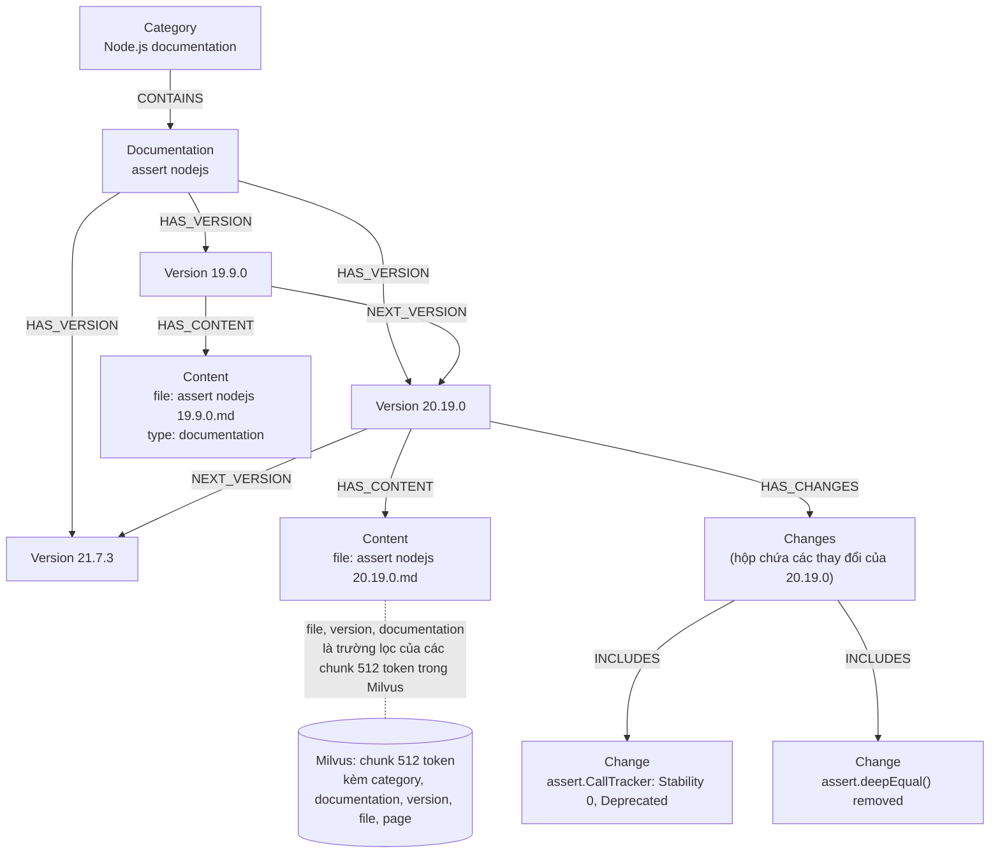

(Ví dụ tên nút và nội dung thay đổi do mình đặt theo câu hỏi mẫu của bài; đồ thị thật do LLM dựng.)

**Nếu dùng ontology cho 3.1 và 3.2, ontology chứa gì** (đề xuất của mình; cùng khuôn "lõi cộng gói theo bộ dữ liệu" trong `16_Ontology_and_Ingestion_Decisions.md`):

| Gói | Lớp (loại thực thể) | Quan hệ và thuộc tính | Ghi chú ví dụ |
|---|---|---|---|
| **LongMemEval (hội thoại cá nhân)** | `User`, `Session` (có ngày), `Turn`, `Attribute` (thuộc tính người dùng), `Event` (sự kiện đời sống), `Place`, `Organization` | `hasAttribute`, `valid_from`, `valid_to` (ngày của phiên đầu và phiên đổi), `supersedes` (trạng thái mới thay trạng thái cũ), `sourceSession`; **thuộc tính đơn trị** (`livesIn`, `employer`: giá trị mới đóng giá trị cũ) và **đa trị** (`ownsPet`, `visited`: cộng dồn) | "Hawaii" thay bằng "Paris" cho `mostRecentFamilyTrip`: nút cũ `valid_to = ngày phiên mới`, `supersedes` trỏ về |
| **VersionQA (phiên bản phần mềm)** | `Software`, `Version` (số hiệu, ngày phát hành), `API` hoặc `Feature`, `ChangeEvent` (kiểu: added, deprecated, removed, modified), `StabilityLevel` | `hasVersion`, `nextVersion`, `introducedIn`, `deprecatedIn`, `removedIn`, `stabilityIs`, `releasedOn`, `supersedes` | `assert.CallTracker`: `stabilityIs = 0 (Deprecated)` ở 20.19.0, `introducedIn = 14.2.0` (ví dụ do mình đặt) |

## Chi phí ước lượng để chạy lại trên bộ `real` của đồ án

**Quy mô của bộ `real`** (mình đo trên `dataset/full_dataset/pages.jsonl`): 556 trang (tune 203, valid 167, test 186), 1,161,632 từ, ước lượng khoảng 1.57M token (nhân 1.35 từ sang token; **đây là ước lượng**). Riêng test: 186 trang, khoảng 0.52M token, 400 câu hỏi. Tổng câu hỏi tune, valid, test là 595, 399, 400.

**Giá dùng để tính:** DeepSeek V4 Flash khoảng **0.14 USD mỗi triệu token vào, 0.28 USD mỗi triệu token ra** (giá cache trúng khoảng 0.0028 USD mỗi triệu). Số này lấy từ các trang tổng hợp giá bên thứ ba ([ZenMux](https://zenmux.ai/blog/deepseek-v4-flash-api-pricing), [LLM Gateway](https://llmgateway.io/models/deepseek-v4-flash)), **chưa kiểm trang giá chính thức**; giá DeepSeek đã đổi nhiều lần trong năm 2026. Nên kiểm lại trước khi trích vào báo cáo.

**Cách ước lượng:** độ dài prompt đo từ file prompt trong repo (chữ số / 4 ra token); số chunk theo cửa sổ của từng bài; một số bước chưa biết số lời gọi nên ghi khoảng.

| Phương pháp | Cần nạp? | Lời gọi LLM: chỉ test (186 trang, 400 câu) | Token vào / ra: chỉ test | Tiền: chỉ test | Tiền: cả 556 trang và 1,394 câu |
|---|---|---|---|---|---|
| **MRAG** | Không (kho có sẵn) | khoảng 2,800 (7 mỗi câu) | 3.8M / 0.16M | khoảng 0.6 USD | khoảng 2 USD |
| **DyG-RAG** | Có, nhiều | 1,350 đến 1,900 | 8.5 đến 10.6M / 0.6 đến 1.0M | 1.4 đến 1.8 USD | khoảng 4.5 đến 6 USD |
| **TG-RAG** | Có, nhiều (báo cáo mọi nút thời gian, mỗi báo cáo khoảng 800 đến 1,500 token ra) | 2,850 đến 4,900 (không chắc, tùy số nút thời gian) | 12 đến 18M / 2.2 đến 4.2M | 2.5 đến 4 USD | khoảng 7.5 đến 12 USD |
| **TA-RAG** | Có | khoảng 1,360 | 4.4M / 0.4M | khoảng 0.7 USD | khoảng 2.4 USD |
| **Khung LongMemEval** (cài trên chunk của đồ án) | Có | khoảng 1,350 | 4.1M / 0.25M | khoảng 0.6 USD | khoảng 2.2 USD |
| **VersionRAG** | Có | Không áp dụng cho bộ `real` | Bài báo: nạp VersionQA hết 186K token vào | (bài báo ghi 0.17 USD, giá tính không rõ) | |

**Nhận xét:**
- Về tiền thì rất rẻ (vài USD) nếu dùng DeepSeek V4 Flash. **Nút thắt là hạn mức, không phải tiền.** Với Gemini khoảng 500 yêu cầu mỗi ngày thì chỉ test mất khoảng 3 đến 4 ngày cho DyG-RAG, 6 đến 10 ngày cho TG-RAG, 6 ngày cho MRAG. Với Gemma (30 RPM, 16K token mỗi phút) thì token mỗi phút là giới hạn thật: 8 triệu token cần khoảng 8 giờ.
- TG-RAG là mục khó ước lượng nhất, vì số nút thời gian (mỗi nút một lời gọi viết báo cáo) phụ thuộc vào số ngày khác nhau xuất hiện trong dữ liệu; trang Wikipedia tiểu sử có nhiều ngày nên có thể lên cao.
- Chưa tính phần chạy cục bộ (embedding, reranker, cross-encoder) cần GPU.

## Ontology trong các bài này

**Không bài nào dùng ontology theo nghĩa đầy đủ** (khai báo lớp và quan hệ bằng OWL, RDF hay Turtle). Gần nhất:

| Bài | Có gì gần với ontology | Mức độ | Nếu triển khai ontology cho bài này: chứa gì |
|---|---|---|---|
| **VersionRAG** | Lược đồ cố định 6 loại nút (Category, Documentation, Version, Content, Changes, Change) và các cạnh `HAS_VERSION`, `NEXT_VERSION`, `INCLUDES`... | Lược đồ đồ thị cố định, không phải ontology; gần nhất | Lớp `Software`, `Version`, `API`, `ChangeEvent` (kiểu added/deprecated/removed/modified); quan hệ `nextVersion`, `introducedIn`, `deprecatedIn`, `removedIn`, `supersedes`; thuộc tính `releasedOn`, `stabilityIs` |
| **TG-RAG** | Danh sách loại thực thể cấu hình được (`person`, `technology`, `mission`, `organization`, `location` trong file mẫu) và cây thời gian năm, quý, tháng, ngày | Một lược đồ nhẹ cấu hình được | Lớp `Company`, `Metric` (doanh thu, biên lợi nhuận, dòng tiền...), `Quarter`, `Person` (lãnh đạo); quan hệ `reports` (công ty báo cáo chỉ số), `valueAt` (giá trị ở quý nào), `guidance`; thuộc tính `period` (quý, năm), `unit` (USD, %); để quan hệ cùng cặp thực thể nhưng khác quý thành các cạnh song song |
| DyG-RAG, TA-RAG, khung LongMemEval, MRAG | Không có | Không | DyG-RAG: ontology thay được việc nối thực thể bằng so khớp chuỗi (loại thực thể, alias); LongMemEval: gói hội thoại như bảng ở mục 3 |

Hai bài benchmark cũng có phần gần ontology nhưng không nằm trong file này: TLQA mượn hai thuộc tính Wikidata (P54, P39) làm khuôn câu hỏi, Conflicts có bảng phân loại 5 loại xung đột (taxonomy). Chi tiết ở `01_SUMMARY_BY_MECHANISM.md` mục 8.

Ý nghĩa với đồ án: ontology nhẹ (lõi cộng gói theo bộ dữ liệu) là phần **đồ án có mà các bài này không có**, nên khi so baseline cần nhớ baseline không dùng ontology; hệ của bạn có thêm thông tin đó.

## 4. Khác biệt chính giữa các phương pháp trên và hệ thống của đồ án

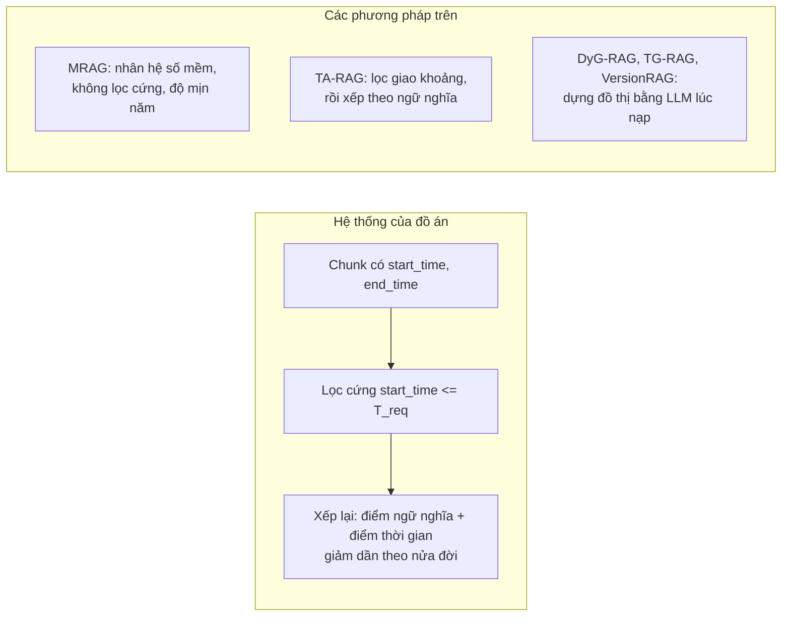

- TA-RAG gần nhất với đồ án (cũng lọc cứng theo khoảng). MRAG khác ở chỗ chấm điểm mềm và không loại hẳn đoạn tương lai (câu không khớp vẫn có hệ số 0.5).
- Trong các bài đã đọc, **không bài nào đo `leakage_rate`** (tỉ lệ lấy nhầm chunk có mốc sau `T_req`). TG-RAG và TA-RAG có lọc theo khoảng thời gian của câu hỏi, DyG-RAG và MRAG thì chỉ chấm điểm; chưa kiểm xem họ có chặn tương lai khi câu hỏi chỉ có mốc "trước".
- **Mã lệch bài:** DyG-RAG (công thức trọng số cạnh) và TG-RAG (top-k và ngân sách token mặc định) khác bài báo. Khi cài lại nên coi mã là nguồn chính cho tham số, và ghi rõ chọn theo mã hay theo bài.
