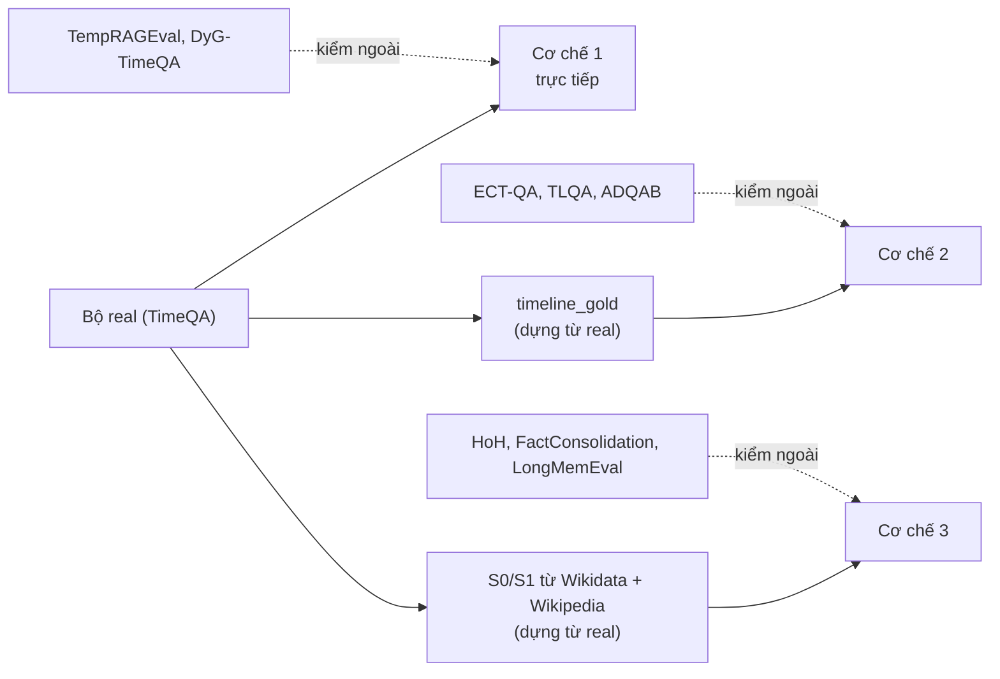

# Kế hoạch đánh giá theo từng cơ chế: chạy trên bộ nào, so với phương pháp nào, đo bằng chỉ số nào

> Ghi 2026-11-02. **Đây là đề xuất, chưa chốt.** Tổng hợp từ `01_SUMMARY_BY_MECHANISM.md` (bộ dữ liệu), `02_REPRODUCIBLE_METHODS.md` (phương pháp), `docs/eval/08_TIMELINE_EVAL_DESIGN.md` (đo Cơ chế 2) và `docs/decisions/09_CONFLICT_RESOLUTION_SCOPE.md` (đo Cơ chế 3). Chỗ nào chưa kiểm dữ liệu thật thì ghi "chưa kiểm".

## 0. Tóm tắt một bảng

| Cơ chế | Bộ chính (kết luận cho luận văn) | Bộ ngoài để kiểm thêm | Tự làm thêm | Phương pháp so cùng bộ | Chỉ số chính |
|---|---|---|---|---|---|
| **1. Temporal Retrieval** | Bộ `real` (TimeQA): tune 595 / valid 399 / test 400 | TempRAGEval (sau khi xin quyền HF), TimeQA của DyG-RAG (chồng 45% với `real`, ít giá trị mới) | Mẫu nhỏ ~100 câu: thời gian tương đối, mức ngày, không nêu mốc, `end_time` còn mở | Plain, Plain+bge, Temporal (hệ mình), ablation, **cả 6 đối thủ cài lại đủ logic** (mục 4) | `hit@k`, `mrr`, `leakage_rate`, EM/F1 |
| **2. Timeline Summarization** | `timeline_gold` tự dựng từ TimeQA (1,241 câu, 1,019 reliable) | ECT-QA (có kho sẵn), TLQA (gần bài toán nhất, phải dựng kho), ADQAB (phụ) | Phần làm tay theo `eval/08`: thời lượng, khoảng trống, precision của dòng thời gian | Vector top-k, graph oracle, graph LLM trích (hệ mình), cả trang, **cùng 6 đối thủ** (mục 4) | độ phủ sự kiện, F1 tập, thứ tự, token, EM/F1 |
| **3. Conflict Resolution** | Bộ tự dựng từ lịch sử Wikidata/Wikipedia (100–150 cặp S0/S1, 6 loại câu) | HoH, FactConsolidation, LongMemEval `knowledge-update`; phụ: VersionQA, Conflicts | Chính là bộ tự dựng; thêm nhóm đối chứng | Plain RAG, Replace-all, Keep-all-snapshots, **cùng 6 đối thủ** (mục 4) | Freshness, Historical retention, False-invalidation, chi phí cập nhật |

Nguyên tắc chung (đã chốt ở các phiên trước, ghi lại để khỏi lệch):
- **tune** chọn tham số; **valid** chọn phương pháp/prompt (đổi khỏi baseline khi hơn >= 2 sai số chuẩn); **`test_clean` chạy một lần**.
- Bộ ngoài **không dùng để tune**. Đề xuất: khóa cấu hình sau valid rồi chạy bộ ngoài đúng một lần, báo riêng một bảng. Lý do: nếu tune thêm trên bộ ngoài thì "kiểm tổng quát hóa" mất nghĩa.
- Số của bài gốc **không chép sang** để so (khác LLM, khác kho, khác cách chấm; xem `01` mục 4). Chỉ so bản cài lại trên máy mình, cùng dữ liệu, cùng LLM, cùng cách chấm.
- Đối thủ cài lại: **cả 6 bài ở file 02**, mỗi bài **đủ logic theo mã chính thức** (không rút gọn, không bỏ bước); danh sách và phần logic phải giữ ở mục 4. Tự viết trong `tam`, lấy mã chính thức làm đặc tả (xem `02`, mục chính sách baseline).

Cả ba bộ chính đều bắt nguồn từ cùng các trang Wikipedia của TimeQA. Ưu điểm: một kho, một bộ ontology nhỏ, một pipeline nạp. Nhược điểm cần ghi vào phần hạn chế của luận văn: tất cả cùng miền (tiểu sử, đội bóng, chức vụ), nên bộ ngoài mới là chỗ thấy hệ có sang miền khác được không.

---

## 1. Cơ chế 1: Temporal Retrieval

### 1.1. Chạy trên bộ nào

| Bộ | Vai trò | Vì sao | Việc còn thiếu |
|---|---|---|---|
| **`real`** (1,394 câu) | **Chính** | Có gold chunk nên đo được `hit@k`, `mrr`, `leakage_rate`; có baseline Plain và Plain+bge đã chạy; có tune/valid/test_clean. Tuần 5 đã chạy test: mrr Plain 0.336 / Plain+bge 0.490 / Temporal 0.620. | Không. |
| **TempRAGEval** (1,000 câu) | Phụ: so với MRAG | Có gold chunk (`ER@k`), có mã MRAG làm đặc tả. Câu hỏi cố ý đổi mốc/cách hỏi ("trước", "mới nhất") nên là phép thử khó hơn. | Xin quyền HF (gated, tải thử 401); thu hẹp kho 33.1M chunk xuống các trang gold + trang nhiễu; gán `start_time`. Số tuyệt đối sẽ cao giả (kho nhỏ), chỉ đọc khoảng cách giữa các hệ. |
| **TimeQA của DyG-RAG** (2,613 câu) | Phụ, giá trị thấp | Chỉ có đáp án, không có gold chunk. **Chồng nhiều với `real`**: 123/186 trang `test_clean` (66%) nằm trong 738 trang C/test.hard (suy ra, chưa xác nhận đây là cùng bộ DyG). Chạy thêm gần như là chạy lại bộ mình. | Nếu muốn dùng: tải từ Google Drive của DyG-RAG (chưa tải), xác nhận chồng. Đề xuất **bỏ**, trừ khi cần đúng bộ của DyG để chạy DyG-RAG ở Cơ chế 2. |
| **TEMPO** (miền nhỏ `quant` 29K, `law` 43K đoạn) | Tùy chọn: kiểm tổng quát hóa sang miền khác | Tải được (đã kiểm), có `gold_ids` nên tính được nDCG@10. | Tài liệu **không có trường ngày**, nên bộ lọc cứng không có gì để lọc và không đo được rò rỉ. Chỉ kiểm được phần xếp hạng theo nghĩa. Muốn có mốc phải nhờ LLM trích ngày cho 29–43K đoạn. Đề xuất: chỉ làm nếu dư thời gian. |
| **ChroniclingAmericaQA** (1,272 câu có năm) | Rất yếu, tùy chọn | Kiểm "không lọt tương lai" trên văn bản OCR. | 95% câu không có mốc, 73% câu có năm lại ≈ ngày đăng báo. Đề xuất: bỏ khỏi kế hoạch chính. |

### 1.2. Tự làm thêm mẫu nhỏ (đề xuất)

Bộ `real` thiên về một kiểu câu. Đo từ 1,394 câu: 1,201 câu (86%) có cả tháng lẫn năm, 92% có năm, **không câu nào hỏi tới ngày** (5 câu có ngày cụ thể đều là ngày sinh). Dạng câu của test: in Month YYYY 142, between/from-to 136, after 35, early/late/mid 33, before 31, in YYYY 20, khác 3. Những tình huống mà thiết kế (`CLAUDE.md`) có hứa nhưng bộ `real` không phủ:

| Nhóm mẫu tự làm | Số câu gợi ý | Kiểm điều gì | Cách tạo |
|---|---:|---|---|
| Thời gian tương đối ("năm ngoái", "hiện nay") với `T_now` cố định | ~30 | Cơ chế chèn `T_now` thành `T_req` tuyệt đối | Viết tay từ các cặp (thực thể, giai đoạn) đã có trong `real`, thêm cụm tương đối; ghi `T_now` giả định vào từng câu |
| Mức ngày ("ngày 5 tháng 3 năm 1998") | ~30 | Độ mịn ngày của lọc và điểm thời gian (MRAG chỉ mịn đến năm) | Chọn thực thể có mốc ngày trong văn bản |
| Câu không nêu mốc | ~20 | Chính sách mặc định (ưu tiên mới nhất hay hỏi lại) | Bỏ cụm thời gian khỏi câu có sẵn; đáp án chuẩn do chính sách quy định, **phải chốt chính sách trước** |
| `end_time` còn mở (đang giữ chức) | ~20 | Quy ước `end_time = NULL` (xem decision 02) | Chọn thực thể còn đương nhiệm |

Tổng khoảng 100 câu. **Chỉ để minh họa và bắt lỗi**, báo riêng, không trộn vào số chính (cỡ mẫu nhỏ, do mình viết nên dễ thiên vị cho hệ mình).

### 1.3. Phương pháp so sánh

| Nhóm | Phương pháp | Trạng thái | Ghi chú |
|---|---|---|---|
| Baseline có sẵn | **Plain** (dense, không thời gian) | Đã chạy | |
| | **Plain+bge-reranker-v2-m3** | Đã chạy | Đây là baseline "công bằng" nhất vì hệ chính cũng dùng bge |
| Hệ chính | **Temporal** (lọc cứng `start_time <= T_req` + xếp lại `W1·Semantic + W2·Temporal` + bge) | Đã chạy | Cấu hình chính của tuần 5 |
| Ablation | Chỉ lọc cứng; chỉ xếp lại có thời gian (không lọc); không bge; bỏ nửa đời (λ) | Chưa làm hết | Cho biết thành phần nào đóng góp bao nhiêu |
| Ý tưởng đơn giản từ bài khác | Rerank phân rã `α·cos + (1−α)·0.5^(age/h)`; α động theo câu hỏi (TimelyRAG, bài đã loại nhưng ý hay) | Chưa làm | Nửa ngày đến 2 ngày mỗi ý, không cần LLM thêm (`01` mục 4) |
| Đối thủ cài lại (đủ logic, mục 4) | **MRAG**, **TA-RAG**, **DyG-RAG**, **TG-RAG**, **khung LongMemEval** (phần lọc/mở rộng truy vấn theo thời gian); MRAG chạy hai cấu hình: "MRAG gốc" (chấm mềm, mịn năm, bỏ nhóm `other`) và "MRAG cộng exact" (thêm điều kiện khớp mốc chính xác) như một ablation, không thay cho bản gốc | Chưa làm | Cả 5 chạy trên `real` và TempRAGEval; VersionRAG không áp dụng (cần chuỗi phiên bản) |
| Ý tưởng đơn giản từ bài khác | Rerank phân rã tuyến `α·cos + (1−α)·0.5^(age/h)` (đã nằm trong nhóm ablation ở trên) | Chưa làm | Chỉ để tham chiếu, không thay đối thủ ở dòng trên |

**Mọi đối thủ trong mục này đều chạy cùng bộ lưu trữ, LLM và cách chấm với hệ mình.** DyG-RAG và TG-RAG dựng đồ thị lúc nạp nên chi phí LLM cao hơn (ước lượng ở mục 4), nhưng vẫn chạy đủ trên `real`; nút thắt là hạn mức, không phải tiền. Không đưa fine-tune retriever kiểu TempRetriever/TMRL/TPOUR (không tái dựng được, không đáng).

### 1.4. Chỉ số

| Chỉ số | Nghĩa | Dùng cho bộ | Ghi chú |
|---|---|---|---|
| `hit@k` (k = 1, 3, 5, 10) | Gold chunk có trong top-k | `real`, TempRAGEval (`ER@k`) | |
| `mrr` | Nghịch đảo hạng của gold chunk | `real` | Chỉ số đầu bảng của tuần 5 |
| **`leakage_rate`** | Tỉ lệ top-k chứa chunk có mốc sau `T_req` | `real`, mẫu tự làm | **Không bài nào khác đo**; đây là điểm khác của đồ án. Đặc biệt có ý nghĩa với MRAG vì nó không loại hẳn đoạn tương lai |
| `ans_valid@k` / `AR@k` | Top-k có chứa chuỗi đáp án | `real`, TempRAGEval | Lưu ý: đã có 71 câu `ans_valid@5=0` chưa phân tích |
| EM / F1 top-5 (Gemini 3.5, prompt v1) | Câu trả lời cuối | `real`, bộ ngoài có đáp án | Tuần 5: EM top-5 0.360 / 0.432 / 0.500 (Plain / Plain+bge / Temporal) |
| Accuracy theo lát | Tách theo dạng câu (in Month YYYY, between, after, before...) và theo "độ xa" của mốc | `real` | Xem hệ có lệch về mới nhất/cũ nhất không (`scope` mục 4) |
| nDCG@10 | Xếp hạng có nhãn liên quan | TEMPO nếu làm | Chỉ phần xếp hạng theo nghĩa |
| Token vào LLM, độ trễ, số lời gọi LLM | Chi phí | Tất cả | Đặc biệt khi so với MRAG (7 lời gọi LLM mỗi câu) |

**Kiểm ý nghĩa thống kê:** báo sai số chuẩn (bootstrap theo câu) và chỉ khẳng định hơn khi chênh >= 2 sai số chuẩn, đúng quy tắc valid. Với bộ tự làm ~100 câu thì chỉ mô tả.

---

## 2. Cơ chế 2: Timeline Summarization

### 2.1. Chạy trên bộ nào

| Bộ | Vai trò | Vì sao | Việc còn thiếu |
|---|---|---|---|
| **`timeline_gold`** (từ TimeQA; 1,241 câu, 1,019 reliable) | **Chính** | Đã dựng bằng code, không LLM; có oracle graph để đo cận trên; câu hỏi `list` 204, `count` 204, `first` 204, `order` 167, `last` 146, `successor` 316. | Phần làm tay (mục 2.2); chạy bước go/no-go (oracle so vector) rồi mới trích bằng LLM. |
| **ECT-QA** (744 câu có đáp án, kho 384 transcript base) | **Ngoài, ưu tiên 1** | Có sẵn cả câu hỏi và kho, có `evidence_list`; có mã TG-RAG chạy lại được. Hợp Cơ chế 2 hơn ADQAB (câu liệt kê 462, so sánh 282). | Tách 261 câu unanswerable ra riêng; cố định `T_now` cho 201 câu thời gian tương đối; mốc theo quý. Tự chấm EM/F1 thay LLM judge. |
| **TLQA** (test 497 câu) | **Ngoài, ưu tiên 2** (gần bài toán nhất) | Câu "liệt kê mọi chức vụ/đội của một người", đáp án là danh sách kèm khoảng năm, trung bình 8.6 đáp án. Chỉ 2 quan hệ (P54, P39) nên ontology dễ nhất. Giống kiểu câu của `timeline_gold`. | **Chưa có kho văn bản**: phải lấy trang Wikipedia của 5,711 thực thể (ước 115 yêu cầu API, chưa đo thời gian); trang hiện tại khác bản dump 4/2024 nên nên dùng bản mapping trên Google Drive của họ. Gold chỉ là infobox, ~51% tên khớp nguyên văn với evidence. |
| **ADQAB** (525 câu trắc nghiệm) | Ngoài, phụ | Chấm accuracy đơn giản; có kho 127 MB. | Không có gold chunk. Đáp án đến từ đồ thị giá chứ không từ văn bản tin, nên là phép thử lạ so với bài toán của mình. Chỉ cần nếu muốn so TA-RAG đúng bộ của họ. Đề xuất: làm sau cùng. |
| **TDBench** (2,854 câu) | Tùy chọn | Đáp án chắc đúng (sinh bằng SQL); `Start`/`End` sạch. | Không có kho văn bản, phải viết mỗi dòng bảng thành câu bằng mẫu. Và bài chỉ đo LLM đóng sách. Đề xuất: bỏ, trừ khi cần bộ không liên quan Wikipedia. |

**`timeline_gold` đã có gì, dùng ngay được không.** Đã kiểm trên đĩa (2026-11-02): `dataset/eval/timeline_gold_real.json` (217 ô, 156 ô `complete`) và `dataset/eval/timeline_questions_real.jsonl` (1,241 câu; mỗi câu có `gold_answer`, `gold_chunk_ids`, `graph_context` của graph oracle, `ideal_output`, số token của graph, chunk đáp án và cả trang); mã chấm `src/tam/evaluation/metrics_timeline.py` và `timeline_gold.py`, 8 test không cần Qdrant. Cả hai file dữ liệu đã nằm trong git. Chia theo tập của bộ `real`:

| Tập | Câu | Câu `reliable` | Ô |
|---|---:|---:|---:|
| tune | 378 | 287 | 67 |
| valid | 186 | 150 | 31 |
| test_clean | 677 | 582 | 106 |
| **Tổng** | **1,241** | **1,019** | **204** |

(Số ô chia theo tập cộng lại 204, thấp hơn 217 ô của file gold vì một số ô không có câu hỏi.)

**Dùng được ngay cho bước go/no-go** (graph oracle so với vector top-k, tầng 2 và 3 của `eval/08`), không cần LLM để dựng dữ liệu. Ba điều cần biết trước khi chạy:
1. **`test_clean` chiếm 55% số câu (677/1,241).** Theo quy tắc chạy một lần thì tune (378) và valid (186) là phần để chọn phương pháp, tức nhỏ. Valid chỉ có 31 ô, 150 câu reliable, nên khó thấy chênh >= 2 sai số chuẩn; nếu cần thì dùng thêm `tune` để chọn tham số rồi báo tune + valid gộp cho phần chọn phương pháp, ghi rõ.
2. **Câu do mẫu cố định sinh ra** nên diễn đạt đơn điệu; router (`temporal` / `timeline`) cần thêm câu đa dạng nếu muốn đo riêng.
3. **Oracle chỉ là cận trên**: sự kiện nào TimeQA không đặt câu hỏi thì không có; 222 câu không `reliable` bỏ khỏi số chính. Chưa có phần làm tay (mục 2.2) và chưa có graph trích bằng LLM.

**Khuyến nghị về thứ tự:** `timeline_gold` → ECT-QA → TLQA → (ADQAB nếu còn thời gian). Một cấu hình Cơ chế 2 duy nhất chạy trên cả `timeline_gold` và ECT-QA (không tune riêng cho từng bộ).

### 2.2. Tự làm thêm (theo `eval/08`, phần phải làm tay)

| Việc | Cỡ mẫu | Vì sao phải tay |
|---|---:|---|
| Câu **thời lượng** ("giữ chức bao lâu") | ~30 sự kiện | Biên của oracle chỉ là biên cửa sổ chú thích, không phải ngày thật |
| Câu **khoảng trống** ("có giai đoạn nào không giữ chức") | ~30 ô | 22.5% ô thiếu đoạn; không phân biệt trống thật với bị thiếu chú thích |
| **Precision** của dòng thời gian | ~100 nút trích ra mà oracle không có | Oracle chưa đầy đủ, "sự kiện thừa" có thể đúng thật |
| Câu ghép hai ô | vài câu | Chỉ 13/204 trang eval có >= 2 quan hệ; chỉ minh họa |
| Kiểm ngẫu nhiên oracle | ~40 ô | Ghi tỉ lệ oracle sai |

Khuôn bản ghi tay có sẵn ở `eval/08`.

### 2.3. Phương pháp so sánh

Ba tầng của `eval/08`: trích xuất, ngữ cảnh, đầu ra cuối. Các phương án ngữ cảnh đưa vào lần gọi LLM cuối:

| Phương án | Là gì | Vai trò | Cần LLM lúc nạp? |
|---|---|---|---|
| (a) **Graph oracle** | Graph lý tưởng dựng từ chú thích | **Cận trên**; nếu oracle không hơn vector thì graph LLM trích cũng không hơn (cổng go/no-go, decision 10) | Không |
| (b) **Vector top-k** (k = 3, 5, 10, và k thích nghi) | RAG thường | Baseline chính | Không |
| (c) **Chunk đáp án** | Đúng các chunk chứa đáp án | Tham chiếu "vector lý tưởng" (lạc quan cho vector) | Không |
| (d) **Cả trang** | Đưa nguyên trang vào LLM | Tham chiếu "không giới hạn token" (token trung vị ~2,290) | Không |
| (e) **Graph trích bằng LLM** (hệ mình, Boomerang: nút graph có `Chunk_ID` trỏ về VectorDB) | Hệ chính | Chỉ làm nếu qua cổng go/no-go | Có |
| (f) **DyG-RAG** cài đủ logic (mục 4) | Đồ thị sự kiện viết lại bằng LLM + đi bộ ngẫu nhiên; đối thủ cùng ý tưởng thật nhất | Chạy trên toàn bộ trang của `real` (không lấy mẫu); ~1.4–1.8 USD cho test, ~4.5–6 USD cả bộ | Có |
| (g) **TG-RAG** cài đủ logic (mục 4) | Đồ thị thời gian hai tầng, PPR, báo cáo cho mỗi nút thời gian | Chạy trên `timeline_gold` (trang `real`) **và** ECT-QA (kho, mã sẵn); ~2.5–4 USD test, ~7.5–12 USD cả bộ, số nút thời gian quyết định | Có |
| (h) **TA-RAG** cài đủ logic (mục 4) | Lọc giao khoảng thời gian rồi xếp theo nghĩa | Chạy trên `timeline_gold` **và** ADQAB nếu làm | Có (trích khoảng thời gian chunk) |
| (h2) **MRAG** và **khung LongMemEval** cài đủ logic (mục 4) | Hai đối thủ vector-chỉ, không graph | Chạy trên `timeline_gold` làm mốc "vector có biết thời gian" | MRAG không; LongMemEval có (fact trích) |
| (i) BM25 / Naive RAG | Baseline chung của các bài | Neo với số bài gốc | Không |

**Lưu ý đọc kết quả:** MRAG, TA-RAG, TG-RAG không được thiết kế riêng cho câu "đếm/đầu tiên/cuối cùng/kế tiếp" của `timeline_gold`. Vẫn chạy đủ logic của họ; khi báo cáo ghi rõ đây là đặt phương pháp ngoài kiểu câu thiết kế của họ, để người đọc không hiểu nhầm là "thắng/thua trên bài toán của họ".

### 2.4. Chỉ số

| Tầng | Chỉ số | Nghĩa | Bộ |
|---|---|---|---|
| 1. Trích xuất | Recall sự kiện, precision sự kiện, sai lệch mốc so với oracle | Graph trích ra có đủ và đúng không | `timeline_gold` (precision cần phần tay) |
| 2. Ngữ cảnh | `event_coverage` (chặt/lỏng), **token trung vị** của ngữ cảnh | Ngữ cảnh có đủ sự kiện không, tốn bao nhiêu | `timeline_gold` |
| 3. Đầu ra cuối | EM/F1 theo loại câu; **F1 tập hợp** (list); đúng số (count); đúng thứ tự (order); đúng phần tử (first/last/successor) | Câu trả lời LLM | `timeline_gold` |
| 3. Đầu ra cuối | Precision/Recall/F1 trên danh sách; **Temporal Overlap**, **Temporal Jaccard** (độ phủ năm) | Đúng tên và đúng khoảng năm | TLQA |
| 3. Đầu ra cuối | EM/F1 tự chấm (token F1); tách nhóm enumeration và comparison; LLM judge chỉ làm phụ nếu đủ quota | Chấm thay judge riêng của họ | ECT-QA |
| 3. Đầu ra cuối | Accuracy trắc nghiệm (5 lần chạy, k = 5/10/20/50) | | ADQAB |
| Chi phí | Số lời gọi LLM và token lúc nạp; token ngữ cảnh lúc hỏi; độ trễ | Điểm bán chính của Boomerang (triplet < 1K token so với RAG đầy đủ) | Tất cả |

Quan trọng khi đọc kết quả: các số hiện có ở `eval/08` (graph nhỏ hơn chunk đáp án ở 95–100% câu; vector top-5 phủ 0.77, top-10 phủ 0.90) **chưa phải bằng chứng**, vì oracle không mất thông tin do trích sai, chunk đáp án là cận lạc quan cho vector, và độ phủ vector đo bằng câu hỏi điểm thời gian chứ không phải câu liệt kê thật. Số có ý nghĩa là số của bước go/no-go ở tầng 3 với top-k thật.

---

## 3. Cơ chế 3: Conflict Resolution (chỉ xung đột thời gian)

### 3.1. Chạy trên bộ nào

| Bộ | Vai trò | Vì sao | Việc còn thiếu |
|---|---|---|---|
| **Bộ tự dựng S0/S1** (đề xuất 100–150 cặp, 6 loại câu) | **Chính** | Khớp đúng luồng chính của decision 09: nạp S0 rồi S1, hỏi hiện tại/lịch sử/chuyển tiếp/đính chính/đối chứng/thăng tiến. Nhãn đáp án lấy từ **lịch sử Wikidata**, không để LLM đọc diff. Là bộ duy nhất đo được "tiến hóa khác sai từ đầu". | Chưa dựng (dữ liệu đánh giá và code chưa làm theo decision 09). |
| **HoH** (111,972 dòng, ~28 MB) | **Ngoài, ưu tiên 1** | Wikipedia sửa thông tin: có đáp án mới, đáp án cũ kèm ngày, `last_modified_time`. Cùng nguồn Wikipedia với bộ chính nhưng khác trang và khác miền (5 lĩnh vực). | Chọn mẫu con (đề xuất vài trăm đến 1–2 nghìn câu, **cố định seed**); dựng kho từ `document`/`evidence`; `start_time = last_modified_time`; đáp án cũ ở `outdated_infos`. Kho chỉ gồm câu evidence nên dễ hơn thực tế. Chủ yếu hỏi giá trị hiện tại, ít câu lịch sử. |
| **FactConsolidation** (SH, MH × 100 câu × 4 mức dài) | **Ngoài, ưu tiên 2** | Đơn giản nhất, có bảng 10 hệ thống (có Mem0). SubEM tự tính. | Không có mốc thời gian thật, chỉ thứ tự số; mình gán ngày giả (điều kiện khác bài gốc). Multi-hop sát sàn với mọi hệ. |
| **LongMemEval `knowledge-update`** (78 câu; `oracle` 15 MB đã kiểm) | **Ngoài, ưu tiên 3** | Bộ nhớ hội thoại, miền khác hẳn Wikipedia nên là phép thử tổng quát hóa tốt; có `haystack_dates`, `question_date`, `answer_session_ids`. | Dùng judge GPT-4o của họ thì tốn tiền; thay bằng EM/contains + judge mình (nêu rõ). Bản `s` 277 MB để sau. |
| **VersionQA** (100 câu, 34 tài liệu) | Phụ | Miền phần mềm, số hiệu phiên bản. | Quá nhỏ (chỉ nói được xu hướng); phiên bản không phải thời gian thật; chỉ chạy được Naive RAG nhẹ. |
| **Conflicts (Cattan)** (Freshness 62 + No conflict 161) | Phụ | Nhóm No conflict làm đối chứng "không đóng nhầm". | Rất nhỏ; mốc `date` chưa kiểm có đủ; repo đã archive. |

**Bộ S0/S1 là gì, có phải tự tạo dataset không, bao nhiêu câu là đủ.** Có, **tự tạo**, vì chưa có bộ công khai nào đo được "tiến hóa khác sai từ đầu" trên văn bản Wikipedia (xem `decisions/09`). Ý tưởng:
- **S0** là bản cũ của một trang, **S1** là bản mới sau khi thông tin đổi. Nạp S0 vào hệ, rồi nạp S1 như một lần cập nhật, để mô phỏng dòng dữ liệu thay đổi.
- Đáp án chuẩn lấy từ **lịch sử Wikidata** (giá trị, `start_time`, `end_time` của đáp án cũ và mới), không để LLM đọc diff. Wikipedia chỉ cho văn bản để nạp.
- Mỗi cặp S0/S1 sinh các câu theo 6 loại của `decisions/09`: hiện tại sau cập nhật, lịch sử sau cập nhật, chuyển tiếp, đính chính, đối chứng không đổi, thăng tiến.
- Ưu tiên thuộc tính hay đổi và đã có nhiều trong TimeQA: P54, P39, P108, P488.

**Quy mô.** `decisions/09` ước 100–150 cặp. Mình đề xuất **150 cặp**, nhắm **>= 150 câu cho mỗi loại chính** (loại 1, 2, 5 và 6 gộp). Cơ sở (tính tay, ước lượng): với độ chính xác khoảng 0.7, so hai hệ trên các câu độc lập cần khoảng 170 câu để chênh 10 điểm đạt 2 sai số chuẩn; so ghép trên cùng câu thì cần ít hơn. 100 câu chỉ thấy được chênh khoảng 13 điểm trở lên. Loại 3 (chuyển tiếp) làm tương tự. **Loại 4 (đính chính)** nhiễu (khoảng 10–15% ứng viên theo comment là sửa sự thật rõ ràng) nên chỉ lấy vài chục câu, báo mô tả, không thống kê. Nếu 150 cặp quá nặng thì hạ xuống 100 và nói rõ giới hạn.

**Quan hệ với HoH.** HoH (bạn đã xem là ổn) có sẵn dữ liệu và đáp án mới/cũ kèm ngày nên **làm trước**, rẻ hơn. S0/S1 vẫn cần để đo những gì HoH không đo: phân biệt Evolution với Falsehood, False-invalidation, Historical retention và chi phí cập nhật theo tần suất nạp. HoH kho chỉ gồm câu evidence nên dễ hơn thực tế, và chủ yếu hỏi giá trị hiện tại.

**Thứ tự làm (đã chọn 2026-11-02): HoH trước, rồi sinh thêm phần HoH không có.**
- HoH có Evolution ngầm (đáp án cũ từng đúng rồi bị thay, có mốc theo tháng). **HoH không có nhãn Falsehood**: bộ chỉ lọc "thông tin thật sự đổi", không phân biệt cập nhật với đính chính, nên một câu sửa lỗi sai cũng thành "đáp án lỗi thời". Cũng không có đối chứng không đổi, câu thăng tiến, câu lịch sử dựng sẵn.
- Việc kiểm rẻ nên làm sớm: đọc tay ~40 dòng `outdated_infos` của HoH, đếm bao nhiêu là đính chính thật (cách đã làm ở `eval/06`). Chưa làm.
- **Falsehood không thể lấy chỉ từ Wikipedia bản mới.** Đã đo ở `eval/06` (204 trang, 38,273 revision từ 2021): 961 ứng viên theo comment (2.5% revision), đọc tay mẫu 40 thì ~10–15% là sửa sự thật rõ ràng, tức khoảng 100–150 lần sửa trên toàn bộ, ~0.3% revision (ước lượng từ mẫu nhỏ, sai số rộng; chưa đo bao nhiêu lần sửa chạm đúng fact mà câu hỏi hỏi). 22% revision là revert/vandalism, phần lớn quá lộ liễu để làm phép thử.
- **Hai nguồn Falsehood đề xuất, báo riêng:** (1) **thật**: lọc tay các lần sửa đính chính trong 204 trang đã crawl, kỳ vọng vài chục câu dùng được; (2) **tổng hợp có nhãn**: lấy chunk đúng, thay giá trị bằng một giá trị có thật nhưng ở thời điểm khác của cùng quan hệ (lấy từ Wikidata, nên hợp lý), rồi nạp bản đính chính sau đó; đáp án chắc đúng, cỡ mẫu tùy ý (~100), nhưng là dữ liệu nhân tạo nên **không trộn vào số chính** và ghi rõ trong báo cáo.
- **Evolution, thăng tiến, đối chứng không đổi** thì lấy dữ liệu thật từ lịch sử Wikidata như đã định.

### 3.2. Tự làm thêm

Bộ chính **chính là phần tự làm**, theo decision 09. Hai lưu ý:
- Quy mô 100–150 cặp S0/S1 là ước lượng của decision 09, chưa dựng; cần ưu tiên P54, P39, P108, P488.
- Nhóm đính chính "sai từ đầu" (loại 4) chỉ là **trụ cột phụ**: đo thử trên Wikipedia thì chỉ ~10–15% trong 961 ứng viên theo comment là sửa sự thật rõ ràng, 22% revision là revert/vandalism; cần lọc tay nhỏ.

Hạn chế đã đo mà phải ghi cạnh kết quả: trên dữ liệu Wikipedia, 88.5–94.5% đáp án của bộ 400 câu (từ bản 2021) vẫn còn trong trang hiện tại, nên lợi thế "giữ lịch sử" so với tải lại cả trang **nhỏ**. Đóng góp chắc chắn của Cơ chế 3 là chi phí cập nhật. Vì vậy chỉ số chi phí (mục 3.4) là chỉ số chính, không phải phụ.

### 3.3. Phương pháp so sánh

| Phương án | Là gì | Dùng trên bộ nào |
|---|---|---|
| **Plain RAG** | Không biết thời gian | Tất cả |
| **Replace-all** | Có bản mới thì xóa hết chunk cũ của trang, nạp lại | Bộ chính |
| **Keep-all-snapshots** | Giữ mọi phiên bản, gắn ngày bản chụp (không phải ngày hiệu lực; kho nhân N lần) | Bộ chính |
| **Hệ mình** (so hash chunk, đóng `end_time` / đặt `invalidated_at`, cạnh `SUPERSEDES`/`CORRECTS`) | Hệ chính | Tất cả |
| **Khung LongMemEval** đủ logic (mục 4): tách phiên thành lượt, mở rộng khóa bằng fact trích ra (merge / separate / replace), mở rộng truy vấn theo thời gian | Đối thủ cài lại | `knowledge-update`, bộ S0/S1, HoH |
| **BM25 / embedding RAG, ngữ cảnh dài** | Baseline của MemoryAgentBench | FactConsolidation |
| **VersionRAG** đủ logic (mục 4): đồ thị 6 loại nút + vector, định tuyến theo loại câu hỏi, diff theo dòng giữa các phiên bản | Đối thủ cài lại; S0 và S1 coi như hai phiên bản của cùng một trang | Bộ S0/S1, VersionQA (Neo4j + Qdrant thay Milvus, ghi là khác biệt) |

Lưu ý ba chỗ dễ làm lệch số:
- Replace-all luôn đúng ở câu "hiện tại" nên hệ mình phải thắng ở **câu lịch sử** hoặc **chi phí** mới có nghĩa.
- Với FactConsolidation, bản gán ngày giả có thể đẩy lợi thế sang hệ mình; ghi rõ khi báo.
- Bộ chính do mình dựng, chỉ chạy một lần ở cuối, và loại 1 – 2 phải luôn đi thành cặp (thiếu loại 2 thì hệ "luôn trả mới nhất" vẫn đạt freshness).

### 3.4. Chỉ số

| Chỉ số | Nghĩa | Bộ |
|---|---|---|
| **Freshness accuracy** (EM) | Hỏi hiện tại sau cập nhật, trả giá trị mới | Bộ chính (loại 1), HoH, FactConsolidation (SubEM), LongMemEval |
| **Historical retention** | Hỏi quá khứ sau cập nhật, vẫn trả giá trị cũ đúng | Bộ chính (loại 2) |
| **False-invalidation rate** | Đóng nhầm khi thuộc tính không đổi hoặc chỉ là thăng tiến | Bộ chính (loại 5, 6), Conflicts No conflict |
| **Độ chính xác phân loại Evolution / Falsehood** | Gắn nhãn tiến hóa hay sai từ đầu | Bộ chính (loại 3, 4) |
| **Stale-answer rate** (đề xuất đo thêm) | Tỉ lệ trả giá trị cũ khi hỏi hiện tại, tính từ `outdated_infos` | HoH (thay Perfect/Missing/Harmful cần judge), LongMemEval (judge của họ không phạt việc trả luôn thông tin cũ) |
| Hit rate đoạn mới (R) và đoạn lỗi thời (O) trong top-k | Truy xuất lấy đoạn mới hay đoạn cũ | HoH |
| Accuracy theo loại câu (Content, Version Listing, Change) | | VersionQA (chỉ xu hướng) |
| **Chi phí cập nhật**: số chunk trong kho, số lời gọi LLM, token mỗi lần nạp | Điểm cộng chắc chắn của Cơ chế 3 | Bộ chính, theo tần suất nạp (nạp thưa thì lợi thế mất, đã đo ở `eval/06`) |
| Một lượt **không có ngữ cảnh** (closed-book) | Biết LLM tự thuộc đáp án thế nào | Bộ chính, HoH |

---

### 3.5. Các bài đã đọc xử lý "sai từ đầu" (Falsehood) và phát hiện thay đổi thế nào

Ghi 2026-11-02, dựa trên các ghi chú trong `docs/research/` (`conflict_resolution/`, `knowledge_representation_and_integration/07`, `08`, `benchmarks_for_comparison/conflict_resolution/`), **chưa mở lại bài gốc**. Kết luận: không bài nào tách Falsehood khỏi Evolution như đồ án; đây là khoảng trống nêu được trong phần related work và là lý do phải tự dựng dữ liệu.

**Bảng 1. Mỗi bài xử lý "sai từ đầu" ra sao**

| Bài hoặc hệ | Làm gì với "sai từ đầu" |
|---|---|
| Zep/Graphiti | Không phân biệt: mọi mâu thuẫn đều đặt `invalid_at` cho cạnh cũ, tức coi như tiến hóa. Hệ quả: nghi phạm B vẫn bị ghi là "nghi phạm cho đến khi C xuất hiện", sai về lịch sử |
| Mem0 | Một thao tác DELETE/UPDATE gộp cả hai ý nghĩa |
| TimelyRAG | Nêu đúng kịch bản đính chính (A nghi phạm rồi A bị oan) nhưng chỉ xử lý bằng giảm điểm theo thời gian, không có cờ sai từ đầu |
| RASTeR | Agent đánh giá phân loại Conflict, Outdated, Irrelevant bằng triplet (cùng Subject và Relation, khác Object), rồi Discard hoặc Correct. Vẫn dựa trên timestamp cũ hơn nên là kiểu Evolution. Không có code công khai |
| HoH, LongMemEval, FactConsolidation, VersionRAG | Chỉ có Evolution |
| Conflicts (Cattan) | Có loại Misinformation nhưng ở mức câu hỏi và đa nguồn, ngoài phạm vi nên chỉ lấy Freshness |
| ConflictBank, RAMDocs, CAGB | Misinformation tổng hợp hoặc đa nguồn, đã loại |

**Bảng 2. Các bài có "đọc diff" để phát hiện thay đổi không**

| Bài hoặc hệ | Phát hiện thay đổi bằng | Chạy lúc nào | Biết "cùng thực thể" bằng |
|---|---|---|---|
| **VersionRAG** | **DeepDiff theo dòng** giữa hai phiên bản liên tiếp, LLM mô tả khác biệt thành nút `Change` | Lúc nạp | Cùng tài liệu/phiên bản (trường lọc `documentation`, `version`) |
| **HoH** | Diff mức câu (Myers) giữa hai bản chụp Wikipedia, lọc heuristic, mô hình nhỏ Qwen2.5-0.5B phân loại có đổi thông tin thật không, Llama-3.1-70B sinh câu hỏi | Chỉ để **dựng dữ liệu**, không phải phương pháp truy xuất | Cùng bài Wikipedia |
| Zep/Graphiti | Không đọc diff; LLM so cạnh mới với các cạnh liên quan về nghĩa, đặt `invalid_at` | Lúc nạp | Nhận diện thực thể bằng embedding + LLM |
| Mem0 | Không đọc diff; LLM "update resolver" so thông tin mới với memory tương tự, đánh dấu invalid thay vì xóa | Lúc nạp | Tìm nút giống bằng embedding (ngưỡng chưa rõ) |
| RASTeR | So triplet (cùng Subject và Relation, khác Object) | Lúc truy vấn | Khớp triplet trích từ câu hỏi |
| Khung LongMemEval | Không đọc diff; ghi theo merge / separate / replace trên khóa | Lúc nạp | Mã phiên/lượt |
| DyG-RAG | Chỉ gộp trùng bằng `event_id` = băm(câu + mốc), không phát hiện mâu thuẫn | Lúc nạp | Thực thể chung (NER) |
| TG-RAG, TA-RAG, MRAG | Không có bước phát hiện thay đổi | | |

**Hệ quả cho đồ án:** với nguồn như Wikipedia, bản cũ và bản mới của một trang **đã biết chắc là cùng thực thể** (cùng `page_id`), nên bước nhận diện thực thể (phần tốn của Zep và Mem0) không còn. Việc còn lại là (1) diff mức đoạn/dòng để biết chỗ đổi, (2) LLM trích triplet hoặc phân loại cặp (câu cũ, câu mới) thành văn phong / tiến hóa / đính chính / thông tin mới, đúng luồng chính của `decisions/09`. Hai điều kiện cần ghi: lợi thế này chỉ đúng với nguồn có định danh ổn định (hội thoại như LongMemEval không có, nên phải nhận diện thực thể); và vẫn còn các khó khăn riêng: cùng quan hệ viết khác cách, diff chạy trên wikitext thô, thay đổi nằm trong infobox, quan hệ đơn trị hay đa trị.

## 4. Sáu đối thủ cài lại: thuộc cơ chế nào, xếp hạng, chọn hai, và logic phải giữ đủ

### 4.1. Mỗi bài thuộc cơ chế nào

| Bài | Cơ chế theo bài và bộ dữ liệu đi kèm (`02`) | Cơ chế theo kỹ thuật | Ghi chú |
|---|---|---|---|
| **MRAG** | 1 (TempRAGEval) | **1** | Chấm điểm thời gian của đoạn/câu lúc truy xuất |
| **DyG-RAG** | 1 (bộ TimeQA) | **2** | Kỹ thuật là đồ thị sự kiện có thời gian, tức đúng ý Boomerang; `02` đã lưu ý hợp Cơ chế 2 hơn. **Chưa chốt chuyển** hẳn sang Cơ chế 2 |
| **TA-RAG** | 2 (ADQAB: xu hướng giá qua nhiều thời điểm) | **1** (gần nhất với hệ mình) | Kỹ thuật là lọc chunk theo giao khoảng thời gian rồi xếp theo nghĩa; chỉ bộ dữ liệu của họ mới nghiêng về Cơ chế 2 |
| **TG-RAG** | 2 (ECT-QA) | **2** | Đồ thị thời gian hai tầng, câu hỏi qua nhiều quý |
| **Khung LongMemEval** | 3 (`knowledge-update`) | **3** (phần mở rộng truy vấn theo thời gian dùng được cho 1) | Phần `temporal-reasoning` của bộ này thuộc Cơ chế 1 |
| **VersionRAG** | 3 (VersionQA) | **3** | Chuỗi phiên bản, cạnh thay đổi giữa phiên bản |

### 4.2. Xếp theo mức đáng mô phỏng, và nếu chỉ chọn 2

Tiêu chí xếp: (a) kỹ thuật có đúng cơ chế đang đo không; (b) chạy được trên dữ liệu của mình; (c) rẻ và ít bước; (d) cho kết luận có ý nghĩa với luận văn. Chi phí lấy từ `02` (DeepSeek V4 Flash, ước lượng chưa đo).

| Cơ chế | Hạng | Bài | Vì sao xếp ở đây | Chạy trên bộ | Chi phí test / cả bộ |
|---|---:|---|---|---|---|
| **1** | **1 (chọn)** | MRAG | Thiết kế riêng cho truy xuất theo mốc, có bộ riêng (TempRAGEval). Chấm **mềm** là đối cực của lọc **cứng** của mình nên so mới biết lọc cứng có đáng; cho phép đo `leakage_rate` của một hệ không chặn tương lai | `real`, TempRAGEval | ~0.6 / ~2 USD |
| | **2 (chọn)** | TA-RAG | Gần hệ mình nhất (lọc cứng theo khoảng); cùng nhóm thì khác nhau ở chỗ LLM trích khoảng thời gian cho từng chunk | `real` | ~0.7 / ~2.4 USD |
| | 3 | DyG-RAG | Gốc là TimeQA nên khớp bộ dữ liệu, nhưng nặng. Nếu đã dựng cho Cơ chế 2 thì chạy thêm trên `real` gần như miễn phí (cùng chỉ mục) | `real` | (dùng chung với Cơ chế 2) |
| | 4 | Khung LongMemEval | Chỉ dùng phần suy ra khoảng thời gian (`infer_time_range`) + lọc; các phần còn lại thuộc Cơ chế 3 | `real` | ~0.6 / ~2.2 USD |
| | 5 | TG-RAG | Đồ thị cho câu qua nhiều giai đoạn, ít hợp câu một mốc | `real` | (dùng chung với Cơ chế 2) |
| | 6 | VersionRAG | Cần chuỗi phiên bản, **không áp dụng** | | |
| **2** | **1 (chọn)** | DyG-RAG | Đối thủ cùng ý tưởng thật nhất (đồ thị sự kiện, có thời gian, trỏ về chunk); cùng nguồn TimeQA | `timeline_gold` | ~1.4–1.8 / ~4.5–6 USD |
| | **2 (chọn)** | TG-RAG | Đồ thị thời gian + báo cáo từng nút thời gian, hợp câu liệt kê/tổng hợp qua nhiều mốc; có bộ ECT-QA kèm kho sẵn để kiểm ngoài | `timeline_gold`, ECT-QA | ~2.5–4 / ~7.5–12 USD |
| | 3 | TA-RAG | Câu xu hướng qua nhiều thời điểm là thứ ADQAB hỏi; không có cấu trúc đồ thị | `timeline_gold`, ADQAB | ~0.7 / ~2.4 USD |
| | 4 | MRAG | Vector có biết thời gian, mốc "không có đồ thị" | `timeline_gold` | ~0.6 / ~2 USD |
| | 5 | Khung LongMemEval | Phần mở rộng khóa bằng fact gần "trích sự kiện" nhưng nhẹ hơn | `timeline_gold` | ~0.6 / ~2.2 USD |
| | 6 | VersionRAG | Chuỗi phiên bản giống chuỗi sự kiện nhưng cần diff giữa phiên bản; không áp dụng chắc | | |
| **3** | **1 (chọn)** | Khung LongMemEval | Bộ `knowledge-update` đã kiểm tải được, rẻ, ít bước, có hợp nhất merge/separate/replace gần ý "đóng/thay" của mình | `knowledge-update`, bộ S0/S1, HoH | ~0.6 / ~2.2 USD |
| | **2 (chọn)** | VersionRAG | Duy nhất có cạnh thay đổi giữa phiên bản (gần `SUPERSEDES`); S0 và S1 coi như hai phiên bản. Nặng hơn (Neo4j + vector) | Bộ S0/S1, VersionQA | chưa ước lượng |
| | 3 trở xuống | MRAG, TA-RAG, DyG-RAG, TG-RAG | Không có cơ chế cập nhật/đóng thông tin cũ; chỉ chạy như RAG thường, không đo đúng cái họ thiết kế | | |

**Tóm tắt "nếu chỉ chọn 2 mỗi cơ chế":** Cơ chế 1: MRAG + TA-RAG. Cơ chế 2: DyG-RAG + TG-RAG. Cơ chế 3: khung LongMemEval + VersionRAG. Ba cặp này là sáu bài khác nhau, nên chọn hai mỗi cơ chế cũng chính là đủ cả sáu.

**Cơ chế 1 dùng được mấy bài?** Chạy được trên `real`: 5 trong 6 bài (trừ VersionRAG). Đáng làm: 2 bài (MRAG, TA-RAG) làm đối thủ chính, thêm 1 bài miễn phí (DyG-RAG, nếu đã dựng cho Cơ chế 2). LongMemEval và TG-RAG chỉ chạy bổ sung nếu còn quota.

### 4.3. Cơ chế 2 có graph thì Cơ chế 1 tận dụng được không

Được, nhưng là **thí nghiệm riêng**, không thay Cơ chế 1 (theo `decisions/10`, mục "Quan hệ với Cơ chế 1"):
- Cơ chế 1 hiện chạy ở mức chunk, chỉ trên VectorDB, không dùng graph lúc truy vấn.
- Ba cách ghép đã nêu ở `decisions/10`: **A** graph chọn các nút đang hiệu lực ở `T_req` rồi thu hẹp hoặc nâng điểm chunk trước khi xếp hạng; **B** lấy top-N bằng Cơ chế 1 rồi dùng khoảng thời gian của các nút trỏ về từng chunk để tính lại điểm (đề xuất 8 của `decisions/07`, nhằm giảm nhóm "lỗi lọc" vì một chunk nhiều sự việc chỉ có một khoảng); **C** hợp top-k với chunk graph chỉ ra.
- Hoặc dùng nút sự kiện làm đơn vị tìm kiếm trong VectorDB (kiểu parent-child: tìm ở sự kiện, trả chunk cha), không cần GraphDB.
- Với đối thủ: DyG-RAG dựng **một chỉ mục** dùng cho cả hai cơ chế, nên chạy nó ở Cơ chế 1 gần như không tốn thêm lời gọi LLM lúc nạp.
- Phải giữ bất biến không rò rỉ tương lai: chunk nhắc sự kiện sau `T_req`.

### 4.4. Logic phải giữ đủ và `time_relation`

Quy tắc: bản cài lại phải có **mọi bước** mà mã chính thức có, đúng thứ tự, đúng tham số mặc định của mã. Không gộp bước, không thay một bước LLM bằng luật cho tiện, không bỏ nhánh phụ. Chỗ nào buộc phải khác (kho, LLM, bộ lưu trữ) thì ghi vào cột "Khác biệt bắt buộc" và báo cáo. Chi tiết từng bước, tham số và sơ đồ ở `02_REPRODUCIBLE_METHODS.md`.

| Bài | Chạy trên | Logic phải cài đủ (theo mã chính thức) | Khác biệt bắt buộc / chọn bên nào khi mã lệch bài | Chi phí LLM ước lượng (DeepSeek V4 Flash, `02`) |
|---|---|---|---|---|
| **MRAG** | `real` (Cơ chế 1), `timeline_gold` (làm mốc), TempRAGEval | Contriever lấy 1000 đoạn → lọc từ khóa còn 100 (LLM chỉ rút danh sách; **loại do luật gán**: chữ hoa đầu = special 1.0, -est/most = superlative 0.7, số = numeric 0.5, còn lại 0.4) → reranker đổi thứ tự → tách câu và tóm tắt 5 đoạn đầu (một câu/đoạn, bỏ nếu "None") → giữ 200 câu → điểm câu = ngữ nghĩa × hệ số thời gian (hàm tuyến tính từng đoạn: `low = 0.6`, `span = 50` năm; ngoài khoảng hoặc không có năm = 0.5) → xếp lại đoạn; nhóm `other` (in/on/during) không chấm thời gian | Mã đọc cột `time_relation` có sẵn trong dữ liệu, còn bài nói LLM tách: bộ `real` không có cột này nên **dùng LLM tách theo bài**, ghi rõ; kho `real` nhỏ thay cho 33.1M chunk | ~0.6 USD test, ~2 USD cả bộ |
| **TA-RAG** | `real`, `timeline_gold`, ADQAB nếu làm | lúc nạp: LLM ước ngày đăng của bài (đầu và cuối bài), tóm tắt bài, rồi trích khoảng thời gian của từng chunk từ chunk + ngày đăng + tóm tắt (giữ đủ ba bước này, **không** thay bằng `start_time` có sẵn); embed `"search_document: " + chunk`; LLM tách câu hỏi thành nội dung + khoảng thời gian; lọc chunk có khoảng giao; mốc neo theo tháng, tiền tố `search_query: In {Tháng Năm}, ...`, lấy trung bình embedding; cây khoảng NCLS; k = 5/10/20/50 | Mốc neo trong mã có **sàn 2012-01-01**: Wikipedia có mốc từ rất sớm nên phải hạ sàn và ghi lại. Có thể thêm biến thể "dùng `start_time` có sẵn" làm ablation, không thay bản chính | ~0.7 USD test, ~2.4 USD cả bộ |
| **DyG-RAG** | `real` (Cơ chế 1), `timeline_gold` (Cơ chế 2) | Chunk 1200 token chồng 64; LLM viết lại thành sự kiện tự đủ nghĩa (không đại từ) kèm mốc; `event_id` = băm(câu + mốc) để gộp trùng; thực thể bằng NER (bert-base-NER); cạnh khi chung >= 1 thực thể, `max_links = 6`; vector BGE-M3 nối mã hóa Fourier 16 chiều; truy vấn nối thời gian × 0.1, **ngưỡng cosine 0.2**, `topk1 = 500`, cross-encoder lấy 20 hạt giống; đi bộ ngẫu nhiên 3 lượt × 2 bước, tối đa 5 nút, xác suất theo trọng số cạnh; đếm `source_id` → <= 20 chunk, cắt 12,000 token; prompt `dynamic_QA` | **Mã lệch bài:** trọng số cạnh bài ghi Jaccard × giảm dần theo thời gian, mã dùng `0.75 × min(1, 0.3 × số thực thể chung) + 0.25 × exp(−0.02 × số ngày)`. Chọn **theo mã** và ghi lại. Có thể thêm biến thể theo công thức bài làm ablation. LLM dựng sự kiện: Qwen2.5-14B của bài → LLM của mình | ~1.4–1.8 USD test, ~4.5–6 USD cả bộ |
| **TG-RAG** | `timeline_gold` (Cơ chế 2), ECT-QA, `real` | Dựng đồ thị hai tầng theo mã: thực thể + quan hệ có mốc; cây thời gian năm/quý/tháng/tuần/ngày với nút thời gian; **báo cáo cho mỗi nút thời gian** (prompt `temporal_community_report`, ra JSON title/summary/rating/findings 5–10); PPR damping 0.85; `top_k = 50`; ngân sách ngữ cảnh local 4000/6000/2000, global 16384, naive 12000; loại thực thể cấu hình được | **Mã lệch bài:** bài ghi top-K = 20, cấu hình mặc định 50: chọn **theo mã**, ghi lại. LLM index: Gemini-2.5-flash-lite của bài → LLM của mình. Số nút thời gian trên Wikipedia tiểu sử có thể cao nên chi phí là ước lượng rộng | ~2.5–4 USD test, ~7.5–12 USD cả bộ |
| **Khung LongMemEval** | `knowledge-update`, bộ S0/S1, HoH; phần lọc thời gian chạy thêm trên `real` | Tách phiên thành lượt; **khóa tìm kiếm** mở rộng bằng fact trích ra (ba kiểu: merge = nối chuỗi fact + nội dung, separate, replace), định danh vẫn là mã phiên/lượt; `infer_time_range` trả `{start, end}` hoặc N/A (đủ 10 ví dụ mẫu, 4 ví dụ N/A); lọc và mở rộng truy vấn theo thời gian; retriever flat-bm25/contriever/stella/gte | Judge GPT-4o của họ → judge của mình (ghi rõ); câu hỏi của `real` không có `question_date` nên `T_now` phải cố định | ~0.6 USD test, ~2.2 USD cả bộ |
| **VersionRAG** | Bộ S0/S1 (S0, S1 là hai phiên bản của một trang), VersionQA | Đồ thị 6 loại nút (Category, Documentation, Version, Content, Changes, Change) và cạnh CONTAINS/HAS_VERSION/NEXT_VERSION/HAS_CONTENT/HAS_CHANGES/INCLUDES; gom tài liệu cùng chủ đề bằng LLM; diff theo dòng giữa phiên bản liền kề; vector nối đồ thị qua trường lọc chung (category, documentation, version, file), không qua id; **định tuyến theo loại ý định** (nội dung / liệt kê phiên bản / thay đổi); `entity_limit = 15` | Vector DB: Milvus của bài → Qdrant của mình (bắt buộc, ghi lại). VersionRAG không có `invalidated_at`, nên không phân biệt Evolution và Falsehood: đúng như thiết kế gốc, báo là giới hạn của họ, không "sửa" giúp họ. Không áp dụng cho `real` | Bài ghi 0.17 USD cho VersionQA, giá tính không rõ; bộ S0/S1 chưa ước lượng |

**`time_relation` là gì.** Là một **cột nhãn có sẵn trong bộ TempRAGEval**, do người gán nhãn điền, ghi loại quan hệ thời gian trong câu hỏi (bài nói 11 loại, ví dụ "as of", "between", "since", "after", cộng điều kiện ngầm như first/earliest/last/latest). Mã MRAG dùng chính cột này để cắt câu hỏi thành phần nội dung (MC) và phần ràng buộc thời gian (TC), lấy năm bằng regex; còn bài báo nói bước này do LLM làm. Bộ `real` **không có cột này**, nên khi cài MRAG trên `real` có hai lựa chọn: (1) LLM tách MC/TC theo đúng bài; (2) dùng Query Profiler của đồ án (đã cho `T_req` và dạng câu). Đề xuất: **(1) làm bản chính** vì đúng bài, (2) làm biến thể để biết chênh bao nhiêu. Lưu ý: mình không mở lại mã MRAG ở phiên này (thư mục tải về đã mất), thông tin dựa trên ghi chú của `02` và `temporal_retrieval/02_MRAG_TempRAGEval.md`.

**DyG-RAG có tốn không.** Tiền thì không: ~1.4–1.8 USD cho test, ~4.5–6 USD cả bộ. Cái tốn là **thời gian và hạn mức**: khoảng 1,350–1,900 lời gọi và 8.5–10.6M token vào cho 186 trang test; Gemini ~500 request/ngày nên test mất 3–4 ngày, Gemma 16K token/phút nên 8M token mất khoảng 8 giờ. Mã của họ còn tính lại cạnh cho mọi nút ở mỗi lần nạp, nên nạp nhiều lần sẽ chậm dần. Phần cục bộ (BGE-M3, NER, cross-encoder) cần GPU. Kết luận: làm được, nhưng nên chạy nền qua nhiều ngày.

Tổng chi phí LLM nếu chạy đủ 5 bài áp dụng được cho `real`: khoảng **5.8–7.7 USD** chỉ test, khoảng **18.6–24.6 USD** cả bộ (cộng các ước lượng ở bảng trên). Nút thắt là hạn mức: Gemini ~500 request/ngày và Gemma 30 RPM / 16K token mỗi phút khiến TG-RAG và DyG-RAG kéo dài nhiều ngày. Ước lượng chưa đo, giá DeepSeek lấy từ trang bên thứ ba (`02`, mục chi phí).

**Cách kiểm xem cài đủ chưa** (không bắt buộc khớp số bài gốc):
1. Mỗi bước có một test đơn vị trên ví dụ nhỏ. File 02 đã có ví dụ tính tay (DyG-RAG: năm sự kiện E1–E5, trọng số E1–E5 = 0.450; MRAG: hệ số thời gian và loại từ khóa).
2. Chạy thử trên mẫu nhỏ của bộ gốc của họ (TempRAGEval cho MRAG, ADQAB cho TA-RAG, ECT-QA cho TG-RAG, VersionQA cho VersionRAG). Số cùng bậc thì không sai nặng.
3. Mỗi lệch giữa mã và bài, và mỗi tham số lấy từ đâu (bài, mã, hay tune trên `tune`), ghi thành một dòng trong báo cáo.

## 5. Các bước kế tiếp và những chỗ cần bạn quyết

| # | Việc | Cơ chế | Cần quyết định gì |
|---|---|---|---|
| 1 | Xin quyền Hugging Face cho TempRAGEval, tải `test.csv` | 1 | Chỉ bạn xin được; xong thì mình kiểm số câu thật và gán mốc |
| 2 | Cài đủ logic 6 đối thủ trong `tam` (mục 4), thứ tự đề xuất: MRAG, TA-RAG, khung LongMemEval (rẻ, ít bước), rồi DyG-RAG, TG-RAG, VersionRAG | 1, 2, 3 | Thứ tự; có giữ biến thể "MRAG cộng exact" và biến thể công thức bài của DyG-RAG làm ablation không |
| 3 | Chốt chính sách khi câu hỏi không nêu mốc (để tạo mẫu 1.2) | 1 | Ưu tiên mới nhất hay hỏi lại |
| 4 | Chạy go/no-go của `eval/08` (oracle, vector top-k, chunk đáp án) trên `tune`/`real` | 2 | Không cần thêm quyết định; cần quota LLM (Gemini ~500 request/ngày) |
| 5 | Dựng kho TLQA (lấy 5,711 trang Wikipedia) | 2 | Có làm không, hay chỉ ECT-QA làm bộ ngoài |
| 6 | Dựng bộ S0/S1 từ Wikidata theo decision 09 | 3 | Cỡ mẫu cuối cùng; bao nhiêu thuộc tính |
| 7 | Tải mẫu HoH, chọn seed và cỡ mẫu | 3 | Cỡ mẫu bao nhiêu (chi phí LLM chạy hệ mình) |
| 8 | Chuyển DyG-RAG sang Cơ chế 2 trong `01` và `02` (hiện xếp Cơ chế 1) | 1, 2 | Mình đề xuất chuyển vì DyG-RAG là đồ thị sự kiện; chưa sửa vì chưa được bảo |

**Những điều chưa kiểm, đừng trích vào báo cáo như sự thật:** nội dung TempRAGEval (gated); bộ DyG-RAG có đúng là `C/test.hard` không; giá DeepSeek (trang bên thứ ba); thời gian lấy trang cho TLQA; mốc `date` của Conflicts; giấy phép từng repo.
