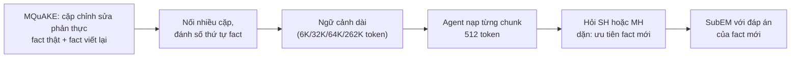

# Benchmark: MemoryAgentBench, bộ FactConsolidation (2507.05257)

Mục đích ghi chú: đánh giá FactConsolidation có phù hợp làm benchmark so sánh cho Cơ chế 3 (Conflict Resolution: fact mới đè fact cũ, "Evolution ≠ Falsehood") của đồ án hay không. Bốn năng lực còn lại của MemoryAgentBench chỉ tóm tắt ngắn.

## 1. Thông tin chung & Tài nguyên

- **Tiêu đề:** Evaluating Memory in LLM Agents via Incremental Multi-Turn Interactions (benchmark tên MemoryAgentBench).
- **Mã arXiv:** [2507.05257](https://arxiv.org/abs/2507.05257) (bản HTML: https://arxiv.org/html/2507.05257v1). Trang arXiv ghi "arXiv.org perpetual non-exclusive license" cho bài báo.
- **Mã nguồn (GitHub):** [HUST-AI-HYZ/MemoryAgentBench](https://github.com/HUST-AI-HYZ/MemoryAgentBench). Giấy phép MIT (theo trang repo).
- **Dữ liệu (HuggingFace):** [ai-hyz/MemoryAgentBench](https://huggingface.co/datasets/ai-hyz/MemoryAgentBench). Giấy phép MIT (theo dataset card), định dạng Parquet, khoảng 76.6 MB.
- **Ngôn ngữ:** tiếng Anh.
- **Lưu ý đọc nguồn:** phần nội dung bài báo đã đọc hết (kể cả phụ lục D.2, D.3); không thấy ví dụ fact cụ thể của FactConsolidation trong bài (xem mục 2).

## 2. Bộ dữ liệu

### 2.1. Bốn năng lực của MemoryAgentBench (tóm tắt)

Benchmark đưa ngữ cảnh dài vào agent theo từng đoạn (incremental multi-turn, tức nạp từng chunk như các lượt hội thoại) rồi mới hỏi.

| Năng lực | Ý nghĩa | Bộ dữ liệu |
|---|---|---|
| Accurate Retrieval (AR) | Tìm đúng thông tin nằm rải rác trong ngữ cảnh dài | RULER-QA, NIAH-MQ (needle-in-a-haystack nhiều truy vấn), ∞Bench-QA, LongMemEval (S\*), EventQA (mới) |
| Test-Time Learning (TTL) | Học nhiệm vụ mới ngay từ nội dung hội thoại | BANKING-77, CLINC-150, NLU, TREC Coarse/Fine, Movie-Rec (Redial) |
| Long-Range Understanding (LRU) | Hiểu tổng quát toàn bộ đầu vào dài | ∞Bench-Sum |
| **Conflict Resolution (CR)** | Phát hiện mâu thuẫn, ghi đè fact cũ | **FactConsolidation-SH, FactConsolidation-MH** (cả hai do tác giả tự xây) |

### 2.2. FactConsolidation

- **Hai biến thể**, mỗi biến thể **100 câu hỏi** (lấy từ câu hỏi gốc của MQuAKE):
  - **SH (single-hop):** nhớ trực tiếp một fact đã bị ghi đè.
  - **MH (multi-hop):** phải suy luận qua nhiều fact, trong đó có fact bị ghi đè.
- **Cách xây:** từ các cặp chỉnh sửa phản thực (counterfactual edit, tức viết lại một fact thật thành phiên bản mâu thuẫn có chủ đích) của MQuAKE (bộ dữ liệu đánh giá chỉnh sửa tri thức đa bước). Theo bài: mỗi cặp gồm một fact thật và một bản viết lại mâu thuẫn; bản viết lại đứng sau bản gốc để mô phỏng một lần cập nhật. Nhiều cặp được nối lại thành ngữ cảnh dài.
- **Đánh số thứ tự:** mỗi câu (fact) có một số thứ tự; fact cũ có số nhỏ, fact mới có số lớn; các câu được nối theo thứ tự số.
- **Chỉ dẫn cho agent:** được dặn ưu tiên thông tin đến sau khi có mâu thuẫn và suy luận dựa trên "trạng thái bộ nhớ cuối cùng" (final memory state). Phụ lục B.2 có prompt mẫu dạng "knowledge pool" gồm fact đánh số; câu hỏi minh họa trong prompt mẫu là "what is the name of the current president of Country R?" với đáp án "Person D" (đây chỉ là ví dụ minh họa trong prompt, không phải mẫu dữ liệu thật).
- **Độ dài ngữ cảnh:** văn bản chính nêu khoảng 32K, 64K, 262K token (Table 11 cũng vậy). Mức 6K chỉ xuất hiện ở Table 3 (kiểm chứng o4-mini trên "bản nhỏ hơn" của bộ dữ liệu). Chia chunk khi nạp: 512 token cho tác vụ CR (Mem0 và Cognee dùng 4096 cho mọi bộ vì tốn thời gian).
- **Định dạng và khả năng tải:** trên HuggingFace, một dataset duy nhất với 4 split `Accurate_Retrieval` (22 dòng), `Test_Time_Learning` (6), `Long_Range_Understanding` (110), `Conflict_Resolution` (8). Mỗi dòng có `context` (chuỗi rất dài), `questions` (danh sách 60-100 câu), `answers` (danh sách danh sách đáp án), `metadata` (có `qa_pair_ids`, ...). Tải bằng `load_dataset("ai-hyz/MemoryAgentBench")`, split `Conflict_Resolution`.
  - 8 dòng của split CR khớp với 2 biến thể x 4 mức độ dài (6K/32K/64K/262K); đây là **suy luận của mình, chưa xác nhận** (dataset card không nêu tên cấu hình).
- **Ví dụ thật:** **chưa có.** Bài báo không in mẫu fact nào của FactConsolidation; dataset card chỉ hiện một dòng xem trước, không xác nhận được thuộc FactConsolidation (ngữ cảnh bắt đầu "Document 1: Tread Softly Stranger", câu hỏi so sánh quốc tịch đạo diễn, đáp án "yes"/"no"), nên không dùng làm ví dụ. Cần tải split `Conflict_Resolution` và in ra trước khi chốt.

Minh họa cấu trúc (tự dựng theo mô tả trong bài, **không phải dữ liệu thật**):

```
[12] The head of government of Country R is Person A.
...
[847] The head of government of Country R is Person D.     <- số lớn hơn, ghi đè [12]
Q (SH): Who is the head of government of Country R?  ->  Person D
```



## 3. Chỉ số đo

- **SubEM (substring exact match):** theo bài, "đo xem câu trả lời dự đoán có khớp chính xác đáp án chuẩn dưới dạng chuỗi con hay không". Hiểu cụ thể: câu trả lời đạt 1 điểm nếu chứa đáp án chuẩn như một chuỗi con, ngược lại 0; điểm là tỉ lệ phần trăm trên 100 câu. Chi tiết chuẩn hóa chuỗi (chữ hoa/thường, dấu câu) và cách xử lý khi có nhiều đáp án chấp nhận được: **chưa rõ** (README repo chỉ ánh xạ `fact_sh`, `fact_mh` sang `substring_exact_match`, không định nghĩa).
- Hệ quả: câu trả lời dài liệt kê cả giá trị cũ lẫn mới vẫn có thể được tính đúng nếu chứa đáp án mới (SubEM không phạt việc nhắc thêm giá trị cũ). Đây là suy luận từ định nghĩa, chưa kiểm bằng chạy thử.

## 4. Baseline và số công bố

Table 2 của bài, điểm SubEM (%) của cột CR, đúng trên 100 câu mỗi bộ (nên 1 câu = 1 điểm).

| Hệ thống | Loại | FactCon-SH | FactCon-MH |
|---|---|---:|---:|
| GPT-4o | Long-context | 60.0 | 5.0 |
| GPT-4o-mini | Long-context | 45.0 | 5.0 |
| GPT-4.1-mini | Long-context | 36.0 | 5.0 |
| Gemini-2.0-Flash | Long-context | 30.0 | 3.0 |
| Claude-3.7-Sonnet | Long-context | 43.0 | 2.0 |
| BM25 | RAG đơn giản | 56.0 | 3.0 |
| NV-Embed-v2 | RAG embedding | 55.0 | 6.0 |
| HippoRAG-v2 | RAG có cấu trúc (graph) | 54.0 | 5.0 |
| MemGPT | Agentic memory | 28.0 | 3.0 |
| Mem0 | Agentic memory | 18.0 | 2.0 |

(Bảng đầy đủ còn Contriever, Text-Embed-3-Small/Large, RAPTOR, GraphRAG, Cognee, Self-RAG, không nêu lại ở đây.) Bài không nêu rõ trong bảng này mỗi số ứng với mức độ dài nào, hay là trung bình các mức: **chưa rõ**.

- Tác giả: không phương pháp nào vượt khoảng 6% ở MH; chỉ long-context agent đạt mức tạm được ở SH.
- **Kiểm chứng với o4-mini (Table 3, 6K / 32K token):** GPT-4o: SH 92.0 / 88.0, MH 28.0 / 10.0. o4-mini: SH 100.0 / 61.0, MH 80.0 / 14.0. Mô hình suy luận làm tốt MH ở 6K (80%) nhưng sụt còn 14% ở 32K.
- **Công trình theo sau (chưa xác nhận kỹ):** trang alphaxiv 2606.01435 hiện ghi tiêu đề "Reliable Post-Retrieval Assembly for Agent Memory: Separating Evidence Extraction from Policy Execution" (Reddy và Challaram, IIT Kharagpur), BibTeX lại ghi "Don't Ask the LLM to Track Freshness". Tác giả báo ở 262K: SH 82%/93%, MH 27%/41% (gpt-4o-mini/gpt-4o), với pipeline tách bước trích bằng chứng và bước áp chính sách trả lời. Trang **không** dùng cụm "version-aware aggregation"; gần nhất là "freshness operator" với metadata phiên bản tường minh, và tác giả nói phần lớn mức tăng đến từ việc tách hai bước, không phải từ freshness operator (đổi riêng bước chính sách chỉ +2.0 điểm trung bình, 0 điểm ở 262K). Lưu ý: số "+28 điểm MH so với HippoRAG-v2" nêu trong yêu cầu chưa thấy khớp trên trang; chưa kiểm bản đầy đủ của bài.

## 5. Ưu điểm / Nhược điểm

**Ưu điểm**
- Có nhãn đáp án rõ ràng, chấm tự động (SubEM), không cần LLM judge.
- Bảng điểm công bố cho nhiều hệ thống (long-context, RAG, graph, agentic memory), có thể so ngay mà không chạy lại baseline.
- Đúng bản chất "fact mới đè fact cũ" và có sẵn tín hiệu thứ tự (số thứ tự fact), MIT, tải dễ.
- Có hai độ khó (SH/MH) và nhiều độ dài ngữ cảnh, đo được độ suy giảm theo kích thước.

**Nhược điểm**
- **Nhỏ:** mỗi bộ chỉ 100 câu, sai số lấy mẫu lớn (1 câu = 1 điểm); các điểm MH 2-6% chỉ cách nhau vài câu nên không có ý nghĩa thống kê để xếp hạng.
- **Dữ liệu phản thực tổng hợp**, không phải sự kiện thật thay đổi theo thời gian; chính tác giả ghi benchmark chủ yếu tổng hợp. Fact viết lại có thể phi thực tế.
- **Thứ tự thay cho mốc thời gian thật:** không có ngày, không có khoảng hiệu lực, không có trường hợp "sai từ đầu" khác với "tiến hóa". Mọi mâu thuẫn đều mang nghĩa "cái sau thắng", nên không đo được Evolution ≠ Falsehood.
- **MH quá khó, khó phân biệt:** gần như mọi hệ thống chạm sàn (≤ 6%), nên MH không cho tín hiệu để so sánh trừ khi hệ thống đạt đột phá.
- Prompt dặn rõ "ưu tiên fact mới", nên thực chất đo khả năng làm theo chỉ dẫn và suy luận trên bộ nhớ, không phải khả năng tự biết nguồn nào đáng tin.
- Khả năng nhiễm tri thức tham số (LLM tự biết đáp án thật) bị đảo ngược do fact viết lại là phản thực: LLM dễ trả fact thật cũ thay vì fact đã bị ghi đè; điều này làm bài khó theo cách khác với dữ liệu thật.

## 6. Áp dụng vào đồ án

### 6.1. Ánh xạ khái niệm

| FactConsolidation | Đồ án (`docs/design/01_INITIAL_BASE_DESIGN.md` mục 2.1, 3.3) |
|---|---|
| Fact cũ bị fact mới ghi đè | "Tiến hóa": đóng `end_time` của chunk cũ, tạo chunk mới, cạnh `SUPERSEDES` |
| Số thứ tự fact | Không có tương đương trực tiếp; dùng làm nguồn cho `start_time` giả |
| Đáp án = fact mới nhất | Truy vấn "hiện tại" ≈ `T_req = T_now`, lọc `end_time` rỗng và `invalidated_at` rỗng (Cơ chế 3 theo `decisions/09`) |
| (không có) | Fact sai từ đầu: `invalidated_at` + `CORRECTS`; cáo buộc: `SUSPECTS` |
| (không có) | Truy vấn lịch sử (loại 2 trong `decisions/09`): Cơ chế 1 lọc `start_time <= T_req` |

Chỉ phần "Evolution" (đóng `end_time`) được chạm tới; phần "Falsehood" và truy vấn lịch sử không có trong bộ này.

### 6.2. Cách chạy hệ thống đồ án trên bộ này

1. Tách `context` thành từng fact đánh số theo quy tắc của bộ (cách tách chính xác từ chuỗi `context`: chưa rõ, cần xem dữ liệu thật).
2. Gán `start_time` giả theo thứ tự số (ví dụ fact thứ i có `start_time` = ngày cơ sở + i ngày) để ép Ingestion Agent hiểu "đến sau = mới hơn".
3. Ingestion: với mỗi fact mới cùng (chủ thể, quan hệ) với fact cũ, đóng `end_time` của fact cũ và nối `SUPERSEDES`. Đây là chỗ cần trích (chủ thể, quan hệ) bằng LLM hoặc quy tắc; bộ này chỉ có câu văn tự do nên **không có khóa sẵn**.
4. Truy vấn: `T_req = T_now` (cuối chuỗi); lọc cứng `invalidated_at IS NULL` và `end_time` rỗng; MH thì cần thêm bước suy luận nhiều bước (Cơ chế 2 hoặc agent lặp), vì Cơ chế 3 một mình chỉ chọn đúng fact mới cho từng quan hệ.

**Hệ quả của `start_time` giả theo thứ tự:**
- Hệ thống đồ án được hưởng tín hiệu thứ tự rất sạch (đúng bằng thông tin mà baseline cũng có qua số thứ tự trong prompt), nhưng thông tin "ai là thực thể trùng khóa" vẫn phải tự phát hiện, nên điểm số chủ yếu đo độ chính xác của bước phát hiện trùng khóa (entity/relation matching), không đo xử lý thời gian thật.
- Các thành phần thời gian của đồ án (half-life decay, `Temporal_Score`, relative time `T_now`) hầu như không được kích hoạt, vì không có ngày thật và không có câu hỏi "năm X". Cơ chế 1 chỉ dùng được ở dạng lọc "mới nhất".

### 6.3. Chỉ số tương ứng

- **SubEM** để so với bảng công bố (mục 4).
- Tương đương trong đồ án: **Temporal Freshness** (EM, câu loại 1 trong `decisions/09`). Các chỉ số còn lại của đồ án (Historical retention, False-invalidation rate, độ chính xác phân loại Evolution/Falsehood) **không đo được** trên bộ này vì không có câu hỏi lịch sử, không có đối chứng không đổi và không có nhãn Evolution/Falsehood.
- Chi phí: số chunk, số lần gọi LLM, token ngữ cảnh (đồ án có đo; bài gốc không công bố số tương ứng: chưa rõ).

### 6.4. Phần không so sánh công bằng

- Baseline trong bảng chạy với chunk 512 token và prompt dặn ưu tiên fact mới; nếu đồ án thêm bước ingestion bằng LLM (tốn gọi LLM) hay gán `start_time` giả, điều kiện khác baseline (baseline không có metadata thời gian ngoài số thứ tự).
- Backbone LLM khác (bảng dùng GPT-4o, GPT-4o-mini, ... và embedding OpenAI/NV-Embed-v2); đồ án dùng stack khác, nên chênh điểm trộn lẫn tác động của mô hình nền và của cơ chế. Muốn công bằng phải chạy lại ít nhất một baseline (BM25 hoặc RAG thuần) với cùng LLM.
- MH: mọi số công bố sát sàn nên "hơn baseline" ở MH không đủ để kết luận.
- SH/MH và mức độ dài của từng con số trong Table 2: chưa rõ (xem mục 4), phải chạy lại hoặc đối chiếu bản mới nhất của repo.

### 6.5. So sánh hai nguồn dữ liệu cho Cơ chế 3

| Tiêu chí | FactConsolidation | Wikipedia revision thật (`docs/eval/06_WIKI_REVISION_CRAWL.md`, `docs/decisions/09_CONFLICT_RESOLUTION_SCOPE.md`) |
|---|---|---|
| Bản chất thay đổi | Phản thực tổng hợp, theo thứ tự | Sự kiện thật thay đổi; nhãn từ lịch sử Wikidata (kế hoạch) |
| Mốc thời gian | Số thứ tự, không có ngày | Có ngày chỉnh sửa thật; mốc chunk theo thời điểm sự kiện (Wikidata) |
| Evolution vs Falsehood | Không phân biệt | Có cả hai, nhưng "sai từ đầu" nhiễu: 961 ứng viên, khoảng 10-15% là sửa sự thật rõ ràng (mẫu 40, một người đọc) |
| Quy mô | 2 x 100 câu | Dự kiến 100-150 cặp S0/S1; bộ 400 câu hiện có từ TimeQA (chưa có nhãn cho cập nhật) |
| So với hệ khác | Có bảng công bố sẵn | Phải tự chạy baseline (Plain RAG, replace-all, keep-all-snapshots) |
| Nhiễm tri thức tham số | Đảo ngược (LLM dễ nghiêng về fact thật cũ) | LLM đã biết nhiều nội dung Wikipedia nên freshness có thể cao giả |
| Chi phí nạp / so hash | Không có khái niệm | Trọng tâm: ~98% chunk giữ nguyên sau một lần sửa nhỏ, chỉ 37% sau khoảng cách dài |
| Lịch sử vs replace-all | Không đo được | 88.5-94.5% đáp án cũ vẫn còn trong trang hiện tại (replace-all chỉ mất tối đa khoảng 5.5-11.5%) |

Nhận định: hai nguồn bổ sung nhau chứ không thay thế. FactConsolidation là "cổng so sánh với văn liệu" (có số công bố, kiểm tra được cơ chế đóng `end_time` chạy đúng với tín hiệu thứ tự sạch); Wikipedia mới là nơi đo được các luận điểm riêng của đồ án (Evolution ≠ Falsehood, giữ lịch sử, chi phí nạp, truy vấn lịch sử). Vì `decisions/09` ghi Cơ chế 3 có thể không rẻ hơn replace-all rõ rệt trên Wikipedia, FactConsolidation cho thêm một kịch bản mà replace-all thua rõ (nạp liên tiếp các fact mâu thuẫn trong cùng ngữ cảnh), nhưng đó chỉ là kết luận giả thuyết chưa thử.

## 7. Chỗ chưa xác nhận

1. Ví dụ dữ liệu thật của FactConsolidation (chưa tải split `Conflict_Resolution` để in ra).
2. Tên cấu hình/mức độ dài trong split CR; việc 6K có nằm trong 8 dòng hay không (mới suy từ 8 = 2 x 4).
3. Mỗi số trong Table 2 ứng với mức độ dài nào hay là trung bình.
4. Chuẩn hóa chuỗi chính xác của SubEM và cách xử lý nhiều đáp án chấp nhận được.
5. Cách tách `context` thành từng fact và định dạng đánh số (ví dụ có tiền tố số thứ tự thế nào).
6. Trạng thái bài 2606.01435: tiêu đề khác giữa trang và BibTeX, chưa thấy cụm "version-aware aggregation" và con số "+28 điểm MH so với HippoRAG-v2"; cần đọc bản đầy đủ.
7. Chi phí/token của các baseline trong bài gốc: chưa rõ.
8. Bài báo mới đọc ở bản v1; chưa kiểm xem có bản cập nhật (số liệu, tên bộ dữ liệu) trên repo/HuggingFace (changelog trên dataset card có nhắc đổi tên trường `uuid` thành `qa_pair_ids`).
