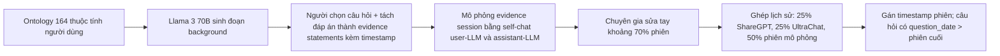
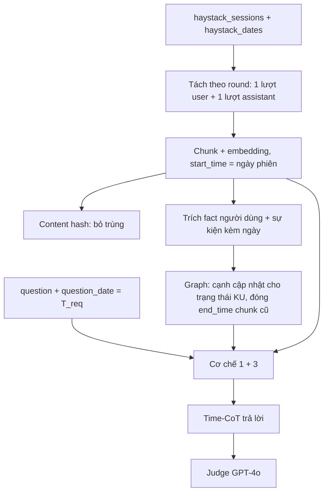

# Ghi chú benchmark: LongMemEval (2410.10813)

Mục đích file: đánh giá LongMemEval có phù hợp làm benchmark để so sánh hệ thống Time-Aware Agentic Memory của đồ án với các hệ thống memory (Zep, Mem0, ...) hay không. Nhóm `temporal-reasoning` liên quan Cơ chế 1, nhóm `knowledge-update` liên quan Cơ chế 3.

Nguồn đọc trực tiếp: PDF arXiv v2 (bản ICLR 2025). Các số của Zep lấy từ ghi chú sẵn có `07_Zep_Graphiti_Temporal_KG.md` §4.2 (xem [Zep](../../knowledge_representation_and_integration/07_Zep_Graphiti_Temporal_KG.md) và [Mem0](../../knowledge_representation_and_integration/08_Mem0_Agent_Memory.md)).

## 1. Thông tin chung & Tài nguyên

| Mục | Nội dung |
|---|---|
| Tiêu đề | LongMemEval: Benchmarking Chat Assistants on Long-Term Interactive Memory |
| Tác giả | Di Wu, Hongwei Wang, Wenhao Yu, Yuwei Zhang, Kai-Wei Chang, Dong Yu (UCLA, Tencent AI Lab Seattle, UC San Diego) |
| arXiv | [2410.10813](https://arxiv.org/abs/2410.10813) (bản v2, 4/3/2025) |
| Venue | ICLR 2025 (conference paper) |
| GitHub | [xiaowu0162/LongMemEval](https://github.com/xiaowu0162/LongMemEval) |
| Giấy phép | Code/repo: MIT (theo README đã kiểm). Bài báo: CC BY 4.0 (theo thông tin đã kiểm). Paper nói dữ liệu hội thoại nền lấy từ ShareGPT (Apache 2.0) và UltraChat (MIT) và dự định phát hành dữ liệu theo giấy phép MIT |
| Ngôn ngữ | Tiếng Anh (paper không nêu ngôn ngữ khác) |
| Phạm vi | Hội thoại cá nhân giữa người dùng và trợ lý AI (không phải Wikipedia/tin tức) |

Paper đề xuất thêm một khung ba giai đoạn (indexing, retrieval, reading) cùng các tối ưu: session decomposition (tách phiên thành từng lượt hỏi-đáp), fact-augmented key expansion (mở rộng khóa chỉ mục bằng fact trích từ nội dung), time-aware query expansion (suy ra khoảng thời gian từ câu hỏi để lọc truy xuất). Mức giảm khoảng 30% độ chính xác của trợ lý thương mại và long-context LLM (LLM đọc ngữ cảnh rất dài) khi phải nhớ qua nhiều phiên là kết quả mở đầu của paper.

## 2. Bộ dữ liệu

### 2.1. Quy mô và năng lực

- 500 câu hỏi do con người tạo/chỉnh tay, mỗi câu gắn với một lịch sử chat user-assistant dài.
- 5 năng lực lõi (paper §3.2): information extraction (IE, nhớ chi tiết cụ thể do người dùng hoặc trợ lý nói), multi-session reasoning (MR, tổng hợp/so sánh qua nhiều phiên), knowledge updates (KU, nhận ra thông tin cá nhân của người dùng đã đổi và cập nhật), temporal reasoning (TR, nhận thức khía cạnh thời gian, gồm cả lời nhắc thời gian trong hội thoại và timestamp metadata của phiên), abstention (ABS, từ chối trả lời "tôi không biết" khi thông tin không được nhắc tới).
- Lưu ý khác biệt về số đếm: Abstract nói "5 năng lực", Figure 1 nói "seven question types", còn dữ liệu có 6 giá trị `question_type`. Lý do: abstention không phải một `question_type` riêng mà là 30 câu rút từ các loại khác rồi sửa thành "câu hỏi tiền đề sai" (false premise), nhận diện qua hậu tố `_abs` trong `question_id` (README). Sáu `question_type`: `single-session-user`, `single-session-assistant`, `single-session-preference`, `multi-session`, `knowledge-update`, `temporal-reasoning`.

### 2.2. Số câu từng loại

Paper không in bảng số câu; Figure 9a chỉ có biểu đồ tròn theo tỉ lệ phần trăm. README cũng không ghi số câu. Số câu dưới đây là quy đổi từ phần trăm (làm tròn, 500 câu), nên chỉ là xấp xỉ:

| question_type | Tỉ lệ (Figure 9a) | Quy đổi xấp xỉ | Năng lực chính |
|---|---|---|---|
| single-session-user | 14% | khoảng 70 | IE |
| single-session-assistant | 11% | khoảng 55 | IE |
| single-session-preference | 6% | khoảng 30 | IE (cá nhân hóa) |
| multi-session | 27% | khoảng 135 | MR |
| knowledge-update | 16% | khoảng 80 | KU |
| temporal-reasoning | 27% | khoảng 135 | TR |

Số câu chính xác từng loại: chưa rõ từ paper và README. Kiến thức nhớ của người viết ghi chú là 70/56/30/133/78/133 (tổng 500) nhưng **chưa kiểm chứng**; phải đếm trực tiếp từ file JSON khi tải về (một dòng script đếm `question_type`) trước khi đưa vào báo cáo. Cũng cần đếm riêng 30 câu `_abs` vì chúng nằm lẫn trong các loại trên.

### 2.3. Ba biến thể

| Biến thể | File (README) | Quy mô lịch sử | Ghi chú |
|---|---|---|---|
| LongMemEval_S | `longmemeval_s_cleaned.json` | khoảng 115k token mỗi câu (khoảng 40 phiên theo thông tin đã kiểm; paper chỉ nói "~50 sessions" ở §3.4, hai con số lệch nhau nên coi là chưa rõ chính xác) | cấu hình chuẩn để so sánh |
| LongMemEval_M | `longmemeval_m_cleaned.json` | 500 phiên, khoảng 1,5M token mỗi câu | khó hơn nhiều, ít hệ thống báo cáo |
| Oracle | `longmemeval_oracle.json` | chỉ các phiên bằng chứng (evidence sessions) | cận trên để tách lỗi đọc khỏi lỗi truy xuất |

Mỗi file 500 mẫu. Hậu tố `_cleaned` cho thấy file đã được thay/làm sạch so với bản đầu; ghi chú 07 nhắc file bị thay tháng 9/2025 nên điểm cũ/mới có thể không so được (chưa kiểm chứng).

### 2.4. Định dạng JSON

Trường mỗi mẫu (theo thông tin đã kiểm từ README): `question_id`, `question_type`, `question`, `answer`, `question_date`, `haystack_session_ids`, `haystack_dates`, `haystack_sessions`, `answer_session_ids`, và trong từng lượt hội thoại có cờ `has_answer` đánh dấu lượt chứa bằng chứng. Mỗi phiên là danh sách các lượt `role`/`content`. Về mặt hình thức paper (§3.1) mô tả mỗi mẫu là bộ 4 `(S, q, t_q, a)` với `S = [(t_1,S_1),...,(t_N,S_N)]` là các phiên xếp theo thời gian, `t_q > t_N` là ngày đặt câu hỏi. Tên trường cụ thể ngoài danh sách trên: chưa rõ (chưa mở file thật).

### 2.5. Cách xây dựng (paper §3.2, Phụ lục A)

- Khoảng 1000 câu được sinh cho mỗi loại, tỉ lệ giữ lại cuối khoảng 5% sau lọc/sửa tay. Khoảng 400 giờ công cho xây dữ liệu.
- Người dùng giả (user LLM) được dặn nói gián tiếp (ví dụ hỏi bảo hiểm xe thay vì nói "tôi vừa mua xe"), nên bằng chứng bị ẩn.
- Timestamp: nếu evidence statement đã có timestamp định trước thì dùng làm mốc neo (anchor) cho các phiên không phải bằng chứng; nếu không thì gán ngẫu nhiên trong tháng 5/2023.
- Phiên nhiễu (haystack) được chọn để ít mâu thuẫn với bằng chứng, nên benchmark có ít xung đột nhân tạo ngoài các cặp KU được thiết kế.
- Đa số câu cần bằng chứng từ nhiều phiên (tối đa 6; Figure 9b); bằng chứng thường nằm đầu phiên (Figure 9c).

### 2.6. Khả năng tải

Repo README hướng dẫn tải ba file JSON (chi tiết link tải/Hugging Face: chưa rõ, cần mở README khi tải). Dữ liệu công khai, không cần xin quyền theo thông tin đã kiểm. Chạy chấm bằng `evaluate_qa.py` với `gpt-4o` (cần API key OpenAI, có chi phí).

### 2.7. Ví dụ (từ Figure 1 của paper)

Ví dụ `temporal-reasoning` (phải tính khoảng thời gian từ ngày phiên):
- Phiên 1/22: "I went to behind-the-scenes tour of the Science Museum today with a friend who's a chemistry professor."
- Phiên 3/11: "I attended a guided tour at the Natural History Museum yesterday with my dad."
- Phiên 4/18: "I just learned a lot in a lecture at the History Museum about ancient civilizations this month."
- Câu hỏi (hỏi vào 6/25): "How many months have passed since my last museum visit with a friend?" Đáp án: 5 tháng.
- Điểm đáng chú ý cho đồ án: cần dùng ngày của phiên (1/22) và ngày hỏi (6/25) cùng lời nhắc tương đối ("today", "yesterday") để suy ra mốc tuyệt đối, rồi lọc theo người đi cùng.

Ví dụ `knowledge-update`:
- Phiên cũ: người dùng kể kỳ nghỉ gia đình ở Hawaii "last month".
- Phiên mới: "I'm actually thinking of going to Paris. We just went there as a family last week."
- Câu hỏi: "Where did I go on my most recent family trip?" Đáp án: Paris.
- Điểm đáng chú ý: hai sự kiện đều đúng ở thời điểm của chúng; câu hỏi chỉ đòi "gần nhất". Đây là kiểu cập nhật trạng thái, không phải tin sai.

## 3. Chỉ số đo

- Question answering: LLM-as-judge (dùng một LLM làm giám khảo), cụ thể `gpt-4o-2024-08-06` qua OpenAI API, trả về "yes"/"no" theo prompt riêng từng loại (Figure 10). Báo cáo `accuracy` = tỉ lệ câu được chấm yes, theo từng `question_type` và tổng. Paper nói đối chiếu với chuyên gia người cho độ đồng thuận hơn 97% (meta-evaluation), và ở Phụ lục A.4 lấy 30 câu mỗi loại, độ chính xác của judge từ 90% trở lên mọi cấu hình, lệch nhẹ ở single-session-preference và abstention.
- Quy tắc chấm theo loại (trích ý từ Figure 10):
  - `temporal-reasoning`: không phạt lỗi lệch 1 (off-by-one) khi hỏi số ngày/tuần/tháng; trả lời chỉ chứa một phần các bước trung gian thì sai.
  - `knowledge-update`: đúng nếu câu trả lời chứa cả thông tin cũ lẫn đáp án mới, miễn đáp án mới là cái được hỏi. Hệ quả: hệ thống trả cả "Hawaii và Paris" vẫn được tính đúng, nên benchmark không phạt việc không loại bỏ thông tin cũ. Điểm này khác tinh thần Cơ chế 3 của đồ án (đóng `end_time`), cần lưu ý ở mục 6.
  - `single-session-preference`: chấm theo rubric, không cần thỏa mọi ý.
- Truy xuất (memory recall): vì có nhãn vị trí đáp án do người gán, nếu hệ thống lộ kết quả truy xuất thì tính `Recall@k` và `NDCG@k` (k là số mục top được truy xuất). Paper không định nghĩa công thức riêng; coi là Recall@k/NDCG@k chuẩn trên các phiên/lượt chứa bằng chứng (round-level hoặc session-level tùy granularity). Định nghĩa cụ thể từng công thức: chưa rõ.
- Không có Exact Match/F1; chỉ accuracy theo judge.

## 4. Baseline và số công bố

### 4.1. Trong paper LongMemEval (tự đọc từ PDF, độ tin cậy cao)

Trợ lý thương mại, mẫu nhỏ (Figure 3a): 97 câu ngẫu nhiên, lịch sử rút gọn còn 3-6 phiên (khoảng 10 lần ngắn hơn bản S), đánh giá trong hai tuần đầu tháng 8/2024. Không phải bộ 500 câu đầy đủ.

| Hệ thống | LLM | Accuracy |
|---|---|---|
| Offline Reading (đưa toàn bộ lịch sử vào context) | GPT-4o | 0,9184 |
| ChatGPT | GPT-4o | 0,5773 |
| ChatGPT | GPT-4o-mini | 0,7113 |
| Coze | GPT-4o | 0,3299 |
| Coze | GPT-3.5-turbo | 0,2474 |

Long-context LLM (Figure 3b), accuracy trên Oracle (chỉ phiên bằng chứng) so với S (khoảng 115k token), trên toàn 500 câu, không Chain-of-Note (CoN, bắt LLM tóm ghi chú từng mục trước khi trả lời):

| Mô hình | Oracle | S | Giảm |
|---|---|---|---|
| GPT-4o | 0,870 | 0,606 | 30,3% |
| Llama 3.1 Instruct 70B | 0,744 | 0,334 | 55,1% |
| Llama 3.1 Instruct 8B | 0,710 | 0,454 | 36,1% |
| Phi-3 128k Instruct 14B | 0,702 | 0,380 | 45,9% |
| Phi-3.5 Mini Instruct 4B | 0,660 | 0,342 | 48,1% |

Với CoN: GPT-4o Oracle 0,924, S 0,640 (giảm 30,7%); Llama 3.1 70B 0,848 và 0,286; 8B 0,710 và 0,420; Phi-3 0,722 và 0,344; Phi-3.5 Mini 0,652 và 0,324. Paper không báo số theo từng `question_type` cho các bảng này trong phần chính (có thể có ở phụ lục E mà bản trang 1-20 tôi đọc không bao gồm: chưa rõ).

Cấu hình RAG của paper (Table 3, trên LongMemEval_M, retriever Stella V5 1,5B, reader dùng Chain-of-Note và định dạng JSON). Trích một số dòng đại diện (Recall@5 / NDCG@5 / Recall@10 / NDCG@10, rồi accuracy GPT-4o Top-5 / Top-10):

| Value | Key | R@5 | N@5 | R@10 | N@10 | GPT-4o Top-5 | Top-10 |
|---|---|---|---|---|---|---|---|
| Round | K = V | 0,582 | 0,481 | 0,692 | 0,512 | 0,615 | 0,670 |
| Round | K = V + fact | 0,644 | 0,498 | 0,784 | 0,536 | 0,657 | 0,720 |
| Session | K = V | 0,706 | 0,617 | 0,783 | 0,638 | 0,670 | 0,676 |
| Session | K = V + fact | 0,732 | 0,620 | 0,862 | 0,652 | 0,714 | 0,700 |

Paper kết luận: mở rộng key bằng fact trích ra tăng trung bình 9,4% recall@k và 5,4% accuracy cuối. Time-aware query expansion (Table 4, tập con temporal reasoning của bản M) tăng recall trung bình 11,3% (value=round) và 6,8% (value=session) khi LLM trích khoảng thời gian là GPT-4o; Llama 3.1 8B làm bước này kém (hay bỏ sót hoặc bịa mốc thời gian). Ví dụ Value=Session, K=V+fact: Recall@5 0,684 (không mở rộng), 0,722 (mở rộng bằng GPT-4o), 0,677 (mở rộng bằng Llama 8B). Lưu ý: mức tăng này tính trên recall, không phải accuracy cuối. Thêm nữa, Figure 6 (oracle retrieval, GPT-4o): CoN + JSON đạt 0,924 so với 0,822-0,862 các cấu hình khác.

### 4.2. Số do bên thứ ba báo cáo (Zep)

Nguồn: bài báo Zep (arXiv) và blog Zep https://blog.getzep.com/state-of-the-art-agent-memory/ , qua ghi chú 07 §4.2. Đây là **số tự báo cáo của vendor**, phiên bản LongMemEval_S, chấm GPT-4o bằng prompt của benchmark; độ tin cậy thấp-trung bình (không phải số độc lập).

| Loại | Model | Full-context | Zep |
|---|---|---|---|
| temporal-reasoning | gpt-4o | 45,1% | 62,4% |
| knowledge-update | gpt-4o | 78,2% | 83,3% |
| temporal-reasoning | gpt-4o-mini | 36,5% | 54,1% |
| knowledge-update | gpt-4o-mini | 76,9% | 74,4% |
| Tổng | gpt-4o | 60,2% | 71,2% |
| Tổng | gpt-4o-mini | 55,4% | 63,8% |

Zep dùng khoảng 1,6k token ngữ cảnh so với 115k của full-context, latency giảm khoảng 90% (theo ghi chú 07).

Đối chiếu với paper LongMemEval (không mâu thuẫn, nhưng cần nêu rõ):
- Full-context gpt-4o tổng 60,2% theo Zep so với 0,606 theo paper LongMemEval (GPT-4o, S, không CoN): gần nhau (chênh 0,4 điểm), nhiều khả năng do model/judge/phiên bản dữ liệu khác nhau. Không coi là mâu thuẫn, nhưng không nên trộn hai nguồn vào cùng một cột.
- Ghi chú 07 nêu hai dòng `single-session-user` giống hệt nhau giữa 4o-mini và 4o (không chắc, có thể sao chép nhầm); không dùng dòng này.
- Ghi chú 07 nêu rằng KU của Zep với 4o-mini giảm 3,36% so với full-context, nên "Zep hơn full-context" không đúng với mọi loại.
- Số tuyệt đối của Zep trên TR/KU **không** chứng minh lọc theo mốc `T_req` (Zep không hard filter, chỉ đưa date range vào context cho LLM), theo ghi chú 07.

### 4.3. Mem0 và hệ thống khác

Mem0 báo cáo trên LoCoMo (chứ không phải LongMemEval) trong ghi chú 08; số LoCoMo của Zep/Mem0 còn tranh cãi giữa hai bên (ghi chú 11). Số của Mem0 trên LongMemEval: chưa rõ (ghi chú 08 không có). Các hệ thống khác (ví dụ Supermemory, bài tổng hợp có bảng điểm): thấy trong kết quả tìm kiếm nhưng chưa đọc, nên chưa ghi số.

## 5. Ưu điểm / nhược điểm

Ưu điểm:
- Có nhóm TR và KU lớn (mỗi nhóm khoảng một phần tư/sáu của bộ), tách riêng, chấm riêng từng loại.
- Mỗi câu có `question_date` (ngày "bây giờ") và `haystack_dates` (ngày từng phiên): khớp với khái niệm `T_req` và `start_time` của đồ án.
- Có nhãn bằng chứng (`answer_session_ids`, `has_answer`) nên đo được truy xuất, không chỉ QA cuối.
- Cung cấp Oracle để tách lỗi truy xuất khỏi lỗi đọc; phiên bản S/M để tăng độ khó; được dùng bởi nhiều hệ thống (Zep, v.v.) nên có số tham chiếu.
- Chấm bằng prompt riêng từng loại, có meta-evaluation (>97% đồng thuận người).

Nhược điểm:
- Miền hội thoại cá nhân, khác miền Wikipedia/tin tức/pháp luật của đồ án; câu trả lời đến từ tuyên bố của người dùng, không có nguồn đa dạng hay độ tin cậy nguồn, nên không thử được phần credibility của Cơ chế 3.
- LLM-judge (GPT-4o) tốn chi phí, phụ thuộc phiên bản model; đổi judge có thể đổi điểm.
- Chỉ 500 câu, mỗi loại vài chục đến khoảng 135 câu; chênh vài điểm phần trăm có thể không có ý nghĩa thống kê (paper không báo khoảng tin cậy).
- Dữ liệu tổng hợp bằng LLM (Llama 3 70B mô phỏng) rồi sửa tay; 70% phiên bằng chứng phải sửa tay, có thể có artifact văn phong.
- KU chấm "đúng nếu có cả cũ lẫn mới" nên không đo được việc loại bỏ thông tin lỗi thời.
- Timestamp phiên nhiễu phần lớn gán ngẫu nhiên (tháng 5/2023 nếu không có mốc neo), nên đặc tính thời gian của lịch sử nền kém tự nhiên.
- Kích thước S (khoảng 115k) vẫn vừa context LLM hiện nay, nên khó phân biệt long-context với memory; M mới thật sự lớn nhưng tốn kém.

## 6. Áp dụng vào đồ án

### 6.1. Ánh xạ cơ chế

| LongMemEval | Cơ chế đồ án | Lý do khớp | Mức độ khớp |
|---|---|---|---|
| `temporal-reasoning` | Cơ chế 1 (Temporal Retrieval) | Cần lọc theo thời gian và tính khoảng cách từ ngày hỏi; time-aware query expansion của paper tương đương bước tìm `T_req`/khoảng thời gian | Trung bình: nhiều câu là tính toán khoảng thời gian, thứ tự sự kiện, không chỉ "lấy chunk đúng mốc" |
| `knowledge-update` | Cơ chế 3 (Conflict Resolution), nhánh Evolution | Trạng thái cũ đổi sang trạng thái mới (Hawaii rồi Paris): đúng "Evolution ≠ Falsehood", đóng cũ bằng `end_time` | Một phần: chỉ có evolution, không có falsehood/`invalidated_at`, không có đa nguồn |
| `multi-session` | Cơ chế 2 (Timeline) có thể liên quan | Tổng hợp qua nhiều phiên | Chưa đánh giá, ngoài trọng tâm |
| `abstention` (30 câu `_abs`) | Không thuộc cơ chế nào | Từ chối khi không có dữ liệu | Có thể dùng để kiểm tra chống hallucination, tùy chọn |

### 6.2. Ánh xạ schema (`docs/design/01_INITIAL_BASE_DESIGN.md` mục 2.1)

- `start_time` = ngày của phiên (`haystack_dates[i]`) hoặc, nếu nạp theo lượt, ngày phiên chứa lượt đó. Với sự kiện được nhắc tương đối trong hội thoại ("yesterday", "last week") thì `start_time` của sự kiện = ngày phiên trừ khoảng tương đối; cần quyết định `start_time` là ngày phát biểu hay ngày xảy ra sự kiện (đồ án đã nói đây là "thời điểm bắt đầu sự kiện hoặc có hiệu lực"). Gợi ý: lưu ngày phiên làm mốc phát biểu và, nếu trích được, ngày sự kiện riêng.
- `T_req` = `question_date`. Quy tắc đồ án "thời gian tương đối được giải bằng đồng hồ server `T_now`" khớp trực tiếp: với LongMemEval đặt `T_now = question_date` (chứ không phải ngày thật chạy thí nghiệm), để "last week"/"now" trong câu hỏi giải đúng.
- `end_time`: hội thoại không có `end_time` tự nhiên. Với KU, cần tác nhân ingestion phát hiện thay đổi trạng thái (ví dụ "chuyến đi gần nhất", "nơi ở hiện tại") và đóng `end_time` của chunk cũ bằng ngày phiên của chunk mới. Đây là phần cần xây thêm; nếu không, các chunk cũ vẫn `end_time = NULL` và Case 1 của Cơ chế 1 sẽ trả cả hai.
- `invalidated_at`: gần như không dùng cho LongMemEval (không có tin sai từ đầu). Không nên mô phỏng bằng KU.
- Hard filter `start_time <= T_req`: hữu ích, vì lịch sử LongMemEval luôn kết thúc trước `question_date`, nhưng gần như không cắt gì (mọi phiên đều trước ngày hỏi). Lợi ích thực sự của Cơ chế 1 ở đây là re-rank/chọn theo mốc tương đối, không phải loại bỏ tương lai.

### 6.3. Cách nạp

- Đơn vị chunk: paper cho thấy `round` (một cặp user-assistant) tốt hơn `session` cho GPT-4o khi dùng làm value (Figure 5), và bổ sung fact vào key giúp thêm. Gợi ý nạp: chunk theo round, key = nội dung + fact trích (khớp fact-augmented key expansion), đồng thời giữ `session_id` để truy ngược (Boomerang tới Chunk_ID). Chunk cấu trúc theo điều khoản của đồ án không áp dụng cho hội thoại; thay bằng chunk theo round.
- Content hashing: lịch sử nền từ ShareGPT/UltraChat ít trùng; ít tác dụng ở đây.
- Chỉ nạp phiên đến `question_date`: với mỗi câu hỏi thường nạp riêng lịch sử của câu đó (mỗi mẫu có haystack riêng). Chi phí nạp lớn: 500 câu x khoảng 115k token (bản S).

### 6.4. Chỉ số đồ án tương ứng

- Accuracy theo LLM-judge từng `question_type` (chỉ số chuẩn của benchmark), báo riêng TR và KU.
- Per-time-slice accuracy của đồ án: với LongMemEval có thể chia theo khoảng cách `question_date - ngày bằng chứng`, nhưng cần tự tính, benchmark không cung cấp.
- Recall@k/NDCG@k trên `answer_session_ids`/`has_answer` để so Cơ chế 1 với dense/BM25 thuần và với time-aware query expansion của paper.
- Token efficiency: so ngữ cảnh đưa vào LLM với 115k (full-context) và 1,6k (Zep).
- Temporal Freshness và coverage: chưa có định nghĩa tương ứng trên LongMemEval; cần tự định nghĩa nếu muốn dùng (ví dụ tỉ lệ trường hợp KU mà ngữ cảnh chứa chỉ trạng thái mới nhất).

### 6.5. Phần không so sánh công bằng

- Không đưa số Zep/Mem0/ChatGPT/Coze vào cùng bảng với số của đồ án như thể cùng điều kiện: khác model sinh/phiên bản judge/thời điểm chạy/phiên bản file (có `_cleaned`), số Zep là tự báo cáo (ghi chú 07 §6 cũng khuyến nghị không đưa số LongMemEval của Zep vào bảng kết quả chính). Cách công bằng: chạy mọi hệ thống (baseline RAG, đồ án, và nếu có thể Zep/Mem0 mã nguồn mở) trên cùng file, cùng LLM sinh, cùng judge, và báo rõ.
- Số trợ lý thương mại của paper chỉ trên 97 câu, lịch sử ngắn; không so sánh với 500 câu.
- Cơ chế 3 của đồ án (credibility đa nguồn, SUPERSEDES/CORRECTS/BÁC_BỎ, `invalidated_at`) hầu như không được kiểm bởi LongMemEval; chỉ kiểm nhánh Evolution một nguồn. Cần benchmark khác cho phần falsehood.
- KU chấm đúng nếu có cả cũ và mới: đồ án nên có thêm chỉ số tự định nghĩa (ví dụ "không nhắc lại giá trị cũ như hiện tại") nếu muốn chứng minh đóng `end_time`, nhưng khi đó không còn là điểm của benchmark gốc.

### 6.6. Rủi ro

- Miền khác: hội thoại cá nhân, tiếng Anh thân mật, bằng chứng gián tiếp; trích xuất fact/sự kiện tốt cho tin tức chưa chắc tốt cho chat.
- Chunk hội thoại không có `end_time` tường minh: cần suy luận thay đổi trạng thái; sai một lần có thể đóng nhầm hoặc bỏ sót (ghi chú 07 nêu rủi ro tương tự cho Zep: false-invalidation).
- Nhiều câu TR cần phép tính số học thời gian và thứ tự; nếu đồ án chỉ làm retrieval chứ không có bước lý luận Time-CoT thì điểm bị giới hạn bởi bước đọc (paper cho thấy oracle với CoN+JSON đạt 0,924 so với tối thiểu 0,822 cho GPT-4o, tức cách đọc ảnh hưởng đến 10 điểm).
- Chi phí chạy judge GPT-4o và nạp 500 lịch sử; có thể phải dùng tập con (ví dụ chỉ TR + KU) và nêu rõ khi báo cáo.
- Điểm Zep thay đổi theo ai chạy (ghi chú 07 §4.3: dao động lớn trên LoCoMo; về LongMemEval chỉ có số tự báo cáo); cần chạy lại.

## 7. Chỗ chưa xác nhận

- Số câu chính xác từng `question_type` (paper chỉ có phần trăm; số 70/56/30/133/78/133 chưa kiểm chứng; cần đếm từ JSON).
- Khoảng 40 phiên (thông tin xuất phát) so với "~50 sessions" (paper §3.4) cho bản S; cần đếm `haystack_sessions` trung bình.
- Tên trường chi tiết trong từng phiên/lượt, và hướng dẫn tải file (README, Hugging Face).
- Giấy phép bộ dữ liệu cụ thể: README ghi MIT cho repo; paper nói dự định phát hành dữ liệu theo MIT; nguồn dữ liệu nền ShareGPT (Apache 2.0) và UltraChat (MIT).
- Định nghĩa chính xác Recall@k/NDCG@k trong code (mức round hay session).
- Số theo từng `question_type` của long-context LLM và các cấu hình RAG của paper (có thể nằm ở phụ lục E, chưa đọc).
- Số Mem0 trên LongMemEval: chưa rõ.
- Các số của Zep là tự báo cáo, qua ghi chú 07; chưa đối chiếu lại với blog Zep gốc trong lần viết này.
- Ảnh hưởng của việc thay file tháng 9/2025 lên điểm cũ (chưa kiểm chứng, theo ghi chú 07).
