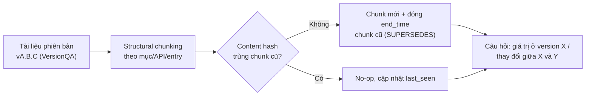

# Benchmark: VersionQA (từ bài báo VersionRAG, 2510.08109)

Mục đích ghi chú: đánh giá VersionQA có đáng dùng để so sánh với hệ thống của đồ án ở Cơ chế 3 hay không (tài liệu có phiên bản, sửa đổi cục bộ, chunk hết hạn). Trọng tâm là bộ dữ liệu, cách đo và số baseline; phương pháp VersionRAG chỉ tóm tắt ngắn.

## 1. Thông tin chung & Tài nguyên

- **Tiêu đề:** VersionRAG: Version-Aware Retrieval-Augmented Generation for Evolving Documents
- **Tác giả:** Huwiler, Stockinger, Fürst
- **Mã arXiv:** [2510.08109](https://arxiv.org/abs/2510.08109) (bản v1, 9/10/2025; [HTML](https://arxiv.org/html/2510.08109v1))
- **Mã nguồn / dữ liệu:** [github.com/danielhuwiler/versionrag](https://github.com/danielhuwiler/versionrag). Bài báo nói code và dataset VersionQA công khai tại đây. Repo tồn tại, công khai, 27 sao, 9 fork, chỉ 1 commit (kiểm tra qua WebFetch).
- **Giấy phép:** bài báo theo arXiv perpetual non-exclusive license. Giấy phép của code/dữ liệu: **chưa rõ** (trang repo không hiển thị).
- **Mirror không chính thức:** có một dataset Hugging Face `Kajaluxan/version-aware-rag-corpus` (gắn nhãn CC-BY-4.0), nhưng là upload riêng, **chưa xác nhận** đó là bản VersionQA chính thức. Không nên dùng làm nguồn.
- **Ngôn ngữ:** tiếng Anh.

## 2. Bộ dữ liệu: VersionQA

### 2.1. Quy mô và nguồn tài liệu

100 cặp QA do tác giả tuyển chọn thủ công (manually curated), trên 34 file tài liệu kỹ thuật có phiên bản, tổng hơn 700 trang (phụ lục ghi 710). Lĩnh vực: tài liệu phần mềm mã nguồn mở.

| Nguồn | Số file | Phiên bản | Số trang |
|---|---:|---|---:|
| Apache Spark (changelog) | 6 | 2.4.7 đến 3.5.5 | 150 |
| Bootstrap (changelog) | 6 | 5.2.3 đến 5.3.5 | 120 |
| Node.js Assert (doc) | 13 | 11.15.0 đến 23.11.0 | 260 |
| Node.js Errors (doc) | 9 | 15.14.0 đến 23.11.0 | 180 |

### 2.2. Sáu nhóm đánh giá

| Nhóm | Số câu | Nhạy cảm phiên bản | Ý nghĩa |
|---|---:|---|---|
| Content Retrieval | 20 | Không | Trích thông tin cơ bản |
| Content Retrieval Complex | 20 | Không | Tổng hợp nhiều mẩu thông tin |
| Content Retrieval Version-Specific | 20 | Có | Truy xuất đúng theo phiên bản được hỏi |
| Version Listing & Inquiry | 20 | Có | Hiểu metadata phiên bản (liệt kê, hỏi về phiên bản) |
| Change Retrieval (Explicit) | 10 | Có | Thay đổi có ghi trong changelog |
| Change Retrieval (Implicit) | 10 | Có | Thay đổi không được ghi rõ giữa các phiên bản (implicit change: phải tự suy ra bằng cách so hai phiên bản) |

60/100 câu nhạy cảm phiên bản. Trong bảng kết quả của bài báo, ba nhóm Content gộp lại thành "Content" (60 câu), Version Listing riêng (20), hai nhóm Change gộp thành "Change" (20).

### 2.3. Ví dụ câu hỏi (từ bài báo)

- Version-specific: "What is the stability level of assert.CallTracker in Node.js version 20.19.0?" (đáp án trong phụ lục: "Stability: 0 - Deprecated").
- Implicit change: "When was assert.deepEqual() removed?"
- Content thường: "What was fixed in Apache SPARK-31967?" (đáp án: sửa trang jobs UI mất 40 giây để tải).

### 2.4. Cách xây dựng, định dạng, khả năng tải

- Xây dựng: chọn tay tài liệu và viết cặp QA; chi tiết quy trình gán nhãn và kiểm tra chéo giữa người: **chưa rõ**.
- Định dạng: câu hỏi kèm đáp án tham chiếu dạng văn bản tự do (free-text), không có trường ngày/khoảng hiệu lực có cấu trúc. Tệp cụ thể trong `data/` của repo: **chưa rõ** (chưa mở được nội dung thư mục).
- Tải: lý thuyết clone từ GitHub; cần xác nhận bằng tay (mục 7).

## 3. Chỉ số đo

- **Accuracy** = số câu trả lời đúng / tổng số câu (100), cũng báo theo nhóm.
- "Đúng" do **LLM judge** (mô hình chấm) quyết định: GPT-4.1 so câu trả lời sinh ra với đáp án chuẩn. Tác giả nói đã rà tay phán quyết cho cả 100 câu.
- Không có chỉ số retrieval riêng (recall, nDCG) trong phần đã đọc; chưa rõ có trong phụ lục hay không.
- Quy mô nhỏ: mỗi nhóm Change chỉ 10 câu, một câu sai/đúng lệch 10 điểm phần trăm.

## 4. Baseline và số công bố

Phương pháp VersionRAG (tóm tắt ngắn): dựng đồ thị phân cấp 5 mức nút (lưu bằng Neo4j, vector bằng Milvus), phát hiện thay đổi giữa các phiên bản bằng so sánh mức dòng (DeepDiff), và định tuyến câu hỏi theo phân loại ý định (intent classification) tới nhánh truy xuất phù hợp.

Accuracy (%), theo bài báo:

| LLM | Phương pháp | Tổng | Content | Version Listing | Change |
|---|---|---:|---:|---:|---:|
| DeepSeek-R1 70B | Naive RAG | 58.0 | 76.6 | 35.0 | 25.0 |
| DeepSeek-R1 70B | GraphRAG | 64.0 | 70.0 | 80.0 | 30.0 |
| DeepSeek-R1 70B | VersionRAG | 90.0 | 93.3 | 100.0 | 70.0 |
| GPT-4o Mini | Naive RAG | 53.0 | 70.0 | 20.0 | 35.0 |
| GPT-4o Mini | GraphRAG | 57.0 | 61.6 | 65.0 | 35.0 |
| GPT-4o Mini | VersionRAG | 79.0 | 80.0 | 90.0 | 65.0 |
| Llama 3 8B | Naive RAG | 47.0 | 61.6 | 25.0 | 25.0 |
| Llama 3 8B | GraphRAG | 43.0 | 45.0 | 70.0 | 10.0 |
| Llama 3 8B | VersionRAG | 55.0 | 61.6 | 70.0 | 20.0 |

Implicit change detection riêng (10 câu):

| LLM | Naive RAG | GraphRAG | VersionRAG |
|---|---:|---:|---:|
| DeepSeek-R1 70B | 0 | 10 | 60 |
| GPT-4o Mini | 10 | 10 | 40 |
| Llama 3 8B | 0 | 0 | 10 |

Số "58 / 64 / 90" là của DeepSeek-R1 70B (cấu hình tốt nhất). Với LLM nhỏ, khoảng cách thu hẹp mạnh (Llama 3 8B: 47 / 43 / 55). Độ chính xác phân loại ý định của câu hỏi: 92% (DeepSeek-R1 70B), 76% (Llama 3 8B).

## 5. Ưu điểm / Nhược điểm

**Ưu điểm**
- Có đúng loại câu hỏi mà đồ án quan tâm: truy xuất theo phiên bản, liệt kê phiên bản, hỏi về thay đổi (explicit và implicit).
- Có baseline Naive RAG và GraphRAG với nhiều LLM, dễ đối chiếu.
- Tài liệu thật, có phiên bản liên tiếp nên phản ánh "sửa đổi cục bộ" (phần lớn nội dung giữ nguyên giữa các phiên bản).
- Công bố nhóm implicit change, nơi RAG thường gần như thất bại.

**Nhược điểm**
- Rất nhỏ: 100 câu, 34 tài liệu; nhóm Change chỉ 10 câu mỗi nhóm, khó có ý nghĩa thống kê.
- Chỉ ba dự án phần mềm (Node.js, Spark, Bootstrap), tiếng Anh, tài liệu kỹ thuật chứ không phải Wikipedia/tin tức/luật.
- Phiên bản kiểu semver (số hiệu 20.19.0), **không phải thời gian thực**. Không có khái niệm "tại thời điểm T". Chưa rõ tệp có kèm ngày phát hành từng phiên bản không.
- Chỉ so các phiên bản trong cùng một chuỗi; không có "sai từ đầu" (falsehood) hay đính chính, nên không kiểm được `invalidated_at`.
- LLM judge (GPT-4.1) có thể chấm lệch, tuy tác giả đã rà tay.
- Chưa rõ giấy phép và tính đầy đủ của dữ liệu công khai; repo chỉ 1 commit, ít bảo trì.
- Hệ thống tác giả cần Neo4j và Milvus, chi phí indexing khoảng 186K token cho bộ 34 tài liệu.

## 6. Áp dụng vào đồ án

### 6.1. Ánh xạ khái niệm

Đối chiếu với schema ở `docs/design/01_INITIAL_BASE_DESIGN.md` mục 2.1:

- **Structural chunking:** chia theo cấu trúc tự nhiên của tài liệu kỹ thuật (mỗi API trong Node.js doc, mỗi mục/entry trong changelog), giống chia theo Điều/Khoản của văn bản luật.
- **Content hashing:** chunk giữ nguyên giữa vA và vB thì hash trùng và là no-op; chỉ chunk đổi mới tạo bản mới. Đây là nơi thể hiện lợi thế chi phí.
- **Phiên bản -> `start_time`/`end_time`:** vì phiên bản không phải thời gian thực, cần một trong hai cách: (a) dùng ngày phát hành của từng phiên bản (tra từ release notes, nằm ngoài VersionQA) làm `start_time`, `end_time` của chunk = ngày phát hành phiên bản kế tiếp có chunk đó bị đổi; (b) dùng chỉ số thứ tự phiên bản như mốc thời gian giả (ordinal time). Cách (a) sát thiết kế hơn nhưng cần dữ liệu ngoài; cách (b) đơn giản nhưng không kiểm được decay theo thời gian thật.
- **`end_time` hay `invalidated_at`:** thay đổi giữa các phiên bản (API bị deprecated rồi removed, giá trị đổi) là **Evolution**, nên đóng `end_time`, không đặt `invalidated_at`. VersionQA gần như không có "sai từ đầu".
- **Câu hỏi nhóm Version-Specific / Version Listing** tương ứng truy vấn theo mốc (Cơ chế 1, lọc `start_time <= T_req` và `end_time`) trên dữ liệu có phiên bản. **Change Retrieval** tương ứng câu hỏi về chính sự thay đổi, đúng loại đã dự kiến ở `docs/decisions/09_CONFLICT_RESOLUTION_SCOPE.md` ("thay đổi gì từ 2023?" qua chunk có `superseded_by`). **Implicit change** là bài kiểm tốt cho cơ chế so hash/diff, vì phải suy ra thay đổi từ hai phiên bản.

### 6.2. So với kế hoạch hiện có

- `docs/decisions/09_CONFLICT_RESOLUTION_SCOPE.md` đã chốt: bỏ nhánh đa nguồn, làm Evolution và Falsehood trên dữ liệu có lịch sử chỉnh sửa, đánh giá bằng dữ liệu tự dựng từ Wikidata/Wikipedia (khoảng 100-150 cặp S0/S1, 6 loại câu hỏi). VersionQA bổ sung chứ không thay thế: nó là bên ngoài, có số baseline công bố, trong khi bộ tự dựng đo được Falsehood, `invalidated_at` và Historical retention.
- `docs/eval/06_WIKI_REVISION_CRAWL.md` đo trên Wikipedia thật: chia theo đoạn giữ nguyên 98% chunk sau một lần sửa nhỏ, nhưng chỉ 37% khi cách xa nhiều năm. Tài liệu changelog/doc của VersionQA có cấu trúc rõ hơn, nên có thể kỳ vọng tỉ lệ chunk giữ nguyên giữa các phiên bản cao hơn; đây là giả thuyết, **chưa đo**.
- Tương quan với baseline đã chốt ở decisions/09: Plain RAG, Replace-all, Keep-all-snapshots. Trên VersionQA, "Keep-all-snapshots" tương đương nạp mọi phiên bản không phân biệt (gần với Naive RAG của bài báo).

### 6.3. Cách chạy hệ thống đồ án trên bộ này

1. Tải repo, lấy 34 file theo thứ tự phiên bản của từng chuỗi (Spark, Bootstrap, Node Assert, Node Errors).
2. Nạp tuần tự vA rồi vB...; mỗi lần chạy ingestion với structural chunking + hash; gán `start_time` theo ngày phát hành (hoặc ordinal).
3. Với mỗi câu: Query Profiler xác định phiên bản/mốc hỏi, truy xuất (Cơ chế 1 cho câu theo phiên bản; liệt kê chunk có `superseded_by` cho câu thay đổi).
4. Chấm bằng LLM judge như bài báo (GPT-4.1 hoặc tương đương) để số liệu so được; ghi rõ LLM sinh đáp án khác nhau sẽ cho kết quả khác nhau (bảng trên cho thấy phụ thuộc LLM rất mạnh).
5. Chỉ số: accuracy tổng và theo ba cột (Content, Version Listing, Change) cùng riêng implicit change; thêm chỉ số đồ án: số chunk lưu, số lần gọi LLM lúc nạp (chi phí cập nhật so Replace-all / Keep-all).

### 6.4. Phần không so sánh công bằng

- Đồ án dùng `start_time`/`end_time` dựa trên thời gian; VersionQA dựa trên số hiệu phiên bản. Nếu dùng ordinal time, các tính năng decay theo năm của Cơ chế 1 không còn ý nghĩa.
- VersionRAG dùng DeepDiff trên toàn bộ phiên bản đã biết; hệ đồ án phát hiện thay đổi bằng hash/diff khi nạp, nên khác phương pháp nhưng cùng ý tưởng.
- LLM của đồ án (Gemma/khác, theo cấu hình dự án) khác DeepSeek-R1 70B, GPT-4o Mini, Llama 3 8B; so số tuyệt đối với bảng bài báo không công bằng, nên chạy lại Naive RAG trong cùng LLM với hệ đồ án thay vì lấy số công bố.
- Không đo được: Falsehood/`invalidated_at`, Timeline ≠ Conflict, Credibility đa nguồn.
- Với 100 câu (và 10 câu implicit), chỉ nên báo xu hướng, không kết luận có ý nghĩa thống kê.

## 7. Chỗ chưa xác nhận

- **Dữ liệu có công khai không:** WebSearch và WebFetch cho thấy bài báo tuyên bố "VersionQA is publicly available" và trỏ tới `github.com/danielhuwiler/versionrag`; repo tồn tại và công khai, có thư mục `data/` và `src/`. Tuy nhiên **không xác nhận được** trong `data/` có tệp câu hỏi VersionQA hay chỉ có tài liệu thô (trang không liệt kê nội dung thư mục, README không nhắc "VersionQA" hay định dạng dữ liệu). Cần clone về kiểm tra.
- Giấy phép code/dữ liệu: chưa rõ.
- Tệp câu hỏi có kèm ngày phát hành phiên bản không: chưa rõ.
- Quy trình gán nhãn và độ đồng thuận giữa người: chưa rõ.
- Mirror Hugging Face `Kajaluxan/version-aware-rag-corpus`: chưa xác nhận liên quan.
- Phần cuối bài báo (khoảng 6K ký tự sau phần phụ lục F) chỉ đọc qua tóm tắt tự động; chưa thấy statement về data availability ngoài lời tuyên bố ở trên.

## Nguồn

- [VersionRAG (arXiv HTML v1)](https://arxiv.org/html/2510.08109v1)
- [VersionRAG (arXiv PDF)](https://arxiv.org/pdf/2510.08109)
- [github.com/danielhuwiler/versionrag](https://github.com/danielhuwiler/versionrag)
