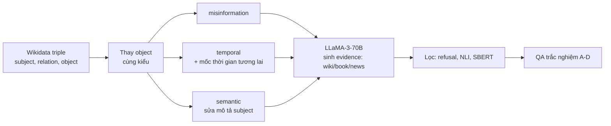

# Benchmark: ConflictBank (2408.12076)

## 1. Thông tin chung & Tài nguyên

- **Tiêu đề:** ConflictBank: A Benchmark for Evaluating the Influence of Knowledge Conflicts in LLMs
- **Mã arXiv:** [2408.12076](https://arxiv.org/abs/2408.12076) (nộp 22/08/2024). Công bố tại NeurIPS 2024, track Datasets & Benchmarks (theo thông tin người giao việc đã kiểm; trang arXiv tôi đọc chỉ ghi "under review").
- **Mã nguồn (GitHub):** [github.com/zhaochen0110/conflictbank](https://github.com/zhaochen0110/conflictbank), gồm script tải dữ liệu, `generate_conflicts.py`, `inference.py`, `evaluate.py`.
- **Dữ liệu (Hugging Face):** `Warrieryes/CB_claim_evidence` và `Warrieryes/CB_qa`.
- **Giấy phép:** README của repo ghi CC BY-SA 4.0 cho dự án; trang Hugging Face của hai dataset **không có dataset card**, không nêu giấy phép riêng. Chưa rõ giấy phép áp dụng cho dữ liệu.
- **Ngôn ngữ:** tiếng Anh.

## 2. Bộ dữ liệu

### 2.1. Quy mô và phân loại

- 7,453,853 cặp claim-evidence và 553,117 cặp QA (con số trong paper).
- **Ba loại xung đột (conflict cause):** *misinformation* (thông tin sai), *temporal* (xung đột thời gian, nhắm vào kiến thức lỗi thời), *semantic* (một tên/khái niệm mang nghĩa khác nhau).
- **Ba nguồn xung đột (conflict source):** (1) giữa bằng chứng được truy xuất và tri thức tham số của LLM (retrieved vs parametric); (2) giữa các đoạn được truy xuất với nhau; (3) nội bộ trong tri thức tham số (do dữ liệu pretrain tự mâu thuẫn). Phần (3) được thử bằng continued pretraining có tiêm dữ liệu xung đột.

### 2.2. Cách xây dựng

1. Lấy fact từ Wikidata dump (02/04/2024), dạng (subject, relation, object) kèm mô tả; chọn 100 relation phổ biến nhất, mỗi cặp (subject, relation) giữ một triple.
2. Tạo claim "mặc định" (đúng) và claim xung đột bằng cách thay object (replaced object).
3. LLaMA-3-70B-Instruct sinh evidence cho claim, theo ba văn phong: Wikipedia, book, news.
4. Lọc ba tầng: bỏ câu từ chối (refusal); NLI (DeBERTa-v2-xxlarge-MNLI) giữ evidence entail được claim; bộ phân loại SBERT (all-mpnet-base-v2) bỏ cặp thực ra không mâu thuẫn. Paper báo kiểm tay 200 mẫu cho độ chính xác trên 95%, và 5 tình nguyện viên kiểm 200 mẫu ngẫu nhiên chỉ 1 mẫu mập mờ.
5. Số lượng sau lọc: Default 1,991,218; Misinformation 1,878,340; Temporal 1,650,026; Semantic 1,934,269; sau bước confirm còn 553,117 mỗi loại để dựng QA.

### 2.3. Cách mô hình hóa xung đột thời gian (quan trọng cho đồ án)

- Theo paper: claim đã bị thay object được **gán một khoảng thời gian ở tương lai** (ví dụ "20 April, 2033") và evidence được viết như thể sự kiện xảy ra trong khoảng đó. Ý tưởng: cùng một (subject, relation) nhưng giá trị mới "thay thế" giá trị mặc định theo thời gian.
- Dữ liệu thực tế (tôi quan sát trên Hugging Face `CB_qa`): trường `temporal_conflict_time_span` là list 1-2 mốc ngày; nhiều mẫu có ngày 2026-2044, tức evidence là **hư cấu**, không phải tin thực.
- Hệ quả: **không có cặp (giá trị cũ, giá trị mới) có `start_time`/`end_time` thật** cho cùng một thực thể. Giá trị "cũ" là fact Wikidata, giá trị "mới" là object được thay ngẫu nhiên cùng kiểu. Loại temporal chủ yếu đo việc LLM có chịu nhận bằng chứng có mốc tương lai hay không, không đo việc chọn đúng phiên bản theo `T_req`. Đây là đánh giá của tôi dựa trên mô tả trên, chưa kiểm sâu code `generate_conflicts.py`.

### 2.4. Định dạng và khả năng tải

- `CB_claim_evidence`: khoảng 2.11M dòng, 18.2 GB (bản trên Hub, chưa rõ vì sao ít hơn 7.45M), 5 cột: `id` (mã property Wikidata, ví dụ P108), `subject`, `category` (`default` / `misinformation_conflict` / `temporal_conflict` / `semantic_conflict`), `claim`, `evidence`.
- `CB_qa`: khoảng 513k dòng (trang Hub ghi 512,769; paper ghi 553,117, chưa rõ chênh lệch), 5.79 GB, 30 cột: triple (`relation`, `subject`, `object`, `replaced_object` + mô tả), claim/evidence mặc định, claim/evidence cho từng loại xung đột (có `temporal_conflict_time_span`), và câu hỏi trắc nghiệm `question`, `options` (4 lựa chọn), `correct_option`, `replace_option`, `uncertain_option`.
- Tải: `load_dataset("Warrieryes/CB_qa")`; chỉ một split `train`. Có thể dùng `streaming=True` hoặc đọc từng shard Parquet để khỏi tải hết (cách này tôi chưa chạy thử).

### 2.5. Ví dụ

Mẫu `CB_qa` (quan sát trên Hub): relation P108 (employer), subject "Jumanah Essa-Hadad", câu hỏi "Which person or organization did Jumanah Essa-Hadad work for?", đáp án đúng D = "The Azrieli Faculty of Medicine". Mẫu `CB_claim_evidence` (rút gọn): `P108 | Kevin King | default | "Kevin King worked for University of Texas Health Science Center at San Antonio."`. Văn bản evidence đầy đủ không được chép ở đây vì chưa đọc nguyên văn.

Ví dụ minh họa trong paper (xung đột misinformation): thay Primetime Emmy Award của Anne Hathaway bằng Hugo Award.

## 3. Chỉ số đo

Mô hình trả lời trắc nghiệm 4 lựa chọn (A-D, D = "uncertain"); đáp án lấy theo xác suất token "(A)"..."(D)" cao nhất. Ba chỉ số (theo paper):
- **OAR (Original Answer Ratio):** tỉ lệ mô hình chọn đáp án mặc định (cũ).
- **CAR (Counter Answer Ratio):** tỉ lệ mô hình chọn đáp án thay thế (xung đột).
- **Memorization Ratio:** `MR = OAR / (OAR + CAR)`. MR cao nghĩa là dựa nhiều vào tri thức tham số hơn evidence.

Không có Exact Match / F1 sinh tự do; chưa rõ cách xử lý lựa chọn "uncertain" trong MR ngoài công thức trên.

## 4. Mô hình đã đánh giá và phát hiện chính

- 12 mô hình thuộc 4 họ: Gemma (2B, 7B), LLaMA2 (7B, 13B, 70B), LLaMA3 (bản 7B và 70B theo trang tôi đọc; "7B" có thể là 8B, chưa rõ), Qwen1.5 (0.5B, 4B, 7B, 14B, 72B). Continued pretraining thử trên Qwen1.5-4B, Mistral-7B, LLaMA3-8B.
- Chỉ có evidence mâu thuẫn: mọi mô hình MR dưới 50%, tức dễ tin evidence ngoài.
- Có cả evidence mặc định và evidence xung đột: mọi mô hình MR trên 50%, tác giả gọi là confirmation bias (thiên về điều khớp tri thức tham số).
- Misinformation cho MR cao hơn temporal và semantic. Với LLaMA2-70B: 9.45% (misinformation), 7.77% (temporal), 3.73% (semantic).
- Mô hình lớn hơn có MR thấp hơn khi evidence xung đột đặt cuối (LLaMA2-7B 56.44% so với 70B 38.97%).
- Tiêm dữ liệu xung đột vào pretraining (tỉ lệ default:conflict = 2:1) làm OAR giảm 41.5% (LLaMA2-7B) và 37.6% (Mistral-7B).
- Thêm mô tả (description) giảm MR của LLaMA3-70B từ 67.52% xuống 8.31%.

Các số trên lấy từ bản HTML arXiv qua công cụ tóm tắt; nên đối chiếu bảng gốc trước khi trích vào luận văn.

## 5. Ưu điểm / Nhược điểm

**Ưu điểm**
- Quy mô rất lớn, có phân loại theo nguyên nhân xung đột (có hẳn loại temporal), có mã sinh dữ liệu mở và dữ liệu trên Hugging Face.
- Dựa Wikidata nên có `subject`/`relation`/`object`, thuận tiện nối với các property hay đổi (P39, P108, P54) mà đồ án đã chọn.
- Có metric rõ ràng (OAR/CAR/MR) và QA trắc nghiệm nên chấm tự động rẻ.

**Nhược điểm**
- **Quá lớn:** vài chục GB; không cần và không thể chạy hết với ingestion có LLM của đồ án.
- **Evidence do LLM sinh (LLaMA-3-70B), nhân tạo:** mốc tương lai 2026-2044, văn phong tin/sách bịa; tác giả tự nêu hạn chế là xung đột sinh tổng hợp, chưa mined từ corpus thật.
- **Đo xung đột giữa tham số LLM và bằng chứng, không phải giữa các nguồn ngoài:** đúng với lưu ý của người giao việc rằng một bài 2026 chỉ ra khoảng trống này; tôi **chưa tìm lại được bài đó**, nên chưa trích dẫn (chưa kiểm).
- Loại temporal không có khoảng hiệu lực thật cho cả hai phiên bản, không phân biệt Evolution và Falsehood.
- Metric MR đo hành vi LLM, không đo chất lượng retrieval hay cập nhật bộ nhớ.
- Dữ liệu trên Hub không khớp hoàn toàn con số paper (2.11M so với 7.45M; 513k so với 553k); chưa rõ nguyên nhân.

## 6. Áp dụng vào đồ án

**Đối chiếu phạm vi** (`docs/decisions/09_CONFLICT_RESOLUTION_SCOPE.md`): đồ án đã **bỏ nhánh đa nguồn / Credibility Score** và chỉ làm Evolution (`end_time`) và Falsehood (`invalidated_at`) trong một nguồn có lịch sử (Wikipedia). Vì vậy `credibility_score` và `source` (schema `docs/design/01_INITIAL_BASE_DESIGN.md` mục 2.1) **không được ConflictBank kiểm thử**: benchmark này cũng không có nhiều nguồn với độ tin cậy khác nhau (evidence chỉ có nhãn văn phong wikipedia/book/new). Điều này khớp với việc ConflictBank không lấp được khoảng trống đa nguồn.

| Thành phần đồ án | ConflictBank cho gì | Đánh giá |
|---|---|---|
| `end_time` (Evolution) | Loại temporal gán mốc tương lai cho giá trị thay thế | Chỉ gần đúng; không có `end_time` thật của giá trị cũ |
| `invalidated_at` (Falsehood) | Loại misinformation (object sai cùng kiểu) | Gần "sai từ đầu" nhưng sai do thay ngẫu nhiên, khác đính chính thật |
| Timeline ≠ Conflict, loại 5-6 | Không có | Không đo được |
| `credibility_score`, `source` | Không có | Không đo (đã bỏ khỏi phạm vi) |
| Truy xuất theo `T_req` | Không có câu hỏi kèm mốc thời gian | Không đo |

**Cách lấy mẫu phần temporal để chạy hệ thống** (đề xuất, chưa thử):
1. Lọc `category = temporal_conflict` rồi chỉ giữ các relation trùng thuộc tính đã chọn trong `09` (P54, P39, P108, P488), để không lệch miền.
2. Lấy mẫu phân tầng theo relation, khoảng 100-150 bộ (khớp quy mô dự kiến ở `09`); dùng streaming/shard Parquet thay vì tải cả 5.79 GB.
3. Mỗi bộ gồm `default_evidence` (giá trị cũ) và `temporal_conflict_evidence` (giá trị mới, kèm `temporal_conflict_time_span`). Nạp lần lượt cũ rồi mới như S0 rồi S1; lấy `start_time` của chunk mới từ `time_span`, coi chunk cũ là bị thay.
4. Hỏi bằng QA tự sinh dạng mở (hoặc dùng trắc nghiệm gốc) theo các loại 1, 2 của `09`: "hiện nay" trả giá trị mới, "trước mốc đó" trả giá trị cũ.
5. Thêm lượt không có ngữ cảnh (closed-book) để đo nhiễm tri thức tham số, như `09` đã dặn; MR/OAR/CAR của paper chính là thước đo tương đương cho việc này.

**Chỉ số tương ứng:** Freshness accuracy (loại 1), Historical retention (loại 2), False-invalidation rate; phụ thêm OAR/CAR để so với số trong paper nếu dùng cùng đề trắc nghiệm.

**Phần không so sánh công bằng:**
- Số MR/OAR/CAR của paper là hành vi LLM trần với evidence đưa thẳng vào prompt, không qua retrieval; hệ của đồ án có kho, lọc `invalidated_at`, re-rank, nên không đặt cạnh trực tiếp.
- Mốc tương lai bịa khiến bộ lọc chống rò rỉ tương lai `start_time <= T_req` của đồ án có thể loại luôn evidence "mới" nếu `T_req` là hiện tại; cần đặt `T_req` sau mốc đó hoặc bỏ nhãn tương lai, nếu không kết quả bị bóp méo.
- Không đo Falsehood thật, không đo đa nguồn.

**Benchmark liên quan (nhắc ngắn):** WikiContradict (IBM, NeurIPS 2024, arXiv 2406.13805) có 253 mẫu do người gán nhãn từ các đoạn Wikipedia mâu thuẫn thật, nhỏ và thật hơn ConflictBank nhưng không đặc thù thời gian; tôi chỉ xác minh qua tóm tắt tìm kiếm. Benchmark "Conflicts" của Google (2025) đã tìm thấy sau đó, xem [`11_Conflicts_Cattan`](11_Conflicts_Cattan.md).

## 7. Chỗ chưa xác nhận

- Giấy phép thực sự của dữ liệu trên Hugging Face (chỉ có CC BY-SA 4.0 của repo).
- Lý do chênh số dòng giữa Hub và paper; sự khác nhau giữa "LLaMA3 7B" và 8B.
- Cách `generate_conflicts.py` chọn mốc thời gian và liệu có mẫu temporal nào dùng mốc quá khứ thật; chưa đọc code.
- Có xem được phân bố relation trong phần temporal để biết P54/P39/P108/P488 có đủ mẫu hay không; chưa kiểm.
- Bài 2026 nhận xét khoảng trống "tham số vs nguồn ngoài": chưa tìm thấy. Benchmark "Conflicts" của Google 2025 xem `11`.
- Các số ở mục 4 chưa đối chiếu với bảng gốc trong PDF (công cụ không đọc được PDF nén).
