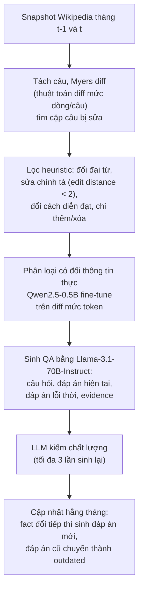
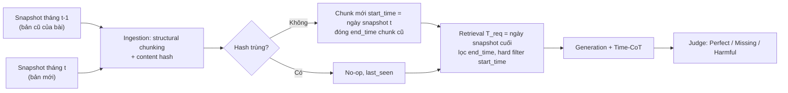

# Benchmark: HoH (ACL 2025), ảnh hưởng của thông tin lỗi thời lên RAG

Mục đích ghi chú: đánh giá HoH có đáng dùng để so sánh với hệ thống của đồ án ở Cơ chế 3 hay không. HoH là benchmark đầu tiên đo trực tiếp việc thông tin lỗi thời (outdated information) làm RAG trả lời sai. Nguồn đã đọc: bản HTML arXiv v3 (đọc qua công cụ tóm tắt tự động, khoảng 100.000/105.000 ký tự đầu), README repo GitHub và dataset card Hugging Face. Mọi số dưới đây lấy từ các nguồn đó; chỗ không thấy thì ghi "chưa rõ".

## 1. Thông tin chung & Tài nguyên

- **Tiêu đề:** HoH: A Dynamic Benchmark for Evaluating the Impact of Outdated Information on Retrieval-Augmented Generation
- **Tác giả:** Jie Ouyang, Tingyue Pan, Mingyue Cheng, Ruiran Yan, Yucong Luo, Jiaying Lin, Qi Liu
- **Hội nghị:** ACL 2025 (theo README repo)
- **Mã arXiv:** [2503.04800](https://arxiv.org/abs/2503.04800) (bản v3, 07/2025; [HTML](https://arxiv.org/html/2503.04800v3), [PDF](https://arxiv.org/pdf/2503.04800), 28 trang)
- **Mã nguồn:** [github.com/0russwest0/HoH](https://github.com/0russwest0/HoH), gồm hai thư mục `diff_extract/` (trích thay đổi) và `qa_generate/` (sinh QA). README nêu: "first large-scale benchmark designed to evaluate RAG's robustness against outdated information".
- **Dữ liệu:** Hugging Face [`russwest404/HoH-QAs`](https://huggingface.co/datasets/russwest404/HoH-QAs), một split `train`, định dạng Parquet, tải bằng `datasets` hoặc pandas.
- **Giấy phép:** Apache-2.0 (cả repo lẫn dataset card). Văn bản gốc là Wikipedia (CC BY-SA); ràng buộc share-alike với phần trích Wikipedia: chưa rõ tác giả xử lý thế nào.
- **Ngôn ngữ:** bài báo không nêu rõ; dùng Wikipedia và các mô hình embedding tiếng Anh (bge-base-en-v1.5) nên nhiều khả năng là tiếng Anh. Xem mục 7.
- **Mã chấm điểm / chạy đánh giá:** README đã đọc không có lệnh đánh giá (chưa rõ).

## 2. Bộ dữ liệu

### 2.1. Nguồn và quy mô

- **Nguồn:** các bản chụp (snapshot) Wikipedia tải từ dumps.wikimedia.org, dùng gần hết bài viết (loại bài dưới 200 ký tự). Bản đầu dùng snapshot 2024-06-01 và 2024-07-01; bộ dữ liệu được cập nhật hằng tháng đến snapshot 2024-11-01. Đây là **phiên bản theo thời gian của cùng một bài Wikipedia**, nhưng mức chi tiết là snapshot theo tháng, không phải từng revision.
- **Quy mô theo bài báo:** 96.124 cặp QA trên 219.463 tài liệu (tóm tắt và Table 1).
- **Số liệu không khớp nhau:** bảng quy trình dựng (Table 8) ghi 101.253 cặp QA cuối; dataset card Hugging Face có 111.972 dòng. Bài báo không giải thích chênh lệch (có thể do cập nhật hằng tháng sau khi đăng bài; đây là suy đoán, chưa xác nhận).
- **Phân bố lĩnh vực** (bài báo, theo bảng thống kê): Open 31.697; Sports 30.011; Finance 22.786; Movie 6.038; Music 5.592.
- **Số lần cập nhật:** 5.129 cặp QA đã được cập nhật ít nhất một lần. Phần lớn chỉ có 1 đáp án lỗi thời: 91.856 câu có 1; 3.647 câu có 2; 447 câu có 3; 108 câu có 4; 66 câu có 5.
- **Tập đánh giá:** 10.000 câu, chọn bằng cách phân cụm toàn bộ dữ liệu rồi lấy ngẫu nhiên 1.000 câu từ mỗi cụm trong 10 cụm.

### 2.2. Cách xây dựng (token-level diff + LLM)

Token-level diff (so sánh hai chuỗi ở mức token để đánh dấu chỗ thêm/xóa/sửa) kết hợp pipeline LLM:

Phễu số lượng (cộng 5 tháng, Table 8): 3.708.543 cặp câu, còn 943.142 sau lọc heuristic, 133.973 sau bộ phân loại, 101.253 cặp QA cuối. Bộ phân loại Qwen2.5-0.5B huấn luyện trên khoảng 2.000 cặp gán nhãn tay, báo accuracy 96,8% và F1 95,1%. Bài báo còn so khả năng trích thay đổi: EvolvingQA 20,85% accuracy / 34,50 F1; GrowOVER 41,26% / 41,08; HoH 96,80% / 95,08 (so trên bộ dữ liệu của chính tác giả nên không hoàn toàn công bằng với hai bộ kia).

### 2.3. Cấu trúc một bản ghi

Theo dataset card: `question`, `answer` (đáp án hiện tại), `evidence` (câu bằng chứng), `last_modified_time` (chủ yếu 07-12/2024), `outdated_infos` (danh sách đáp án cũ, mỗi phần tử có đáp án, evidence và mốc thời gian riêng), `document` (metadata: ID, tiêu đề bài). Danh sách trường chính xác trong tệp Parquet: chưa kiểm tra bằng cách tải.

### 2.4. Trả lời ba câu hỏi bắt buộc

- **Gold/current document có chứa đáp án không?** Có. Passage loại Relevant (R) được định nghĩa là passage "contain the correct answer and are useful for the question". Đó là bản hiện hành của bài, chứa đáp án hiện tại. Khác với benchmark mà tài liệu đúng bị giấu, ở đây đáp án đúng luôn có trong kho; khó khăn nằm ở chỗ nó bị cạnh tranh bởi bản cũ.
- **Tài liệu lỗi thời được dựng thế nào?** Là **phiên bản cũ của cùng bài Wikipedia** (limitations của bài: outdated corpora "primarily come from the historical versions of the same article"). Passage Outdated (O) là passage "previously relevant but have become obsolete". Có thêm loại Distracting (D): giống câu hỏi về ngữ nghĩa nhưng không chứa đáp án. Corpus của mock search engine chứa cả bản hiện hành và bản lịch sử của mọi bài dùng khi dựng QA.
- **Có gắn mốc thời gian cho từng phiên bản không?** Có, ở mức "Last Modified Time" (ngày của snapshot, theo tháng). Mọi tài liệu mang mốc này và mốc được chèn vào prompt. Đáp án lỗi thời trong `outdated_infos` cũng có mốc riêng. Lưu ý đây là ngày bản chụp/phiên bản, **không phải** khoảng hiệu lực `[start_time, end_time]` của fact.

### 2.5. Ví dụ thật (trích từ bài báo)

- Hỏi: "Who is the current Master of the Horse?" Đáp án hiện tại: "The Lord Ashton of Hyde" (2024-07-01). Đáp án lỗi thời: "Lord de Mauley" (2024-06-01).
- Hỏi: "What was the median income in Otago compared to the national median income?" Hiện tại: "$39,100, compared with $41,500 nationally" (2024-11-01). Lỗi thời: "$30,000, compared with $31,800 nationally" (2024-10-01).

### 2.6. Loại câu hỏi

Bài báo không chia theo loại câu hỏi kiểu "point-in-time / change / historical" như đồ án. Chia theo lĩnh vực (Open, Sports, Finance, Movie, Music). Câu hỏi hướng tới **giá trị hiện tại** (dùng từ như "current"), nên bộ này đo "có chọn đúng bản mới nhất hay không". Việc câu hỏi có phụ thuộc thời gian tường minh hay không: chưa rõ.

## 3. Chỉ số đo

- **Generation:** LLM judge (Llama-3.1-70B-Instruct) chia mỗi câu trả lời vào ba mức: Perfect (+1), Missing (0), Harmful (-1). Harmful là trả lời sai, nhất là sai theo đáp án lỗi thời. Kiểm tay bởi tác giả cho precision/recall của judge 98,5-100%.
- **Score tổng:** các bảng có vẻ là Perfect% trừ Harmful%, nhưng công thức **không được nêu** trong phần đã đọc (suy luận, chưa xác nhận). Ví dụ vanilla (không truy xuất) cho Score âm: Llama-70B -19,21.
- **Retrieval:** top-k hit rate (k = 5, 10, 20, 50), tính riêng cho passage Relevant (R) và Outdated (O). R cao và O thấp là tốt.
- **Thông số khác:** temperature 0.3, tối đa 100 token sinh ra.
- Không có EM/F1 theo nghĩa chuẩn (chưa thấy trong phần đã đọc).

## 4. Mô hình/baseline và số công bố

- **Retriever/reranker:** bge-base-en-v1.5, bge-m3, bge-reranker-v2-m3; mock search engine Elasticsearch (BM25 + Gaussian time decay; công thức chi tiết không được nêu); hai retriever có nhận biết thời gian là MRAG và TempRALM.
- **LLM:** Qwen-2.5-7B-Instruct, Llama-3.1-8B-Instruct, Llama-3.1-70B-Instruct; GPT-4o chỉ chạy trên tập con 1.000 mẫu.

Số chọn lọc (từ bài báo):

| Thí nghiệm | Kết quả |
|---|---|
| Vanilla RAG đầu-cuối, Score mặc định | Llama-70B 51,7; Llama-8B 40,0; Qwen-7B 29,9 |
| Không truy xuất (vanilla) | Llama-70B -19,21; Llama-8B -10,98; Qwen-7B -1,47 |
| Search engine hit@5 (R / O), không decay | 0,8707 / 0,8837 |
| Search engine hit@5 (R / O), Gaussian decay | 0,7023 / 0,4950 |
| bge-m3 hit@5 (R / O), không rerank | 0,7312 / 0,5507 |
| bge-m3 hit@5 (R / O), có rerank | 0,7754 / 0,5678 |
| Llama-70B, 1 R + 1 D | 89,12 |
| Llama-70B, thêm 1 passage O, không D, xếp theo score | 72,95 (xếp theo ngày còn thấp hơn) |
| Chỉ có passage O (1 O + D), n=1 | khoảng -71 (Llama-70B), -69 (Llama-8B), -63 (Qwen-7B) |
| GPT-4o, 1 R + 1 D | 89,5 (ngang Llama-70B) |

Nhận xét của bài báo: MRAG làm tụt mạnh hit rate của R; TempRALM cân bằng hơn nhưng vẫn mất recall R. Kết luận chung: thông tin lỗi thời làm RAG kém chính xác vì gây nhiễu, có thể dẫn tới đầu ra có hại dù thông tin hiện hành có sẵn; gặp khó ở cả truy xuất lẫn sinh. Time decay giảm O nhưng cũng giảm R (0,87 -> 0,70 ở hit@5), tức decay thô làm mất cả thông tin đúng.

## 5. Ưu điểm / Nhược điểm

**Ưu điểm**
- Đo đúng hiện tượng cần: passage cũ và mới của cùng tài liệu cùng nằm trong kho. Đây là kịch bản Keep-all-snapshots của đồ án.
- Quy mô lớn (hàng chục nghìn câu), có tập đánh giá cố định 10.000 câu, dữ liệu và code công khai, Apache-2.0.
- Mọi phiên bản có mốc thời gian, mỗi câu có đáp án hiện tại và đáp án cũ kèm evidence; đo được "hệ thống trả lời theo đáp án cũ" (Harmful) chứ không chỉ đúng/sai.
- Tách chỉ số truy xuất (hit R/O) khỏi sinh (Perfect/Missing/Harmful), tiện chẩn đoán lỗi ở tầng nào.
- Cập nhật hằng tháng nên bớt nguy cơ lộ trong dữ liệu huấn luyện LLM.

**Nhược điểm**
- Câu hỏi hướng tới "hiện tại", gần như không có truy vấn tại mốc quá khứ (point-in-time) hay câu hỏi về lịch sử, nên không kiểm tra `start_time <= T_req` theo kiểu của đồ án (hầu như T_req = nay).
- Không có "sai từ đầu" (falsehood): mọi đáp án cũ từng đúng. Không kiểm được `invalidated_at` hay cảnh báo trong câu trả lời lịch sử.
- Đáp án lỗi thời lấy từ đúng bài viết cũ của cùng tài liệu, nên không có mâu thuẫn đa nguồn; chính tác giả ghi đây không giống nội dung lỗi thời đa dạng trên web thật.
- Chi tiết thời gian thô: snapshot theo tháng, không có khoảng hiệu lực của fact.
- Mỗi câu từ một bài; không có tổng hợp đa nguồn.
- Số liệu quy mô không nhất quán giữa bài báo (96.124), bảng dựng (101.253) và Hugging Face (111.972).
- Pipeline dựng và judge đều dùng LLM (Llama-3.1-70B) nên có nguy cơ lệch nhãn dù tác giả kiểm tay.
- Cập nhật theo lịch snapshot, không theo dõi các lĩnh vực biến động nhanh (như thị trường).

## 6. Áp dụng vào đồ án

### 6.1. Ánh xạ cơ chế và schema

| Khái niệm HoH | Tương ứng trong đồ án |
|---|---|
| Passage Relevant (bản hiện hành) | chunk có `end_time = NULL`, `invalidated_at = NULL` |
| Passage Outdated (bản cũ cùng bài) | chunk đã đóng `end_time` (Evolution), không phải `invalidated_at` |
| Last Modified Time của snapshot | ứng viên cho `start_time` của chunk (ngày bản chụp, xấp xỉ ngày hiệu lực) |
| Đáp án lỗi thời (`outdated_infos`) | chunk cũ trong lịch sử, vẫn trả về cho câu hỏi lịch sử |
| Harmful (trả lời theo đáp án cũ) | tương ứng lỗi "cũ lấn mới", đối trọng của rò rỉ tương lai ở Cơ chế 1 |

Theo `docs/design/01_INITIAL_BASE_DESIGN.md` mục 2.1, thay đổi giá trị theo thời gian là Evolution, xử lý bằng `end_time`; `invalidated_at` dành cho thông tin sai từ đầu. HoH **chỉ có Evolution**, nên chỉ kiểm được nhánh `end_time`, không kiểm được `invalidated_at`.

### 6.2. Cách chạy hệ thống đồ án trên bộ này

1. Tải `russwest404/HoH-QAs`; chọn tập con nhỏ (ví dụ vài trăm câu, ưu tiên các câu có từ 2 đáp án lỗi thời trở lên) vì kho đầy đủ có hàng trăm nghìn tài liệu.
2. Với mỗi bài trong tập con, lấy bản mới và bản cũ (từ `evidence` và `outdated_infos`; để có toàn bộ văn bản bài cần tra lại snapshot Wikipedia hoặc API revision, vì dataset card chỉ nêu evidence là câu bằng chứng; xem mục 7).
3. Nạp theo thứ tự thời gian (cũ trước, mới sau) qua ingestion có structural chunking + hash: chunk không đổi thì no-op; chunk đổi thì đóng `end_time` bản cũ.
4. Hỏi với `T_req` = thời điểm hiện tại của bộ (ví dụ 2024-11-01): Cơ chế 1 lọc `end_time`/`start_time`, Cơ chế 3 ưu tiên chunk mới. Có thể thêm biến thể hỏi với `T_req` cũ (dùng `outdated_infos` làm đáp án vàng) để kiểm Historical retention, nhưng đó là mở rộng của đồ án, không phải thiết kế gốc của HoH.
5. So với ba baseline đã chốt ở `docs/decisions/09_CONFLICT_RESOLUTION_SCOPE.md`: Plain RAG, Replace-all, Keep-all-snapshots. Trên HoH, Keep-all-snapshots chính là cấu hình mà bài báo đo (kho có cả bản cũ lẫn mới). Plain RAG trên kho có cả hai bản dự kiến cho Harmful cao.
6. Chấm theo Perfect/Missing/Harmful bằng LLM judge cùng kiểu bài báo, và đo hit@k của chunk mới so chunk cũ.

### 6.3. Chỉ số đồ án tương ứng

`docs/eval/07_TUNE_VALID_RESULTS.md` dùng hit@1, hit@5, `mrr`, `ans_valid@5`, tỉ lệ rò rỉ (đáp án từ chunk có `start > T_req`), và EM/F1/contains cho đáp án sinh ra. Đối ứng:

| HoH | Đồ án |
|---|---|
| hit@k của R | hit@k, `mrr` trên chunk đúng thời điểm |
| hit@k của O (càng thấp càng tốt) | chưa có chỉ số tương đương; nên thêm "tỉ lệ đáp án lấy từ chunk đã đóng `end_time`" (phiên bản "rò rỉ quá khứ" của rò rỉ tương lai) |
| Perfect / Harmful | contains / EM (đúng) và tỉ lệ trả lời đúng đáp án cũ (Harmful); null tính 0 giống Missing |

Số của đồ án ở `docs/eval/07` (TimeQA 2021, 400 câu `test_clean`) **không so trực tiếp** được với số HoH vì khác dữ liệu, khác thang điểm và khác LLM.

### 6.4. Đối chiếu tài liệu hiện có

- `docs/decisions/09_CONFLICT_RESOLUTION_SCOPE.md` chốt làm Evolution và Falsehood trên dữ liệu có lịch sử chỉnh sửa, đánh giá bằng bộ tự dựng. HoH bổ sung phần Evolution bằng một benchmark ngoài, có nhãn đáp án cũ/mới và số baseline công bố. Phần Falsehood vẫn phải dựa bộ tự dựng.
- `docs/eval/06_WIKI_REVISION_CRAWL.md` (crawl lịch sử chỉnh sửa Wikipedia): đo 98% chunk giữ nguyên sau một lần sửa nhỏ, 37% khi cách xa nhiều năm. HoH cùng nguồn Wikipedia nhưng khoảng cách giữa hai snapshot là một tháng, nên giả thuyết là tỉ lệ chunk giữ nguyên gần mức 98% hơn (chưa đo trên HoH). Ghi chú ở decisions/09: 88,5-94,5% đáp án cũ vẫn còn trong trang hiện tại, tức Replace-all ít mất thông tin trên Wikipedia; với HoH điều này có nghĩa Replace-all có thể đạt Perfect cao, và lợi thế của đồ án chủ yếu là chi phí cập nhật chứ không phải độ chính xác.

### 6.5. Phần không so sánh công bằng

- Câu hỏi của HoH chủ yếu về hiện tại; đồ án có lọc `start_time <= T_req` và decay theo năm. Phần mạnh nhất của Cơ chế 1 (point-in-time, no future leakage) hầu như không được thử thách.
- HoH đo trên mock search engine Elasticsearch (BM25 + Gaussian decay) và retriever bge; đồ án dùng hybrid dense + BM25 + cross-encoder. Khác retriever thì không so số tuyệt đối được.
- LLM khác (Llama-3.1/Qwen-2.5/GPT-4o so với LLM của đồ án); phải chạy lại baseline trong cùng LLM của đồ án thay vì lấy số công bố.
- Judge khác nhau (Llama-3.1-70B ở HoH) sẽ lệch điểm.
- Không đo được: Falsehood/`invalidated_at`, đa nguồn/Credibility, Timeline Summarization.

## 7. Chỗ chưa xác nhận

- Kích thước chính thức của bộ: 96.124 (bài báo), 101.253 (Table 8), 111.972 (Hugging Face); chưa rõ bản nào ứng với tập đánh giá 10.000 câu và còn mở rộng hằng tháng hay không.
- Ngôn ngữ: chưa nêu rõ; suy ra là tiếng Anh.
- Công thức Score tổng (Perfect% trừ Harmful% là suy luận) và công thức Gaussian decay: chưa rõ.
- Dataset có chứa toàn văn các phiên bản bài (passage R/O/D) hay chỉ câu `evidence`: dataset card chỉ nêu `evidence`; chưa tải để kiểm. Nếu chỉ có câu bằng chứng, phải dựng lại kho từ snapshot Wikipedia, tốn công lớn.
- Số cập nhật `last_modified_time` có phải ngày revision thật hay chỉ ngày snapshot: bài nói là last-modified date theo snapshot; chưa rõ độ chính xác.
- README repo trong phần đã đọc không có lệnh chạy đánh giá; dataset card README trống. Khả năng tái lập đánh giá: chưa rõ.
- Phần cuối HTML (khoảng 5.000 ký tự, gồm phần phụ lục) chưa đọc; file PDF chỉ tải về, không trích được văn bản.
- Giấy phép với phần văn bản Wikipedia (CC BY-SA): chưa rõ.

## Nguồn

- [HoH, arXiv HTML v3](https://arxiv.org/html/2503.04800v3)
- [HoH, arXiv abs](https://arxiv.org/abs/2503.04800)
- [github.com/0russwest0/HoH](https://github.com/0russwest0/HoH)
- [Hugging Face russwest404/HoH-QAs](https://huggingface.co/datasets/russwest404/HoH-QAs)
