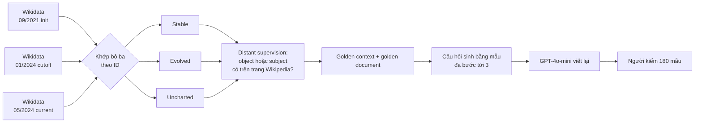

# Benchmark: EvoWiki (2412.13582), tri thức Wikipedia/Wikidata tiến hóa theo thời gian

Mục đích ghi chú: đánh giá EvoWiki có phù hợp làm benchmark so sánh cho Cơ chế 3 (Conflict Resolution: tiến hóa, đè fact cũ) và một phần Cơ chế 1 (Temporal Retrieval, truy vấn "hiện tại") của đồ án hay không. EvoWiki là bộ gần nhất với dữ liệu "Wikipedia thay đổi theo thời gian" mà đồ án đang tự dựng ở `docs/eval/06_WIKI_REVISION_CRAWL.md`. Bài báo chủ yếu nghiên cứu "LLM và RAG xử lý tri thức tiến hóa thế nào", không phải benchmark cho hệ thống bộ nhớ; điều này ảnh hưởng đến cách dùng (mục 6).

## 1. Thông tin chung & Tài nguyên

- **Tiêu đề:** EvoWiki: Evaluating LLMs on Evolving Knowledge (tiêu đề đầy đủ: chưa kiểm lại trên trang; mã arXiv là căn cứ chính).
- **Mã arXiv:** [2412.13582](https://arxiv.org/abs/2412.13582) (bản HTML: https://arxiv.org/html/2412.13582v1). Trang arXiv ghi "arXiv.org perpetual non-exclusive license" cho bài báo; đây là giấy phép của bài, **không phải của dữ liệu**.
- **Mã nguồn / dữ liệu:** [wtangdev/EvoWiki](https://github.com/wtangdev/EvoWiki). Theo README đã đọc: repo chỉ có `README.md`, mục "Code" ghi "Coming soon" (tức **chưa có mã**); dữ liệu đặt ở một thư mục **MEGA** (mega.nz), không phải HuggingFace.
- **Giấy phép dữ liệu:** không nêu (README không có license; bài chỉ nêu giấy phép của chính bài). Dữ liệu gốc từ Wikidata (CC0) và Wikipedia (CC BY-SA) là kiến thức chung, chưa kiểm điều khoản của bản phái sinh: **chưa rõ**.
- **Ngôn ngữ:** tiếng Anh.
- **Mô hình trong bài:** Meta-Llama-3.1-8B-Instruct và Mistral-7B-Instruct-v0.3.
- **Tự cập nhật:** bài mô tả cách xây từ Wikidata/Wikipedia nên về nguyên tắc dựng lại được với mốc mới; chu kỳ cập nhật bộ phát hành: không nêu; mã dựng lại: chưa phát hành.

## 2. Bộ dữ liệu

### 2.1. Nguồn, quy mô, ba loại tri thức

Ba mốc thời gian định nghĩa mức tiến hóa: **init-time** (09/2021), **cutoff-time** (01/2024), **current-time** (05/2024). Tri thức là bộ ba (subject, relation, object) lấy từ Wikidata tiếng Anh, khớp giữa các snapshot theo định danh duy nhất của Wikidata.

| Loại | Định nghĩa (theo bài) | Số câu | Độ dài ngữ cảnh TB | Độ phổ biến TB (lượt xem trang) |
|---|---|---:|---:|---:|
| Stable | không đổi từ init-time đến current-time | 3,819 | 5,411.98 | 16,305.96 |
| Evolved | tồn tại trước init-time và **đổi** ở cutoff-time hoặc current-time | 3,491 | 4,451.90 | 42,807.55 |
| Uncharted | có ở current-time, **không có** ở init-time/cutoff-time | 2,954 | 5,014.30 | 24,039.57 |

Tổng 10,264 câu. Đơn vị của "ngữ cảnh TB" (từ hay token) bài không nêu rõ trong phần đã đọc: **chưa rõ**. Số câu đơn bước và đa bước theo từng loại: **chưa rõ** (Table 2 chỉ cho tổng). Độ phổ biến = số lượt xem trang Wikipedia tương ứng; evolved có độ phổ biến trung bình cao hơn hẳn (khoảng 2.6 lần stable), tức bộ lệch về thực thể nổi tiếng.

### 2.2. Cách xây dựng

1. So sánh ba snapshot Wikidata tiếng Anh, gán nhãn stable/evolved/uncharted.
2. **Distant supervision** (giám sát từ xa: tự gán nhãn bằng quy tắc thay vì người gán): fact được coi là "có chứng cứ" nếu object (hoặc subject) được nhắc tường minh trên trang Wikipedia liên quan; câu ngắn nhắc đến đó là **golden context**, trang là **golden document**.
3. Câu hỏi về thực thể người, đa bước tới 3 bước, đáp án là object của bước cuối; sinh bằng **mẫu (template)**, rồi GPT-4o-mini viết lại cho tự nhiên.
4. Người kiểm: 4 nhà nghiên cứu chấm 180 mẫu (20 mẫu cho mỗi mức bước x mỗi loại tiến hóa) về độ trôi chảy, khả năng trả lời được, độ chính xác. Điểm chính xác đã thấy: stable một bước 97.92, uncharted một bước 91.67 (Table 3); điểm các ô còn lại, và điểm cho evolved: **chưa lấy được**.

### 2.3. Fact là cặp giá trị ở ba mốc hay khoảng hiệu lực?

Theo phần đã đọc: dữ liệu được dựng từ **ba bản chụp (snapshot) rời rạc**, không phải khoảng hiệu lực `[start, end]`. Bài chỉ nêu ba mốc thời gian và không nói có lưu khoảng hiệu lực; README liệt kê đúng năm trường (xem 2.5), không có trường thời gian nào. Hệ quả:

- Với evolved, biết được "giá trị cũ" (có ở init-time) và "giá trị mới" (đáp án mới nhất) nhưng **không biết đổi vào ngày nào** (chỉ biết nằm giữa hai snapshot), và nếu giá trị đổi hơn một lần giữa hai snapshot thì giá trị trung gian mất.
- Không có `start_time`/`end_time` thật để ánh xạ vào schema đồ án; nếu muốn dùng phải gán mốc xấp xỉ (xem 6.2).
- Câu hỏi luôn là "hiện tại" (đáp án = giá trị mới nhất); trường `all_answer` có cả đáp án lỗi thời nhưng chỉ phục vụ đo mức nhiễm thông tin cũ, không phải câu hỏi lịch sử có mốc.

### 2.4. Nhãn "golden document" có đảm bảo chứa đáp án không?

**Không đảm bảo.** Căn cứ:
- Nhãn gán bằng distant supervision: chỉ cần object hoặc subject xuất hiện ở trang là tính. Điều kiện "object hoặc subject" nghĩa là một trang có thể được nhận chỉ vì nhắc tới subject.
- Phần Limitations của bài (nguyên văn, trích): "Despite being recognized as high-quality corpora, Wikidata and Wikipedia inevitably contain noise" và "this noise cannot be completely eliminated".
- Bài **không đo** tỉ lệ golden document thật sự chứa đáp án. Điểm người kiểm (97.92 / 91.67 ở hai ô) là của câu hỏi/đáp án, không phải kiểm riêng nhãn golden document.
- Chưa rõ: golden document là bản Wikipedia nào (current-time hay init-time)? Với evolved, đáp án mới có chắc nằm trong trang đã chụp không? Bài không trả lời trong phần đã đọc. Cận trên "open-book" (đưa thẳng golden context) chỉ 75.24 (evolved) và 56.40 (stable, đa bước, Llama), thấp hơn 100% đáng kể, **phù hợp với** việc nhãn nhiễu hoặc câu khó, nhưng không chứng minh được nguyên nhân.

### 2.5. Định dạng và khả năng tải

- Tải thủ công từ thư mục MEGA trong README; không có `load_dataset`.
- Theo README, mỗi mẫu có 5 trường: `question`, `answer` (đáp án mới nhất), `all_answer` (mọi đáp án, kể cả đã lỗi thời), `contriever_top30`, `bm25_top30` (chunk do hai bộ truy xuất trả về). README không nêu tên file, định dạng (JSON/CSV) hay mẫu bản ghi: **chưa rõ**. Không có trường id trang/golden document trong README (có thể có trong dữ liệu: chưa kiểm).
- Corpus truy xuất: 15K tài liệu gold; bản mở rộng thêm 370K bài Wikipedia ngẫu nhiên. Chunk 256 token. Bài dùng top 15 chunk (README lưu top 30).

### 2.6. Ví dụ thật

Bài không in câu evolved trong văn bản chính. Hai ví dụ thật duy nhất đã thấy:

- Hướng dẫn gán nhãn (Table 6): "What is the occupation of Ashley Neal?" Đáp án mới nhất: "driving instructor", "YouTuber"; danh sách mọi đáp án còn có "association football player". Đây là minh họa evolved: đáp án lỗi thời "association football player" nằm trong `all_answer` nhưng không nằm trong `answer`. (Hướng dẫn nói latest và all chỉ khác nhau ở dữ liệu evolved.)
- Mẫu template: "Who is the spouse of Barack Obama?" (ví dụ minh họa của template, chưa chắc là mẫu trong bộ).

Ví dụ đa bước thật: **chưa có**; cần tải dữ liệu để in ra.

### 2.7. Thiên lệch do sinh từ mẫu

- **Một khuôn quan hệ lặp lại:** câu hỏi sinh từ ít mẫu theo quan hệ Wikidata, rồi GPT-4o-mini viết lại. Phân bố quan hệ (nghề nghiệp, vợ/chồng, ...) và số mẫu: **chưa rõ**. Rủi ro: hệ thống học khớp từ khóa quan hệ thay vì xử lý thời gian.
- **Chỉ thực thể người** và thiên về người nổi tiếng (evolved có lượt xem TB cao hơn stable); LLM có thể đã biết một phần đáp án (closed-book evolved vẫn 6.96 đến 13.99).
- **Không có nhiễu thời gian trong câu hỏi:** không nêu năm; "hiện tại" ngầm. Không đo được cơ chế thời gian (half-life decay, `T_req` theo năm).
- **Viết lại bằng LLM** có thể đổi ý (điểm người kiểm cho thấy độ chính xác 91.67 ở uncharted một bước), và bước nhiễu từ Wikidata (quan hệ đa trị, giá trị bổ sung chứ không thay thế như "occupation") khiến "evolved" không phải lúc nào cũng nghĩa là "giá trị cũ bị thay". Ví dụ Ashley Neal: nghề mới được thêm vào, không hẳn là nghề cũ sai. Điều này lẫn lộn giữa Evolution và Timeline (xem 6.4).
- **Độ phổ biến lệch giữa các loại** (bảng 2.1) làm so sánh stable/evolved/uncharted chưa sạch.

## 3. Chỉ số đo

- **EM (exact match):** đạt 1 điểm nếu câu trả lời khớp đáp án. Chi tiết chuẩn hóa chuỗi và việc khớp chuỗi con hay khớp toàn bộ: **chưa rõ** (bài gọi là EM; khác với SubEM của FactConsolidation, không được suy từ tên).
- **Với evolved:** đúng khi khớp **đáp án mới nhất** (`answer`).
- **Precision của câu trả lời chứa thông tin lỗi thời (số trong ngoặc ở bảng bài):** chỉ báo cho evolved; đo tỉ lệ câu trả lời khớp **bất kỳ** đáp án nào trong `all_answer` (gồm cả đáp án lỗi thời). Hiệu hai số (ví dụ 72.70 và 48.99) cho thấy mô hình trả lời đúng nhưng lỗi thời; nhưng định nghĩa chính xác tử/mẫu của "precision" ở đây: **chưa rõ**, đây là cách hiểu từ chú thích bảng.
- Không có chỉ số cho truy xuất riêng (hit@k, MRR) trong phần đã đọc; không có chỉ số chi phí/token.

## 4. Baseline và số công bố

Tự báo cáo trong bài (EM %, Table 4; ngoặc = số liên quan đáp án lỗi thời, xem mục 3). Mô hình Llama-3.1-8B-Instruct và Mistral-7B-Instruct-v0.3, corpus 15K gold, chunk 256 token, top 15.

**Một bước, Llama-3.1-8B-Instruct (stable / evolved / uncharted):**

| Cấu hình | Stable | Evolved | Uncharted |
|---|---:|---:|---:|
| Closed-book | 31.61 | 6.96 (24.61) | 10.84 |
| Contriever RAG | 77.90 | 48.99 (72.70) | 72.69 |
| Open-book (cận trên) | 86.87 | 75.24 (83.47) | 83.52 |

Số cột stable/uncharted của BM25 RAG: chưa lấy được.

**Evolved, bốn cấu hình (EM, ngoặc = số liên quan đáp án lỗi thời):**

| Cấu hình | Llama 1 bước | Llama đa bước | Mistral 1 bước | Mistral đa bước |
|---|---:|---:|---:|---:|
| Closed-book | 6.96 (24.61) | 13.99 | 5.83 (19.90) | 15.76 |
| BM25 RAG | 36.13 (53.78) | 13.85 | 34.78 (50.49) | 16.08 |
| Contriever RAG | 48.99 (72.70) | 17.85 | 52.43 (74.05) | 19.11 |
| Open-book | 75.24 (83.47) | 60.30 | 77.56 (83.99) | 60.44 |
| BM25, corpus mở rộng 370K | 28.12 (44.95) | 14.27 | 26.33 (38.82) | 13.20 |
| Contriever, corpus mở rộng 370K | 44.28 (67.99) | 14.41 | 46.97 (67.02) | 15.20 |

Số khác đã thấy: Llama, **stable đa bước**: closed-book 22.17, Contriever RAG 19.37, open-book 56.40 (tức RAG dưới closed-book). Mistral, stable một bước: closed-book 29.81, open-book 87.68.

Nhận xét tự báo cáo (và suy ra):
- Evolved luôn khó hơn stable cho cùng cấu hình; closed-book gần như không biết tri thức mới (6.96 và 10.84).
- RAG kéo mạnh ở một bước (evolved 6.96 lên 48.99) nhưng còn cách cận trên 26 điểm; một phần khoảng cách là trả lời bằng đáp án lỗi thời (72.70 so với 48.99 cho thấy khoảng 24 điểm câu trả lời trùng một đáp án cũ hoặc mới).
- Đa bước: RAG gần như không giúp (evolved 13.99 lên 17.85), có thể thấp hơn closed-book ở stable.
- Mở rộng corpus lên 370K làm RAG giảm (Contriever evolved một bước 48.99 xuống 44.28).
- Không có số cho hệ thống bộ nhớ, graph RAG hay time-aware RAG: bài chỉ so BM25 và Contriever. Muốn so với hệ khác phải tự chạy.

## 5. Ưu điểm / Nhược điểm

**Ưu điểm**
- Dữ liệu thật (Wikidata và Wikipedia thay đổi thật), không phải phản thực tổng hợp như FactConsolidation; nên cùng "họ" với dữ liệu Wikipedia revision của đồ án.
- Quy mô lớn (10,264 câu, evolved 3,491), sai số lấy mẫu nhỏ hơn nhiều so với 100 câu.
- Có sẵn tách ba loại stable/evolved/uncharted: stable là đối chứng không đổi (gần loại 5 trong `decisions/09`); evolved và uncharted đo tri thức mới.
- Có `all_answer` để đo mức dùng nhầm thông tin lỗi thời; có top chunk đã truy xuất của BM25/Contriever để đối chiếu.
- Chấm tự động bằng EM; có số baseline với RAG đơn giản và cận trên open-book.
- Độ khó đa bước tới 3 bước, hợp với việc đánh giá phần suy luận phía trên Cơ chế 3.

**Nhược điểm**
- **Golden document nhiễu, không bảo đảm chứa đáp án** (2.4); bài không đo tỉ lệ.
- **Chỉ ba snapshot rời rạc**, không có khoảng hiệu lực, không có ngày đổi chính xác; không có truy vấn lịch sử có năm (2.3). Không đo được "Evolution không làm mất lịch sử".
- **Không có Falsehood:** không phân biệt đổi vì sự kiện thật (tiến hóa) với sửa vì ghi sai; không có `invalidated_at` tương ứng.
- Mọi câu đều hỏi "hiện tại"; Cơ chế 1 (lọc `start_time <= T_req`, decay) hầu như không được kích hoạt.
- Câu hỏi từ mẫu, chỉ thực thể người, lệch về thực thể nổi tiếng (thiên lệch ở 2.7).
- Quan hệ đa trị (như "occupation") làm "evolved" không đồng nghĩa "giá trị cũ bị thay".
- Chỉ ngôn ngữ tiếng Anh; chỉ hai mô hình 7-8B; không có hệ thống bộ nhớ làm baseline.
- Mã chưa phát hành, dữ liệu trên MEGA, giấy phép không nêu: rủi ro tái lập và trích dẫn.
- Mốc 09/2021 và 01/2024 gần mốc kiến thức của LLM hiện nay; nhiễm tri thức tham số khó kiểm với mô hình mới hơn (mô hình có mốc kiến thức sau 2024 thì "uncharted" có thể không còn mới).

## 6. Áp dụng vào đồ án

### 6.1. Ánh xạ khái niệm

| EvoWiki | Đồ án (`docs/design/01_INITIAL_BASE_DESIGN.md` mục 2.1) |
|---|---|
| Stable (không đổi) | Đối chứng không đổi; chunk hash trùng, không đóng `end_time` (loại 5 trong `decisions/09`) |
| Evolved, đáp án mới nhất `answer` | Truy vấn "hiện tại": `T_req = T_now`, `end_time` rỗng và `invalidated_at` rỗng (Cơ chế 3, một phần Cơ chế 1) |
| Evolved, đáp án cũ trong `all_answer` | Chunk bị đóng `end_time` (Evolution); dùng để đo "có trả nhầm thông tin cũ" |
| Uncharted (fact xuất hiện sau cutoff) | Fact mới thêm; ingest sau, kiểm "không cần ghi đè" nhưng phải truy xuất được |
| Mốc init/cutoff/current-time | `start_time` xấp xỉ theo snapshot (không phải ngày sự kiện thật) |
| Trang Wikipedia, câu nhắc đến (golden context) | `chunk_id` của chunk chứa fact, `source` = trang Wikipedia |
| (không có) | `invalidated_at` (Falsehood), `category`, `SUSPECTS`, truy vấn lịch sử có năm |

### 6.2. Cách chạy hệ thống đồ án trên bộ này

1. Tải dữ liệu từ MEGA; in vài bản ghi để biết định dạng, có trường id trang hay không (nếu không có, phải tự ánh xạ câu hỏi về trang bằng tìm thực thể).
2. Dựng corpus: 15K tài liệu gold (hoặc bản mở rộng 370K để thử khả năng chống nhiễu), chia chunk theo đoạn (nhất quán với `decisions/09`; bài dùng 256 token).
3. **Mô phỏng luồng cập nhật hai lần:** nạp trang ở trạng thái init-time (S0, 09/2021) rồi trạng thái cutoff/current-time (S1). Việc lấy các bản Wikipedia theo ngày này có thể làm bằng revision API như ở `docs/eval/06_WIKI_REVISION_CRAWL.md`, nhưng bài **không nói** bản Wikipedia nào làm corpus; cần tự quyết và ghi rõ.
4. Gán `start_time` = ngày của snapshot nạp, `end_time` chỉ đóng khi Ingestion phát hiện fact mới cùng (chủ thể, quan hệ).
5. Truy vấn với `T_req = T_now` (hoặc ngày cố định 05/2024): lọc cứng `invalidated_at IS NULL`, chọn chunk còn hiệu lực. Đa bước thì kết hợp Cơ chế 2 hoặc agent lặp.
6. Chấm EM trên `answer`; với evolved, đếm thêm tỉ lệ rơi vào `all_answer` mà không phải `answer`.

Thử trước trên tập con nhỏ (ví dụ 100-200 câu mỗi loại, ưu tiên evolved một bước) để kiểm tra hệ chạy được, rồi mới chạy toàn bộ.

### 6.3. Chỉ số tương ứng ở `docs/eval/07_TUNE_VALID_RESULTS.md`

- **EM trên evolved** ~ Temporal Freshness (loại 1 trong `decisions/09`).
- **Tỉ lệ trả đáp án lỗi thời** ~ chỉ số "rò rỉ" (`rò rỉ`) và độ trễ cập nhật nhưng khác nghĩa: ở `07`, rò rỉ = kết quả truy xuất dùng chunk tương lai so với `T_req`; ở EvoWiki, lỗi thời = trả giá trị cũ khi hỏi "hiện tại". Hai chỉ số đối xứng chứ không giống nhau.
- **EM trên stable** ~ False-invalidation rate gián tiếp (nếu hệ đóng nhầm thì EM stable giảm).
- Chỉ số truy xuất của `07` (`mrr`, hit@5, ans_valid@5) không báo trong EvoWiki; muốn đối chiếu phải tính trên top chunk với nhãn golden context (cẩn thận nhãn nhiễu), hoặc không đối chiếu.
- **Không đo được** trên bộ này: Historical retention, độ chính xác phân loại Evolution/Falsehood, chi phí nạp so hash (có thể đo riêng nếu nạp hai snapshot).

### 6.4. Phần không so sánh công bằng

- **Baseline khác hệ thống:** chỉ BM25 và Contriever với Llama-3.1-8B/Mistral-7B; chênh điểm so với bảng trộn lẫn tác động của LLM nền, chunk (256 token) và top-k (15). Công bằng chỉ khi chạy lại BM25/Contriever và Plain RAG với cùng LLM, chunk, top-k của đồ án.
- **Đồ án có thêm thông tin thời gian** (`start_time`, snapshot) mà baseline không có; cần một baseline "Plain RAG nạp S1 đè S0" (replace-all) và "keep-all-snapshots" như `decisions/09`.
- **Golden document nhiễu** (2.4): điểm thấp có thể do nhãn, không do hệ thống.
- **Không có mốc thời gian thật** nên các thành phần trọng tâm (decay, `T_req` theo năm) không được kiểm; thắng ở đây không chứng minh được giá trị của Cơ chế 1.
- **Evolution lẫn Timeline:** nếu quan hệ đa trị (nghề nghiệp) thì giá trị cũ vẫn có thể đúng; đồ án không nên đóng `end_time` trong trường hợp này (Timeline ≠ Conflict). Cách xử lý của bộ (chỉ tính `answer` là đúng) có thể phạt hệ xử lý đúng theo thiết kế.
- **Nhiễm tri thức tham số:** mô hình hiện nay có thể đã biết dữ liệu 2024.
- Đa bước: các baseline RAG gần sàn, nên thắng ở đa bước ít thông tin về Cơ chế 3.

### 6.5. Đối chiếu với dữ liệu tự dựng (`decisions/09`, `eval/06`)

| Tiêu chí | EvoWiki | Tự dựng từ Wikipedia revision (`eval/06`, `decisions/09`) |
|---|---|---|
| Nguồn nhãn | Diff ba snapshot Wikidata; golden document bằng distant supervision | Lịch sử Wikidata (giá trị, `start_time`, `end_time`) theo kế hoạch; Wikipedia chỉ là văn bản |
| Mốc thời gian | Ba snapshot rời rạc | Có ngày sự kiện (kế hoạch) |
| Evolution / Falsehood | Chỉ evolved, không có falsehood | Có cả hai, nhưng sai từ đầu nhiễu (khoảng 10-15% của 961 ứng viên, mẫu 40) |
| Loại câu hỏi | Hiện tại, đa bước | 6 loại, gồm lịch sử, chuyển tiếp, đối chứng |
| Quy mô | 10,264 câu | Dự kiến 100-150 cặp S0/S1 |
| So với hệ khác | Có BM25/Contriever, chưa có hệ bộ nhớ | Tự chạy baseline |
| Mâu thuẫn chéo trang | không nêu | Tối đa 7.6% câu, bỏ khỏi phạm vi |

Nhận định: EvoWiki phù hợp làm **bộ thứ hai** cho phần "Evolution, hỏi hiện tại" ở quy mô lớn, bổ sung cho FactConsolidation (có bảng công bố nhưng nhỏ và tổng hợp) và cho dữ liệu tự dựng (đo Falsehood, lịch sử). Không thay thế dữ liệu tự dựng vì thiếu mốc thời gian và falsehood. Ghi chú từ `eval/06`: 88.5-94.5% đáp án cũ vẫn còn trong trang hiện tại, nên lợi thế giữ lịch sử của kho phiên bản so với replace-all có thể cũng nhỏ trên EvoWiki; **chưa kiểm** trên bộ này.

## 7. Chỗ chưa xác nhận

1. Tiêu đề đầy đủ chính xác của bài (chưa kiểm lại).
2. Định dạng file, tên file, mẫu bản ghi thật; có trường id trang/golden document hay không (README chỉ liệt kê 5 trường).
3. Ví dụ evolved thật và ví dụ đa bước thật (chỉ có ví dụ Ashley Neal trong hướng dẫn gán nhãn và ví dụ mẫu template).
4. Golden document: bản Wikipedia nào (init hay current), tỉ lệ thật sự chứa đáp án với evolved; bài không đo (đã nêu mục 2.4).
5. Fact có lưu khoảng hiệu lực hay chỉ giá trị theo snapshot: phần đã đọc không nêu khoảng hiệu lực; chưa xem mã (chưa phát hành) hay dữ liệu.
6. Số câu đơn bước/đa bước theo từng loại; điểm người kiểm cho evolved và các ô còn lại; đơn vị "độ dài ngữ cảnh".
7. Định nghĩa chính xác của EM (chuẩn hóa, khớp chuỗi con hay toàn chuỗi) và của "precision" cho đáp án lỗi thời.
8. Danh sách quan hệ, số mẫu câu, phân bố; quy tắc xử lý quan hệ đa trị.
9. Giấy phép dữ liệu, chu kỳ cập nhật, ngày phát hành mã (README ghi "Coming soon").
10. Số của BM25 RAG cho stable/uncharted, và toàn bộ bảng đa bước stable/uncharted (chỉ lấy được vài số).
11. Bài mới đọc ở bản v1 (HTML); chưa kiểm có bản mới hơn thay đổi số liệu.
