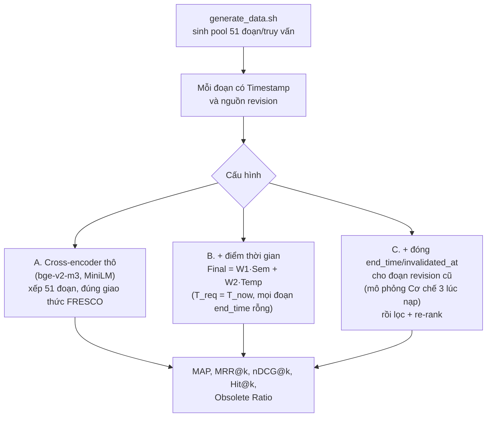

# Benchmark: FRESCO (2604.14227)

## 1. Thông tin chung & Tài nguyên

- **Tiêu đề:** FRESCO: Benchmarking and Optimizing Re-rankers for Evolving Semantic Conflict in Retrieval-Augmented Generation
- **Mã arXiv:** [2604.14227](https://arxiv.org/abs/2604.14227) (nộp 14/04/2026). Tác giả thuộc Meta Superintelligence Labs và UCLA. Giấy phép bài báo CC BY 4.0.
- **Mã nguồn (GitHub):** [github.com/facebookresearch/fresco](https://github.com/facebookresearch/fresco). Repo gồm script sinh dữ liệu (`generate_data.sh`) và mã tối ưu chỉ dẫn (`inst_optimization/`, `preprocess_nek_data.py`). Trang chủ repo (lúc tôi đọc) **không** có hướng dẫn chạy đánh giá re-ranker.
- **Dữ liệu:** **không có file tải sẵn**; README chỉ nói chạy `bash generate_data.sh` để sinh dữ liệu "dynamic FRESCO". Mục Releases và Packages trống.
- **Giấy phép dữ liệu/mã:** README ghi "majority of FRESCO is licensed under CC-BY-NC" và dữ liệu CC-BY-NC "intended for benchmarking purposes" (**phi thương mại**; dùng cho luận văn là chấp nhận được, nhưng không được đóng gói lại thương mại). Mã tối ưu chỉ dẫn là MIT (điều chỉnh từ Microsoft LMOps). Nội dung bên thứ ba kéo từ nơi khác tuân theo giấy phép riêng.
- **Ngôn ngữ:** tiếng Anh (văn bản bách khoa).
- **Cách tôi đọc:** bản HTML arXiv v1 qua công cụ tóm tắt; công cụ chỉ đọc được khoảng 100k ký tự đầu, phần sau lấy qua một lần đọc tiếp theo. Các số trong bảng dưới nên đối chiếu lại với PDF trước khi trích vào luận văn.

**Ý tưởng một câu:** ghép truy vấn "cần thông tin mới nhất" với các đoạn lấy từ nhiều bản sửa (revision) Wikipedia của cùng một thực thể, rồi đo xem **re-ranker** (mô hình chấm lại thứ hạng danh sách ứng viên) có đưa đoạn mới nhất lên đầu hay bị cuốn theo đoạn cũ nhưng giàu ngữ nghĩa.

## 2. Bộ dữ liệu

### 2.1. Nguồn và cách xây dựng (theo paper)

1. **Wikidata** cho fact có mốc thời gian (subject, relation, object, start, end). **Wikipedia revision history** cho văn bản tương ứng. **Infobox** (khung thông tin bên phải trang Wikipedia) dùng để kiểm chứng fact.
2. **Chọn thực thể:** cần ít nhất hai fact có chú thích thời gian khác nhau trong khoảng từ 01/01/2020 đến một mốc tham chiếu (**mốc này paper không nêu, chưa rõ**).
3. **Kiểm chứng hai bước:** (a) fact mới nhất phải xuất hiện trong infobox của một revision nằm trong khoảng hiệu lực của nó; (b) ít nhất một fact trước đó phải xuất hiện trong một revision cũ hơn với **giá trị object khác**.
4. **Truy vấn:** viết tay theo mẫu theo từng relation, hai dạng: **explicit** (nói rõ "mới nhất", ví dụ "Who is the most recent person to lead {ss} as its head coach?") và **implicit** (không nói, ví dụ "Who is handling the head coaching duties for {ss}?").
5. **Pool ứng viên của mỗi truy vấn:** 1 positive + 50 negative.
   - Positive: đoạn từ revision có giá trị khớp fact mới nhất.
   - Negative loại "không đủ bằng chứng": các đoạn **cùng revision** với positive nhưng thiếu bằng chứng cho đáp án.
   - Negative loại "lỗi thời": đoạn từ **các revision cũ hơn của cùng thực thể**; thêm các đoạn gần nghĩa lấy từ một snapshot Wikipedia tĩnh (2018-12-20) bằng retriever BGE.
   - **Hard negative mining** (chọn các negative khó nhất): Qwen3-Embedding-0.6B chấm điểm, giữ top 50.
6. Mỗi ứng viên được đưa vào re-ranker kèm dòng `Timestamp: YYYY-MM-DDThh:mm:ssZ` nối sau văn bản; truy vấn cũng có mốc thời gian.

### 2.2. Quy mô

- 3,658 truy vấn cho mỗi dạng (explicit, implicit), tổng **7,316**; mỗi truy vấn 51 đoạn (1 positive, 50 negative).
- Số thực thể, số relation, mốc tham chiếu: **chưa rõ** (không thấy trong phần đã đọc).
- Phụ lục D có nói tách 200 mẫu train và 800 mẫu validation, phần còn lại để test. Tôi chưa xác định được phép tách này áp dụng cho bước tối ưu chỉ dẫn hay cho toàn bộ benchmark; **chưa rõ**.

### 2.3. Evolving Knowledge (EK) và Non-Evolving Knowledge (NEK)

- **EK** (kiến thức tiến hóa) chính là FRESCO ở trên.
- **NEK** (kiến thức không tiến hóa) lấy từ Natural Questions (NQ, bộ hỏi đáp trên Wikipedia của Google) bản "reformulated": mỗi truy vấn và mỗi đoạn được gán **mốc thời gian ngẫu nhiên**. Chi tiết còn lại **chưa rõ**. NEK dùng để kiểm tra việc tối ưu chỉ dẫn cho EK không phá hỏng khả năng xếp hạng thông thường.

### 2.4. Gán nhãn gold và obsolete (phần BẮT BUỘC làm rõ)

- **Nhãn nhị phân:** positive = 1, mọi negative = 0.
- **Gold có đảm bảo chứa đáp án không? Paper không khẳng định như vậy.** Positive được chọn vì nó lấy từ revision mà **infobox khớp giá trị mới nhất**; tức là bảo đảm nằm ở mức "revision đúng", không phải "đoạn này nêu đáp án". Kiểm chứng bằng người: 200 mẫu, 3 người chọn đoạn hỗ trợ tốt nhất hoặc "None"; Fleiss' κ (độ đồng thuận giữa nhiều người gán nhãn) = 0.9689; đa số khớp nhãn của pipeline ở 98.5% mẫu. Vậy khoảng 1.5% mẫu kiểm không khớp, và suy ra có thể có positive không chứa đáp án.
- **Obsolete được xác định thế nào?** Ở khâu xây dựng: negative lỗi thời đến từ **các revision cũ hơn của cùng thực thể** (đã ràng buộc giá trị object khác ở ít nhất một fact trước), còn negative "không đủ bằng chứng" đến từ **cùng revision** với positive. Tức là so sánh **revision cũ với revision chứa positive**, không so từng cặp câu. Paper định nghĩa Obsolete Ratio là phần negative xếp trên positive mà "factually outdated (describing an earlier state)", nhưng phần tôi đọc **không nêu rõ ở khâu đánh giá mỗi negative được gắn nhãn obsolete bằng quy tắc nào** (có thể chỉ dựa vào nguồn revision khi xây dựng). Đoạn gần nghĩa lấy từ snapshot 2018-12-20 thuộc loại nào (lỗi thời hay không) cũng **chưa rõ**.
- Lưu ý: một số negative "không đủ bằng chứng" là đúng về thời gian nhưng thiếu thông tin, nên không phải mọi lỗi xếp hạng đều là lỗi thời gian.

### 2.5. Ví dụ

- Explicit: "Who is the most recent person to lead {ss} as its head coach?" Implicit: "Who is handling the head coaching duties for {ss}?" (`{ss}` là chỗ điền tên thực thể).
- Ví dụ minh họa ở phần mở đầu paper: truy vấn "phiên bản ổn định mới nhất của vLLM" khi changelog 0.5.0 và 0.6.0 đều trông liên quan nhưng chỉ bản mới đúng.
- Không có mẫu dữ liệu thật (có tên thực thể, đoạn văn) trong phần tôi đọc; **chưa rõ**.

## 3. Chỉ số đo

Với danh sách 51 đoạn và nhãn nhị phân (theo Phụ lục F.1):

- **MAP:** Average Precision (AP) mỗi truy vấn rồi lấy trung bình; AP = 0 nếu không có positive.
- **MRR@k:** Reciprocal Rank của positive đầu tiên, 0 nếu hạng > k; trung bình trên truy vấn.
- **nDCG@k:** DCG@k chuẩn hóa bởi IDCG@k, relevance nhị phân; bằng 0 nếu IDCG@k = 0.
- **Hit Rate@k:** 1 nếu positive đầu tiên nằm trong top-k, ngược lại 0; trung bình trên truy vấn. k ∈ {5, 10}. (Văn bản gọi là Recall@k nhưng bảng báo Hit Rate.)
- **Obsolete Ratio (%):** trong các negative xếp **trên** positive, tỷ lệ là loại **factually outdated** (mô tả trạng thái cũ hơn) thay vì "đúng thời điểm nhưng thiếu bằng chứng". Công thức chính xác trong phần tôi đọc không có (phụ lục F.1 chỉ định nghĩa bốn chỉ số còn lại). **Chưa rõ công thức mẫu số** (theo truy vấn hay gộp toàn bộ negative xếp trên).

## 4. Baseline và số công bố

### 4.1. Re-ranker (19 mô hình, Table 1)

Các số lấy từ Table 1 (MAP, nDCG@10, Hit@10 là tỷ lệ phần trăm; Obsolete% với truy vấn explicit). **Không có bge-reranker-v2-m3, MiniLM hay bge-reranker-base** trong 19 mô hình; mô hình gần nhất về họ là bce-reranker-base-v1 và họ jina.

| Mô hình | MAP explicit | nDCG@10 explicit | Hit@10 explicit | MAP implicit | Obsolete% explicit |
|---|---:|---:|---:|---:|---:|
| MonoT5 | 26.56 | 33.29 | 62.74 | 28.16 | 89.75 |
| RankT5 | 38.85 | 45.60 | 72.17 | 37.24 | 90.24 |
| UPR | 35.69 | 40.47 | 64.00 | 39.44 | 86.18 |
| RankGPT (gpt-3.5) | 33.04 | 43.92 | 79.50 | 28.23 | 87.99 |
| RankGPT (gpt-4o) | 49.51 | 62.55 | 99.67 | 48.15 | 90.44 |
| RankVicuna | 38.14 | 43.62 | 67.09 | 38.85 | 89.29 |
| RankZephyr | 41.68 | 48.33 | 74.22 | 40.65 | 89.59 |
| bce-reranker-base-v1 | 32.53 | 39.56 | 68.32 | 34.54 | 87.15 |
| InRanker | 53.18 | 43.02 | 78.49 | 56.82 | 91.20 |
| mxbai-rerank-base-v1 | 27.22 | 33.80 | 62.06 | 33.18 | 89.72 |
| Twolar | 47.33 | 53.24 | 76.30 | 49.09 | 88.88 |
| jina-reranker-v1-tiny-en | 40.88 | 46.65 | 70.09 | 45.09 | 85.98 |
| jina-reranker-v1-turbo-en | 44.90 | 50.34 | 72.23 | 46.19 | 86.18 |
| jina-reranker-v2 | 61.05 | 68.75 | 94.20 | 62.85 | 91.78 |
| gte-multilingual-reranker-base | 55.07 | 63.03 | 90.19 | 61.72 | 84.50 |
| LdIR-Qwen2-reranker-1.5B | 42.11 | 52.02 | 86.50 | 43.75 | 93.99 |
| IncontextReranker | 24.01 | 32.79 | 66.92 | 24.29 | 90.92 |
| Qwen3-Reranker-0.6B | 57.47 | 64.95 | 93.00 | 49.43 | 95.13 |
| Qwen3-Reranker-8B | 66.29 | 73.60 | 97.10 | 58.54 | 95.73 |

(MRR@5/10 và nDCG@5 có trong Table 1 nhưng tôi không chép.)

**Phát hiện chính:** Obsolete Ratio nằm khoảng 84% đến 98% ở gần như mọi mô hình, nghĩa là lỗi xếp hạng chủ yếu là đưa **đoạn lỗi thời** lên trên positive, chứ không phải đoạn lạc đề. Truy vấn implicit thường khó hơn explicit với mô hình mạnh (Qwen3-8B: MAP 66.29 xuống 58.54), nhưng một số mô hình lại tốt hơn ở implicit (jina-v2: 61.05 lên 62.85), nên không có xu hướng đồng nhất.

### 4.2. Tối ưu chỉ dẫn (tóm tắt ngắn)

Với Qwen3-Reranker-8B, paper tối ưu **chỉ dẫn (instruction) đưa vào prompt của re-ranker**, không đổi trọng số mô hình. Đây là tìm kiếm hai mục tiêu (EK và NEK) theo kiểu Pareto (tập lời giải không bị lời giải nào khác hơn ở cả hai mục tiêu), quần thể 4 chỉ dẫn; **mutation** là LLM đọc lỗi xếp hạng để sửa chỉ dẫn, **crossover** là ghép hai chỉ dẫn bổ trợ nhau, chọn lọc bằng non-dominated set và crowding distance. Kết quả MAP (EK / NEK): base 62.41 / 60.93; TempRALM 77.79 / 40.32; MRAG 78.41 / 59.18; Pareto 1 79.20 / 59.41 (cao hơn base khoảng 27% trên EK); Pareto 4 68.88 / 62.27. Bỏ mutation hay crossover đều giảm EK (ví dụ Pareto 1 bỏ mutation: 76.59). Chi tiết thuật toán không cần cho đồ án.

Lưu ý: hai baseline TempRALM và MRAG trong bảng này là các phương pháp tăng thứ hạng theo thời gian (đồ án đã có ghi chú về MRAG ở mục benchmark liên quan); chi tiết cách paper cài đặt chúng **chưa rõ**.

## 5. Ưu điểm / Nhược điểm

**Ưu điểm**
- Là benchmark hiếm nhắm đúng câu hỏi "re-ranker có chọn bản mới nhất không", trên văn bản Wikipedia thật có nhiều revision chứ không phải văn bản do LLM sinh (khác ConflictBank).
- Nhãn dựa trên Wikidata + infobox, kèm kiểm chứng người (κ = 0.9689; 98.5% khớp trên 200 mẫu).
- Quy mô vừa phải (7,316 truy vấn, mỗi truy vấn 51 ứng viên), chạy được cho re-ranker cục bộ, không cần ingestion bằng LLM.
- Có mã sinh dữ liệu, có dạng truy vấn explicit/implicit để tách tác động của từ khóa "mới nhất".
- Có phân tích lỗi (Obsolete Ratio) chứ không chỉ điểm xếp hạng.

**Nhược điểm**
- Chỉ kiểm **re-ranker độc lập trên 51 ứng viên đã chọn trước**, không kiểm retrieval, không kiểm ingestion, không có `end_time`/`invalidated_at`, không có đa nguồn, không có câu hỏi theo mốc quá khứ `T_req`.
- Mọi truy vấn đều hỏi "mới nhất", nên không có cặp câu hỏi lịch sử tương ứng; một hệ chỉ luôn chọn đoạn mới nhất sẽ đạt điểm cao (giống cảnh báo cặp loại 1/2 ở `docs/decisions/09`).
- Mốc thời gian đưa vào rõ ràng ở mọi đoạn; paper tự nêu hạn chế là không có mốc nhiễu hoặc thiếu. Chỉ Wikipedia/Wikidata nên chưa chắc khái quát sang tin tức.
- Mốc thời gian của đoạn có thể là mốc revision chứ không phải mốc sự kiện; chưa rõ (xem mục 7).
- Dữ liệu **không tải sẵn**, phải tự sinh; sinh cần gọi API Wikipedia/Wikidata và có thể ra bản không trùng số liệu paper (do dữ liệu nguồn đổi). Giấy phép CC-BY-NC.
- Khái niệm "obsolete" ở khâu đánh giá chưa rõ (mục 2.4).
- 19 re-ranker không có bge-reranker-v2-m3 hay MiniLM, nên không so được trực tiếp với số của đồ án; phải tự chạy.

## 6. Áp dụng vào đồ án

### 6.1. FRESCO ứng với cơ chế nào

| Thành phần đồ án | FRESCO kiểm được không | Ghi chú |
|---|---|---|
| Cơ chế 1: cross-encoder sau lọc cứng và điểm thời gian | **Một phần**: kiểm bước cross-encoder (và `Final = W1·Semantic + W2·Temporal`) trong điều kiện ứng viên đã có | Xem 6.2 |
| Cơ chế 1: lọc cứng `start_time <= T_req` | **Không**: mọi ứng viên là quá khứ so với truy vấn "mới nhất", lọc này không loại gì | Không kiểm chống rò rỉ tương lai |
| Cơ chế 3: lọc cứng `invalidated_at IS NULL` và `end_time` | **Chỉ khi** tự gán nhãn đóng/thay cho revision cũ lúc nạp | Đây là cách chạy hệ đồ án đúng nghĩa (6.3) |
| Cơ chế 3: Evolution vs Falsehood | **Không**: không có nhãn tiến hóa/sai từ đầu | Revision cũ là "từng đúng, nay thay" (Evolution), không phải Falsehood |
| Cơ chế 3: `credibility_score`, `source` | **Không** | Đã bỏ khỏi phạm vi ở `docs/decisions/09` |
| Cơ chế 2: Timeline | **Không** | Không có câu hỏi dòng thời gian |

Nối với schema `docs/design/01_INITIAL_BASE_DESIGN.md` mục 2.1: FRESCO chỉ tác động trực tiếp lên `start_time` (và mốc suy ra để chấm điểm thời gian). `end_time`, `invalidated_at` không có sẵn trong dữ liệu, phải suy ra từ mốc revision kế tiếp (6.3).

### 6.2. FRESCO có kiểm được "cross-encoder chạy sau lọc cứng và điểm thời gian" không

Kết quả của đồ án (`docs/eval/07_TUNE_VALID_RESULTS.md`): trên `test_clean`, Temporal Retrieval + bge-reranker-v2-m3 đạt `mrr` 0.620, hơn nền không cross-encoder +0.104; bỏ điểm thời gian (`W2 = 0`) vẫn giữ lọc cứng thì tụt còn 0.537. Bài học ở đó là cross-encoder **bù một phần** cho điểm thời gian, và lọc cứng chặn rò rỉ tương lai (Plain RAG rò rỉ 88 đến 90%).

FRESCO kiểm một **câu hỏi khác** với câu hỏi đó:
- Ở đồ án, nhiễu chính là **chunk tương lai** (sau `T_req`), và lọc cứng loại sạch. Ở FRESCO, nhiễu chính là **chunk quá khứ nhưng đã bị thay** (cùng thực thể, giá trị cũ). Lọc cứng `start_time <= T_req` **không** chạm tới loại nhiễu này vì chúng đều thỏa điều kiện.
- Vì vậy FRESCO kiểm được ba thứ: (1) cross-encoder thô (bge-v2-m3, MiniLM) có thiên về bản cũ giàu ngữ nghĩa không; (2) điểm thời gian trong `Final` có kéo được bản mới lên không; (3) việc đóng `end_time`/`invalidated_at` lúc nạp có loại được bản cũ trước khi vào re-ranker không. Nó **không** kiểm được lọc cứng chống tương lai.
- Một điểm cần thận trọng: đồ án trả lời đúng lúc `T_req` là điểm trong quá khứ; FRESCO là `T_req = T_now` (hiện tại). Trường hợp 1 của `Temporal_Score` (T_req nằm trong `[start_time, end_time]`, `end_time` rỗng = đang hiệu lực) chấm 1.0 cho đoạn nào còn hiệu lực. Nếu không đóng `end_time` của revision cũ thì đoạn cũ **cũng** có `end_time` rỗng và cũng chấm 1.0, nên điểm thời gian không phân biệt được (đây đúng là lý do Cơ chế 3 cần thiết).

### 6.3. Cách chạy hệ thống đồ án trên bộ này (đề xuất, chưa thử)

- **Cấu hình A (giao thức gốc):** coi 51 đoạn là danh sách ứng viên, chạy bge-reranker-v2-m3, MiniLM-L6/L12 trên truy vấn; lấy MAP, nDCG@10, Hit@10, Obsolete Ratio. Đây là số so sánh trực tiếp được với bảng của paper (cùng chỉ số, cùng pool), vì paper không có hai mô hình này.
- **Cấu hình B:** thêm `Final` với điểm thời gian lấy từ `Timestamp` của đoạn. Mong đợi (chưa kiểm): phải để `start_time` của đoạn là thời điểm revision, và với `T_req = T_now` điểm `exp(-λ·Δ)` ưu tiên đoạn mới, nhưng cần xác định `end_time`.
- **Cấu hình C (đúng Cơ chế 3):** với mỗi thực thể, sắp các revision theo thời gian; đoạn của revision cũ được gán `end_time` = mốc revision mới (hoặc `invalidated_at` nếu coi là thay thế hoàn toàn, theo ghi chú ở `docs/decisions/09` rằng chunk không còn thuộc bản hiện tại được đánh `invalidated_at` kèm lý do `recut`/`factual_change`); lọc cứng trước khi re-rank. Rồi so với A và B để thấy phần đóng góp của đóng-lúc-nạp. Cách đánh nhãn này **bắt buộc dùng thông tin nguồn revision**, mà bài toán gốc của FRESCO không đưa cho re-ranker; cần ghi rõ đây là cấu hình dùng thông tin ngoài, không so trực tiếp với 19 re-ranker.
- **Đo thêm theo mẫu của đồ án:** vì mọi truy vấn FRESCO là loại "hiện tại" (loại 1 ở `decisions/09`), cần tự thêm truy vấn lịch sử (loại 2) từ cùng thực thể ("năm X ai là ...") để không thưởng cho hệ luôn chọn mới nhất. Thao tác này **cần tự dựng**, FRESCO không có sẵn.
- **Đối chiếu crawl Wikipedia** (`docs/eval/06_WIKI_REVISION_CRAWL.md`): FRESCO dùng revision từ 2020 trở đi nên thuận hướng với crawl 2021 đến nay của đồ án; nhưng đồ án đo 22% revision là revert/vandalism và chỉ ~10 đến 15% ứng viên đính chính là sửa sự thật, còn FRESCO chọn revision bằng infobox khớp Wikidata, tức đã lọc nhiễu. Hệ quả: FRESCO là bộ **sạch** cho Evolution, không thay thế được nhu cầu bộ nhỏ cho Falsehood (loại 4) mà `decisions/09` đã nêu là phải lọc tay.
- **Nên dùng cho Cơ chế nào:** phù hợp nhất để **biện minh cho việc cần Cơ chế 3 (đóng bản cũ lúc nạp)** và để đánh giá cross-encoder + điểm thời gian của Cơ chế 1 trong tình huống bản cũ cạnh tranh. Không dùng thay bộ TimeQA/`tune`/`valid`/`test_clean` của đồ án, vì không có `T_req` quá khứ và không có rò rỉ tương lai.

### 6.4. Phần không so sánh công bằng

- Số của paper dùng nhãn nhị phân trên pool cố định 51 đoạn, mốc thời gian đều có sẵn; hệ đồ án có truy xuất VectorDB (hybrid), lọc cứng, ingestion gán mốc bằng LLM. Chỉ cấu hình A so được với paper; B và C là ablation nội bộ.
- Số của đồ án đo `mrr`/hit@5/EM trên pool lớn, không phải pool 51 đoạn đã chọn hard negative bằng Qwen3-Embedding; mức khó khác nhau.
- bge-reranker-v2-m3 và MiniLM chưa có số trong paper; không được suy từ họ Qwen3/jina.

## 7. Chỗ chưa xác nhận

- Công thức chính xác của Obsolete Ratio (mẫu số) và cách mỗi negative được gắn nhãn obsolete lúc đánh giá; đoạn từ snapshot 2018-12-20 có tính là lỗi thời không.
- Gold có chứa đáp án hay không: paper không bảo đảm; chỉ có kiểm 200 mẫu (98.5% khớp). Cần tự kiểm một mẫu (ví dụ 50 đến 100 truy vấn) bằng đối chiếu chuỗi đáp án Wikidata trong positive nếu dùng làm số chính.
- Số thực thể, số relation, mốc tham chiếu (reference time), phân bố relation (có P54/P39/P108/P488 không), và phép tách 200/800/test áp dụng cho phần nào.
- Mốc thời gian đưa cho mỗi đoạn là mốc revision hay mốc sự kiện (ảnh hưởng đến `start_time` và `Temporal_Score`).
- Định dạng file sinh ra và quy trình chạy đánh giá (README không mô tả); `generate_data.sh` có tái tạo đúng 7,316 truy vấn không; có thể tải dữ liệu đã sinh sẵn từ Hugging Face hay không (tôi không tìm thấy).
- Chi tiết NEK (cách tái cấu trúc NQ và gán mốc ngẫu nhiên) và cách cài đặt TempRALM, MRAG trong paper.
- Mọi số ở mục 4 lấy qua công cụ tóm tắt bản HTML, chưa đối chiếu PDF. Phụ lục F.1 trong phần đọc được chỉ định nghĩa MAP, MRR, nDCG, Hit Rate.
- Tổng quát hóa ra tiếng khác ngoài tiếng Anh: chưa rõ (paper mô tả nội dung là tiếng Anh).
