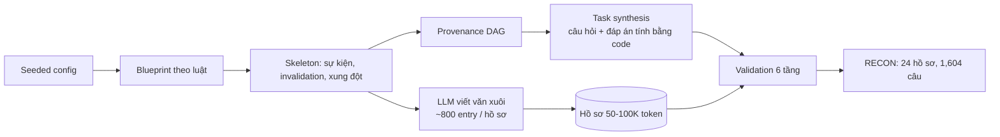

# Benchmark: RECON (arXiv 2607.16716)

## 1. Thông tin chung & Tài nguyên

- **Tiêu đề:** trang arXiv ghi "RECON: Benchmarking Agent Memory for Compositional Reasoning over Long Contexts". Tên viết tắt RECON được giải thích trong bản HTML là "Reasoning over Extended Contexts with Obfuscated Narratives". Hai cách gọi cùng chỉ một bài.
- **Mã arXiv:** [2607.16716](https://arxiv.org/abs/2607.16716), v1, cs.AI, nộp 18/07/2026. Một tác giả: Mihir Shriniwas Arya (RV College of Engineering). Là preprint, chưa rõ đã qua bình duyệt hay chưa.
- **Mã nguồn / dữ liệu:** bài dẫn một repo ẩn danh `https://anonymous.4open.science/r/RECON-Bench` và hứa phát hành dataset, generator (bộ sinh dữ liệu) và evaluation harness (bộ chạy đánh giá). Khi tôi mở, trang chỉ hiện tiêu đề "Anonymous Github", không thấy nội dung. **Chưa xác nhận dữ liệu đã công khai và tải được.** Không thấy repo GitHub hay Hugging Face chính thức.
- **Giấy phép:** bài báo CC BY 4.0. Giấy phép của dataset và code: **chưa rõ**.
- **Ngôn ngữ:** các trang đã đọc không nêu rõ. Có thể là tiếng Anh (header kiểu `[Day X, HH:MM]`, tên mô hình, trang alphaXiv gắn thẻ "en") nhưng **chưa rõ**.
- **Nguồn tôi đã đọc:** trang alphaXiv, trang abs arXiv, bản HTML arXiv v1 (qua công cụ tóm tắt, đọc được khoảng 100,000/114,044 ký tự đầu; phần phụ lục bị cắt nên không trích được câu hỏi nguyên văn).

## 2. Bộ dữ liệu

### 2.1. Quy mô

- **24 case file** (hồ sơ vụ việc) thuộc ba miền: hình sự (crime), y tế (medical), tài chính (finance). Mỗi hồ sơ dài khoảng 50,000 đến 100,000 token, gồm khoảng 800 entry có mốc thời gian trải trên 30 ngày.
- **1,604 câu hỏi.** 190 câu (11.8%) bị gắn cờ là trả lời được từ kiến thức sẵn có của mô hình (contamination filter: ba mô hình trả lời không có ngữ cảnh, câu nào có ít nhất hai mô hình đúng thì bị loại khỏi đánh giá chính). Còn **1,414 câu "sạch"** dùng cho đánh giá chính.
- Dữ liệu là **tổng hợp**: cấu trúc vụ việc do code sinh, LLM chỉ viết lại thành văn xuôi. Không phải hồ sơ thật.

### 2.2. Cách xây dựng (và vì sao gọi là "obfuscated")

Bài **không giải thích rõ** lý do chọn chữ "obfuscated". Theo cách làm, hợp lý nhất là hiểu: sự kiện được giấu trong lớp văn xuôi dài do LLM viết, các bằng chứng liên quan nằm rải rác, không gắn nhãn. Đây là suy luận của tôi, không phải lời tác giả. Một chi tiết hỗ trợ: bằng chứng giải quyết xung đột "không gắn nhãn và thường nằm xa" trong văn bản.

Quy trình bảy bước (theo bản HTML):

1. Seeded configuration (cấu hình theo hạt giống ngẫu nhiên): miền, số nhân vật, hạn ngạch bằng chứng.
2. Attribute-conditioned blueprint: bộ sinh theo luật, mỗi luật chỉ kích hoạt khi đủ thuộc tính tiền đề.
3. Skeleton expansion: mở rộng thành các sự kiện có mốc thời gian, chuỗi bằng chứng, vô hiệu hóa (invalidation), xung đột, phản thực, luồng dữ liệu song song.
4. Provenance DAG (đồ thị có hướng không chu trình ghi nguồn gốc suy luận): bằng chứng nào nâng đỡ kết luận nào.
5. Task synthesis: sinh câu hỏi bằng duyệt đồ thị theo ma trận hạn ngạch cố định.
6. Narrative realization: LLM viết lại thành hồ sơ văn xuôi, ràng buộc giữ nguyên sự thật.
7. Validation sáu tầng: kiểm schema, kiểm DAG và thời gian, grounding, LLM audit, kiểm độ bền, kiểm người.

Điểm then chốt: **đáp án và chứng minh được tính bằng code; LLM không định nghĩa cấu trúc nhân quả hay đáp án.** Vì vậy đáp án gốc không phụ thuộc phán đoán LLM, nhưng tính chân thực của văn xuôi thì có.

### 2.3. Định dạng hồ sơ

Mỗi entry có header dạng `[Day X, HH:MM] [TYPE] [AUTHOR]`. Loại entry gồm lời khai nhân chứng, báo cáo phòng lab pháp y, hồ sơ tài chính. Miền hình sự có bốn luồng song song (cell tower, camera giám sát, biên lai giao dịch, nhật ký ra vào tòa nhà) phủ từng phần và chồng lấn nhau; miền khác dùng luồng tương tự (hồ sơ lâm sàng, hồ sơ kiểm toán). Có năm dạng đáp án: MCQ-Single 392, MCQ-Multiple 384, Integer 264, Ordering 324, Free-form 240 câu.

### 2.4. Sáu nhóm tác vụ

| Nhóm | Số câu | Nội dung |
|---|---|---|
| Chain Reconstruction (chuỗi bằng chứng) | 336 | Tìm và xếp đúng thứ tự chuỗi 5-15 bước rải khắp hồ sơ |
| Cascade Propagation (truyền lan vô hiệu hóa) | 288 | Từ một invalidation chính thức (mẫu bị nhiễm, lời khai bị rút, bản ghi kiểm toán bị sửa, kết luận lâm sàng bị đổi), xác định kết luận nào mất chỗ dựa, kết luận nào vẫn đứng nhờ bằng chứng độc lập |
| Source Conflict Resolution (giải quyết xung đột nguồn bằng đối chiếu) | 264 | Hai lời khai không dung hòa được, kèm đúng một nguồn độc lập (thuộc luồng dữ liệu khác) phân xử |
| Counterfactual Reasoning (phản thực) | 264 | Suy luận trên dòng thời gian thay thế |
| Temporal Constraint Satisfaction | 216 | Thỏa ràng buộc thời gian trên các luồng song song |
| Temporal Fact Retrieval (đối chứng) | 236 | Truy xuất fact thời gian cơ bản, ít phép hợp thành |

Tổng sáu nhóm = 1,604, khớp tổng số câu. Chưa rõ số câu "sạch" của từng nhóm sau khi lọc.

Về nhóm Source Conflict: bài định nghĩa nguồn phân xử bằng **đối chiếu độc lập (corroboration)**, **không** gán điểm uy tín (credibility) cho nguồn. Đây là khác biệt quan trọng với `credibility_score` của đồ án (xem mục 6).

### 2.5. Ví dụ

- Ví dụ minh họa trong bài (không phải câu hỏi nguyên văn): phòng lab báo chiếc cốc bị nhiễm bẩn nên khớp vân tay lấy từ cốc đó vô hiệu, nhưng một xét nghiệm hóa học riêng trên cùng chiếc cốc vẫn còn giá trị. Đây là mẫu của nhóm Cascade.
- Phụ lục E có một câu trắc nghiệm sáu lựa chọn cho mỗi nhóm, mỗi lựa chọn nhiễu gắn nhãn kiểu lỗi nó nhắm tới. Ví dụ ở Cascade, "Option E is the primary trap" (kiểm tra mô hình có sụp đổ mọi kết luận phía sau hay không). **Tôi không đọc được nội dung câu hỏi nguyên văn** nên không chép ở đây.

## 3. Chỉ số đo

- **Accuracy (Strict Accuracy):** đúng hoàn toàn mới tính, không điểm từng phần, không trừ điểm câu sai.
- **Score (chỉ số nhạy định dạng, format-sensitive):** mỗi dạng đáp án một công thức: MCQ-Single +1 đúng, -0.2 sai, 0 bỏ trống; MCQ-Multiple `c/k - w/(n-k)` (c, w là số lựa chọn đúng/sai đã chọn; k, n chưa được bài định nghĩa rõ trong phần tôi đọc); Integer là exact match; Ordering dùng Kendall's tau; Free-form là trung bình hai phán quyết nhị phân của LLM judge (gpt-4o và gemini-2.5-flash). Vì Score trộn nhiều thang, nên xếp hạng theo Score và theo Accuracy có thể lệch (ví dụ gpt-5.1 đứng đầu Score nhưng gemini-2.5-pro đứng đầu Accuracy).
- **Coverage (phân tích độ phủ):** với mỗi câu, coverage là tỉ lệ entry bằng chứng gold có header `[Day X, HH:MM] [TYPE] [AUTHOR]` xuất hiện **nguyên văn** trong ngữ cảnh đã truy xuất. Một câu chỉ tính là "retrieval hit" khi coverage đầy đủ; còn lại là "retrieval miss". Phân tích này tách lỗi truy xuất khỏi lỗi suy luận.
- Hệ quả của định nghĩa: coverage dựa vào khớp header nguyên văn nên **không áp dụng được** cho hệ memory làm paraphrase (xem mục 4).

## 4. Baseline và số công bố

Bảng 2 của bài (Score / Accuracy), trên các câu sạch:

| Nhóm | Hệ thống | Score | Accuracy |
|---|---|---|---|
| Long-context (cả hồ sơ trong prompt) | gpt-5.1 | 0.287 | 20.3% |
| | gemini-2.5-pro | 0.265 | **22.4%** (tốt nhất không-Oracle) |
| | gemini-2.5-flash | 0.256 | 15.3% |
| | kimi-k2.5 | 0.257 | 13.8% |
| | gpt-4o-mini | 0.232 | 11.2% |
| | qwen3-vl-30b | 0.230 | 14.6% |
| | gpt-4.1-mini | 0.206 | 10.7% |
| | llama-3.3-70b | 0.192 | 9.8% |
| Oracle (nhận ground truth có cấu trúc thay vì văn xuôi) | gemini-2.5-flash | 0.654 | **54.6%** |
| | gpt-5.1 | 0.638 | 53.7% |
| RAG | dense thường | 0.178 | 10.5% |
| | + rerank | 0.192 | 14.5% |
| | hybrid + rerank | 0.179 | 11.8% |
| | hybrid + rerank + multi-query | 0.173 | 11.5% |
| Memory | Supermemory | 0.211 | 15.1% |
| | Mem0-Graph | 0.149 | 10.8% |
| | Hindsight | 0.148 | 10.2% |
| | Mem0 | 0.112 | 9.7% |

- **Closed-book:** bài **không báo điểm** closed-book. Ba mô hình chỉ dùng để lọc contamination.
- **Oracle** đổi cả định dạng đầu vào chứ không chỉ khôi phục truy xuất, nên là chẩn đoán (diagnostic), không phải ablation thuần về retrieval.
- **Coverage vs accuracy:**

| Hệ thống | Coverage đầy đủ | Retrieval miss |
|---|---|---|
| RAG | 20.6% (782 câu) | 1.3% (632 câu) |
| Memory | 16.7% (722 câu) | 4.3% (692 câu) |

  Đọc đúng: khi bằng chứng gold đã nằm trong ngữ cảnh, RAG vẫn chỉ đúng khoảng một phần năm; khi hụt, gần như không đúng (1.3%). Tức coverage là **điều kiện cần nhưng chưa đủ**: có coverage không bảo đảm đúng, thiếu coverage gần như chắc sai. Long-context giữ toàn bộ entry nhưng vẫn chỉ đạt trung bình 14.8%, so với 54.2% của Oracle (cùng mô hình hay không: chưa rõ). Mem0 và Mem0-Graph bị loại khỏi phân tích coverage vì ingestion paraphrase bằng chứng thành fact nguyên tử, mất header; "Memory" trong bảng coverage do đó là các hệ còn lại (cụ thể hệ nào: chưa rõ).
- **Oracle so với LLM tốt nhất theo nhóm (Bảng 3):** Source Conflict 88.9% vs 27.8%; Cascade 81.8% vs 18.2%; Chain 77.3% vs 18.2%; Counterfactual 41.2% vs 23.5%; Temporal Constraint 33.3% vs 20.0%; Temporal Fact Retrieval 23.5% vs 35.3% (LLM cao hơn Oracle ở nhóm đối chứng). Tác giả cho rằng khoảng cách lớn ở Chain/Cascade/Conflict chủ yếu do truy xuất, còn Counterfactual/Temporal Constraint do giới hạn suy luận; đây là chẩn đoán của họ, không phải cô lập nhân quả.
- **Người:** 60 câu, 3 người mỗi câu, bỏ phiếu đa số: 63.0% Accuracy (Score 0.54), bỏ trống 11.8%, khoảng 8.8 phút/câu, nhưng người nhận gói bằng chứng đã chọn lọc nên so sánh bất đối xứng. Theo nhóm: Temporal Fact Retrieval 90%, Temporal Constraint 78%, Source Conflict 70%, Chain 58%, Cascade 45%, Counterfactual 37%.
- **Kiểm chất lượng:** 200 câu, 3 người gán nhãn mù mỗi câu (23 annotator), đa số khớp đáp án 86.3% (Fleiss' kappa 0.69), **13.2% bị gắn mơ hồ**, tập trung ở Counterfactual và Cascade.

## 5. Ưu điểm / Nhược điểm

**Ưu điểm**
- Hiếm: có hẳn nhóm **Cascade** (hậu quả của một invalidation, kết luận nào còn vững nhờ bằng chứng độc lập) và **Source Conflict**, đúng chỗ các benchmark xung đột khác (ConflictBank, MemoryAgentBench) không đo.
- Đáp án tính bằng code từ DAG, có proof trace; không nhờ LLM gán nhãn.
- Có chỉ số coverage tách lỗi truy xuất khỏi lỗi suy luận; có baseline RAG, hệ memory và Oracle cùng bộ câu hỏi.
- Có nhóm đối chứng (Temporal Fact Retrieval) và baseline người.

**Nhược điểm**
- **Rất nhỏ:** chỉ 24 hồ sơ, nên phương sai theo hồ sơ lớn; chưa rõ có báo khoảng tin cậy hay không.
- **13.2% câu mơ hồ**, nhiều ở Counterfactual/Cascade, đúng nhóm liên quan nhất tới đồ án. Chặn trên của Accuracy khó diễn giải; kappa 0.69 chỉ ở mức khá.
- **Tổng hợp**: văn xuôi do LLM viết, tác giả tự nêu mô hình quen văn phong tương tự có thể được lợi; biết schema có thể khai thác định dạng đáp án; không phải agent triển khai thật.
- Hồ sơ là **một khối văn bản 50-100K token trong một lần**, không phải dòng cập nhật theo thời gian. Mốc thời gian là "Day X, HH:MM" trong 30 ngày, không phải ngày lịch thật nên không ánh xạ trực tiếp sang `start_time`.
- Dữ liệu và giấy phép chưa xác nhận công khai (mục 1); preprint một tác giả.
- Oracle đổi cả định dạng nên số 54.6% không phải trần của riêng retrieval.
- Chỉ số memory đo bằng header nguyên văn nên thiên vị hệ giữ nguyên văn.

## 6. Áp dụng vào đồ án

**Đối chiếu phạm vi.** `docs/decisions/09_CONFLICT_RESOLUTION_SCOPE.md` đã **bỏ nhánh đa nguồn và Credibility Score**, chỉ giữ Evolution (`end_time`) và Falsehood (`invalidated_at`) trên nguồn có lịch sử (Wikipedia), với lý do "không có benchmark công khai phù hợp". RECON là ứng viên đáng xem lại lý do đó, nhưng phải thận trọng:

| Thành phần đồ án (`01_INITIAL_BASE_DESIGN.md` mục 2.1) | RECON cho gì | Đánh giá |
|---|---|---|
| `invalidated_at` (Falsehood) | Nhóm Cascade: invalidation chính thức (mẫu nhiễm bẩn, lời khai bị rút, bản ghi sửa) | Gần nhất. Đo thêm việc **truyền lan** sang kết luận phụ thuộc, điều thiết kế đồ án hiện chưa có (chỉ có `CORRECTS`, `SUSPECTS`) |
| `source`, `credibility_score` | Nhóm Source Conflict: nguồn có luồng dữ liệu khác nhau | Chỉ đo **đối chiếu độc lập**, không có điểm uy tín; không kiểm thử `credibility_score` trực tiếp |
| `end_time` (Evolution) | Không có đối ứng rõ | Hồ sơ không có chuyện "từng đúng rồi đổi"; chưa rõ có entry kiểu này không |
| Evolution ≠ Falsehood | Cascade thuần Falsehood; Evolution không được đo | Không kiểm thử phân biệt hai loại, và không có "Timeline ≠ Conflict" |
| Cơ chế 1 (truy xuất theo `T_req`) | Temporal Fact Retrieval, Temporal Constraint | Thời gian là "Day X, HH:MM", không phải `T_req` theo lịch; chỉ dùng được sau khi quy đổi |
| Cơ chế 2 (timeline / triplet) | Chain Reconstruction (xếp thứ tự 5-15 bước) | Liên quan lỏng; cần dựng graph từ văn xuôi |

**Cách chạy hệ thống đồ án (đề xuất, chưa thử):**
1. Chia mỗi hồ sơ theo entry (mỗi entry có header là một chunk tự nhiên, không cần chunking cố định). `start_time` lấy từ "Day X, HH:MM" quy ước một ngày gốc giả; `source` lấy từ `[AUTHOR]`/`[TYPE]`; `domain_features.domain` là miền hồ sơ.
2. Ingestion bằng LLM trích triplet; với Cascade cần cạnh phụ thuộc "A được suy ra từ B" để lan `invalidated_at` (phần mở rộng, hiện chưa có trong thiết kế).
3. Hỏi từng câu với `T_req` = cuối hồ sơ. Câu trắc nghiệm/Integer/Ordering chấm tự động được; Free-form cần LLM judge giống bài.
4. Chạy tập con: ưu tiên Cascade (288) và Source Conflict (264), thêm Temporal Fact Retrieval làm đối chứng; lọc câu sạch (1,414) nếu có cờ trong dữ liệu.
5. Báo cùng các điều kiện: Plain RAG, Long-context, Oracle nếu dữ liệu cho cấu trúc.

**Chỉ số đồ án tương ứng:** Strict Accuracy theo nhóm; coverage đầy đủ so với hụt (đo theo header nguyên văn, hệ đồ án giữ `chunk_id` nên làm được); False-invalidation rate (kết luận vẫn đứng bị đóng nhầm, tương ứng bẫy "sụp đổ mọi kết luận" của Cascade); token efficiency (triplet <1K token so với hồ sơ 50-100K).

**Vì sao phải báo coverage và accuracy riêng.** Số trong bài cho thấy: RAG có coverage đầy đủ chỉ đúng 20.6% (nên truy xuất tốt vẫn chưa đủ), hụt thì 1.3% (nên truy xuất vẫn là nút thắt lớn). Với đồ án, nếu hệ hybrid Vector + Graph cải thiện coverage nhưng Accuracy khi coverage đầy đủ không tăng, thì cải thiện đó đến từ truy xuất chứ không từ suy luận; báo hai số riêng để không nhập nhằng.

**Phần không so sánh công bằng:**
- Số Mem0, Mem0-Graph, Supermemory, Hindsight không có phân tích coverage, và cấu hình (mô hình trả lời, top-k) trong bài **chưa rõ**; không thể đặt số của đồ án cạnh nhau nếu đổi LLM.
- Hệ đồ án có ingestion offline bằng LLM trích triplet, chi phí ingestion không được bài tính.
- Oracle đổi định dạng đầu vào nên không phải trần hợp lệ cho hệ đồ án.
- Không đo `credibility_score`, Evolution, hay chống rò rỉ tương lai; kết quả tốt trên RECON không chứng minh các thành phần này.
- Dữ liệu tổng hợp, 24 hồ sơ, 13.2% mơ hồ: chỉ dùng làm bằng chứng bổ sung, không phải benchmark chính của Cơ chế 3.

**Quyết định đề xuất:** không đảo lại quyết định bỏ đa nguồn trong `09`. Dùng RECON (nếu dữ liệu công khai) như thí nghiệm phụ cho `invalidated_at` và truyền lan. Nếu dữ liệu không phát hành kịp, ghi vào hạn chế thay vì tự dựng lại (generator chưa có).

## 7. Chỗ chưa xác nhận

- Dữ liệu, generator, harness đã công khai chưa; repo ẩn danh chỉ hiện tiêu đề khi tôi mở. Giấy phép dataset/code.
- Ngôn ngữ của hồ sơ (nhiều khả năng tiếng Anh, chưa rõ).
- Nội dung nguyên văn các câu hỏi mẫu ở Phụ lục E (không đọc được); ví dụ cốc nhiễm bẩn chỉ là mô tả minh họa.
- Lý do chọn chữ "obfuscated" (bài không giải thích).
- Mem0 / Mem0-Graph: cấu hình chạy cụ thể, mô hình đứng sau; "Memory" trong bảng coverage gồm hệ nào.
- Số câu sạch theo từng nhóm; khoảng tin cậy; ý nghĩa k, n trong công thức MCQ-Multiple.
- Closed-book: không có điểm công bố.
- Các số chép từ bản HTML qua công cụ tóm tắt, chưa đối chiếu bảng gốc trong PDF; cần kiểm lại trước khi trích vào luận văn.
- Phần cuối bản HTML (khoảng 14,000 ký tự) chưa đọc.
