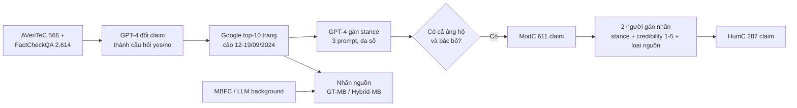

# Benchmark: CONFACT (2505.17762)

## 1. Thông tin chung & Tài nguyên

- **Tiêu đề:** Resolving Conflicting Evidence in Automated Fact-Checking: A Study on Retrieval-Augmented LLMs. Bộ dữ liệu tên **CONFACT** (Conflicting Evidence for Fact-Checking).
- **Mã arXiv:** [2505.17762](https://arxiv.org/abs/2505.17762), v1 (23/05/2025), cs.CL / cs.IR. Tác giả: Ziyu Ge, Yuhao Wu, Daniel Wai Kit Chin, Roy Ka-Wei Lee, Rui Cao.
- **Venue:** IJCAI 2025 (theo thông tin người giao việc; trang arXiv/HTML tôi đọc không ghi venue, chưa kiểm).
- **Mã nguồn + dữ liệu:** [github.com/zoeyyes/CONFACT](https://github.com/zoeyyes/CONFACT). Thư mục `data/` chứa dataset (README nhắc `data/dataset/ModC.pkl.gz`), `mediaBG_check/` (thu thập "background" của nguồn), `method/` (rerank), cùng `main.py`, `preprocess.py`, `inference.py`, `eval.py`.
- **Cách tải:** README không có hướng dẫn tải riêng; nhiều khả năng chỉ cần `git clone`. File `.pkl.gz` chưa mở thử (chưa kiểm). Không thấy bản Hugging Face (chưa kiểm).
- **Giấy phép:** bài báo CC BY 4.0. **Dữ liệu/code: README và paper đều không nêu giấy phép** (chưa rõ). Lưu ý thêm: nội dung evidence là trang web cào về, bản quyền gốc thuộc các site đó (đánh giá của tôi, chưa kiểm thêm).
- **Ngôn ngữ:** tiếng Anh (chưa kiểm cụ thể từng trang).
- **Nguồn tôi đọc:** PDF không trích được văn bản (nén FlateDecode), nên số liệu dưới đây lấy từ bản HTML arXiv và README GitHub **qua công cụ tóm tắt**, chưa đối chiếu bảng gốc.

## 2. Bộ dữ liệu

### 2.1. Quy mô

- **3,180 claim** ban đầu, gộp từ AVeriTeC (566) và FactCheckQA (2,614). Bỏ claim từ mạng xã hội vì khó tìm qua search engine. Chỉ giữ nhãn Refuted/Supported (AVeriTeC) và true/false (FactCheckQA).
- Mỗi claim được đổi thành **câu hỏi yes/no** bằng GPT-4. Ví dụ: "Nigeria had a population of 45 million at the time of independence" thành "Did Nigeria have a population of 45 million at the time of independence?". Claim đúng thì đáp án Yes, claim sai thì No.
- Chỉ những claim **có cả tài liệu ủng hộ lẫn bác bỏ** mới vào bộ cuối (611 trên 3,180, tức 17.8%). Hai tập con:

| Tập | Số claim | Yes / No | Số tài liệu nguồn | Ý nghĩa |
|---|---|---|---|---|
| **ModC** (Model Conflicts) | 611 | 125 / 486 | 2,469 | Xung đột do GPT-4 gán stance, lọc bước 1 |
| **HumC** (Human Conflicts) | 287 | 51 / 236 | 1,418 | Người xác nhận xung đột (bản sạch hơn) |

- Paper không nói rõ HumC có phải tập con của ModC hay không (con số gợi ý là có, chưa kiểm). Cả hai **lệch lớp mạnh** về phía No (khoảng 80%), nên họ báo Macro-F1.

### 2.2. Cách xây dựng

1. Mỗi câu hỏi đưa vào Google, lấy **top 10 trang web**. Cào trong một tuần (12 đến 19/09/2024), lưu Wayback Machine để tái lập.
2. **Bước 1, GPT-4 gán stance** (ủng hộ/bác bỏ claim) cho từng tài liệu, ba biến thể prompt (chỉ URL, văn bản cào, văn bản kèm justification) lấy đa số phiếu. Claim nào có cả hai phía mới đi tiếp.
3. **Bước 2, người gán nhãn:** hai annotator xem từng cặp ủng hộ/bác bỏ, người thứ ba phân xử. Họ kiểm stance, chấm **độ tin cậy nguồn thang 1-5**, và gán loại nguồn (Mainstream News, Government, Non-profit, Academic, Social Media, Other). Krippendorff's alpha cho HumC = 0.586 (mức vừa, tác giả tự nhận).

### 2.3. Nhãn credibility lấy từ đâu, có theo thời gian không

Có **hai lớp nhãn** khác nhau, đừng nhầm:

- **MBFC (Media Bias/Fact Check):** trang đánh giá của chuyên gia, dùng làm "background" của nguồn, gọi là **GT-MB** (ground-truth media background). Nguồn nào không có trên MBFC thì thiếu background.
- **Hybrid-MB:** nếu MBFC thiếu, LLM tự sinh mô tả nguồn từ kết quả Google Search, rồi ánh xạ ra nhãn low/medium/high và điểm 0-1. Bộ dự đoán huấn luyện trên dữ liệu Baly et al. (2018), zero-shot đạt khoảng 70.04% (theo bản tóm tắt, chưa kiểm).
- **Điểm người chấm 1-5** là nhãn riêng của annotator. Ví dụ phát hiện của paper: khoảng 30% nguồn gây hiểu lầm bị MBFC xếp là không đáng tin, nhưng annotator lại chấm 69.8% trong số đó là đáng tin. Tức MBFC và người lệch nhau khá nhiều.
- **Có theo thời gian không: không.** Paper coi credibility là tĩnh, không phụ thuộc ngữ cảnh (chính họ nêu là hạn chế). Rating MBFC là một ảnh chụp tại thời điểm họ tra, paper không ghi ngày tra (chưa kiểm). Không có chuyện "nguồn X uy tín năm 2019 nhưng hết uy tín năm 2024".

### 2.4. Chunk gold có chứa đáp án không

- **Không có chunk/span gold.** Gold là nhãn Yes/No của claim. Evidence được gán nhãn theo **stance** (ủng hộ hay bác bỏ) và credibility ở mức **tài liệu**, không có annotation span chứa đáp án.
- Thực tế mỗi claim có cả tài liệu ủng hộ lẫn bác bỏ (xung đột), nên một phần tài liệu cố tình **đi ngược đáp án gold**. Top-5 đoạn BM25 (xem mục 3) không được bảo đảm chứa bằng chứng đúng; paper nêu "irrelevant or conflicting retrieved context" là một nhóm lỗi.
- Hệ quả cho đồ án: không đo được recall của retrieval theo kiểu "gold chunk có nằm trong top-k không" mà phải tự suy từ stance + nhãn claim (xem mục 6).

### 2.5. Định dạng

JSON, mỗi đối tượng là một claim, các trường (theo README): `id`, `claim`, `label` (vd "Supported"), `claim_date`, `review_date`, `country` (ISO, vd "NG"), `question`, `original_claim_url`, `fact_checking_article` (link lưu trữ), `evidence_url` (list; mỗi phần tử có `evidence_id`, `original_link`, `content`). Thấy trường `source`/credibility trong `evidence_url` hay không: chưa kiểm (README không liệt kê; nhãn media có thể nằm ở kết quả của `mediaBG_check/`).

Mốc thời gian có sẵn: `claim_date`, `review_date` (mức claim), và ngày cào 09/2024. **Không có ngày đăng/start_time cho từng evidence** theo README (chưa kiểm trong file dữ liệu).

## 3. Chỉ số đo

- **Accuracy** (khớp Yes/No) và **Macro-F1** (vì lệch lớp).
- Retrieval trong paper: chia đoạn tối đa 256 từ, BM25 lấy top-5 đoạn (họ nói ranker neural không cải thiện đáng kể). Suy luận bằng vLLM, BF16, greedy decoding. Siêu tham số credibility: ngưỡng γ = 0.3, β = 0.8 (chỉnh trên thí nghiệm sơ bộ).
- Không có chỉ số retrieval (recall@k, MRR) và không có chỉ số thời gian.

## 4. Baseline và số công bố

Toàn bộ số dưới đây là **tự báo cáo của tác giả** (Acc / Macro-F1, top-5 đoạn), chép từ bản tóm tắt HTML, **chưa đối chiếu bảng gốc**.

**Mô hình:** LLaMA-3.1-8B, Qwen-2 (ghi "8B" trong tóm tắt, chưa kiểm cỡ), Mistral-v0.3-7B; GPT-4o-mini chạy riêng.

**Phương pháp:** DirA (trả lời thẳng), MajV (đa số), DisA (có hướng dẫn phân biệt), CoT; nhóm SBA (Source Background Aware: đưa mô tả/độ tin cậy nguồn vào prompt) gồm SBA-dir, SBA-CoT, SBA-exp; và nhóm lọc/trọng số theo credibility (CW, SF). Chi tiết cách định nghĩa từng biến thể: chưa kiểm.

| Tập | Mô hình | Phương pháp | Acc | Macro-F1 |
|---|---|---|---|---|
| ModC | LLaMA-3.1 | DirA | 71.36 | 66.13 |
| ModC | LLaMA-3.1 | MajV | 79.87 | 45.96 |
| ModC | LLaMA-3.1 | DisA | 72.18 | 63.26 |
| ModC | LLaMA-3.1 | CoT | 77.58 | 68.50 |
| ModC | LLaMA-3.1 | SBA-CoT (GT background) | 78.07 | 68.32 |
| ModC | LLaMA-3.1 | SBA-dir (GT) | 73.16 | 67.96 |
| ModC | LLaMA-3.1 | SBA-exp (GT) | 74.47 | 64.57 |
| HumC | LLaMA-3.1 | DirA | 70.03 | 63.81 |
| HumC | LLaMA-3.1 | SBA-dir (GT) | 72.82 | 66.46 |
| HumC | LLaMA-3.1 | SBA-CoT (GT) | 78.40 | 66.07 |
| (bảng 6) | GPT-4o-mini | CoT | 78.23 | 70.42 |
| (bảng 6) | GPT-4o-mini | CoT + GT background | 79.05 | 71.33 |

**Đọc số cho đúng.** MajV có Acc 79.87 cao nhất nhưng F1 chỉ 45.96: nó gần như luôn đáp "No" (lớp chiếm ~80%), nên Acc đánh lừa. Với tập lệch lớp này, một mô hình đáp "No" hết đã được khoảng 80% (suy ra từ 486/611 và 236/287, đánh giá của tôi). Nghĩa là mức cải thiện của SBA so với baseline khá nhỏ (vài điểm) và nên xem F1.

**Ablation (HumC, LLaMA-3.1, GT):** top-10 đoạn kém top-5 (SBA-dir 71.78/65.04 so với 72.82/66.46); chia theo câu (top-5 câu) tụt mạnh còn 62.37/57.52. Đoạn tốt hơn câu.

**Đánh giá người:** 4 nhà nghiên cứu NLP, 20 claim. Accuracy không background 49.45, GT background 50.34, Hybrid 48.47. Mẫu rất nhỏ, người hay trả lời "unsure".

**Phát hiện chính của tác giả:**
1. Vanilla RAG kém khi bằng chứng xung đột, F1 lớp thiểu số thấp.
2. Đưa background nguồn vào bước **sinh câu trả lời** (nhất là CoT hoặc có chỉ dẫn phân biệt) cho cải thiện ổn định nhất.
3. **Lọc hoặc xếp hạng lại theo credibility có thể làm tệ hơn**, vì credibility và độ liên quan không trùng nhau, lọc còn xoá cả bằng chứng phản bác hữu ích.
4. Background chuyên gia (GT) thường tốt hơn background LLM sinh (Hybrid).

## 5. Ưu điểm / Nhược điểm

**Ưu điểm**
- Hiếm: **bằng chứng thật từ web** (không do LLM sinh), có nhãn stance và credibility, đúng loại "nhiều nguồn mâu thuẫn" mà ConflictBank (04) không có.
- Có nguồn xung đột rõ: ba kiểu stance, source-credibility và majority-bias (nhiều nguồn kém uy tín áp đảo một nguồn tốt).
- Nhỏ vừa phải (287 đến 611 claim), cào sẵn và lưu Wayback nên chạy được không cần search.
- Đã có baseline credibility-weighted, đúng thứ `credibility_score` của đồ án định làm; kèm kết luận phủ định đáng tham khảo (lọc theo credibility có thể hại).

**Nhược điểm**
- **Là fact-checking claim, không phải QA mở.** Câu hỏi là yes/no về tính đúng sai của một claim. Hệ thống đồ án trả lời kiểu "Ai là chủ tịch CLB X năm 2015?" (đáp án là thực thể/ngày), nên đầu ra và chỉ số khác hẳn.
- **Không có trục thời gian:** credibility tĩnh; không có `start_time`/`end_time` cho evidence; chỉ có `claim_date`/`review_date` ở mức claim. Không đo Evolution hay Falsehood.
- Lệch lớp (~80% No) và HumC chỉ 287 claim; alpha 0.586 chỉ ở mức vừa.
- MBFC có thể thiên lệch (tác giả tự nêu); thiếu MBFC thì dùng LLM sinh, nhiễu hơn.
- Giấy phép dữ liệu không rõ; evidence là trang web cào.
- Không có gold span, không đo được chất lượng retrieval.
- Số công bố chỉ trên mô hình 7-8B và GPT-4o-mini, retrieval BM25 đơn giản; không phải hệ memory.

## 6. Áp dụng vào đồ án

**Đối chiếu phạm vi** (`docs/decisions/09_CONFLICT_RESOLUTION_SCOPE.md`): đồ án đã **bỏ nhánh đa nguồn và Credibility Score**, lý do là "không có benchmark công khai phù hợp". CONFACT là ứng viên trả lời lại đúng lý do đó ở khía cạnh **nguồn có nhãn credibility**. Tuy nhiên nó **không** có trục thời gian, nên chỉ kiểm thử được một nửa `credibility_score`, không kiểm thử Evolution/Falsehood.

| Thành phần đồ án (`01_INITIAL_BASE_DESIGN.md` mục 2.1) | CONFACT cho gì | Đánh giá |
|---|---|---|
| `source` (String) | Domain/URL của mỗi evidence (`original_link`) | Dùng được trực tiếp |
| `credibility_score` (Float 0.0-1.0) | Nhãn MBFC (GT-MB), nhãn Hybrid-MB (0-1), điểm người 1-5 | Có thể quy về [0,1]; MBFC là nhãn rời rạc, cần bảng quy đổi (chưa kiểm định dạng nhãn trong file) |
| `start_time` | Chỉ có `claim_date`/`review_date` ở mức claim, ngày cào 09/2024 | Không có thời gian đăng của evidence; phải dùng `review_date`/ngày cào làm xấp xỉ, chưa kiểm |
| `end_time` / `invalidated_at` | Không có | Không đo |
| Evolution ≠ Falsehood, Timeline ≠ Conflict | Không có | Không đo |
| `domain_features.country` | Trường `country` của claim | Khớp tên trường, ý nghĩa gần |

**Cách ánh xạ vào hệ thống (đề xuất, chưa thử):**
1. Mỗi `evidence_url[i].content` cắt theo đoạn tối đa 256 từ như paper, mỗi đoạn là một Chunk.
2. `source` = domain của `original_link`; `credibility_score` = nhãn MBFC quy về [0,1] (ví dụ High 1.0, Medium 0.5, Low 0.0; chỉ là ví dụ minh hoạ); nguồn không có MBFC thì NULL, không tự bịa điểm.
3. `start_time` = `review_date` (hoặc ngày cào 2024-09-12..19) làm xấp xỉ; ghi rõ là ngày thu thập, không phải ngày sự kiện, đúng như lưu ý ở `09_CONFLICT_RESOLUTION_SCOPE.md` về ngày bản chụp so với ngày hiệu lực. `T_req` đặt sau mốc này để bộ lọc chống rò rỉ tương lai không loại nhầm.
4. Nạp toàn bộ tài liệu của một claim vào kho, hỏi bằng `question` yes/no, chấm bằng Accuracy và Macro-F1.
5. So sánh tối thiểu: Plain RAG, RAG + `credibility_score` làm trọng số khi re-rank (CW), RAG + đưa nguồn vào prompt (SBA). Lưu ý phát hiện 3 của paper: nhiều khả năng đưa credibility vào **prompt sinh** có lợi hơn **lọc cứng**, nên khi thiết kế `W3·Credibility` nên thử cả hai và không giả định lọc luôn tốt.

**Ví dụ minh hoạ.** Claim "Nigeria có 45 triệu dân lúc độc lập": 5 đoạn top có 3 đoạn từ blog kém uy tín nói đúng và 1 đoạn từ nguồn báo chính thống nói sai. Đây là ca *majority-bias*. Hệ có `credibility_score` kỳ vọng bỏ phiếu theo trọng số thay vì đếm đầu, nhưng nếu nguồn tốt lại không liên quan, lọc theo credibility sẽ không cứu được.

**Chỉ số tương ứng:** Accuracy, Macro-F1 (bắt buộc, vì lệch lớp), thêm tỉ lệ đáp "No" để phát hiện hệ chỉ đoán lớp đa số; token efficiency theo định nghĩa chung của đồ án.

**Phần không so sánh công bằng:**
- Số của paper dùng LLaMA-3.1-8B/GPT-4o-mini với BM25 top-5 và prompt cố định; hệ đồ án có hybrid retrieval + rerank, nên không đặt cạnh trực tiếp nếu đổi LLM.
- Đầu ra yes/no khác loại câu hỏi đồ án (thực thể, mốc thời gian); kết quả tốt ở đây **không** chứng minh Cơ chế 3 (Evolution/Falsehood) hay chống rò rỉ tương lai.
- Baseline "luôn đáp No" đã đạt khoảng 80% Acc; phải báo F1.

**Quyết định đề xuất:** không đảo lại quyết định bỏ đa nguồn trong `09`. Nếu muốn, dùng CONFACT như thí nghiệm phụ nhỏ (HumC, 287 claim) để có một con số cho `credibility_score`, và ghi rõ trong hạn chế rằng nó không đo thời gian. Việc này chỉ nên làm nếu còn thời gian sau Cơ chế 1 và 2.

## 7. Chỗ chưa xác nhận

- Giấy phép dữ liệu và code (chưa rõ); quyền dùng nội dung trang web cào.
- Trong file dữ liệu thực tế có sẵn trường credibility/MBFC cho từng evidence không, hay phải chạy `mediaBG_check/` mới có (chưa kiểm). Định dạng nhãn MBFC (nhãn rời rạc hay điểm).
- Ngày tra cứu MBFC; có trường thời gian đăng của từng evidence không (chưa kiểm).
- HumC có phải tập con ModC không; kích thước chính xác của Qwen-2 ("8B" trong tóm tắt).
- Định nghĩa chính xác DirA/MajV/DisA/SBA-*/CW/SF; cách tính điểm Hybrid-MB.
- Venue IJCAI 2025 (từ người giao việc, trang đã đọc không ghi).
- Tất cả số ở mục 4 chép qua công cụ tóm tắt từ bản HTML, PDF không đọc được; cần đối chiếu bảng gốc trước khi trích vào luận văn.
- Chưa tải thử dữ liệu, chưa mở `ModC.pkl.gz`.
