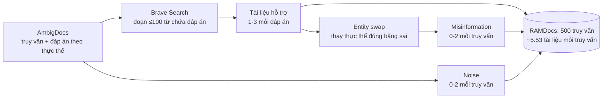

# Benchmark: RAMDocs + MADAM-RAG (arXiv 2504.13079)

## 1. Thông tin chung & Tài nguyên

- **Tiêu đề:** Retrieval-Augmented Generation with Conflicting Evidence. RAMDocs là tên dataset ("Retrieval with Ambiguity and Misinformation in Documents"), MADAM-RAG là phương pháp đề xuất kèm theo.
- **Mã arXiv:** [2504.13079](https://arxiv.org/abs/2504.13079), cs.CL (và cs.AI). v1 nộp 17/04/2025, v2 (bản hiện hành) sửa 12/08/2025. Tác giả: Han Wang, Archiki Prasad, Elias Stengel-Eskin, Mohit Bansal (UNC Chapel Hill). Công bố tại COLM 2025 (theo trang arXiv và README của repo).
- **Mã nguồn (GitHub):** [github.com/HanNight/RAMDocs](https://github.com/HanNight/RAMDocs): có `RAMDocs_test.jsonl` và `run_madam_rag.py` (tham số `model_name`, `cache_dir`, `data_path`, `num_rounds`, `seed`). Repo nhỏ (4 commit, 25 sao khi tôi xem).
- **Dữ liệu (Hugging Face):** [huggingface.co/datasets/HanNight/RAMDocs](https://huggingface.co/datasets/HanNight/RAMDocs) (link lấy từ README GitHub; **chưa mở trang Hub để kiểm tra** nội dung, số dòng, dataset card).
- **Giấy phép:** repo ghi **MIT** (LICENSE và README). Giấy phép riêng cho dữ liệu trên Hub: chưa kiểm. Lưu ý văn bản tài liệu lấy từ web qua Brave Search, nên quyền sử dụng lại nội dung gốc chưa rõ.
- **Ngôn ngữ:** tiếng Anh.
- **Nguồn tôi đã đọc:** bản HTML arXiv v2 (qua công cụ tóm tắt, không đọc PDF), trang abs arXiv, README GitHub. Các số bên dưới chép từ bản tóm tắt này, chưa đối chiếu bảng gốc.

## 2. Bộ dữ liệu

### 2.1. Ba loại "xung đột" mà RAMDocs gộp lại

- **Ambiguity (mơ hồ):** truy vấn có tên chung cho nhiều thực thể (ví dụ cùng một tên người), nên có **nhiều đáp án đúng cùng lúc**, mỗi đáp án ứng với một thực thể. Đây là xung đột bề mặt nhưng không có bên nào sai.
- **Misinformation (thông tin sai):** tài liệu chứa đáp án sai.
- **Noise (nhiễu):** tài liệu không trả lời câu hỏi (không liên quan hoặc chất lượng thấp).

Điểm cần nói rõ cho đồ án: đây là xung đột **trong một tập tài liệu truy xuất cho một truy vấn**, không có trục thời gian.

### 2.2. Quy mô

- **500 truy vấn**, chỉ có một file test (`RAMDocs_test.jsonl`); số dòng trên Hub: chưa kiểm.
- Số đáp án đúng mỗi truy vấn: 1 đến 3, trung bình 2.20.
- Tài liệu hỗ trợ: mỗi đáp án 1 đến 3 tài liệu (trung bình 1.77 mỗi đáp án, 3.84 mỗi truy vấn).
- Misinformation: 0 đến 2 tài liệu mỗi truy vấn (trung bình 0.61 đáp án sai mỗi mẫu).
- Noise: 0 đến 2 tài liệu mỗi truy vấn (trung bình 1.08).
- Trung bình **5.53 tài liệu mỗi truy vấn**. Tức mỗi mẫu rất nhỏ, đưa thẳng vào prompt được.

### 2.3. Cách xây dựng

1. **Nền AmbigDocs:** giữ truy vấn đã được tách nghĩa (disambiguated) và các đáp án theo từng thực thể.
2. **Tài liệu hỗ trợ:** truy xuất bằng Brave Search API, cắt thành đoạn tối đa 100 từ, chỉ giữ đoạn có chứa đáp án đúng.
3. **Misinformation:** **thay thực thể đúng bằng thực thể sai nhưng hợp lý** (entity swap), theo cách của FaithEval và Longpre et al. (2021). Nói cách khác là **sửa tổng hợp trên văn bản thật**, không phải sai sót mined từ web thật. Chi tiết (ai thực hiện việc thay: LLM hay luật; có kiểm tay không): chưa rõ.
4. **Noise:** tài liệu không liên quan hoặc chất lượng thấp; cách chọn cụ thể: chưa rõ.

### 2.4. Nhãn độ tin cậy nguồn: KHÔNG có

Theo bản tóm tắt tôi đọc, bài **không mô tả nhãn độ tin cậy nguồn** (credibility). Định dạng file từ README xác nhận điều này: mỗi tài liệu chỉ có `text`, `type`, `answer`; không có trường tên miền, nguồn hay điểm uy tín. Nhãn `type` (`correct` / `misinfo` / `noise`) là **nhãn đúng-sai của chính tài liệu** do bộ sinh gán, **không phải** nhãn độ tin cậy nguồn, và hệ thống không được dùng nó khi chạy (nó là ground truth). Hệ quả: benchmark này không kiểm thử việc "chọn nguồn uy tín hơn", chỉ kiểm thử việc **lọc theo nội dung và theo số phiếu**. Một tín hiệu mà hệ có thể dùng thật sự chỉ là số lượng tài liệu ủng hộ mỗi đáp án (xem mục 4).

### 2.5. Định dạng

JSONL, mỗi dòng có (theo README):
- `question`: truy vấn.
- `documents`: danh sách `{text, type, answer}` với `type` thuộc `correct` / `misinfo` / `noise`, `answer` là đáp án suy ra từ tài liệu (hoặc `unknown` với noise).
- `disambig_entity`: các thực thể cùng tên trong câu hỏi.
- `gold_answers`: đáp án đúng cho từng thực thể.
- `wrong_answers`: các đáp án sai.

Ví dụ nguyên văn một mẫu: chưa kiểm (chưa mở file dữ liệu). Hình dung theo mô tả: truy vấn về một cái tên chung, 2 thực thể thật cho 2 đáp án đúng, mỗi đáp án 1-2 đoạn web ủng hộ, thêm 1 đoạn đã đổi thực thể cho đáp án sai và 1 đoạn không liên quan. Đây là minh họa của tôi, không phải mẫu thật.

## 3. Chỉ số đo

- **Chỉ số chính: Exact Match (EM)** (bài gọi là accuracy). Một câu trả lời chỉ tính đúng khi **chứa đủ mọi đáp án vàng** và **không chứa đáp án sai chỉ được misinformation ủng hộ**. Cách khớp chuỗi cụ thể (chuẩn hóa, ai chấm): chưa rõ.
- Ablation có thêm Precision, Recall, F1.
- Đánh giá trên 3 tập: **FaithEval** (tập "inconsistent", 1,000 mẫu; thử việc bám ngữ cảnh khi có thông tin sai), **AmbigDocs** (1,000 mẫu test; liệt kê mọi đáp án hợp lệ), **RAMDocs** (500 truy vấn).

## 4. Baseline, MADAM-RAG và số công bố

### 4.1. MADAM-RAG

Multi-agent debate cho RAG, gồm:
- **Mỗi tài liệu một agent** (cùng LLM), vòng 1 chỉ trả lời dựa trên tài liệu của mình.
- **Aggregator** nhận mọi câu trả lời (xáo thứ tự), tổng hợp câu trả lời kèm giải thích; gộp đáp án theo từng thực thể và loại misinformation/noise.
- **Debate:** các vòng sau agent thấy kết quả aggregator, giữ hoặc sửa đáp án. Tối đa T = 3 vòng; dừng sớm nếu không agent nào đổi.
- Chi phí cao: trung bình khoảng 3,186 token vào và 1,547 token ra, so với 822 và 126 của prompt-based (Bảng 2 của bài).

### 4.2. Kết quả EM (%), số tự báo cáo

| Mô hình | Phương pháp | FaithEval | AmbigDocs | RAMDocs |
|---|---|---|---|---|
| Self-RAG (Llama2-13B) | Self-RAG | 12.40 | 55.00 | 26.80 |
| Llama3.3-70B-Inst | No RAG | 26.70 | 4.30 | 5.80 |
| | Prompt-based (nối chuỗi tài liệu) | 27.30 | 54.20 | 32.60 |
| | Single Agent + Self-reflection | 25.70 | 54.50 | 30.40 |
| | Speculative RAG | 41.80 | 44.30 | 30.60 |
| | Astute RAG | 37.10 | 46.80 | 31.80 |
| | **MADAM-RAG** | **43.10** | **58.20** | **34.40** |
| Qwen2.5-72B-Inst | No RAG | 26.40 | 1.80 | 4.20 |
| | Prompt-based | 38.50 | 41.20 | 20.60 |
| | Single Agent + Self-reflection | 39.40 | 29.40 | 21.80 |
| | Speculative RAG | 56.20 | 13.40 | 22.20 |
| | Astute RAG | 44.60 | 39.80 | 20.80 |
| | **MADAM-RAG** | **57.70** | **52.70** | **26.40** |
| GPT-4o-mini | No RAG | 31.00 | 1.00 | 2.50 |
| | Prompt-based | 21.00 | 51.50 | 25.00 |
| | Single Agent + Self-reflection | 36.00 | 44.50 | 22.50 |
| | Speculative RAG | 36.50 | 22.50 | 23.00 |
| | Astute RAG | 34.00 | 15.00 | 13.00 |
| | **MADAM-RAG** | **38.50** | **63.00** | **28.00** |

Ghi chú: abstract nêu "32.60 EM" cho Llama3.3-70B trên RAMDocs, trùng với dòng Prompt-based; điểm cao nhất của bảng là 34.40 (MADAM-RAG). Bài không dùng Self-RAG gốc với mô hình 70B; drafter của Speculative RAG không công khai nên tác giả thay bằng mô hình khác trong Bảng 1.

### 4.3. Số tài liệu hỗ trợ và số tài liệu sai ảnh hưởng thế nào

- **Mất cân bằng số tài liệu hỗ trợ** (thử trên 200 mẫu; một đáp án có 1 tài liệu, đáp án kia 1-3): baseline giảm khi mất cân bằng tăng (prompt nối chuỗi giảm tới 8%); MADAM-RAG giảm ít hơn (phương sai trung bình 3.33 qua các vòng).
- **Lượng misinformation** (200 truy vấn, thêm 1-3 tài liệu sai): mọi phương pháp giảm; prompt nối chuỗi và Astute RAG **giảm 46%** theo bài; MADAM-RAG vẫn cao nhất ở mọi mức.
- **Xu hướng chung:** mô hình thiên về đáp án có nhiều tài liệu ủng hộ hơn (majority bias), và với truy vấn mơ hồ thường chỉ đưa ra một đáp án hợp lệ.
- Ablation (Llama3.3-70B, FaithEval và RAMDocs): bỏ aggregator thì tăng số vòng vẫn cải thiện (+21.10 trên FaithEval từ vòng 1 sang 3); aggregator giúp mạnh ở các vòng đầu (RAMDocs vòng 1: 30.00 lên 37.80) và tăng precision.

## 5. Ưu điểm / Nhược điểm

**Ưu điểm**
- Gộp ba hiện tượng (ambiguity, misinformation, noise) trong một mẫu; mỗi tài liệu có nhãn `type`, nên chẩn đoán được hệ chọn nhầm tài liệu loại nào.
- Nhỏ (500 mẫu, ~5.5 tài liệu mỗi mẫu): chạy rẻ, không cần ingestion lớn. Có MIT, code và dữ liệu công khai, có sẵn baseline và số tự báo cáo.
- Metric EM chặt (đủ đáp án, không lẫn đáp án sai), chấm tự động.
- Thao tác được: mức misinformation và mức mất cân bằng đã có phân tích riêng.

**Nhược điểm**
- **Misinformation là sửa tổng hợp (đổi thực thể)**, không phải sai sót thật hay cáo buộc đã bị bác bỏ; và nó "sai cùng lúc" với đúng, không có trục thời gian.
- **Không có nhãn độ tin cậy nguồn, không có timestamp** trong định dạng (theo README); do đó không đo `credibility_score`, `end_time`, `invalidated_at` hay lọc `T_req`.
- **Điểm tuyệt đối còn thấp** (tốt nhất 34.40 EM), tức benchmark khó nhưng cũng khó diễn giải nguyên nhân (mơ hồ hay sai hay nhiễu).
- Chỉ 500 mẫu một lần chạy; chưa rõ có báo khoảng tin cậy hay nhiều seed.
- Bài không có mục hạn chế riêng trong phần tôi đọc; mức chi phí MADAM-RAG cao (gấp khoảng 4 lần token vào so với prompt-based).
- Tài liệu lấy từ web qua Brave Search, nên kết quả tái lập có thể lệch theo thời gian (chưa rõ dữ liệu có cố định hoàn toàn; file jsonl là bản chụp nên chắc đã cố định, nhưng chưa kiểm).

## 6. Áp dụng vào đồ án

**Đối chiếu phạm vi** (`docs/decisions/09_CONFLICT_RESOLUTION_SCOPE.md`): đồ án đã **bỏ nhánh đa nguồn và Credibility Score**, chỉ làm Evolution (`end_time`) và Falsehood (`invalidated_at`) trong một nguồn có lịch sử. RAMDocs **không đảo lại** quyết định đó, vì không có nhãn uy tín nguồn (mục 2.4); nhưng là benchmark công khai gần nhất cho "đa tài liệu mâu thuẫn" nên đáng để làm **thí nghiệm phụ / dẫn chứng cho phần hạn chế**.

| Thành phần đồ án (`01_INITIAL_BASE_DESIGN.md` mục 2.1) | RAMDocs cho gì | Đánh giá |
|---|---|---|
| `source` | Không có trường nguồn; chỉ `text`, `type`, `answer` | Có thể gán `source` giả (id tài liệu), không mang nghĩa uy tín |
| `credibility_score` | Không có nhãn nào | **Không đo được**; chỉ có thể dùng số phiếu (số tài liệu ủng hộ mỗi đáp án) làm tín hiệu thay thế |
| `invalidated_at` (Falsehood) | Loại `misinfo` (sai tổng hợp) | Gần "sai từ đầu" về bản chất nhưng không có đính chính hay mốc thời gian; hệ phải tự phát hiện sai chỉ từ nội dung |
| `end_time` (Evolution) | Không có | Không đo |
| Cơ chế 1 (`T_req`, lọc `start_time`) | Không có timestamp | Không đo |
| Evolution ≠ Falsehood, Timeline ≠ Conflict | Không có | Không đo |
| Ambiguity (nhiều đáp án đúng) | Có: 1-3 đáp án đúng/truy vấn | Khác hẳn thiết kế hiện tại: hệ đồ án giả định mỗi thời điểm có một giá trị; cần trả nhiều thực thể, ngoài phạm vi |

**Cách chạy hệ đồ án (đề xuất, chưa thử):**
1. Mỗi tài liệu là một chunk; `start_time` đặt cùng một mốc giả (nếu không, bộ lọc `start_time <= T_req` loại hoặc xếp lệch); `T_req` = `T_now`. Tức là tắt cơ chế thời gian, chỉ đo phần ingestion/lọc/tổng hợp.
2. Chia tài liệu vào kho riêng cho từng truy vấn (hoặc gộp có `query_id` làm filter) vì mỗi mẫu có tập tài liệu riêng.
3. Điều kiện so sánh: Plain RAG (nối chuỗi, như "Prompt-based"), hệ đồ án, và nếu có thời gian, MADAM-RAG; chạy bằng cùng LLM với số của bài để đối chiếu có ý nghĩa (ví dụ GPT-4o-mini hoặc Llama3.3-70B).
4. Chấm EM theo luật của bài (đủ đáp án vàng, không lẫn đáp án sai). Cách chấm chính xác: chưa rõ, cần đọc code repo.
5. Phân tích theo `type`: hệ chọn nhầm `misinfo` hay `noise` bao nhiêu lần.

**Chỉ số tương ứng:** EM (cùng chuẩn với bài), Precision/Recall/F1, tỉ lệ đáp án chỉ được misinfo ủng hộ lọt vào câu trả lời (gần với False-invalidation rate đảo chiều), và token (MADAM-RAG tốn gấp nhiều lần, dịp để nêu lợi thế token efficiency).

**Ý đáng cân nhắc đưa vào thiết kế:**
- Số tài liệu ủng hộ làm tín hiệu yếu thay cho `credibility_score` khi không có nhãn nguồn; nhưng bài chỉ ra mô hình **thiên về đa số**, nên cần cảnh giác: đa số không bằng đúng, đặc biệt khi nguồn trùng lặp.
- Tách xử lý theo tài liệu rồi mới tổng hợp (ý chính của MADAM-RAG) tương thích với ingestion theo chunk có `source`; có thể là baseline "đắt" để đối chứng với cách lọc bằng trường dữ liệu có cấu trúc (`invalidated_at`) của đồ án.
- Bảng này cung cấp con số ảnh hưởng của misinformation (giảm 46% với baseline) để dẫn chứng động cơ cho `invalidated_at` hard-filter.

**Phần không so sánh công bằng:**
- Số của bài là LLM với tài liệu đưa thẳng vào prompt, không qua kho, lọc hay re-rank; hệ đồ án có thêm các bước đó.
- Hệ đồ án không xử lý ambiguity (nhiều đáp án đúng); điểm EM sẽ thấp vì thiếu đáp án chứ không phải vì sai.
- Tắt thời gian nghĩa là không chứng minh được gì về mục tiêu cốt lõi (time-aware); chỉ dùng làm thí nghiệm phụ, ghi rõ trong luận văn.
- Nhãn `misinfo` do sinh tổng hợp nên kết quả tốt ở đây không chứng minh xử lý được Falsehood thực.

**Quyết định đề xuất:** không đưa RAMDocs vào benchmark chính của Cơ chế 3 (vẫn là dữ liệu tự dựng từ Wikidata/Wikipedia theo `09`). Dùng làm thí nghiệm phụ nếu còn thời gian, hoặc chỉ trích số của bài để thảo luận hạn chế "không có đa nguồn".

## 7. Chỗ chưa xác nhận

- Số dòng, schema, dataset card và giấy phép dữ liệu trên Hugging Face (chưa mở trang Hub).
- Giấy phép nội dung văn bản gốc lấy từ web.
- Ai thực hiện entity swap (LLM hay luật), có kiểm tay không; cách chọn noise.
- Cách chấm EM chi tiết (chuẩn hóa chuỗi, xử lý đáp án phụ); cần đọc code.
- Mẫu nguyên văn một câu hỏi; chưa đọc file dữ liệu.
- Bài có mục hạn chế hay không (phần tôi đọc không thấy); khoảng tin cậy, nhiều seed.
- Các số ở mục 4 chép từ bản HTML qua công cụ tóm tắt, chưa đối chiếu bảng gốc; cần kiểm trước khi trích vào luận văn.
- README ví dụ dùng `--dataset_path` nhưng danh sách tham số ghi `data_path`; cần xem script khi chạy.
