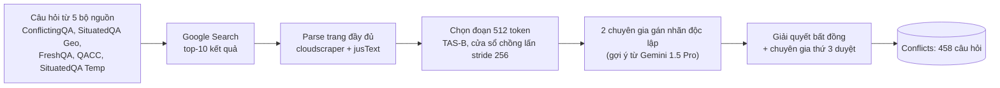

# Benchmark: Conflicts (Cattan et al. 2025, arXiv 2506.08500)

## 1. Thông tin chung & Tài nguyên

- **Tiêu đề:** DRAGged into Conflicts: Detecting and Addressing Conflicting Sources in Search-Augmented LLMs. Tên bộ dữ liệu trong bài: **Conflicts**.
- **Mã arXiv:** [2506.08500](https://arxiv.org/abs/2506.08500), v1, 06/2025. Tác giả: Arie Cattan, Alon Jacovi, Ori Ram, Jonathan Herzig, Roee Aharoni, Sasha Goldshtein, Eran Ofek, Idan Szpektor, Avi Caciularu (Google Research; Caciularu có thêm Bar-Ilan University). Chưa rõ đã qua bình duyệt hội nghị nào hay chưa (chưa kiểm).
- **Dữ liệu và mã (GitHub):** [github.com/google-research-datasets/rag_conflicts](https://github.com/google-research-datasets/rag_conflicts). Repo có đúng 3 mục: `LICENSE`, `README.md`, `conflicts.jsonl`. Repo **đã được chủ sở hữu archive (13/08/2026), chỉ đọc**. README ghi "not an official Google's product". Không có mã đánh giá trong repo (chưa rõ bộ chạy đánh giá có ở nơi khác không).
- **Giấy phép:** trang GitHub hiển thị **Apache-2.0** (file `LICENSE`); README không nêu giấy phép; bài báo CC BY 4.0 (áp cho bài, không phải dữ liệu). Lưu ý: dữ liệu chứa nội dung trang web do Google Search trả về (`response_str`), nên Apache-2.0 của repo không chắc bao trùm quyền với văn bản web gốc (suy luận của tôi, chưa kiểm điều khoản).
- **Xác nhận tải được:** mới xác nhận **một phần**. Mở URL raw `.../main/conflicts.jsonl` thì công cụ báo vượt giới hạn 10,485,760 byte, tức file tồn tại và lớn hơn 10 MB; tôi **chưa tải về, chưa parse, chưa đếm số dòng**. Chưa kiểm xem số dòng có đúng 458 không, và chưa kiểm file có bị cắt hay không.
- **Ngôn ngữ:** chủ yếu tiếng Anh (chưa kiểm kỹ).
- **Nguồn tôi đã đọc:** bản HTML arXiv v1 (qua công cụ tóm tắt, đọc 100,000/100,037 ký tự; chưa đối chiếu PDF/bảng gốc), trang GitHub và README.

## 2. Vấn đề giải quyết

Hệ search-augmented LLM (RAG trên kết quả Google Search) thường nhận về các tài liệu **bất đồng với nhau**, và mô hình hay trả lời như thể chỉ có một góc nhìn, hoặc ngược lại tranh luận cả khi không có xung đột thực. Bài đề xuất (1) một **taxonomy 5 loại quan hệ giữa các nguồn** gắn với **hành vi mong đợi** của câu trả lời cho từng loại, (2) bộ dữ liệu có chú thích chuyên gia, (3) đánh giá xem LLM có nhận ra loại xung đột và cư xử đúng không.

Ví dụ (theo bài): hỏi "Số quốc gia hợp pháp hóa hôn nhân đồng giới là bao nhiêu?" thì các trang cho số khác nhau vì thời điểm viết khác nhau (loại Freshness): hành vi mong đợi là ưu tiên thông tin mới nhất, có thể nêu rằng nguồn cũ đã lỗi thời. Hỏi "Nhịn ăn có lợi cho người tiểu đường không?" thì các nguồn kết luận trái ngược (Conflicting opinions): mong đợi là tóm tắt trung lập các quan điểm.

## 3. Cơ chế cốt lõi

### 3.1. Taxonomy xung đột (trọng tâm)

| # | Loại | Nghĩa | Hành vi mong đợi | Số mẫu |
|---|---|---|---|---|
| 1 | No conflict | Các tài liệu cho đáp án tương đương | Trả lời trực tiếp, không thêm quan điểm hay rào đón | 161 |
| 2 | Complementary information | Đáp án nói về khái niệm khác nhau nhưng tương thích | Hợp nhất các đáp án một phần, không dựng thành tranh luận | 115 |
| 3 | Conflicting opinions or research outcomes | Đáp án không tương thích do bằng chứng chủ quan hoặc mâu thuẫn | Tóm tắt trung lập các quan điểm | 115 |
| 4 | Conflict due to outdated information ("Freshness") | Xung đột sinh ra từ chênh lệch thời gian | Ưu tiên thông tin mới, có thể ghi chú nguồn cũ | 62 |
| 5 | Conflict due to misinformation | Ít nhất một nguồn nhiều khả năng sai hoặc gây hiểu lầm | Bỏ nguồn sai, trả lời theo nguồn đáng tin | 5 |

Tổng 458; 297 mẫu (65%) có xung đột (loại 3-5, cộng cả loại 2 tuỳ cách đếm của bài; chưa rõ bài tính 297 gồm loại nào, 115+115+62+5 = 297 nên là loại 2-5). Ngoài ra khi gán nhãn có thêm "Other" (0 mẫu) và "No relevant sources" (18 mẫu bị loại).

**Trả lời câu hỏi trọng tâm:**
- **Có loại liên quan thời gian:** có, đúng một loại là **Freshness** (loại 4). Nó là xung đột "cùng thực thể, giá trị đổi theo thời gian, nguồn cũ hết hạn". Xét theo khung của đồ án, đây gần với **Evolution** (từng đúng, nay đổi), nhưng hành vi mong đợi là "ưu tiên mới nhất", chưa có phần "trả lời lịch sử theo `T_req`".
- **Có loại liên quan nguồn:** **Misinformation** (loại 5) là loại duy nhất nói về độ đáng tin của nguồn ("ít nhất một nguồn sai"), nhưng nhãn đặt ở **mức câu hỏi (instance)**, không phải nhãn từng nguồn, và chỉ có **5 mẫu**.
- **Khác "freshness" ở đâu:** Conflicting opinions và Complementary là xung đột **không do thời gian** (quan điểm, khía cạnh). Chúng không có đối ứng trong Evolution/Falsehood của đồ án; chúng gần nhất với tình huống "không mâu thuẫn thật, nên không đóng `end_time` hay đặt `invalidated_at`".

### 3.2. Xây dựng dữ liệu

- **Câu hỏi:** 458 sau lọc, từ ConflictingQA (162), SituatedQA Geo (105), FreshQA (95), QACC (55), SituatedQA Temp (41). Phân bố loại là do **chọn lọc có chủ đích**, không phản ánh tần suất tự nhiên (bài tự nêu).
- **Tài liệu:** top-10 Google Search mỗi câu, trung bình 9.2 kết quả/câu, suy ra khoảng 4,200 tài liệu (con số này **tôi suy ra**, bài không nêu). Mỗi kết quả trong file có `title`, `url`, `snippet`, `date`, `response_str` (toàn văn trang), `short_text` (đoạn 512 token) theo README.
- **Chú thích:** hai chuyên gia ngôn ngữ học gán nhãn độc lập, hợp nhất bất đồng, chuyên gia thứ ba duyệt cuối; có viết giải thích ngắn và đáp án đúng (khi áp dụng). Gemini 1.5 Pro sinh đáp án theo từng nguồn làm gợi ý (có thể bỏ qua). **Độ đồng thuận giữa người gán nhãn: bài không báo.**
- **Nhãn uy tín nguồn:** **không có** nhãn credibility cho từng nguồn. Trường `date` của mỗi kết quả có trong file, nhưng chưa kiểm nó được điền đầy đủ không và có phải ngày xuất bản hay không.

Định dạng một mẫu (README): `source`, `question`, `search_results[]`, `conflict_type`, `correct_answer`.

## 4. Kết quả chính

**Chỉ số (theo bài):** (1) Accuracy dự đoán loại xung đột; (2) Factual grounding: tỉ lệ câu được hỗ trợ, chấm bằng prompt kiểu FACTS; (3) Answer Recall: đáp án vàng có xuất hiện không, chấm bằng LLM, chỉ trên 228 câu (No conflict, Freshness, Misinformation); (4) Expected behavior adherence: LLM judge nhị phân kèm few-shot, kiểm trên 100 mẫu so với người đạt 0.89 accuracy.

**Dự đoán loại xung đột (accuracy):** Gemma 3 27B 53.9; Qwen 2.5 72B 53.1; GPT-4o 59.2; Gemini 2.0 Flash 60.5; Gemini 2.5 Flash 65.3.

**Sinh câu trả lời (Expected behavior / Answer Recall / Factual grounding), số tự báo cáo của tác giả:**

| Mô hình | Vanilla | Pipeline | Taxonomy-Aware | Oracle |
|---|---|---|---|---|
| Gemma 3 27B | 59.4 / 89.0 / 94.4 | 71.6 / 89.9 / 91.9 | 76.2 / 86.0 / 92.9 | 87.6 / 88.6 / 93.3 |
| Qwen 2.5 72B | 64.2 / 87.7 / 90.5 | 67.5 / 89.0 / 88.2 | 68.3 / 88.2 / 89.4 | 90.6 / 87.3 / 89.3 |
| GPT-4o | 67.2 / 87.3 / 91.2 | 74.9 / 87.3 / 92.0 | 70.0 / 88.6 / 94.0 | 88.6 / 87.3 / 91.4 |
| Gemini 2.0 Flash | 62.0 / 90.8 / 98.5 | 75.3 / 89.5 / 96.6 | 69.4 / 89.0 / 96.8 | 87.8 / 90.4 / 96.8 |
| Gemini 2.5 Flash | 65.7 / 92.1 / 96.8 | 75.1 / 90.8 / 96.9 | 69.9 / 94.3 / 96.2 | 88.0 / 91.7 / 96.8 |
| Gemini 2.5 Flash Thinking | 68.3 / 90.8 / 96.2 | 76.6 / 89.0 / 96.1 | 73.6 / 91.7 / 97.0 | 89.3 / 89.9 / 96.8 |

- **Vanilla:** prompt thường. **Pipeline:** (suy ra) dự đoán loại xung đột trước rồi sinh theo hành vi mong đợi. **Taxonomy-Aware:** đưa taxonomy vào prompt. **Oracle:** biết sẵn nhãn loại xung đột đúng. Định nghĩa chính xác Pipeline vs Taxonomy-Aware tôi chưa đọc kỹ (chưa kiểm).
- Oracle tăng Expected behavior khoảng 24 điểm so với Vanilla (trung bình); Answer Recall và Grounding gần như không đổi. Hàm ý: nút thắt là **nhận diện đúng loại xung đột**, không phải khả năng sinh.
- Gemini 2.5 Flash Thinking, loại Conflicting opinions: 36.2% (Vanilla) lên 73.3% (Pipeline).
- Chưa có số **riêng cho loại Freshness** trong phần tôi nắm (chưa kiểm bảng theo loại).
- Phân tích lỗi trên 40 mẫu đầu ra của một mô hình (chưa rõ chi tiết).

Các số chép từ bản HTML qua công cụ tóm tắt, chưa đối chiếu bảng gốc; cần kiểm trước khi trích vào luận văn.

## 5. Ưu điểm / Nhược điểm

**Ưu điểm**
- Dữ liệu **thật** (Google Search, toàn văn trang), không phải xung đột do LLM sinh như ConflictBank; có chú thích chuyên gia ba lượt.
- Taxonomy gắn với **hành vi mong đợi**, tách "có mâu thuẫn thật" khỏi "bổ sung" và "quan điểm".
- Có loại Freshness và Misinformation riêng; có đáp án vàng cho loại 1, 4, 5.
- Quy mô nhỏ nên chạy trọn bộ được, kèm toàn văn và `url`/`date` từng nguồn (cho phép dựng `source`).

**Nhược điểm**
- **Misinformation chỉ 5 mẫu**: không thể đánh giá Falsehood.
- Freshness chỉ 62 mẫu và chỉ có hành vi "ưu tiên mới"; không có truy vấn điểm thời gian lịch sử, không có `start_time`/`end_time` chuẩn.
- Không có nhãn credibility từng nguồn; nhãn xung đột ở mức câu hỏi, không chỉ ra **cặp tài liệu nào** mâu thuẫn (chưa kiểm file có trường đó không; README liệt kê không có).
- Phân bố chọn lọc, không đại diện; chỉ câu hỏi "an toàn".
- Chấm bằng LLM judge, kiểm chỉ 100 mẫu (0.89); gợi ý từ Gemini có thể thiên lệch; không báo inter-annotator agreement.
- Chỉ xét xung đột giữa các tài liệu truy xuất, **không** xét xung đột bộ nhớ tham số vs ngữ cảnh.
- Kết quả phụ thuộc nội dung web tại thời điểm crawl; trang có thể đã đổi, repo đã archive.
- Quy mô nhỏ: 458 câu, mỗi loại ít (đặc biệt loại 5).

## 6. Áp dụng vào đồ án

**Đối chiếu phạm vi** (`docs/decisions/09_CONFLICT_RESOLUTION_SCOPE.md`): đồ án đã **bỏ nhánh đa nguồn / Credibility Score**, giữ Evolution (`end_time`) và Falsehood (`invalidated_at`) trên nguồn có lịch sử (Wikipedia). Lý do bỏ là "không có benchmark công khai phù hợp". Conflicts là benchmark công khai thật nhất cho xung đột đa nguồn nhưng **vẫn không lấp được khoảng trống đó**: không có nhãn credibility từng nguồn và Misinformation chỉ 5 mẫu. Vì vậy **không đề xuất đảo quyết định bỏ đa nguồn**.

| Thành phần đồ án | Conflicts cho gì | Đánh giá |
|---|---|---|
| `end_time` (Evolution) | Loại Freshness (62 mẫu, FreshQA/SituatedQA Temp) | Gần nhất; chỉ kiểm "ưu tiên nguồn mới", không kiểm đóng `end_time` hay truy vấn lịch sử |
| `invalidated_at` (Falsehood) | Loại Misinformation (5 mẫu) | Quá ít; không dùng làm kết luận |
| `source`, `credibility_score` (`design/01` mục 2.1) | `url`, `title`, `date` mỗi kết quả; không có điểm uy tín | Điền được `source`; **không** có ground truth cho `credibility_score` |
| Timeline ≠ Conflict | Complementary information (115) | Gần ý "không phải mâu thuẫn thật, đừng đóng chunk"; tương đồng ý niệm, không cùng cấu trúc |
| Conflicting opinions | 115 mẫu | Ngoài khung Evolution/Falsehood; hệ đồ án chưa có cơ chế xử lý (nên ghi vào hạn chế) |
| Truy xuất theo `T_req` | SituatedQA Temp (41) có yếu tố thời gian | Chưa kiểm cách giữ mốc `T_req` trong file |

**Cách dùng (đề xuất, chưa thử):**
1. Chỉ nạp phần Freshness (62) và No conflict (161, làm đối chứng "không đóng nhầm", tương ứng loại 5 của `09`). Mỗi kết quả search thành một chunk: `start_time` lấy từ `date` (nếu có; thiếu thì theo quy tắc "không có mốc thì không vào kho" của thiết kế, nên đo tỉ lệ bị loại), `source` từ `url`.
2. Dùng `short_text` thay vì `response_str` để tránh chi phí ingestion LLM trên toàn văn.
3. Đo: Answer Recall trên đáp án vàng (khớp thước đo của bài), tỉ lệ chọn nguồn mới ở loại Freshness, và False-invalidation rate ở loại No conflict/Complementary.
4. Có thể dùng làm thí nghiệm phụ minh họa rằng lọc theo thời gian giải quyết loại Freshness nhưng không giải quyết được Opinions/Misinformation, để ghi vào phần hạn chế.

**Phần không so sánh công bằng:**
- Số của bài là LLM trần nhận 10 tài liệu trong prompt, không có kho, `invalidated_at`, hay re-rank; "Expected behavior" chấm bằng LLM judge cùng tác giả, đồ án không thể đặt cạnh trực tiếp nếu đổi judge.
- Freshness của bài là "đáp án mới nhất", gần như là `T_req = T_now`; không đo được phần lịch sử.
- Ngày (`date`) của kết quả search có thể là ngày xuất bản chứ không phải ngày hiệu lực của sự kiện, trái nguyên tắc mốc thời gian theo thời điểm sự kiện của `09`.
- Nhãn xung đột ở mức câu hỏi nên không đánh giá được chính xác chunk nào bị đóng.

**Quan hệ với benchmark khác trong thư mục:** ConflictBank (04) lớn nhưng tổng hợp và đo xung đột tham số vs bằng chứng; Conflicts nhỏ, thật, đo xung đột giữa các nguồn truy xuất. Hai bài bổ sung nhau, nhưng đều không đo Evolution vs Falsehood theo `end_time`/`invalidated_at`.

## 7. Chỗ chưa xác nhận

- File `conflicts.jsonl` có tải và parse được không, có đủ 458 mẫu không (mới biết file tồn tại và lớn hơn 10 MB). Cách `date` được điền; tỉ lệ kết quả thiếu `date`.
- Giấy phép: Apache-2.0 theo trang GitHub, nhưng README không nêu; quyền với nội dung web gốc trong `response_str` chưa kiểm.
- Chưa rõ có mã đánh giá công khai ở đâu không (repo chỉ có dữ liệu).
- Định nghĩa chính xác các điều kiện Pipeline và Taxonomy-Aware; số theo từng loại (đặc biệt Freshness); cách bài đếm 297 mẫu xung đột.
- Có trường nào chỉ ra cặp tài liệu mâu thuẫn không (README không liệt kê).
- Bài đã công bố ở hội nghị nào; inter-annotator agreement (bài không báo).
- Số liệu chép từ bản HTML qua công cụ tóm tắt, chưa đối chiếu bảng gốc.
- Ghi chú trong `04_ConflictBank.md` nói benchmark "Conflicts" của Google "chưa kiểm/không tìm thấy"; ghi chú này nay đã tìm thấy (file hiện tại), chưa sửa file 04 theo yêu cầu.
