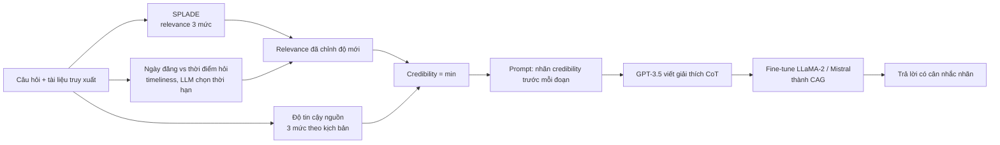

# Benchmark: CAG / CAGB (arXiv 2404.06809)

> Lưu ý tên gọi: benchmark của bài tên là **CAGB (Credibility-aware Generation Benchmark)**. Tên "CrEval" xuất hiện lúc giao việc là nhầm tên, không có trong bài.

## 1. Thông tin chung & Tài nguyên

- **Tiêu đề:** Not All Contexts Are Equal: Teaching LLMs Credibility-aware Generation
- **Tác giả:** Ruotong Pan, Boxi Cao, Hongyu Lin, Xianpei Han, Jia Zheng, Sirui Wang, Xunliang Cai, Le Sun.
- **Mã arXiv:** [2404.06809](https://arxiv.org/abs/2404.06809), nộp 10/04/2024, bản hiện tại v3 (09/10/2024). Ghi chú trên arXiv: EMNLP 2024 Main Conference.
- **Mã nguồn (GitHub):** [github.com/panruotong/CAG](https://github.com/panruotong/CAG), gồm `ALCE`, `datasets`, `prompt`, `scripts`, `demo.py`, `eval.py`, `eval_chatgpt.py`, `metrics.py`.
- **Dữ liệu benchmark:** thư mục `datasets` trong repo, hoặc Hugging Face [`ruotong-pan/CAGB`](https://huggingface.co/datasets/ruotong-pan/CAGB) (khoảng 177 MB, tiếng Anh, tag question-answering). Dataset viewer trên Hub báo lỗi timeout khi tôi mở.
- **Mô hình công bố:** `ruotong-pan/CAG-13b` (fine-tune từ LLaMA2-13B), `ruotong-pan/CAG-mistral-7b`, bản CAG-7B (tên repo CAG-7B trên Hub: chưa kiểm).
- **Dữ liệu huấn luyện:** README ghi lưu trên Google Drive (chưa kiểm link còn sống).
- **Giấy phép:** repo GitHub MIT; trang dataset CAGB trên Hugging Face ghi MIT; model card CAG-13b ghi MIT. Lưu ý: dữ liệu CAGB phái sinh từ HotpotQA, 2WikiMHQA, MuSiQue, ASQA, RGB, RealTime QA, TAQA và tin tức/Google Search, nên giấy phép của nguồn gốc có thể ràng buộc thêm; chưa kiểm.
- **Xác nhận tải được:** các trang repo và Hub **tồn tại và công khai** (đã mở được). Tôi **chưa tải thật** file dữ liệu về máy nên chưa xác nhận định dạng và nội dung từng file. Footnote trong bài từng ghi "sẽ công bố sau khi được chấp nhận"; hiện đã có.
- **Ngôn ngữ:** tiếng Anh.
- **Cách tôi đọc bài:** PDF nén không đọc được qua công cụ; số liệu lấy từ bản HTML arXiv qua công cụ tóm tắt, README, model card. Chưa đối chiếu bảng gốc.

## 2. Vấn đề giải quyết

RAG thường nhét mọi đoạn truy xuất vào ngữ cảnh như nhau, dù có đoạn nhiễu, lỗi thời hoặc là tin giả. Bài đề xuất **Credibility-aware Generation (CAG)**: cho mỗi đoạn một nhãn credibility trong prompt, và dạy LLM cân nhắc theo nhãn đó khi trả lời (đồng thời cho phép người dùng tự đặt nhãn).

Ví dụ minh họa (tự dựng theo mô tả bài, không phải mẫu nguyên văn): hỏi "Hiện ai là chủ tịch CLB X?", ngữ cảnh có một bài báo uy tín năm nay và một bài blog cũ hai năm trước nêu tên khác. Mô hình thường tin đoạn nào khớp câu hỏi hơn; CAG kỳ vọng mô hình nghiêng về đoạn có nhãn credibility cao.

## 3. Cơ chế cốt lõi

### 3.1. Credibility gắn vào từng đoạn bằng cách nào

Trả lời trọng tâm: **chủ yếu tự động, không phải nhãn người; một phần dữ liệu tổng hợp.**

- **Relevance (tự động):** điểm SPLADE giữa câu hỏi và đoạn, chia 3 mức cao/vừa/thấp. Biến thể 0-9 mức mịn hơn cho kết quả kém hơn ở vài trường hợp (Phụ lục A.3 theo bản tóm tắt).
- **Timeliness (tự động):** hạ mức khi khoảng cách giữa thời điểm hỏi và ngày đăng vượt ngưỡng; thời hạn hiệu lực do LLM chọn qua prompt, 3 lần thử rồi bỏ phiếu (Phụ lục A.9).
- **Source reliability (đặt theo kịch bản, 3 mức):** ví dụ ở NewsPollutedQA, bài tin giả do LLM sinh là mức thấp, trang tin uy tín là mức cao.
- **Điểm cuối:** credibility = giá trị **thấp hơn** giữa (relevance đã chỉnh timeliness) và source reliability.
- **Người tham gia:** EvolvingTempQA có đáp án gán tay; bài **không nói** nhãn credibility có được người kiểm hay không (chưa rõ).
- **Tổng hợp:** tin giả trong NewsPollutedQA sinh bằng GPT-3.5 và Qwen.
- **Nhãn vàng (gold):** có thiết lập dùng nhãn credibility "vàng" cho thấy trần hiệu năng (xem mục 4); cách tạo nhãn vàng chưa rõ.

Điểm đáng chú ý: **bài không có thang điểm uy tín nguồn thật** (kiểu tên báo A uy tín 0.9). Nhãn nguồn chỉ 3 mức, đặt theo kịch bản; phần "độ tin cậy" của đoạn thực chất trộn relevance và độ mới.

### 3.2. Dữ liệu huấn luyện và cách dạy mô hình

1. **Multi-granularity annotation:** gán nhãn credibility 3 mức cho tài liệu và cho câu.
2. **Credibility-guided explanation:** GPT-3.5 viết giải thích chain-of-thought từ câu hỏi, tài liệu đã gắn nhãn và đáp án vàng; giải thích này thay đáp án gốc.
3. **Instruction fine-tuning:** huấn luyện next-token chuẩn trên các giải thích.

Nguồn huấn luyện (Bảng 3): ShareGPT 3,426; HotpotQA 5,287; ELI5 2,000; QAMPARI 1,000; WikiQA 1,040; NewsQA 2,135; PubMedQA 12,552. Tổng cộng khoảng 27,440, nhưng mục 3.1 của bài nói "khoảng 15k": **số liệu trong bài không khớp nhau**, chưa rõ cái nào đúng.

## 4. Kết quả chính

### 4.1. CAGB gồm gì và quy mô (Bảng 1 theo bản tóm tắt)

7 tập, 3 kịch bản; README nói mỗi tập có ba thiết lập: `concat` (xáo ngẫu nhiên), `rerank` (đoạn liên quan nhất gần câu hỏi), `cred` (ngẫu nhiên, kèm nhãn credibility trước mỗi đoạn); file có `qstart` đặt câu hỏi ở đầu prompt.

| Kịch bản | Tập | Mẫu | Tài liệu | Tỉ lệ nhiễu |
|---|---|---|---|---|
| Open-domain QA | HotpotQA | 500 | 5,000 | 0.8 |
| | 2WikiMHQA | 500 | 5,000 | 0.6-0.8 |
| | MuSiQue | 500 | 10,000 | 0.9 |
| | ASQA | 948 | 4,740 | không ghi |
| | RGB | 300 | 11,641 | 0.2-0.8 |
| Time-sensitive QA | EvolvingTempQA | 321 | 2,247 | 0.4-0.8 |
| Misinformation QA | NewsPollutedQA | 480 | 2,400 | 0.5-0.75 |

Lưu ý: README và Hub liệt kê 6 tập (không thấy ASQA); bài có 7. Chưa rõ ASQA có nằm trong bản công khai.

- **EvolvingTempQA:** câu hỏi từ RealTime QA, TAQA và tin tức; tài liệu từ Google Search API (3 liên quan, 4 gây nhiễu mỗi câu).
- **NewsPollutedQA:** quiz tin hằng tuần của CNN và nguồn khác từ 01/07/2023, thêm tin giả tổng hợp.

### 4.2. Chỉ số

**Exact Match (EM)** kiểu substring (đáp án ngắn xuất hiện trong câu sinh). ASQA thêm độ dài và Rouge-L. Không có chỉ số riêng cho việc chọn đúng nguồn hay đóng/mở hiệu lực.

### 4.3. Baseline và số tự báo cáo (Bảng 2, EM, chọn lọc, chưa đối chiếu bảng gốc)

| Tập | Retrieval-based (prompt, chọn lọc) | CAG tốt nhất |
|---|---|---|
| HotpotQA | ChatGPT 0.334 | CAG-13B 0.514 |
| 2WikiMHQA | ChatGPT 0.368 | CAG-13B 0.604 |
| MuSiQue | LLaMA-2-70B 0.256 | CAG-13B 0.408 |
| RGB | ChatGPT 0.773 | CAG-13B 0.917 |
| EvolvingTempQA | ChatGPT 0.579 | CAG-mistral 0.835 |
| NewsPollutedQA | ChatGPT 0.231 | CAG-mistral 0.613 |

Baseline gồm ba kiểu prompt: retrieval, retrieval + rerank, retrieval + credibility; mô hình: ChatGPT (gpt-3.5-turbo-0613), LLaMA-2 7B/13B/70B, Vicuna-7B-v1.5, Mistral-7B-Instruct. Có thêm "vanilla IFT" (LLaMA-2-7B fine-tune cùng dữ liệu nhưng không có nhãn credibility). Số của baseline khác (rerank, credibility-prompt, Vicuna, Mistral) chưa chép.

Phát hiện khác (theo bản tóm tắt):
- CAG vượt baseline trên cả 7 tập.
- Với nhãn vàng, CAG-7B trung bình EM 0.610 so với 0.466 khi dùng nhãn từ retriever (Phụ lục A.2): **chất lượng gán nhãn quyết định hiệu năng**.
- Loại bỏ hẳn đoạn credibility thấp kém hơn CAG (mục 5.3.2).
- CAG giữ hiệu năng tốt hơn khi tỉ lệ nhiễu tăng (Hình 3, Phụ lục A.13).

### 4.4. Mô hình: cần fine-tune hay chỉ prompt

- **Cần fine-tune** để có CAG: CAG-7B (LLaMA-2-7B), CAG-13B (LLaMA-2-13B), CAG-mistral-7B; 3 epoch, lr 1e-5, A100-80G; FastChat cho LLaMA, axolotl cho Mistral.
- Baseline là **prompt** (3-shot QA, nhiệt độ 0.01). Bài cũng thử prompt có nhãn credibility cho mô hình chưa fine-tune; số riêng chưa chép (chưa kiểm).
- Dạng prompt-only vẫn là khả thi cho đồ án vì mô hình chỉ cần thấy nhãn, nhưng bài cho thấy fine-tune mới là điểm đóng góp chính.

## 5. Hạn chế

Tác giả tự nêu:
- Độ chính xác gán nhãn credibility giới hạn hiệu năng; nhãn từ retriever thua nhãn vàng.
- Nhãn quá mịn có thể giảm hiệu năng.
- Vẫn cần dữ liệu có nhãn và huấn luyện thêm.
- Chỉ xét RAG; nguồn khác (knowledge graph, công cụ) để dành sau.

Nhận xét của tôi:
- **Credibility không phải độ uy tín nguồn thật.** Chỉ 3 mức, trộn relevance (SPLADE) với độ mới; "uy tín" cao/thấp do kịch bản đặt, tin giả do LLM sinh nên dễ phân biệt kiểu văn phong (khả năng thiên lệch chưa kiểm).
- Tập thời gian chỉ 321 mẫu; mốc "lỗi thời" xác định bằng ngưỡng do LLM chọn, không phải khoảng hiệu lực thật `start_time`/`end_time`.
- Không phân biệt Evolution và Falsehood; không có `T_req` kiểu quá khứ (thời điểm hỏi luôn là hiện tại).
- Không có kho bộ nhớ hay luồng cập nhật: ngữ cảnh đưa thẳng vào prompt.
- Số huấn luyện (15k vs 27k) mâu thuẫn trong bài.
- Số lấy qua công cụ tóm tắt HTML, chưa đối chiếu PDF.

## 6. Áp dụng vào đồ án

**Đối chiếu phạm vi.** `docs/decisions/09_CONFLICT_RESOLUTION_SCOPE.md` đã **bỏ nhánh đa nguồn và Credibility Score**, lý do "không có benchmark công khai phù hợp". CAGB là benchmark công khai gần nhất với thiết kế đã bỏ: nó chính là bài toán "gắn điểm credibility cho từng đoạn rồi dạy/cho LLM dùng". Tuy vậy, nó **chưa đủ để đảo quyết định**, vì không đo xung đột đa nguồn cùng mốc thời gian có nguồn uy tín thật.

### Ánh xạ vào `credibility_score` (`docs/design/01_INITIAL_BASE_DESIGN.md` mục 2.1: `source` String, `credibility_score` Float 0.0-1.0)

| Khía cạnh | CAG/CAGB | Đồ án (thiết kế đã bỏ) |
|---|---|---|
| Kiểu giá trị | Rời rạc 3 mức | Liên tục 0.0-1.0 |
| Cách gán | Tự động: SPLADE + độ mới + mức nguồn theo kịch bản | Điểm uy tín của nguồn, gắn lúc ingestion |
| Độ mới | Nằm trong credibility (timeliness) | Đã có riêng: `start_time`, half-life decay ở Cơ chế 1 |
| Cách dùng | Nhãn trong prompt, mô hình fine-tune tự cân nhắc | Trọng số khi xếp hạng/giải xung đột |
| Phạm vi nguồn | Theo kịch bản | `source` theo tên báo/đường link |

Gợi ý rút ra (đều là đề xuất, chưa thử):
1. **Tách trục.** CAG trộn relevance và độ mới vào một nhãn; đồ án nên giữ `credibility_score` chỉ cho độ tin cậy nguồn, còn độ mới đã có `start_time`/decay. Làm vậy tránh tính trùng độ mới hai lần.
2. **Cách kết hợp "lấy giá trị thấp nhất" (min)** của bài có thể thử làm ablation: điểm cuối = min(điểm nguồn, điểm thời gian) so với tích `W1·Semantic + W2·Temporal`.
3. **Thang rời rạc 3 mức** là cách dễ vận hành hơn thang 0.0-1.0 khi không có nhãn người; bài cũng cho thấy thang mịn không tốt hơn.
4. **Nhãn từ tín hiệu sẵn có** (ngày đăng, loại nguồn) thay cho điểm tay; phù hợp nếu sau này khôi phục nhánh này.

### Cách dùng thực tế cho đồ án (đề xuất)

- **Không cần fine-tune CAG.** Có thể dùng tập con `EvoTempQA` và `NewsPollutedQA` làm thí nghiệm phụ về `invalidated_at`/lọc nhiễu: nạp tài liệu vào kho, gán `source` và `start_time` từ ngày đăng, đo EM của hệ so với Plain RAG và so với số công bố.
- EvoTempQA (321 mẫu, nhiễu 0.4-0.8) khớp loại 1 trong `09` (câu "hiện tại") hơn các loại khác; **không** đo loại 2 (lịch sử), 5, 6.
- NewsPollutedQA khớp tình huống Falsehood: tin giả tổng hợp; có thể coi tin giả là chunk đặt `invalidated_at` để đo hiệu quả bộ lọc cứng, nhưng khi đó đã đưa nhãn "sai" vào miễn phí, dễ thành rò rỉ nhãn; cần nói rõ trong luận văn.
- Chỉ số tương ứng: EM theo tập (so số bài), thêm False-invalidation rate và Freshness accuracy của `09`. Đo thêm lượt closed-book như `09` đã dặn.

### Phần không so sánh công bằng
- Số EM của bài là prompt nhét thẳng 5-10 tài liệu vào ngữ cảnh (kèm nhãn), không qua kho/lọc/re-rank; hệ đồ án có truy xuất nên không đặt cạnh trực tiếp.
- CAG được fine-tune với dữ liệu cùng phân phối (HotpotQA có cả trong train); đối chiếu với hệ chỉ dùng LLM nguyên bản là không cân.
- Mô hình nền khác nhau (LLaMA-2, Mistral-7B, ChatGPT-0613): đổi LLM thì số không còn so được.
- Nhãn credibility trong CAGB do tác giả cung cấp sẵn; hệ đồ án phải tự gán lúc ingestion, nên phải chạy lại bước gán nếu muốn công bằng.

### Quyết định đề xuất
Giữ nguyên quyết định ở `09` (bỏ đa nguồn). Dùng CAGB, nếu muốn, chỉ như bằng chứng bổ sung và để trích dẫn trong phần "hạn chế / hướng phát triển" cho nhánh Credibility; ghi rõ bài này credibility là nhãn 3 mức tự động, không phải uy tín nguồn thật.

## 7. Chỗ chưa xác nhận

- Chưa tải thật `ruotong-pan/CAGB` hoặc thư mục `datasets`; chưa kiểm định dạng, trường dữ liệu, số mẫu thực so với Bảng 1 (README liệt kê 6 tập, bài ghi 7 tập, thiếu ASQA).
- Giấy phép của dữ liệu gốc (HotpotQA, 2WikiMHQA, MuSiQue, RGB, RealTime QA, TAQA, tin CNN, Google Search) và tác động tới việc tái phân phối: chưa kiểm.
- Link Google Drive dữ liệu huấn luyện còn sống không: chưa kiểm.
- Cách tạo nhãn credibility vàng; nhãn credibility có người kiểm hay không: chưa rõ.
- Mâu thuẫn quy mô dữ liệu huấn luyện (khoảng 15k vs tổng Bảng 3 khoảng 27k).
- Số baseline đầy đủ của Bảng 2 (rerank, credibility-prompt, Vicuna, Mistral), kết quả prompt-only có nhãn: chưa chép.
- Các số ở mục 4 lấy qua bản tóm tắt HTML, chưa đối chiếu bảng gốc trong PDF.
- Tên repo model CAG-7B trên Hub: chưa kiểm.

Nguồn: [arXiv abs](https://arxiv.org/abs/2404.06809), [arXiv HTML](https://arxiv.org/html/2404.06809), [GitHub](https://github.com/panruotong/CAG), [HF dataset](https://huggingface.co/datasets/ruotong-pan/CAGB), [HF model CAG-13b](https://huggingface.co/ruotong-pan/CAG-13b).
