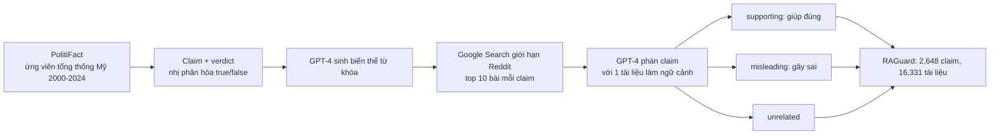

# Benchmark: RAGuard (arXiv 2502.16101)

## 1. Thông tin chung & Tài nguyên

- **Tiêu đề (đã kiểm trên trang abs):** "Worse than Zero-shot? A Fact-Checking Dataset for Evaluating the Robustness of RAG Against Misleading Retrievals". RAGuard là tên bộ dữ liệu.
- **Tác giả:** Linda Zeng, Rithwik Gupta, Divij Motwani, Yi Zhang, Diji Yang (nhóm UCSC, theo tên tổ chức Hugging Face `UCSC-IRKM`; đơn vị chính xác chưa kiểm).
- **Mã arXiv:** [2502.16101](https://arxiv.org/abs/2502.16101), cs.AI và cs.IR. Nộp v1 22/02/2025, v2 21/05/2025; trang abs hiện đã có v3 (26/10/2025), v4 (02/11/2025), v5 (17/01/2026). Ghi chú trên trang: NeurIPS 2025. Số liệu dưới đây lấy từ bản HTML được yêu cầu (v2) qua công cụ tóm tắt; **chưa kiểm** xem v5 có đổi số hay không.
- **Dữ liệu (Hugging Face):** [huggingface.co/datasets/UCSC-IRKM/RAGuard](https://huggingface.co/datasets/UCSC-IRKM/RAGuard). Tôi chỉ lấy đường dẫn từ trang abs, chưa mở trang dataset.
- **Mã nguồn (GitHub):** trang abs không liệt kê repo; chưa rõ có code công khai hay không.
- **Giấy phép:** bài báo CC BY 4.0. Giấy phép của dataset: bài không nêu; chưa kiểm trên trang Hugging Face. Lưu ý chung: nội dung Reddit và PolitiFact có thể kéo theo điều khoản của bên thứ ba, chưa kiểm.
- **Ngôn ngữ:** tiếng Anh (chính trị Mỹ).
- **Nguồn đã đọc:** trang abs và bản HTML v2 qua công cụ tóm tắt. PDF không đọc được (nén). Chưa đọc nguyên văn các phụ lục; phần Figure (kết quả người, retrieval precision/NDCG) chỉ có ở hình, không có số trong chữ.

## 2. Bộ dữ liệu

### 2.1. Vấn đề benchmark nhắm tới

Các benchmark RAG hiện có dùng tài liệu gold sạch hoặc nhiễu chèn nhân tạo, nên bị cho là đánh giá quá lạc quan. RAGuard dùng kho **Reddit** để có thông tin sai tự nhiên, rồi đo xem RAG có tệ hơn zero-shot (không truy xuất) khi gặp tài liệu gây hiểu lầm không. Đây là xung đột giữa **bằng chứng truy xuất được và sự thật của claim**, không phải xung đột theo thời gian.

### 2.2. Cách xây dựng (theo §3)

1. **Claim:** cào từ PolitiFact, giới hạn ở các ứng viên tổng thống Mỹ 2000-2024. Thang 6 mức của PolitiFact được nhị phân hóa thành true/false; verdict gốc cũng được phát hành.
2. **Corpus:** với mỗi claim, GPT-4 sinh các biến thể từ khóa; Google Search giới hạn ở Reddit trả về top 10 bài.
3. **Gán nhãn tài liệu:** GPT-4 phân loại claim với **chỉ một tài liệu** làm ngữ cảnh, rồi so với verdict thật:
   - *supporting*: tài liệu giúp mô hình dự đoán đúng;
   - *misleading*: tài liệu khiến dự đoán sai;
   - *unrelated*: mô hình thấy tài liệu không liên quan tới dự đoán.

   Nhãn là **nhãn theo hành vi của GPT-4**, không phải nhãn người và không phải phán đoán khách quan về nội dung (theo tóm tắt của §3.3 và App. H).

### 2.3. Quy mô (Bảng 3a trong bài)

| Mục | Số |
|---|---|
| Claim | 2,648 (1,333 true, 50.3%; 1,315 false, 49.7%) |
| Tài liệu | 16,331 (trung bình 6.2 tài liệu mỗi claim) |
| Supporting | 2,685 (16.4%) |
| Misleading | 1,812 (11.1%) |
| Unrelated | 11,834 (72.5%) |
| Claim có ít nhất 1 tài liệu supporting | 955 (36.1%) |
| Claim có ít nhất 1 tài liệu misleading | 788 (29.8%) |
| Độ dài trung bình | tài liệu 161 từ, claim 17.6 từ |

Chưa rõ: cách chia train/test (nếu có), số tài liệu mỗi claim sau lọc (10 truy xuất so với 6.2 trung bình).

### 2.4. Nhãn độ tin cậy nguồn

**Không có.** Không có điểm hay nhãn credibility cho subreddit, tác giả hay bài đăng. "Misleading" được định nghĩa theo việc nó làm GPT-4 đoán sai, nên một bài đúng nhưng mơ hồ vẫn có thể bị gán misleading, và ngược lại. Mọi tài liệu cùng một loại nguồn (Reddit), nên cũng không có nhiều loại nguồn để so độ uy tín. Chưa kiểm xem metadata của dataset (URL, subreddit, ngày đăng) có trong bản phát hành hay không; nếu có thể dùng làm `source`, nhưng tôi chưa xác nhận.

### 2.5. Thời gian

Bài không mô tả mốc thời gian của tài liệu hay claim như một trục xử lý. Claim trải 2000-2024 nhưng chưa rõ dataset có kèm ngày đăng bài Reddit hay ngày phát biểu của claim; **chưa kiểm**. Vì vậy chưa biết có dùng được cho `T_req` hay không.

### 2.6. Ví dụ

Chưa kiểm: tôi chưa mở dữ liệu nên không chép ví dụ nguyên văn. Dạng mẫu (mô tả chung, không phải mẫu thật): một claim chính trị ngắn (~18 từ) kèm verdict true/false và vài bài Reddit (~160 từ) gắn nhãn supporting/misleading/unrelated. Bài báo cũng ghi một số bài chỉ có placeholder "[Link Post]", khi đó dùng tiêu đề làm ngữ cảnh.

## 3. Chỉ số đo

- **Accuracy** so với verdict nhị phân; câu trả lời ngoài phạm vi (out-of-scope) tính là sai.
- **Misleading Retrieval Recall:** tỉ lệ claim có ít nhất một tài liệu misleading trong tập truy xuất. RAG-1: 21.3%; RAG-5: 44.8%; Oracle (Misleading): 100%.
- Retrieval precision, recall, NDCG: chỉ có ở hình, bài không nêu số trong chữ (chưa kiểm số cụ thể).
- Không có chỉ số về độ tin cậy nguồn, về thời gian, hay về việc mô hình có nhận ra và cảnh báo tài liệu sai hay không.

## 4. Baseline tự báo cáo (Bảng 2, accuracy %)

Các điều kiện: **Zero-context** (không truy xuất), **RAG-1** và **RAG-5** (top-1, top-5 theo semantic search `text-embedding-ada-002`), **Oracle (All)** (đưa tất cả tài liệu gold của claim), **Oracle (Misleading)** (chỉ đưa tài liệu misleading).

| Mô hình | Zero-context | RAG-1 | RAG-5 | Oracle (All) | Oracle (Misleading) |
|---|---|---|---|---|---|
| Llama 3 8B | 62.50 | 59.40 | 61.37 | 61.09 | 36.81 |
| Mistral 7B | 63.97 | 59.14 | 58.91 | 51.55 | 26.88 |
| Gemini 1.5 Flash | 61.06 | 56.68 | 57.59 | 52.38 | 30.57 |
| GPT-4o | 67.33 | 64.80 | 65.90 | 53.22 | 45.97 |
| Claude 3.5 Sonnet | 74.51 | 70.09 | 68.58 | 52.56 | 35.98 |
| DeepSeek R1 | 69.98 | 66.88 | 57.81 | 50.06 | 38.25 |
| o4-mini | 63.67 | 62.76 | 63.14 | 51.88 | 33.39 |

Phát hiện chính (theo bài):
- Mọi mô hình đều **thấp hơn zero-shot** khi dùng RAG-1 hoặc RAG-5 (ngoại lệ gần bằng: Llama 3 8B ở RAG-5 61.37 so với 62.50, vẫn thấp hơn).
- Oracle (Misleading) làm tụt mạnh: bài nêu giảm tương đối Claude 3.5 -51.7%, GPT-4o -31.7%, Mistral -58.0%, o4-mini -47.6%, trung bình các mô hình 46.48%. Tôi không có số giảm cho các mô hình còn lại trong bản đọc.
- Ngay cả tài liệu unrelated cũng làm giảm accuracy (ví dụ Llama 3 từ 61.09% xuống 50.2% theo bài).
- Người (App. G): 4 annotator (2 chuyên gia PhD lĩnh vực gần, 2 người ít hiểu chính trị) trên tập con 64 mẫu (20 misleading, 36 supporting, 8 unrelated). Bài nói người làm tốt hơn mô hình, nhưng số cụ thể chỉ có ở Figure 5; **chưa kiểm số**. Tập 64 mẫu rất nhỏ.

Các số chép từ bản HTML qua công cụ tóm tắt, cần đối chiếu bảng gốc trước khi trích vào luận văn.

## 5. Ưu điểm / Nhược điểm

**Ưu điểm**
- Nhiễu là **tự nhiên** (bài Reddit thật), không chèn tay; đo đúng tình huống "truy xuất đúng chủ đề nhưng dẫn tới kết luận sai".
- Có nhãn 3 lớp trên từng tài liệu, và điều kiện Oracle (Misleading) cho cận dưới rõ.
- Quy mô vừa phải (16K tài liệu), dễ chạy; chi phí gọi LLM thấp hơn nhiều so với ConflictBank.
- Có nhiều baseline LLM và chỉ số Misleading Retrieval Recall tách lỗi truy xuất khỏi lỗi suy luận.

**Nhược điểm**
- **Nhãn do GPT-4 gán**, theo hành vi dự đoán, không có số đo đồng thuận người-máy trong bài. Nhãn misleading bị ràng buộc với mô hình đó (tác giả tự nhận hạn chế).
- **72.5% tài liệu là unrelated**; chỉ 11.1% misleading, 29.8% claim có tài liệu misleading. Ít mẫu thật sự gây nhiễu.
- **Miền hẹp:** chính trị Mỹ, ứng viên tổng thống 2000-2024; claim ngắn (~18 từ) dạng true/false nhị phân hóa từ thang 6 mức, mất sắc thái (half-true, mostly-true).
- **Một loại nguồn (Reddit), không có nhãn credibility**, nên không kiểm thử được chọn nguồn theo uy tín.
- Không có trục thời gian trong chỉ số; không phân biệt Evolution và Falsehood; không có phiên bản cũ/mới của cùng sự kiện.
- Bài nêu: Misleading Retrieval Recall có thể khác nếu dùng Google Search gốc thay cho ada-002; một số bài chỉ có "[Link Post]".
- Có khả năng nhiễm tri thức tham số: PolitiFact là nguồn phổ biến trong dữ liệu pretrain (đánh giá của tôi, bài không đo).
- Giấy phép dữ liệu chưa rõ.

## 6. Áp dụng vào đồ án

**Đối chiếu phạm vi** (`docs/decisions/09_CONFLICT_RESOLUTION_SCOPE.md`): đồ án đã **bỏ nhánh đa nguồn và Credibility Score**, chỉ làm Evolution (`end_time`) và Falsehood (`invalidated_at`) trong một nguồn có lịch sử (Wikipedia). RAGuard thuộc đúng nhánh đã bỏ (sai do nguồn kém tin cậy, không do thời gian), nên **không nên đảo lại quyết định đó**; dùng làm tài liệu tham chiếu cho phần hạn chế.

Về schema `docs/design/01_INITIAL_BASE_DESIGN.md` mục 2.1:

| Thành phần đồ án | RAGuard cho gì | Đánh giá |
|---|---|---|
| `source` (tên báo, link) | Mọi tài liệu từ Reddit; URL/subreddit có trong dữ liệu hay không: chưa kiểm | Không có đa dạng nguồn để kiểm thử |
| `credibility_score` (0.0-1.0) | Không có nhãn độ tin cậy nguồn | Không kiểm thử được. Nhãn supporting/misleading/unrelated là nhãn theo hành vi mô hình ở mức tài liệu, không thể quy ra điểm uy tín của nguồn |
| `invalidated_at` (Falsehood) | Tài liệu misleading là thông tin gây sai, nhưng sai theo claim chứ không có mốc "bị xác nhận sai" | Khác nghĩa: ở đồ án là mốc hệ thống phát hiện sai từ đầu, ở RAGuard là nhãn tĩnh |
| `end_time` (Evolution) | Không có | Không đo |
| Timeline ≠ Conflict, loại 5-6 của `09` | Không có | Không đo |
| Truy xuất theo `T_req`, chống rò rỉ tương lai | Chưa biết có ngày đăng bài không (chưa kiểm) | Không đo |
| Allegation `SUSPECTS` | Claim chính trị là "cáo buộc/phát biểu" cần kiểm chứng | Liên quan khái niệm: claim có thể chưa là fact. Chỉ gần đúng, RAGuard không dựng graph |

**Có thể dùng làm gì (đề xuất, chưa thử):**
1. Thí nghiệm phụ, không phải benchmark chính của Cơ chế 3: lấy tập con claim có ít nhất một tài liệu misleading (788 claim) để đo hệ đồ án có **tệ hơn zero-shot** như các baseline không. Lấy mẫu vài trăm claim cho vừa chi phí.
2. Nếu dữ liệu có ngày đăng (chưa kiểm), dùng làm `start_time` và xem bộ lọc `start_time <= T_req` có loại bài đăng sau ngày claim hay không; nhưng không đo Evolution.
3. Lấy điều kiện thí nghiệm từ bài: Zero-context, RAG-1, RAG-5, Oracle (Misleading); báo thêm Misleading Retrieval Recall để tách lỗi truy xuất khỏi lỗi suy luận, tương tự cách tách coverage/accuracy ở `08_RECON.md`.
4. Lượt zero-context vốn có trong bài, khớp với dặn của `09` về chạy thêm lượt không ngữ cảnh để đo nhiễm tri thức tham số; ở RAGuard zero-context đạt 61-75%, tức mô hình đã biết nhiều claim.

**Chỉ số tương ứng:** Accuracy so với Zero-context (chênh lệch, âm nghĩa là truy xuất làm hại), Misleading Retrieval Recall, và False-invalidation rate nếu hệ đồ án loại tài liệu bị lọc nhầm. Đồ án đã có sẵn bộ chỉ số trong `09` nên không đổi.

**Phần không so sánh công bằng:**
- Baseline của bài là LLM trả lời trực tiếp trên 1 hoặc 5 tài liệu, không có kho phiên bản, không có lọc `invalidated_at`, nên không đặt trực tiếp cạnh hệ đồ án.
- Hệ đồ án không có tín hiệu nào để phân biệt bài Reddit sai với bài đúng ngoài nội dung: không có `credibility_score` thật, nên không kỳ vọng cải thiện so với RAG thường; kết quả âm là hợp lý, không phải lỗi thiết kế.
- Nhãn GPT-4 làm "gold" của misleading nên chỉ so được cùng định nghĩa.
- Miền chính trị, claim ngắn dạng true/false: không đại diện cho truy vấn Wikipedia/Wikidata của đồ án.

**Quyết định đề xuất:** đưa RAGuard vào phần "Công trình liên quan/Hạn chế" như một ví dụ về xung đột đa nguồn mà đồ án chủ động không làm. Chỉ chạy nó nếu còn thời gian, dưới dạng thí nghiệm phụ.

## 7. Chỗ chưa xác nhận

- Giấy phép dataset; điều khoản Reddit/PolitiFact; trang Hugging Face (chưa mở).
- Có repo code công khai không (trang abs không liệt kê).
- Dữ liệu có kèm URL, subreddit, ngày đăng, ngày claim hay không; cách chia train/test.
- Số liệu v2 so với v5 có khác nhau không (v3-v5 ra sau, chưa so).
- Số trong các Figure (retrieval precision/recall/NDCG, accuracy của người) và độ đồng thuận giữa người và GPT-4 (bài không báo số).
- Giảm tương đối Oracle (Misleading) của các mô hình còn lại ngoài bốn mô hình nêu.
- Cách đúng của prompt gán nhãn, cách xử lý tài liệu trùng/không lấy được nội dung.
- Ví dụ mẫu nguyên văn từ dữ liệu.
- Mọi số ở mục 2-4 chép từ bản HTML qua công cụ tóm tắt, chưa đối chiếu PDF.
