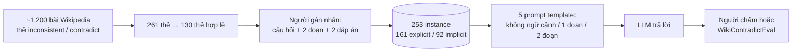

# Benchmark: WikiContradict (2406.13805)

## 1. Thông tin chung & Tài nguyên

- **Tiêu đề:** WikiContradict: A Benchmark for Evaluating LLMs on Real-World Knowledge Conflicts from Wikipedia
- **Mã arXiv:** [2406.13805](https://arxiv.org/abs/2406.13805), cs.CL, nộp 19/06/2024 (v1). Công bố tại NeurIPS 2024 (theo thông tin người giao việc; trang arXiv tôi đọc không xác nhận nơi công bố, chưa kiểm).
- **Tác giả:** Yufang Hou, Alessandra Pascale, Javier Carnerero-Cano, Tigran Tchrakian, Radu Marinescu, Elizabeth Daly, Inkit Padhi, Prasanna Sattigeri (IBM Research).
- **Dữ liệu (Hugging Face):** [ibm/Wikipedia_contradict_benchmark](https://huggingface.co/datasets/ibm/Wikipedia_contradict_benchmark). Đoạn code mẫu trên trang dùng mã `ibm-research/Wikipedia_contradict_benchmark`; hai tên có thể là alias của nhau, chưa kiểm. Abstract còn dẫn `ibm.biz/wikicontradict`.
- **Mã nguồn (GitHub):** chưa kiểm (chưa tìm repo chứa prompt template và WikiContradictEval).
- **Giấy phép:** MIT (trang dataset và phần Ethics của paper).
- **Ngôn ngữ:** tiếng Anh. Định dạng CSV trên Hub, paper nói JSON.

## 2. Bộ dữ liệu

### 2.1. Quy mô và cột

- **253 instance** do người gán nhãn. Mỗi instance gồm một câu hỏi, hai đoạn văn mâu thuẫn và hai đáp án khác nhau.
- Trang Hub hiển thị 506 dòng (một split `train`), tức khoảng gấp đôi số instance; lý do chưa kiểm (có thể do cách lưu hai phía hoặc biến thể), không giả định.
- 12 cột: `question_ID`, `question`, `context1`, `context2`, `answer1`, `answer2`, `contradictType` (explicit / implicit), `samepassage`, `merged_context`, `ref_answer`, `WikipediaArticleTitle`, `url`.
- Phân bố: 133 câu yes/no (53%), 120 câu wh (47%); 161 explicit (64%), 92 implicit (36%).

### 2.2. Cách xây dựng (mâu thuẫn là thật, không tổng hợp)

1. Ngày 26/02/2024 thu khoảng 1,200 bài Wikipedia thuộc danh mục bảo trì "content issues", gắn thẻ *inconsistent*, *self-contradictory* hoặc *contradict-other*.
2. Từ 261 thẻ, giữ 130 thẻ được xác nhận hợp lệ.
3. Người gán nhãn viết câu hỏi và hai đáp án, tách hai đoạn mâu thuẫn ra khỏi ngữ cảnh (decontextualized). Trung bình khoảng 30 phút mỗi thẻ, implicit lâu hơn.

Điểm khác ConflictBank: đoạn văn là chữ thật của Wikipedia, mâu thuẫn do biên tập viên Wikipedia tự gắn thẻ, không do LLM sinh. Nhưng "thật" chỉ trong phạm vi các thẻ được người gắn đúng; mức sót và gắn sai chưa kiểm.

### 2.3. Hai loại mâu thuẫn

- **Explicit:** hai đoạn nói thẳng điều trái nhau.
- **Implicit:** cần suy luận mới thấy mâu thuẫn.

### 2.4. Có phần nào là mâu thuẫn do thời gian không

- Paper **không phân tích mâu thuẫn thời gian thành một loại riêng**; "Date" chỉ xuất hiện trong taxonomy (theo công cụ tóm tắt, chưa đọc nguyên văn phần taxonomy).
- Không có cột `start_time`/`end_time` hay nhãn Evolution so với Falsehood. Một số mâu thuẫn về ngày tháng có thể nằm trong dữ liệu, nhưng chưa kiểm số lượng. Có thể lọc thử bằng tìm năm/ngày trong `answer1`/`answer2` (đề xuất, chưa thử).
- Mô tả của paper: hai đoạn **cùng nguồn, cùng độ tin cậy**. Nghĩa là bài không đặt câu hỏi "tin nguồn nào" mà "mô hình có nhận ra và nêu mâu thuẫn không".

### 2.5. Ví dụ

Chưa chép ví dụ nguyên văn vì chưa đọc dòng dữ liệu cụ thể (chỉ đọc mô tả cột). Dạng mẫu theo schema: một `question`, `context1` ủng hộ `answer1`, `context2` ủng hộ `answer2`, cùng `url` bài Wikipedia gốc.

## 3. Chỉ số đo

- Năm prompt template: template 1 kiểm tri thức tham số (không ngữ cảnh); template 2-3 một đoạn; template 4-5 hai đoạn mâu thuẫn (template 5 nhắc mô hình rằng có thể có mâu thuẫn). Có các biến thể phụ (5.2 chỉ phát hiện mâu thuẫn; 5.4 ngữ cảnh không mâu thuẫn).
- Câu trả lời được chấm **correct / partially correct / incorrect** theo chuẩn nới lỏng kiểu FreshLLM. Đúng nghĩa là nêu đủ cả hai đáp án và chỉ ra mâu thuẫn.
- **WikiContradictEval:** judge tự động là Llama-3-70b-instruct, few-shot, đối chiếu 240 câu trả lời template 5 do người chấm. F-score khoảng 0.8 (lớp "correct": GPT-4 82.5, Llama-3-70b-instruct 80.4). Judge đánh giá cao Mistral-7b-instruct vì mô hình này hay đưa cả hai đáp án.

## 4. Mô hình đã đánh giá và phát hiện chính (tự báo cáo)

- Đánh giá người trên 5 LLM: Mistral-7b-instruct, Mixtral-8x7b-instruct, Llama-2-70b-chat, Llama-3-70b-instruct, GPT-4-turbo. Đợt đầu 1,375 câu trả lời (2,750 phán quyết, 2 annotator); sau xử lý bất đồng còn 1,200 mẫu từ 48 instance (loại 7). Cohen's kappa 0.58 đến 0.88.
- Hai đoạn mâu thuẫn: mọi mô hình khó phản ánh đúng mâu thuẫn, nhất là implicit.
- Llama-3-70b-instruct: 10.4% (template 4) lên 43.8% (template 5) correct. GPT-4: 6.3% lên 10.4%.
- Llama-3-70b-instruct ở template 5: explicit 13.3% lên 60.0%; implicit 5.9% lên 17.6%.
- Chỉ phát hiện mâu thuẫn (5.2): GPT-4 khoảng 88%, Llama-3-70b-instruct khoảng 77%.
- Ngữ cảnh không mâu thuẫn (5.4): GPT-4 và Llama-3-70b-instruct chỉ 44% và 48% nhận ra là không mâu thuẫn, hay bịa lý do.
- Bằng judge tự động trên cả 253 instance: Mistral-7b-instruct 50.6% và Llama-3-70b-instruct 45.8% cao nhất.

Là số tự báo cáo của tác giả, lấy qua công cụ tóm tắt bản HTML, chưa đối chiếu bảng gốc.

## 5. Ưu điểm / Nhược điểm

**Ưu điểm**
- Mâu thuẫn thật từ Wikipedia, do người xác nhận; sát miền Wikipedia của đồ án.
- Có phân loại explicit/implicit, có kiểm tra ngược (ngữ cảnh không mâu thuẫn), có judge tự động rẻ.
- Giấy phép MIT, tải được từ Hugging Face.

**Nhược điểm**
- **Nhỏ:** 253 instance; phần chấm người chỉ 48 instance.
- Chỉ đo hành vi LLM với 2 đoạn đưa thẳng vào prompt, không qua retrieval hay bộ nhớ.
- Không có khái niệm thời gian, nguồn khác nhau hay độ tin cậy.
- Thiên lệch theo thẻ Wikipedia (tác giả tự nêu); chỉ tiếng Anh, chỉ text.
- Paper có mâu thuẫn nội bộ: abstract nói hơn 3,500 phán quyết còn thân bài 2,750; phần mở đầu nói khoảng 61% wh, Bảng 1 là 47%.
- Judge F ~0.8 nghĩa là có sai số; thiên lệch với câu trả lời liệt kê cả hai đáp án.

## 6. Áp dụng vào đồ án

**Đối chiếu phạm vi** (`docs/decisions/09_CONFLICT_RESOLUTION_SCOPE.md`): đồ án đã bỏ nhánh đa nguồn và Credibility Score. WikiContradict vì cùng nguồn, cùng độ tin cậy nên **không kiểm thử `credibility_score` và `source`** (schema `docs/design/01_INITIAL_BASE_DESIGN.md` mục 2.1); đúng với việc đã bỏ nhánh này, không lấp được khoảng trống đa nguồn.

| Thành phần đồ án | WikiContradict cho gì | Đánh giá |
|---|---|---|
| `invalidated_at` (Falsehood) | Cặp đoạn mâu thuẫn thật, có thể có một phía là sai | Thật hơn misinformation tổng hợp của ConflictBank, nhưng không có nhãn đúng/sai phía nào |
| `end_time` (Evolution) | Không có nhãn tiến hóa | Không đo (chưa kiểm số mâu thuẫn do ngày tháng) |
| Evolution ≠ Falsehood | Không phân loại | Không đo |
| `credibility_score`, `source` | Cùng nguồn Wikipedia | Không đo |
| Truy xuất theo `T_req` | Không có mốc thời gian | Không đo |

**Dùng làm đối chứng (đề xuất, chưa thử):**
1. Lấy tập con có mâu thuẫn dính tới ngày/số (lọc tay, chưa biết số lượng) để xem hệ phân loại sai từ đầu hay tiến hóa ra sao khi không có lịch sử; không có đáp án vàng cho phân loại này nên chỉ là quan sát định tính.
2. Dùng làm thước phụ: hệ ingestion có phát hiện hai chunk mâu thuẫn (cạnh `CORRECTS`/`SUPERSEDES` hoặc cảnh báo) hay trả lời một phía? Có thể mượn mẫu chấm correct / partial / incorrect và template 5.4 (ngữ cảnh không mâu thuẫn) để đo False-invalidation rate.
3. Closed-book (template 1) tương ứng lượt không ngữ cảnh mà `09` đã dặn.

**Phần không so sánh công bằng:** số của paper là LLM trần với 2 đoạn trong prompt, không qua retrieval; judge F ~0.8 nên khoảng sai lệch phải ghi kèm; không đo thời gian nên chỉ là bằng chứng phụ cho `invalidated_at`, không thay thế dữ liệu tự dựng từ lịch sử Wikidata của `09`.

**Quyết định đề xuất:** không đảo quyết định bỏ đa nguồn. Chỉ dùng như thí nghiệm phụ và để trích dẫn trong phần hạn chế rằng benchmark mâu thuẫn thật hiện có quá nhỏ và không có trục thời gian.

## 7. Chỗ chưa xác nhận

- Nơi công bố NeurIPS 2024 (trang arXiv tôi đọc không ghi).
- Repo GitHub, prompt template và code WikiContradictEval.
- Vì sao Hub có 506 dòng so với 253 instance; tên dataset `ibm/` hay `ibm-research/`.
- Số mâu thuẫn liên quan thời gian (ngày tháng) và nội dung taxonomy "Date"; ví dụ dòng dữ liệu nguyên văn.
- Mức sót và gắn sai của thẻ Wikipedia.
- Các số ở mục 4 chưa đối chiếu bảng gốc; đọc qua công cụ tóm tắt, thiếu khoảng 3,500 ký tự cuối bản HTML.
