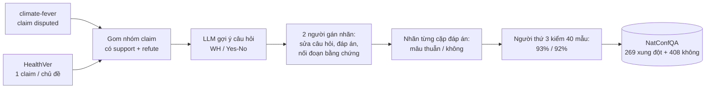

# Benchmark: NatConfQA (arXiv 2508.12355)

## 1. Thông tin chung & Tài nguyên

- **Tiêu đề:** Consensus or Conflict? Fine-Grained Evaluation of Conflicting Answers in Question-Answering. Tên bộ dữ liệu: **NatConfQA** (Natural Conflicts QA).
- **Mã arXiv:** [2508.12355](https://arxiv.org/abs/2508.12355), v1, tháng 8/2025. Công bố tại workshop UncertaiNLP 2025 (ACL), theo thông tin người giao việc nêu; trang HTML tôi đọc không xác nhận lại nơi đăng (chưa kiểm).
- **Tác giả:** Eviatar Nachshoni, Shmuel Amar, Arie Cattan, Ori Shapira, Ido Dagan (Bar-Ilan University; một số tác giả có thêm Google Research, OriginAI). Phần ánh xạ đơn vị công tác bị lỗi hiển thị trên trang nên chỉ mang tính gần đúng.
- **Mã nguồn / dữ liệu:** [github.com/EN555/ContraQA](https://github.com/EN555/ContraQA), theo bài. Tôi **chưa mở repo** nên chưa biết cấu trúc file, định dạng, có script chấm điểm hay không (chưa kiểm). Bài không nhắc bản Hugging Face.
- **Giấy phép:** công cụ tóm tắt báo bài nói NatConfQA sẽ phát hành dưới CC BY 4.0; hai dataset nguồn (climate-fever, HealthVer) không nêu giấy phép rõ. Phần cuối bản HTML không có câu nào về giấy phép dữ liệu. Giấy phép thực của repo: **chưa kiểm**.
- **Ngôn ngữ:** tiếng Anh.
- **Nguồn đã đọc:** bản HTML arXiv v1 qua công cụ tóm tắt (đọc khoảng 100.000 trên 105.229 ký tự, phần còn lại là phụ lục hướng dẫn gán nhãn và boilerplate). Chưa đối chiếu PDF.

## 2. Bộ dữ liệu

### 2.1. Dựng từ dataset fact-check nào

Hai dataset kiểm chứng tuyên bố (fact-checking) có sẵn nhãn bằng chứng ủng hộ / bác bỏ:

| Nguồn | Số claim | Bằng chứng | Phần dùng |
|---|---|---|---|
| climate-fever (Diggelmann et al., 2021) | 808 (654 chỉ có bằng chứng ủng hộ, 154 nhãn "disputed") | Wikipedia | Nhóm xung đột lấy claim "disputed" |
| HealthVer (Sarrouti et al., 2021) | 1,084 (607 chỉ ủng hộ, 477 có cả ủng hộ và bác bỏ) | Tóm tắt (abstract) CORD-19 | Giữ một claim mỗi chủ đề, khoảng 55 instance theo bài |

Bằng chứng trong hai nguồn có ba nhãn quan hệ với claim: *support*, *refute*, *neutral*. Tập xung đột được gom từ các nhóm claim có **ít nhất một bằng chứng support và một refute**, cho 188 nhóm ban đầu. Tập không xung đột là các nhóm chỉ có support hoặc neutral.

### 2.2. Nhãn cặp đáp án mâu thuẫn / không

- Nhãn là **nhị phân theo cặp đáp án**: mỗi cặp đáp án của một câu hỏi được người gán nhãn đánh "conflicting" hoặc "not conflicting". Mỗi instance lưu tập C các cặp mâu thuẫn.
- Mỗi đáp án được nối với các đoạn (passage) chứa bằng chứng ủng hộ nó.
- Hướng dẫn gán nhãn (phụ lục): 1 = mâu thuẫn rõ ràng; 0 = tương thích hoặc cùng tồn tại; trường hợp mơ hồ nghiêng về 0 kèm ghi chú.
- Ba kiểu câu hỏi được nhắc: WH-question, Yes/No, và "WH-mix" (vừa có đáp án mâu thuẫn vừa có đáp án không mâu thuẫn). Số instance theo từng kiểu: chỉ biết nhóm xung đột có 89 câu WH (chưa kiểm phần còn lại).
- **Nhãn là xung đột sự thật (factual) về nội dung**, không có trục thời gian. Bài đối chiếu với xung đột quan điểm (point-of-view) ở các dataset khác.

### 2.3. Có nhãn độ tin cậy nguồn không

**Không.** Bài không nhắc nhãn credibility cho đoạn hay nguồn. Mỗi đáp án chỉ gắn với các đoạn ủng hộ. Các đoạn là Wikipedia (climate-fever) hoặc abstract khoa học (HealthVer), không có `source` kiểu tên báo/URL được dùng làm tín hiệu. Đây là điểm quan trọng cho mục 6.

### 2.4. Quy mô

- **677 instance**: 269 có xung đột (89 là WH-question), 408 không xung đột.
- Trung bình khoảng 5.6 đoạn mỗi instance xung đột và 6.7 mỗi instance không xung đột; đoạn dài khoảng 252 từ.
- Instance WH xung đột: trung bình khoảng 2.6 đáp án (từ 2 đến 10), khoảng 1.3 cặp mâu thuẫn. Instance WH không xung đột: khoảng 3.8 đáp án (2 đến 13).
- Bài không mô tả chia train/dev/test; coi đây là tập chỉ để đánh giá (evaluation-only).

### 2.5. Cách xây dựng

1. Gom nhóm claim từ hai dataset như mục 2.1.
2. Công cụ gán nhãn hiển thị gợi ý câu hỏi WH và Yes/No do LLM sinh (bài không nêu tên LLM theo trang tôi đọc).
3. Hai người gán nhãn (sinh viên) qua hai vòng huấn luyện mỗi vòng 10 instance, tổng khoảng 52 giờ. Họ xác nhận có xung đột, viết hoặc sửa câu hỏi và đáp án, nối bằng chứng, gán nhãn từng cặp đáp án.
4. Người thứ ba kiểm 40 instance: đáp án đúng 93%, cặp xung đột đúng 92%.
5. Bài **không báo chỉ số đồng thuận giữa hai người gán nhãn** (chỉ có chú thích hình nói "độ đồng thuận cao" cho một người ngoài kiểm chất lượng).

### 2.6. Ví dụ

Từ HealthVer (WH-question, xung đột): câu hỏi "What is possible in regards to cat to human coronavirus transmission?", hai đáp án "cats can transmit the virus to humans" và "cats cannot transmit the virus to humans", tạo thành một cặp mâu thuẫn. Các đoạn kèm theo không hiện trên trang tôi đọc nên không chép.

## 3. Chỉ số đo

Đo ở mức instance rồi lấy trung bình; F1 là điều hòa của precision và recall:

- **Chất lượng đáp án:** `recall_ans` (tỉ lệ đáp án tham chiếu xuất hiện trong câu trả lời của mô hình), `precision_ans` (tỉ lệ đáp án rút từ câu trả lời mà có trong các đoạn), `F1_ans`.
- **Nhận diện xung đột:** `recall_conf` (tỉ lệ cặp mâu thuẫn tham chiếu mà câu trả lời nêu ra là mâu thuẫn), `precision_conf` (tỉ lệ cặp được nêu ra mà thực sự mâu thuẫn trong đoạn), `F1_conf`.
- **Bộ chấm:** o4-mini làm LLM-as-a-judge để tách đáp án và ra quyết định nhị phân. Tương quan với người trên 120 mẫu: Pearson r khoảng 0.62 đến 0.66.
- Không có EM, không có chỉ số về thời gian hay nguồn.

## 4. Baseline tự báo cáo

Tám mô hình: GPT-4o, Gemini 2.0 Flash, DeepSeek-V3, Qwen2.5-72B, o3, Gemini 2.5 Pro, DeepSeek-R1, Qwen3-235B. Hai kiểu prompt cùng một khuôn "trả lời một câu ngắn bao quát mọi đáp án trong đoạn": *defaultive* (mặc định) và *conflict-aware* (thêm chỉ dẫn nêu rõ đáp án mâu thuẫn, giữ khách quan).

Conflict recall ở prompt mặc định, tập xung đột (Bảng 1 theo công cụ tóm tắt):

| Mô hình | recall_conf |
|---|---|
| GPT-4o | 37.8 |
| Qwen2.5-72B | 46.0 |
| Qwen3-235B | 50.3 |
| DeepSeek-R1 | 50.6 |
| Gemini 2.0 Flash | 54.7 |
| DeepSeek-V3 | 55.5 |
| Gemini 2.5 Pro | 61.8 |
| o3 | 67.8 |

- Prompt conflict-aware tăng recall_conf ở cả tám mô hình, từ khoảng 7.5 đến 27.6 điểm; precision vẫn cao. Mức tăng nhỏ nhất ở nhóm WH-mix.
- `precision_ans` cao (92.4 đến 97.8). `recall_ans` của o3 là 71.1 (các mô hình khác: chưa kiểm).
- Tập không xung đột: bốn mô hình đạt F1_ans trên 90 với prompt mặc định; prompt conflict-aware làm F1_ans giảm nhẹ ở tập này.
- **Phân tích lỗi** (160 câu trả lời của 4 mô hình, một người gán nhãn; 80 câu có lỗi): *Choose* 42% (chỉ nêu một trong các đáp án mâu thuẫn), *Generalize* 17% (gộp thành tóm tắt mơ hồ), *Resolve* 13% (bịa chi tiết để hòa giải), *Refrain* 5% (không trả lời). Khoảng 23% còn lại: chưa rõ trên trang đã đọc.
- Không có baseline retrieval hay hệ memory; mô hình nhận sẵn các đoạn trong prompt.

Các con số lấy từ bản HTML qua công cụ tóm tắt, cần đối chiếu bảng gốc trước khi trích vào luận văn.

## 5. Ưu điểm / Nhược điểm

**Ưu điểm**
- Xung đột **tự nhiên** (từ dataset kiểm chứng có bằng chứng thật), không do LLM sinh bịa như ConflictBank.
- Nhãn mức **cặp đáp án** do người gán, kèm đoạn bằng chứng cho từng đáp án; có cả tập không xung đột để đo báo động giả.
- Chỉ số tách "có nêu đủ đáp án" khỏi "có nhận ra mâu thuẫn"; phân loại lỗi (Choose, Generalize, Resolve, Refrain) hữu ích để mô tả hành vi mô hình khi gặp mâu thuẫn.
- Nhỏ, dễ chạy lại.

**Nhược điểm / hạn chế (tác giả nêu hoặc suy ra từ bài)**
- Chỉ hai dataset nguồn; xung đột thuộc lĩnh vực khí hậu và y tế, là xung đột sự thật.
- Phụ thuộc nặng vào LLM (tách đáp án, chấm điểm, baseline); prompt khác có thể đổi kết quả. Độ tương quan judge-người chỉ khoảng 0.62-0.66 trên 120 mẫu.
- Kiểm tay chỉ 40 instance; hai người gán nhãn, không báo độ đồng thuận; phân tích lỗi chỉ 160 câu và một người.
- Có thể nhiễm dữ liệu (dữ liệu pretrain của mô hình không rõ).
- Không giải quyết xung đột: bộ này chỉ yêu cầu mô hình **nêu ra** mâu thuẫn, không yêu cầu chọn đáp án đúng.
- Không có thời gian, không có nguồn/độ tin cậy.

## 6. Áp dụng vào đồ án

**Đối chiếu phạm vi** (`docs/decisions/09_CONFLICT_RESOLUTION_SCOPE.md`): đồ án đã bỏ nhánh đa nguồn và Credibility Score, chỉ làm Evolution (`end_time`) và Falsehood (`invalidated_at`) trong một nguồn có lịch sử (Wikipedia), với lý do "không có benchmark công khai phù hợp". NatConfQA **không đảo ngược lý do đó**:

| Thành phần đồ án | NatConfQA cho gì | Đánh giá |
|---|---|---|
| `source`, `credibility_score` (`design/01` mục 2.1) | Không có nhãn nguồn hay độ tin cậy; mỗi đáp án chỉ nối với đoạn ủng hộ | Không kiểm thử được; đúng với kết luận trong `09` rằng thiếu benchmark có nhãn credibility |
| `end_time` (Evolution) | Không có trục thời gian | Không đo |
| `invalidated_at` (Falsehood) | Không có khái niệm "sai từ đầu" được đính chính; mâu thuẫn là hai quan điểm cùng tồn tại trong tài liệu | Không đo |
| Timeline ≠ Conflict, loại 5-6 của `09` | Tập không xung đột là đối chứng cho báo động giả, nhưng không liên quan thăng tiến theo thời gian | Chỉ gần đúng về tinh thần |
| Cơ chế 3 nói chung | Đo **khả năng nhận diện và nêu mâu thuẫn** của bước sinh | Bổ trợ ở tầng Generation, không phải tầng lưu trữ |

**Chỗ có thể dùng (đề xuất, chưa thử):**
1. **Kiểm tra bước sinh khi kho trả về hai đoạn mâu thuẫn.** Nếu hệ đồ án trả về cả chunk còn hiệu lực lẫn chunk bị đánh dấu (ví dụ cảnh báo `invalidated_at` trong câu hỏi lịch sử), bước Time-CoT cần nêu rõ thay vì chọn một. Dùng NatConfQA như bài kiểm riêng cho hành vi này: nạp các đoạn của một instance làm context, chạy hai prompt như bài.
2. **Mượn cách phân loại lỗi** Choose / Generalize / Resolve / Refrain để gán nhãn lỗi trong phân tích định tính của loại 4 (đính chính) khi đồ án có dữ liệu bán tổng hợp. Đây là mượn khung, không phải dùng số.
3. **Mượn thiết kế "tập đối chứng không xung đột"** tương tự loại 5 của `09` để đo tỉ lệ báo động giả (conflict-aware prompt làm F1_ans giảm nhẹ ở tập này là một cảnh báo: chỉ dẫn nêu mâu thuẫn có thể gây báo nhầm).
4. **Chỉ số tương ứng:** `F1_conf`, `recall_conf` cho đầu ra; False-invalidation rate vẫn lấy từ `09`. Hai nhóm này đo hai tầng khác nhau, không gộp.

**Ghi vào luận văn:** NatConfQA là ví dụ benchmark xung đột sự thật có nhãn người, nhưng không có thời gian và không có độ tin cậy nguồn. Có thể trích trong mục hạn chế (khoảng trống: chưa có benchmark công khai gắn cả mâu thuẫn, mốc thời gian và độ tin cậy nguồn). Lưu ý khẳng định "chưa có" chỉ dựa trên những benchmark tôi đã đọc (ConflictBank, RECON, NatConfQA), chưa quét toàn bộ tài liệu.

**Phần không so sánh công bằng:**
- Baseline của bài là LLM nhận đoạn trực tiếp trong prompt, không có retrieval, kho, lọc `invalidated_at` hay re-rank; số recall_conf không đặt cạnh số của hệ đồ án.
- Bộ chấm o4-mini và số mô hình khác với cấu hình của đồ án; đổi LLM thì không so được.
- Tập nhỏ (677, chỉ 269 xung đột, 89 câu WH): sai số lớn khi chia nhỏ theo kiểu câu hỏi.

**Quyết định đề xuất:** không dùng làm benchmark chính của Cơ chế 3. Nếu còn thời gian, chạy như thí nghiệm phụ ở tầng Generation; nếu không, chỉ dẫn trong phần liên quan và hạn chế.

## 7. Chỗ chưa xác nhận

- Nội dung repo `EN555/ContraQA`: định dạng dữ liệu, script chấm điểm, giấy phép thực tế (chưa mở repo).
- Việc bài hứa phát hành dưới CC BY 4.0 (theo công cụ tóm tắt; phần cuối HTML không nêu giấy phép); không có thông tin giấy phép dữ liệu nguồn.
- Venue chính xác (UncertaiNLP 2025, ACL) chỉ theo người giao việc.
- Tên LLM sinh gợi ý câu hỏi; số instance theo từng kiểu (WH, Yes/No, WH-mix) ngoài con số 89 câu WH xung đột.
- Độ đồng thuận giữa hai người gán nhãn: bài không báo.
- `recall_ans` của bảy mô hình ngoài o3; số F1 đầy đủ trong Bảng 1; khoảng 23% lỗi còn lại ở phân tích lỗi.
- Đối chiếu toàn bộ số liệu với PDF gốc: chưa làm.
- Có hay không cột cho phép nối instance với `claim` gốc và metadata nguồn của climate-fever/HealthVer (nếu nối được thì có thể suy ra nguồn đoạn, nhưng vẫn không có credibility): chưa kiểm.
