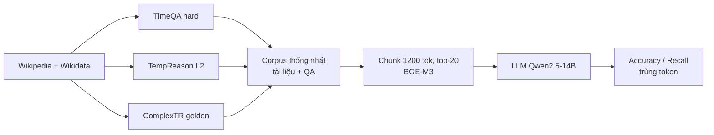

# Benchmark so sánh: DyG-RAG (TimeQA / TempReason / ComplexTR)

> Ghi chú này chỉ tập trung vào **dataset, cách đo, số baseline** để quyết định có dùng bộ này làm benchmark so sánh hay không. Phần phương pháp của DyG-RAG (Dynamic Event Graph, Event Time Graph...) đã có ở [../../timeline_summarization/01_DyG_RAG_Event_Graph.md](../../timeline_summarization/01_DyG_RAG_Event_Graph.md), không lặp lại ở đây.

## 1. Thông tin chung & Tài nguyên
- **Tiêu đề:** DyG-RAG (Dynamic Graph Retrieval-Augmented Generation with Event-Centric Reasoning). Tên đầy đủ chính xác: chưa rõ, xem trang arXiv.
- **arXiv:** [2507.13396](https://arxiv.org/html/2507.13396)
- **GitHub:** [RingBDStack/DyG-RAG](https://github.com/RingBDStack/DyG-RAG). Cấu trúc thư mục gốc: `datasets/`, `demo/` (ví dụ TimeQA), `docs/`, `examples/`, `figs/`, `graphrag/`, `models/`, `reproduce/`, kèm `LICENSE`, `README.md`, `requirements.txt`.
- **Dataset:** ba bộ đã xử lý lại, tác giả nói công bố trên GitHub; README mô tả `datasets/` chứa "three types of temporal QA datasets". Danh sách file và schema bên trong: **chưa rõ** (trang GitHub không liệt kê).
- **Giấy phép:** repo có file `LICENSE` nhưng loại giấy phép **chưa rõ** (chưa đọc nội dung). Bài báo theo giấy phép arXiv. Dữ liệu gốc dựa trên Wikipedia/Wikidata; giấy phép của từng bộ gốc chưa xác nhận.
- **Ngôn ngữ:** bài không nêu; suy ra tiếng Anh (nguồn Wikipedia).
- **Nguồn gốc TimeQA:** [arXiv 2108.06314](https://arxiv.org/abs/2108.06314), repo [wenhuchen/Time-Sensitive-QA](https://github.com/wenhuchen/Time-Sensitive-QA). Ghi chú TimeQA của đồ án: [../../../dataset/01_TIME_SENSITIVE_QA.md](../../../dataset/01_TIME_SENSITIVE_QA.md).

## 2. Bộ dữ liệu
DyG-RAG **không tự tạo dataset mới**: tác giả lấy ba bộ temporal QA có sẵn (đều dựa trên Wikipedia) và gom lại thành dạng thống nhất "corpus tài liệu + cặp hỏi đáp" vì (theo tác giả) chưa có benchmark riêng cho temporal RAG.

| Bộ | Subset dùng | Kiểu suy luận | Số tài liệu | Số token | Token TB/tài liệu | Số câu hỏi |
|---|---|---|---|---|---|---|
| TimeQA | hard mode | Suy luận thời gian ngầm định (implicit temporal inference) | 3,159 | ~1,819,999 | ~576 | 2,613 |
| TempReason | L2 | Event state grounding (xác định trạng thái sự kiện tại một mốc) | 2,721 | ~2,667,820 | ~980 | 5,397 |
| ComplexTR | golden test | Multi-hop temporal reasoning | 112 | ~240,165 | ~2,144 | 312 |

- **Cách xây dựng:** corpus là các bài Wikipedia gắn với câu hỏi; đáp án chuẩn của TimeQA lấy từ Wikidata (có cấu trúc), còn ngữ cảnh là văn bản Wikipedia (xem ghi chú TimeQA của đồ án). Chi tiết bước gộp và lọc của DyG-RAG: chưa rõ.
- **Chia tập:** bài không mô tả train/valid/test ngoài tên subset. Câu hỏi 2,613 của TimeQA thuộc split nào (dev hay test) và có trùng bộ test chính thức của TimeQA không: **chưa rõ**. DyG-RAG là phương pháp không cần huấn luyện trên QA, nên không cần train split để chạy.
- **Cấu hình retrieval của tác giả:** chunk cửa sổ trượt 1,200 token, overlap 64; top-20; đầu vào cắt ở 16,384 token.
- **Khả năng tải:** nằm trong `datasets/` của repo (định dạng chưa rõ). Có thể tải thẳng từng bộ gốc: TimeQA từ repo Time-Sensitive-QA; TempReason và ComplexTR: link nguồn gốc chưa kiểm.
- **Ví dụ câu hỏi thật:** bài DyG-RAG (trang HTML đã trích) không cho câu hỏi cụ thể của ba bộ. Ví dụ TimeQA lấy từ ghi chú của đồ án: *"What position did Ian Gibson hold in 2005?"* (đáp án: Member of Parliament for Norwich North; khoảng hiệu lực May 1997 đến May 2001 theo Wikidata). Ví dụ TempReason/ComplexTR: chưa rõ.

## 3. Chỉ số đo
- **Accuracy** và **Recall**, đều tính ở mức **token** dựa trên độ trùng giữa token của câu trả lời dự đoán và token của đáp án chuẩn, theo một giao thức được bài trích dẫn.
- **Công thức chính xác:** bài (bản HTML đã đọc) không đưa công thức; việc "Accuracy" là có chứa đáp án hay là precision token, cách chuẩn hóa (lowercase, bỏ mạo từ...) đều **chưa rõ**. Cần đọc code `reproduce/` trước khi so sánh số.
- Không dùng EM/F1 chuẩn, nên **không thể quy đổi trực tiếp** sang EM/F1 của đồ án.

## 4. Baseline và số đã công bố
Tất cả số **do chính tác giả DyG-RAG báo cáo** (Table 3), Accuracy / Recall (%). Cấu hình chung: LLM **Qwen2.5-14B** (dựng đồ thị và sinh câu trả lời), embedding **BGE-M3**, phục vụ bằng vLLM trên 4 GPU V100. DyG-RAG dùng thêm `dslim/bert-base-NER` (trích thực thể) và TinyBERT-L-2-v2 (rerank sự kiện ứng viên). Chưa rõ các baseline có cùng cấu hình chunk/top-k hay không.

| Phương pháp | TimeQA | TempReason | ComplexTR |
|---|---|---|---|
| Vanilla RAG | 37.58 / 44.14 | 52.01 / 64.38 | 42.55 / 51.46 |
| GraphRAG-L | 40.26 / 46.28 | 56.11 / 67.55 | 43.16 / 54.29 |
| GraphRAG-G | 10.10 / 13.83 | 8.81 / 11.34 | 20.97 / 30.81 |
| LightRAG-L | 34.94 / 39.89 | 54.23 / 66.82 | 41.03 / 49.46 |
| LightRAG-G | 6.66 / 8.12 | 13.54 / 15.27 | 12.46 / 13.56 |
| LightRAG-H | 36.36 / 43.06 | 50.01 / 62.95 | 42.68 / 53.59 |
| HippoRAG | 39.99 / 45.39 | 69.80 / 80.54 | 44.68 / 55.28 |
| E2GraphRAG | 40.48 / 50.19 | 61.29 / 73.58 | 38.29 / 54.99 |
| **DyG-RAG** | **58.78 / 67.02** | **84.75 / 91.47** | **55.62 / 69.88** |

Chú thích hậu tố: L = local, G = global, H = hybrid (các chế độ truy vấn của GraphRAG/LightRAG). Nhận xét: các biến thể "global" gần như thất bại (6 đến 21%) trên QA điểm-thời-gian; Vanilla RAG đã đạt 37.58 Accuracy trên TimeQA hard, nên khoảng cách DyG-RAG so với Vanilla là khoảng +21 điểm Accuracy.

## 5. Ưu điểm / nhược điểm
**Ưu điểm**
- Có số của 8 baseline trên cùng bảng, gồm Vanilla RAG, nên dễ đặt đồ án cạnh nhau.
- TimeQA là bộ đồ án đã dùng, cùng nguồn Wikipedia/Wikidata, nên chi phí chuẩn bị thấp nhất.
- Corpus nhỏ (hàng nghìn tài liệu, ~2M token ở TimeQA): chạy lại rẻ.
- Dữ liệu đã xử lý được cho là phát hành cùng code.

**Nhược điểm**
- Chỉ số token-overlap không rõ công thức, khác EM/F1; tác giả dùng LLM 14B cục bộ khác LLM của đồ án, nên số tuyệt đối khó so.
- Câu hỏi tĩnh, chỉ một bài Wikipedia/entity: **không có xung đột đa nguồn, không có correction, không streaming** (xem bảng tính chất ở ghi chú TimeQA). Không kiểm được Cơ chế 3 đầy đủ.
- TimeQA không có metadata thời gian cho từng chunk: thời gian chôn trong văn bản; mốc truy vấn nằm trong câu hỏi, không có `T_req` riêng.
- Rò rỉ: LLM đã thấy Wikipedia lúc pre-training (contamination); mức độ chưa đo. Dữ liệu dừng quanh 2020 đến 2021.
- Chỉ tiếng Anh, miền Wikipedia (người, tổ chức, địa điểm), khác miền pháp luật và tin tức của đồ án.
- Không có số retrieval (hit@k, mrr) hay số về rò rỉ tương lai; chỉ có đáp án cuối.
- Giấy phép và định dạng chưa rõ.

## 6. Áp dụng vào đồ án

**Cơ chế phù hợp**
- **Cơ chế 1 (Temporal Retrieval):** phù hợp nhất, qua TimeQA hard. Cơ chế 2 (Timeline Summarization): ComplexTR (multi-hop) và TempReason có thể thử, nhưng DyG-RAG là bài về graph nên so với đồ án ở Cơ chế 2 hợp lý hơn; cần kiểm câu hỏi có dạng timeline hay không (chưa rõ). Cơ chế 3 (Conflict Resolution): **không** kiểm được bằng bộ này.

**Cần làm để chạy hệ thống đồ án**
1. Lấy `datasets/` của DyG-RAG (hoặc dùng đúng subset hard từ repo TimeQA nếu xác định được 2,613 câu); xác nhận file và schema.
2. Nạp: mỗi tài liệu cắt chunk; điền schema mục 2.1 của [docs/design/01_INITIAL_BASE_DESIGN.md](../../../design/01_INITIAL_BASE_DESIGN.md): `chunk_id`, `source` (tên trang), `category` (domain nếu có), `start_time` / `end_time` (trích từ văn bản bằng bước Ingestion, vì dataset không cho sẵn), `invalidated_at = null` (TimeQA không có tin sai). Tài liệu không trích được mốc thời gian không vào được store time-aware, nên cần đo tỉ lệ rơi rớt ở bước này.
3. Lấy `T_req`: không có trường riêng; trích từ chuỗi câu hỏi bằng Query Profiler (như pipeline `tune`/`valid` của đồ án). Câu hỏi không có mốc rõ thì `T_req` chưa xác định, ghi nhận riêng.
4. Chạy đúng LLM của DyG-RAG nếu có thể (Qwen2.5-14B + BGE-M3) ở một lần chạy đối chứng; nếu không, chạy lại Vanilla RAG trong hạ tầng đồ án làm mốc nội bộ.

**Chỉ số tương ứng** (đồ án đo ở [docs/eval/07_TUNE_VALID_RESULTS.md](../../../eval/07_TUNE_VALID_RESULTS.md))
- Accuracy/Recall token-overlap của DyG-RAG <-> **EM/F1** và `contains` của đồ án: chỉ tương đương sau khi cài lại đúng công thức của họ.
- `hit@k`, `mrr`, `ans_valid@k`, `leakage_rate`: **không có số công bố** ở bộ này, nên chỉ dùng cho so sánh nội bộ (Plain RAG vs Temporal Retrieval).

**Phần KHÔNG so sánh được công bố**
- Hit@k/mrr/rò rỉ tương lai (DyG-RAG không báo cáo).
- Số tuyệt đối khi khác LLM, embedding, cách chunk, top-k; và khi bộ con của đồ án (`tune`/`valid`/`test_clean`, 400 + 195 câu `real`...) khác 2,613 câu của DyG-RAG.
- Xung đột/đính chính (Cơ chế 3), `invalidated_at`, `credibility_score`.
- Điểm lợi của `start_time <= T_req` hard filter: TimeQA nén cả lịch sử vào một bài, nên lọc ở mức chunk phụ thuộc hoàn toàn vào chất lượng trích mốc thời gian.

## 7. Chỗ chưa xác nhận
- `datasets/` có tải được không và schema file ra sao.
- Subset TimeQA 2,613 câu có trùng split chính thức hay là mẫu con; có phát hành danh sách ID không.
- Loại giấy phép của repo và của dữ liệu đã xử lý lại; điều khoản TempReason, ComplexTR.
- Công thức Accuracy/Recall; code trong `reproduce/` có tái hiện được Table 3 không (README không có phần đánh giá).
- Baseline có cùng chunk/top-k/LLM với DyG-RAG không.
- Bản bộ con phát hành riêng: chưa rõ, chưa thấy.
