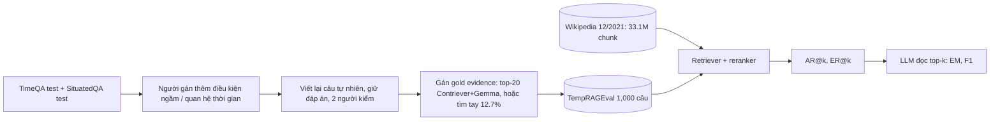
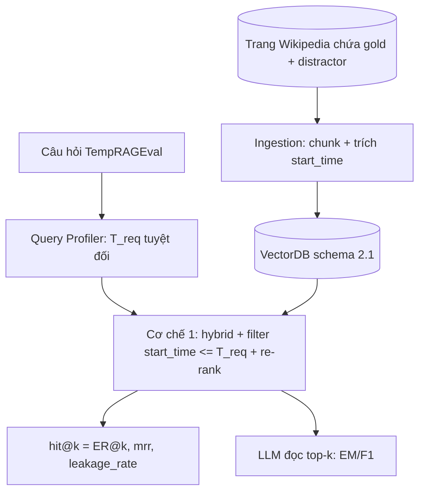

# Benchmark: TempRAGEval (từ bài MRAG, arXiv 2412.15540)

Ghi chú này phục vụ việc chọn benchmark để so sánh với các hệ thống đã công bố. Trọng tâm là dataset TempRAGEval; phương pháp MRAG chỉ tóm tắt ngắn.

## 1. Thông tin chung & Tài nguyên
- **Tiêu đề:** MRAG: A Modular Retrieval Framework for Time-Sensitive Question Answering (Siyue Zhang, Yuxiang Xue, Yiming Zhang, Xiaobao Wu, Anh Tuan Luu, Chen Zhao; NTU / NYU Shanghai / Zhejiang Univ.). Bản v2 ngày 21/05/2025; theo kết quả tìm kiếm, bài đăng ở Findings of EMNLP 2025 (chưa tự xác nhận trên ACL Anthology).
- **arXiv:** [2412.15540](https://arxiv.org/abs/2412.15540) (bản HTML: https://arxiv.org/html/2412.15540v2)
- **Dữ liệu:** Hugging Face [`siyue/TempRAGEval`](https://huggingface.co/datasets/siyue/TempRAGEval) (gated: phải đăng nhập và đồng ý chia sẻ thông tin tài khoản HF).
- **Mã nguồn:** [github.com/siyue-zhang/MRAG](https://github.com/siyue-zhang/MRAG) (repo công khai, có `temp_eval.py`, `reader.py`... nhưng README không mô tả lệnh đánh giá). Lưu ý: trong bài link ghi là `https://github/anonymous` (chỗ giữ chỗ); repo thật tìm được qua dataset card HF.
- **Giấy phép (ba nguồn không thống nhất):** dataset card HF ghi Apache-2.0; README repo GitHub ghi MIT; bài báo ghi CC BY 4.0 cho paper và nêu hai bộ gốc là BSD-3-Clause (TimeQA) và Apache-2.0 (SituatedQA), cho phép phát hành chú thích sửa đổi. Cần đọc điều khoản trên HF trước khi tái phân phối.
- **Ngôn ngữ:** tiếng Anh (dataset card HF ghi English).
- **Nguồn gốc hai bộ gốc:** TimeQA ([2108.06314](https://arxiv.org/abs/2108.06314)), SituatedQA ([2109.06157](https://arxiv.org/abs/2109.06157)). Ghi chú nội bộ: [TimeQA](../../../dataset/01_TIME_SENSITIVE_QA.md), [SituatedQA](../../../dataset/05_SITUATED_QA.md).

## 2. Bộ dữ liệu
- **Nguồn và quy mô:** 1,000 câu từ tập TEST của TimeQA và SituatedQA, chia đều: TimeQA 500 (123 gốc + 377 perturbed), SituatedQA 500 (120 gốc + 380 perturbed). Dataset card ghi kích thước 572 kB, định dạng CSV, split `test`; số cột và tên cột chưa rõ (card chỉ nêu `time_relation`).
- **Perturbation (biến đổi câu hỏi):** người gán nhãn thêm *implicit condition* (điều kiện ngầm: None, first, earliest, last, latest) và *temporal relation* (quan hệ thời gian, 11 loại như "as of", "between", "since", "after"), hoặc đổi mốc thời gian sang mốc khác, rồi viết lại câu tự nhiên. Đáp án giữ nguyên. Hai người kiểm mỗi cặp. Mẫu có `time_relation` rỗng bị loại khi đánh giá (theo README).
- **Gold evidence:** tối đa 2 câu/đoạn Wikipedia mỗi câu hỏi; một chunk được coi là gold nếu chứa một trong các câu gold. Người gán xem top-20 của Contriever (dense retriever) được rerank bằng Gemma; nếu không có thì tìm tay trên Wikipedia (khoảng 12.7% số câu).
- **Loại câu hỏi:** hỏi sự kiện/thuộc tính tại một mốc hoặc khoảng thời gian (điểm-thời-gian có điều kiện first/last/between). Một chiều: chỉ ràng buộc thời gian tường minh. Không có câu hỏi vượt knowledge cutoff của LLM, không multi-hop (tác giả tự nêu).
- **Thống kê:** độ dài câu hỏi trung bình 15.2 token (TimeQA), 15.6 (SituatedQA).
- **Corpus đi kèm:** Wikipedia dump 02/12/2021, **33.1 triệu chunk** (phiên bản `corpora/wiki/enwiki-dec2021` của ATLAS). Kích thước dung lượng và định dạng tải: chưa rõ (cần tải từ ATLAS, không nằm trong dataset card TempRAGEval).
- **Ví dụ thật:**
  - Từ bài (phụ lục): "Who won the latest America's Next Top Model by May 8, 2021?" -> đáp án Kyla Coleman.
  - Từ dataset card: câu hỏi gốc dùng mốc "2019" được đổi thành "6 May 2021", đáp án vẫn là Boris Johnson (câu đầy đủ chưa xem được vì dataset gated).

## 3. Chỉ số đo
- **AR@k (Answer Recall):** tỉ lệ mẫu có ít nhất một đáp án gold xuất hiện (khớp chuỗi) trong top-k đoạn truy xuất.
- **ER@k (Gold Evidence Recall):** tỉ lệ mẫu có ít nhất một đoạn gold evidence nằm trong top-k.
- **EM (Exact Match):** đáp án sinh ra khớp chính xác đáp án gold.
- **F1:** độ trùng từ giữa đáp án sinh ra và đáp án gold.
- Chi tiết chuẩn hóa chuỗi (lowercase, bỏ mạo từ...) và cách khớp AR: chưa rõ, cần đọc `temp_eval.py`.
- Pipeline của bài: retriever lấy top 1,000, reranker xếp lại top 100.

## 4. Baseline và số đã công bố
Tất cả số do **chính tác giả tự báo cáo** (v2 của bài), chưa có tái lập độc lập.

**Truy xuất (1st stage = Contriever trừ khi ghi khác; 2nd stage = reranker):**

| Phương pháp | TimeQA AR@1 | AR@5 | ER@1 | ER@5 | SituatedQA AR@1 | AR@5 | ER@1 | ER@5 |
|---|---|---|---|---|---|---|---|---|
| BM25 | 17.5 | 39.0 | 4.2 | 14.1 | 27.6 | 58.2 | 6.8 | 18.4 |
| Contriever | 18.8 | 49.9 | 9.6 | 28.7 | 22.6 | 51.1 | 6.8 | 17.1 |
| Hybrid | 18.8 | 51.2 | 9.6 | 28.1 | 22.6 | 55.8 | 6.8 | 19.7 |
| + ELECTRA | 40.1 | 76.9 | 21.8 | 58.6 | 35.5 | 71.3 | 15.3 | 37.1 |
| + MiniLM | 34.0 | 76.1 | 16.2 | 57.3 | 36.8 | 73.4 | 20.0 | 40.3 |
| + Jina | 42.4 | 77.2 | 23.6 | 58.6 | 47.9 | 78.4 | 19.5 | 41.1 |
| + BGE | 40.3 | 80.9 | 23.3 | 61.3 | 36.3 | 74.2 | 14.5 | 35.0 |
| + NV-Embed | 49.9 | 81.2 | 33.4 | 62.9 | 47.4 | 81.3 | 23.4 | 46.1 |
| + Gemma | 46.7 | 82.5 | 26.0 | 66.6 | 54.7 | 82.6 | 20.3 | 45.3 |
| MRAG (không tóm tắt) | 57.6 | 89.4 | 32.4 | 73.5 | 61.1 | 88.2 | 27.4 | 56.3 |
| MRAG (tóm tắt top-5) | 58.6 | 90.0 | 37.1 | 74.3 | 61.3 | 89.0 | 31.1 | 59.2 |
| MRAG (tóm tắt top-10) | 56.0 | 88.1 | 35.5 | 73.2 | 62.1 | 87.9 | 30.8 | 57.9 |

**QA (EM / F1), trích một số dòng chính:**

| LLM | Phương pháp | TimeQA EM/F1 | SituatedQA EM/F1 |
|---|---|---|---|
| GPT-4o-mini | Direct Prompt | 19.6 / 30.6 | 54.2 / 58.6 |
| GPT-4o-mini | RAG-Concat (3 docs) | 43.4 / 55.2 | 55.8 / 58.1 |
| GPT-4o-mini | Self-MRAG (3 docs) | 44.6 / 54.9 | 62.4 / 64.5 |
| Llama3.1-8B | RAG-Concat (5 docs) | 44.0 / 52.8 | 60.0 / 62.7 |
| Llama3.1-8B | Self-MRAG (5 docs) | 54.2 / 65.6 | 66.4 / 68.2 |
| Llama3.1-70B | Direct Prompt | 31.0 / 42.3 | 59.0 / 62.1 |
| Llama3.1-70B | RAG-Concat (5 docs; 20 cho SituatedQA) | 54.4 / 63.2 | 67.0 / 69.8 |
| Llama3.1-70B | Self-MRAG (5 docs; 20 cho SituatedQA) | 61.2 / 75.3 | 72.2 / 76.0 |
| TIMO (LLaMA2-13B tinh chỉnh thời gian) | Direct Prompt | 16.2 / 24.8 | 50.6 / 53.1 |

Các dòng khác (Direct CoT, MRAG-Concat, Llama 8B/70B đầy đủ) có trong bài, không chép hết ở đây.

- **Reranker:** ELECTRA, MiniLM, Jina, BGE, NV-Embed, Gemma; MRAG dùng embedding Gemma cho semantic score.
- **MRAG tóm tắt:** 3 module (xử lý câu hỏi; truy xuất + tóm tắt query-focused top-5 bằng LLM, case study dùng Llama3.1-8B; xếp hạng điểm semantic và temporal tách riêng). Training-free, chi phí khoảng gấp đôi RAG thường (tự báo cáo); 4 GPU L40S.
- **LLM đọc:** GPT-4o mini, TIMO, Llama3.1-8B/70B-Instruct, prompt 10 ví dụ.

## 5. Ưu điểm / nhược điểm
**Ưu điểm**
- Có nhãn gold evidence do người gán -> đo được ER@k (truy xuất đúng bằng chứng), không chỉ khớp chuỗi đáp án.
- Có bảng baseline truy xuất đầy đủ (BM25 tới reranker mạnh) và QA nhiều LLM, dễ đặt cạnh.
- Nhỏ (1,000 câu, 572 kB), có thêm lớp perturbation để thử độ bền với diễn đạt thời gian.
- Thuần Wikipedia, không rò rỉ giấy phép báo chí.

**Nhược điểm**
- Corpus 33.1M chunk rất lớn, tải/embed/index tốn kém; kho chunk không có sẵn `start_time`/`end_time`.
- Số liệu chỉ từ tác giả, và gold evidence thiên về những gì Contriever+Gemma tìm được (chọn từ top-20 của chính các retriever này), có thể thiên lệch có lợi cho họ retriever này; khoảng 12.7% bổ sung tay giảm phần nào.
- Khác miền với đồ án (Wikipedia, tiếng Anh, so với tin tức/pháp luật, tiếng Việt).
- Chỉ ràng buộc thời gian tường minh, không có xung đột nguồn, không timeline nhiều sự kiện, không câu hỏi vượt cutoff.
- Giấy phép không thống nhất giữa các nguồn; dataset gated; tên cột chưa rõ.
- Độ lệch tập con: chỉ 123/120 câu là gốc, còn lại là biến thể do chính tác giả tạo.

## 6. Áp dụng vào đồ án
**Map vào cơ chế**
- **Cơ chế 1 (Temporal Retrieval):** khớp trực tiếp. Câu hỏi "latest ... by May 8, 2021" có `T_req` tuyệt đối; hard filter `start_time <= T_req`, Case 1/Case 2 và re-rank `W1·Semantic + W2·Temporal` đều chạy được.
- **Cơ chế 2 (Timeline):** chỉ liên quan gián tiếp (các câu "first/last/between" gợi ý chuỗi sự kiện), không phải bài đo timeline.
- **Cơ chế 3 (Conflict):** gần như không đo được; tác giả nói rõ xung đột giữa các passage để lại cho công việc sau.

**Cần làm để chạy hệ thống của đồ án**
1. Xin quyền truy cập HF, tải CSV, xem lại cột (câu hỏi, đáp án, gold sentence, `time_relation`, mốc `T_req`; tên cột chưa rõ).
2. Ánh xạ chunk Wikipedia vào schema mục 2.1 của [`01_INITIAL_BASE_DESIGN.md`](../../../design/01_INITIAL_BASE_DESIGN.md): `chunk_id` = id chunk ATLAS; `source` = tiêu đề trang/URL; `category` = chủ đề trang hoặc loại câu hỏi; `start_time`/`end_time` phải trích từ văn bản chunk (hoặc dùng ngày dump 12/2021 làm fallback), nên nguồn nhãn thời gian là chỗ yếu nhất; `invalidated_at` = null toàn bộ.
3. Chạy retriever của đồ án trên chunk, lấy top-k, tính chỉ số bên dưới; thêm bước LLM đọc nếu so EM/F1 (nên dùng cùng LLM với bảng, ví dụ Llama3.1-8B hoặc GPT-4o-mini).

**Thu hẹp corpus (vì 33.1M quá lớn)**
- Lấy các trang Wikipedia chứa gold evidence của 1,000 câu (có thể thêm các trang liên quan từ top-k của BM25 làm distractor, và các trang cùng thực thể ở các thời điểm khác). Nhận dạng gold bằng cách khớp câu gold trong chunk.
- Hệ quả: nhiệm vụ dễ hơn nhiều (ít nhiễu hơn so với 33.1M), nên AR@k/ER@k của đồ án **cao giả tạo** so với bảng của tác giả; chỉ so sánh công bằng khi chạy cả baseline (BM25, Contriever, reranker) trên đúng corpus thu hẹp đó. Số công bố chỉ để tham khảo định tính.

**Chỉ số tương ứng của đồ án** ([`07_TUNE_VALID_RESULTS.md`](../../../eval/07_TUNE_VALID_RESULTS.md))
| Benchmark | Đồ án |
|---|---|
| ER@k | `hit@k` trên chunk gold |
| AR@k | gần với `ans_valid@k` nhưng chưa chắc cùng định nghĩa (cần kiểm tra cách đồ án định nghĩa ans_valid) |
| EM, F1 | EM/F1 giữ nguyên định nghĩa |
| (không có) | `mrr`, `leakage_rate` (rò rỉ tương lai): bổ sung thêm cho đồ án |

**Phần KHÔNG so sánh công bằng**
- Số tuyệt đối trên corpus thu hẹp so với 33.1M.
- `leakage_rate`, `invalidated_at`, Cơ chế 2 và 3: TempRAGEval không đo; chỉ đo được nhánh point-in-time.
- Nhãn thời gian của chunk do đồ án tự trích (baseline của tác giả không dùng), nên độ chính xác bước này ảnh hưởng kết quả.
- LLM đọc khác nhau (tránh so với Llama3.1-70B nếu đồ án chạy mô hình nhỏ).
- Tiếng Anh/Wikipedia khác miền tiếng Việt.

## 7. Chỗ chưa xác nhận
- Tên cột và split của CSV (dataset gated, chưa tải).
- Giấy phép chính thức (Apache-2.0 trên HF, MIT trên GitHub, mâu thuẫn với phần nói trong bài).
- Định nghĩa chính xác khớp đáp án của AR@k và chuẩn hóa EM/F1 (cần đọc `temp_eval.py`).
- Kích thước tải và định dạng của corpus `enwiki-dec2021` (ATLAS).
- Việc bài được nhận ở Findings of EMNLP 2025 (dựa trên kết quả tìm kiếm).
- Có số liệu tái lập độc lập của bên thứ ba hay không: chưa tìm thấy.
