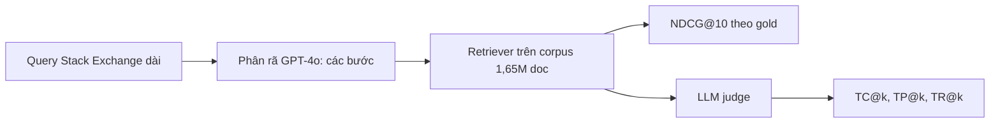

# Ghi chú benchmark: TEMPO (2601.09523)

## 1. Thông tin chung & Tài nguyên
- **Tiêu đề:** TEMPO: A Realistic Multi-Domain Benchmark for Temporal Reasoning-Intensive Retrieval
- **Tác giả:** Abdelrahman Abdallah, Mohammed Ali, Muhammad Abdul-Mageed, Adam Jatowt (cs.IR, nộp 14/01/2026).
- **arXiv:** [2601.09523](https://arxiv.org/abs/2601.09523) (đã đọc bản HTML; phần cuối bản HTML khoảng 4.400 ký tự chưa đọc).
- **GitHub:** [tempo-bench/Tempo](https://github.com/tempo-bench/Tempo) (chứa `run.py`, `run_step.py`, `temporal_metrics.py`, `retrievers.py`). Website: https://tempo-bench.github.io/
- **Dữ liệu:** Hugging Face `tempo26/Tempo`; `temporal_metrics.py` tự tải queries và corpus từ Hub.
- **Giấy phép:** repo hiển thị badge MIT (theo trang README); paper là CC BY 4.0. Giấy phép riêng của dữ liệu (nội dung Stack Exchange, trang web bên thứ ba) **chưa rõ**, cần xem thẻ dataset trên Hugging Face trước khi dùng/phát hành lại.
- **Ngôn ngữ:** tiếng Anh (paper nêu trong phần giới hạn).

## 2. Bộ dữ liệu
**Nguồn và quy mô.** Query lấy từ Stack Exchange, 13 domain, 1.730 query phức tạp (trung bình khoảng 300 từ, gồm title + body), 3.976 bước phân rã truy xuất (retrieval step: câu truy vấn con, mỗi bước có gold documents) thuộc 1.605 query có phân rã, và corpus 1.654.055 tài liệu (đoạn/passage) cộng dồn qua các domain.

| Nhóm | Domain (số query / số doc corpus) |
|---|---|
| Blockchain | Bitcoin 100 / 153.291; Cardano 51 / 87.201; IOTA 10 / 10.372; Monero 65 / 85.093 |
| Social Sciences | Economics 83 / 93.756; Law 35 / 43.288; Politics 150 / 183.394; History 801 / 356.493 |
| Applied | Quant. Finance 34 / 28.785; Travel 100 / 177.677; Workplace 36 / 64.659; Genealogy 115 / 156.228 |
| STEM | History of Science & Math (HSM) 150 / 213.818 |

Lưu ý: History chiếm 801/1.730 query (khoảng 46%), nên điểm trung bình dễ bị History chi phối.

**Cách xây dựng.**
1. 7 annotator (5 PhD, 2 master) duyệt bài Stack Exchange từ mới đến cũ, giữ bài có accepted answer hoặc >10 vote và cần suy luận thời gian.
2. Positive documents: theo link trong câu trả lời, dùng Gemini tìm bài web; trích đoạn chứa thông tin thời gian then chốt (nguồn: Wikipedia, blog kỹ thuật, bài nghiên cứu, tài liệu chính thức, báo). Bài không có tài liệu liên quan bị loại.
3. Hard negatives (đoạn cùng chủ đề nhưng thiếu phạm vi thời gian cần thiết): GPT-4o sinh search query và danh sách entity/event, annotator tìm Google và thu thập.
4. Nhãn temporal intent / reasoning class do GPT-4o gán rồi người duyệt. Trên mẫu 200 query (11,6%): Cohen's kappa (độ đồng thuận giữa hai người gán nhãn) 0,82 cho reasoning class, 0,78 cho temporal intent, 0,85 cho gold relevance.
5. Các bước phân rã sinh bằng GPT-4o (Appendix F.1).

**Loại câu hỏi.** Temporal intent: when, duration, order, before/after, ongoing status, period definition, timeline. 10 reasoning class, lớn nhất: Event Analysis & Localization 36,1%; Time Period Contextualization 21,1%; Origins, Evolution & Comparative Analysis 14,8%; Trends & Cross-Period Comparison 8,9%; còn lại nhỏ. Khoảng thời gian từ trước 1900 (806 query) đến 2020+ (162 query).

**Ví dụ** (chỉ có ví dụ minh họa, không có bộ query-kèm-bước thật đầy đủ trong phần đã đọc):
- Query thật (Appendix I, History): "Was the Tsar's property separated from state property in Russian Empire in early 19th century (regarding land)?" Phần positive/negative chỉ thấy bị cắt ngắn; **các bước phân rã của câu này chưa rõ**.
- Ví dụ phân rã minh họa của paper (không lấy từ dataset): "How did Bitcoin's consensus mechanism change after the 2017 fork?" gồm 3 bước: xác định cơ chế đồng thuận gốc; tìm thông tin về fork 2017; tìm tài liệu về thay đổi đồng thuận sau fork. Cách diễn đạt bước kiểu "Retrieve historical baseline statistics from 2013-2017" / "Retrieve current statistics from 2020-present".

**Khả năng tải:** có, qua Hugging Face `tempo26/Tempo`; định dạng qrels và cấu trúc file nội bộ **chưa rõ**.

## 3. Chỉ số đo
Mọi định nghĩa dưới đây theo bản HTML đã đọc.
- **NDCG@10:** chỉ số chính, paper không viết công thức, dùng định nghĩa chuẩn (Normalized Discounted Cumulative Gain: điểm xếp hạng có chiết khấu theo vị trí, chuẩn hóa theo xếp hạng lý tưởng).
- **Temporal Coverage@k (TC@k):** với mỗi giai đoạn m, `C_m(k) = max_{i<=k} c_{i,m}`, trong đó `c_{i,m}=1` nếu tài liệu hạng i bao phủ giai đoạn m. `TC@k = (1/M) * sum_m C_m(k)`. Paper dùng M = 2 (giai đoạn nền/baseline và giai đoạn so sánh). Tức là tỉ lệ các giai đoạn cần thiết có ít nhất một tài liệu trong top-k. Việc doc có bao phủ giai đoạn hay không do LLM judge quyết định.
- **Temporal Precision@k (TP@k):** precision có trọng số vị trí trên các tài liệu liên quan về thời gian. Gọi R là tập các hạng liên quan: `TP@k = (1/|R|) * sum_{r in R} |{j in R : j <= r}| / r`. Ghi chú: công thức này giống Average Precision; cách xác định "liên quan thời gian" cũng dựa trên LLM judge.
- Chỉ số phụ: **TR@k** (Temporal Relevance) `= (1/k) * sum v_i`, v_i in {0,1} là phán quyết của LLM judge; **NDCG|FC@k** là NDCG chỉ tính trên query có TC@k = 1.
- Hạn chế: nhóm chỉ số thời gian phụ thuộc LLM judge (`temporal_metrics.py` gọi Azure OpenAI mặc định, hoặc OpenAI/Anthropic/Gemini), nên tốn chi phí và có nhiễu.
- Giao thức step-wise (Appendix F.1): Step-Only (mỗi bước làm query), Query+Step (ghép query gốc với từng bước, lấy trung bình NDCG@10), Query+All (query gốc ghép toàn bộ các bước).

## 4. Baseline và số công bố
12 hệ thống truy xuất (Table 3, 4; số trung bình qua các domain, đã đọc qua bản HTML):

| Hệ thống | NDCG@10 | TP@10 | TR@10 | TC@10 |
|---|---|---|---|---|
| BM25 | 10,8 | 24,0 | 11,1 | 32,8 |
| BGE | 22,0 | 53,7 | 34,0 | 66,1 |
| Contriever | 21,4 | 49,6 | 30,3 | 64,1 |
| Inst-L (Instructor-L) | 24,8 | 53,1 | 33,8 | 66,9 |
| SBERT | 24,9 | 54,1 | 35,0 | 67,2 |
| E5 | 30,4 | 53,5 | 31,1 | 63,2 |
| GritLM | 27,2 | 53,8 | 35,0 | 69,1 |
| Qwen | 22,8 | 46,2 | 28,8 | 61,0 |
| SFR | 30,0 | chưa rõ | chưa rõ | chưa rõ |
| DiVeR | **32,0** | 62,0 | 41,3 | 71,4 |
| Rader | 24,2 | 50,6 | 32,3 | 66,1 |
| ReasonIR | 27,2 | 57,4 | 38,2 | **72,4** |

Điểm lệch cần kiểm: abstract nói DiVeR tốt nhất về TC@10 (71,4%), nhưng bảng cho ReasonIR 72,4 > 71,4; chưa rõ lý do (có thể khác cấu hình bảng). Nên đối chiếu bản PDF/GitHub trước khi trích dẫn. Số theo từng domain và theo chiến lược step-wise chưa đọc. Paper đánh giá retriever, không phải hệ thống agentic memory hay RAG có lọc thời gian tường minh.

## 5. Ưu điểm / nhược điểm
**Ưu**
- Đa miền (13 domain), quy mô lớn (1,65 triệu doc), có hard negatives và gold theo từng bước.
- Có chỉ số phủ giai đoạn (TC) mà NDCG thuần không đo được; có sẵn code chạy và dữ liệu tải tự động; giấy phép repo MIT.
- Khoảng thời gian dài (trước 1900 đến 2020+), phù hợp thử Timeline.

**Nhược**
- **Khác bài toán point-in-time:** query là bài hỏi dài, mở, cần suy luận qua nhiều giai đoạn; không có `T_req` rõ ràng, không có nhãn "tài liệu nào đang hiệu lực tại T". Chỉ số không đo leakage tương lai.
- Corpus là passage web/Wikipedia/blog, không phải kho có phiên bản (versioned) hay có đính chính; không có cấu trúc `end_time`/`invalidated_at`.
- Nhãn và chỉ số thời gian dựa trên GPT-4o/LLM judge; Stack Exchange thiên về tiếng Anh, thiên về giai đoạn gần.
- Phân bố lệch (History ~46% query); lệch miền so với dữ liệu tin tức/luật của đồ án.

## 6. Áp dụng vào đồ án
**Map vào cơ chế**
- **Cơ chế 2 (Timeline Summarization) là gần nhất:** các query kiểu "how has X evolved/changed since...", "trends before and after..." và chỉ số Temporal Coverage (phủ các giai đoạn) tương ứng với việc timeline phải chứa đủ các mốc. Chỉ nên coi là tương ứng ý tưởng; TC của TEMPO chỉ có 2 giai đoạn, phán quyết bởi LLM, không phải độ phủ mốc timeline.
- **Cơ chế 1:** chỉ tương ứng một phần (khía cạnh bước nhỏ "tìm tài liệu cho một giai đoạn"); phần lọc cứng `start_time <= T_req` không được kiểm.
- **Cơ chế 3:** gần như không áp dụng được (không có mâu thuẫn/đính chính được gán nhãn).

**Schema (mục 2.1 của `docs/design/01_INITIAL_BASE_DESIGN.md`):** TEMPO không cung cấp `start_time`, `end_time`, `invalidated_at`, `category`; chỉ có `source` ngầm (URL) và id doc. Muốn chạy phải tự suy `start_time` từ nội dung hoặc ngày xuất bản (theo invariant của đồ án, doc không có timestamp không vào được time-aware store), nên phần lớn passage web có thể bị loại hoặc cần bước trích ngày bằng LLM. `invalidated_at` để NULL. `chunk_id` có thể dùng id doc của TEMPO; `category` ánh xạ từ 13 domain (có thể đặt vào `domain_features.domain`).

**Cách chạy hệ thống đồ án trên bộ này (đề xuất):**
1. Tải dữ liệu từ Hugging Face, chọn 1-3 domain nhỏ (ví dụ Law, Quant, Workplace, IOTA) để giảm chi phí.
2. Ingestion: gán `start_time` từ ngày trích được; chạy cấu hình tốt nhất (bge-v2-m3 làm cross-encoder).
3. Với mỗi query, chọn `T_req` (khó: query không có sẵn T; có thể dùng agent suy ra hoặc để Plain RAG vs Temporal ở chế độ không lọc). Chạy cả ba kiểu của paper (Step-Only, Query+Step, Query+All).
4. Xuất ranking theo định dạng của `run.py`, rồi dùng `temporal_metrics.py` để lấy NDCG@10, TC@k, TP@k, so với bảng ở mục 4.

**Chỉ số đồ án tương ứng** (`docs/eval/07_TUNE_VALID_RESULTS.md`):
| Đồ án | TEMPO | Ghi chú |
|---|---|---|
| hit@k, mrr | NDCG@10 | cùng nhóm đo xếp hạng nhưng khác định nghĩa; nên báo thêm NDCG@10 để so được |
| ans_valid@k | không có | TEMPO không có nhãn hiệu lực |
| leakage_rate | không có | TEMPO không kiểm tương lai |
| (Cơ chế 2, chưa có) | TC@k, TP@k | cần LLM judge giống paper |

**Phần không so sánh công bằng**
- Baseline của TEMPO là retriever đơn (chưa kèm agent/graph/lọc thời gian); số của đồ án (dùng cross-encoder, filter, decay) dùng thêm thông tin thời gian nên không cùng điều kiện.
- Không so được leakage, ans_valid vì benchmark không đo.
- Ngôn ngữ/miền khác nếu đồ án tập trung vào dữ liệu tin tức/luật: số TEMPO chỉ là tham chiếu, cần chạy lại baseline (BM25, một dense retriever) trên cùng tập con để so cùng điều kiện, không sao chép số 32,0.

## 7. Chỗ chưa xác nhận
- Giấy phép dữ liệu (README ghi MIT cho repo; thẻ Hugging Face và nội dung Stack Exchange chưa kiểm).
- Định dạng qrels, cấu trúc file, cách gắn ngày cho từng doc (có hay không), số gold doc trung bình/query, độ dài doc.
- Sự lệch giữa abstract và bảng (DiVeR hay ReasonIR có TC@10 tốt nhất); số SFR về TP/TR/TC.
- Số theo từng domain, kết quả step-wise, kết quả có/không reasoning rewrite: chưa đọc.
- Ví dụ phân rã thật của dataset (chỉ thấy ví dụ minh họa); 4.400 ký tự cuối bản HTML chưa đọc.
- Chi phí chạy LLM judge và model nào dùng để báo cáo trong paper: chưa rõ.
