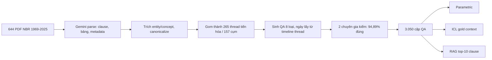

# Ghi chú benchmark: TIDE (arXiv 2608.08512)

## 1. Thông tin chung & Tài nguyên
- **Tiêu đề:** Time Present and Time Past: Benchmarking Large Language Models on Temporally Evolving Document Understanding. TIDE là viết tắt của Temporal Information Drift in Evolving Documents (theo kết quả tìm kiếm web, chưa kiểm trong thân paper).
- **Tác giả:** Mahbub E Sobhani, Md. Faiyaz Abdullah Sayeedi, Fahmid Hasan Chowdhury, Md Adnan Arefeen, Farig Sadeque, Md. Faizul Bari, Swakkhar Shatabda (cs.AI).
- **arXiv:** [2608.08512](https://arxiv.org/abs/2608.08512), v1 nộp 09/08/2026, v3 sửa 25/08/2026; giấy phép paper CC BY 4.0. Đã đọc abstract và khoảng 200.000 ký tự đầu bản HTML v3 (khoảng 14.000 ký tự cuối chưa đọc; mục 3.2 và một phần phụ lục không nằm trong đoạn đọc được, xem mục 7).
- **GitHub:** [icsetepa44/TIDE](https://github.com/icsetepa44/TIDE), kho ẩn danh cho double-blind (bình duyệt kín tác giả). Gồm `Document Parsing/` (OCR, 644 PDF nguồn, kết quả parse), `Entity and Concept Extraction/`, `QA Generation Pipeline/`, `TIDE DATA/` (mỗi loại câu một thư mục/JSON), ba thư mục pipeline đánh giá (Parametric, In Context Learning, RAG) và `Results/`.
- **Dữ liệu:** Hugging Face [mahbubhimel/TIDE](https://huggingface.co/datasets/mahbubhimel/TIDE), **dataset gated** (phải đồng ý chia sẻ thông tin liên hệ mới thấy danh sách file); bản trong repo `TIDE DATA/` tải thẳng được.
- **Giấy phép:** MIT (README và thẻ dataset). README cảnh báo: công báo chính thức mới là nguồn có thẩm quyền, bộ không phải tư vấn pháp lý.

## 2. Bộ dữ liệu
**Nguồn và quy mô.** 644 văn bản hải quan chính thức của National Board of Revenue (NBR) Bangladesh, ban hành 1969-2025: 3 Acts (luật), 20 GOs (Government Orders), 609 SROs (Statutory Regulatory Orders, văn bản quy định dưới luật) và 12 Rules. Có 3.050 cặp QA trên 265 chuỗi khái niệm tiến hóa (evolving-concept thread: chuỗi các văn bản cùng sửa đổi một khái niệm, ví dụ một mức thuế) thuộc 157 cụm chủ đề (topic cluster). Bố cục không đồng nhất. Hai chuyên gia độc lập kiểm từng cặp: 94,89% đúng về sự kiện, Cohen's kappa (độ đồng thuận giữa hai người) 0,91.

**Ngôn ngữ (đã xác định).** Không chỉ tiếng Anh. Theo bản HTML của paper và thẻ Hugging Face, văn bản là **code-mixed Bangla-English** (trộn tiếng Bengali và tiếng Anh trong cùng văn bản); thẻ dataset ghi ngôn ngữ là English và Bengali. Khoảng 97% văn bản ghi ngày bằng **cả lịch Bangla lẫn lịch Gregorian**. Abstract và README không nêu tên ngôn ngữ/lịch, thông tin này chỉ có ở bản HTML và thẻ dataset. Chưa rõ tỉ lệ chữ Bengali trong câu hỏi so với trong văn bản nguồn. Limitations của paper tự nhận: chỉ một miền (hải quan Bangladesh), một cặp ngôn ngữ, một hệ lịch chính.

**Cách xây (3 bước).**
1. Parse: PDF chính thức được Gemini parse thành clause (điều khoản), bảng và metadata; 13 tình nguyện viên kiểm, WER (word error rate, tỉ lệ lỗi từ) 0,07%.
2. Threading: gom cặp entity/concept thành chuỗi tiến hóa.
3. Sinh QA theo từng loại, rồi chuyên gia kiểm.

**Ngày hiệu lực có được gắn sẵn cho từng điều khoản không?** Chưa thấy bằng chứng là có. Paper không mô tả lược đồ gắn effective date theo clause; theo bản HTML, ngày lấy từ ngày của từng văn bản trong timeline của thread, và bộ sinh phải nêu "phiên bản có hiệu lực và ngày hiệu lực của nó", nhờ vậy đáp án đúng về thời gian ngay lúc sinh. README cho thấy trường `clauses_involved` liệt kê văn bản kèm ngày trong ngoặc. Kết luận thực dụng: **không có bảng `start_time`/`end_time` theo clause để dùng ngay**; muốn có phải tự trích từ văn bản (văn bản sửa đổi tự nêu nó thay gì và có hiệu lực từ khi nào) hoặc từ metadata trong `Document Parsing/` (chưa kiểm cấu trúc).

**Tám loại câu hỏi** (cột phải theo README):

| # | Loại | Số câu | Kiểm tra |
|---|---|---:|---|
| 1 | Temporal MCQ | 354 | chọn văn bản/mã/ngày trong 4 đáp án gần nhau |
| 2 | Event Sorting | 207 | xếp các sự kiện bị xáo, đã bỏ ngày, theo thứ tự thời gian |
| 3 | Perturbation Detection | 498 | phát hiện một giá trị bị sửa và nêu giá trị đúng |
| 4 | Scenario Short Answer | 562 | rút giá trị (ví dụ mức thuế) từ tình huống |
| 5 | Temporal Scenario Short Answer | 363 | suy luận qua nhiều văn bản có ngày, sửa đổi áp dụng thế nào |
| 6 | Relative-Time QA | 463 | từ mốc ngày + độ lệch, suy ra ngày đích |
| 7 | Open-Ended | 487 | giải thích lý do thay đổi chính sách |
| 8 | Context Misalignment | 116 | bỏ qua đoạn mở đầu trôi chảy nhưng sai, trả lời theo sự thật |

Tổng 3.050.

**Khả năng tải.** Hugging Face có 9 config (`all` 3.050 hàng, cộng 8 config theo loại), chỉ có split `test`, parquet 2,55 MB, trường chung `id` (ví dụ `temporal_mcq_0001`) và `type`. Trường theo loại: `temporal_mcq` có question/options/answer/answer_index/explanation; `event_sorting` có events_shuffled/answer_ordered (kèm date); `perturbation_detection` có statement/is_perturbed/perturbed_fact/correct_fact; `scenario_short_answer` có scenario/date_or_instrument; `temporal_scenario_short_answer` có clauses_involved; `relative_time_qa` có seed_time/relative_offset; `context_misalignment` có misaligned_context/conflict. Mỗi mẫu trong repo giữ provenance (clause ID, thread ID, file nguồn).

**Ví dụ thật** (Phụ lục A.4 của paper, diễn đạt lại ngắn):
- Temporal MCQ: hỏi năm chính phủ giảm thuế suất cho một số nhóm miễn trừ từ 3% xuống 2%, đáp án 2011-2014; đáp án đúng 2013, căn cứ SRO 145-AIN/2013 (06/06/2013) sửa SRO 157-AIN/2012.
- Relative-Time QA: mốc 02/06/2016 (SRO 160/2016, nộp VAT-7), hỏi thay đổi sáu năm sau; đáp án SRO 118/2022 (09/06/2022) yêu cầu BIN 13 chữ số và xác minh điện tử tờ khai VAT hằng tháng.
(Còn Temporal Scenario SA về hạn mức hành lý miễn thuế 100 USD năm 2012 tăng lên 300 USD rồi giảm còn 150 USD năm 2025, và Perturbation Detection về ngưỡng 5% vs 10% của TABLE-1/TABLE-2 trong SRO 175/2024.)

## 3. Chỉ số đo
- **Strict accuracy:** điểm cơ sở. Câu xác định (Temporal MCQ, Perturbation Detection, Event Sorting) chấm accuracy (Event Sorting: khớp chính xác thứ tự), không có điểm từng phần.
- **Hội đồng 3 LLM (LLM-as-a-Council):** 6 loại câu tự do được chấm bởi Claude Opus 4.6, Gemini 3.5 Flash, GPT-5.1; mỗi judge trả lời các câu yes/no nguyên tử (atomic) dạng JSON, chương trình tính điểm cuối theo đa số phiếu. Fleiss kappa (độ đồng thuận nhiều người chấm) 0,83-0,86; đồng thuận trung bình với chuyên gia độc lập 94,21%.
- **Hard date gate (cổng ngày cứng):** với câu một ngày, sai ngày thì 0 điểm bất kể nghĩa đúng hay sai; với câu nhiều ngày, chỉ được điểm "nghĩa" khi mọi ngày tham chiếu đúng. Ngày chỉ tính khớp khi model cam kết đúng ngày ở độ chi tiết yêu cầu; ngày mâu thuẫn xóa điểm nghĩa. Định nghĩa đầy đủ ở mục 3.2 của paper (chưa đọc được); phần trên dựa vào đoạn đọc được và README.
- **Partial accuracy:** strict cộng một mức nhỏ cho trường hợp đúng ngày nhưng sai nghĩa (README có bảng phần cộng thêm).
- Macro-average: trung bình các loại câu, không trọng số theo số câu (xác nhận từ README: "macro-averaged strict accuracy").

## 4. Baseline và số công bố
9 LLM (6 mã nguồn mở/open-weight, 3 độc quyền) × 3 chế độ:
- **Parametric (closed-book):** chỉ dùng kiến thức trong model.
- **ICL gold context:** đưa vào prompt các văn bản gold đã dùng để sinh cặp QA.
- **RAG:** index 6.939 vector (4.858 phần tử nguyên + 2.081 chunk 1.200 ký tự chồng lấp cho 82 clause quá dài) bằng `gemini-embedding-2` (3.072 chiều) trong ChromaDB; lấy top 40 vector theo cosine, ánh xạ về clause cha, khử trùng, còn tối đa 10 clause (trung bình khoảng 9,9). **Không re-rank theo thời gian**, nên paper coi số RAG là cận dưới.

Macro strict accuracy (%), từ README:

| Model | Parametric | RAG | ICL |
|---|---:|---:|---:|
| GPT-5.2 | 35,39 | 57,06 | **68,49** |
| Claude Sonnet 4.5 | 25,91 | **58,05** | 64,39 |
| Kimi K2.5 | 33,28 | 54,46 | 63,27 |
| DeepSeek-V4-Flash | 32,64 | 52,08 | 63,11 |
| Gemini 3.5 Flash | 34,15 | 52,87 | 62,45 |
| Qwen3.6-35B | 26,39 | 52,13 | 61,13 |
| Gemma-4-31B | 32,04 | 47,69 | 60,05 |
| GPT-OSS-120B | 30,76 | 52,69 | 57,11 |
| GLM-4.6 | 25,54 | 45,43 | 50,38 |

Phát hiện chính (abstract/README): tốt nhất ICL 68,49% (GPT-5.2), RAG 58,05% (Claude Sonnet 4.5), parametric 35,39% (GPT-5.2). Suy ra phiên bản từ ngày ngầm: 59,7%. Phát hiện phiên bản được cung cấp không phải phiên bản có hiệu lực: 26,7%. Parametric gắn cờ 78,9% điều khoản bị sửa nhưng chỉ nêu đúng chỗ sửa 18,6%. Context Misalignment tối đa 27,62% (model tin tiền đề sai hơn văn bản chính thống). Event Sorting giảm từ 66,7% (ICL) xuống 31,4% (RAG). Bảng theo từng loại câu có trong README nhưng không chép ở đây.

**Gold context có đảm bảo chứa đáp án không?** Theo thiết kế: gold context là tập tài liệu gold D dùng để dựng từng cặp QA, mỗi cặp trích dẫn các điều khoản hậu thuẫn, và gold context gồm clause chứa thông tin liên quan. Nhưng paper (phần đọc được) **không phát biểu tường minh** rằng đáp án luôn nằm trong context ở mọi mẫu. Với câu suy luận (Event Sorting, Relative-Time, Open-Ended), "chứa clause liên quan" khác với "chứa đáp án trực tiếp". Nên coi ICL là cận trên "oracle" của retrieval, không phải bằng chứng hợp lệ 100%. Dù có oracle, điểm tốt nhất chỉ 68,49%, nên bottleneck là suy luận thời gian, không chỉ retrieval.

## 5. Ưu điểm / nhược điểm
**Ưu**
- Đúng kịch bản "luật sửa đổi, chỉ sửa một điều": ngôn ngữ văn bản sửa đổi tự nêu thay gì và hiệu lực khi nào; có Perturbation Detection và Context Misalignment (giống bài toán dữ liệu sai/phiên bản không còn hiệu lực).
- Có sẵn ba chế độ, nên tách được lỗi retrieval (RAG vs ICL) khỏi lỗi suy luận.
- Chuyên gia kiểm toàn bộ cặp; MIT; có pipeline đánh giá và dữ liệu thô (`Results/`).
- Chấm có hard date gate nên phạt model trả lời đúng ý sai ngày.

**Nhược**
- Văn bản code-mixed Bangla-English và ngày hai lịch: hệ thống đồ án (nếu tối ưu cho tiếng Việt/Anh) cần embedding đa ngữ; kết quả lẫn yếu tố ngôn ngữ với yếu tố thời gian.
- Chỉ một miền (hải quan Bangladesh), một cơ quan; có thể không khái quát hóa sang luật Việt Nam hay tin tức.
- Không có nhãn `start_time`/`end_time` theo clause và không có nhãn `T_req` rõ ràng cho mọi câu (nhiều câu là suy luận nhiều bước, so sánh, giải thích), nên không đo trực tiếp leakage hay ans_valid như đồ án.
- Phần lớn chỉ số cần LLM judge; hard date gate có thể phạt cả khi model đúng nghĩa nhưng sai độ chi tiết ngày.
- Dataset trên Hugging Face bị gated; repo ẩn danh có thể thay đổi sau khi hết bình duyệt.
- Paper mới (08/2026), chưa có tái lập độc lập.

## 6. Áp dụng vào đồ án
**Map cơ chế**
- **Cơ chế 1 (Temporal Retrieval)**: gần nhất với Temporal MCQ, Scenario SA, Relative-Time QA ("phiên bản nào có hiệu lực ngày X"); đặc biệt Relative-Time QA có `seed_time` và `relative_offset` nên suy ra `T_req` tuyệt đối tương tự cơ chế tiêm `T_now`. Baseline RAG của paper không có lọc thời gian, đúng chỗ hệ thống đồ án (hard filter `start_time <= T_req`, re-rank half-life) có thể cải thiện.
- **Cơ chế 3 (Conflict Resolution)**: Perturbation Detection và Context Misalignment (phát hiện thông tin sai/phiên bản không còn hiệu lực) gần với `invalidated_at`/CORRECTS; luật sửa đổi tương ứng `SUPERSEDES` và việc đóng `end_time` của đúng điều bị sửa.
- **Cơ chế 2 (Timeline Summarization)**: Event Sorting, Temporal Scenario SA ("thay đổi thế nào qua 2012-2025") và Open-Ended là các câu timeline; chỉ so sánh định tính vì chưa có chỉ số tương ứng ở đồ án.

**Schema** (`docs/design/01_INITIAL_BASE_DESIGN.md`, mục 2.1):
- `start_time`: ngày hiệu lực của văn bản sửa đổi (cần tự trích; bộ chỉ cho ngày văn bản trong timeline thread, và văn bản hai lịch nên chuẩn hóa về Gregorian).
- `end_time`: đóng khi một văn bản sau thay thế đúng điều đó (chuỗi trong `clauses_involved`/thread cho phép suy ra); NULL nếu còn hiệu lực. Theo nguyên tắc Evolution khác Falsehood, một mức thuế cũ bị thay là evolution, không dùng `invalidated_at`.
- `invalidated_at`: dùng cho sự kiện sai từ đầu; trong TIDE chủ yếu liên quan câu bị perturb (nội dung đưa vào câu hỏi), không phải trường trong kho văn bản, nên ở kho thường để NULL.
- `chunk_id`: dùng id element/clause của `Document Parsing/` (chưa kiểm định dạng id).
- **Structural chunking theo điều/khoản**: TIDE đã parse sẵn clause và bảng, rất hợp với chunk theo điều/khoản để việc sửa đổi một phần chỉ đóng chunk bị ảnh hưởng; nhưng 82 clause quá dài phải cắt 1.200 ký tự, cần quyết định giữ cấu trúc hay cắt lại.
- **Content hashing**: hash nội dung clause giúp phân biệt "văn bản mới lặp lại điều cũ" (no-op/re-affirm) với điều thật sự đổi; dùng được ngay trên 644 văn bản.

**Cách chạy hệ thống đồ án (đề xuất)**
1. Tải 3.050 mẫu (hoặc `TIDE DATA/` trong repo nếu Hugging Face gated gây khó), tải 644 văn bản đã parse.
2. Ingestion: chunk theo clause, trích `start_time` (chuẩn hóa hai lịch) và quan hệ thay thế từ văn bản sửa đổi, gán `end_time`.
3. Chọn tập con có `T_req` rõ (Temporal MCQ, Scenario SA, Relative-Time QA) cho Cơ chế 1; Perturbation Detection + Context Misalignment cho Cơ chế 3.
4. Chạy ba cấu hình trên cùng tập con, cùng embedding và cùng LLM trả lời: (a) Plain RAG top-10 như paper, (b) Temporal Retrieval (filter + decay + cross-encoder bge-reranker-v2-m3 theo cấu hình chính), (c) ICL gold làm trần.
5. Chấm bằng accuracy/hard date gate cho câu xác định; câu tự do cần hội đồng LLM (tốn kém, có thể giảm xuống một judge và ghi rõ).

**Chỉ số tương ứng** (`docs/eval/07_TUNE_VALID_RESULTS.md`: hit@k, mrr, ans_valid@k, leakage_rate, EM/F1):

| Đồ án | TIDE | Ghi chú |
|---|---|---|
| hit@k, mrr | không có trực tiếp | TIDE không có qrels; cần tự ánh xạ clause gold từ `clauses_involved` |
| ans_valid@k | gần với "clause gold đúng phiên bản" | cần tự dựng nhãn từ thread |
| leakage_rate | không có | không đo văn bản sau `T_req` |
| EM/F1 | strict accuracy | định nghĩa khác, đặc biệt hard date gate |

**Phần không so sánh công bằng**
- Không sao chép số 58,05% (RAG) hay 68,49% (ICL) làm mốc: khác LLM, khác embedding (gemini-embedding-2), khác ngôn ngữ, khác cách chấm; phải chạy lại baseline trên cùng tập con.
- Pipeline đồ án có lọc/decay thời gian còn baseline paper thì không, nên cải thiện một phần đến từ thông tin thời gian được bổ sung, đúng chủ đích nhưng phải báo rõ.
- Không đo được leakage và ans_valid theo cùng định nghĩa như trên tập đồ án.
- Đồ án chưa có tập tiếng Bengali; nếu bỏ qua ngôn ngữ, có thể mất mẫu hoặc điểm thấp vì lỗi embedding thay vì lỗi thời gian.

## 7. Chỗ chưa xác nhận
- Mục 3.2 và phần định nghĩa thread timeline, gold context, hard date gate đầy đủ: chưa đọc được trong HTML; còn khoảng 14.000 ký tự cuối chưa đọc.
- Các số 59,7%, 26,7%, 18,6% lấy từ abstract/tóm tắt đề bài; chưa tìm được đoạn thân paper tương ứng trong phần đọc được.
- Gold context ở ICL có chứa đáp án cho mọi mẫu hay không: chưa phát biểu tường minh trong phần đọc được.
- Cấu trúc id, trường ngày hiệu lực thật trong JSON của `TIDE DATA/` và `Document Parsing/` (chưa mở file cụ thể; trang chỉ liệt kê thư mục).
- Tỉ lệ ngôn ngữ (Bengali vs English) trong câu hỏi và đáp án; tên hai hệ lịch (suy ra Bangla và Gregorian từ bản HTML, không từ abstract).
- Hugging Face gated: chưa xem danh sách file; repo ẩn danh có thể đổi hoặc bị gỡ.
- Chưa kiểm tính tái lập độc lập, và chi phí chạy hội đồng 3 LLM (model, giá) chưa rõ ngoài tên ba model judge.
