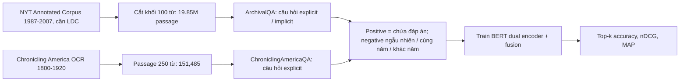
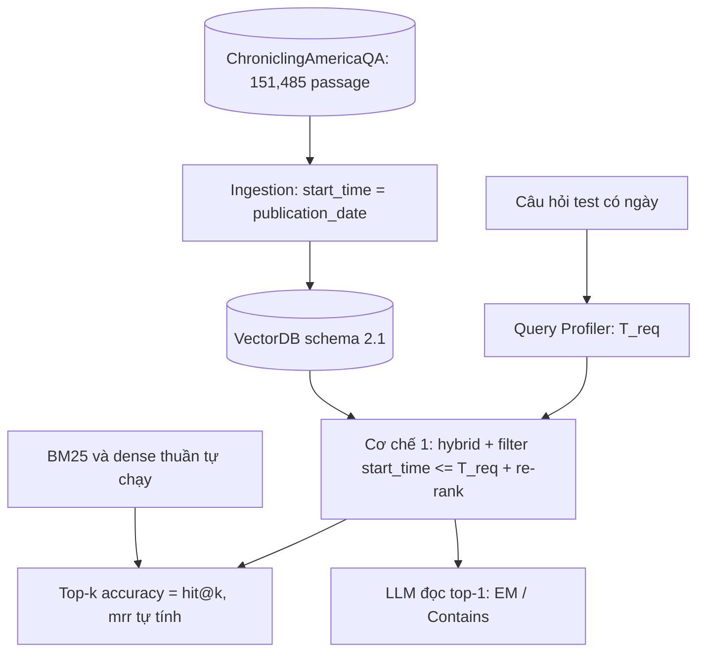

# Ghi chú benchmark: TempRetriever (arXiv 2502.21024)

Ghi chú này phục vụ việc chọn benchmark để so sánh với các hệ thống đã công bố. Trọng tâm là cặp dữ liệu ChroniclingAmericaQA + ArchivalQA và số baseline của bài; phương pháp TempRetriever chỉ tóm tắt ngắn.

## 0. Kết luận so sánh được không

**Nói thẳng dòng đầu: so sánh được MỘT NỬA. ChroniclingAmericaQA dùng được và vừa sức chạy lại. ArchivalQA thì phần câu hỏi tải được nhưng phần kho văn bản (NYT) thì không công khai, nên coi như không chạy lại được.** Số liệu bên dưới là tự báo cáo của tác giả, chưa có tái lập độc lập. Mình không có Bash/curl trong phiên này, nên "kiểm" nghĩa là đọc trang bằng WebFetch/WebSearch, chưa tải file thật về.

**(a) Dữ liệu có công khai và tải được không?**
- **ChroniclingAmericaQA: CÓ.** Công khai, MIT, tiếng Anh, văn bản **OCR báo Mỹ cũ** (có trường `raw_ocr`, chữ nhiễu, lỗi chính tả).
  - GitHub: https://github.com/DataScienceUIBK/ChroniclingAmericaQA
  - Tải thẳng (HF `Bhawna/ChroniclingAmericaQA`): `https://huggingface.co/datasets/Bhawna/ChroniclingAmericaQA/resolve/main/{train,dev,test}.json`
  - Thật sự có 439,302 train / 24,111 dev / 24,084 test (khoảng 487K cặp QA, báo trong 120 năm). Dung lượng file chưa rõ (trang không ghi; chưa tải).
  - Trường: `query_id`, `question`, `answer`, `org_answer`, `para_id`, `context`, `raw_ocr`, `publication_date`, `trans_que`, `trans_ans`, `url`. Có sẵn `publication_date` nên lấy được `start_time`.
  - Ngôn ngữ: dataset card HF nói rõ là câu hỏi tiếng Anh; trang GitHub và abstract không nêu.
- **ArchivalQA: CÂU HỎI tải được, KHO NYT thì KHÔNG công khai.** Repo https://github.com/WangJiexin/ArchivalQA (Apache-2.0) trỏ tới Google Drive https://drive.google.com/drive/folders/15JMtkJAqtZsKr_P-0jH4iFy2EOri4GbR (chưa mở được thư mục, nên không biết kích thước thật). Theo bài ArchivalQA, bộ có 532,444 cặp QA (xác nhận qua kết quả tìm kiếm), xây trên NYT Annotated Corpus (khoảng 1.8 triệu bài, 1987-2007). Một bài khác nhận xét NYT corpus không open-source; muốn có đoạn văn phải có giấy phép LDC riêng (tìm kiếm cho thấy, chưa tự xác nhận trên trang LDC). Tiếng Anh, văn bản báo hiện đại sạch, **không phải OCR**.
- **Mã nguồn TempRetriever:** bản arXiv v2 ghi code/dataset "sẽ có sau khi chấp nhận". Kết quả tìm kiếm cho thấy bản đã xuất bản (WSDM '26, chưa tự xác nhận) ghi link https://github.com/DataScienceUIBK/TempRetriever, nhưng **lúc mình mở thì repo trống ("This repository is empty")**. Chưa có checkpoint, chưa có script.

**(b) Quy mô, có thu nhỏ vừa không?**
- ChroniclingAmericaQA (bản bài dùng): test 1,268 truy vấn, **151,485 passage** (khoảng 250 từ, đã cắt sẵn). Vừa sức cho một máy: embed vài trăm nghìn đoạn là làm được. Phù hợp.
- ArchivalQA: **19,851,114 passage** (khối 100 từ), test 7,783 (explicit) + 1,000 (implicit). Quá lớn, lại thiếu kho NYT. Chỉ thu nhỏ được nếu có LDC; nếu không thì bỏ.
- Lưu ý: tập bài dùng của ChroniclingAmericaQA (22,918/1,232/1,268) nhỏ hơn nhiều so với bản đầy đủ 487K; bài bảo theo cách chia của Wallat et al. (2024) và loại câu không có đáp án trong passage ứng viên. Cách lấy đúng tập con này từ bản 487K: **chưa rõ**, không có script công khai.

**(c) Chỉ số có trùng hit@k không?**
- **Top-k accuracy** của bài = tỉ lệ truy vấn mà top-k passage **chứa chuỗi đáp án** (answer-based, k = 1, 5, 10, 20, 50, 100). Gần với AR@k ở ghi chú MRAG, **không phải** hit@k trên chunk gold. Chỉ trùng hit@k nếu đồ án định nghĩa hit theo "chunk chứa đáp án"; cần đối chiếu lại định nghĩa trong `docs/eval/07_TUNE_VALID_RESULTS.md`.
- **nDCG@k, MAP@k:** có. **MRR: không báo**; MAP gần nhưng không đồng nhất, nên không so MRR trực tiếp được (nhưng tự tính MRR từ cùng nhãn "chứa đáp án" thì được, chỉ không có số đối chiếu).
- **EM/F1:** chỉ có trong thí nghiệm RAG (Llama-3-8B, chỉ top-1 passage): EM, Recall (mức token), Contains. Không có F1.

**(d) Baseline có số không?**
- Có số cho VanillaDPR, DateAsTag, DateAsToken, BiTimeBERT, TS-Retriever (mục 4). **Không có BM25**, không có hybrid, không có reranker, không có số cho filter thời gian cứng. Muốn có mốc BM25 phải tự chạy.

**(e) Kho có chạy lại vừa không?**
- ChroniclingAmericaQA: vừa, dữ liệu sẵn. Nhưng TempRetriever phải **huấn luyện** (55 epoch, batch 32, BERT) và code chưa có, nên khó tái hiện **TempRetriever**. Chạy lại **baseline** (VanillaDPR, DateAsToken) là khả thi nếu tự viết; chạy hệ thống đồ án (không cần huấn luyện) trên cùng kho thì ổn.
- ArchivalQA: không (thiếu NYT).

**Kết luận thực dụng:** dùng **ChroniclingAmericaQA test (1,268 câu, 151,485 passage)** làm benchmark so sánh; ArchivalQA chỉ để trích dẫn số. Phải tự chạy BM25 và dense baseline trên cùng kho; số của bài chỉ là tham khảo, vì tập con 1,268 câu khó tái dựng đúng.

## 1. Thông tin chung & Tài nguyên
- **Tiêu đề:** TempRetriever: Fusion-based Temporal Dense Passage Retrieval for Time-Sensitive Questions.
- **Tác giả:** Abdelrahman Abdallah, Bhawna Piryani, Jonas Wallat, Avishek Anand, Adam Jatowt (cs.IR, chéo cs.CL).
- **arXiv:** [2502.21024](https://arxiv.org/abs/2502.21024); v1 28/02/2025, v2 08/04/2025 (đọc bản HTML v2: https://arxiv.org/html/2502.21024v2). Venue trên arXiv: không ghi; kết quả tìm kiếm cho thấy WSDM '26 (chưa tự xác nhận).
- **GitHub:** https://github.com/DataScienceUIBK/TempRetriever, **đang trống** lúc kiểm.
- **Dữ liệu:** xem mục 0 (a) và mục 2. Phần cốt lõi là ChroniclingAmericaQA ([arXiv 2403.17859](https://arxiv.org/abs/2403.17859), SIGIR '24) và ArchivalQA ([arXiv 2109.03438](https://arxiv.org/abs/2109.03438)).
- **Giấy phép:** ChroniclingAmericaQA MIT; ArchivalQA repo Apache-2.0 (chưa rõ có áp cho file dữ liệu không); NYT Annotated Corpus cần LDC.

## 2. Bộ dữ liệu
**Hai bộ trong bài** (Bảng của bài, test/val/train):

| Bộ | Loại | Train | Val | Test | Nguồn |
|---|---|---:|---:|---:|---|
| ArchivalQA | explicit | 62,157 | 7,841 | 7,783 | NYT Annotated Corpus |
| ArchivalQA | implicit | 5,000 | 1,000 | 1,000 | cùng nguồn |
| ChroniclingAmericaQA | explicit | 22,918 | 1,232 | 1,268 | báo Mỹ 1800-1920 |

- **Explicit vs implicit:** explicit là câu hỏi có ngày trong câu; implicit là câu không nêu ngày, ngày phải đoán (bài dùng bộ dự đoán ngày BERT, huấn luyện trên "Event Sentence" 22,399 mẫu, 21 lớp năm 1987-2007, báo MAE 3.51 năm, accuracy 20%).
- **Năm của ArchivalQA:** bài ghi 1987-2007 ở mục 4.1 nhưng 1978-2007 ở mục 4.2, không giải thích; coi là chưa thống nhất.
- **Kho passage:** ArchivalQA 19,851,114 passage (cắt 100 từ không chồng như DPR); ChroniclingAmericaQA 151,485 passage (khoảng 250 từ, cắt sẵn). Mỗi passage được ghép tiêu đề bài, ngăn bằng [SEP].
- **Positive / negative:** positive là passage chứa đáp án (nhiều passage chứa đáp án thì đều là positive). Negative có 3 kiểu: ngẫu nhiên; cùng năm với positive nhưng không chứa đáp án; khác năm. Mặc định 4 negative ngẫu nhiên.
- **Ví dụ câu hỏi thật của bài:** chưa trích được từ trang đã đọc; **chưa rõ**.

## 3. Chỉ số đo
- **Top-k accuracy** (k = 1, 5, 10, 20, 50, 100): tỉ lệ truy vấn có đáp án nằm trong top-k passage.
- **nDCG@k, MAP@k** (k như trên).
- **EM, Recall, Contains:** chỉ cho thí nghiệm RAG với Llama-3-8B (top-1 passage); bài còn chạy thêm Gemma-2-2B và Llama-2-7B (số không chép ở đây).
- **Kiểm định:** paired t-test (Bảng 6), đơn vị mẫu kiểm không nêu.
- Chuẩn hóa chuỗi khi khớp đáp án và định nghĩa Recall/Contains: chưa rõ.

## 4. Baseline và số đã công bố
Tất cả số do **tác giả tự báo cáo**, chưa có tái lập độc lập. Bảng dưới là Top-k accuracy trên **test**.

**ChroniclingAmericaQA**

| Mô hình | Top-1 | Top-10 | Top-100 |
|---|---:|---:|---:|
| BiTimeBERT | 38.52 | 60.46 | 76.95 |
| TS-Retriever | 46.65 | 69.06 | 82.56 |
| VanillaDPR | 45.70 | 67.40 | 82.26 |
| DateAsTag | 45.75 | 66.77 | 81.89 |
| DateAsToken | 45.81 | 66.58 | 82.10 |
| TempRetriever VS | 49.72 | 71.27 | 84.77 |
| TempRetriever RE | 47.28 | 71.74 | 85.56 |
| TempRetriever EWI | 46.57 | 69.69 | 84.06 |
| TempRetriever FS | **50.10** | **71.85** | **86.52** |

**ArchivalQA (explicit)**

| Mô hình | Top-1 | Top-10 | Top-100 |
|---|---:|---:|---:|
| BiTimeBERT | 60.22 | 86.70 | 95.62 |
| TS-Retriever | 64.68 | 89.44 | 97.29 |
| VanillaDPR | 62.98 | 87.17 | 96.15 |
| DateAsTag | 58.37 | 83.93 | 94.93 |
| DateAsToken | 63.44 | 88.35 | 96.72 |
| TempRetriever VS | 67.96 | 90.47 | 97.55 |
| TempRetriever RE | 66.11 | 91.53 | 97.88 |
| TempRetriever EWI | 69.27 | 90.04 | 97.16 |
| TempRetriever FS | **69.84** | **91.65** | 97.75 |

- **nDCG@10 (ChroniclingAmericaQA, test):** VanillaDPR 48.87, TempRetriever FS 52.85. Với ArchivalQA, bảng test in chưa nhất quán (FS test nDCG@10 ghi 64.91, trong khi val là 68.02), nên không chép làm mốc.
- **RAG, Llama-3-8B, top-1 passage, test (EM / Recall / Contains):** ChroniclingAmericaQA VanillaDPR 17.28 / 27.15 / 18.31, TempRetriever 18.36 / 30.74 / 20.78; ArchivalQA VanillaDPR 38.23 / 57.17 / 44.59, TempRetriever 39.25 / 58.14 / 45.14.
- **Implicit (ArchivalQA test Top-1):** VanillaDPR 41.90, TempRetriever FS 43.30; Top-100 của TS-Retriever (92.00) còn cao hơn FS (89.70), nên không phải lúc nào TempRetriever cũng thắng.
- **Không có BM25, không có reranker, không có lọc thời gian cứng.** Đây là chỗ đồ án phải tự bù.

**Phương pháp (tóm tắt ngắn):** một BERT dùng chung, lấy [CLS] (768 chiều), cộng thêm vector thời gian của ngày truy vấn / ngày tài liệu; hợp nhất bằng Vector Summation (x+y), Relative Embedding (x-y), Element-Wise (x·y) hoặc Feature Stacking (nối, 1,536 chiều); điểm = tích vô hướng. Huấn luyện 55 epoch, lr 1e-5, Adam, batch 32 (in-batch negative). Phần cứng: không báo.

## 5. Ưu điểm / nhược điểm
**Ưu**
- ChroniclingAmericaQA là OCR báo cũ có sẵn `publication_date`: gần sát tình huống "văn bản có thời gian, nhiễu" của đồ án, và nhỏ vừa phải (151,485 passage).
- Có nhiều baseline dense/time-aware cùng một khung, kèm kiểm định thống kê và thí nghiệm RAG.
- Nhãn "chứa đáp án" tự động, rẻ, dễ tự chạy lại cho hệ thống khác.

**Nhược**
- Code repo trống, không có checkpoint; không có BM25/hybrid/reranker.
- ArchivalQA thiếu kho NYT công khai; 19.85M passage quá lớn.
- Nhãn đúng = "chứa chuỗi đáp án", không phải chunk gold; passage chứa đáp án sai thời điểm vẫn tính là đúng, nên **không đo được leakage hay tính hợp lệ theo thời gian** như đồ án.
- Mỗi truy vấn giả định một ngày; ngày xuất bản passage không nhất thiết trùng ngày trong câu hỏi (tác giả tự nêu).
- Tính nhất quán số liệu: abstract nói +9.56% Top-1 trên ChroniclingAmericaQA nhưng bảng cho 5.25 điểm (val) / 4.40 điểm (test); số "EM" trong văn bản khớp cột Contains hơn EM; Bảng 4 và 5 có dòng in chưa khớp. Chưa có tái lập độc lập, nên dùng thận trọng.
- Phần lớn câu là sự kiện, hợp Cơ chế 1; không có xung đột nguồn hay timeline.

## 6. Áp dụng vào đồ án
**Map cơ chế**
- **Cơ chế 1 (Temporal Retrieval):** khớp. Có ngày trong câu hỏi (explicit) ra `T_req`; hard filter `start_time <= T_req` rồi re-rank `W1·Semantic + W2·Temporal` chạy được. Câu implicit (không có ngày) cần Query Profiler đoán `T_req`, bài tự nhận chỉ 20% accuracy ở bước này.
- **Cơ chế 2 và 3:** không đo được (không có chuỗi sự kiện, không có nguồn mâu thuẫn).

**Ánh xạ schema** (`docs/design/01_INITIAL_BASE_DESIGN.md`, mục 2.1) cho ChroniclingAmericaQA:
- `chunk_id` = `para_id`; `source` = `url` (trang báo); `category` = chưa rõ (có thể dùng tên báo hoặc để mặc định).
- `start_time` = `publication_date`. Điểm lưu ý: ngày xuất bản không phải ngày xảy ra sự kiện, nhưng đây đúng là "publish-date fallback" mà thiết kế đã cho phép; do vậy `end_time` = NULL, `invalidated_at` = NULL.
- Payload index chỉ 4 trường theo thiết kế (`start_time`, `invalidated_at`, `domain_features.domain`, `domain_features.country`): với kho này `domain`/`country` gần như hằng số, nên hard filter thực sự chỉ còn `start_time`.
- Ingestion: dùng passage có sẵn 250 từ thay vì structural chunking; content hashing vẫn dùng được để khử passage trùng (báo chí in lại).
- OCR nhiễu: dùng `context` (đã sửa) hay `raw_ocr` là quyết định thí nghiệm; chạy cả hai để đo độ bền với OCR.

**Cách chạy (đề xuất)**
1. Tải `test.json` (và `dev.json` để chỉnh tham số `W1`, `W2`, half-life) từ HF.
2. Dựng kho: gom `para_id`/`context` duy nhất, thử khớp 151,485 passage của bài (cách lọc đúng: chưa rõ); đưa vào VectorDB với `start_time = publication_date`.
3. Chạy trên câu hỏi test có ngày: (a) BM25, (b) dense thuần (kiểu VanillaDPR, dùng embedding sẵn có, không huấn luyện), (c) hybrid + hard filter + decay của đồ án. Tính Top-k accuracy theo định nghĩa của bài.
4. Nếu cần so EM/F1: dùng cùng LLM đọc top-1 (bài dùng Llama-3-8B), lưu ý bài chỉ báo EM / Recall / Contains.

**Chỉ số tương ứng**

| Đồ án | TempRetriever | Ghi chú |
|---|---|---|
| hit@k | Top-k accuracy | Trùng nếu hit@k tính theo "top-k chứa chuỗi đáp án"; còn nếu tính theo chunk gold thì khác (cần đối chiếu `07_TUNE_VALID_RESULTS.md`) |
| mrr | không có | MAP/nDCG gần nhưng khác; tự tính MRR, không có số đối chiếu |
| EM/F1 | EM, Recall, Contains | Không có F1; chỉ top-1 |
| leakage_rate, ans_valid | không có | Bài không đo văn bản sau `T_req` |

**Phần KHÔNG so sánh công bằng**
- Số tuyệt đối của bài (ví dụ Top-1 50.10 trên ChroniclingAmericaQA): tập 1,268 câu / 151,485 passage khó tái dựng đúng; mô hình bài có huấn luyện, đồ án thì không. Chỉ nên so hướng (có lọc/decay có tốt hơn không) trên baseline tự chạy.
- Hard filter dùng `publication_date`, nhưng câu hỏi hỏi về sự kiện có thể được ghi nhận sau ngày sự kiện: filter đúng thiết kế vẫn có thể loại nhầm passage chứa đáp án (do ngày xuất bản trễ hơn ngày sự kiện). Kết quả có thể thấp hơn dự đoán vì lý do dữ liệu chứ không phải lỗi hệ thống; cần báo rõ.
- Nhãn "chứa đáp án" không bắt lỗi dùng passage sai thời điểm; kết quả cao chưa chắc đúng về mặt thời gian.
- Domain khác: báo Mỹ cổ OCR tiếng Anh, không phải tin tức/pháp luật tiếng Việt.

## 7. Chỗ chưa xác nhận
- Chưa tải thật file nào (không có curl); kích thước file ChroniclingAmericaQA, nội dung thư mục Google Drive của ArchivalQA: chưa rõ.
- Cách tạo tập con 22,918 / 1,232 / 1,268 và 151,485 passage của ChroniclingAmericaQA: chưa rõ (bài chỉ trỏ Wallat et al., 2024).
- Số 532,444 cặp QA của ArchivalQA và yêu cầu giấy phép LDC cho NYT: dựa trên kết quả tìm kiếm, chưa đọc được PDF bài ArchivalQA (PDF nén không đọc được).
- Ngôn ngữ ChroniclingAmericaQA: card HF ghi tiếng Anh, nhưng các trường `trans_que`/`trans_ans` chưa rõ dịch sang ngôn ngữ nào.
- Repo TempRetriever trống; WSDM '26 chỉ qua tìm kiếm.
- Phần cứng, số lần chạy đằng sau dấu ± và đơn vị t-test: bài không báo.
- Số +9.56% trong abstract không khớp bảng; số test nDCG@10 của ArchivalQA mâu thuẫn trong bảng.
