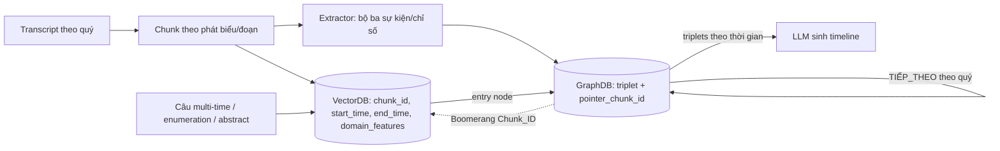

# Benchmark: ECT-QA (đi kèm TG-RAG, 2510.13590)

> Ghi chú này chỉ tập trung vào **bộ dữ liệu và cách đo** để quyết định có dùng ECT-QA làm benchmark so sánh hay không. Phương pháp TG-RAG (bi-level temporal graph) đã có ở [`04_TG_RAG_BiLevel.md`](../../timeline_summarization/04_TG_RAG_BiLevel.md), không lặp lại ở đây.

## 1. Thông tin chung & Tài nguyên
- **Tiêu đề bài báo:** TG-RAG (Temporal GraphRAG, giới thiệu bộ ECT-QA). Tên đầy đủ xem file `04`.
- **arXiv:** [2510.13590](https://arxiv.org/abs/2510.13590) (bản HTML: https://arxiv.org/html/2510.13590)
- **GitHub (mã + dữ liệu, theo bài):** https://github.com/hanjiale/Temporal-GraphRAG (chưa xác nhận repo còn truy cập được và có đủ dữ liệu).
- **Giấy phép dữ liệu:** chưa rõ. Bài không có tuyên bố license cho dataset (chỉ có license của arXiv cho bản thân bài). Transcript gốc lấy từ Motley Fool nên cần kiểm tra điều khoản sử dụng trước khi tái phân phối.
- **Ngôn ngữ:** bài không nêu; transcript earnings call nên gần chắc là tiếng Anh (suy luận, chưa xác nhận).

## 2. Bộ dữ liệu

### 2.1 Corpus
- **Nguồn:** transcript earnings call (cuộc gọi báo cáo thu nhập, nơi ban lãnh đạo công ty đại chúng trình bày kết quả kinh doanh theo quý) crawl từ Motley Fool, giai đoạn 2020-2024.
- **Chỉ giữ phần "prepared remarks"** (phần phát biểu chuẩn bị sẵn, bỏ phần hỏi đáp với nhà phân tích).
- **Quy mô:** 480 transcript của 24 công ty thuộc 5 ngành, khoảng 1.58 triệu token.

### 2.2 Tập base và updated corpus (kiểm thử cập nhật tăng dần)
| Tập | Nội dung | Số tài liệu | Số câu cụ thể | Số câu trừu tượng |
|---|---|---:|---:|---:|
| Base corpus | 2020-2023 | 384 | 656 (base queries) | 72 |
| New corpus (phần thêm) | 2024 | 96 | 349 (new queries) | 28 |

Ba tổ hợp được đánh giá: base queries trên base corpus; base queries trên updated corpus (base + 2024, kiểm tra không bị nhiễu khi thêm dữ liệu); new queries trên updated corpus (câu hỏi về năm 2024).

### 2.3 Câu hỏi
- **Câu cụ thể (specific, multi-hop):** 1,005 câu (Table II và Mục IV). Mục V-A ghi 1,105, nhưng 656 + 349 = 1,005 và các cách chia bên dưới đều cộng ra 1,005, nên 1,105 gần chắc là lỗi in; vẫn nên đối chiếu với file dữ liệu thật.
  - Theo phạm vi thời gian: 483 single-time (một mốc), 321 multi-time (nhiều mốc/khoảng), 201 relative-time (thời gian tương đối, ví dụ "năm ngoái so với quý trước", cần phân giải về mốc tuyệt đối).
  - Theo loại suy luận: 282 comparison (so sánh), 462 enumeration (liệt kê), 261 unanswerable (không có đáp án trong corpus; hệ thống đúng là từ chối).
- **Câu trừu tượng (abstract):** 100 câu, 43 single-time, 57 multi-time. Không có đáp án chuẩn; chấm bằng so sánh cặp.

### 2.4 Cách xây dựng (LLM hỗ trợ + người duyệt)
GPT-4o-mini trích sự kiện thời gian từ transcript, HDBSCAN (thuật toán gom cụm theo mật độ) gom các từ khóa, rồi LLM sinh và lọc câu hỏi. Câu trừu tượng sinh từ 10 persona (vai người dùng) giả lập. Mức độ và quy trình duyệt của con người: chưa rõ chi tiết.

### 2.5 Ví dụ câu hỏi thật (trích từ bài)
- Specific, multi-hop: "Which quarter saw the highest deferred revenue growth for Autodesk Inc from Q3 2022 to Q3 2023?"
- Specific (case study, single-time): "What were Western Digital Corporation's operating cash flow, gross debt outstanding, and earnings per share in 2020 Q3?"
- Specific (case study, multi-time): "What was Western Digital Corporation's revenue in each quarter from 2023 Q1 to Q3?"
- Abstract: "How did energy companies navigate cost pressures and enhance profitability across 2024?"
- Chưa có ví dụ relative-time hay unanswerable nào trong phần bài đã đọc.

### 2.6 Khả năng tải
Theo bài, dữ liệu và mã nằm ở repo `hanjiale/Temporal-GraphRAG`. Chưa xác nhận: định dạng file, có kèm transcript thô hay chỉ ID, có kèm nhãn gold evidence hay không.

## 3. Chỉ số đo
- **Câu cụ thể:** LLM-judge tách đáp án dự đoán thành các phần tử sự kiện (fact-level) rồi phân loại, báo tỉ lệ **Correct / Refusal / Incorrect** (tổng bằng 1). Bài đo thêm **ROUGE-L** (độ trùng chuỗi con chung dài nhất) và **token F1**. Prompt chấm yêu cầu khớp chính xác trừ khi nghĩa tương đương rõ ràng. Prompt không nêu tên model judge; theo bản kiểm trước, GPT-4o-mini được dùng làm judge và sinh đáp án chính (bài cũng thử Llama-3.3-70B, Qwen3-235B, DeepSeek-R1 làm QA model); phần case study chỉ nói "the QA LLM". Mức chắc chắn: trung bình.
- **Câu trừu tượng:** LLM so sánh cặp hai đáp án, chọn bên thắng theo Comprehensiveness (đầy đủ), Diversity (đa dạng góc nhìn), Temporal Coverage (phủ trục thời gian) và Overall; báo **win rate**.
- **Chi phí cập nhật:** số prompt/completion token tiêu tốn khi index (lại) corpus.
- LLM dùng để index cho TG-RAG và các baseline: Gemini-2.5-flash-lite (theo bản kiểm trước).

## 4. Baseline và số công bố
Baseline: LLM-GT (đưa gold evidence cho LLM, cận trên), NaiveRAG, QD-RAG, GraphRAG, LightRAG, HippoRAG2.

**Table III, câu cụ thể, base queries trên base corpus**
| Model | Correct | Refusal | Incorrect | ROUGE-L | F1 |
|---|---:|---:|---:|---:|---:|
| LLM-GT | 0.902 | 0.023 | 0.075 | 0.626 | 0.647 |
| NaiveRAG | 0.385 | 0.325 | 0.290 | 0.375 | 0.366 |
| QD-RAG | 0.380 | 0.329 | 0.291 | 0.369 | 0.359 |
| GraphRAG | 0.405 | 0.280 | 0.315 | 0.371 | 0.375 |
| LightRAG | 0.406 | 0.160 | 0.434 | 0.350 | 0.359 |
| HippoRAG2 | 0.410 | 0.345 | 0.245 | 0.382 | 0.385 |
| TG-RAG | 0.599 | 0.191 | 0.210 | 0.493 | 0.490 |

**Table IV, Correct trên updated corpus**
| Model | Base queries | New queries |
|---|---:|---:|
| LLM-GT | 0.902 | 0.874 |
| NaiveRAG | 0.366 | 0.390 |
| QD-RAG | 0.362 | 0.407 |
| GraphRAG | 0.380 | 0.398 |
| LightRAG | 0.386 | 0.382 |
| HippoRAG2 | 0.399 | 0.372 |
| TG-RAG | 0.587 | 0.617 |

**Table V, câu trừu tượng, win rate Overall của TG-RAG**
| Cấu hình | vs GraphRAG | vs HippoRAG | vs LightRAG |
|---|---:|---:|---:|
| Base queries, base corpus | 0.833 | 0.819 | 0.986 |
| Base queries, updated corpus | 0.764 | 0.819 | 0.972 |
| New queries, updated corpus | 0.893 | 0.750 | 1.000 |

**Chi phí index (token)**
| Model | Prompt | Completion |
|---|---:|---:|
| GraphRAG | 30.0M | 7.8M |
| LightRAG | 4.6M | 2.6M |
| HippoRAG2 | 0.8M | 0.3M |
| TG-RAG | 1.6M | 2.0M |

Mâu thuẫn số liệu trong bài (nên ghi nhận khi trích dẫn):
- 1,005 (Table II, Mục IV) và 1,105 (Mục V-A) câu cụ thể.
- TG-RAG base-query Correct: 0.599 (Table III, base corpus) và 0.587 (Table IV, updated corpus); hai cấu hình khác corpus nên chênh có thể hợp lý, nhưng bài không giải thích.
- Chi phí index GraphRAG: 37.1M / 17.7M (Table III) so với 30.0M / 7.8M (Table IV và văn bản). Nhãn bảng mơ hồ, chưa rõ con số nào là chi phí index đầy đủ.
- Case study multi-time: đáp án "$142 million, $9.8 billion, and $0.85" giống đáp án của câu một quý, có vẻ copy nhầm.
- Chi phí so sánh không đủ rõ giữa "index lại toàn bộ" và "chỉ index phần thêm"; chưa rõ.

## 5. Ưu điểm / nhược điểm
**Ưu điểm**
- Có sẵn **kịch bản cập nhật tăng dần** (base 2020-2023, thêm 2024) cùng ba tổ hợp query/corpus và bảng chi phí index: hiếm trong các benchmark temporal QA, rất khớp với ingestion theo thời gian của đồ án.
- Có cả câu multi-time, enumeration, relative-time, unanswerable và abstract; nhiều loại gần với nhu cầu timeline.
- Có cận trên LLM-GT (gold evidence), cho biết trần của khâu sinh đáp án.
- Corpus có cấu trúc thời gian rõ (quý/năm), nhiều công ty cùng chỉ số lặp theo quý: kiểm tra tốt khả năng không lẫn mốc.

**Nhược điểm**
- Miền **transcript tài chính**, chỉ phần prepared remarks, văn phong khuôn mẫu; khác miền Wikipedia/tin tức/pháp luật của đồ án. Kết quả khó khái quát.
- Câu hỏi và sự kiện được **tổng hợp bằng LLM** (GPT-4o-mini); có nguy cơ thiên lệch về cách trích sự kiện mà TG-RAG khai thác, và nhãn có thể sai. Mức độ người duyệt: chưa rõ.
- **LLM-judge** (cho cả đáp án cụ thể lẫn win rate cặp đôi) làm kết quả phụ thuộc judge; chưa thấy kiểm tra độ đồng thuận với người. Win rate cặp đôi trên 100 câu có phương sai lớn.
- Câu trừu tượng không có đáp án chuẩn, không đo được độ phủ sự kiện theo gold.
- Quy mô nhỏ (24 công ty, 1.58M token); không có xung đột/đính chính kiểu Cơ chế 3 (số liệu quý là sự kiện tiến hóa, không có thông tin sai ban đầu).
- Số liệu nội tại mâu thuẫn (mục 4); giấy phép chưa rõ.
- Là benchmark do chính nhóm TG-RAG đề xuất, baseline do họ tự chạy lại: có thể thiên lệch cấu hình.

## 6. Áp dụng vào đồ án

### 6.1 Ánh xạ cơ chế
| Phần ECT-QA | Cơ chế đồ án | Ghi chú |
|---|---|---|
| Single-time (483) | Cơ chế 1 (Temporal Retrieval) | Hard filter `start_time <= T_req` + khớp quý/năm |
| Relative-time (201) | Cơ chế 1 + `T_now` | Cần quy ước `T_now` cho từng câu (bài chưa rõ mốc tham chiếu) |
| Multi-time (321), enumeration (462) | **Cơ chế 2 (Timeline Summarization)** | Chuỗi quý/năm của cùng một chỉ số là một timeline |
| Comparison (282) | Cơ chế 1 nhiều lần + LLM so sánh, hoặc Cơ chế 2 | |
| Abstract (100) | **Cơ chế 2** | Tóm tắt xu hướng theo ngành/năm |
| Unanswerable (261) | Kiểm tra từ chối của Cơ chế 1 (không có chunk thỏa filter thì từ chối) | |
| Cập nhật 2024 | Ingestion tăng dần + content hashing | Không đụng Cơ chế 3 |

### 6.2 Ánh xạ schema (`docs/design/01_INITIAL_BASE_DESIGN.md` mục 2.1/2.2)

- Chunk của VectorDB: `start_time` = ngày/quý của cuộc gọi (hoặc kỳ báo cáo), `end_time`: với số liệu một quý thường là sự kiện tức thời nên `end_time = start_time` (point event, xem mục 2.1). `domain_features.domain` = ngành, có thể thêm tên công ty vào metadata miền (chỉ index 4 trường theo quy ước thiết kế).
- Node GraphDB: triplet kiểu (Công ty, doanh thu, giá trị) kèm `pointer_chunk_id`; các quý nối bằng cạnh next-event, không đóng `end_time` (Timeline khác Conflict).
- Content hashing: transcript quý mới không trùng quý cũ nên hầu như không có no-op; phần ý lặp lại giữa các quý có thể nhận cạnh re-affirm.

### 6.3 Cách chạy hệ thống đồ án trên bộ này
1. Ingest base corpus (384 tài liệu 2020-2023), chạy base queries; sau đó ingest 96 tài liệu 2024 và chạy lại base queries và new queries. Ghi lại token tiêu tốn cho từng giai đoạn để so với bảng chi phí.
2. Chạy hai cấu hình để cô lập đóng góp: top-k vector (kèm lọc thời gian) và vector + graph timeline. Nên chạy thêm NaiveRAG của chính đồ án làm baseline cục bộ (không phụ thuộc số công bố).
3. Dùng cùng LLM sinh đáp án và cùng judge với bài nếu có thể (GPT-4o-mini); nếu không, ghi rõ khác biệt.

### 6.4 Chỉ số đồ án tương ứng (xem `docs/eval/08_TIMELINE_EVAL_DESIGN.md`)
- Độ phủ sự kiện (tầng ngữ cảnh) và token ngữ cảnh: ECT-QA không có gold timeline, cần tự xây oracle từ các sự kiện đã được trích khi dựng câu hỏi (nếu repo công bố) hoặc dựng tay một mẫu nhỏ.
- EM/F1 cho đáp án đơn; **F1 tập hợp và thứ tự** cho câu enumeration/multi-time (chuỗi quý). Các chỉ số này chặt hơn Correct/Refusal/Incorrect của bài.
- Tỉ lệ từ chối đúng trên 261 câu unanswerable (đo như Refusal của bài).
- Chi phí cập nhật: token prompt/completion khi thêm 2024.

### 6.5 Phần không so sánh công bằng
- Số của bài (Correct, win rate) dùng LLM judge, prompt phân loại fact-level riêng; không so trực tiếp với EM/F1 của đồ án.
- Baseline dùng pipeline index bằng Gemini-2.5-flash-lite; nếu đồ án dùng LLM khác, chênh lệch một phần do LLM.
- Câu relative-time phụ thuộc mốc "hiện tại" bài định nghĩa; đồ án dùng `T_now` từ server clock nên cần cố định `T_now`.
- Abstract: win rate cặp đôi chỉ có ý nghĩa khi chạy lại đối thủ trong cùng điều kiện; không so với 0.833 / 0.819 / 0.986 bằng số.
- Cơ chế 3 (conflict) không được đo bởi bộ này.

## 7. Chỗ chưa xác nhận
- Repo `hanjiale/Temporal-GraphRAG` có thực sự phát hành đủ dữ liệu, giấy phép, định dạng, và nhãn gold evidence không.
- Số câu cụ thể: 1,005 hay 1,105 (nhiều khả năng 1,005).
- Ngôn ngữ (suy ra tiếng Anh), mức người duyệt khi dựng câu hỏi.
- Model judge chính xác và độ đồng thuận với người.
- Số chi phí index đúng của GraphRAG (30.0M/7.8M hay 37.1M/17.7M) và phạm vi "chi phí cập nhật".
- Có ví dụ relative-time và unanswerable cụ thể không (chưa thấy trong phần bài đã đọc; phần cuối bài chỉ có prompt đánh giá và case study).
- Bản kiểm này đọc bài qua bản HTML đã được chuyển thành văn bản; chi tiết bảng nên đối chiếu với PDF gốc.
