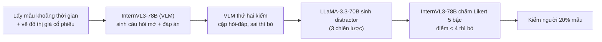
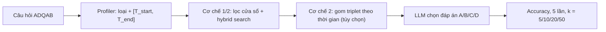

# Benchmark: ADQAB (đi kèm TA-RAG, 2507.22917)

Ghi chú này chỉ nói về **bộ dữ liệu và cách đo** để quyết định có dùng ADQAB làm benchmark so sánh hay không. Phần phương pháp TA-RAG (trích thời gian, Timeline Summary, truy xuất) đã có ở [`02_TA_RAG_Diachronic.md`](../../timeline_summarization/02_TA_RAG_Diachronic.md), không lặp lại ở đây.

## 1. Thông tin chung & Tài nguyên

- **Tiêu đề bài báo:** TA-RAG (bài đề xuất ADQAB); tên đầy đủ xem file phương pháp ở trên.
- **arXiv:** [2507.22917](https://arxiv.org/html/2507.22917v1)
- **GitHub:** [github.com/kwunhang/TA-RAG](https://github.com/kwunhang/TA-RAG). Tóm tắt bài nói dataset và code công khai tại repo này; bài không đưa link dataset riêng.
- **Giấy phép:** dataset **chưa rõ** (bài không nêu). Chân trang arXiv ghi CC BY-NC-SA 4.0 nhưng đó là giấy phép của bài báo, không phải của dữ liệu. Cần xem repo trước khi dùng.
- **Ngôn ngữ:** bài không nêu rõ; câu hỏi và corpus là tiếng Anh.
- **ADQAB** = Analytical Diachronic Question Answering Benchmark. "Diachronic" là hỏi về diễn biến theo thời gian (một khoảng, trước/sau một mốc), không phải một sự kiện đơn lẻ.

## 2. Bộ dữ liệu

### 2.1. Corpus

| Phần | Số bài | Độ dài TB | Ghi chú |
|---|---:|---:|---|
| Tin thật (FNSPID, Nasdaq news 2012-2022, 25 mã cổ phiếu) | 23,737 | 840 từ | FNSPID là bộ tin tài chính gắn mã cổ phiếu. Chỉ giữ bài có ngày tường minh kèm năm (SpaCy NER) và được LLaMA-3.1-7B-Instruct đánh giá là đủ dấu hiệu thời gian nội tại |
| Tin tổng hợp | 3,300 | 192 từ | LLaMA-3.3-70B-Instruct sinh, mỗi mã mỗi tháng (T1/2012-T12/2022) một bài, dựa trên giá cổ phiếu lịch sử, để lấp khoảng trống phủ |
| Tổng | 27,037 | 761 từ | 77,965 chunk (mỗi chunk tối đa 2048 token) |

Kiểm: 25 mã x 132 tháng = 3,300, khớp số bài tổng hợp.

### 2.2. Câu hỏi

525 câu trắc nghiệm (MCQA, multiple-choice QA). Ba loại, **bảy** subtype, mỗi subtype 75 câu (7 x 75 = 525):

| Loại | Subtype | Số câu |
|---|---|---:|
| Specific Time Period | Specific Year Trend | 75 |
| Before/After | Before Year Anchor | 75 |
| Before/After | Before Month Anchor | 75 |
| Before/After | After Year Anchor | 75 |
| Before/After | After Month Anchor | 75 |
| Time Range | Time Interval (Years) | 75 |
| Time Range | Time Interval (Months) | 75 |

Lưu ý: yêu cầu ban đầu ghi "6 subtype x 75"; bảng Table 4 trong bài có 7 dòng, và 525 chỉ chia hết cho 7 x 75, nên ghi 7 theo bài.

Ví dụ câu hỏi (nguyên văn Table 2, tên công ty ẩn thành X, Y...):

- "What was the predominant stock price trend for Company Y before the start of 2020?" (Before Year Anchor)
- "Describe the stock price trend for Company B from May 2015 to January 2016." (Time Interval, Months)

Các lựa chọn và đáp án của từng câu: chưa xem trực tiếp trong dữ liệu (chưa tải repo).

### 2.3. Cách xây dựng

- VLM = Vision-Language Model, mô hình đọc được ảnh (ở đây là đồ thị giá).
- Distractor (đáp án gây nhiễu) có 3 chiến lược: xu hướng mâu thuẫn với đáp án đúng; xu hướng đúng nhưng sai giai đoạn; một lựa chọn do LLM tự nghĩ.
- Likert 5 điểm: thang đánh giá 1-5 mức đúng đắn.
- **Đáp án chuẩn đến từ đồ thị giá, không từ văn bản tin.** Đây là điểm mấu chốt về bản chất benchmark (xem mục 5).

### 2.4. Kiểm người và khả năng tải

- Người duyệt ngẫu nhiên 20% số cặp MCQA đã qua VLM; 94% đạt về độ đúng đáp án và độ rõ của câu hỏi/lựa chọn. Số người duyệt: chưa rõ.
- Tải: bài nói dataset công khai ở GitHub; định dạng file, kích thước, có kèm 27,037 bài và chunk hay không: chưa rõ, chưa kiểm repo.

## 3. Chỉ số đo

- **Accuracy** = tỉ lệ câu mà mô hình chọn đúng lựa chọn.
- Mỗi thí nghiệm chạy 5 lần, báo trung bình và độ lệch chuẩn.
- Đo tại top-k = 5, 10, 20, 50 chunk đưa vào LLM sinh.
- Mô hình dùng trong bài: LLaMA-3.3-70B-Instruct (xử lý câu hỏi và sinh đáp án), nomic-embed-text-v1.5 (embedding), bge-reranker-v2-m3 (reranker), LLaMA-3.1-7B-Instruct (trích thời gian).
- Không có chỉ số truy xuất (hit@k, MRR, recall) vì không có nhãn chunk gold. Bài cũng nêu thêm chi phí: lần gọi LLM phụ làm thời gian chạy chậm khoảng 1.4 lần Naive RAG.

## 4. Baseline và số công bố

Accuracy (%), trung bình (± độ lệch chuẩn) trên 5 lần chạy, Table 5 của bài:

| Phương pháp | k=5 | k=10 | k=20 | k=50 |
|---|---|---|---|---|
| BM25 | 36.72 (±0.87) | 55.09 (±0.58) | 65.79 (±1.25) | 79.39 (±0.69) |
| Naive RAG | 44.27 (±0.67) | 56.72 (±0.69) | 67.50 (±1.19) | 74.82 (±0.64) |
| Naive RAG + Reranker | 48.30 (±0.50) | 59.39 (±0.87) | 72.42 (±0.53) | 82.10 (±0.77) |
| TS-Retriever | 32.04 (±0.25) | 42.78 (±0.61) | 52.15 (±0.75) | 58.51 (±0.47) |
| TA-RAG + Reranker | 59.89 (±0.98) | 71.50 (±0.86) | 80.53 (±0.53) | 87.09 (±0.69) |
| **TA-RAG** | **71.73 (±0.81)** | **84.84 (±0.46)** | **88.23 (±0.89)** | **88.00 (±0.88)** |

Điểm đáng chú ý:

- TA-RAG hơn Naive RAG +27.46 điểm ở k=5 và +13.18 điểm ở k=50 (khớp với "13%-27%" của bài; đây là điểm phần trăm tuyệt đối).
- Thêm reranker tổng quát vào TA-RAG **làm giảm** accuracy ở cả 4 mức k (ví dụ k=10: 84.84 xuống 71.50), trong khi với Naive RAG thì reranker tăng. Bài giải thích là reranker chung không biết ràng buộc thời gian.
- Ở k=50, BM25 (79.39) hơn Naive RAG dense (74.82); bài quy việc TA-RAG giảm nhẹ ở k=50 cho "Lost-in-the-Middle" (LLM bỏ sót thông tin nằm giữa ngữ cảnh dài).
- TS-Retriever (baseline retrieval có thời gian) kém nhất ở mọi k.
- Bài không nêu mức chặn trên (oracle) hay mức đoán ngẫu nhiên; số lựa chọn mỗi câu: chưa rõ (nên kiểm repo để biết nền ngẫu nhiên).

## 5. Ưu điểm / nhược điểm

**Ưu điểm**

- Câu hỏi nhắm đúng dạng "diễn biến trong một khoảng / trước-sau một mốc", hiếm trong các benchmark temporal QA khác (vốn phần lớn là điểm thời gian).
- Có sẵn 5 lần chạy, độ lệch chuẩn và 4 mức k, cho phép vẽ đường cong theo k và so sánh có sai số.
- Chấm bằng trắc nghiệm nên rẻ, không cần LLM chấm.
- Có phép kiểm người (94% trên mẫu 20%) và nhiều vòng lọc tự động.
- Code và dữ liệu công khai (theo bài).
- Corpus khá lớn (27k bài), có nhiều bài trùng chủ đề (cùng mã, nhiều tháng), tạo áp lực phân biệt thời gian thật.

**Nhược điểm**

- Trắc nghiệm: LLM có thể đoán nhờ distractor yếu hoặc nhờ kiến thức tham số; điểm cao không chắc do truy xuất đúng.
- Chỉ một lĩnh vực (xu hướng giá cổ phiếu), một dạng đáp án (tăng/giảm/đi ngang kèm mô tả); khó suy ra cho luật hay tin sự kiện.
- Một phần corpus (3,300 bài, khoảng 12%) là tổng hợp do LLM sinh từ chính giá cổ phiếu, nên có nguy cơ rò rỉ: bài tổng hợp được viết dựa trên dữ liệu mà đáp án cũng dựa vào. Bài không phân tích chênh lệch kết quả giữa tin thật và tin tổng hợp (chưa rõ).
- Đáp án chuẩn từ đồ thị giá chứ không từ nội dung tin, nên trả lời đúng không đồng nghĩa văn bản tin hỗ trợ đáp án.
- **Không có nhãn chunk gold**, nên không đo trực tiếp hit@k, MRR hay độ phủ sự kiện; chỉ đo gián tiếp qua accuracy cuối.
- Không có câu hỏi đa nguồn mâu thuẫn, đính chính hay thay thế, nên không đo Cơ chế 3.
- Mô hình sinh (LLaMA-3.3-70B, InternVL3-78B) và quy trình lọc có thể thiên về dạng câu hỏi mà chính pipeline TA-RAG xử lý tốt (suy đoán, bài không bàn).
- Giấy phép dữ liệu chưa rõ; ngôn ngữ chỉ tiếng Anh.

## 6. Áp dụng vào đồ án

### 6.1. Map cơ chế

| Loại câu ADQAB | Cơ chế đồ án gần nhất | Lý do |
|---|---|---|
| Specific Time Period (một năm) | Cơ chế 1 (Temporal Retrieval) | Một cửa sổ năm cố định, lọc theo `start_time`/`end_time` |
| Before / After (neo năm hoặc tháng) | Cơ chế 2 (Timeline Summarization) với cận một phía | Cần gom nhiều sự kiện trước/sau mốc rồi tóm tắt xu hướng; với Cơ chế 1, hard filter `start_time <= T_req` chính là "Before", nhưng "After" là ngược hướng với nguyên tắc không rò rỉ tương lai nên cần cấu hình riêng |
| Time Range (khoảng năm/tháng) | Cơ chế 2 | Cần duyệt đồ thị theo khoảng `[T_start, T_end]` và gom triplet |

Cơ chế 3 (xung đột): ADQAB không đo.

### 6.2. Chạy hệ thống đồ án trên ADQAB

Map vào schema `docs/design/01_INITIAL_BASE_DESIGN.md` mục 2.1:

- `text_chunk`: chunk từ 27,037 bài (cách chunk của đồ án, không bắt buộc dùng 2048 token của bài).
- `start_time`: ngày đăng bài (FNSPID có ngày đăng; bài tổng hợp có tháng sinh). Với bài tin, mốc sự kiện thường trùng ngày đăng, nên `end_time` = `start_time` (sự kiện tức thời) hoặc để `null`. Với bài chỉ có năm tường minh trong nội dung, cần Profiler/Ingestion trích thêm; nếu không có mốc phục hồi được thì theo nguyên tắc đồ án bài đó không vào kho time-aware (bài ADQAB đã lọc sẵn bài có năm tường minh).
- `category`/`domain_features.domain`: "Kinh tế/Tài chính"; mã cổ phiếu có thể là thực thể trong GraphDB (node Entity), chưa có trong schema Vector hiện tại.
- `source`, `credibility_score`: nguồn tin thật khác bài tổng hợp; có thể gán `credibility_score` thấp hơn cho bài tổng hợp nếu muốn thử ảnh hưởng (không có trong thí nghiệm gốc).
- `invalidated_at`: không dùng.

Từ câu hỏi, Query Profiler cần trả: loại (point / before / after / range) và cửa sổ `[T_start, T_end]` tuyệt đối. Ví dụ: "before the start of 2020" thành `T_end = 2019-12-31`, "after June 2021" thành `T_start = 2021-07-01`, "from May 2015 to January 2016" thành `[2015-05, 2016-01]`. Không có thời gian tương đối nên không cần `T_now`, nhưng với dạng "after" phải bỏ giả định "chỉ lấy quá khứ" của hard filter mặc định (neo là `T_req`, không phải "hôm nay").

Luồng đề xuất:

### 6.3. Chỉ số đồ án tương ứng

- Đo **cuối**: accuracy theo ADQAB (trực tiếp so với bảng mục 4).
- Đo **truy xuất** (đồ án có, ADQAB không có): `mrr`, `hit@k`, `ans_valid@k`, tỉ lệ rò rỉ (như [`07_TUNE_VALID_RESULTS.md`](../../../eval/07_TUNE_VALID_RESULTS.md)). Với ADQAB cần tự dựng nhãn gold, ví dụ coi chunk có `start_time` thuộc cửa sổ câu hỏi và cùng mã cổ phiếu là "đúng cửa sổ", chỉ để đo rò rỉ và độ phủ cửa sổ, không phải nhãn đáp án.
- Đo **ngữ cảnh/token**: độ phủ sự kiện và token như tầng 2 của [`08_TIMELINE_EVAL_DESIGN.md`](../../../eval/08_TIMELINE_EVAL_DESIGN.md); so token graph triplet với top-k chunk, vì top-50 là 50 chunk dài, còn graph có thể nhỏ gọn hơn nhiều.
- Báo cáo kèm độ lệch chuẩn 5 lần chạy cho cùng giao thức của bài.

### 6.4. Phần không so sánh công bằng

- Số TA-RAG dùng LLaMA-3.3-70B và nomic-embed; nếu đồ án dùng LLM/embedding khác (Gemini flash-lite, Gemma...), chênh lệch tuyệt đối không quy được cho phương pháp. Cần chạy lại ít nhất Naive RAG và BM25 của chính đồ án trên cùng LLM, rồi so chênh lệch tương đối, không so với số công bố.
- Đồ án đo trên TimeQA (Wikipedia, câu hỏi điểm thời gian, trích đáp án); ADQAB là tin tài chính, trắc nghiệm. Không gộp hai bộ số vào một bảng.
- Cách chunk của bài (tối đa 2048 token) khác đồ án; cùng k nhưng lượng token khác nhau, nên cần thêm trục token.
- Bài trích mốc thời gian bằng LLM trong lúc ingestion cho mọi bài; nếu đồ án dùng ngày đăng thay vì trích, đó là một biến thể khác, cần ghi rõ.

## 7. Chỗ chưa xác nhận

- Giấy phép của dataset ADQAB.
- Định dạng, cách tải, có kèm sẵn corpus/chunk hay phải dựng lại từ FNSPID (FNSPID có giấy phép riêng cần kiểm).
- Số lựa chọn mỗi câu, mức đoán ngẫu nhiên, và phân bố đáp án đúng giữa các vị trí.
- Số người kiểm tay và tiêu chí chi tiết.
- Chênh lệch kết quả giữa tin thật và tin tổng hợp; mức rò rỉ do bài tổng hợp sinh từ giá cổ phiếu.
- Ngôn ngữ có chính thức là tiếng Anh hay không (bài không nêu).
- Xác nhận chi tiết 7 subtype (số 6 trong yêu cầu ban đầu có thể là nhầm).
- Toàn bộ nội dung ở trên lấy từ bản HTML v1 của bài; chưa đối chiếu với repo hay bản arXiv sau.
