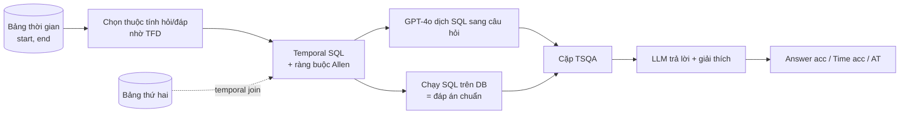

# Benchmark: TDBench (2508.02045), công cụ sinh câu hỏi time-sensitive từ cơ sở dữ liệu thời gian

Ghi chú phục vụ chọn benchmark so sánh/đánh giá. Nguồn: bản HTML arXiv v2 và README GitHub. Phần nào không thấy trong nguồn ghi "chưa rõ".

## 1. Thông tin chung & Tài nguyên
- **Tiêu đề:** Harnessing Temporal Databases for Systematic Evaluation of Factual Time-Sensitive Question-Answering in Large Language Models (tên hệ thống: TDBench)
- **arXiv:** [2508.02045](https://arxiv.org/abs/2508.02045) (cs.CL; nộp 04/08/2025, bản v2 sửa 02/03/2026). Được nhận ở ICLR 2026.
- **Tác giả:** Soyeon Kim, Jindong Wang, Xing Xie, Steven Euijong Whang.
- **GitHub:** [github.com/ssoy0701/tdbench](https://github.com/ssoy0701/tdbench) (Python; README cho thấy 7 commit, 4 sao, repo còn rất nhỏ).
- **Giấy phép:** bài báo CC BY 4.0. Giấy phép của mã và dữ liệu: **chưa rõ** (README và trang repo không ghi).
- **Ngôn ngữ:** bài báo không nêu rõ; câu hỏi sinh bằng GPT-4o từ SQL, ví dụ trong bài đều tiếng Anh. Xem là tiếng Anh, tính chất "chưa rõ" chính thức.
- **Bản chất:** là **công cụ sinh** (framework) cộng với một bộ dữ liệu đã sinh sẵn từ các bảng mẫu, không chỉ là một file câu hỏi cố định.

## 2. Bộ dữ liệu / công cụ sinh

### 2.1. Nguồn dữ liệu thời gian
Mỗi nguồn là một bảng quan hệ có cột thời gian (temporal database: cơ sở dữ liệu lưu cả khoảng thời gian hiệu lực của mỗi dòng, ví dụ `start`, `end`). Ví dụ lược đồ: `Leader(country, role, gender, name, start, end)`.

| Nhóm | Bảng | Nguồn | Số câu |
|---|---|---|---|
| Wikipedia | Country, Athlete, Organization, Olympic | Wikipedia (lấy ngày 02/01/2025) | 6,177 |
| Domain-specific | Law (luật hôn nhân đồng giới), Carbon Tax, Heritage (UNESCO), Netflix | ILGA World, World Bank, UNESCO, Kaggle | 1,704 |
| Synthetic | Medical (hồ sơ bệnh nhân giả) | Kaggle | 1,350 |

- Tổng ba nhóm: 2,079 câu temporal alignment + 6,756 temporal reasoning + 396 multi-hop = 9,231 (gồm cả 1,350 câu synthetic). Hai nhóm đầu cộng lại 7,881.
- Tổng **9 bảng** (4 + 4 + 1) theo Table 15; số dòng mỗi bảng: **chưa rõ**.
- Repo có sẵn các bảng tiền xử lý ở `dataset/crafted/` (culture, dyknow, environ, legal, medical, movie, olympic kèm bảng nối Olympic_Country). Có thư mục `qa_pairs/` chứa cặp đã sinh. Không thấy đường dẫn tải riêng.

### 2.2. Cách sinh câu hỏi
Giải thích thuật ngữ:
- **Temporal functional dependency (TFD):** phụ thuộc hàm có yếu tố thời gian, nghĩa là tại mỗi thời điểm, các thuộc tính vế trái xác định duy nhất thuộc tính vế phải. Ví dụ `(country, role) ->T name`: tại một thời điểm, một nước với một chức vụ chỉ có một người. TFD cho biết cột nào làm "câu hỏi", cột nào là "đáp án duy nhất".
- **Temporal SQL:** truy vấn SQL có điều kiện trên khoảng thời gian. TDBench thêm ràng buộc theo 13 quan hệ khoảng của Allen (before, after, meet, met-by, overlap, overlapped-by, equal, start, started-by, finish, finished-by, during, contain).
- **Temporal join:** nối hai bảng theo khóa và theo sự chồng lấn thời gian, dùng để tạo câu hỏi nhiều bước ngầm (implicit multi-hop).

Điểm quan trọng: **đáp án chuẩn đến từ việc chạy SQL**, không do LLM tạo, nên chính xác theo dữ liệu nguồn. LLM chỉ dùng để diễn đạt câu hỏi (độ chính xác chuyển SQL sang câu hỏi tự báo cáo 91.5% trên 130 mẫu kiểm tay; lỗi nhỏ gồm suy ra quốc tịch từ chức vụ, nới ngày cụ thể thành tháng).

### 2.3. Loại câu hỏi
- **Temporal alignment:** hỏi sự thật "hiện tại" (sinh qua quan hệ overlap, ví dụ "đang đương nhiệm").
- **Temporal reasoning:** đáp án phải thỏa ràng buộc theo 1 trong 13 quan hệ Allen. Có câu nhiều đáp án, đáp án duy nhất, và **không có đáp án**.
- **Multi-hop (2-hop, 3-hop):** nhờ temporal join.

### 2.4. Ví dụ thật (từ bài báo)
- Reasoning: "Who was the president of Brazil whose term ended exactly four months before May 1, 2019?" (đáp án: Michel Temer).
- Multi-hop: "Who was the president of the host country during the 1988 Summer Olympics?"

### 2.5. Khả năng tải / tái sinh
- Tái sinh được bằng lệnh: `python -m qa_pairs.write_sql --task <tên> --qtype now|basic`, sau đó `python -m qa_pairs.convert_sql ...`, rồi `python run_qa.py ...` để chạy LLM và `evaluation.analyze_result` để tổng hợp.
- Thêm CSDL riêng: tạo lớp dataset kế thừa lớp cơ sở trong `utils/utils_dataset.py` và khai báo TFD; nếu không có TFD thì định nghĩa thuộc tính hỏi/đáp bằng tay (bài báo, mục B.2).
- Cần khóa API OpenAI (bước dịch câu hỏi) và Ollama (mô hình kiểm time accuracy, DeepSeek-R1 14B).

## 3. Chỉ số đo
- **Answer accuracy (A):** tỉ lệ câu trả lời có đáp án đúng (so khớp chuỗi trên câu trả lời cuối).
- **Time accuracy (T):** tỉ lệ câu trả lời có **các mốc thời gian trong phần giải thích đúng**. Với mỗi quan hệ Allen có quy định mốc nào phải xuất hiện (Table 10):
  - Chỉ cần mốc kết thúc: before, meet, finished-by.
  - Chỉ cần mốc bắt đầu: after, met-by, started-by, và điều kiện "current" của overlap.
  - Cần cả hai: overlap, overlapped-by, equal, start, finish, during, contain.
  - Điểm = tỉ lệ các mốc bắt buộc có mặt và đúng (có điểm một phần, ví dụ đúng 1/2 ngày thì 50%). Người chấm là một LLM judge (DeepSeek-R1-14B, khớp 91.1% với kiểm tay; GPT-4o khớp 95.5% nhưng không dùng vì cũng là mô hình bị đánh giá).
- **Answer-Time accuracy (AT):** vừa đáp án đúng vừa mốc thời gian đúng, không có điểm một phần.
- Độ khớp với kiểm tay (125 mẫu mỗi tác vụ): F1 0.97 (alignment), 0.88 (reasoning), 0.91 (multi-hop). Tác giả thừa nhận recall của kiểm tra thấp hơn precision.

## 4. Baseline / LLM đã đánh giá và số công bố
Mô hình: GPT-3.5, GPT-4, GPT-4o, Llama3.1-70B, Mixtral-8x7B, Gemma2-27B, Qwen2-72B, Granite3.1-8B; temperature 0.

**Temporal alignment, Wikipedia (Table 4):**

| Model | A | AT | Chênh |
|---|---|---|---|
| GPT-3.5 | 47.5 | 22.4 | 25.1 |
| GPT-4 | 44.5 | 29.6 | 14.9 |
| GPT-4o | 73.9 | 48.8 | 25.1 |
| Llama3.1-70B | 64.6 | 56.7 | 7.9 |
| Mixtral-8x7B | 42.9 | 30.9 | 12.0 |
| Gemma2-27B | 69.3 | 32.8 | 36.5 |
| Qwen2-72B | 62.7 | 34.1 | 28.6 |
| Granite3.1-8B | 49.6 | 26.1 | 23.5 |
| Trung bình | 56.9 | 35.2 | 21.7 |

**Multi-hop 3-hop (Table 6, cột chọn lọc):** GPT-4o A 90.4 / AT 87.9; Llama3.1-70B 82.8 / 80.8; GPT-4 57.1 / 52.5; Granite3.1-8B 11.1 / 11.1 (các mô hình khác có trong bài).

**Kỹ thuật cải thiện, multi-hop (Table 7):** GPT-4o: Original 79.3, RAG 89.9, CoT 92.9, Time-CoT 95.5; GPT-3.5: 63.1, 71.2, 39.4, 15.2. Bài kết luận CoT/Time-CoT thường hơn RAG, vì RAG hay lấy đoạn liên quan nhưng lệch thời gian; không kỹ thuật nào thắng đều.

**Phát hiện khác:** chỉ chấm đáp án bỏ sót nhiều lỗi (AT thấp hơn A trung bình 21.7 điểm ở Wikipedia); mô hình mạnh nhất với ràng buộc "equal", yếu nhất với "contain" và "overlap"; xử lý mốc start tốt hơn mốc end; một số mô hình kém ở câu không có đáp án.

**Bối cảnh đánh giá:** hai chế độ chính là closed-book (chỉ câu hỏi) và open-book (thêm các dòng liên quan lấy bằng cách bỏ điều kiện thời gian và chạy lại truy vấn, cộng dòng ngẫu nhiên không liên quan). RAG theo nghĩa truy xuất đoạn Wikipedia chỉ có ở thí nghiệm multi-hop; cấu hình retriever **chưa rõ**.

## 5. Ưu điểm / nhược điểm
**Ưu điểm**
- Đáp án chuẩn chính xác theo dữ liệu (chạy SQL), tái sinh được, không tốn gán nhãn tay.
- Dùng được trên dữ liệu riêng của ứng dụng (thêm bảng + TFD), không bị khóa vào Wikipedia/Wikidata.
- Phủ 13 quan hệ khoảng (các benchmark khác chỉ 4 đến 6, theo bài).
- Có chỉ số time accuracy kiểm tra lập luận thời gian, không chỉ đáp án.
- Có câu "không có đáp án" và multi-hop nhờ temporal join.

**Nhược điểm**
- Là dữ liệu dạng bảng quan hệ; không có văn bản nguồn dài để làm corpus RAG (open-book chỉ là dòng bảng).
- Mẫu hỏi là sự thật đơn (một người/giá trị) kèm ràng buộc thời gian; **không sinh sẵn câu "liệt kê toàn bộ lịch sử"**. Bài chỉ nói đếm sự kiện (GROUP BY/HAVING) là mở rộng khả thi.
- Câu hỏi qua GPT-4o có khoảng 8.5% lỗi diễn đạt; time accuracy phụ thuộc LLM judge (91.1%) và recall thấp.
- TFD không đúng chặt sẽ cho nhiều đáp án hợp lệ; đơn vị thời gian phi chuẩn (quý tài chính) và khoảng không chắc chắn chưa hỗ trợ.
- Repo nhỏ, giấy phép mã/dữ liệu chưa rõ; chất lượng bảng nguồn do người dùng chịu.

## 6. Áp dụng vào đồ án

### 6.1. Map theo cơ chế
| Cơ chế | Mức phù hợp | Lý do |
|---|---|---|
| 1. Temporal Retrieval | Trung bình | Câu "alignment" (hiện tại) và reasoning (tại thời điểm T) giống query point-in-time; cần tự dựng corpus văn bản từ bảng nếu muốn đo truy xuất |
| 2. Timeline Summarization | Phù hợp về dữ liệu, chưa có sẵn câu hỏi | Bảng `Leader(country, role, name, start, end)` chính là timeline của một (thực thể, quan hệ) với `start`/`end` thật; có thể sinh câu `list/count/first/last/successor/order` trực tiếp bằng SQL |
| 3. Conflict Resolution | Thấp | TDBench không có mâu thuẫn nguồn hay đính chính; chỉ có tiến hóa |

### 6.2. Đối chiếu với `docs/eval/08_TIMELINE_EVAL_DESIGN.md`
- Thiết kế hiện tại dựng gold timeline từ chú thích TimeQA, nên biên `start`/`end` chỉ là **biên cửa sổ chú thích**, không phải ngày thật; do đó nhóm câu thời lượng và khoảng trống phải làm tay (~30 mẫu mỗi loại), oracle chưa đầy đủ nên không đo được precision.
- Bảng TDBench có `start`/`end` thật và đầy đủ theo thiết kế, nên có thể sinh gold timeline **đầy đủ và có ngày chính xác**, kể cả thời lượng và khoảng trống (có thể tính bằng SQL). Đây là chỗ bổ sung giá trị nhất.
- Bộ loại câu `list/count/first/last/successor/order` ở `08` có thể viết lại thành SQL trên bảng TDBench (đáp án chạy ra, không cần mẫu cố định tự viết gold). Chưa có sẵn trong TDBench; phải tự viết (dự kiến ít việc, nhưng chưa thử).
- Rủi ro: dòng thời gian sinh từ bảng đã "sạch" (mỗi thời điểm một giá trị theo TFD), dễ hơn trường hợp văn bản thật phải trích sự kiện (tầng 1 trong `08`). Vì vậy chỉ đo tầng 2 và 3, không thay được tầng trích xuất.

### 6.3. Map schema `docs/design/01_INITIAL_BASE_DESIGN.md` mục 2.1/2.2
(Chưa đối chiếu lại từng trường trong file thiết kế khi viết ghi chú này; map dưới đây theo khái niệm của CLAUDE.md, cần rà lại trước khi dùng.)
- Cột `start`/`end` của bảng TDBench tương ứng `start_time`/`end_time` của chunk/event (VectorDB, mục 2.1) và cạnh/nút sự kiện (GraphDB, mục 2.2). `end` bị thiếu/NULL ứng với "còn hiệu lực".
- Một dòng bảng là một sự kiện; chuỗi dòng cùng khóa (country, role) sắp theo `start` là chuỗi nút nối bằng cạnh next-event. Dữ liệu TDBench chỉ có tiến hóa, không có `invalidated_at`.
- Để dùng cho RAG cần **biến mỗi dòng thành văn bản** (ví dụ "X was president of Y from ... to ...") rồi nạp qua pipeline ingestion; phép chuyển này tự thiết kế, TDBench không cung cấp.

### 6.4. Cách dùng làm bộ đánh giá bổ sung
1. Chọn 1-2 bảng có nhiều dòng theo khóa (Country/Leader, Athlete/Organization); sinh dòng thời gian gold từ bảng.
2. Dựng corpus văn bản: lấy đoạn Wikipedia gốc (nếu dùng bảng Wikipedia) hoặc render dòng bảng thành câu; nạp vào hệ thống như dữ liệu thật.
3. Hỏi: câu TDBench nguyên bản (reasoning, alignment) cho Cơ chế 1; câu liệt kê/đếm/kế nhiệm tự viết SQL cho Cơ chế 2.
4. So sánh: plain RAG vs top-k thời gian vs graph timeline (như `08`), bám cùng nhóm câu để tách hiệu ứng.

### 6.5. Time accuracy có áp dụng được không?
- **Áp dụng được, sau chỉnh:** định nghĩa "mốc cần có theo quan hệ" dùng lại được cho câu hỏi Cơ chế 1/2 của đồ án, và hợp với Time-CoT ở lớp Generation (đồ án cũng yêu cầu giải thích mốc thời gian). Cần cài lại bộ kiểm: có thể kiểm bằng so khớp ngày với gold từ SQL thay vì LLM judge để tránh sai số 91.1%.
- **Lưu ý:** chỉ số này kiểm mốc trong lời giải thích, không kiểm "đã lấy đúng bằng chứng"; muốn đo bằng chứng vẫn dùng độ phủ sự kiện/chunk như `08`.

### 6.6. Phần so sánh không công bằng
- Số công bố trong bài là **LLM closed-book** (và open-book kèm dòng bảng), không phải RAG có kho văn bản lớn. Không thể so trực tiếp số của bài với hệ thống của đồ án; phải tự chạy lại các baseline trên cùng bộ câu hỏi.
- Mô hình bài dùng (GPT-3.5 đến Qwen2-72B) khác mô hình đồ án; kiến thức tham số của LLM về tổng thống/vận động viên Wikipedia rất lớn, nên closed-book có thể hơn hệ thống RAG chỉ vì đã biết sẵn. Cần dùng bảng riêng hoặc ẩn danh/đổi thực thể nếu muốn đo bộ nhớ chứ không đo kiến thức LLM.
- Thí nghiệm RAG của bài (Table 7) ở multi-hop, dùng retriever chưa rõ, nên không dùng làm mốc.

## 7. Chỗ chưa xác nhận
- Giấy phép mã và dữ liệu trong repo; có hay không file tải dữ liệu riêng.
- Ngôn ngữ chính thức (suy đoán tiếng Anh).
- Số dòng từng bảng; số câu theo từng quan hệ Allen.
- Cấu hình retriever trong thí nghiệm RAG.
- Tôi chưa chạy mã; chưa kiểm tra bảng nào có đủ dòng/khóa để sinh câu timeline có từ 3 sự kiện trở lên.
- Chưa đối chiếu từng trường của schema `01_INITIAL_BASE_DESIGN.md` mục 2.1/2.2 (xem 6.3).
- Chưa kiểm phần cuối trang HTML bài báo ngoài các phụ lục đã đọc.
