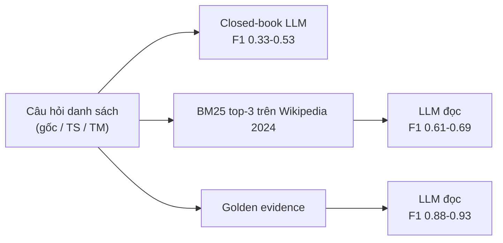

# Benchmark: TLQA (Timeline-based List Question Answering)

Ghi chú để chọn benchmark so sánh cho Cơ chế 2 (Timeline Summarization). Số liệu lấy từ bản HTML của bài báo (arXiv v1) và README của repo; chỗ nào chưa kiểm được ghi "chưa rõ" ở mục 7.

## 1. Thông tin chung & Tài nguyên
- **Tiêu đề:** Evaluating List Construction and Temporal Understanding capabilities of Large Language Models
- **Tác giả:** Alexandru Dumitru (Prosus), Venktesh V (TU Delft), Adam Jatowt (University of Innsbruck), Avishek Anand (TU Delft)
- **arXiv:** [2506.21783](https://arxiv.org/abs/2506.21783) (v1, 26/06/2025)
- **Venue:** ICTIR '25 (ACM SIGIR International Conference on Innovative Concepts and Theories in Information Retrieval), Padua, 07/2025
- **GitHub:** [github.com/elixir-research-group/TLQA](https://github.com/elixir-research-group/TLQA)
- **Giấy phép:** code và repo là Apache-2.0 (`LICENSE.MD`). Giấy phép riêng của dữ liệu Wikipedia/Wikidata gốc: chưa rõ (nội dung Wikipedia thường là CC BY-SA, cần tự kiểm).
- **Ngôn ngữ:** tiếng Anh (suy ra từ nguồn English Wikipedia; bài báo không nêu tường minh).

## 2. Bộ dữ liệu

### 2.1. Nguồn và cách xây dựng
- Danh sách chủ thể (subject) lấy từ **TempLAMA** (bộ cloze-QA có gắn thời gian), ánh xạ sang Wikidata ID (5,825 xuống 5,711 thực thể sau khi kiểm tên).
- Chỉ dùng hai quan hệ Wikidata: **P54** (member of sports team) và **P39** (position held). Hai chủ đề: Sports và Political.
- Đáp án lấy từ **infobox** (khung thông tin bên phải trang) của Wikipedia: mỗi mục có năm bắt đầu/kết thúc; thiếu năm kết thúc thì coi là còn đang diễn ra.
- Câu hỏi sinh từ mẫu (ví dụ "List all teams [subject] played for to this day"). Hai biến thể TS/TM do GPT-4o sinh rồi GPT-4o tự lọc (LLM-as-judge).
- Kiểm tay 100 câu (Likert 1-5): độ đầy đủ đáp án 4.75 ± 0.50 (kappa 0.67), độ hữu ích câu hỏi 4.98 ± 0.05 (kappa 0.74).
- **Corpus open-domain:** dump English Wikipedia tháng 4/2024, khoảng 4.5 triệu bài có infobox.

### 2.2. Quy mô và cách chia

| Tập | Số câu | Ghi chú |
|---|---:|---|
| TLQA gốc | 1,655 | trung bình khoảng 8.6 đáp án/câu |
| - Political | 881 | 630 train / 251 test |
| - Sports | 774 | 528 train / 246 test |
| TLQA-TS (time span) | 423 | chỉ tập test |
| TLQA-TM (temporal marker) | 460 | chỉ tập test |

Chia train/test phân tầng theo chủ đề. Có tập validation dùng chỉnh temperature nhưng kích thước chưa rõ.

### 2.3. Loại câu hỏi
- **Explicit temporal:** TLQA gốc ("to this day", lấy toàn bộ lịch sử) và TLQA-TS (có cửa sổ tường minh, "between 2000 and 2010").
- **Implicit temporal:** TLQA-TM, dùng mốc sự kiện ("after serving as Senator"), mô hình phải tự suy ra khoảng thời gian.
- Đáp án luôn là **danh sách các cặp (thực thể: khoảng năm)**.

### 2.4. Ví dụ thật (trích từ bài báo)
Gốc: "List all political positions Joe Biden held to this day."
- President of the United States (2021-2024)
- Vice President of the United States (2009-2017)
- United States Senator from Delaware (1973-2009)

TS: "What political positions were held by Biden between 2009-2020?" -> Vice President of the United States (2009-2017).

TM: "What political positions were held by Biden after serving as Senator?" -> Vice President (2009-2017); President (2021-2024).

### 2.5. Khả năng tải
- Benchmark và split nằm trong repo: `TLQA_data_splits/benchmark_v0.0.json`, `TLQA_data_splits/splits/` (train/test, mỗi loại có bản thường, `_golden_evidence`, `_updated_with_titles`). Dữ liệu TempLAMA ở `TempLama/data/`.
- Mapping title-to-infobox (corpus) đặt trên Google Drive, link trong README.
- README không mô tả schema hay bản ghi mẫu; cần mở JSON để biết trường (chưa rõ).

## 3. Chỉ số đo
- **Precision / Recall / F1** trên danh sách thực thể. Ghép thực thể bằng pipeline 3 giai đoạn: khớp chuỗi con (subsequence) và độ tương đồng token dựa BERT; giai đoạn thứ ba và ngưỡng chưa rõ (xem `evaluation/evaluateResults.py`).
- **Temporal Overlap (TO)** = |Y_expected ∩ Y_generated| / |Y_expected|, với Y là tập năm. Đo độ phủ thời gian.
- **Temporal Jaccard (TJ)** = |Y_expected ∩ Y_generated| / |Y_expected ∪ Y_generated|. Phạt cả năm bịa thêm.
- TO và TJ tính trên tập năm của từng thực thể đã ghép được, rồi lấy trung bình. Độ mịn chỉ đến năm.
- **Retrieval:** MRR và Recall@k.
- Không có chỉ số thứ tự (order) hay đếm (count) riêng.

## 4. Mô hình và baseline đã đánh giá
Mistral v0.2 7B và GPT-4o-mini là hai mô hình đánh giá đầy đủ; Llama 3.1 8B kém hơn Mistral, kết quả chỉ nằm trong repo. Prompting: few-shot, kNN few-shot, few-shot CoT, Auto-CoT. Retriever: BM25, all-MiniLM-v2, multi-qa-mpnet. Temperature 0.3.

**Closed-book (TLQA gốc):**

| Mô hình / cách | Precision | Recall | F1 | TO | TJ |
|---|---:|---:|---:|---:|---:|
| Mistral few-shot | 0.558 | 0.257 | 0.330 | 0.384 | 0.317 |
| Mistral kNN few-shot | 0.532 | 0.310 | 0.366 | 0.435 | 0.360 |
| GPT-4o-mini few-shot | 0.625 | 0.451 | 0.501 | 0.595 | 0.533 |
| GPT-4o-mini kNN few-shot | 0.620 | 0.487 | 0.525 | 0.610 | 0.550 |
| GPT-4o-mini few-shot CoT | 0.645 | 0.459 | 0.513 | chưa rõ | chưa rõ |
| GPT-4o-mini Auto-CoT | 0.524 | 0.384 | 0.420 | chưa rõ | chưa rõ |

**Open-domain (top-3, BM25) và golden evidence (đưa thẳng đoạn đúng):**

| Cấu hình | F1 | TO | TJ |
|---|---:|---:|---:|
| Mistral + BM25 top-3 | 0.607 | 0.623 | 0.581 |
| GPT-4o-mini + BM25 top-3 | 0.685 | 0.751 | 0.729 |
| Mistral golden (kNN few-shot) | 0.882 | 0.857 | 0.820 |
| GPT-4o-mini golden (kNN few-shot) | 0.934 | 0.960 | 0.949 |

GPT-4o-mini trên biến thể: TLQA-TM F1 0.455 (closed), 0.713 (BM25@3), 0.857 (golden); TLQA-TS F1 0.523 (closed), 0.670 (BM25@3), 0.823 (golden).

Phát hiện khác: BM25 thắng retriever dense; thêm distractor vào golden evidence làm điểm giảm, chỉ một distractor cũng đủ gây tụt. Lỗi thường gặp: popularity bias, danh sách thiếu, từ chối trả lời, sai mốc thời gian.

## 5. Ưu điểm / nhược điểm
**Ưu điểm**
- Đáp án là danh sách có khoảng thời gian, gần với "timeline một thực thể" của Cơ chế 2; có sẵn ba bậc closed-book / open-domain / golden để tách lỗi retrieval và lỗi lập luận.
- Có chỉ số thời gian riêng (TO, TJ), có câu hỏi implicit (TM), có corpus và code công bố, Apache-2.0.
- Đáp án trung bình 8.6 mục, dài hơn nhiều so với TimeQA (đa số 2-5 sự kiện/ô).

**Nhược điểm**
- Chỉ hai quan hệ (P39, P54) và hai chủ đề; câu hỏi sinh từ mẫu, đa dạng thấp.
- Độ mịn năm; TS/TM do GPT-4o sinh và lọc, kiểm tay chỉ 100 câu.
- Chỉ hai mô hình được đánh giá đầy đủ; không có baseline dùng graph hay timeline.
- Corpus là Wikipedia tĩnh (4/2024), không có xung đột/cập nhật giữa các nguồn nên không đo Cơ chế 3.
- Đáp án xây từ infobox, nên "đủ" nghĩa là đủ theo infobox, không phải theo toàn bộ văn bản.

## 6. Áp dụng vào đồ án

### 6.1. Map cơ chế
| Cơ chế | Mức phù hợp | Lý do |
|---|---|---|
| 2. Timeline Summarization | **Cao** | câu hỏi "liệt kê mọi chức vụ/đội theo thời gian" chính là truy xuất một chuỗi sự kiện của một thực thể |
| 1. Temporal Retrieval | Trung bình | TLQA-TS (cửa sổ năm) kiểm tra lọc theo khoảng; TLQA-TM cần suy ra mốc |
| 3. Conflict Resolution | Không | không có nguồn mâu thuẫn hay đính chính |

### 6.2. Đối chiếu với `docs/eval/08_TIMELINE_EVAL_DESIGN.md`
Đồ án tự dựng câu hỏi `list/count/first/last/successor/order` từ chú thích TimeQA (oracle graph, 1,241 câu, 1,019 câu reliable). TLQA bổ sung cho dữ liệu tự dựng ở ba điểm: (1) câu hỏi và đáp án do người ngoài xây nên giảm rủi ro "tự ra đề tự chấm"; (2) đáp án dài hơn, bài toán độ phủ khó hơn; (3) có số công bố để đặt cạnh. Chỉ số TLQA tương ứng loại `list` của đồ án, không có `count/first/last/successor/order`, nhưng các loại này có thể suy ra từ đáp án chuẩn (danh sách có năm) bằng cùng cách sinh mẫu như `timeline_gold`.

### 6.3. Map vào schema (`docs/design/01_INITIAL_BASE_DESIGN.md` mục 2.1/2.2)
- Mỗi cặp (thực thể: khoảng năm) trong đáp án tương ứng một **node Event** ở GraphDB (mục 2.2): `content` = tên chức vụ/đội, `timestamp` = năm bắt đầu, cạnh có `start_time`/`end_time`; `end_time` NULL khi infobox không có năm kết thúc ("to this day").
- Mỗi bài Wikipedia/infobox tách thành chunk ở VectorDB (mục 2.1) với `chunk_id`, `start_time`, `end_time`; node graph giữ `pointer_chunk_id` (Boomerang). Cần quyết định chunk theo mục infobox hay theo đoạn văn; chưa rõ cách nào cho Recall tốt hơn.
- Không cần `invalidated_at` hay `credibility_score` ở bộ này (không có tin sai).

### 6.4. Cách chạy hệ thống đồ án
1. Nạp Wikipedia 2024 cho các chủ thể của tập test (hoặc dùng title-to-infobox của repo) vào VectorDB; dựng Event graph bằng bước trích xuất của Cơ chế 2.
2. Query Profiler/Routing Agent định tuyến câu "List all ..." sang Cơ chế 2; Vector tìm entry node, Graph time-traversal trả triplets (có lọc cửa sổ cho TS).
3. LLM sinh danh sách `thực thể: năm-năm` theo khuôn đầu ra cố định; chấm bằng script của TLQA (`evaluation/evaluateResults.py`) để có F1, TO, TJ so sánh được với bảng công bố.
4. Các cấu hình đối chứng: closed-book, vector top-k (k = 3, 5, 10) và graph oracle (cận trên) giống quy trình go/no-go ở `docs/eval/08`.

### 6.5. Chỉ số đồ án tương ứng
| TLQA | Đồ án (`metrics_timeline`) |
|---|---|
| Precision/Recall/F1 thực thể | F1 tập hợp, precision, recall của `list` |
| TO, TJ (năm) | chưa có; cần thêm nếu muốn so khoảng thời gian |
| không có | `order` (thứ tự), `event_coverage` (độ phủ sự kiện của ngữ cảnh), token ngữ cảnh |

### 6.6. Phần không so sánh công bằng
- Số công bố dùng BM25 top-3 trên Wikipedia 4.5M bài; hệ thống đồ án có Graph + Vector và k khác nên khó quy lỗi cho đúng thành phần.
- Hệ thống đồ án dùng LLM khác Mistral 7B/GPT-4o-mini; muốn công bằng phải chạy lại baseline của TLQA trên cùng LLM.
- Chỉ số thời gian của TLQA ở mức năm, trong khi schema đồ án dùng ISO date.
- Nếu tự dựng graph từ infobox có cấu trúc thì phần trích xuất quá dễ so với văn bản tự do; phải nói rõ khi báo cáo.

## 7. Chỗ chưa xác nhận
- Schema JSON và số bản ghi thực tế trong `benchmark_v0.0.json` (chưa mở file); số liệu quy mô lấy từ bài báo.
- Giai đoạn thứ ba của pipeline khớp thực thể, ngưỡng BERT, quy tắc parse năm.
- Giấy phép của dữ liệu (ngoài Apache-2.0 của repo); link Google Drive còn sống hay không.
- TO/TJ của biến thể CoT; kích thước validation; kết quả Llama 3.1 8B (chỉ trong repo).
- Bài báo chỉ có bản v1 được đọc; chưa kiểm có phiên bản camera-ready khác số liệu.
- Phần tóm tắt từ bản HTML do công cụ trích xuất; nên đối chiếu lại Bảng 5 và 7 trong PDF trước khi trích số vào báo cáo chính thức.
