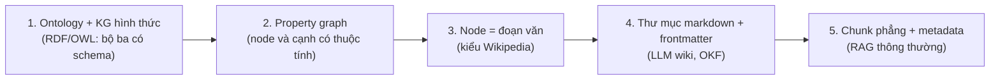
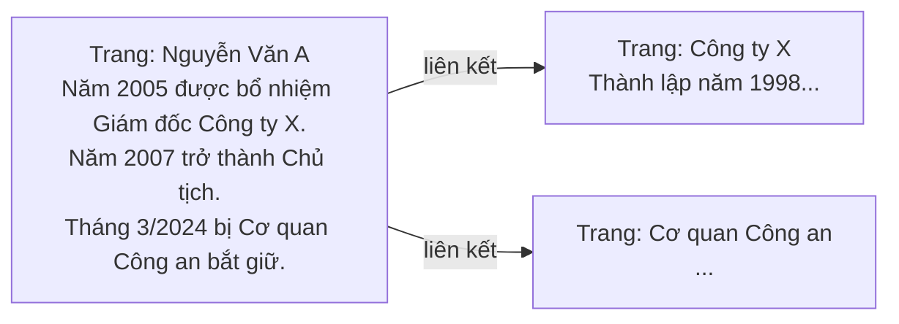
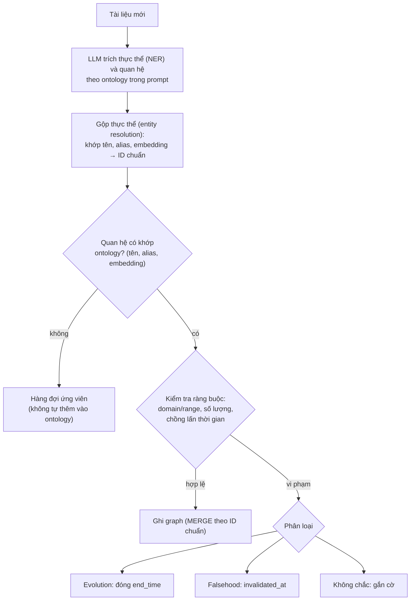
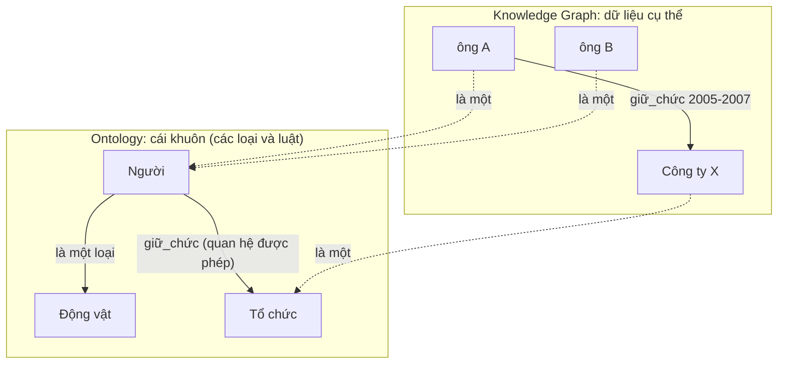
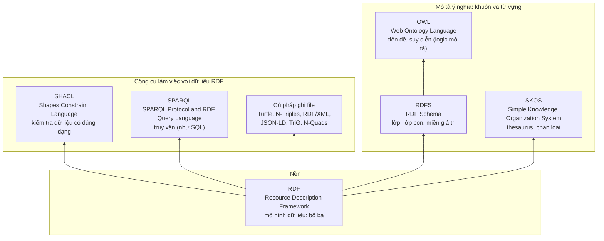

# Phổ biểu diễn tri thức: cùng một thông tin, năm cách ghi khác nhau

> **Câu hỏi file này trả lời:** để một hệ thống AI tìm và dùng được thông tin có yếu tố thời gian, ta nên *ghi* thông tin đó ở dạng nào, và mức cấu trúc nào là vừa đủ? Có năm lựa chọn, từ rất chặt chẽ (ontology) đến rất đơn giản (đoạn văn cắt rời). Thay vì định nghĩa chung chung, file này lấy **một mẩu thông tin cụ thể** rồi ghi nó bằng cả năm cách, để thấy mỗi cách giữ được gì và mất gì.
> **Quy ước:** ví dụ ở đây là *minh họa tự nghĩ ra*, không phải dữ liệu thật. Nhãn **[kiến thức chung]** là kiến thức nền chưa kiểm lại bằng nguồn trong phiên này; **[suy luận]** là phân tích của nhóm. Ontology được đi sâu ở [`14_Ontology_and_Temporal_Representation.md`](14_Ontology_and_Temporal_Representation.md).

## 1. Ví dụ xuyên suốt

Giả sử kho dữ liệu có đoạn tin sau:

> "Năm 2005, ông Nguyễn Văn A được bổ nhiệm Giám đốc Công ty X. Năm 2007, ông A trở thành Chủ tịch công ty. Tháng 3/2024, ông A bị Cơ quan Công an bắt giữ."

Và ba câu hỏi mà hệ thống phải trả lời được. Chúng tương ứng với ba cơ chế của đồ án:

| # | Câu hỏi | Loại | Cơ chế của đồ án |
|---|---|---|---|
| Q1 | "Năm 2006, ông A giữ chức gì?" | Hỏi tại **một mốc thời gian** (point-in-time) | Cơ chế 1: Temporal Retrieval |
| Q2 | "Tóm tắt quá trình sự nghiệp của ông A" | Gom **chuỗi sự kiện** theo thứ tự | Cơ chế 2: Timeline Summarization |
| Q3 | Ngày 1 tin nói "B là nghi phạm", ngày 3 tin nói "B bị oan, C mới là nghi phạm". Hỏi "ngày 2 ai là nghi phạm?" và "ai là nghi phạm hiện nay?" | **Thông tin đổi hoặc bị đính chính** | Cơ chế 3: Conflict Resolution |

Một điều cần phân biệt ngay (là bất biến của đồ án): **Evolution** (tiến hóa) là sự việc *từng đúng rồi thay đổi*, ví dụ ông A từ Giám đốc lên Chủ tịch; **Falsehood** (sai từ đầu) là thông tin *chưa bao giờ đúng*, ví dụ "B là nghi phạm" sau khi bị đính chính. Hai trường hợp phải xử lý khác nhau (xem `11` §3).

## 2. Năm cách ghi, từ chặt chẽ đến đơn giản



Đi từ trái sang phải: càng về sau càng *ít cấu trúc, rẻ hơn để dựng, giữ nguyên văn hơn*, nhưng máy càng *ít hiểu* ý nghĩa bên trong.

### Cách 1. Ontology và đồ thị tri thức hình thức (RDF/OWL)

Tóm tắt ba ý chính (lý thuyết đầy đủ ở **§7**):

- **Ontology** (bản thể luận) là bản mô tả hình thức *các loại thực thể và loại quan hệ được phép tồn tại* trong một lĩnh vực, ví dụ "có loại `Người`, `Tổ chức`; có quan hệ `giữ_chức_vụ` nối Người với Chức". Nó như cái *khuôn*; dữ liệu cụ thể (ông A, Công ty X) là thứ đổ vào khuôn.
- **RDF** (Resource Description Framework) ghi mọi thông tin dưới dạng **bộ ba** (triple) *chủ ngữ - vị ngữ - tân ngữ*, ví dụ `(ông A, giữ_chức_vụ, Giám đốc)`. **OWL** (Web Ontology Language) viết ontology trên nền RDF, có thể kèm luật để **reasoner** (bộ suy diễn) suy ra điều chưa ghi.
- Truy vấn bằng **SPARQL**; kho lưu bộ ba là **triple store**; ví dụ lớn là **Wikidata**.

**Vấn đề thời gian, và "nút trung gian" là gì.** Hãy hình dung đồ thị: mỗi bộ ba là một *mũi tên* nối hai *chấm*.

```text
(Ông A) ──giữ chức──▶ (Giám đốc)
```

Ta muốn ghi thêm "từ 2005 đến 2007" **cho chính mũi tên này**. Nhưng trong RDF, mũi tên chỉ là một cái nhãn, **không có chỗ để gắn thêm thông tin**. Cách chữa: **biến mũi tên thành một chấm** (một "sự kiện nhiệm kỳ"), rồi nối chấm đó tới từng thứ liên quan:

```text
                         ┌── người ────▶ (Ông A)
                         ├── chức ─────▶ (Giám đốc)
(Nhiệm kỳ số 1) ─────────┼── tổ chức ──▶ (Công ty X)
                         ├── bắt đầu ──▶ 2005
                         └── kết thúc ─▶ 2007
```

Chấm **"Nhiệm kỳ số 1" chính là nút trung gian**: nó không phải người hay công ty thật, chỉ là *chỗ để gom* mọi thông tin của một lần "giữ chức". Đoạn mã dưới đây là đúng hình trên, viết bằng **Turtle** (cú pháp văn bản của RDF):

```turtle
:A  a :Người ;                 # A là một Người ("a" nghĩa là "là một")
    :tên "Nguyễn Văn A" .      # dấu chấm kết thúc mô tả về A

:nhiệm_kỳ_1  a :NhiệmKỳ ;      # nút trung gian: một lần giữ chức
             :người   :A ;     # dấu ; = vẫn nói tiếp về :nhiệm_kỳ_1
             :chức    :GiámĐốc ;
             :tổ_chức :CôngTyX ;
             :bắt_đầu "2005" ;
             :kết_thúc "2007" .
```

(Dấu `:` ở đầu tên là tiền tố cho "thuộc ontology của mình", giống không gian tên.) **So với property graph (cách 2):** ở đó mũi tên mang được thuộc tính nên viết thẳng `GIỮ_CHỨC {start:2005, end:2007}`, không cần chấm phụ. Đó là lý do cách 2 gọn hơn khi gắn thời gian. Các cách khác để vá chỗ yếu này của RDF (đồ thị đặt tên, RDF-star, 4D fluents…) được viết cùng ví dụ này ở **§7.9**.

### Cách 2. Property graph (đồ thị thuộc tính)

**Property graph** cũng gồm **node** (nút = thực thể) và **edge** (cạnh = quan hệ), nhưng cả node lẫn cạnh đều mang được *thuộc tính* (cặp khóa-giá trị). **Neo4j** là cơ sở dữ liệu đồ thị phổ biến theo kiểu này, truy vấn bằng ngôn ngữ **Cypher**. Thời gian gắn thẳng vào cạnh, không cần nút trung gian:

```cypher
(a:Người {tên:"Nguyễn Văn A"})-[:GIỮ_CHỨC {start:2005, end:2007}]->(:Chức {tên:"Giám đốc"})
(a)-[:GIỮ_CHỨC {start:2007}]->(:Chức {tên:"Chủ tịch"})
(a)-[:BỊ_BẮT {at:"2024-03"}]->(:Tổ_chức {tên:"Cơ quan Công an"})
```

Đây là hướng thiết kế dự kiến của đồ án (GraphDB trong `docs/design/`). Nhược điểm: không có chuẩn chung cho ý nghĩa của `start`/`end`, mỗi hệ thống tự quy ước (so với Wikidata, `14` §3).

### Cách 3. Node là đoạn văn (kiểu Wikipedia)

Ý tưởng: mỗi **node là một "trang" chứa văn xuôi**, các trang nối với nhau bằng **liên kết** (như hyperlink). Khác biệt then chốt với cách 2: *mũi tên chỉ nói "hai trang này có liên quan"*, còn **mọi chi tiết (năm, chức vụ…) nằm trong câu chữ của trang**, không nằm trong thuộc tính.



So sánh cùng một thông tin ở cách 2 và cách 3:

| | Cách 2 (property graph) | Cách 3 (node = đoạn văn) |
|---|---|---|
| Mũi tên mang gì | Dữ liệu có cấu trúc: `GIỮ_CHỨC {start:2005, end:2007}` | Chỉ "có liên quan", không có dữ liệu |
| "A làm Giám đốc 2005–2007" nằm ở đâu | Trên mũi tên, máy đọc được | Trong câu chữ của trang A, phải đọc hiểu |
| Hỏi "năm 2006 A giữ chức gì" | Lọc theo `start`/`end` | Đọc cả đoạn rồi suy ra |
| Giữ sắc thái ("bị bắt *vì nghi ngờ*") | Mất | Giữ |

Ví dụ ngoài đời **[kiến thức chung]**: **Wikipedia** (các trang nối bằng hyperlink); **DBpedia** trích bảng thông tin (infobox) của Wikipedia thành RDF; **Microsoft GraphRAG** (kiểu RAG dùng đồ thị tri thức) sinh "báo cáo cộng đồng" bằng văn xuôi cho từng cụm node.

### Cách 4. Thư mục markdown có frontmatter (LLM wiki, OKF)

**Markdown** là định dạng văn bản đơn giản (`# tiêu đề`, `**đậm**`, `[link](...)`). Ở cách này, mỗi *khái niệm* là một file `.md`; đầu file có khối **frontmatter**: phần *siêu dữ liệu* (metadata: dữ liệu mô tả dữ liệu) nằm giữa hai dòng `---`, viết theo **YAML** (định dạng khai báo dạng `khóa: giá trị`). Phần thân là văn xuôi, link giữa các file tạo thành đồ thị. Đây là mẫu **LLM wiki** của Karpathy (`10`) và chuẩn **OKF** (Open Knowledge Format, `09`):

```markdown
---
type: Person
title: Nguyễn Văn A
tags: [lãnh-đạo]
---
Giám đốc [Công ty X](/orgs/cong-ty-x.md) từ 2005, Chủ tịch từ 2007.
Bị [Cơ quan Công an](/orgs/cong-an.md) bắt giữ tháng 3/2024.
```

Rẻ, con người đọc và sửa được, `git` cho sẵn lịch sử thay đổi. Nhưng *ngữ nghĩa thời gian không có sẵn*: "từ 2005" chỉ nằm trong câu chữ, máy không biết đó là khoảng hiệu lực (xem `09` §9).

### Cách 5. Chunk phẳng kèm metadata (RAG thông thường)

**RAG** (Retrieval-Augmented Generation) là cách cho LLM trả lời bằng tài liệu: cắt văn bản thành các **chunk** (đoạn nhỏ), biến mỗi chunk thành **embedding** (vector số biểu diễn ý nghĩa; hai đoạn gần nghĩa thì vector gần nhau), lưu vào **VectorDB** (cơ sở dữ liệu vector, ví dụ Qdrant). Khi hỏi, hệ thống tìm các chunk có vector gần câu hỏi nhất rồi đưa cho **LLM** (mô hình ngôn ngữ lớn như Claude, GPT) đọc. Mỗi chunk kèm **payload/metadata** (dữ liệu phụ) để lọc:

```json
{ "chunk_id": "c_17",
  "text": "Năm 2005, ông Nguyễn Văn A được bổ nhiệm Giám đốc Công ty X.",
  "start_time": "2005-01-01", "end_time": "2007-12-31",
  "source": "bao-X-2005" }
```

Đây là hướng của Cơ chế 1 hiện tại (tuần 4–5). Đơn giản và mở rộng tốt, nhưng *mỗi chunk đứng một mình*: nếu không tự thêm `start_time`/`end_time` thì hệ thống không biết chunk nào còn hiệu lực.

## 2A. Hỏi đáp: những chỗ hay nhầm

**1. Thông tin về thời gian nằm ở đâu trong mỗi cách?** Đây là điểm khác biệt quan trọng nhất cho đồ án:

| Cách | "A làm Giám đốc 2005–2007" được ghi ở |
|---|---|
| 1. RDF/OWL | Các bộ ba của nút trung gian "nhiệm kỳ": `bắt_đầu`, `kết_thúc` |
| 2. Property graph | Thuộc tính `start`, `end` **trên mũi tên** |
| 3. Node = văn xuôi | Trong **câu chữ** của trang |
| 4. Markdown + frontmatter | Câu chữ trong thân file; ngày (nếu có) ở khối metadata đầu file |
| 5. Chunk + metadata | Câu chữ trong chunk; ngày trong **payload** của chunk |

**2. Property graph có "biểu diễn được nhiều hơn" ontology không?** Không phải nhiều hơn hay ít hơn, mà **hai thứ khác loại**, hay bị đặt ngang hàng:

| | Là gì | Ví dụ |
|---|---|---|
| **Ontology** (và schema) | **Luật chơi**: có những loại thực thể nào, quan hệ nào được phép, suy ra được gì | "Có loại Người, Tổ chức; quan hệ `giữ_chức` nối Người với Chức" |
| **Cách lưu dữ liệu** | **Chỗ chứa** dữ liệu cụ thể: RDF (bộ ba, mũi tên không mang thuộc tính) hoặc property graph (mũi tên mang thuộc tính) | Ông A, Công ty X, các mũi tên |

Nên: property graph **tiện hơn để gắn thời gian vào quan hệ** (thuộc tính ngay trên mũi tên, ít nút phụ). RDF/OWL **mạnh hơn về ngữ nghĩa chặt, suy diễn và chuẩn trao đổi**, nhưng gắn thời gian thì rườm rà. Hai thứ không loại trừ: có thể đặt một "luật chơi" (schema) lên trên property graph, và đồ án làm đúng như vậy ở dạng nhẹ. Bản mở rộng RDF-star (đưa vào RDF 1.2 dưới tên triple term) đang cố vá chỗ yếu này; **tình trạng chuẩn chưa chắc**: Wikipedia ghi RDF 1.2 và SPARQL 1.2 được phát hành tháng 04/2026, trong khi kết quả tìm kiếm khác vẫn thấy các tài liệu RDF 1.2 ở mức Working Draft đến cuối 2026, và trang W3C không mở được để kiểm (xem §7.9).

**3. RDF là gì, "công nghệ nào hỗ trợ xây" nó?** RDF **không phải công cụ** mà là một **chuẩn định dạng dữ liệu**, giống JSON. Các công cụ là thứ thực hiện chuẩn đó. Bảng đối chiếu với thứ bạn đã quen:

| Thế giới đã quen | Tương đương trong thế giới RDF |
|---|---|
| JSON hoặc bảng dữ liệu | **RDF** (bộ ba chủ ngữ - vị ngữ - tân ngữ) |
| Khai báo cột của bảng, JSON Schema | **RDFS / OWL** (lớp, thuộc tính, ràng buộc) |
| SQL | **SPARQL** |
| PostgreSQL, Qdrant, Neo4j | **Triple store** (cơ sở dữ liệu lưu bộ ba) |
| Thư viện đọc ghi JSON | **rdflib** (Python) |
| Kiểm tra dữ liệu có đúng định dạng | **SHACL** (và pySHACL) |
| IDE để soạn code | **Protégé** (soạn ontology bằng giao diện) |

**4. Cách 1 trông lằng nhằng nhất, đồ án dùng phần nào của nó?** Phần lý thuyết đầy đủ (RDF, RDFS, OWL, SKOS, SHACL, SPARQL, cách biểu diễn thời gian, quy trình xây ontology) nằm ở **§7**. Việc đồ án *thực tế* lấy gì từ đó, và gọi tên nó ra sao trong luận văn, nằm ở **§5** (bullet "Phần của cách 1 mà đồ án dùng").

## 2B. Công nghệ nếu muốn làm ontology/RDF

> **Bảng dưới là thư viện và công cụ soạn.** Còn **cơ sở dữ liệu để lưu và chạy Docker cho từng trong 5 cách** (triple store cho cách 1, graph database cho cách 2 và 3, file + git cho cách 4, vector database cho cách 5, các phương án gộp vào Postgres, mẫu Docker Compose) nằm ở [`15_Storage_and_Deployment_per_Approach.md`](15_Storage_and_Deployment_per_Approach.md). Tóm tắt: cách 1 cần triple store (Fuseki, GraphDB, Oxigraph…); cách 2 và 3 cần graph DB (Neo4j, Memgraph, Apache AGE…); cách 4 không cần DB, chỉ file + git; cách 5 cần vector DB (Qdrant, pgvector…).

Không có nguồn nào tìm được cho số liệu "cái nào phổ biến nhất" hiện nay (tìm kiếm chỉ ra tài liệu cũ hoặc so sánh nhỏ), nên bảng dưới là **những tên hay được nhắc**, không phải xếp hạng.

| Việc cần làm | Công cụ hay được nhắc | Ghi chú | Độ tin |
|---|---|---|---|
| Soạn ontology bằng giao diện | **Protégé** | Được một nguồn gọi là trình soạn OWL được biết đến nhiều nhất; thiên về soạn, không phải kho lưu | thứ cấp |
| Đọc/ghi RDF, chạy SPARQL bằng **Python** | **rdflib** | Có parser/serializer nhiều định dạng, SPARQL 1.1; **không hỗ trợ OWL 2** | thứ cấp |
| Làm việc với OWL và suy diễn bằng Python | **owlready2** | Cài bằng pip, nạp/sửa/lưu ontology OWL 2, kèm reasoner HermiT; giấy phép LGPL | thứ cấp |
| Kiểm tra ràng buộc trên RDF | **pySHACL** | Xây trên rdflib | thứ cấp |
| Kho lưu và truy vấn bộ ba quy mô lớn | **Apache Jena Fuseki**, **RDF4J**, **GraphDB**, **Virtuoso**, **Stardog** (và Blazegraph, Neptune, AllegroGraph…) | Đều có trong danh sách so sánh của một bài giảng đại học 2025; các benchmark tìm được khá cũ, không dùng để chọn | thứ cấp, yếu |
| Nối **Neo4j** với RDF | **neosemantics (n10s)**, Neo4j Labs | Nhập/xuất Turtle, JSON-LD, RDF/XML…, cả ontology OWL/SKOS/RDFS; **chỉ cho Neo4j tự cài** (không có trên Aura), cần đặt ràng buộc unique cho `:Resource(uri)` và cấu hình GraphConfig trước khi nhập; thay thế: driver `rdflib-neo4j` | thứ cấp |

**Vì sao các cái tên này được nhắc nhiều [suy luận]:** đều miễn phí hoặc có bản mở, đọc/ghi các định dạng chuẩn W3C nên chuyển đổi qua lại dễ, và có sẵn cho Python (rdflib, owlready2, pySHACL) hay Java (Jena, RDF4J, Protégé).

**Đối với đồ án [suy luận]:** *không cần* triple store hay reasoner vì đã dùng Neo4j và Qdrant. Nếu muốn "xuất chuẩn mở" để chứng minh khả năng trao đổi: dùng **rdflib** sinh Turtle hoặc JSON-LD từ dữ liệu có sẵn, hoặc **n10s** trong Neo4j. Nếu muốn vẽ schema đẹp cho báo cáo: thử **Protégé**. Nếu muốn có kiểm tra ràng buộc dạng chuẩn: **pySHACL**.

## 3. Mỗi cách trả lời ba câu hỏi ra sao

Đánh giá dưới đây là **[suy luận]**, mang tính định tính để so sánh, không phải kết quả đo.

| Cách | Q1: chức năm 2006 | Q2: tóm tắt sự nghiệp | Q3: tin bị đính chính |
|---|---|---|---|
| **1. RDF/OWL** | Tốt: lọc nhiệm kỳ chứa 2006 | Tốt: duyệt các nhiệm kỳ theo thứ tự | Có thể mô hình hóa, nhưng phải tự thiết kế cách tách "hết hạn" và "sai từ đầu" (Wikidata có sẵn, `14` §3) |
| **2. Property graph** | Tốt: lọc cạnh theo `start`/`end` | Tốt và gọn: lấy chuỗi cạnh, ít token | Cần quy ước riêng; đồ án dùng `end_time` và `invalidated_at` |
| **3. Node = văn xuôi** | Phải đọc đoạn văn để suy ra | Dễ: đọc cả trang | Khó: phải đọc và tự phán đoán |
| **4. Markdown + frontmatter** | Như cách 3, trừ khi thêm khóa ngày | Dễ nếu có trang tổng hợp | Khó: không có cơ chế sẵn; LLM wiki chỉ nhờ bước `lint` (kiểm tra định kỳ) |
| **5. Chunk + metadata** | Tốt nếu có `start_time`/`end_time` và lọc cứng | Khó: chuỗi dài làm tràn ngữ cảnh | Khó: các chunk cũ vẫn nằm trong kho, dễ lấy nhầm bản cũ |

## 4. So sánh theo các tiêu chí

| Tiêu chí | 1. RDF/OWL | 2. Property graph | 3. Node = văn xuôi | 4. Markdown + frontmatter | 5. Chunk phẳng |
|---|---|---|---|---|---|
| Công dựng ban đầu | Rất cao (thiết kế ontology) | Cao (thiết kế schema, trích bộ ba) | Trung bình | Thấp | Thấp nhất |
| Chi phí trích xuất bằng LLM | Cao | Cao | Trung bình | Trung bình | Không cần |
| Giữ sắc thái, nguyên văn | Kém | Kém | **Tốt** | **Tốt** | **Tốt nhất** |
| Nén thông tin (ít token) | Tốt | **Tốt nhất** | Kém | Kém | Kém |
| Truy vấn chính xác | **Tốt nhất** (SPARQL, suy diễn) | Tốt (Cypher) | Kém | Kém | Trung bình (ngữ nghĩa) |
| Con người kiểm tra được | Khó | Trung bình | Dễ | **Dễ nhất** | Khó khi chunk nhiều |
| Hỗ trợ thời gian có sẵn | Có chuẩn, nặng | Tự quy ước | Không | Tùy thiết kế | Chỉ qua metadata |
| Phù hợp tin tức mở, nhiều lĩnh vực | Kém | Trung bình | Tốt | Tốt | **Tốt nhất** |

## 5. Đồ án đang đứng ở đâu

- **Không chọn một cách, mà ghép hai cách:** cách 5 (chunk + metadata thời gian trong VectorDB) giữ nguyên văn và phục vụ Cơ chế 1; cách 2 (đồ thị gọn, cạnh có thời gian) nén thông tin cho Cơ chế 2. Đồ thị chỉ giữ *bộ ba nhẹ cùng con trỏ `Chunk_ID` trỏ về chunk gốc*; cần chi tiết thì quay lại VectorDB lấy chunk (mẫu thiết kế gọi là **Boomerang**, xem `timeline_summarization/03`). Hai cách bổ sung nhau: nén khi cần tổng quan, nguyên văn khi cần chi tiết hay sắc thái.
- **Cách 3 và 4 không bị loại:** chúng là *định dạng trình bày và trao đổi* (xuất bundle OKF cho người khác hoặc agent khác đọc), không thay bộ máy truy xuất (`11` §1).
- **Phần của cách 1 mà đồ án dùng:** một **ontology nhẹ (lightweight ontology) viết thành file khai báo**, là thành phần chính thức của hệ thống, không phải chỉ "mượn ý". Phần khai báo (lớp, quan hệ, alias) viết theo **chuẩn** (RDFS + SKOS, ghi bằng Turtle, đọc bằng rdflib); phần luật theo thời gian dùng **thuộc tính tự đặt** và do code thực thi. Không dựng triple store, không chạy reasoner. Chi tiết ở §5.1.
- **Trục thời gian:** thiết kế có `start_time`/`end_time` (thời gian hiệu lực ngoài đời) và `invalidated_at` (sai từ đầu); **chưa có** trường cho *thời điểm hệ thống biết thông tin*. Người ta gọi mô hình hai trục là **bi-temporal** (Zep/Graphiti làm vậy, `07`). Đề xuất thêm `ingested_at`, xem `06`.

### 5.1. Ontology nhẹ của đồ án: dùng ở đâu, viết bằng gì

> **[suy luận]** Đây là hướng đề xuất của nhóm (đã chọn hướng kết hợp chuẩn và thuộc tính tự đặt), chưa hiện thực. Vẫn ngoài phạm vi: mâu thuẫn đa nguồn theo độ uy tín (`decisions/09`).

**Lõi và gói theo miền.** Chia hai tầng, giống upper/domain ở §7.1: *lõi dùng chung* (`Entity`, `Event`, cạnh có `start_time`, `end_time`, `invalidated_at`, nguồn; không đổi theo miền) và *gói theo miền* (mỗi miền như tiểu sử, luật, tài chính là một file định nghĩa loại và quan hệ riêng). Đổi miền chỉ là đổi file. Đây cũng là cách để về sau bọc thành MCP dùng cho nhiều loại dữ liệu (`12`).

**Ontology cắm vào đâu trong quá trình nạp dữ liệu.**



- **NER** (Named Entity Recognition, nhận dạng thực thể có tên) tìm "ông Nguyễn Văn A", "Công ty X" và gán loại; danh sách loại hợp lệ lấy từ ontology. Có thể để LLM làm cùng lúc với trích quan hệ (đã dùng LLM ở bước này). Công cụ NER riêng cho tiếng Việt: **[chưa kiểm]**.
- **Gộp thực thể** là bước khó và dễ sai nhất ("ông A", "Nguyễn Văn A", "Chủ tịch A" là một nút). Đây mới là chỗ nối "lịch sử Công ty X" với "sự nghiệp ông A": hai tài liệu cùng trỏ vào một nút `Công ty X`.
- **Ontology phục vụ bốn việc:** (1) đưa vào prompt để LLM không bịa tên cạnh; (2) chuẩn hóa "giữ chức", "làm", "được bổ nhiệm" về một quan hệ; (3) ràng buộc, ví dụ "một chức tại một tổ chức chỉ có một người giữ tại một thời điểm", chồng lấn thì có mâu thuẫn rồi mới phân loại Evolution hay Falsehood; (4) lộ ra qua tool `get_schema` của MCP.

**Phần nào đồ án phải xây, và duyệt ở đâu [suy luận].** Quá trình nạp quan hệ (trích, chuẩn hóa, kiểm tra ràng buộc, ghi graph) thuộc lớp **Ingestion** của đồ án, vì nó quyết định cách tổ chức dữ liệu. Nó là một chương trình **riêng** với server MCP:

| Thành phần | Việc | Đọc/ghi | Chạy khi nào |
|---|---|---|---|
| **Ingestion pipeline** | Cắt chunk, trích thực thể và quan hệ, gộp thực thể, chuẩn hóa theo ontology, kiểm tra ràng buộc, ghi Qdrant và Neo4j | **Ghi** | Offline, theo đợt |
| **Hàng đợi duyệt** | Lưu các đề xuất mơ hồ với trạng thái `pending`/`approved`/`rejected` kèm bằng chứng | Ghi | Do pipeline tạo, người hoặc quy tắc xử lý |
| **Server MCP** | Trả lời truy vấn qua `search`, `get_timeline`... | **Chỉ đọc** | Khi người dùng hỏi |

Hàng đợi duyệt chỉ cần là **dữ liệu** (bảng hoặc file JSONL) cộng một cách thao tác tối thiểu, như lệnh CLI hay một trang Streamlit nhỏ; không cần xây hệ thống duyệt đầy đủ. Khi chạy thực nghiệm, đặt chính sách tự động (đề xuất mơ hồ thì ghi tạm dạng quan hệ chung hoặc bỏ qua) để kết quả tái lập được. Việc người duyệt thật chỉ làm trên mẫu nhỏ hoặc nêu như hướng phát triển.

**LLM nhận gì khi trích xuất, và đơn vị xử lý là gì [suy luận].**

- **Đơn vị lưu và truy vết là chunk, nhưng LLM cần nhìn cả tài liệu để hiểu.** Một chunk lẻ thường thiếu thông tin: đại từ ("ông ấy"), chủ thể nêu ở đầu bài, ngày đăng để đổi "tuần trước" thành ngày tuyệt đối, hay thuật ngữ định nghĩa ở điều khác. Có ba cách:

| Cách | Mô tả | Ưu | Nhược |
|---|---|---|---|
| **1. Từng chunk kèm ngữ cảnh gọn** | Chunk + tiêu đề tài liệu, tiêu đề mục, ngày đăng, đoạn liền kề | Rẻ, gắn thẳng `Chunk_ID` | Dễ thiếu ngữ cảnh xa |
| **2. Cả tài liệu, rồi gán về chunk (ưu tiên)** | Đánh số chunk trong prompt (`[C1]`, `[C2]`…); LLM đọc cả bài, trả bộ ba kèm **mã chunk** làm bằng chứng. Code kiểm bằng cách xem tên thực thể có xuất hiện trong chunk được dẫn không | Hiểu tổng quan; không phải chép lại đoạn dài | Tốn token; bài dài thì LLM bỏ sót |
| **3. Hai lượt (đề xuất cho tài liệu dài)** | Lượt 1: đọc cả bài, ra tóm tắt, danh sách thực thể, ngày neo. Lượt 2: trích từng chunk, kèm kết quả lượt 1 làm ngữ cảnh | Vừa có tổng quan vừa gắn chunk chính xác | Thêm một lượt gọi LLM |

Gợi ý chọn: tài liệu ngắn (vừa ngữ cảnh) thì cách 2; tài liệu dài hoặc văn bản luật theo điều khoản thì cách 3.
- **Gán bộ ba về chunk bằng mã chunk, không bằng câu chép nguyên văn.** Chép lại đoạn dài dễ sai chữ. Số liệu của chính đồ án cho thấy: trong bảng kiểm `ongoing_evidence` (`design/03` §2.2), câu LLM diễn đạt lại thay vì chép nguyên văn bị loại, và có 55 chunk bị hạ `ongoing`. Vì vậy cho LLM **dẫn mã chunk** (`[C3]`) thay vì chép chữ, rồi code kiểm tên thực thể có nằm trong chunk đó không. Dẫn không hợp lệ (mã không tồn tại, tên không có trong chunk) thì đưa vào hàng đợi, không ghi `Chunk_ID` bừa. Nếu cần câu trích để hiển thị thì lấy từ chunk gốc theo mã, không lấy từ LLM.
- **Pipeline hiện tại đã gần cách 2:** theo `design/03` §2.2, ingestion đã chạy theo **lô tối đa 30 chunk của cùng một trang** (`batch_size = 30`), nên LLM đã thấy ngữ cảnh cả trang. Việc kiểm `ongoing_evidence` cũng chỉ xét cụm có trong lô, không biết cụm thuộc chunk nào. Phần mới cần làm là gán bộ ba về từng chunk.
- **Prompt gồm ba phần:** (1) chunk và ngữ cảnh; (2) ontology: các loại thực thể, các quan hệ cho phép kèm mô tả và alias; (3) vài thực thể đã có trong KG giống với tên xuất hiện trong chunk (lấy top-k theo độ giống, không đưa cả KG) để LLM gán đúng ID chuẩn.
- **Quan hệ nào đưa vào prompt:** là danh sách quan hệ **của ontology**. Các loại cạnh trong KG luôn là tập con của nó nên không cần liệt kê riêng. Khi ontology lớn lên hàng trăm quan hệ thì chỉ đưa tập con liên quan (chọn bằng embedding).
- **Cách lai:** cho phép LLM chọn quan hệ trong ontology, hoặc ghi `OTHER` kèm tên tự do khi không quan hệ nào hợp. Phần `OTHER` đi vào hàng đợi ứng viên; code so độ tương đồng với các quan hệ hiện có để gợi ý ánh xạ.
- **Tiền lệ:** Zep và Mem0 cũng lấy các nút hoặc fact tương tự đã có để LLM đối chiếu trước khi ghi (`07`, `08`).

**Ví dụ khai báo: kết hợp chuẩn và thuộc tính tự đặt (Turtle):**

```turtle
@prefix :     <http://example.org/timemem#> .
@prefix rdf:  <http://www.w3.org/1999/02/22-rdf-syntax-ns#> .
@prefix rdfs: <http://www.w3.org/2000/01/rdf-schema#> .
@prefix owl:  <http://www.w3.org/2002/07/owl#> .
@prefix skos: <http://www.w3.org/2004/02/skos/core#> .

# --- Phần chuẩn: lớp, quan hệ, alias ---
:Person   a rdfs:Class .
:Position a rdfs:Class .

:holds_position a rdf:Property ;
    rdfs:domain :Person ;
    rdfs:range  :Position ;
    skos:altLabel "giữ chức"@vi, "làm"@vi, "appointed as"@en .

# --- Phần tự đặt: luật của đồ án, khai báo là annotation để không ảnh hưởng suy diễn ---
:temporal    a owl:AnnotationProperty ; rdfs:comment "Quan hệ bắt buộc có start_time." .
:exclusiveBy a owl:AnnotationProperty ; rdfs:comment "Tại một thời điểm, mỗi giá trị của vai trò này chỉ có một chủ thể." .

:holds_position :temporal true ; :exclusiveBy :range .
```

Phần trên `# --- Phần chuẩn` là RDFS và SKOS, công cụ nào đọc RDF cũng hiểu. Phần `# --- Phần tự đặt` là quy ước riêng của đồ án: chuẩn không có khái niệm "loại trừ theo thời gian", nên code của đồ án đọc hai thuộc tính này và tự kiểm tra.

**Bên khác dùng ontology này có gặp vấn đề với thuộc tính tự đặt không [kiến thức chung]?** Không hỏng, nhưng họ chỉ hiểu phần chuẩn:
- **Không báo lỗi.** Với RDF, thuộc tính lạ chỉ là thêm một bộ ba; công cụ đọc, lưu và ghi lại bình thường (cùng tinh thần "giữ khóa lạ" của OKF, `09` §2).
- **Họ không thực thi luật.** Công cụ ngoài sẽ bỏ qua `:exclusiveBy`, nên dữ liệu vi phạm luật vẫn được chấp nhận ở phía họ. Luật chỉ có hiệu lực ở nơi có code của đồ án.
- **Khai báo thuộc tính tự đặt là annotation** (`owl:AnnotationProperty`) như ví dụ. Nếu không khai báo, một số reasoner/công cụ OWL kiểm tra chặt có thể phàn nàn hoặc coi file là OWL Full. Annotation không ảnh hưởng suy diễn.
- **Đặt trong namespace của mình** (`http://example.org/timemem#` ở trên chỉ là chỗ tạm; khi công bố nên dùng địa chỉ ổn định của nhóm), để tên không đụng với từ vựng của người khác.
- **Ghi nghĩa bằng `rdfs:comment`** để người ngoài đọc hiểu quy ước, dù máy của họ không thực thi được.

**Ontology (nội dung) khác với cách viết (định dạng).** Ontology là nội dung: có lớp nào, quan hệ nào, luật nào. Turtle/OWL, YAML, OKF là các cách ghi, nhưng không cùng vai trò:

| | Viết được **khuôn** (lớp, quan hệ, luật)? | Viết được **dữ liệu**? | Ngữ nghĩa chuẩn, máy suy diễn? |
|---|---|---|---|
| **RDF/RDFS/OWL/SKOS** (Turtle) | Được | Được (bộ ba) | **Có** (phần chuẩn) |
| **YAML tự đặt** | Được, theo quy ước của mình | Được nhưng nên để ở Neo4j | Không; code của mình thực thi luật |
| **OKF** | **Không** thực sự: chỉ có chuỗi `type` và link không kiểu | Được (mỗi file một concept) | Không |

Nên: khuôn viết bằng Turtle (phần chuẩn) cộng thuộc tính tự đặt; dữ liệu ở Neo4j và Qdrant; OKF chỉ là lớp xuất. Lưu ý RDF không chỉ là cách trình bày: cú pháp (Turtle, JSON-LD…) mới là cách trình bày, còn RDF/OWL còn có ngữ nghĩa chính thức đi kèm.

**Vì sao không dùng OWL nguyên bản cho cả luật [kiến thức chung, suy luận]:** (1) "một chức một người *tại một thời điểm*" là ràng buộc theo khoảng thời gian, OWL không biểu diễn trực tiếp (phải dùng mô hình 4D §7.9 hoặc SHACL); (2) OWL theo giả định thế giới mở, vi phạm luật không bị báo lỗi (§7.5), muốn báo lỗi phải thêm SHACL; (3) dữ liệu nằm ở Neo4j, không phải kho RDF. Vì vậy chỉ chuẩn hóa phần khai báo, còn luật do code thực thi.

| | Thuần YAML | Turtle (RDFS + SKOS) + thuộc tính tự đặt |
|---|---|---|
| Phần khai báo lớp, quan hệ, alias | Tự chế | **Theo chuẩn** |
| Mở bằng Protégé, vẽ sơ đồ, xuất | Không | **Có** |
| Luật theo thời gian | Tự đặt, code kiểm tra | Tự đặt (`:exclusiveBy`), code kiểm tra |
| Chi phí | Thấp nhất | Cao hơn một chút (cú pháp, rdflib) |
| Người ngoài hiểu | Chỉ qua tài liệu của bạn | Hiểu phần chuẩn, bỏ qua phần tự đặt |
| Cách gọi trong luận văn | *lightweight ontology/schema* | *lightweight ontology*: chuẩn cho phần khai báo, quy ước riêng cho phần luật |

**"Khả năng trao đổi chuẩn" nghĩa là gì [kiến thức chung].** RDF, OWL, SPARQL và SHACL là các khuyến nghị (Recommendation) của W3C, nghĩa là tài liệu chuẩn mà nhiều công cụ cùng tuân theo (Protégé, Jena, rdflib, GraphDB…). Hệ quả: (a) bên khác nạp file Turtle của bạn bằng công cụ có sẵn, không cần code riêng; (b) dùng lại được từ vựng công cộng (Wikidata, PROV-O, schema.org) bằng IRI. Hai lưu ý: chuẩn chỉ có giá trị nếu *có bên thứ hai thật sự dùng*, mà đồ án khó có, nên lợi ích chủ yếu là để trình bày; và trao đổi chỉ chạy khi hai bên dùng cùng từ vựng, chuẩn cú pháp không tự làm hai bên hiểu giống nhau.

**Ontology và KG lưu ở đâu [suy luận].** Mô hình Boomerang (Qdrant giữ chunk, Neo4j giữ triplet kèm `Chunk_ID`) vẫn giữ nguyên. Ontology **không bắt buộc nằm trong graph database**:

| Phương án | Ontology (khuôn) | KG (dữ liệu) | Nhận xét |
|---|---|---|---|
| **A. File + code (đề xuất)** | File Turtle trong repo (đưa vào git), nạp bằng rdflib khi khởi động | Neo4j: nhãn nút và tên cạnh trùng tên lớp và quan hệ trong ontology | Đơn giản nhất; ontology có lịch sử git; code nạp dữ liệu kiểm tra theo ontology |
| B. File + phản chiếu vào Neo4j | Như A, thêm nút `:Class`, `:RelationType` trong Neo4j | Như A | Tiện truy vấn "graph có loại gì" bằng Cypher; phải đồng bộ hai nơi |
| C. Lưu ontology trong kho RDF | Triple store (Fuseki, GraphDB) hoặc neosemantics | Neo4j hoặc cùng kho RDF | Đúng chuẩn nhất nhưng nặng, thêm một hệ thống (xem `15`) |

Neo4j không có schema bắt buộc theo ontology, nên việc "ép" khuôn (đúng loại nút, đúng quan hệ, đúng ràng buộc thời gian) do **code nạp dữ liệu** làm, không phải do cơ sở dữ liệu. Qdrant chỉ liên quan ontology qua trường `domain_features.domain` trong payload.

**Cần chuẩn gì cho ontology [kiến thức chung, suy luận].** Không có chuẩn bắt buộc. Mức tối thiểu hợp lý là RDFS và SKOS ghi bằng Turtle (đúng hướng đã chọn). Nên tái dùng từ vựng có sẵn khi nó khớp, thay vì tự đặt: PROV-O cho nguồn gốc (`sources`), OWL-Time cho khái niệm thời gian, qualifier và rank của Wikidata cho mô hình hiệu lực (bảng ánh xạ ở `14` §7). SHACL và OWL chỉ thêm khi có nhu cầu. Trang W3C chưa mở được trong phiên này nên cần đối chiếu nguyên văn trước khi trích dẫn.

**Vì sao không dùng OKF làm nền lưu trữ hay ontology [suy luận từ `09`].** OKF không bị loại hẳn: nó dễ đọc cho người và LLM, rẻ, dùng git được, nên vẫn hợp làm lớp xuất cho agent khác đọc (làm sau cùng nếu còn thời gian). Chỉ ở vai trò *lưu trữ* và *ontology* thì nó chưa đủ:

| Lý do | Mức đúng | Nói chính xác |
|---|---|---|
| Còn mới | Đúng | v0.1 ngày 12/06/2026, đã lên v0.2; Google tự nhận sẽ tiến hóa tiếp; bản major mới có thể phá khóa bắt buộc (`09` §7). Mức chấp nhận ngoài hệ sinh thái Google chưa rõ **[chưa kiểm]** |
| Hạn chế biểu diễn | Đúng | Không có khoảng hiệu lực, không kiểu cạnh, không tách Evolution và Falsehood (`status: deprecated` gộp cả hai), xem `09` §9.1 |
| Phải tự code nhiều | Đúng một nửa | RDF/OWL cũng không tự xử lý luật theo thời gian của đồ án. Khác biệt thật: RDF có sẵn hạ tầng chung (SPARQL truy vấn, SHACL kiểm tra, công cụ đọc/ghi), OKF thì không có truy vấn hay kiểm tra |
| Không có chuẩn như RDF | Đúng một nửa | OKF có spec công khai (Apache-2.0, có mục conformance) nhưng là spec của một công ty. RDF/OWL là Recommendation của W3C. Nên nói "chưa phải chuẩn do tổ chức chuẩn hóa ban hành", không nói "không có chuẩn" |

Cách nói trong luận văn: "chưa dùng làm nền vì còn mới và thiếu ngữ nghĩa", không phải "OKF kém".

## 6. Cách chọn mức cấu trúc (quy tắc kinh nghiệm)

**[suy luận]** Hỏi lần lượt:
1. Câu hỏi có cần **lọc chính xác theo thời gian** (point-in-time)? → ít nhất phải có cách 5 với metadata thời gian và lọc cứng.
2. Có cần **gom chuỗi sự kiện của một thực thể** gọn trong ít token? → thêm cách 2 (đồ thị nhẹ) hay bảng quan hệ (`03` §3).
3. Có cần **giữ nguyên câu chữ và sắc thái**? → luôn giữ chunk gốc; đừng chỉ giữ bộ ba.
4. Có cần **người khác hay agent khác đọc được** kho tri thức? → thêm lớp xuất cách 4 (OKF) hay MCP (`12`).
5. Có thật sự cần **suy diễn tự động** (reasoner)? Thường là không với bài toán này → bỏ cách 1 đầy đủ.

## 7. Lý thuyết nền: ontology và web ngữ nghĩa

> Mục này là phần lý thuyết đầy đủ cho cách 1, viết để đọc lại một mình mà không cần nguồn khác. Phần lớn đối chiếu với các trang Wikipedia về RDF, OWL, SHACL, SPARQL và reification (đã mở trực tiếp). Nhãn **[kiến thức chung]** là kiến thức chuẩn của lĩnh vực mà trang Wikipedia đó không nêu hoặc chưa kiểm; **[suy luận]** là phân tích của nhóm. Trang W3C (nơi có đặc tả gốc) không mở được trong phiên này, nên khi cần trích dẫn chính thức hãy đối chiếu thêm với w3.org.

### 7.1. Ontology là gì, gồm những phần nào

**Định nghĩa thường dùng [kiến thức chung]:** ontology là một *đặc tả tường minh, hình thức về một cách hiểu chung của một lĩnh vực* (thường trích câu của Thomas Gruber). Hiểu đời thường: một bản "từ điển có luật" mà máy đọc được, nói lĩnh vực này có những loại sự vật nào, chúng quan hệ với nhau ra sao, và điều gì luôn đúng.

Theo mô tả của Wikipedia, ontology OWL coi dữ liệu là **individuals** (cá thể) nối với nhau bằng các **property assertions** (khẳng định về thuộc tính), còn **axioms** (tiên đề) ràng buộc các lớp và quan hệ để reasoner suy ra sự kiện mới. Các thành phần:

| Thành phần | Nghĩa | Ví dụ |
|---|---|---|
| **Class** (lớp, khái niệm) | Một tập hợp các sự vật cùng loại | `Người`, `Tổ chức`, `ChủTịch` |
| **Individual** (cá thể, thể hiện) | Một sự vật cụ thể | `ông A`, `Công ty X` |
| **Object property** (thuộc tính đối tượng) | Quan hệ nối hai cá thể | `giữ_chức(ông A, Giám đốc)` |
| **Data property** (thuộc tính dữ liệu) | Nối cá thể với một giá trị (số, chuỗi, ngày) | `tên(ông A, "Nguyễn Văn A")` |
| **Axiom** (tiên đề) | Một điều luôn đúng, dùng để ràng buộc hoặc suy diễn | "Mọi `ChủTịch` đều là `LãnhĐạo`" |
| **Annotation** (chú thích) | Thông tin cho con người, không ảnh hưởng suy diễn | nhãn, mô tả, nguồn |

**TBox và ABox [kiến thức chung, từ logic mô tả]:** phần *thuật ngữ* (TBox: các lớp, thuộc tính, tiên đề, tức "khuôn") tách khỏi phần *khẳng định* (ABox: các cá thể và sự kiện cụ thể, tức "dữ liệu"). Đồ thị tri thức (KG) = ontology (TBox) + dữ liệu (ABox). Cả hai thường được lưu dưới dạng RDF.

**Ba tầng ontology theo mức tổng quát [kiến thức chung]:** *upper/foundational* (rất chung: "vật", "sự kiện", "thời gian"; ví dụ BFO, DOLCE, SUMO), *domain* (một lĩnh vực: y tế, luật, tài chính), *application* (riêng một ứng dụng). Ontology nhỏ cho một đồ án thường là tầng domain/application, có thể tái dùng từ vựng của tầng trên.

**Phân biệt với các thứ gần giống:**

| Thứ | Có quan hệ gì | Có suy diễn? |
|---|---|---|
| **Vocabulary** (từ vựng) | Danh sách thuật ngữ/thuộc tính dùng chung, như Dublin Core hay schema.org | Rất ít |
| **Taxonomy** | Chỉ cha-con (Động vật → Có vú → Mèo) | Không |
| **Thesaurus** | Cha-con + liên quan + từ đồng nghĩa; chuẩn là **SKOS** | Không |
| **Schema** | Cấu trúc dữ liệu phải tuân theo (khai báo cột, JSON Schema) | Không, chỉ kiểm tra hợp lệ |
| **Ontology** | Lớp, thuộc tính, tiên đề | **Có**, qua reasoner |
| **Knowledge Graph** | Dữ liệu cụ thể (thực thể thật, quan hệ thật) | Tùy |

### 7.1A. Ontology và Knowledge Graph: khác nhau thế nào

**Cách hiểu "ontology trừu tượng hơn, KG là dữ liệu cụ thể" là đúng ý chính.** Ontology nói *có những loại gì* (Người, Động vật, Tổ chức) và *quan hệ nào được phép giữa chúng*; Knowledge Graph (KG, đồ thị tri thức) chứa *các thực thể cụ thể* (ông A, ông B, Công ty X) và những quan hệ thật giữa chúng.



Cách nhớ bằng thứ bạn đã quen:

| Thế giới | Phần "khuôn" (trừu tượng) | Phần "dữ liệu" (cụ thể) |
|---|---|---|
| Lập trình hướng đối tượng | `class Person` | `a = Person("ông A")` |
| Cơ sở dữ liệu quan hệ | `CREATE TABLE` (schema) | các dòng dữ liệu |
| Ontology và KG | **Ontology** (lớp, quan hệ, luật) | **KG** (cá thể và quan hệ thật) |

**Bốn chỗ cần chỉnh cho đủ ý [kiến thức chung, trừ chỗ có ghi nguồn khác]:**

1. **Ontology không chỉ có "loại".** Ở đây "loại" chính là **class** (lớp): `Người` *là* một class, nên bạn hiểu đúng, ontology chắc chắn có class. Ý chỉnh là ontology còn có **thêm hai thứ nữa ngoài class**: (a) *quan hệ giữa các loại* (property, ví dụ `giữ_chức` nối `Người` với `Chức`), (b) *luật* (axiom, ví dụ "mọi `ChủTịch` là `LãnhĐạo`", "`Người` và `Tổ chức` không trùng nhau"). Nếu chỉ có danh sách class thì đó mới là taxonomy, chưa đủ gọi là ontology (xem bảng cuối 7.1).
2. **Từ "KG" được dùng theo hai nghĩa.** Nghĩa **hẹp** (như bạn hiểu và như bảng ở 7.1): chỉ *phần dữ liệu cụ thể*. Nghĩa **rộng**: *cả đồ thị*, gồm cả dữ liệu lẫn khuôn ontology. Ví dụ ở Wikidata, cả "Người" (một lớp) lẫn "Obama" (một cá thể) đều là nút trong cùng một đồ thị. Khi đọc bài viết hay tài liệu, nên xem họ đang dùng nghĩa nào.
3. **Ranh giới "loại" và "cá thể" không tuyệt đối.** Ontology đôi khi chứa vài cá thể cố định (như `Mùa = {xuân, hạ, thu, đông}`), và một thứ có thể vừa là cá thể vừa là lớp của thứ khác (OWL Full cho phép, xem 7.5). Trong logic mô tả hai phần này gọi là **TBox** (khuôn) và **ABox** (dữ liệu), xem 7.1.

**Hỏi: individual nằm trong ontology thì có bị quá chi tiết và thành KG không?** Có thể, và đây đúng là chỗ ranh giới mờ. Quy tắc kinh nghiệm **[suy luận]**: cá thể nào *thuộc về định nghĩa của lĩnh vực*, ít, cố định, không đổi theo dữ liệu thì để trong ontology (4 mùa, các giá trị `Giới tính`, các hạng `Rank` của Wikidata, các loại quan hệ). Cá thể nào *sinh ra từ dữ liệu thật*, nhiều, tăng dần, có thời gian hiệu lực (ông A, ông B, từng nhiệm kỳ) thì thuộc KG. Thử nhanh: **nếu thêm một bài báo mới mà phải thêm cá thể này thì nó là KG; nếu chỉ khi lĩnh vực đổi cách hiểu mới phải thêm thì nó là ontology.** Một ontology nhồi hàng nghìn cá thể thật thì thực chất đã là KG mang tên ontology.

**Hỏi: ABox có bị lẫn với KG không, phân biệt thế nào?** Gần như trùng về *nội dung* nhưng khác về *góc nhìn*:

| | ABox | KG (nghĩa hẹp, phần dữ liệu) |
|---|---|---|
| Thuật ngữ của | Logic mô tả, học thuật | Kỹ thuật dữ liệu, ngành công nghiệp |
| Định nghĩa | Tập khẳng định về cá thể, **luôn tính tương đối với một TBox** | Đồ thị thực thể và quan hệ, **không cần TBox** |
| Hình dạng | Là các mệnh đề logic (`Người(A)`, `giữ_chức(A, X)`) | Là đồ thị nút-cạnh, có thể thêm thuộc tính, nguồn, embedding |
| Dùng để | Suy diễn, kiểm tra nhất quán | Lưu, truy vấn, trực quan, nạp cho LLM |

Cách nhớ: **ABox là cách nhìn logic của "dữ liệu"; KG là cách nhìn kỹ thuật của "đồ thị dữ liệu".** Khi KG có ontology đi kèm thì phần dữ liệu của nó *chính là* ABox. Khi không có ontology (như Neo4j của đồ án) thì vẫn gọi được là KG nhưng nói "ABox" thì hơi thừa vì không có TBox để đối chiếu.
4. **KG không bắt buộc có ontology hình thức.** Một đồ thị Neo4j có nhãn `Người` và cạnh `GIỮ_CHỨC` đã *ngầm* có một cái khuôn, chỉ là chưa được viết thành ontology có tiên đề và suy diễn. Đồ án đang ở mức này (xem §5).

### 7.2. Chồng chuẩn: cái nào đứng trên cái nào

Sơ đồ dưới đây vẽ **các chuẩn của W3C (World Wide Web Consortium, tổ chức đặt chuẩn web) trong thế giới "web ngữ nghĩa"** (Semantic Web: ý tưởng cho dữ liệu trên web có ý nghĩa mà máy hiểu được) và quan hệ giữa chúng.



**Cách đọc sơ đồ.** Mũi tên "A → B" nghĩa là *B dựa trên A*, hoặc *B làm việc với dữ liệu viết bằng A*. RDF nằm dưới cùng vì mọi thứ khác đều dựa vào nó. Sơ đồ có hai kiểu quan hệ khác nhau, hay bị coi là cùng một loại:
- **Chuỗi RDF → RDFS → OWL** là các *tầng ngôn ngữ mô tả ý nghĩa*, tầng sau mạnh hơn và bao gồm tầng trước (còn gọi "semantic web layer cake"). Đây là ba mức để viết "khuôn" (ontology).
- **SKOS, SHACL, SPARQL, cú pháp ghi file** *không phải tầng cao hơn* mà là các nhánh **ngang hàng**, cùng lấy RDF làm dữ liệu nền: SKOS là một bộ từ vựng nhẹ riêng, SHACL là bộ kiểm tra, SPARQL là ngôn ngữ truy vấn, cú pháp là cách viết ra file.

**Mỗi hộp viết tắt của gì và làm gì:**

| Hộp | Viết tắt của | Làm gì (một câu) | Ví dụ ngắn | Tương đương quen thuộc |
|---|---|---|---|---|
| **RDF** | Resource Description Framework (khung mô tả tài nguyên) | Quy định **mọi thông tin là bộ ba** chủ ngữ - vị ngữ - tân ngữ | `(ông A, giữ_chức, Giám đốc)` | JSON: định dạng dữ liệu nền |
| **RDFS** | RDF Schema (lược đồ cho RDF) | Cho phép khai báo **lớp, lớp con, thuộc tính áp cho loại nào** | "Người là lớp con của Động vật" | Khai báo `class` đơn giản |
| **OWL** | Web Ontology Language (ngôn ngữ ontology cho web) | Thêm **luật mạnh hơn** để reasoner suy diễn (lớp rời nhau, số lượng, bắc cầu…) | "Mọi Chủ tịch là Lãnh đạo"; "mỗi nhiệm kỳ đúng một người" | Như JSON Schema nhưng có suy diễn |
| **SKOS** | Simple Knowledge Organization System (hệ thống tổ chức tri thức đơn giản) | Mô tả **thesaurus và phân loại** nhẹ: khái niệm, rộng hơn, hẹp hơn, nhãn | "Chứng khoán" hẹp hơn "Kinh tế" | Cây danh mục chủ đề |
| **SHACL** | Shapes Constraint Language (ngôn ngữ ràng buộc theo "hình dạng") | **Kiểm tra** dữ liệu có đúng dạng mong muốn không, báo lỗi nếu sai | "Mọi nhiệm kỳ phải có ngày bắt đầu" | Bộ validator, như kiểm tra schema |
| **SPARQL** | SPARQL Protocol and RDF Query Language (tên đệ quy: chữ S đầu là chính SPARQL) | **Truy vấn** dữ liệu RDF | `SELECT ?chức WHERE {...}` | SQL |
| **Cú pháp** | — | **Cách viết** cùng một dữ liệu RDF ra file | Turtle dễ đọc; N-Triples mỗi dòng một bộ ba; JSON-LD dựa trên JSON | `.json` hay `.yaml`: cùng dữ liệu, khác cách ghi |

Về các tên cú pháp: **Turtle** thường được giải nghĩa là *Terse RDF Triple Language* (ngôn ngữ bộ ba RDF ngắn gọn) **[kiến thức chung]**; **N-Triples** và **N-Quads** là dạng đơn giản nhất, mỗi dòng một bộ ba (hoặc bốn thành phần: thêm tên đồ thị); **RDF/XML** là chuẩn W3C đầu tiên, viết bằng XML; **JSON-LD** (JSON for Linking Data, theo cách giải nghĩa thông dụng **[kiến thức chung]**) dùng JSON; **TriG** là Turtle mở rộng để ghi nhiều đồ thị có tên. Chi tiết ở 7.3.

**Điều rút ra cho việc chọn:** RDFS đã đủ để viết một ontology rất đơn giản (lớp, lớp con); chỉ cần OWL khi cần *suy diễn* hoặc ràng buộc phức tạp; SKOS khi chỉ cần chuẩn hóa nhãn và phân cấp chủ đề; SHACL khi cần *kiểm tra lỗi dữ liệu*. Wikipedia mô tả RDF là nền của Semantic Web và của các ngôn ngữ ontology RDFS, OWL, SHACL.

**Hỏi: có phải dùng hết các hộp không, hay chúng thay thế nhau?** Không dùng hết, và cũng không hẳn thay thế nhau. Chia làm ba nhóm:

| Nhóm | Gồm | Quan hệ | Cách chọn |
|---|---|---|---|
| **Bắt buộc** | RDF (+ một cú pháp để ghi) | Là nền; có RDF thì phải có một cú pháp | Luôn có nếu đi theo hướng này |
| **Chọn một mức** để mô tả khuôn | RDFS → OWL | *Cùng mục đích, mạnh dần, OWL bao gồm RDFS.* Không cần dùng "cả hai", chỉ cần chọn mức đủ dùng. RDFS: lớp, lớp con, miền giá trị. OWL: thêm luật để suy diễn | Chỉ cần khai báo "có loại nào, quan hệ nào" thì RDFS; cần suy diễn hoặc ràng buộc phức tạp thì OWL |
| **Thêm khi cần**, độc lập nhau | SKOS, SHACL, SPARQL | *Làm việc khác nhau, không thay thế nhau.* SKOS: tổ chức chủ đề. SHACL: kiểm tra lỗi dữ liệu. SPARQL: truy vấn | Cần lấy dữ liệu ra thì SPARQL (gần như luôn cần); cần kiểm tra khi nạp thì SHACL; cần phân loại chủ đề thì SKOS |

Ví dụ một dự án điển hình: RDF + Turtle + RDFS (khuôn) + SPARQL (truy vấn) + SHACL (kiểm tra) là đủ; OWL và SKOS chỉ thêm nếu có nhu cầu riêng. Với đồ án, nếu theo hướng này thì chỉ mượn RDF (bộ ba) và có thể SHACL, còn OWL gần như không cần (xem §5).

**Hỏi: có framework nào làm được hết và phổ biến không, hay phải ghép thư viện?** Không có một công cụ duy nhất làm *tốt nhất mọi thứ*, nhưng có những **bộ công cụ trọn gói** đủ dùng **[kiến thức chung, chưa kiểm phiên bản]**:

| Công cụ | Ngôn ngữ | Làm được | Ghi chú |
|---|---|---|---|
| **Apache Jena** | Java | Đọc/ghi mọi cú pháp RDF, lưu trữ (TDB), SPARQL (ARQ), suy diễn RDFS/OWL bằng luật, SHACL, máy chủ SPARQL (Fuseki) | Gần với "trọn gói" nhất, phổ biến trong học thuật và công nghiệp |
| **Eclipse RDF4J** | Java | Tương tự Jena: kho lưu trữ, SPARQL, SHACL, suy diễn RDFS | Hay dùng làm nền cho GraphDB |
| **GraphDB, Stardog, Virtuoso** | (cơ sở dữ liệu) | Kho bộ ba kèm SPARQL, suy diễn, SHACL, giao diện quản trị | Có bản thương mại; cài bằng Docker, xem file 15 |
| **rdflib + pySHACL + owlready2** | Python | Ghép ba thư viện: rdflib (RDF, cú pháp, SPARQL), pySHACL (SHACL), owlready2 (OWL + reasoner) | Phải tự ghép nhưng cùng ngôn ngữ với đồ án; đủ cho thử nghiệm nhỏ |
| **Protégé** | Java, có giao diện | Soạn ontology bằng giao diện, gắn reasoner | Công cụ *soạn thảo*, không phải thư viện lập trình |

SKOS **không cần thư viện riêng**: nó chỉ là một bộ từ vựng (các tên như `skos:broader`), bạn viết dữ liệu RDF dùng các tên đó. Với đồ án dùng Python, lựa chọn thực tế là **rdflib** (kèm pySHACL nếu cần kiểm tra); Jena chỉ đáng cân nhắc nếu muốn một máy chủ SPARQL chạy riêng.

### 7.3. RDF: mô hình dữ liệu

RDF là "một phương pháp mô tả và trao đổi dữ liệu đồ thị", ban đầu W3C thiết kế như mô hình metadata. Các khái niệm:

| Khái niệm | Nghĩa | Ví dụ |
|---|---|---|
| **Triple** (bộ ba) | Một khẳng định: chủ ngữ - vị ngữ - tân ngữ. Một tập bộ ba là một **đồ thị có hướng, có nhãn** | `(bầu trời, có màu, xanh)` |
| **IRI** (Internationalized Resource Identifier) | Định danh toàn cầu của chủ ngữ, vị ngữ và tân ngữ dạng tài nguyên; mở rộng của URI cho nhiều ngôn ngữ | `http://example.org/OngA` |
| **Literal** (giá trị) | Tân ngữ là chuỗi hoặc giá trị thuần, có thể kèm kiểu dữ liệu (số nguyên, ngày…) hoặc nhãn ngôn ngữ | `"Giám đốc"@vi`, `2005` |
| **Blank node** (nút ẩn danh) | Tài nguyên không đặt tên, chỉ để nối các bộ ba với nhau | nút trung gian của §2 có thể là blank node |
| **Prefix** (tiền tố) | Viết tắt IRI dài cho dễ đọc | `:` thay cho `http://example.org/` |

Điểm cần nhớ: IRI **không bắt buộc phải mở được trên web**; điều quan trọng là bên viết và bên đọc cùng hiểu định danh đó nghĩa là gì, thường qua một ontology công bố sẵn. Ví dụ định danh có thể chỉ một *lớp* (như loại rượu vang), không phải một vật thể.

**Các cú pháp ghi RDF** (cùng một dữ liệu, nhiều cách viết):

| Cú pháp | Đặc điểm |
|---|---|
| **Turtle** | Gọn, dễ đọc, phổ biến nhất |
| **N-Triples** | Mỗi dòng một bộ ba, dễ phân tích nhưng dài |
| **RDF/XML** | Chuẩn W3C đầu tiên; hay bị nhầm là chính RDF; có đồ thị không biểu diễn được vì giới hạn tên XML |
| **JSON-LD** | Dựa trên JSON, hợp với lập trình web |
| **TriG** | Turtle mở rộng, thêm đồ thị đặt tên |
| **N-Quads** | N-Triples mở rộng, mỗi dòng có thêm tên đồ thị |
| **N3 (Notation3)** | Thêm cả luật suy diễn |

**Hỏi: các khái niệm trên (triple, IRI, literal, blank node, prefix) có dùng cho mọi cú pháp không?** Phần lớn có, nhưng cần tách hai tầng **[kiến thức chung]**: *mô hình* (các khái niệm) và *cú pháp* (cách viết). Triple, IRI, literal, blank node thuộc **mô hình**, nên *mọi* cú pháp đều biểu diễn được, chỉ khác cách viết. Prefix và named graph thì khác:

| Khái niệm | Turtle | N-Triples | RDF/XML | JSON-LD | TriG | N-Quads |
|---|---|---|---|---|---|---|
| Triple, IRI, literal | có | có | có | có | có | có |
| Blank node | có (`_:b1` hoặc `[ ]`) | có (`_:b1`) | có | có | có | có |
| Prefix | `@prefix` | **không**, luôn viết IRI đầy đủ | `xmlns` | `@context` | `@prefix` | **không** |
| Named graph | không | không | không | có (`@graph`) | **có** | **có** |

Hai điều cần nhớ: (1) *Prefix chỉ là tiện lợi khi viết*, không thuộc mô hình; N-Triples cố ý bỏ nó để dễ phân tích bằng chương trình. (2) *Named graph không thuộc RDF cơ bản* (một đồ thị chỉ có bộ ba); nó thuộc **RDF dataset**, nên chỉ các cú pháp có chỗ ghi tên đồ thị (TriG, N-Quads, JSON-LD) mới biểu diễn được. Vì vậy nếu cần gắn thông tin chung cho một nhóm bộ ba (nguồn, thời hạn), phải chọn cú pháp thuộc nhóm đó.

Ví dụ Turtle có kiểu dữ liệu và nhãn ngôn ngữ:

```turtle
@prefix :    <http://example.org/> .
@prefix xsd: <http://www.w3.org/2001/XMLSchema#> .

:A  a :Người ;
    :tên  "Nguyễn Văn A" ;
    :sinh "1960-05-12"^^xsd:date ;           # ngày, có kiểu
    :chức_danh "Giám đốc"@vi .               # chuỗi có nhãn ngôn ngữ
```

**Đồ thị tập dữ liệu (RDF dataset) và named graph:** gom bộ ba thành các nhóm có tên (TriG, N-Quads), để gắn thông tin chung cho cả nhóm như nguồn hoặc thời hạn.

### 7.4. RDFS: lớp và thuộc tính cơ bản

RDFS (RDF Schema) thêm từ vựng cho RDF:

| Từ vựng | Ý nghĩa |
|---|---|
| `rdf:type` (viết tắt `a`) | Cá thể thuộc lớp nào |
| `rdfs:subClassOf` | Lớp con (ChủTịch là lớp con của LãnhĐạo) |
| `rdfs:subPropertyOf` | Thuộc tính con |
| `rdfs:domain` / `rdfs:range` | Chủ ngữ / tân ngữ của một thuộc tính thuộc lớp nào |
| `rdfs:label`, `rdfs:comment`, `rdfs:seeAlso`, `rdfs:isDefinedBy` | Nhãn, mô tả, liên kết tham khảo |

Điểm hay nhầm **[kiến thức chung]**: `domain` và `range` trong RDFS là **quy tắc suy ra**, không phải ràng buộc kiểm tra. Nếu khai `:giữ_chức` có domain `:Người` rồi ghi `:công_ty_X :giữ_chức :GiámĐốc`, RDFS không báo lỗi mà *suy ra* "công ty X là một Người". Việc *kiểm tra và báo lỗi* là việc của SHACL (§7.7).

### 7.5. OWL: ontology có suy diễn

**Vị trí.** OWL là họ ngôn ngữ biểu diễn tri thức để viết ontology, xây trên RDF, có ngữ nghĩa hình thức. OWL 1 thành khuyến nghị W3C năm 2004, OWL 2 năm 2009. Công cụ điển hình: trình soạn **Protégé**; reasoner **Pellet, HermiT, FaCT++**.

**Các lớp con của OWL** (Wikipedia):

| Profile / loài | Dành cho | Đặc điểm |
|---|---|---|
| **OWL 2 EL** | Ontology lớn, nhiều thuật ngữ (y sinh) | Suy diễn trong thời gian đa thức, nhanh |
| **OWL 2 QL** | Truy vấn dữ liệu nằm trong cơ sở dữ liệu | Dựa trên họ DL-Lite |
| **OWL 2 RL** | Xử lý kiểu luật | Tập con dạng luật, hợp với hệ luật |
| **OWL DL** | Biểu đạt tối đa mà vẫn *quyết định được* | Tương ứng logic SHOIN(D) (của OWL 1) |
| **OWL Full** | Tương thích hoàn toàn RDF Schema (lớp vừa là tập vừa là cá thể) | **Không quyết định được**: không reasoner nào suy diễn đầy đủ |

OWL 2 tương ứng logic mô tả **SROIQ(D)**. Các chữ cái là các tính năng: **S** thuộc tính bắc cầu, **H** phân cấp thuộc tính, **R** đặc tính thuộc tính (phản xạ, bất đối xứng, hợp thành…), **O** lớp liệt kê, **I** thuộc tính nghịch đảo, **F** hàm (functional), **N/Q** số lượng (cardinality, có hoặc không kèm lớp), **D** kiểu dữ liệu.

**Các cấu trúc chính, kèm ví dụ:**

| Cấu trúc | Ý nghĩa | Ví dụ |
|---|---|---|
| Lớp con, lớp tương đương | Bao hàm, đồng nghĩa giữa lớp | `ChủTịch ⊑ LãnhĐạo` |
| Lớp rời nhau **[kiến thức chung]** | Không cá thể nào thuộc cả hai | `Người` rời `Tổ chức` |
| Giao, hợp, phần bù | Tổ hợp lớp | `Người ∩ ĐangTạiChức` |
| Giới hạn tồn tại / mọi | "có ít nhất một…" / "chỉ…" | "Giám đốc là người giữ ít nhất một chức" |
| Thuộc tính bắc cầu, nghịch đảo, đối xứng | Đặc tính quan hệ | `thuộc_về` bắc cầu; `giữ_chức` nghịch đảo `do_ai_giữ` |
| Chuỗi thuộc tính (hợp thành) | Hợp hai quan hệ thành một | `cha ∘ cha = ông` |
| Số lượng (cardinality) | Giới hạn số quan hệ | "mỗi nhiệm kỳ có đúng một người" |
| Lớp liệt kê | Định nghĩa bằng danh sách | `MùaTrongNăm = {xuân, hạ, thu, đông}` |
| Kiểu dữ liệu | Giá trị có kiểu | số tuổi, ngày |

**Ví dụ suy diễn.** Khai: `ChủTịch ⊑ LãnhĐạo` và `ông A là ChủTịch`. Reasoner suy ra: `ông A là LãnhĐạo` dù chưa ai ghi điều đó. Ví dụ tương tự trong Wikipedia: biết ai đó có nhóm máu O và ontology cấm quan hệ cha-mẹ giữa nhóm O và nhóm AB, thì suy ra người mẹ không thuộc nhóm AB.

**Hai giả định cần nhớ, hay gây bất ngờ với người quen cơ sở dữ liệu:**
- **Open-world assumption** (giả định thế giới mở): điều không chứng minh được là đúng thì *không* có nghĩa là sai; có thể chỉ là chưa biết. Trái với SQL và Prolog dùng closed-world (thế giới đóng: không ghi tức là sai). Ví dụ: nếu chưa ghi ông A bị bắt, OWL không kết luận "ông A không bị bắt".
- **Không có Unique Name Assumption [kiến thức chung]:** hai tên khác nhau có thể cùng chỉ một cá thể trừ khi khai rõ là khác. Hệ quả: khai "mỗi nhiệm kỳ có đúng một người" rồi ghi hai người khác tên, reasoner có thể suy ra hai tên đó là một người thay vì báo lỗi.

**Tác vụ suy diễn thường gặp [kiến thức chung]:** kiểm tra tính nhất quán (consistency: ontology có tự mâu thuẫn không), phân loại (classification: tính cây lớp con), kiểm tra thể hiện (instance checking: cá thể này thuộc lớp nào).

**Hạn chế (Wikipedia):**
- **OWL không trực tiếp hỗ trợ quan hệ n-ngôi** (nhiều hơn hai cá thể) hay quan hệ có thuộc tính; phải dùng mẫu thiết kế như nút trung gian. **Đây chính là chỗ vướng khi biểu diễn thời gian** (§7.9).
- OWL Full không quyết định được; OWL Lite ít người dùng.
- Suy diễn thế giới mở có thể làm người quen CSDL bất ngờ.

### 7.6. SKOS: thesaurus và phân loại

**[kiến thức chung]** SKOS (Simple Knowledge Organization System) là chuẩn W3C để mô tả thesaurus, bảng phân loại, danh mục chủ đề, **nhẹ hơn nhiều so với OWL**. Gồm: `skos:Concept` (khái niệm), `skos:prefLabel` và `skos:altLabel` (nhãn chính và nhãn thay thế, đa ngôn ngữ), `skos:broader`/`skos:narrower` (rộng hơn/hẹp hơn), `skos:related` (liên quan), `skos:ConceptScheme` (một bộ khái niệm). SKOS *không có suy diễn mạnh*; dùng khi chỉ cần chuẩn hóa nhãn và phân cấp chủ đề (ví dụ phân loại tin tức), không cần tiên đề.

**Thesaurus là gì [kiến thức chung].** Là một *bộ từ vựng có kiểm soát kèm quan hệ giữa các từ*, thường dùng ở thư viện và kho tài liệu để gán chủ đề nhất quán. Mỗi mục có: **nhãn chính** (từ được chọn dùng), **nhãn thay thế** (từ đồng nghĩa dẫn về nhãn chính), **rộng hơn** (BT, broader term), **hẹp hơn** (NT, narrower term), **liên quan** (RT, related term). Ví dụ:

```text
Chứng khoán            (nhãn chính)
  nhãn thay thế: Securities, Chứng khoán niêm yết
  rộng hơn:  Tài chính
  hẹp hơn:   Cổ phiếu, Trái phiếu
  liên quan: Sàn giao dịch
```

Khác ontology ở chỗ: "hẹp hơn" chỉ nghĩa là *thuộc chủ đề con*, **không bắt buộc là "một loại của"** (ví dụ "Tay" hẹp hơn "Cơ thể" nhưng tay không phải một loại cơ thể), và thesaurus không có luật để suy diễn. Mục đích của nó là *tìm kiếm và gắn nhãn*, không phải *suy luận*.

### 7.7. SHACL: kiểm tra dữ liệu đúng dạng

SHACL (Shapes Constraint Language) là chuẩn W3C để *mô tả và kiểm tra* đồ thị RDF (W3C Recommendation 2017). Wikipedia mô tả:
- **Node shape**: mô tả một nút bất kể đến từ đường nào; **property shape**: mô tả giá trị đi qua một **path** (`sh:path`), có thể là một thuộc tính hay chuỗi, nghịch đảo, lựa chọn.
- **Constraint**: ràng buộc lên giá trị, ví dụ `sh:datatype` (kiểu), `sh:minCount` (số giá trị tối thiểu), `sh:length` (độ dài).
- **Target**: shape áp dụng cho dữ liệu nào (mọi cá thể của một lớp, một tài nguyên cụ thể…).
- Engine nhận *data graph* và *shapes graph*, trả về **validation report** (cũng là đồ thị) với mức độ Violation, Warning, Info.
- **SHACL-SPARQL**: viết ràng buộc phức tạp bằng SPARQL. Còn có ShEx (ngôn ngữ kiểm tra gọn) và SPIN (tiền thân, nay SHACL thay thế).

Ví dụ minh họa (không lấy từ nguồn): mọi nhiệm kỳ phải có đúng một người và một ngày bắt đầu.

```turtle
:NhiệmKỳShape a sh:NodeShape ;
    sh:targetClass :NhiệmKỳ ;
    sh:property [ sh:path :người   ; sh:minCount 1 ; sh:maxCount 1 ] ;
    sh:property [ sh:path :bắt_đầu ; sh:minCount 1 ; sh:datatype xsd:integer ] .
```

**SHACL khác OWL thế nào [kiến thức chung]:** OWL chạy theo thế giới mở và *suy ra* điều mới; SHACL chạy theo cách *đóng*: thiếu giá trị bắt buộc là **lỗi**. Nên làm schema kiểm tra thì dùng SHACL, làm suy diễn thì dùng OWL. Neo4j cũng có hỗ trợ SHACL một phần.

### 7.8. SPARQL: truy vấn RDF

SPARQL (SPARQL Protocol and RDF Query Language) là ngôn ngữ truy vấn RDF kiểu SQL. SPARQL 1.0 là khuyến nghị W3C ngày 15/01/2008, SPARQL 1.1 tháng 03/2013 (bản ổn định theo Wikipedia). Điểm chính:
- **Bốn dạng truy vấn:** `SELECT` (bảng), `CONSTRUCT` (sinh đồ thị RDF mới), `ASK` (đúng/sai), `DESCRIBE` (mô tả một tài nguyên).
- **Mẫu bộ ba** với biến đánh dấu `?x`; kết hợp bằng `.` (và), `UNION` (hoặc), `OPTIONAL` (không bắt buộc, giữ dòng không khớp), `FILTER` (lọc), `ORDER BY`, `LIMIT`; thêm **property path** (ví dụ dấu `+` đi theo bắc cầu), **aggregate** (đếm, tổng…).
- **Federated query** (truy vấn liên kết nhiều endpoint) và **SPARQL Update** (INSERT/DELETE).
- Wikidata Query Service cho truy vấn Wikidata bằng SPARQL.

**Ví dụ đặt cạnh nhau, cùng câu hỏi Q1 "năm 2006 ông A giữ chức gì?"** (minh họa, chưa chạy thử; năm dùng số nguyên để so sánh được trong mọi engine):

```sparql
# RDF + nút trung gian
PREFIX : <http://example.org/>
SELECT ?chức WHERE {
  ?nk a :NhiệmKỳ ; :người :A ; :chức ?chức ; :bắt_đầu ?bd .
  OPTIONAL { ?nk :kết_thúc ?kt }                     # kết thúc có thể không có (còn hiệu lực)
  FILTER( ?bd <= 2006 && ( !BOUND(?kt) || ?kt >= 2006 ) )
}
```

```cypher
// Property graph (Neo4j)
MATCH (a:Người {tên:"Nguyễn Văn A"})-[r:GIỮ_CHỨC]->(c:Chức)
WHERE r.start <= 2006 AND (r.end IS NULL OR r.end >= 2006)
RETURN c.tên
```

Nhận xét **[suy luận]**: logic lọc giống hệt nhau; khác nhau là SPARQL phải đi qua nút trung gian `?nk` còn Cypher đọc thẳng thuộc tính của mũi tên. Đây là lý do property graph gọn hơn cho bài toán thời gian.

### 7.9. Biểu diễn thời gian và quan hệ nhiều ngôi trong RDF/OWL

Vì RDF và OWL chỉ có quan hệ hai ngôi (§7.5), mọi cách gắn thời gian đều là một "mẹo". Cùng một fact "A giữ chức Giám đốc từ 2005 đến 2007" (số năm viết đơn giản):

**(a) Nút trung gian / n-ary relation** (đã trình bày ở cách 1): tạo `:nhiệm_kỳ_1` nối người, chức, bắt đầu, kết thúc.

**(b) Reification chuẩn của RDF.** Tạo một nút kiểu `rdf:Statement` mô tả cả bộ ba rồi gắn thông tin lên nó:

```turtle
:phát_biểu_1 a rdf:Statement ;
    rdf:subject :A ;  rdf:predicate :giữ_chức ;  rdf:object :GiámĐốc ;
    :bắt_đầu 2005 ;   :kết_thúc 2007 .
```

Ưu: chuẩn, tương thích mọi nơi, dùng được để nói "Mary khẳng định rằng…" (Wikipedia: gắn nguồn lên phát biểu để hai báo cáo mâu thuẫn không phá nhau). Nhược: mỗi fact cần thêm ít nhất ba bộ ba (chủ ngữ, vị ngữ, tân ngữ) và bộ ba gốc phải ghi riêng nếu muốn nó được khẳng định; đồ thị phình nhanh. Đồ thị đặt tên được coi là cách nhẹ hơn.

**(c) Named graph (TriG).** Gom bộ ba vào một đồ thị có tên rồi gắn thời hạn cho cả đồ thị:

```trig
:giai_đoạn_2005_2007 { :A :giữ_chức :GiámĐốc . }
:giai_đoạn_2005_2007 :bắt_đầu 2005 ; :kết_thúc 2007 .
```

Ưu: gọn khi nhiều fact cùng thời hạn. Nhược: hạt thô, không theo từng fact.

**(d) RDF-star / triple term (RDF 1.2).** Cho phép một bộ ba làm tân ngữ của bộ ba khác, nên chú thích trực tiếp lên từng fact. Dạng viết rút gọn gọi là *annotation* **[kiến thức chung, cú pháp có thể đổi giữa các bản nháp]**:

```turtle
:A :giữ_chức :GiámĐốc {| :bắt_đầu 2005 ; :kết_thúc 2007 |} .
```

Wikipedia ghi RDF 1.2 thêm *quads*, *triple terms cho reification* và hướng của chuỗi; nhưng **tình trạng chuẩn chưa thống nhất**: Wikipedia nói RDF 1.2 và SPARQL 1.2 phát hành tháng 04/2026, trong khi kết quả tìm kiếm khác thấy tài liệu RDF 1.2 (RDF/XML) vẫn ở mức Working Draft đến tháng 09/2026. Không mở được w3.org để kiểm, nên cần đối chiếu trước khi khẳng định.

**(e) Thuộc tính trên cạnh (property graph):** `-[:GIỮ_CHỨC {start:2005, end:2007}]->`. Gọn nhất nhưng không có chuẩn ngữ nghĩa chung.

**(f) Qualifier + rank của Wikidata:** fact có qualifier `start time` (P580), `end time` (P582) và rank; chi tiết và tiền lệ cho Evolution ≠ Falsehood ở `14` §3.

**(g) 4D fluents / time slices** (chia thực thể thành các "lát cắt theo thời gian") và **ontology thời gian** như OWL-Time (đại số Allen): xem `14` §2 và §4.

| Cách | Số nút/bộ ba thêm | Mức chuẩn | Hợp với |
|---|---|---|---|
| (a) Nút trung gian | Thêm một nút + bộ ba cho mỗi thuộc tính | Chuẩn hiện hành, OWL dùng được | Mặc định nếu ở lại thế giới OWL |
| (b) Reification | ≥ 3 bộ ba cho mỗi fact | Chuẩn hiện hành | Cần nói về nguồn/độ tin của fact |
| (c) Named graph | Một đồ thị mỗi nhóm | Chuẩn hiện hành | Nhiều fact chung thời hạn hoặc nguồn |
| (d) RDF-star | Thêm chú thích ngay trên fact | Chưa chắc (xem trên) | Tương lai |
| (e) Cạnh có thuộc tính | Không thêm nút | Không có chuẩn | Đồ án dùng cách này |

### 7.10. Linked Data và định danh

**[kiến thức chung]** Linked Data (dữ liệu liên kết) là bộ nguyên tắc của Tim Berners-Lee để xuất bản dữ liệu RDF lên web: (1) dùng URI làm tên cho sự vật; (2) dùng HTTP URI để tra cứu được; (3) khi tra URI, trả về thông tin hữu ích theo chuẩn (RDF, SPARQL); (4) đưa liên kết tới URI khác để khám phá thêm. Liên quan đến bài toán **entity resolution** (gộp các cách gọi khác nhau của cùng một thực thể, ví dụ "A. Turing" và "Alan Turing"): RDF có `owl:sameAs` để nói hai định danh là một **[kiến thức chung]**. Wikipedia lưu ý IRI không bắt buộc phải tra cứu được, miễn bên dùng thống nhất ý nghĩa.

### 7.11. Quy trình xây một ontology

**[kiến thức chung, chưa kiểm lại trong phiên này]** Hướng dẫn kinh điển *Ontology Development 101* (Noy và McGuinness) đề xuất các bước: (1) xác định lĩnh vực và phạm vi; (2) xem xét tái dùng ontology có sẵn; (3) liệt kê các thuật ngữ quan trọng; (4) định nghĩa lớp và cây lớp; (5) định nghĩa thuộc tính; (6) định nghĩa ràng buộc của thuộc tính (kiểu giá trị, số lượng); (7) tạo cá thể. Các phương pháp khác hay được nhắc: METHONTOLOGY, NeOn.

Một kỹ thuật rất hữu ích là **competency questions** (câu hỏi năng lực): viết trước danh sách câu hỏi mà ontology phải trả lời được, rồi kiểm tra từng câu. Với đồ án, ba câu Q1–Q3 ở §1 chính là competency questions. **[suy luận]** Nếu một thiết kế (ontology hay schema) không trả lời được Q1–Q3 thì chưa đủ; ngược lại, thành phần nào không phục vụ câu hỏi nào thì có thể bỏ.

Bẫy thường gặp **[kiến thức chung]**: thiết kế quá sâu khi chưa có câu hỏi cụ thể; đặt tên quan hệ mơ hồ ("liên_quan"); không tái dùng từ vựng có sẵn; dữ liệu ít mà ontology quá lớn.

### 7.12. Khi nào ontology đáng dùng, khi nào không

| Nên dùng ontology (OWL) khi | Không cần khi |
|---|---|
| Cần **suy diễn** tự động (phân loại, phát hiện mâu thuẫn logic) | Chỉ cần lưu và truy xuất theo điều kiện |
| Cần **chuẩn trao đổi** giữa nhiều tổ chức, dữ liệu liên kết | Dữ liệu chỉ nội bộ một hệ thống |
| Lĩnh vực có thuật ngữ ổn định, chuyên gia biên soạn (y sinh, pháp lý) | Tin tức mở, nhiều chủ đề, thay đổi liên tục |
| Có đội biên tập và bảo trì tri thức | Không có người duy trì |
| Ràng buộc chặt, quan trọng | Có thể chấp nhận ràng buộc mềm do LLM trích xuất |

### 7.13. Ontology kết hợp LLM

LLM trích bộ ba từ văn bản có hai kiểu (theo tổng quan [arXiv 2510.20345](https://arxiv.org/abs/2510.20345), chỉ đọc tóm tắt): *theo schema* (đưa cho LLM danh sách loại thực thể và quan hệ cho phép; chính xác hơn, gọn hơn) và *tự do* (Open IE: LLM sinh mọi bộ ba; phủ rộng hơn nhưng nhiễu, một quan hệ có nhiều tên). Khung **EDC** (Extract-Define-Canonicalize) kết hợp: trích tự do, rồi định nghĩa và chuẩn hóa về schema. Chi tiết ở `14` §5. **[suy luận]** Ontology/schema nhỏ đóng vai trò *khuôn* cho bước trích xuất của LLM, đúng chỗ đồ án dùng nó (§5).

### 7.14. Công nghệ để hiện thực

Xem bảng công nghệ ở **§2B** (Protégé, rdflib, owlready2, pySHACL, triple store, neosemantics). Bổ sung hai ý **[kiến thức chung]**: (1) triple store có hai kiểu xử lý suy diễn: *materialization* (tính trước và lưu sẵn các bộ ba suy ra) hay *query-time* (suy ra khi truy vấn); (2) ontology viết ra thường lưu thành file `.ttl` hoặc `.owl` và nạp vào triple store cùng dữ liệu.

## Tài liệu tham khảo (docs, git)

- **Ontology và thời gian trong tri thức có cấu trúc:** [`14_Ontology_and_Temporal_Representation.md`](14_Ontology_and_Temporal_Representation.md) (đi sâu, có nguồn).
- **Wikidata (đồ thị tri thức có qualifier thời gian):** [Help:Ranking](https://www.wikidata.org/wiki/Help:Ranking), [Help:Qualifiers](https://www.wikidata.org/wiki/Help:Qualifiers); [arXiv 2506.07853 (LRMoo, luật)](https://arxiv.org/abs/2506.07853)
- **OKF:** [GoogleCloudPlatform/open-knowledge-format](https://github.com/GoogleCloudPlatform/open-knowledge-format) (repo hiện hành, có `SPEC.md`)
- **LLM wiki:** [Karpathy — LLM Wiki (gist)](https://gist.github.com/karpathy/442a6bf555914893e9891c11519de94f)
- **Zep (bi-temporal, thuộc tính thời gian trên cạnh):** [Zep paper, arXiv 2501.13956](https://arxiv.org/abs/2501.13956); mã nguồn [getzep/graphiti](https://github.com/getzep/graphiti)
- **Mô tả Wikipedia/DBpedia/GraphRAG** ở Cách 3 là **[kiến thức chung]**, chưa kiểm lại trong phiên này.
- **Công nghệ ontology/RDF (thứ cấp, qua tìm kiếm):** [owlready2](https://owlready2.readthedocs.io/en/latest/intro.html), [Python tools for the Semantic Web (DEV)](https://dev.to/seriousfun01/python-tools-for-the-semantic-web-2e1g), [neosemantics (n10s)](https://neo4j.com/labs/neosemantics/) và [mã nguồn](https://github.com/Neo4j-labs/neosemantics), [so sánh triple store của LINCS](https://portal.lincsproject.ca/blog/triplestore-battle) (benchmark cũ).
- **Lý thuyết §7 (Wikipedia, đã mở):** [Web Ontology Language](https://en.wikipedia.org/wiki/Web_Ontology_Language), [Resource Description Framework](https://en.wikipedia.org/wiki/Resource_Description_Framework), [SHACL](https://en.wikipedia.org/wiki/SHACL), [SPARQL](https://en.wikipedia.org/wiki/SPARQL), [Reification (knowledge representation)](https://en.wikipedia.org/wiki/Reification_(knowledge_representation)). Các trang W3C gốc không mở được (HTTP 403); đặc tả chính thức: [OWL 2](https://www.w3.org/TR/owl2-overview/), [RDF](https://www.w3.org/RDF/), [SHACL](https://www.w3.org/TR/shacl/), [SPARQL 1.1](https://www.w3.org/TR/sparql11-query/) (chưa mở).
- **Lưu trữ và Docker cho từng cách:** [`15_Storage_and_Deployment_per_Approach.md`](15_Storage_and_Deployment_per_Approach.md) (kèm tài liệu chính thức của Qdrant, Neo4j, GraphDB, Oxigraph, Fuseki, Apache AGE, pgvector, Memgraph).
