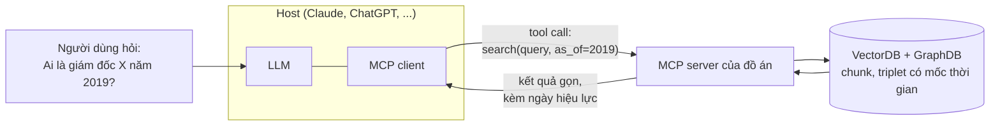
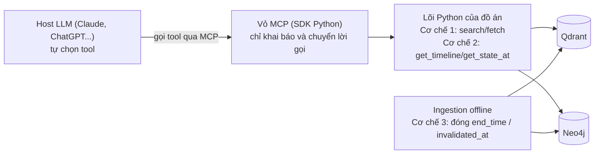

# MCP server và tool cho agent (Claude, ChatGPT, agent tự viết)

> Mục tiêu: hiểu cách "đưa tri thức time-aware cho agent" qua giao thức chuẩn, các lựa chọn công nghệ, và thiết kế tool. Ba từ nền: **LLM** (Large Language Model, mô hình ngôn ngữ lớn như Claude, GPT, Gemini: phần "bộ não" sinh văn bản); **agent** (chương trình dùng LLM để tự lập kế hoạch rồi gọi công cụ, thay vì chỉ trả lời một lượt); **tool** (công cụ, thực chất là một hàm có tên và tham số mà LLM được phép yêu cầu chạy, ví dụ hàm tra cứu). "Tri thức time-aware" là tri thức có gắn mốc thời gian, để trả lời được kiểu "năm 2019 thì ai đang giữ chức vụ này?".
> **Cảnh báo:** phần này thay đổi nhanh. Spec (đặc tả: tài liệu quy định chính thức) của MCP (Model Context Protocol, xem giải thích ở §1) đã có bản mới (2026-07-28) khác khá nhiều bản 2025-11-25 (tên bản đặt theo ngày phát hành); chính sách **connector** (mục kết nối cho phép chatbot dùng một dịch vụ bên ngoài, ví dụ một MCP server) của Claude/ChatGPT theo gói đăng ký và tính năng cũng biến động. Kiểm tra tài liệu chính thức trước khi chốt.

## 1. MCP là gì

### MCP là gì, nói bằng ví dụ đời thường

Hình dung bạn hỏi chatbot: "Ai là giám đốc công ty X vào năm 2019?". Chatbot không thuộc lòng mọi thứ; nó cần **tra cứu trong một kho tri thức** (ở đồ án này là kho có gắn mốc thời gian). Mỗi chatbot (Claude, ChatGPT, Gemini...) lại có cách nối với kho riêng, giống như mỗi hãng điện thoại ngày xưa dùng một loại sạc riêng. **MCP (Model Context Protocol)** là "ổ cắm chuẩn" kiểu USB-C: kho tri thức chỉ cần làm một lần theo chuẩn MCP, mọi chatbot hiểu chuẩn này đều cắm vào dùng được. Một cách ví khác: kho tri thức là thư viện, **MCP server** là thủ thư, MCP là mẫu phiếu yêu cầu chung; chatbot nào điền đúng mẫu phiếu cũng được thủ thư phục vụ.

Ba vai trong MCP:

- **Host** (ứng dụng chủ): ứng dụng người dùng đang mở và có LLM bên trong, ví dụ Claude Desktop, Claude Code, ChatGPT.
- **Client** (MCP client): phần mềm nhỏ nằm trong host, lo việc nói chuyện với một server theo đúng giao thức. Người dùng thường không thấy nó, nên nhiều tài liệu gộp "client/host" làm một.
- **Server** (MCP server): chương trình của đồ án, đứng trước dữ liệu và chỉ phơi ra một số chức năng có tên rõ ràng.

Luồng chạy: (1) người dùng hỏi; (2) LLM thấy danh sách tool mà server cung cấp, tự thấy cần tra cứu nên tạo một **tool call** (yêu cầu gọi tool kèm tham số); (3) client chuyển yêu cầu cho server, server truy vấn dữ liệu rồi trả kết quả; (4) LLM đọc kết quả và viết câu trả lời. LLM không chạm trực tiếp vào cơ sở dữ liệu; server giữ quyền kiểm soát (ví dụ lọc theo thời gian). **VectorDB** (cơ sở dữ liệu vector) lưu đoạn văn dưới dạng dãy số để tìm theo ý nghĩa; **GraphDB** (cơ sở dữ liệu đồ thị) lưu thực thể và quan hệ giữa chúng; **triplet** là một bộ ba (chủ thể, quan hệ, đối tượng), ví dụ (Ông A, bị bắt, 2024).

Về mặt kỹ thuật, MCP dùng **JSON-RPC** (RPC là Remote Procedure Call, gọi hàm từ xa; JSON là định dạng văn bản có cấu trúc dạng `{"khóa": giá trị}`): client gửi một tin JSON kiểu "hãy chạy hàm này với tham số này" và nhận lại kết quả cũng ở dạng JSON. Server có thể phơi ra ba loại thứ (gọi là *primitive*, thành phần cơ bản của giao thức):

| Primitive | Ai điều khiển | Dùng cho | Trong bài toán này |
|---|---|---|---|
| **Tools** | Model quyết định gọi | Hành động / truy vấn có tham số | `search`, `get_timeline`, `fetch` |
| **Resources** | Ứng dụng/người dùng chọn đưa vào ngữ cảnh | Dữ liệu đọc được theo URI | Một trang entity, một bundle OKF, một chunk |
| **Prompts** | Người dùng gọi | Mẫu lời nhắc | "Tóm tắt dòng thời gian của X" |

Giải thích từng loại bằng ví dụ time-aware:

- **Tools** giống nút "tra cứu" mà LLM tự bấm khi thấy cần. Người dùng hỏi "Chức vụ của ông A năm 2019 là gì?" thì LLM tự gọi `temporal_search` (tìm có xét thời gian) với `as_of=2019-12-31`. Đây là loại quan trọng nhất của đồ án vì mọi chức năng cốt lõi đều phơi ra dưới dạng tool.
- **Resources** giống tài liệu đính kèm: có địa chỉ cố định (URI), do ứng dụng hoặc người dùng chọn đưa vào cuộc trò chuyện chứ LLM không tự gọi. Ví dụ người dùng đính kèm trang "Công ty X" gom toàn bộ lịch sử chức vụ để LLM đọc.
- **Prompts** giống mẫu câu có sẵn trong menu: người dùng chọn "Tóm tắt dòng thời gian của X", điền X, ứng dụng ghép thành lời nhắc hoàn chỉnh gửi cho LLM.

Giải thích nhanh các từ trong bảng: **URI** (Uniform Resource Identifier, chuỗi định danh tài nguyên; địa chỉ web URL là một loại URI); **entity** (thực thể: một người, công ty, điều luật... được nhắc tới trong tri thức); **chunk** (một đoạn văn bản được cắt ra để lưu và tìm kiếm); **OKF** (Open Knowledge Format, định dạng mở lưu tri thức thành thư mục các file markdown, mỗi file có một khối YAML ở đầu ghi metadata), **bundle OKF** là một thư mục như vậy; `get_chunk` lấy nguyên văn một chunk theo id.

**Transport** (cách thức truyền tin giữa client và server) có hai kiểu chính. **stdio** (standard input/output, đầu vào/ra chuẩn của một tiến trình): host khởi chạy server như một chương trình con trên cùng máy và hai bên trao đổi qua ống dẫn văn bản, hợp cho chạy cục bộ. **Streamable HTTP**: server chạy như một dịch vụ web, client gọi qua HTTP (giao thức web thông thường); có từ bản 2025-03-26, thay kiểu cũ HTTP+SSE. **SSE** (Server-Sent Events) là kênh HTTP một chiều để server liên tục đẩy dữ liệu về client.

## 2. Thay đổi lớn ở bản mới nhất (2026-07-28, đọc từ changelog chính thức)

- **Stateless** (server không nhớ gì giữa hai lần gọi): bỏ handshake `initialize`; bỏ `Mcp-Session-Id`. Mỗi request mang phiên bản + capability trong `_meta`; thêm `server/discover`. Server cần trạng thái giữa các lần gọi thì dùng *handle do server cấp* truyền như tham số tool.
- Danh sách `tools/list`... **không đổi theo kết nối**; phải có `ttlMs` và `cacheScope` để cache; nên trả tool theo **thứ tự xác định** (tốt cho prompt cache).
- **Bỏ khả năng resume SSE**; request đứt giữa chừng phải gọi lại.
- **Tasks** (tác vụ dài) chuyển thành extension; **Multi Round-Trip Requests** (`input_required`) thay cho server chủ động gọi sampling/elicitation.
- **Deprecated:** Roots, Sampling, Logging; transport HTTP+SSE; **Dynamic Client Registration** (ưu tiên *Client ID Metadata Documents*).
- Auth (xác thực và ủy quyền: kiểm tra "bạn là ai, được làm gì"): kiểm tra tham số `iss` (RFC 9207), credential gắn với authorization server cấp.

Giải thích nhanh các từ ở §2:

- **Request** là một lần client gửi yêu cầu cho server. **Session** (phiên) là cuộc làm việc liên tục giữa client và server, trong đó server nhớ client là ai và hai bên đã nói gì. Server stateless thì mỗi request tự mang đủ thông tin, giống mỗi lần gọi món là một phiếu độc lập.
- **Handshake** là bước "chào hỏi" lúc mới kết nối để hai bên thỏa thuận phiên bản và khả năng (`initialize`); `Mcp-Session-Id` là mã định danh phiên trong bản cũ. **Capability** là khả năng mà một bên hỗ trợ. `_meta` là phần thông tin kèm theo (metadata) của request. `server/discover` là lệnh để client hỏi thông tin của server (theo tên gọi).
- **Handle** là mã do server cấp để các lần gọi sau trỏ lại đúng trạng thái cũ, giống số thứ tự lấy ở phòng khám: server không nhớ bạn, nhưng bạn đưa số thì nó biết phải tìm gì.
- `tools/list` là yêu cầu hỏi server có những tool nào. **Cache** là lưu tạm kết quả để khỏi hỏi lại; `ttlMs` (time to live, thời gian sống tính bằng mili giây) và `cacheScope` (phạm vi dùng chung bản lưu tạm) điều khiển việc này. **Prompt cache** là cơ chế nhà cung cấp LLM lưu tạm phần đầu giống nhau của lời nhắc để rẻ và nhanh hơn, nên thứ tự tool ổn định thì tận dụng được.
- **Resume SSE** là nối lại luồng SSE đã đứt để nhận phần còn thiếu. **Tasks** là cơ chế cho tác vụ chạy lâu; **extension** là phần mở rộng tùy chọn nằm ngoài lõi spec. **Multi Round-Trip Requests**: khi server cần thêm thông tin, nó trả `input_required` và client gọi lại kèm thông tin đó. **Sampling** (server nhờ LLM của host sinh văn bản) và **elicitation** (server hỏi thêm người dùng) là hai cách server chủ động gọi ngược về client; **Roots** (host báo cho server biết thư mục nào được phép truy cập) và **Logging** (server gửi nhật ký chạy) là hai tính năng khác. **Deprecated** nghĩa là không còn khuyến khích dùng và sẽ bị bỏ dần.
- **OAuth** là chuẩn ủy quyền cho phép ứng dụng truy cập dịch vụ thay người dùng mà không lộ mật khẩu. **Authorization server** là máy chủ cấp quyền (cấp token, tức chuỗi mã chứng minh được phép). **Dynamic Client Registration (DCR)**: ứng dụng client tự đăng ký với authorization server ngay lúc chạy; **Client ID Metadata Documents** là cách thay thế, trong đó client dùng một URL làm định danh và URL đó trỏ tới tài liệu mô tả chính nó. `iss` (issuer, bên cấp quyền) là tham số cho biết token do ai cấp, kiểm tra để khỏi nhầm máy chủ; **RFC 9207** là tài liệu chuẩn Internet (RFC: Request for Comments) quy định việc này.

Ý nghĩa **[suy luận]**: server stateless, chỉ đọc (read-only: chỉ trả dữ liệu, không sửa dữ liệu) như một kho tri thức hợp rất tốt với mô hình mới (không cần phiên). Tuy nhiên SDK (Software Development Kit, bộ thư viện lập trình sẵn để viết server/client MCP) và client thực tế có thể chưa theo kịp bản mới → thiết kế nên chạy được với cả bản 2025-11-25.

## 3. Kết nối từ Claude

- **Custom connector** (kết nối tùy chỉnh: người dùng tự thêm một MCP server vào chatbot) cho **remote MCP** (server chạy trên Internet, không phải trên máy người dùng) có trên Claude (web), Cowork (tên một sản phẩm Claude theo trang Claude Help, chưa tìm hiểu thêm), Claude Desktop, ở các gói đăng ký Free/Pro/Max/Team/Enterprise, **đang beta** (bản thử nghiệm); thêm bằng URL server, tùy chọn khai báo thêm Client ID/Secret của OAuth (cặp mã định danh và mã bí mật của ứng dụng client; OAuth xem §2) ([Claude Help](https://support.claude.com/en/articles/11175166)).
- Kết nối đi **từ cloud Anthropic**, nên server phải là **HTTPS công khai** (địa chỉ web có mã hóa mà ai trên Internet cũng truy cập được); server nằm sau VPN (mạng riêng ảo, chỉ truy cập được từ bên trong) không dùng được. Khi phát triển trên máy cá nhân cần **tunnel** (đường hầm: công cụ như ngrok, Cloudflare Tunnel tạo một địa chỉ công khai trỏ về máy mình).
- Có báo lỗi người dùng về OAuth/DCR (xem §2) trong connector claude.ai (các issue, tức mục báo lỗi, trên GitHub, **chưa kiểm**).
- **Claude Code** (công cụ lập trình của Anthropic chạy trong terminal) nối server bằng lệnh `claude mcp add --transport http ...`; stdio dùng cho server cục bộ. Một báo cáo cho thấy Claude Code có thể dùng được server mà connector claude.ai lỗi **[chưa kiểm]**.

## 4. Kết nối từ ChatGPT

- Dùng **custom connector/app MCP**, server phải remote. Nguồn thứ cấp: trước đây connector cần hai tool tên chính xác **`search`** và **`fetch`** (bắt buộc cho **deep research**, chế độ ChatGPT tự tra cứu nhiều bước rồi viết báo cáo); **Developer Mode** (chế độ dành cho nhà phát triển) mới cho phép tool tùy ý ở chế độ chat. Ngay cả ở Developer Mode, deep research chỉ dùng `search`/`fetch`.
- Quyền theo gói (Plus/Pro/Business/Enterprise/Edu) và mức đọc/ghi **các nguồn mâu thuẫn nhau** → **chưa chốt được**, phải kiểm tra trang chính thức của OpenAI. Tài liệu chính thức của OpenAI không nằm trong kết quả tìm được.
- Có báo cáo cộng đồng: đổi tên tool đúng thành `search`/`fetch` thì tool mới hiện ra **[forum, chưa kiểm]**.

## 5. Thiết kế tool cho đồ án (đề xuất, **[suy luận]**)

Ánh xạ thẳng thiết kế hiện tại sang tool, đồng thời tương thích quy ước `search`/`fetch` của ChatGPT:

| Tool | Tham số chính | Làm gì | Ghi chú |
|---|---|---|---|
| `search` | `query`, tùy chọn `as_of` | Alias của temporal retrieval: trả danh sách `id`, tiêu đề, đoạn trích, ngày hiệu lực | `as_of` mặc định = `T_now` của server; đảm bảo lọc `start_time ≤ as_of` |
| `fetch` | `id` | Trả toàn văn chunk (Boomerang) kèm `start_time`, `end_time`, `invalidated_at`, nguồn | Đúng vai trò "GET chunk WHERE id" |
| `get_timeline` | `entity`, `from`, `to` | Trả triplet nhẹ theo thứ tự thời gian | Mục tiêu < 1K token |
| `get_state_at` | `entity`, `as_of` | Trạng thái hiệu lực tại một mốc | Thể hiện rõ cờ `invalidated` |
| `list_changes` | `since` | Thay đổi gần đây (kiểu `log.md`) | Phục vụ Temporal Freshness (xem giải thích dưới bảng) |

Giải thích nhanh các từ trong bảng:

- **Alias**: tên gọi khác. `search` chỉ là tên gọi theo quy ước ChatGPT cho chức năng **temporal retrieval** (Cơ chế 1 của đồ án: truy xuất theo thời gian, trả lời câu hỏi về một mốc cụ thể).
- `as_of` nghĩa là "tính đến ngày": chỉ xét thông tin đã tồn tại tại mốc đó. `T_now` là ngày giờ hiện tại theo đồng hồ của server, dùng làm mặc định khi người dùng không nói mốc nào.
- `start_time` là lúc thông tin bắt đầu có hiệu lực; `end_time` là lúc hết hiệu lực (để trống nghĩa là còn hiệu lực), dùng cho việc **tiến hóa** (sự việc từng đúng rồi thay đổi, ví dụ nhân viên lên giám đốc); `invalidated_at` đánh dấu thông tin **sai ngay từ đầu** (ví dụ tin đồn bị đính chính), nên cờ `invalidated` trong kết quả báo cho agent biết điều đó. Hai trường này khác nhau có chủ đích: cái đầu vẫn trả về khi hỏi chuyện quá khứ, cái sau thì bị lọc đi hoặc kèm cảnh báo.
- **Boomerang**: nút trong đồ thị chỉ giữ triplet gọn kèm một con trỏ `Chunk_ID` quay về cơ sở dữ liệu vector để lấy văn bản gốc khi cần (ném đi gọn, lấy về đầy đủ). `fetch` đóng vai "lấy chunk theo id" đó.
- **Triplet** là bộ ba (chủ thể, quan hệ, đối tượng), ví dụ (Ông A, bị bắt, 2024); `get_timeline` trả một chuỗi triplet theo thứ tự thời gian thay vì cả đoạn văn, nên rất ít token (**token** là đơn vị đếm chữ của LLM, mỗi từ hoặc mảnh từ là một hay vài token).
- `list_changes` với `since` ("từ thời điểm nào") trả danh sách thay đổi gần đây, kiểu một file nhật ký tên `log.md`.
- **Temporal Freshness** (độ tươi mới theo thời gian): hệ thống cập nhật tri thức mới nhanh và đúng đến mức nào.

**Ba cơ chế ánh xạ vào tool nào, và chạy ở đâu [suy luận].**

| Cơ chế của đồ án | Tool | Thực thi ở đâu |
|---|---|---|
| **1. Temporal Retrieval** | `search` (tham số `as_of`), `fetch` | Lõi Python của đồ án: lọc cứng `start_time <= as_of` trong Qdrant, rồi chấm lại thứ hạng |
| **2. Timeline Summarization** | `get_timeline`, `get_state_at` | Lõi Python: tìm nút khởi đầu ở Qdrant, đi qua đồ thị ở Neo4j, trả triplet; cần chi tiết thì `fetch` (Boomerang) |
| **3. Conflict Resolution** | Không có tool riêng | Chạy ở **Ingestion** (offline): đóng `end_time` (Evolution) hoặc đặt `invalidated_at` (Falsehood). Kết quả lộ ra qua cờ `invalidated` trong đầu ra của các tool trên |

Nghĩa là MCP chỉ là **vỏ**; logic của các cơ chế nằm ở lõi phía sau. Việc chọn `search` hay `get_timeline` cho từng câu hỏi (vai trò của Query Profiler/Routing trong thiết kế gốc) do **host LLM** làm khi dùng cách 1 ở `12` §5, hoặc do server tự làm nếu muốn một tool `ask` duy nhất kèm Profiler bên trong (cách 2/3).

Nguyên tắc:
- **Tool ít, rõ**: mô tả ngắn gọn nói *khi nào dùng*; tên mô tả hành động. Đầu ra gọn để tiết kiệm **context** (ngữ cảnh: toàn bộ chữ mà LLM nhìn thấy trong một lượt, có giới hạn độ dài; LLM trả lời theo kết quả tool nên rất nhạy với độ dài).
- **Thời gian là tham số tường minh** (`as_of`) thay vì để model tự lọc; đồng thời server tự quy đổi (resolve) thời gian tương đối như "tuần trước", "hiện nay" ra ngày tuyệt đối bằng `T_now` (đúng bất biến "relative time"). Không trả dữ liệu sau `as_of` (no future leakage: không để lộ thông tin xảy ra sau mốc được hỏi, vì lúc đó chưa thể biết) làm ràng buộc **phía server**, không dựa vào việc model tự giữ lời nhắc.
- Đầu ra có **structured content** (dữ liệu có cấu trúc dạng JSON để chương trình đọc chính xác) + văn bản ngắn; chỉ đọc (read-only) nên không cần hành động ghi qua MCP, giảm rủi ro an toàn.
- Chống prompt injection (nhét chỉ thị độc hại vào nội dung để LLM làm theo): nội dung chunk là dữ liệu không đáng tin; không đưa chỉ thị từ chunk vào tool description (mô tả tool: đoạn chữ LLM đọc để biết tool làm gì).
- Ghi (nạp tài liệu) tách khỏi MCP đọc: là pipeline (chuỗi bước xử lý nối tiếp) Ingestion offline như thiết kế; Ingestion là giai đoạn nạp tài liệu vào hệ thống (cắt chunk, gắn mốc thời gian, lưu vào cơ sở dữ liệu), chạy trước chứ không chạy lúc người dùng hỏi.

## 6. Lựa chọn công nghệ xây server

| Lựa chọn | Ngôn ngữ | Ưu | Nhược |
|---|---|---|---|
| **MCP Python SDK** (đã gộp FastMCP 1.0) | Python | Chính thức, bám spec | Ít tiện nghi hơn framework |
| **FastMCP** (Prefect) | Python | Khai báo tool bằng type hint + docstring, ít boilerplate | Framework bên ngoài; theo kịp spec phụ thuộc người duy trì |
| **TypeScript SDK** (`@modelcontextprotocol/sdk`) | TS | Chính thức, hệ sinh thái web | Mức thấp, tự lo transport/phiên |

Giải thích nhanh: **SDK** là bộ thư viện lập trình sẵn (ở đây để viết server MCP mà khỏi tự cài giao thức). **Framework** là khung sườn đã dựng sẵn để bạn chỉ điền phần riêng. **FastMCP** là framework Python rút gọn việc viết MCP server; **Prefect** là tổ chức duy trì bản FastMCP hiện hành. **Type hint** (chú thích kiểu dữ liệu của tham số, như `as_of: str`) và **docstring** (đoạn mô tả đầu hàm) được FastMCP đọc để tự sinh khai báo tool. **Boilerplate** là đoạn code lặp đi lặp lại, nhàm chán. **TS** là TypeScript, ngôn ngữ JavaScript có thêm kiểu dữ liệu. "Tự lo transport/phiên" nghĩa là tự viết phần truyền tin và quản lý phiên (xem §1, §2).

Với đồ án **[suy luận]**: phần retrieval (tìm kiếm) hiện đã viết bằng Python và dùng **Qdrant** (một cơ sở dữ liệu vector mã nguồn mở: lưu đoạn văn dưới dạng dãy số để tìm theo ý nghĩa), nên dùng Python, SDK chính thức hoặc FastMCP, để bọc (gói lại) các hàm retrieval sẵn có thành tool. Nguồn so sánh ở trên chủ yếu là blog framework; **cần xác nhận trên repo chính thức** (kho mã nguồn trên GitHub).

**Đo thực tế trên GitHub API ngày 31/10/2026:** `modelcontextprotocol/python-sdk` có khoảng 24,7 nghìn sao, giấy phép MIT, bản mới nhất v2.3.0 (02/10/2026), vẫn đang cập nhật; `PrefectHQ/fastmcp` có khoảng 28,2 nghìn sao, Apache-2.0, bản mới nhất v4.1.4 (26/10/2026), vẫn đang cập nhật. Số sao chỉ phản ánh mức quan tâm, không phải độ ổn định. Về uy tín: SDK nằm trong tổ chức `modelcontextprotocol` (nơi quản lý spec) nên bám spec sớm nhất; FastMCP là dự án bên thứ ba nhưng được dùng rộng.

## 7. MCP so với các cách "đưa tri thức cho agent" khác

| Cách | Ưu | Nhược |
|---|---|---|
| **MCP server** | Chuẩn chung, dùng cho nhiều client; điều khiển được truy vấn phía server (lọc thời gian) | Cần đặt server công khai trên Internet cho Claude.ai/ChatGPT; thêm xác thực (auth) |
| **Function calling riêng của từng nhà** | Đơn giản khi chỉ dùng một model | Phải viết lại cho từng nền tảng |
| **File markdown/OKF cho agent đọc thẳng** (Claude Code đọc file, grep) | Không cần server; dễ kiểm tra | Không bảo đảm lọc thời gian; không kiểm soát quyền; scale kém |
| **API REST + OpenAPI** | Phổ biến | Không phải chuẩn gắn với model; model phải làm quen |

Giải thích nhanh: **Function calling** là tính năng của từng nhà cung cấp LLM: LLM trả về một yêu cầu "gọi hàm này với tham số này", chương trình chạy hàm rồi đưa kết quả lại cho LLM; mỗi nhà (OpenAI, Google, Anthropic) khai báo hàm theo một kiểu hơi khác nhau. **grep** là lệnh tìm một chuỗi chữ trong nhiều file. "Scale kém" là khó mở rộng khi dữ liệu lớn. **API** (Application Programming Interface) là giao diện để chương trình này gọi chương trình khác; **REST** là kiểu API web gọi qua HTTP; **OpenAPI** là chuẩn mô tả API REST bằng JSON hoặc YAML.

## 8. Nguồn

- Spec MCP: [changelog bản mới nhất](https://modelcontextprotocol.io/specification/latest/changelog) (đã đọc trực tiếp); [index](https://modelcontextprotocol.io/llms.txt)
- [Claude Help — custom connectors](https://support.claude.com/en/articles/11175166) (qua kết quả search; chưa mở trực tiếp); issues: [claude-ai-mcp#402](https://github.com/anthropics/claude-ai-mcp/issues/402), [#212](https://github.com/anthropics/claude-ai-mcp/issues/212)
- ChatGPT: [FastMCP — ChatGPT integration](https://gofastmcp.com/integrations/chatgpt), [diễn đàn OpenAI](https://community.openai.com/t/chatgpt-only-uses-search-tool-in-mcp-server/1358796), [StackOne](https://docs.stackone.com/connect/agent-setup/chatgpt) (đều thứ cấp)
- SDK: [xmcp — so sánh framework](https://xmcp.dev/blog/xmcp-vs-fastmcp-vs-mcp-sdk) (blog đối thủ, thiên lệch)

## Tài liệu tham khảo (docs, git)

- **SDK / framework (git):** [modelcontextprotocol/python-sdk](https://github.com/modelcontextprotocol/python-sdk) (giấy phép MIT: mã nguồn mở, dùng tự do; Python 3.11+; hỗ trợ stdio, Streamable HTTP, SSE); [PrefectHQ/fastmcp](https://github.com/PrefectHQ/fastmcp) (giấy phép mã nguồn mở Apache-2.0, framework riêng, FastMCP 1.0 đã gộp vào SDK chính thức năm 2024)
- **Cổng (gateway: máy chủ trung gian gom nhiều server về một địa chỉ) và cầu nối (bridge: chương trình dịch từ giao thức này sang giao thức khác):** [OpenAI — remote MCP](https://developers.openai.com/api/docs/guides/tools-connectors-mcp); [LiteLLM MCP Gateway](https://docs.litellm.ai/docs/mcp); [open-webui/mcpo](https://github.com/open-webui/mcpo)
- **Bảo mật chính thức:** [Security Best Practices 2026-07-28](https://modelcontextprotocol.io/docs/2026-07-28/tutorials/security/security_best_practices.md)
- **Hướng triển khai đa LLM:** [`12`](12_Chatbot_vs_MCP_Server_Multi_LLM.md)
