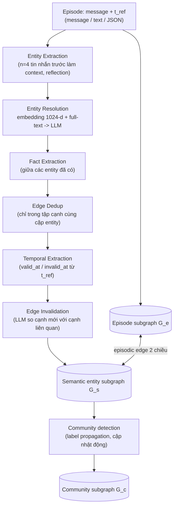
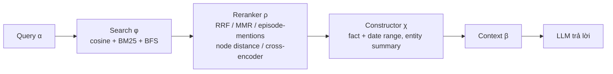

# Phân tích bài báo: Zep / Graphiti (2501.13956)

> Ghi chú đọc sâu, bổ sung cho mục Zep/Graphiti trong [`04_Agent_Memory_Systems.md`](04_Agent_Memory_Systems.md). Số liệu trong phần 1–5 lấy trực tiếp từ bản PDF v1 của paper (đã đọc từng trang). Phần nào lấy từ nguồn ngoài paper (mã nguồn Graphiti, bài viết bên thứ ba) được gắn nhãn rõ. Chỗ không chắc ghi "chưa rõ" hoặc "[không chắc]".

## 1. Thông tin chung & Tài nguyên

- **Tiêu đề:** Zep: A Temporal Knowledge Graph Architecture for Agent Memory
- **Tác giả:** Preston Rasmussen, Pavlo Paliychuk, Travis Beauvais, Jack Ryan, Daniel Chalef (Zep AI). Đây là paper của công ty, không phải peer-reviewed (chưa qua phản biện của các chuyên gia độc lập trước khi công bố).
- **Mã arXiv:** [2501.13956](https://arxiv.org/abs/2501.13956) (v1, ngày 20/01/2025, cs.CL)
- **Mã nguồn:** [Graphiti (getzep/graphiti)](https://github.com/getzep/graphiti) là engine mã nguồn mở; Zep là dịch vụ thương mại xây trên Graphiti. Paper nói notebook thí nghiệm sẽ công bố trên GitHub (URL cụ thể: chưa rõ).
- **Dataset đánh giá:** DMR (Deep Memory Retrieval, bộ câu hỏi kiểm tra bộ nhớ hội thoại do dự án MemGPT đưa ra, gồm 500 hội thoại con lấy từ Multi-Session Chat là tập hội thoại nhiều phiên) và LongMemEval_s (bộ benchmark đo trí nhớ dài hạn của chatbot qua nhiều phiên; mỗi hội thoại dài khoảng 115K token, token là đơn vị cắt nhỏ văn bản mà LLM đọc). MemGPT là một hệ thống bộ nhớ cho agent, được Zep dùng làm đối chứng.
- **Lĩnh vực:** Agent memory (bộ nhớ dài hạn cho chương trình AI) dạng Temporal Knowledge Graph (đồ thị tri thức có gắn thời gian: tri thức lưu thành các nút và cạnh, mỗi cạnh có mốc thời gian), bi-temporal (theo dõi hai trục thời gian: lúc sự việc đúng ngoài đời và lúc hệ thống biết về nó), hội thoại + dữ liệu nghiệp vụ.
- **Mức độ liên quan:** rất cao cho Cơ chế 3 (đóng/vô hiệu hóa fact cũ), cao cho Cơ chế 2 (graph + mốc thời gian), vừa cho Cơ chế 1 (paper không có point-in-time query thực nghiệm).

> **Giải thích nhanh các khái niệm của đồ án dùng trong file này** (xem thiết kế đầy đủ ở `docs/scope/01_PROJECT_SCOPE.md`):
> - **Fact:** một câu khẳng định về thế giới, ví dụ "An làm ở công ty X".
> - **Cơ chế 1 (Temporal Retrieval):** trả lời câu hỏi "tại thời điểm D thì sự thật là gì", chỉ dùng cơ sở dữ liệu vector. **Cơ chế 2 (Timeline Summarization):** tóm tắt chuỗi sự kiện theo thời gian, đi qua đồ thị. **Cơ chế 3 (Conflict Resolution):** xử lý khi thông tin mới mâu thuẫn thông tin cũ.
> - **Point-in-time query:** câu hỏi gắn với một thời điểm cụ thể ("năm 2020 ai là giám đốc?").
> - **`start_time` / `end_time`:** lúc fact bắt đầu và hết đúng ngoài đời (`end_time` rỗng nghĩa là vẫn đúng). **`invalidated_at`:** đánh dấu thông tin sai ngay từ đầu.
> - **Evolution (tiến hóa):** điều từng đúng rồi đổi (nhân viên lên giám đốc), đóng lại bằng `end_time`, vẫn trả lời được câu hỏi về quá khứ. **Falsehood (sai sự thật):** điều vốn sai từ đầu (tin đồn, bản tin bị đính chính), đánh dấu bằng `invalidated_at`.
> - **`T_req` / `T_now`:** `T_req` là thời điểm mà câu hỏi nhắm tới; `T_now` là giờ hiện tại của máy chủ, dùng để đổi "tuần trước", "hiện nay" thành ngày tuyệt đối.
> - **Boomerang:** mẫu thiết kế trong đó đồ thị chỉ giữ bộ ba gọn nhẹ, kèm `Chunk_ID` là mã trỏ về đoạn văn gốc lưu ở cơ sở dữ liệu vector, cần thì "ném" ngược về lấy văn bản.

## 2. Vấn đề giải quyết

Paper lập luận RAG (Retrieval-Augmented Generation, tìm đoạn tài liệu liên quan rồi đưa cho LLM đọc để trả lời) hiện tại chủ yếu cho kho tài liệu tĩnh, trong khi agent (chương trình dùng LLM để tự lập kế hoạch và gọi công cụ) cần bộ nhớ từ dữ liệu liên tục thay đổi (hội thoại với người dùng + dữ liệu nghiệp vụ). Đưa nguyên lịch sử vào context (phần văn bản tối đa mà LLM đọc được trong một lần trả lời, còn gọi là context window) vừa tốn token vừa suy giảm chất lượng khi hội thoại dài. Yêu cầu: (a) tích hợp dữ liệu mới **không mất thông tin (non-lossy)**, (b) giữ **dòng thời gian của fact và khoảng hiệu lực**, (c) latency (độ trễ từ lúc hỏi đến lúc có câu trả lời) thấp cho môi trường production (hệ thống chạy thật cho người dùng thật, không phải thử nghiệm).

**Ví dụ (tự dựng, minh họa):** tháng 3 người dùng nói "tôi làm ở công ty X". Tháng 9 nói "tuần trước tôi chuyển sang công ty Y". Bộ nhớ phải (1) quy "tuần trước" thành ngày tuyệt đối dựa trên thời điểm gửi tin nhắn, (2) không xóa fact "làm ở X" mà đóng khoảng hiệu lực của nó, (3) khi hỏi "năm ngoái bạn làm ở đâu" vẫn trả lời được.

## 3. Cơ chế cốt lõi

### 3.1. Đồ thị 3 tầng

Đồ thị `G = (N, E, φ)` gồm 3 subgraph (đồ thị con) phân cấp (theo paper). Ký hiệu: `N` là tập node (nút, mỗi nút là một "đối tượng" trong đồ thị), `E` là tập edge (cạnh, đường nối giữa hai nút, ở đây mỗi cạnh mang một fact), `φ` là hàm cho biết mỗi cạnh nối hai nút nào.

| Tầng | Ký hiệu | Node | Cạnh | Vai trò |
|---|---|---|---|---|
| **Episode subgraph** | `G_e` | Episode: dữ liệu thô (message, text hoặc JSON) | Episodic edge nối episode với entity được nhắc tới | Kho dữ liệu gốc, nguồn để trích entity/fact; không mất thông tin |
| **Semantic entity subgraph** | `G_s` | Entity (đã resolve) | Entity edge = "fact" giữa hai entity | Tri thức đã chắt lọc, mang 4 mốc thời gian |
| **Community subgraph** | `G_c` | Community: cụm entity liên kết chặt, kèm summary | Community edge nối community với entity thành viên | Cái nhìn tổng quát cấp cao |

**Giải thích nhanh ba tầng** (dùng ví dụ ở mục 2 và mục 3.3):
- **Episode** là một "lần ghi nhận" dữ liệu thô, ví dụ tin nhắn "tuần trước tôi chuyển sang công ty Y" gửi vào tháng 9.
- **Entity** là một đối tượng được nhắc tới (người, công ty, địa điểm...), ví dụ "người dùng", "công ty X", "công ty Y". Entity là node của tầng giữa.
- **Fact** là cạnh giữa hai entity, ví dụ (người dùng) -[WORKS_FOR]-> (công ty X), mang các mốc thời gian.
- **Community** là một nhóm entity liên quan chặt với nhau (ví dụ mọi entity về chủ đề công việc của một người), kèm một đoạn tóm tắt chung.
- Ba tầng nối với nhau: episode chỉ tới entity mà nó nhắc (episodic edge), entity nối nhau bằng fact, community gom các entity.

Paper liên hệ với episodic memory (trí nhớ về từng sự kiện đã trải qua) vs semantic memory (trí nhớ về kiến thức chung) trong tâm lý học, và với GraphRAG (RAG dùng đồ thị tri thức thay vì chỉ các đoạn văn rời rạc; phần community học theo hướng này), AriGraph (hệ thống bộ nhớ đồ thị cũng tách episode và semantic). Episode và cạnh dẫn xuất có **chỉ mục hai chiều**: từ fact truy ngược về episode nguồn (để trích dẫn), từ episode lấy ra entity/fact liên quan. Paper nói rõ tính năng này **không được đánh giá** trong thực nghiệm.



### 3.2. Ingest: Episode, entity, fact

Ingest (ingestion) là quá trình nạp dữ liệu mới vào đồ thị: đọc tin nhắn, trích entity và fact, rồi ghi vào graph. Mỗi bước dưới đây thường gọi LLM một lần.

**Episode.** Ba loại (message, text, JSON, tức dữ liệu có cấu trúc dạng khóa-giá trị); paper chỉ tập trung `message` = đoạn văn ngắn kèm actor phát ngôn (người hoặc bot nói câu đó). Mỗi message có **reference timestamp `t_ref`** (thời điểm tin nhắn được gửi, dùng làm mốc để đổi "tuần trước" thành ngày cụ thể).

**Entity extraction** (trích các đối tượng được nhắc tới). Xử lý message hiện tại cùng **n = 4** tin nhắn trước (hai lượt hội thoại đầy đủ) để hiểu ngữ cảnh. Người nói luôn được tự động trích thành entity. Dùng kỹ thuật **reflection** (lấy ý từ Reflexion: cho LLM tự rà lại kết quả của chính nó) để giảm hallucination (LLM bịa ra thông tin không có thật) và tăng độ phủ. Đồng thời sinh entity summary. Prompt ở phụ lục: luôn trích speaker làm node đầu tiên; không tạo node cho quan hệ/hành động; **không tạo node cho thông tin thời gian** (ngày/năm sẽ nằm trên cạnh); tên đầy đủ, tường minh.

**Entity resolution** (nhận ra hai cách gọi khác nhau là cùng một đối tượng, ví dụ "Alan Turing" và "A. Turing", để gộp thành một node). Embed (đổi văn bản thành một dãy số, gọi là vector, sao cho văn bản gần nghĩa có vector gần nhau) tên entity vào không gian **1024 chiều** (BGE-m3 theo mục 4, một mô hình embedding), tìm cosine (cosine similarity: thước đo độ gần nhau giữa hai vector, càng gần 1 càng giống nghĩa) trên node entity hiện có, đồng thời chạy **full-text search** (tìm theo từ khóa chữ) trên tên và summary (đoạn tóm tắt về entity) để lấy ứng viên. Ứng viên + context episode đưa qua LLM (Large Language Model, mô hình ngôn ngữ lớn như Claude, GPT, Gemini) với prompt resolution (trả `is_duplicate`, uuid node cũ, tên đầy đủ nhất). Nếu trùng thì sinh tên và summary cập nhật. Việc ghi vào graph dùng **Cypher query định sẵn** thay vì để LLM tự sinh query (để schema nhất quán, giảm hallucination). Ở đây Cypher là ngôn ngữ truy vấn đồ thị của Neo4j, còn Neo4j là một cơ sở dữ liệu đồ thị phổ biến (giống SQL là ngôn ngữ truy vấn của cơ sở dữ liệu bảng).

**Fact extraction.** Trích fact giữa các cặp entity đã resolve; mỗi fact có `relation_type` (nhãn loại quan hệ) dạng chữ hoa ngắn (ví dụ `WORKS_FOR`) kèm **fact dạng câu chi tiết**. Cùng một fact có thể được trích nhiều lần giữa các entity khác nhau, cho phép mô hình **hyper-edge** (fact đa entity, tức một fact nối hơn hai entity). Prompt yêu cầu "consider temporal aspects of relationships when relevant" (cân nhắc yếu tố thời gian của quan hệ khi cần). (Dòng đầu của đoạn mô tả fact bị cắt trong bản PDF đọc được, chi tiết đầy đủ: chưa rõ.)

**Edge deduplication** (dedup: loại bỏ cạnh trùng lặp, ví dụ hai câu "An làm ở X" và "An đang làm việc tại X" chỉ giữ một). Tương tự entity resolution (embedding + hybrid search, tức tìm kiếm kết hợp theo nghĩa của embedding và theo từ khóa BM25, thuật toán xếp hạng đếm mức trùng từ giữa hai văn bản, + LLM), nhưng tìm ứng viên **bị giới hạn trong các cạnh đang tồn tại giữa cùng cặp entity** với cạnh mới. Hai lợi ích paper nêu: tránh gộp nhầm cạnh giống nhau giữa các entity khác nhau, và giảm đáng kể chi phí tính. Prompt fact resolution: hai fact "không cần giống hệt, chỉ cần diễn đạt cùng thông tin".

### 3.3. Mô hình bi-temporal

Paper định nghĩa hai timeline:

- **Timeline `T`**: thứ tự **thời gian của sự kiện** (chronological ordering of events), mô hình hóa tính động của dữ liệu hội thoại. Hiểu đơn giản: đồng hồ của thế giới thật, "việc đó xảy ra khi nào".
- **Timeline `T'`** (đọc là "T phẩy"): thứ tự **giao dịch** (transactional order of ingestion), chức năng audit (kiểm toán, truy vết ai ghi gì lúc nào) của cơ sở dữ liệu truyền thống. Hiểu đơn giản: đồng hồ của hệ thống, "hệ thống biết/ghi việc đó khi nào".

Bốn mốc trên cạnh fact:

| Trường (paper) | Thuộc timeline | Ý nghĩa |
|---|---|---|
| `t'_created` (created_at) | `T'` | Lúc hệ thống tạo fact |
| `t'_expired` (expired_at) | `T'` | Lúc hệ thống ghi nhận fact bị vô hiệu |
| `t_valid` (valid_at) | `T` | Lúc quan hệ bắt đầu đúng ngoài đời |
| `t_invalid` (invalid_at) | `T` | Lúc quan hệ hết đúng ngoài đời |

(Lưu ý: paper dùng ký hiệu toán `t'_created`, `t'_expired`, `t_valid`, `t_invalid`; tên `created_at/expired_at/valid_at/invalid_at` là tên trường trong prompt/mã nguồn Graphiti. Prompt phụ lục chỉ nêu `valid_at`, `invalid_at`.)

**Ví dụ minh họa bi-temporal** (dùng lại tình huống ở mục 2, ngày cụ thể là giả định để dễ hình dung): người dùng nhắn vào tháng 9 "tuần trước tôi chuyển sang công ty Y". Fact "làm ở X" có `t_valid` = tháng 3, và sẽ được đóng bằng `t_invalid` = ngày chuyển việc ngoài đời (khoảng cuối tháng 8), đó là trục `T`. Còn `t'_expired` = tháng 9, lúc hệ thống đọc tin nhắn và nhận ra fact cũ hết đúng, đó là trục `T'`. Hai mốc này lệch nhau vì người dùng báo tin muộn; chỉ cần một trục thì không phân biệt được "việc xảy ra khi nào" với "hệ thống biết khi nào".

**Trích ngày tuyệt đối từ ngày tương đối.** Prompt Temporal Extraction nhận `<REFERENCE TIMESTAMP>` = `t_ref` của message, cộng fact vừa trích. Quy tắc chính trong prompt (phụ lục 6.1.5):
- Chỉ trích mốc thời gian **nếu nó là một phần của fact**; không suy ngày từ các sự kiện liên quan ("Do not infer dates from related events").
- Mốc tương đối ("10 years ago", "2 mins ago") được tính ra ngày thật dựa trên reference timestamp.
- Fact viết ở thì hiện tại thì `valid_at` = reference timestamp.
- Quan hệ không kéo dài nhưng xác định được ngày thì chỉ đặt `valid_at`.
- Chỉ có ngày không có giờ: dùng 00:00:00; chỉ có năm: 1 tháng 1 của năm đó; luôn kèm múi giờ (Z nếu không rõ); định dạng ISO 8601.
- Không có thông tin thì để `null`.

Ví dụ trong paper: "Alan Turing sinh ngày 23/06/1912" (tuyệt đối) và "I started my new job two weeks ago" (tương đối).

**Vô hiệu hóa cạnh (edge invalidation).** Theo paper (mục 2.2.3): LLM so sánh cạnh mới với các cạnh **liên quan ngữ nghĩa** đang có để tìm mâu thuẫn. Khi phát hiện mâu thuẫn **trùng lặp về thời gian (temporally overlapping)**, hệ thống **đặt `t_invalid` của cạnh cũ bằng `t_valid` của cạnh làm vô hiệu**. "Following the transactional timeline T', Graphiti consistently prioritizes new information" tức là **tiêu chí chọn cạnh bị vô hiệu là "cạnh mới thắng", theo thứ tự nạp (`T'`)**, không phải theo độ tin cậy nguồn hay theo độ chắc chắn nội dung. Paper không mô tả tiêu chí nào khác (không có credibility, không có phân loại loại mâu thuẫn).

Chi tiết bổ sung từ **mã nguồn Graphiti** (`edge_operations.py`, đọc qua tóm tắt công cụ, **không phải từ paper**, có thể thay đổi theo phiên bản):
- LLM trả về danh sách `contradicted_facts` (chỉ số cạnh bị mâu thuẫn) cùng với bước dedup.
- Với mỗi cạnh ứng viên: nếu khoảng hiệu lực không giao nhau (cạnh cũ kết thúc trước khi cạnh mới bắt đầu, hoặc ngược lại) thì không làm gì. Nếu cạnh cũ bắt đầu sớm hơn cạnh mới thì `invalid_at(cũ) = valid_at(mới)` và `expired_at(cũ) = now` nếu chưa có.
- Trường hợp cạnh mới nạp muộn nhưng mô tả sự việc **bắt đầu trước** một cạnh đã có (nạp không theo thứ tự thời gian), chính cạnh mới bị đặt `invalid_at` = `valid_at` của cạnh sau. Đây là điều paper không nói rõ: có xử lý nạp lệch thứ tự.
- Do đó `expired_at` (trục `T'`) thực tế được ghi khi vô hiệu hóa, đồng thời `invalid_at` (trục `T`) được ghi. Trong **paper** mô tả chỉ nói `t'_expired` "monitor when facts are created or invalidated", không nói cơ chế gán chi tiết.

**Ví dụ edge invalidation** (cùng tình huống mục 2): cạnh cũ (người dùng)-[WORKS_FOR]->(công ty X) và cạnh mới (người dùng)-[WORKS_FOR]->(công ty Y) mâu thuẫn vì một người thường chỉ có một nơi làm chính tại một thời điểm. Hệ thống đặt `t_invalid` của cạnh X bằng `t_valid` của cạnh Y. Kết quả: X đúng trong khoảng [tháng 3, ngày chuyển], Y đúng từ ngày chuyển, không cạnh nào bị xóa. Ở đây "cạnh mới thắng" nghĩa là cạnh nạp sau được coi là đúng hơn.

**Điểm quan trọng:** không có xóa. Cạnh cũ vẫn ở trong graph với khoảng `[valid_at, invalid_at]`, nên lịch sử còn nguyên. Paper nói "maintaining both current relationship states and historical records of relationship evolution over time."

### 3.4. Community subgraph

Community detection là bài toán chia các node thành nhóm liên kết chặt. Paper dùng **label propagation** (thuật toán cho mỗi node nhận nhãn nhóm của đa số hàng xóm, lặp lại cho đến khi ổn định; không dùng Leiden là thuật toán chia nhóm khác mà GraphRAG dùng) vì dễ mở rộng động. Khi thêm entity mới `n_i`, hệ thống xem community của các neighbor (node kề với `n_i`), gán `n_i` vào community chiếm **đa số (plurality)**, rồi cập nhật summary và graph. Ví dụ: nếu 3 trong 4 entity kề với `n_i` thuộc nhóm "công việc" thì `n_i` vào nhóm "công việc". Cập nhật động dần lệch khỏi kết quả chạy lại hoàn toàn nên **cần refresh định kỳ**. Summary community theo kiểu map-reduce lặp (tóm tắt từng phần nhỏ trước rồi tóm tắt gộp các bản tóm tắt, như GraphRAG); ngoài ra sinh **community name** (từ khóa và chủ đề), embed để tìm cosine. Community **không được dùng/đánh giá riêng** trong thí nghiệm (paper nói chỉ dùng một phần chức năng).

### 3.5. Retrieval: `f(α) = χ(ρ(φ(α))) = β`

Retrieval là bước tìm lại thông tin liên quan khi người dùng hỏi. Ba bước dưới đây biến câu hỏi dạng chuỗi chữ `α` thành đoạn context dạng chuỗi chữ `β` để đưa cho LLM; hàm `f` là cả quy trình, ghép ba hàm `φ`, `ρ`, `χ` nối tiếp nhau:

1. **Search `φ`**: trả bộ ba (danh sách fact-edge, entity node, community node).
   - `φ_cos`: cosine similarity trên embedding; `φ_bm25`: full-text Okapi BM25 (thuật toán xếp hạng theo từ khóa, như đã nói ở mục 3.2: đếm mức trùng từ giữa câu hỏi và văn bản). Cả hai chạy trên Lucene (thư viện tìm kiếm full-text) có sẵn trong Neo4j. Trường tìm: fact (với edge), tên entity (với entity node), tên community (với community).
   - `φ_bfs`: breadth-first search (duyệt đồ thị theo từng lớp hàng xóm) trong `n` hop (bước nhảy qua một cạnh) quanh node; nhận **node làm tham số** (ví dụ dùng episode gần nhất làm seed để kéo entity/quan hệ vừa được nhắc).
   - Ba cách bù nhau: full-text bắt giống từ, cosine bắt giống nghĩa, BFS (Breadth-First Search, viết tắt đã giải thích ở trên) bắt giống **ngữ cảnh** (gần nhau trên graph).
2. **Reranker `ρ`** (bộ chấm lại thứ hạng các kết quả đã tìm được): tăng precision (độ chính xác: trong số kết quả trả về, bao nhiêu phần đúng) sau bước recall cao (bước đầu cố tình lấy rộng để ít bỏ sót). Gồm:
   - RRF (Reciprocal Rank Fusion, cách gộp nhiều bảng xếp hạng thành một bằng cách cộng 1 chia hạng: mục đứng hạng 1 ở nhiều bảng sẽ có điểm tổng cao);
   - MMR (Maximal Marginal Relevance, xếp hạng ưu tiên kết quả vừa liên quan vừa không trùng nhau);
   - **episode-mentions** (ưu tiên entity/fact được nhắc nhiều trong hội thoại);
   - **node distance** (xếp theo khoảng cách graph tới một centroid node, tức node trung tâm làm mốc);
   - **cross-encoder** (mô hình đọc cùng lúc câu hỏi và đoạn văn để chấm độ liên quan, chính xác hơn nhưng chậm hơn), trong paper là loại dùng LLM (đắt nhất, chất lượng cao nhất).
   Trong thí nghiệm paper dùng BGE-m3 cho rerank/embedding; chi tiết reranker nào thực sự bật trong từng thí nghiệm: **chưa rõ**.
3. **Constructor `χ`**: với edge trả `fact` + `t_valid`, `t_invalid`; với entity trả `name` + `summary`; với community trả `summary`.

**Mẫu context string (paper, mục 3):**

```
FACTS and ENTITIES represent relevant context to the current conversation.
These are the most relevant facts and their valid date ranges. If the fact is about an event, the event takes place during this time.
format: FACT (Date range: from - to)
<FACTS>
{facts}
</FACTS>
These are the most relevant entities
ENTITY_NAME: entity summary
<ENTITIES>
{entities}
</ENTITIES>
```

Nhận xét: mốc `valid_at/invalid_at` được đưa vào context dưới dạng "Date range: from - to"; paper **không** đưa `created_at/expired_at` vào context và **không** có bước lọc cứng theo thời điểm hỏi (không có `T_req`).



## 4. Kết quả chính

**Thiết lập (mục 4):** lấy **20 edge (fact) và entity node (summary) liên quan nhất** cho LongMemEval (với DMR paper nói top 10 node và edge; top-k nghĩa là lấy k kết quả xếp cao nhất). Embedding và rerank: **BGE-m3** (mô hình embedding đa ngôn ngữ mã nguồn mở). Xây graph: **gpt-4o-mini-2024-07-18** (gpt-4o-mini là phiên bản nhỏ, rẻ, nhanh của mô hình GPT-4o của OpenAI; chuỗi số phía sau là ngày phát hành bản cụ thể). Sinh câu trả lời: gpt-4o-mini-2024-07-18 và gpt-4o-2024-11-20; riêng DMR thêm **gpt-4-turbo-2024-04-09** để so MemGPT. LongMemEval chấm bằng GPT-4o với prompt riêng từng loại câu hỏi của benchmark gốc (tức dùng một LLM làm giám khảo, gọi là LLM judge). Thí nghiệm chạy 12/2024 đến 01/2025, client là laptop ở Boston, Zep host trên AWS us-west-2 (AWS là dịch vụ đám mây của Amazon, us-west-2 là một vùng máy chủ ở Mỹ; nên latency gồm cả độ trễ mạng; baseline, tức hệ thống đối chứng dùng để so sánh, thì không).

### 4.1. DMR (Bảng 1)

| Memory | Model | Score |
|---|---|---|
| Recursive Summarization (số của MemGPT) | gpt-4-turbo | 35.3% |
| Conversation Summaries | gpt-4-turbo | 78.6% |
| MemGPT (số báo cáo trong bài MemGPT) | gpt-4-turbo | 93.4% |
| Full-conversation | gpt-4-turbo | 94.4% |
| **Zep** | gpt-4-turbo | **94.8%** |
| Conversation Summaries | gpt-4o-mini | 88.0% |
| Full-conversation | gpt-4o-mini | 98.0% |
| **Zep** | gpt-4o-mini | **98.2%** |

Giải thích nhanh bảng: các dòng là các cách tổ chức bộ nhớ. Recursive Summarization và Conversation Summaries là tóm tắt hội thoại (liên tục tóm tắt lại hoặc tóm tắt theo phiên); Full-conversation là đưa toàn bộ hội thoại cho model đọc, không nén (cận trên dễ đạt vì hội thoại ngắn); Score là phần trăm câu trả lời đúng.

Chấm bằng LLM judge (LLM làm giám khảo) so với golden answer (đáp án chuẩn của bộ dữ liệu). Paper tự thừa nhận không tái hiện được MemGPT với gpt-4o-mini vì thiếu chi tiết phương pháp.

**Hạn chế DMR (do chính paper nêu):** mỗi hội thoại chỉ 60 tin nhắn (5 session, tối đa 12 message/session), vừa trong context window; chỉ câu hỏi single-turn (hỏi một lượt, không đối thoại tiếp) truy xuất fact, không kiểm tra hiểu bộ nhớ phức tạp; nhiều câu mơ hồ ("favorite drink to relax with", "weird hobby"); không đại diện cho use case doanh nghiệp. Full-context đạt 94.4–98.0% cho thấy benchmark không phân biệt được hệ thống bộ nhớ. Vì vậy, chênh lệch Zep vs full-conversation (0.4 và 0.2 điểm) **không có ý nghĩa thống kê** (nghĩa là chênh lệch nhỏ đến mức có thể chỉ do ngẫu nhiên; paper không báo khoảng tin cậy hay số lần chạy: chưa rõ).

### 4.2. LongMemEval_s (Bảng 2 và 3)

Dataset: ~115K token/hội thoại trung bình; 6 loại câu hỏi (phân bố không đều, xem bài gốc LongMemEval): single-session-user (hỏi điều người dùng nói trong một phiên), single-session-assistant (hỏi điều trợ lý đã nói trong một phiên), single-session-preference (hỏi sở thích người dùng), multi-session (cần ghép thông tin từ nhiều phiên), knowledge-update (thông tin được cập nhật giữa các phiên), temporal-reasoning (suy luận về thời gian). Session là một cuộc trò chuyện liền mạch; "4o-mini" ở các bảng dưới là gpt-4o-mini.

**Bảng 2 (tổng):**

| Memory | Model | Score | Latency | Latency IQR | Avg context tokens |
|---|---|---|---|---|---|
| Full-context | gpt-4o-mini | 55.4% | 31.3 s | 8.76 s | 115k |
| Zep | gpt-4o-mini | **63.8%** | **3.20 s** | 1.31 s | **1.6k** |
| Full-context | gpt-4o | 60.2% | 28.9 s | 6.01 s | 115k |
| Zep | gpt-4o | **71.2%** | **2.58 s** | 0.684 s | **1.6k** |

Giải thích nhanh bảng: Full-context là đưa toàn bộ hội thoại 115k token vào context; Latency là thời gian chờ trả lời; IQR (Interquartile Range, khoảng tứ phân vị) là độ rộng của nửa giữa các lần đo, càng nhỏ thì thời gian càng ổn định; Avg context tokens là số token trung bình đưa cho model.

Paper gọi mức cải thiện là 15.2% (mini) và 18.5% (gpt-4o), là mức **tăng tương đối**. Điểm tuyệt đối tăng 8.4 và 11.0 điểm; tính lại tương đối từ bảng cho 15.2% (mini, khớp) và khoảng 18.3% (gpt-4o, lệch nhẹ 18.5% có thể do làm tròn). Latency giảm khoảng 90% (31.3 s xuống 3.20 s; 28.9 s xuống 2.58 s), context giảm từ 115k xuống 1.6k token (khoảng 70 lần).

**Bảng 3 (theo loại câu hỏi):**

| Loại | Model | Full-context | Zep | Delta (paper) |
|---|---|---|---|---|
| single-session-preference | 4o-mini | 30.0% | 53.3% | +77.7% |
| single-session-assistant | 4o-mini | 81.8% | 75.0% | -9.06% |
| temporal-reasoning | 4o-mini | 36.5% | 54.1% | +48.2% |
| multi-session | 4o-mini | 40.6% | 47.4% | +16.7% |
| knowledge-update | 4o-mini | 76.9% | 74.4% | -3.36% |
| single-session-user | 4o-mini | 81.4% | 92.9% | +14.1% |
| single-session-preference | 4o | 20.0% | 56.7% | +184% |
| single-session-assistant | 4o | 94.6% | 80.4% | -17.7% |
| temporal-reasoning | 4o | 45.1% | 62.4% | +38.4% |
| multi-session | 4o | 44.3% | 57.9% | +30.7% |
| knowledge-update | 4o | 78.2% | 83.3% | +6.52% |
| single-session-user | 4o | 81.4% | 92.9% | +14.1% |

Quan sát của chúng tôi (không phải của paper):
- Hai dòng `single-session-user` của gpt-4o-mini và gpt-4o **giống hệt nhau** (81.4% / 92.9%); có thể là trùng hợp hoặc sao chép nhầm. **[không chắc]**
- Delta là mức thay đổi tương đối (so với điểm Full-context, không phải số điểm phần trăm chênh nhau). Tính lại: single-session-assistant 4o-mini là -8.3% (paper ghi -9.06%), 4o là -15.0% (paper ghi -17.7%); lệch nhẹ, nguyên nhân chưa rõ (có thể tính trên số chưa làm tròn).
- Cái đáng quan tâm cho đồ án: **temporal-reasoning** tăng 48.2% (4o-mini) và 38.4% (4o); **knowledge-update** với 4o-mini **giảm** 3.36% và với 4o chỉ tăng 6.52%. Tức là nhóm "cập nhật tri thức" (câu hỏi có đáp án đã đổi theo thời gian, ví dụ nơi làm việc mới), chính xác loại mà bi-temporal edge invalidation nhắm tới, là nhóm cải thiện yếu nhất. Paper chỉ nhận xét "may need additional development to improve less capable models' understanding of Zep's temporal data".
- Zep **thua** full-context ở single-session-assistant (câu hỏi về điều trợ lý đã nói); paper thừa nhận và chưa giải thích nguyên nhân (có thể vì extraction tập trung vào lời user: **[suy đoán]**).
- Tăng điểm đi cùng việc **mất thông tin** do nén: context 1.6k token so với 115k. Không có ablation (thí nghiệm bỏ từng thành phần để xem nó đóng góp bao nhiêu) tách đóng góp của từng thành phần (BFS vs cosine vs reranker, community, bi-temporal): chưa rõ/không có. Từ đây về sau, "extraction" nghĩa là bước trích entity/fact từ văn bản.

### 4.3. Hạn chế và tranh cãi

Do paper nêu:
- MemGPT không chạy được trên LongMemEval nên **không có so sánh trực tiếp** với SOTA (State Of The Art, hệ thống tốt nhất hiện biết) nào trên benchmark này, chỉ so full-context.
- Benchmark nghèo nàn (DMR quá dễ); chưa có benchmark đo khả năng tổng hợp hội thoại + dữ liệu nghiệp vụ có cấu trúc, đúng thế mạnh Zep.
- Hướng tương lai: fine-tune model extraction, ontology theo miền, tích hợp GraphRAG khác.

Nhận xét/tranh cãi ngoài paper (nguồn thứ cấp, **chưa kiểm chứng gốc**):
- Mem0 (một hệ thống bộ nhớ agent cạnh tranh với Zep) sau đó công bố paper so sánh trên LoCoMo (Long-term Conversational Memory, bộ benchmark hội thoại dài để đo trí nhớ của agent), trong đó Zep bị chấm khoảng 66%; Zep phản bác về phương pháp. Theo một bài tổng hợp, Zep tự công bố 75.14% sau khi hiệu chỉnh từ con số ~84% ban đầu (lỗi gộp câu hỏi category 5 vào tử số mà không vào mẫu số); điểm Zep trên LoCoMo dao động ~58 đến ~95 tùy ai chạy. (Chi tiết: [Memory Benchmark Scores: One Product, 58 to 95 on LoCoMo](https://braindetox.kr/en/posts/memory_benchmark_scores_reliability_2026.html), nguồn blog; **không phải paper Zep**, paper Zep không có số LoCoMo.)
- Cùng nguồn lưu ý file LongMemEval bị thay thế tháng 9/2025 nên điểm cũ và mới có thể không so sánh được **[chưa kiểm chứng]**.
- Khuyến nghị cho đồ án: coi các con số benchmark của vendor là **tham khảo định tính**; phù hợp với ghi chú ở `04_Agent_Memory_Systems.md`.
- Vấn đề thiết kế (nhận xét của chúng tôi): (1) invalidation phụ thuộc hoàn toàn vào LLM so sánh theo cặp, sai một lần là cạnh đúng bị đóng nhầm, paper không đo **false-invalidation rate** (tỉ lệ đóng nhầm cạnh vốn vẫn đúng); (2) tiêu chí "cạnh mới thắng" đúng cho thay đổi trạng thái nhưng sai khi bản tin mới là tin đồn/sai; (3) không có đánh giá riêng bi-temporal (không có câu hỏi point-in-time về quá khứ); (4) chi phí ingestion (chi phí nạp dữ liệu; nhiều lần gọi LLM cho mỗi message: extract entity, reflection, resolve, extract fact, dedup, temporal) không được báo cáo, chỉ báo latency truy xuất.

## 5. So sánh bi-temporal của Zep với thiết kế đồ án

### 5.1. Đối chiếu trường

| Khía cạnh | Zep / Graphiti | Đồ án (`design/01`, `02`, quyết định `09`) |
|---|---|---|
| Thời gian hiệu lực ngoài đời | `valid_at` .. `invalid_at` (timeline `T`) | `start_time` .. `end_time` |
| Thời gian hệ thống | `created_at`, `expired_at` (timeline `T'`) | Không có `ingested_at`/`created_at` ở cấp truy vấn; quyết định `09` thêm `first_seen`, `last_seen` (hướng gần `T'` nhưng không đủ để hỏi "tại ngày D hệ thống biết gì") |
| "Hết đúng" | Một cơ chế duy nhất: đặt `invalid_at` (kèm `expired_at`) | Hai cơ chế tách biệt: `end_time` (Evolution) và `invalidated_at` (Falsehood) |
| "Sai từ đầu" | **Không phân biệt** (xem 5.2) | `invalidated_at`, hard filter ở Cơ chế 1, cảnh báo ở truy vấn lịch sử |
| Cáo buộc (allegation) | Không có mô hình riêng; fact "A bị nghi ngờ" là fact bình thường | `(Authority)-[SUSPECTS]->(A)` |
| Lưu vết nguồn | Episode + episodic edge hai chiều | `Chunk_ID` pointer (Boomerang) |
| Mốc thời gian tương đối | LLM + `t_ref` của message, prompt có quy tắc chi tiết | `T_now` inject vào system prompt (phía **truy vấn**); phía ingestion dùng ngày đăng bài làm fallback |
| Lọc theo thời điểm hỏi | **Không có** hard filter theo `T_req` trong retrieval (chỉ đưa date range vào context) | `start_time <= T_req`, TH1 = 1.0, TH2 = `exp(-λ·Δyears)` |
| Credibility | Không | Đã bỏ khỏi phạm vi (`09`) |
| Dedup | Embedding + LLM, giới hạn trong cạnh cùng cặp entity | Content hash chunk, `last_seen`/RE_AFFIRM |

Giải thích nhanh bảng 5.1:
- **Đồ án** ở cột phải là thiết kế của luận văn (file `design/01`, `design/02` và quyết định `09` trong thư mục `docs`). **Zep / Graphiti** ở cột trái là hệ thống đang phân tích.
- **Hard filter:** bộ lọc cứng, loại bỏ hẳn kết quả không thỏa điều kiện (khác với chỉ trừ điểm). Ví dụ lọc `start_time <= T_req` là bỏ mọi fact bắt đầu sau thời điểm được hỏi, để không "rò rỉ tương lai" vào câu trả lời.
- **TH1 / TH2:** hai trường hợp chấm điểm thời gian của Cơ chế 1 (Case 1 và Case 2 trong tài liệu thiết kế). TH1 (khớp chính xác): `T_req` nằm trong `[start_time, end_time]` nên được điểm thời gian 1.0. TH2 (không có fact khớp nên lùi về fact gần nhất trong quá khứ): điểm `exp(-λ·Δyears)`, tức giảm dần theo số năm lệch Δyears, λ là hệ số giảm.
- **Allegation (cáo buộc) và `SUSPECTS`:** đồ án không ghi "A là nghi phạm" như sự thật mà ghi cạnh `(Authority)-[SUSPECTS]->(A)`, nghĩa là "cơ quan chức năng nghi ngờ A". Nhờ vậy sau khi A được minh oan, câu "A từng bị nghi ngờ" vẫn đúng lịch sử.
- **Chunk:** một đoạn văn bản được cắt ra từ tài liệu để lưu và tìm kiếm. **Content hash:** mã băm nội dung chunk; hai chunk giống hệt cho cùng mã băm nên không cần ghi lại, chỉ cập nhật `last_seen` (lần cuối thấy) hoặc thêm cạnh `RE_AFFIRM` (khẳng định lại). `first_seen` là lần đầu thấy.
- **`Chunk_ID` pointer (Boomerang):** xem phần giải thích đầu file.
- **`T_now` inject vào system prompt:** nhét giờ hiện tại vào phần chỉ dẫn gốc đưa cho LLM để nó đổi "hôm qua" thành ngày cụ thể. **Fallback:** phương án dự phòng khi thiếu thông tin chính, ở đây là dùng ngày đăng bài khi văn bản không nêu ngày sự kiện.
- **Credibility:** độ tin cậy của nguồn, dùng để ưu tiên nguồn đáng tin khi hai nguồn mâu thuẫn.

### 5.2. Zep có phân biệt Evolution và Falsehood không?

**Theo paper: không.** Cơ chế duy nhất là "mâu thuẫn trùng thời gian thì đặt `t_invalid` cho cạnh cũ bằng `t_valid` của cạnh mới". Điều này ngầm coi **mọi** mâu thuẫn là tiến hóa (cạnh cũ từng đúng cho đến thời điểm cạnh mới bắt đầu). Hệ quả cho các ca của đồ án:

- **Evolution** (nhân viên thành giám đốc; đổi nơi ở): Zep xử lý tốt, tương đương `end_time`. Truy vấn lịch sử vẫn thấy fact cũ với khoảng hiệu lực đúng.
- **Falsehood** (đính chính "nghi phạm là B" thành "là C"): Zep sẽ đặt `invalid_at(B) = valid_at(C)`. Tức là mô hình ghi rằng "B là nghi phạm cho đến lúc C xuất hiện", **sai về mặt lịch sử** (B chưa bao giờ là nghi phạm thật). Truy vấn "tháng trước ai là nghi phạm" vẫn trả B mà không có cảnh báo. Không có cờ "sai từ đầu".
- Trục `T'` (`expired_at`) có thể được dùng để tái dựng "hệ thống từng tin gì" nhưng nó đo **khi nào hệ thống phát hiện**, không phân loại **tại sao** cạnh bị đóng. Nên về nguyên tắc có thể chạy bi-temporal query (truy vấn dùng cả hai trục thời gian, ví dụ "tại thời điểm D hệ thống tin gì"), nhưng thông tin "sai từ đầu" vẫn mất.
- **Timeline ≠ Conflict** (chuỗi sự kiện kế tiếp không phải là mâu thuẫn): Zep không có cạnh `TIẾP_THEO` (cạnh nối sự kiện này sang sự kiện kế tiếp theo thời gian, ví dụ nhân viên -> giám đốc). Vì "làm nhân viên" và "làm giám đốc" có thể được LLM coi là mâu thuẫn (cùng quan hệ `WORKS_AS`) nên cạnh nhân viên bị `invalid_at` đúng lúc lên giám đốc; điều này đúng với Evolution nhưng với đồ án (`design/01` mục 2.2 ghi chú) sự nghiệp là **timeline**, *không đóng* `end_time` của chặng trước (vì sự thật lịch sử chặng trước vẫn đúng trong khoảng của nó). Điểm tinh tế: ở Zep, "invalid_at" của chặng trước thực chất chính là ngày kết thúc chặng, không mâu thuẫn với "đúng trong khoảng của nó". Tức là **ngữ nghĩa `invalid_at` của Zep gần `end_time` của đồ án hơn là `invalidated_at`**. Sự khác biệt chỉ lộ ra ở ca Falsehood. **[phân tích của chúng tôi]**

Kết luận: Zep cung cấp tương đương `start_time/end_time` + `ingested/expired`, **không** cung cấp `invalidated_at` (Falsehood). Đây là khoảng trống có thể nêu rõ trong phần "so với related work" của luận văn, đúng như bài học số 2 ở `04_Agent_Memory_Systems.md`.

## 6. Áp dụng vào đồ án

> Chỉ **đề xuất**, không sửa `docs/design/`. Ranh giới: nhánh Credibility/đa nguồn của Cơ chế 3 đã bỏ (`decisions/09`); Cơ chế 3 chỉ làm Evolution/Falsehood trên nguồn có lịch sử chỉnh sửa.

### 6.1. Cơ chế 3 (Conflict Resolution): giá trị lớn nhất

1. **Dùng Zep làm baseline thiết kế "một trục" để chứng minh giá trị của hai trục.** Luận văn có thể mô phỏng hành vi Zep (mọi mâu thuẫn chỉ đóng `end_time`, không `invalidated_at`) làm một biến thể ablation (bản hệ thống bị bỏ bớt một thành phần để so sánh), so với bản tách Evolution/Falsehood trên loại câu hỏi 4 (đính chính) và 2 (lịch sử sau cập nhật) trong `09`. Kỳ vọng định tính: biến thể "Zep-style" trả sai khi hỏi quá khứ về thông tin đã bị đính chính (không cảnh báo). Lưu ý `09` cho biết loại 4 trên Wikipedia nhiễu và chỉ là trụ cột phụ, nên đây là bằng chứng nhỏ, không nên hứa kết quả.
2. **Tiêu chí chọn cạnh bị đóng.** Quy tắc "cạnh mới thắng theo thứ tự nạp" của Zep bị lệch khi nạp không theo thứ tự thời gian; mã Graphiti có xử lý (đóng cạnh mới nếu nó bắt đầu trước cạnh đã có). Đề xuất đồ án so sánh `start_time` (thời gian sự kiện) chứ không dựa vào thứ tự nạp, và ghi lại trong luận văn như một thiết kế có chủ đích. Đây khớp với `09`: mốc thời gian của chunk lấy theo thời điểm sự kiện, không theo ngày chỉnh sửa Wikipedia.
3. **Bước phân loại LLM (bước 4 trong luồng chính của `09`).** Bổ sung từ prompt Zep: so cặp (fact cũ, fact mới) chỉ trong tập **cùng cặp entity/ô quan hệ** để giảm chi phí và giảm gộp nhầm. Điều này tương ứng "ô = cặp (trang, quan hệ)" ở `10`. Đề xuất giữ danh sách ứng viên nhỏ (cùng ô) rồi mới hỏi LLM "mới có mâu thuẫn/thay thế cũ không, và là Evolution hay Falsehood".
4. **Metric chưa có ở paper Zep:** False-invalidation rate (loại 5, 6 trong `09`). Đồ án nên đo, vì invalidation bằng LLM theo cặp là điểm yếu tiềm ẩn của Zep không được định lượng.
5. **`ingested_at`.** Thêm một trường thời gian hệ thống rõ ràng (đề xuất tên `ingested_at`, hoặc dùng `first_seen` của `09`) để trả lời "tại ngày D hệ thống đã biết gì" và đo Temporal Freshness (độ tươi mới theo thời gian: hệ thống cập nhật tri thức mới nhanh và đúng đến mức nào, tức độ trễ cập nhật). Đây là bài học số 1 ở `04`. Kèm: `invalidated_at` hiện vừa nghĩa "sai từ gốc" vừa dùng làm cờ "không còn thuộc bản hiện tại" (`recut`, `removed`) ở `09`; Zep tách `expired_at` (hệ thống) khỏi `invalid_at` (sự kiện), gợi ý có thể tách thêm một trường lý do. Đây là đề xuất tùy chọn, không bắt buộc. (Theo `decisions/09`, ngoài `factual_change` (nội dung thật sự đổi) còn có `recut`: trang chỉ sửa văn phong, không đổi ý, nên chunk cũ bị đánh dấu và chunk mới được cắt lại kế thừa nhãn thời gian; và `removed`: đoạn bị xóa khỏi trang. Cả ba dùng chung `invalidated_at` để truy xuất lọc cứng được ngay trong truy vấn.)

### 6.2. Cơ chế 2 (Timeline Summarization)

- Zep **không có cạnh thứ tự** (`TIẾP_THEO`); thứ tự suy ra từ `valid_at`. Đồ án đã có `TIẾP_THEO` trong `design/01`, đây là ưu điểm cho truy hồi theo chuỗi; có thể nói rõ trong related work.
- **Episode subgraph ↔ Boomerang `Chunk_ID`:** cùng ý "graph mỏng, văn bản gốc lưu riêng, truy ngược theo ID". Zep có sẵn cạnh episodic **hai chiều**; đề xuất đồ án đảm bảo `Chunk_ID` ↔ node cũng tra được hai chiều (từ chunk lấy được các node bị ảnh hưởng, như `09` yêu cầu khi chunk bị thay: "xóa các nút có `pointer_chunk_id` trỏ tới chunk bị thay").
- **Context format của Zep** ("FACT (Date range: from - to)") rất gần mảng triplet có thời gian của Cơ chế 2 (triplet là bộ ba chủ thể, quan hệ, đối tượng, ví dụ Ông A, bị bắt, 2024). Có thể mượn nguyên định dạng `fact + [start_time, end_time]` làm mẫu prompt Time-CoT (Chain-of-Thought theo thời gian: bắt LLM suy luận từng bước, trước hết xác định mốc thời gian), đo token để đối chiếu với mốc <1K token (Zep tự báo cáo ~1.6k token/context, 20 item, **trên một tác vụ khác**, không so trực tiếp được).
- **Community subgraph** là ý tưởng "tóm tắt cấp cao" tương tự nén cho Timeline; nhưng paper không đánh giá nó, nên chỉ nên đưa vào Future Work, không đưa vào phạm vi.
- BFS từ node seed (`φ_bfs`) tương ứng bước "Vector làm La Bàn rồi đi dọc đồ thị" của Cơ chế 2.

### 6.3. Cơ chế 1 (Temporal Retrieval)

- Zep **không** có hard filter theo mốc hỏi; chỉ đưa date range vào context cho LLM tự suy luận. Cơ chế 1 của đồ án (`start_time <= T_req`, Case 1/2 như giải thích dưới bảng 5.1, cùng half-life decay, tức điểm giảm dần theo thời gian, sau mỗi chu kỳ bán rã chỉ còn một nửa) **mạnh hơn và chặt hơn** cho point-in-time query. Cần nói rõ: kết quả LongMemEval (temporal-reasoning) của Zep không chứng minh khả năng lọc theo mốc `T_req`.
- **Hybrid search + RRF:** Zep cũng dùng cosine + BM25 + RRF (`design/02` mục 3.3). Có thể trích dẫn như xác nhận thực tế cho lựa chọn RRF, không phải bằng chứng riêng cho đồ án.
- **Time extraction từ ngày tương đối:** prompt `valid_at/invalid_at` của Zep (quy tắc: chỉ có năm thì 1/1, chỉ có ngày thì 00:00:00, kèm múi giờ, không suy ngày từ sự kiện khác) là mẫu tốt cho **phía ingestion** của đồ án khi tài liệu có "tuần trước", "năm ngoái" và cần fallback theo ngày đăng (ngoài `T_now` ở phía truy vấn). Đề xuất lấy nguyên các quy tắc chuẩn hóa này (đặc biệt "chỉ có năm thì 1 tháng 1"), vì ảnh hưởng trực tiếp đến `start_time` và độ chính xác Δyears.
- Chi tiết cần cân nhắc: Zep neo `t_ref` = thời điểm gửi message; đồ án neo = ngày đăng bài. Cùng một logic.

### 6.4. Schema

| Đối tượng | Đề xuất (không sửa file thiết kế) |
|---|---|
| VectorDB payload (`design/01` 2.1, `design/02`) | Giữ nguyên 4 trường index. Nếu thêm `ingested_at`/`first_seen`, **không** index (tuân thủ giới hạn 4 trường), chỉ dùng cho truy vấn "hệ thống biết gì" ở Cơ chế 3 |
| GraphDB node/edge (`design/01` 2.2) | Edge hiện có `start_time/end_time`; cân nhắc thêm `created_at` (hệ thống) và trường `invalid_reason` (evolution / falsehood / recut / removed) để không dồn mọi thứ vào `invalidated_at` |
| Quan hệ | Giữ `SUPERSEDES`/`CORRECTS`/`SUSPECTS`; Zep không có tương đương, đây là điểm khác biệt có thể trình bày |

Giải thích nhanh bảng 6.4: **VectorDB** là cơ sở dữ liệu vector, lưu embedding và tìm theo độ giống nghĩa (ví dụ Qdrant, Chroma). **Payload** là dữ liệu kèm theo mỗi vector (ngày, nguồn...). **Index** một trường là tạo chỉ mục để lọc theo trường đó nhanh; đồ án cố ý chỉ index 4 trường (`start_time`, `invalidated_at`, `domain_features.domain`, `domain_features.country`). **GraphDB** là cơ sở dữ liệu đồ thị (ví dụ Neo4j). `SUPERSEDES` (thay thế) và `CORRECTS` (đính chính) là các loại cạnh nối thông tin mới với thông tin cũ mà nó thay hoặc sửa.

### 6.5. Phạm vi và rủi ro

- Đa nguồn/Credibility: Zep cũng **không** làm (cạnh mới thắng bất kể nguồn), nên việc đồ án bỏ nhánh này không tạo khoảng cách so với Zep; ghi vào hạn chế như `09` đã chốt.
- Không nên đưa số LongMemEval/DMR của Zep vào bảng kết quả của đồ án (khác dữ liệu: hội thoại cá nhân vs tri thức Wikipedia/TimeQA).
- Triển khai Graphiti thật làm baseline: khả thi về mặt mã nguồn mở (Neo4j), nhưng chi phí ingestion LLM cao và nhiều lần gọi/message; đối chiếu với đo chi phí cập nhật ở `09`. Chỉ làm nếu còn thời gian; phương án an toàn là mô phỏng hành vi "một trục" như 6.1.1.

## 7. Nguồn

- Paper: [arXiv 2501.13956](https://arxiv.org/abs/2501.13956) ([PDF](https://arxiv.org/pdf/2501.13956)), đã đọc 10 trang đầu (nội dung chính + phụ lục prompt); phần References không đọc.
- Mã nguồn: [getzep/graphiti](https://github.com/getzep/graphiti), file `graphiti_core/utils/maintenance/edge_operations.py` (đọc qua tóm tắt công cụ, chi tiết hành vi có thể đã đổi so với bản trong paper).
- Tranh cãi benchmark (thứ cấp, chưa kiểm chứng): [braindetox.kr](https://braindetox.kr/en/posts/memory_benchmark_scores_reliability_2026.html); ngoài ra xem mục nguồn ở [`04_Agent_Memory_Systems.md`](04_Agent_Memory_Systems.md).
