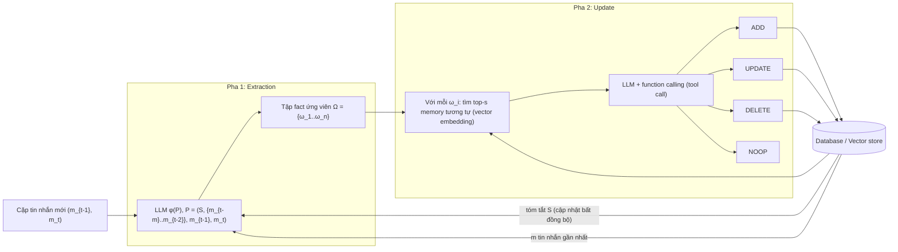
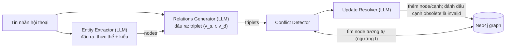

# Mem0: Building Production-Ready AI Agents with Scalable Long-Term Memory

> Ghi chú đọc sâu paper (đã đọc toàn bộ 23 trang gồm Appendix A-C). Số liệu chép từ Table 1 (điểm chất lượng theo từng loại câu hỏi, mục 4.2), Table 2 (độ trễ, số token và điểm tổng, mục 4.3) và văn bản của paper; chỗ nào paper không nói hoặc tôi không kiểm chứng được thì ghi "chưa rõ". Số benchmark do chính nhóm Mem0 chạy (kể cả số của các baseline (hệ thống đối chứng dùng để so sánh)), nên không dùng để xếp hạng tuyệt đối.

## 1. Thông tin chung & Tài nguyên

| Mục | Nội dung |
|---|---|
| Tiêu đề | *Mem0: Building Production-Ready AI Agents with Scalable Long-Term Memory* |
| Tác giả | Prateek Chhikara, Dev Khant, Saket Aryan, Taranjeet Singh, Deshraj Yadav (mem0.ai) |
| arXiv (kho đăng bản thảo bài báo khoa học) | [2504.19413](https://arxiv.org/abs/2504.19413), bản đọc là v1 (28/04/2025). Các bản sau có thể khác số liệu **[chưa kiểm]** |
| Code | Paper ghi "Code can be found at https://mem0.ai/research"; không nêu repo GitHub cụ thể trong bản đọc. Repo `mem0ai/mem0` là sản phẩm mã nguồn mở nhưng **chưa kiểm** nó khớp bản trong paper |
| Dataset (bộ dữ liệu dùng để đánh giá) | LoCoMo (Long-term Conversational Memory), một benchmark (bài kiểm tra chuẩn) gồm các hội thoại rất dài, dùng để đo trí nhớ của agent (Maharana et al., ACL 2024): 10 hội thoại dài, mỗi hội thoại khoảng 600 lượt thoại (mỗi lần một người nói), khoảng 26.000 token, khoảng 200 câu hỏi |
| LLM / embedding | `gpt-4o-mini` (một LLM nhỏ của OpenAI) cho extraction (trích fact), update (cập nhật kho memory) và mọi suy luận; `text-embedding-small-3` nêu rõ cho LangMem và baseline RAG (embedding riêng của Mem0 không nêu rõ **[chưa rõ]**) |
| Graph DB | Neo4j (cơ sở dữ liệu đồ thị phổ biến), chỉ dùng cho biến thể Mem0^g (Mem0 có thêm đồ thị, xem mục 3.2) |
| Vector DB | Paper chỉ nói "vector database dùng dense embedding" (kho lưu vector embedding, tìm theo độ giống nghĩa); **không nêu tên sản phẩm** |
| Siêu tham số | `m` = 10 tin nhắn gần nhất đưa vào prompt; `s` = 10 memory tương tự được truy xuất; temperature 0 (tham số điều chỉnh độ ngẫu nhiên của LLM, 0 là gần như luôn cho cùng một đáp án) |

*Giải thích nhanh các thuật ngữ trong bảng:*
- **LLM** (Large Language Model, mô hình ngôn ngữ lớn như GPT, Claude, Gemini): mô hình AI đọc và sinh văn bản.
- **Embedding**: vector số biểu diễn ý nghĩa của một đoạn văn bản; hai đoạn gần nghĩa thì vector gần nhau, nên máy có thể tìm "đoạn giống nghĩa" bằng cách so khoảng cách vector.
- **Token**: đơn vị nhỏ mà LLM dùng để đếm văn bản (một từ tiếng Anh thường khoảng 1 đến 2 token). Số token càng nhiều thì LLM đọc càng lâu và chi phí càng cao.
- **RAG** (Retrieval-Augmented Generation): tìm trước vài đoạn tài liệu liên quan đến câu hỏi, rồi đưa cho LLM đọc để trả lời. **Baseline** là hệ thống đối chứng dùng để so sánh.
- **Agent**: chương trình dùng LLM để tự lập kế hoạch và gọi công cụ. **Memory** của agent là kho thông tin lưu lâu dài ngoài prompt để agent nhớ lại ở các phiên hội thoại sau.
- **Extraction / update**: hai pha của Mem0. Extraction là rút ra các fact (mẩu thông tin ngắn) từ hội thoại; update là quyết định thêm, sửa hay xóa trong kho memory (xem mục 3.1).

**Định vị:** đây là paper của vendor (công ty bán sản phẩm, ở đây là Mem0), mô tả một lớp memory cho hội thoại người-agent. Đối tượng là *sở thích/sự kiện cá nhân trong hội thoại*, khác miền tri thức Wikipedia/tin tức của đồ án.

## 2. Vấn đề giải quyết

Context window (cửa sổ ngữ cảnh: lượng văn bản tối đa, đo bằng token, mà LLM đọc được trong một lần trả lời) cố định khiến LLM "reset" (quên) khi thông tin ra khỏi cửa sổ; kéo dài context chỉ trì hoãn (paper nêu hai lý do: quan hệ người-AI kéo dài nhiều tuần/tháng vượt mọi cửa sổ, và hội thoại hiếm khi liền mạch chủ đề nên thông tin quan trọng bị chôn trong hàng nghìn token không liên quan).

Ví dụ của paper (Figure 1): user nói "I'm vegetarian & avoid dairy" ở phiên 1; hôm sau hỏi "What about dinner tonight?". Không có memory thì hệ thống gợi ý "Chicken Alfredo"; có memory thì gợi ý món chay không sữa.

Mục tiêu: **trích xuất, hợp nhất, truy xuất** các thông tin nổi bật từ hội thoại đang diễn ra (trích xuất: rút fact ra; hợp nhất: gộp, cập nhật cho khỏi trùng hoặc mâu thuẫn; truy xuất: tìm lại khi cần), giữ chất lượng gần full-context (cách đơn giản nhất: nhét toàn bộ lịch sử hội thoại vào prompt mỗi lần hỏi) nhưng token (chi phí) và latency (độ trễ, thời gian chờ có đáp án) thấp.

## 3. Cơ chế cốt lõi

### 3.1. Mem0 (memory phẳng dạng fact, hai pha)

*Cách đọc sơ đồ:* mỗi khi có cặp tin nhắn mới, hệ thống (1) nhờ LLM rút ra các fact ứng viên (pha Extraction), rồi (2) với từng fact, tìm trong kho (vector store: kho lưu memory dưới dạng embedding, tìm theo độ giống nghĩa) các memory gần giống và nhờ LLM chọn một trong bốn thao tác ADD/UPDATE/DELETE/NOOP (pha Update). Các ký hiệu trong ô (S, m, Ω, ω) được giải thích ngay bên dưới.

**Pha extraction** (trích xuất: LLM đọc hội thoại và rút ra các fact, tức mẩu thông tin ngắn, ví dụ "user ăn chay"). Khi có cặp tin nhắn mới (thường là một lượt của user + một lượt trả lời của assistant, tức trợ lý AI), prompt (đoạn chỉ dẫn gửi cho LLM) `P = (S, {m_{t-m},...,m_{t-2}}, m_{t-1}, m_t)` gồm:
- `S`: **tóm tắt toàn bộ hội thoại**, lấy từ DB, do một module sinh tóm tắt **chạy bất đồng bộ** (chạy nền, song song, không bắt luồng chính phải chờ), độc lập với pipeline (chuỗi các bước xử lý) chính (để không gây trễ).
- `m` tin nhắn gần nhất (m = 10 trong thực nghiệm): cung cấp chi tiết ngắn hạn chưa kịp vào tóm tắt.
- Cặp tin nhắn mới.

LLM `φ` (GPT-4o-mini) trích ra tập fact ứng viên Ω. Nội dung prompt extraction cụ thể **không được in** trong paper (Appendix A chỉ có prompt judge, prompt sinh đáp án và prompt cho ChatGPT memory) **[chưa rõ]**.

**Pha update.** Với mỗi fact ứng viên `ω_i`: truy xuất top-`s` memory gần nhất bằng vector embedding (s = 10), đưa cả hai cho LLM qua giao diện function-calling (cơ chế để LLM "gọi" một hàm có sẵn kèm tham số; mỗi lần gọi như vậy là một *tool call*, ở đây hàm chính là thao tác sửa kho memory). **Chính LLM chọn** một trong bốn thao tác, không có classifier (mô hình phân loại) riêng:

| Thao tác | Điều kiện theo paper |
|---|---|
| `ADD` | chưa có memory tương đương ngữ nghĩa |
| `UPDATE` | bổ sung thông tin cho memory hiện có |
| `DELETE` | memory bị thông tin mới **mâu thuẫn** thì xóa |
| `NOOP` | fact không cần sửa gì |

*Giải thích nhanh bốn thao tác:* `ADD` = thêm memory mới; `UPDATE` = sửa memory cũ cho đầy đủ hơn; `DELETE` = xóa memory cũ; `NOOP` (no operation) = không làm gì. Ví dụ: memory cũ "user ăn chay"; fact mới "user cũng tránh sữa" thì `UPDATE`; fact mới "user ăn thịt trở lại" thì `DELETE` memory cũ.

Appendix B (Algorithm 1) là pseudo-code (mã giả, mô tả thuật toán gần giống code nhưng không chạy được): `UPDATE` chỉ thay `m_i` khi `InformationContent(f) > InformationContent(m_i)` (fact mới chứa nhiều thông tin hơn memory cũ); `DELETE` là `M \ {m_i}` (tập memory M bỏ đi phần tử `m_i`; **xóa thật**, không đánh dấu). Đây là pseudo-code mô tả logic, không phải code thật (LLM quyết định qua prompt).

**Điểm cần ghi nhớ:** trong Mem0 phẳng (bản Mem0 gốc, kho chỉ là danh sách fact rời rạc, khác Mem0^g ở mục 3.2), "xung đột" xử lý bằng **xóa** → mất lịch sử. Đây là khác biệt cốt lõi so với Mem0^g và so với thiết kế đồ án.

### 3.2. Mem0^g (graph memory)

Mem0^g (chữ g là graph) là biến thể của Mem0: thay vì chỉ lưu danh sách fact, nó lưu memory thành một đồ thị tri thức (các nút là thực thể như người, địa điểm; các cạnh là quan hệ giữa chúng, ví dụ Alice - sống ở - San Francisco).

*Cách đọc sơ đồ:* tin nhắn đi qua hai bước LLM (nhận diện thực thể, rồi sinh quan hệ giữa chúng), sau đó bộ phát hiện mâu thuẫn so với đồ thị Neo4j hiện có và LLM quyết định thêm node/cạnh mới hay đánh dấu cạnh cũ là hết hiệu lực.

- Đồ thị có hướng có nhãn `G = (V, E, L)` (V: tập node/nút, E: tập cạnh, L: tập nhãn). Node là thực thể (Alice, San_Francisco), cạnh là quan hệ (`lives_in`), nhãn là kiểu node (Person, City).
- Mỗi node chứa: (1) kiểu thực thể, (2) embedding vector `e_v` (vector biểu diễn nghĩa của node), (3) **metadata (dữ liệu mô tả kèm theo) gồm creation timestamp `t_v`** (dấu thời gian lúc node được tạo).
- Quan hệ là triplet (bộ ba chủ thể - quan hệ - đối tượng, ví dụ Ông A - bị bắt - 2024) `(v_s, r, v_d)` (nút nguồn, quan hệ, nút đích). Hai bước LLM: **Entity Extractor** (nhận diện thực thể, tức đối tượng được nhắc đến: người, địa điểm, đồ vật, khái niệm, sự kiện, thuộc tính) rồi **Relations Generator** (sinh quan hệ giữa các thực thể, gán nhãn như `lives_in`, `prefers`, `owns`, `happened_on`, cả quan hệ ngầm).
- **Ghi vào graph:** tính embedding cho node nguồn/đích, tìm node hiện có có độ tương đồng trên ngưỡng `t` (mức giống nhau tối thiểu để dùng lại node có sẵn; giá trị `t` **chưa rõ**); tùy trường hợp tạo cả hai node, một node, hoặc dùng lại node có sẵn, rồi tạo quan hệ kèm metadata.
- **Conflict detection + update resolver:** khi có thông tin mới, cơ chế phát hiện quan hệ hiện có có thể mâu thuẫn; **LLM-based update resolver quyết định quan hệ nào nên obsolete (lỗi thời) và "đánh dấu invalid thay vì xóa vật lý, để cho phép temporal reasoning" (suy luận có yếu tố thời gian)** (nguyên văn ý của paper). Paper **không nêu** tên trường (kiểu `invalid_at`), không nêu nó là một timestamp hay cờ boolean (đúng/sai), và không có thời điểm bắt đầu/kết thúc hiệu lực **[chưa rõ]**.
- **Truy xuất hai hướng:** (a) *entity-centric* (xuất phát từ thực thể): tìm thực thể chính trong query (câu hỏi của người dùng), khớp embedding với node, duyệt cạnh vào/ra để dựng subgraph (đồ thị con quanh thực thể đó); (b) *semantic triplet*: embed cả query, so với embedding văn bản của từng triplet, lọc theo ngưỡng, xếp theo độ tương đồng giảm dần.
- Prompt sinh đáp án của Mem0^g thêm khối `Relations for user {...}` và bước "Analyze the knowledge graph relations".
- Paper **không nói** node graph có con trỏ về văn bản gốc kiểu Boomerang (mẫu thiết kế: đồ thị chỉ giữ con trỏ, khi cần chi tiết thì quay về VectorDB lấy chunk gốc, tức đoạn văn bản được cắt nhỏ từ tài liệu). Memory dạng câu và quan hệ graph đều được đưa thẳng vào prompt.

### 3.3. Xử lý thời gian và mâu thuẫn (tổng hợp)

| Khía cạnh | Mem0 (phẳng) | Mem0^g |
|---|---|---|
| Timestamp | Paper không mô tả trường timestamp trong pha ingest (nạp tài liệu vào hệ thống). Prompt sinh đáp án nói "These memories contain timestamped information", nên timestamp có đi cùng memory, nhưng **cơ chế gắn vào đâu: chưa rõ**. Ở baseline OpenAI, timestamp đưa vào prompt ingest (Appendix A) | Node có creation timestamp `t_v` (thời điểm tạo, không phải thời gian hiệu lực) |
| Thời gian hiệu lực (`start`/`end`) | Không có | Không có (chỉ có "invalid" cho quan hệ obsolete) |
| Thời gian tương đối | Xử lý lúc *trả lời*: prompt bảo LLM đổi "last year" thành ngày tuyệt đối dựa trên timestamp memory | Như bên trái |
| Mâu thuẫn | LLM chọn `DELETE` (xóa thật) | LLM resolver đánh dấu quan hệ invalid, không xóa |
| Heuristic (quy tắc kinh nghiệm, không đảm bảo đúng) khi vẫn còn mâu thuẫn | Prompt trả lời: "If the memories contain contradictory information, prioritize the most recent memory" | Như bên trái |

Không có phân biệt giữa hai khái niệm của đồ án: **Evolution** (tiến hóa: sự việc từng đúng rồi thay đổi theo thời gian, ví dụ nhân viên lên giám đốc; đồ án xử lý bằng cách đóng `end_time`, tức ghi thời điểm hết hiệu lực, còn `start_time` là thời điểm bắt đầu có hiệu lực) và **Falsehood** (thông tin sai ngay từ đầu, ví dụ tin đồn bị đính chính; đồ án đánh dấu bằng `invalidated_at`, tức thời điểm bị coi là không hợp lệ). Mem0 chỉ có một khái niệm chung "contradicted/obsolete" (bị mâu thuẫn/lỗi thời).

## 4. Kết quả chính

### 4.1. Thiết lập thực nghiệm
- **LoCoMo**: 4 loại câu hỏi dùng (hop = bước suy luận):
  - *single-hop*: đáp án nằm trong một đoạn hội thoại, ví dụ "Alice sống ở đâu?";
  - *multi-hop*: phải ghép thông tin từ nhiều đoạn khác nhau mới trả lời được;
  - *temporal*: hỏi về thời gian hoặc thứ tự sự kiện, ví dụ "Alice chuyển nhà khi nào?";
  - *open-domain*: ngoài hội thoại còn cần thêm kiến thức chung bên ngoài.

  Loại **adversarial** (câu hỏi bẫy, đúng ra phải trả lời "không có thông tin") **bị loại** vì thiếu ground truth (đáp án chuẩn để chấm; hành vi đúng là nhận ra "unanswerable", tức không trả lời được).
- **Metric chất lượng** (metric = chỉ số đo; điểm 0 đến 100, càng cao càng tốt):
  - **F1**: so từng từ giữa đáp án của hệ thống và đáp án chuẩn; là điểm cân bằng giữa độ chính xác (trong số từ trả lời, bao nhiêu đúng) và độ phủ (trong số từ của đáp án chuẩn, bao nhiêu được nêu). Ví dụ đáp án chuẩn "ăn chay", hệ thống trả "user ăn chay" thì trùng nhiều từ nên F1 cao; trả "ăn thịt" thì F1 thấp.
  - **B1** (BLEU-1): cũng đo mức trùng từ đơn giữa hai câu, theo kiểu tính khác F1; chỉ cần hiểu là càng cao càng giống đáp án chuẩn.
  - **J** (LLM-as-a-Judge, dùng một LLM làm giám khảo): LLM đọc câu hỏi, đáp án chuẩn và đáp án của hệ thống rồi chấm đúng hoặc sai; J là tỉ lệ phần trăm câu được chấm đúng. Prompt chấm ở Appendix A, chỉnh từ MemGPT. Judge này "generous" (dễ tính): đúng chủ đề là CORRECT; với câu hỏi thời gian, chấp nhận cách nói tương đối nếu cùng mốc (ví dụ "tuần trước" so với ngày cụ thể của tuần trước).
  - 10 lần chạy độc lập trên toàn dataset, báo trung bình ±1 std (std = độ lệch chuẩn, cho biết kết quả giữa các lần chạy dao động bao nhiêu; dùng cho J).
- **Metric triển khai** (đo chi phí vận hành, không đo độ đúng): số token (đếm bằng tiktoken `cl100k_base`, bộ đếm token của OpenAI) của ngữ cảnh truy xuất, tức phần memory đưa vào prompt; latency *search* (thời gian tìm memory) và *total* (tổng thời gian cho tới khi có đáp án, gồm cả bước LLM trả lời), đo bằng giây ở **p50/p95**. p50 là trung vị (một nửa số lượt chạy nhanh hơn mức này, nên là thời gian "thường gặp"); p95 là phân vị 95 (95% lượt chạy nhanh hơn mức này, nên phản ánh các lượt chậm nhất).
- **Baseline** (6 nhóm):
  - LoCoMo (baseline do chính paper LoCoMo đề xuất, trùng tên với dataset), ReadAgent, MemoryBank, MemGPT, A-Mem: số công bố sẵn, chỉ có F1/B1. MemGPT là hệ thống coi context như RAM và kho ngoài như đĩa, A-Mem là hệ thống ghi chú liên kết với nhau (cả hai được mô tả ở mục 5);
  - A-Mem\*: A-Mem chạy lại với temperature 0 để có thêm J;
  - LangMem: thư viện memory cho agent (chạy ở chế độ Hot Path);
  - RAG: cắt hội thoại thành chunk dài 128 đến 8192 token, lấy k ∈ {1,2} chunk giống câu hỏi nhất đưa cho LLM;
  - full-context: đưa toàn bộ hội thoại (khoảng 26k token) vào prompt;
  - OpenAI memory: tính năng memory của ChatGPT (GPT-4o-mini); ingest (nạp) toàn bộ hội thoại, **đưa toàn bộ memory sinh ra làm ngữ cảnh**, không truy xuất chọn lọc;
  - Zep: hệ thống memory dựa trên đồ thị tri thức theo thời gian (mục 5), bản nền tảng có timestamp.

### 4.2. Table 1: F1 / B1 / J theo loại câu hỏi (chép từ paper; "-" là không báo)

| Method | Single-hop F1 / B1 / J | Multi-hop F1 / B1 / J | Open-domain F1 / B1 / J | Temporal F1 / B1 / J |
|---|---|---|---|---|
| LoCoMo | 25.02 / 19.75 / - | 12.04 / 11.16 / - | 40.36 / 29.05 / - | 18.41 / 14.77 / - |
| ReadAgent | 9.15 / 6.48 / - | 5.31 / 5.12 / - | 9.67 / 7.66 / - | 12.60 / 8.87 / - |
| MemoryBank | 5.00 / 4.77 / - | 5.56 / 5.94 / - | 6.61 / 5.16 / - | 9.68 / 6.99 / - |
| MemGPT | 26.65 / 17.72 / - | 9.15 / 7.44 / - | 41.04 / 34.34 / - | 25.52 / 19.44 / - |
| A-Mem | 27.02 / 20.09 / - | 12.14 / 12.00 / - | 44.65 / 37.06 / - | 45.85 / 36.67 / - |
| A-Mem\* | 20.76 / 14.90 / 39.79 ± 0.38 | 9.22 / 8.81 / 18.85 ± 0.31 | 33.34 / 27.58 / 54.05 ± 0.22 | 35.40 / 31.08 / 49.91 ± 0.31 |
| LangMem | 35.51 / 26.86 / 62.23 ± 0.75 | 26.04 / 22.32 / 47.92 ± 0.47 | 40.91 / 33.63 / 71.12 ± 0.20 | 30.75 / 25.84 / 23.43 ± 0.39 |
| Zep | 35.74 / 23.30 / 61.70 ± 0.32 | 19.37 / 14.82 / 41.35 ± 0.48 | **49.56** / 38.92 / **76.60 ± 0.13** | 42.00 / 34.53 / 49.31 ± 0.50 |
| OpenAI | 34.30 / 23.72 / 63.79 ± 0.46 | 20.09 / 15.42 / 42.92 ± 0.63 | 39.31 / 31.16 / 62.29 ± 0.12 | 14.04 / 11.25 / 21.71 ± 0.20 |
| **Mem0** | **38.72 / 27.13 / 67.13 ± 0.65** | **28.64** / 21.58 / **51.15 ± 0.31** | 47.65 / 38.72 / 72.93 ± 0.11 | 48.93 / **40.51** / 55.51 ± 0.34 |
| **Mem0^g** | 38.09 / 26.03 / 65.71 ± 0.45 | 24.32 / 18.82 / 47.19 ± 0.67 | 49.27 / **40.30** / 75.71 ± 0.21 | **51.55** / 40.28 / **58.13 ± 0.44** |

(Chữ đậm theo paper. Trong bản gốc B1 multi-hop của LangMem, 22.32, cũng được in đậm; tôi giữ nguyên chi tiết đó ở đây.)

*Cách đọc bảng:* mỗi hàng là một hệ thống, mỗi nhóm cột là một loại câu hỏi (giải thích ở mục 4.1), và mỗi ô có ba số F1 / B1 / J, càng cao càng tốt. Phần "± x" sau J là độ lệch chuẩn qua 10 lần chạy; dấu "-" nghĩa là nguồn gốc không báo J; chữ đậm là điểm cao nhất của cột theo paper. Ví dụ ô temporal của Mem0 là F1 48.93, B1 40.51, J 55.51: khoảng 56% câu hỏi về thời gian được judge chấm đúng. Ở các hàng có đủ ba số, J thường cao hơn F1 và B1 vì judge chấm theo ý đúng chứ không bắt khớp từng từ.

**Hạng mục temporal, Mem0 và Mem0^g so với Zep:**

| | F1 | B1 | J |
|---|---|---|---|
| Zep | 42.00 | 34.53 | 49.31 ± 0.50 |
| Mem0 | 48.93 | 40.51 | 55.51 ± 0.34 |
| Mem0^g | 51.55 | 40.28 | 58.13 ± 0.44 |

Mem0^g hơn Zep 8.82 điểm J (58.13 vs 49.31), Mem0 hơn Zep 6.20 điểm J. Hạng mục **open-domain thì ngược lại**: Zep dẫn (J 76.60), Mem0^g 75.71, Mem0 72.93; paper tự thừa nhận Zep "dẫn nhỏ nhưng có ý nghĩa". Với single-hop và multi-hop, graph **không giúp** (Mem0^g thấp hơn Mem0). Paper giải thích: graph có ích khi cần ngữ cảnh quan hệ/chuỗi thời gian, thừa với truy xuất đơn giản.

Lưu ý khi đọc: temporal là loại có J của OpenAI thấp nhất (21.71); paper quy cho việc memory sinh ra thiếu timestamp dù đã prompt yêu cầu. LangMem temporal chỉ 23.43 J dù single-hop cao.

### 4.3. Table 2: latency, token, Overall J (toàn LoCoMo)

| Method | K | chunk size / memory tokens | Search p50 | Search p95 | Total p50 | Total p95 | Overall J |
|---|---|---|---|---|---|---|---|
| RAG | 1 | 128 | 0.281 | 0.823 | 0.774 | 1.825 | 47.77 ± 0.23% |
| RAG | 1 | 256 | 0.251 | 0.710 | 0.745 | 1.628 | 50.15 ± 0.16% |
| RAG | 1 | 512 | 0.240 | 0.639 | 0.772 | 1.710 | 46.05 ± 0.14% |
| RAG | 1 | 1024 | 0.240 | 0.723 | 0.821 | 1.957 | 40.74 ± 0.17% |
| RAG | 1 | 2048 | 0.255 | 0.752 | 0.996 | 2.182 | 37.93 ± 0.12% |
| RAG | 1 | 4096 | 0.254 | 0.719 | 1.093 | 2.711 | 36.84 ± 0.17% |
| RAG | 1 | 8192 | 0.279 | 0.838 | 1.396 | 4.416 | 44.53 ± 0.13% |
| RAG | 2 | 128 | 0.267 | 0.624 | 0.766 | 1.829 | 59.56 ± 0.19% |
| RAG | 2 | 256 | 0.255 | 0.699 | 0.802 | 1.907 | 60.97 ± 0.20% |
| RAG | 2 | 512 | 0.247 | 0.746 | 0.829 | 1.729 | 58.19 ± 0.18% |
| RAG | 2 | 1024 | 0.238 | 0.702 | 0.860 | 1.850 | 50.68 ± 0.13% |
| RAG | 2 | 2048 | 0.261 | 0.829 | 1.101 | 2.791 | 48.57 ± 0.22% |
| RAG | 2 | 4096 | 0.266 | 0.944 | 1.451 | 4.822 | 51.79 ± 0.15% |
| RAG | 2 | 8192 | 0.288 | 1.124 | 2.312 | 9.942 | 60.53 ± 0.16% |
| Full-context | - | 26031 | - | - | 9.870 | 17.117 | **72.90 ± 0.19%** |
| A-Mem | - | 2520 | 0.668 | 1.485 | 1.410 | 4.374 | 48.38 ± 0.15% |
| LangMem | - | 127 | 17.99 | 59.82 | 18.53 | 60.40 | 58.10 ± 0.21% |
| Zep | - | 3911 | 0.513 | 0.778 | 1.292 | 2.926 | 65.99 ± 0.16% |
| OpenAI | - | 4437 | - | - | 0.466 | 0.889 | 52.90 ± 0.14% |
| **Mem0** | - | 1764 | **0.148** | **0.200** | **0.708** | **1.440** | 66.88 ± 0.15% |
| **Mem0^g** | - | 3616 | 0.476 | 0.657 | 1.091 | 2.590 | 68.44 ± 0.17% |

*Cách đọc bảng:* mỗi hàng là một cách đưa ngữ cảnh cho LLM. Cột K chỉ có ở RAG: số chunk lấy ra cho mỗi câu hỏi. Cột "chunk size / memory tokens": với RAG là độ dài mỗi chunk (đơn vị token), với các hệ còn lại là số token memory đưa vào LLM mỗi câu hỏi. "Search" là thời gian tìm memory, "Total" là tổng thời gian đến khi có đáp án (giây; p50 và p95 xem mục 4.1). Overall J là điểm J gộp cả bốn loại câu hỏi. Với latency và token thì số càng nhỏ càng tốt; với J thì càng cao càng tốt. Ví dụ: Full-context có J cao nhất (72.90) nhưng tốn 26031 token và p95 total 17.117 giây; Mem0 có J 66.88 nhưng chỉ 1764 token và p95 total 1.440 giây.

Ghi chú: OpenAI không có số search latency vì đọc memory chép tay từ playground (giao diện thử nghiệm của OpenAI) (paper nói rõ số 0.466/0.889 không tính bước trích ngữ cảnh). Figure 4b ghi RAG (K=2, 8192) J = 61.0%, lệch nhẹ so với 60.53 trong Table 2 (và 60.97 ở chunk 256); paper nói "khoảng 61%". Tôi coi là chưa khớp tuyệt đối **[không rõ nguyên nhân]**.

**Các phát biểu định lượng của paper:**
- Mem0 hơn OpenAI **26% tương đối** về J (66.88 / 52.90 ≈ 1.264, khớp). "Tương đối" nghĩa là so theo tỉ lệ với điểm của đối thủ, khác với "điểm phần trăm" là hiệu số tuyệt đối giữa hai điểm. Mem0^g hơn Mem0 khoảng 2 điểm phần trăm (68.44 so với 66.88).
- Full-context cho J cao nhất (khoảng 73%) nhưng p95 total khoảng 17 s; Mem0 p95 total 1.44 s (giảm 92% theo paper), Mem0^g 2.59 s (giảm 85%). Abstract: p95 thấp hơn 91%, tiết kiệm trên 90% token.
- So với RAG tốt nhất (khoảng 61% J): Mem0 khoảng +10% tương đối, Mem0^g khoảng +12%.
- Kết luận: so với phương pháp tốt nhất theo từng loại, cải thiện tương đối 5% (single-hop), 11% (temporal), 7% (multi-hop). Số 11% temporal khớp phép tính Mem0 55.51 vs A-Mem\* 49.91; paper không giải thích cách tính **[suy ra, chưa xác nhận]**.
- **Kích thước memory store** (kho memory; token bình quân mỗi hội thoại): Mem0 khoảng 7k, Mem0^g khoảng 14k, Zep trên 600k (do cache tóm tắt ở mỗi node và lưu fact trên cạnh nên lặp thông tin), hội thoại thô khoảng 26k.
- **Độ trễ có hiệu lực của Zep:** sau khi thêm memory vào Zep, truy xuất ngay thường trả lời sai, vài giờ sau mới tốt hơn (xử lý bất đồng bộ); Mem0 dựng graph xong "dưới một phút trong trường hợp xấu nhất". Đây là quan sát của tác giả paper, không phải kết quả có kiểm soát.

### 4.4. Tranh cãi methodology Mem0 và Zep

- **Trong paper:** Zep được chạy bằng "platform version" với timestamp và được Mem0 tự chạy trên LoCoMo; paper **không nhắc** tranh cãi nào, cũng không có thảo luận về việc cấu hình Zep có tối ưu hay không **[chưa rõ]**. Paper của Zep (arXiv 2501.13956) theo một nguồn thứ cấp (bài viết của bên thứ ba, không phải bản gốc) chỉ báo kết quả trên DMR (Deep Memory Retrieval, bộ câu hỏi hội thoại để đo trí nhớ của agent) và LongMemEval (bộ benchmark đo trí nhớ dài hạn của chatbot qua nhiều phiên hội thoại), không có số LoCoMo **[chưa kiểm trực tiếp]**; vậy số "Zep 65.99% / J theo loại" là phép đo của Mem0, không phải của Zep.
- **Từ nguồn ngoài (không phải paper, chưa kiểm gốc):** có phản hồi công khai từ phía Zep và các bài thứ ba nói rằng Zep sau đó báo lại số LoCoMo cao hơn nhiều, tranh luận xoay quanh việc có tính loại câu hỏi adversarial (category 5, loại câu hỏi thứ năm của LoCoMo, xem mục 4.1) vào mẫu số (tổng số câu dùng để chia khi tính điểm) hay không, và con số Zep được báo lại là 75.14% (trung bình 10 lần) theo một nguồn, trong khi nguồn khác nói số khoảng 84% ban đầu bị tính lại còn khoảng 58.44% khi gồm adversarial. Hai nguồn **mâu thuẫn nhau** về chi tiết; tôi chưa tìm được bản gốc blog của Zep. Kết luận an toàn: **không dùng số tuyệt đối Mem0 vs Zep trên LoCoMo làm bằng chứng xếp hạng**; chỉ dùng như quan sát thiết kế.
- Các điểm lệch methodology tự thân paper có thể gây thiên lệch (đều là phân tích của tôi, không phải lời paper): (1) tất cả baseline do Mem0 tự chạy; (2) prompt sinh đáp án của Mem0 được tinh chỉnh cho memory của chính họ (hướng dẫn đổi thời gian tương đối, ưu tiên memory mới nhất), baseline khác có thể không có prompt tương đương; (3) judge "generous" với đáp án đúng chủ đề; (4) OpenAI baseline nhận toàn bộ memory chứ không truy xuất.

## 5. So sánh với các hệ memory khác

Từ paper (Appendix C, Table 1) và ghi chú `04_Agent_Memory_Systems.md`:

Bảng dưới có nhiều tên hệ thống và thuật ngữ; phần "Giải thích nhanh" ngay sau bảng giải thích từng cái.

| Hệ thống | Biểu diễn | Thời gian | Mâu thuẫn | Ghi chú |
|---|---|---|---|---|
| **Mem0** | Danh sách fact dạng câu, truy xuất vector | Timestamp memory chưa rõ cơ chế; không có khoảng hiệu lực | LLM chọn `DELETE`/`UPDATE`/`NOOP` | Pipeline 2 pha, nhẹ (1.764 token memory) |
| **Mem0^g** | Fact + KG (Neo4j), node có `t_v` | Creation timestamp; quan hệ obsolete bị đánh dấu invalid | LLM update resolver, không xóa | Nặng gấp đôi (3.616 token) |
| **Zep (Graphiti)** | Temporal KG, episode gốc | Bi-temporal (`valid_at`/`invalid_at` và `created_at`/`expired_at`) theo `04_*` | Đặt `invalid_at` cho cạnh cũ | Theo paper Mem0: store >600k token, ingest bất đồng bộ trễ |
| **A-Mem** | Ghi chú Zettelkasten kèm keyword, tag, mô tả, liên kết do LLM tạo, "evolution" cập nhật ghi chú cũ | Không nói rõ **[chưa rõ]** | Ghi chú cũ bị tinh chỉnh khi có ghi chú mới | Số A-Mem\* (chạy lại): J temporal 49.91 |
| **MemGPT/Letta** | Main context (như RAM) + external context (như đĩa); agent tự gọi hàm paging | Không có mô hình thời gian hiệu lực riêng | Agent tự sửa memory bằng tool | Là runtime agent, không chỉ kho; ở LoCoMo temporal F1 25.52 |
| **Đồ án** | VectorDB chunk có `start_time/end_time/invalidated_at` + Graph Boomerang | Khoảng hiệu lực trên từng chunk, bất biến "không rò tương lai" | Tách Evolution (`end_time`) và Falsehood (`invalidated_at`); `SUPERSEDES`/`CORRECTS` | Dữ liệu là tri thức/tin tức/Wikipedia, không phải hội thoại cá nhân |

*Giải thích nhanh các thuật ngữ trong bảng:*
- **KG** (Knowledge Graph, đồ thị tri thức): nút là thực thể, cạnh là quan hệ giữa chúng. **Temporal KG** là đồ thị tri thức có gắn thông tin thời gian lên nút hoặc cạnh.
- **Zep (Graphiti)**: Zep là hệ thống memory cho agent; Graphiti là thành phần đồ thị thời gian của nó. **Episode** là đơn vị dữ liệu đầu vào gốc (ví dụ một tin nhắn) được giữ lại trong đồ thị.
- **Bi-temporal** (hai trục thời gian): một trục là lúc sự việc đúng ngoài đời (`valid_at`/`invalid_at`: bắt đầu/hết hiệu lực), trục kia là lúc hệ thống biết về nó (`created_at`/`expired_at`: được ghi vào/hết hạn trong hệ thống).
- **A-Mem**: hệ memory dùng phương pháp **Zettelkasten** (hộp ghi chú: mỗi ghi chú nhỏ gắn từ khóa, thẻ, mô tả và liên kết đến ghi chú liên quan); "evolution" ở đây nghĩa là ghi chú cũ được LLM chỉnh lại khi có ghi chú mới liên quan.
- **MemGPT/Letta**: Letta là tên hiện nay của dự án MemGPT. **Main context** là phần nằm trong prompt (như RAM), **external context** là kho ngoài prompt (như đĩa); **paging** là việc chuyển dữ liệu qua lại giữa hai nơi đó, ở đây do agent tự gọi hàm để thực hiện.
- **Agent** (chương trình dùng LLM để tự lập kế hoạch và gọi công cụ), **tool** (công cụ, hàm mà agent được phép gọi).
- **VectorDB**: cơ sở dữ liệu vector, lưu embedding và tìm theo độ giống nghĩa. **Graph Boomerang**: mẫu thiết kế của đồ án, đồ thị chỉ giữ con trỏ và quay về VectorDB lấy văn bản gốc khi cần.
- **`SUPERSEDES`/`CORRECTS`**: tên hai loại cạnh trong đồ thị của đồ án, nghĩa là "thay thế" (tình trạng cũ được thay bằng tình trạng mới) và "đính chính" (thông tin cũ bị sửa vì sai).

Điểm khác cơ bản của Mem0 so với đồ án: Mem0 là memory về *người dùng* (state hiện tại, ưu tiên cái mới), còn đồ án là *kho tri thức có trục thời gian* phải trả lời được "vào thời điểm T thì sao".

## 6. Áp dụng vào đồ án

> Chỉ **đề xuất**; không sửa `docs/design/`. Ranh giới: Cơ chế 3 đã thu về nhánh belief revision (điều chỉnh những điều hệ thống tin là đúng khi có thông tin mới) trên nguồn có lịch sử sửa (Wikipedia), bỏ đa nguồn/Credibility (đánh giá độ tin cậy của từng nguồn) (`docs/decisions/09_CONFLICT_RESOLUTION_SCOPE.md`).

Nhắc lại ba cơ chế của đồ án: **Cơ chế 1** (Temporal Retrieval) là truy xuất thông tin đúng tại một mốc thời gian được hỏi; **Cơ chế 2** (Timeline Summarization) là tóm tắt diễn biến của một đối tượng theo dòng thời gian; **Cơ chế 3** (Conflict Resolution) là xử lý thông tin mâu thuẫn hoặc bị sửa theo thời gian.

### 6.1. Cơ chế 3 (Conflict / belief revision), liên quan trực tiếp nhất

1. **Mem0 là baseline "replace" tự nhiên.** Mem0 phẳng xử lý mâu thuẫn bằng `DELETE`/`UPDATE` (mất lịch sử), tương ứng baseline **replace-all** (ghi đè cả trang bằng bản mới) trong decision 09, nhưng ở mức fact thay vì cả trang. Đề xuất: ở mục baseline của luận văn, mô tả Mem0 như đại diện của nhóm "ghi đè", và nó **sẽ rớt ở câu hỏi loại 2 (lịch sử sau cập nhật) và loại 6 (thăng tiến, không phải mâu thuẫn)** (các loại câu hỏi đánh số trong decision 09) vì mâu thuẫn bị xóa. Với Mem0^g (đánh dấu invalid, không xóa) thì giữ được lịch sử nhưng không có `end_time`, nên chưa trả lời được "năm 2015 ai là chủ tịch" theo mốc thời gian. Đây là luận điểm có cơ sở từ paper để biện minh cho `start_time/end_time`. (Không chạy Mem0 trên dữ liệu của đồ án thì chỉ là lập luận thiết kế, không phải số đo.)
2. **Bước phân loại ở `decisions/09` mục "Luồng chính" (bước 4) có thể đối chiếu 1:1 với ADD/UPDATE/DELETE/NOOP**, nhưng đồ án tách tinh hơn:
   - `NOOP` ↔ hash trùng / văn phong (hash: mã băm nội dung, hai đoạn giống hệt nhau cho cùng một hash; không đổi chunk, chỉ cập nhật `last_seen`, tức lần cuối thấy lại đoạn đó).
   - `ADD` ↔ thông tin mới, không mâu thuẫn.
   - `UPDATE` ↔ bổ sung thông tin: đồ án sẽ tạo chunk mới và, nếu là thay thế trạng thái, đóng `end_time` cũ.
   - `DELETE` ↔ **không dùng**; tách thành Evolution (`end_time`) hoặc Falsehood (`invalidated_at`).
   Đây là cách trình bày rõ ràng "đóng góp so với Mem0": một thao tác `DELETE` gộp hai ngữ nghĩa mà đồ án buộc phải tách (invariant "Evolution ≠ Falsehood").
3. **Mẫu "retrieve top-s tương tự rồi để LLM quyết định".** Mem0 dùng vector (s = 10) để tìm ứng viên rồi LLM phán xử. Với nguồn *không có diff* (diff: phần khác biệt giữa hai phiên bản của văn bản; phần mở rộng ở decision 09, chưa đánh giá), mẫu này là phương án đơn giản thay cho SimHash (kỹ thuật băm để nhận ra hai văn bản gần giống nhau)/ghép mờ, và bản thân paper chứng minh nó chạy được ở quy mô hội thoại. Cần nhớ cảnh báo trong decision 09: embedding gần như giống nhau khi chỉ đổi một năm/con số, nên top-s chỉ để tìm ứng viên, quyết định vẫn phải dựa trên so văn bản/diff.
4. **Ngữ cảnh khi gọi LLM extraction/classification.** Mem0 đưa vào LLM *tóm tắt + m tin nhắn gần nhất*. Tương tự cho ingestion (nạp tài liệu vào hệ thống) của đồ án: đưa kèm tiêu đề mục/đoạn lân cận khi LLM gán `start_time` (liên quan hạn chế 15 trong decision 09 "nhãn thời gian suy từ chunk lân cận"). Tóm tắt bất đồng bộ của Mem0 là ý tưởng để không làm chậm luồng nạp.
5. **Heuristic "ưu tiên memory mới nhất"** trong prompt của Mem0 chính là cách làm ngây thơ mà đồ án muốn thay bằng khoảng hiệu lực; có thể dùng làm baseline prompt ("prioritize most recent") trong ablation (thí nghiệm bỏ từng thành phần để xem nó đóng góp bao nhiêu) freshness (độ tươi: hệ thống có trả về thông tin mới nhất hay không; loại 1) và để chứng minh nó thất bại ở loại 2.

### 6.2. Cơ chế 2 (Timeline, Hybrid Vector-Graph Boomerang)

- **Mem0^g gần Boomerang nhưng khác ở hai điểm:** (a) triplet được đưa thẳng vào prompt, không có `pointer_chunk_id` về văn bản gốc (theo bản đã đọc); (b) node chỉ có creation timestamp, không có chuỗi `TIẾP_THEO` (cạnh nối một sự kiện với sự kiện kế tiếp theo thời gian). Do đó Mem0^g không có "time-traversal" (duyệt đồ thị theo thứ tự thời gian); đồ án có thể nêu rõ khác biệt này.
- **Bài học về chi phí:** Mem0^g tốn gấp đôi token memory (14k vs 7k) và p95 total 2.59 s so với 1.44 s của Mem0; trên single-hop/multi-hop thì không lợi (65.71 vs 67.13; 47.19 vs 51.15 J). Hợp với routing của đồ án: câu hỏi một mốc không cần graph (Cơ chế 1); graph chỉ bật cho câu hỏi chuỗi/timeline. Đây là bằng chứng gián tiếp ủng hộ việc **Routing Agent** (thành phần của đồ án có nhiệm vụ nhìn câu hỏi rồi chọn cơ chế xử lý phù hợp) chọn cơ chế theo loại câu hỏi.
- **Token efficiency:** memory của Mem0 khoảng 1.764 token/query so với 26.031 token full-context (khoảng 6.8%). Có thể dùng làm điểm tham chiếu khi báo cáo "<1K token triplets" của đồ án; lưu ý Mem0 đo token ngữ cảnh truy xuất trên LoCoMo, khác dữ liệu đồ án.

### 6.3. Cơ chế 1 (Temporal Retrieval)

- Mem0 **không có hard filter (bộ lọc cứng, loại bỏ hẳn kết quả không thỏa điều kiện) thời gian** và không có `T_req`; việc đổi thời gian tương đối (last year thành ngày tuyệt đối) được đẩy cho LLM lúc trả lời, dựa trên timestamp memory. Đồ án làm khác và chặt hơn: inject (đưa vào) `T_now` (giờ hiện tại của máy chủ) ở tầng Query Processing (xử lý câu hỏi) để ra `T_req` (mốc thời gian mà câu hỏi nhắm tới, dạng ngày cụ thể), rồi lọc cứng `start_time <= T_req` (không rò tương lai) và `invalidated_at IS NULL`. Điểm đối chiếu hữu ích: kết quả temporal của Mem0/Zep trên LoCoMo (J 49 đến 58) cho thấy temporal J (49 đến 58) thấp hơn open-domain (73 đến 77) nhưng vẫn cao hơn multi-hop (41 đến 51); **không thể suy ra từ đây rằng cách của đồ án tốt hơn** vì dữ liệu và loại câu hỏi khác nhau.
- Prompt trả lời của Mem0 (Appendix A, 8 hướng dẫn, "think step by step") là một mẫu tham khảo cho **Time-CoT** (Chain-of-Thought theo thời gian: bắt LLM suy luận từng bước, trước hết xác định mốc thời gian) ở tầng Generation (sinh câu trả lời): ép đổi thời gian tương đối thành tuyệt đối, "show your work", đáp án ngắn (dưới 5-6 từ).

### 6.4. Schema liên quan (`design/01`, mục 2.1, 2.2)

- Mem0^g gợi ý thêm vào GraphDB (cơ sở dữ liệu đồ thị, ví dụ Neo4j) một quan hệ có **trạng thái "invalid"** thay cho xóa node, tương thích với bất biến "không xóa, chỉ đóng". Đồ án đã có `end_time`/`invalidated_at` nên ở mức schema không cần thêm trường mới.
- Kinh nghiệm từ `04_Agent_Memory_Systems.md` vẫn áp dụng: xem xét `ingested_at` (thời điểm hệ thống nạp và biết thông tin đó) để đo Temporal Freshness (độ tươi mới theo thời gian: hệ thống cập nhật tri thức mới nhanh và đúng đến mức nào); Mem0 chỉ có thời điểm tạo, cũng không có trục này theo nghĩa bi-temporal (theo dõi hai trục thời gian: lúc sự việc đúng ngoài đời và lúc hệ thống biết về nó).
- Payload index (chỉ mục trên các trường dữ liệu đính kèm mỗi chunk trong VectorDB, giúp lọc nhanh) chỉ 4 trường vẫn ổn: Mem0 chỉ cần vector + (graph); không có bằng chứng ở đây ủng hộ thêm index.

### 6.5. Phép so sánh và đánh giá

- **Không so số trực tiếp** với bảng LoCoMo (hội thoại cá nhân, F1/J do judge dễ tính; F1, J, judge xem mục 4.1). Nếu muốn một đối chiếu, chạy Mem0 (open-source) trên **cùng bộ chunk/câu hỏi** của đồ án làm baseline "ghi đè", hoặc chỉ so định tính ở mục thiết kế. Thông báo rõ rủi ro tái hiện: bản code hiện hành của Mem0 có thể khác bản trong paper.
- **Cẩn thận judge:** J của paper "generous"; nếu đồ án dùng LLM-judge, cần prompt chặt hơn cho câu hỏi thời gian (đúng mốc, không chỉ đúng chủ đề).
- Đo thêm **latency p50/p95 theo search/total** và **token memory** theo cách Table 2, để đưa phần "Token Efficiency" (hiệu quả token: tốn bao nhiêu token ngữ cảnh cho mỗi câu hỏi) của đồ án về cùng hệ quy chiếu.

### 6.6. Ba ý đáng đưa vào thiết kế / luận văn

1. **Mem0 làm đại diện baseline "ghi đè" (DELETE xóa lịch sử)** cho Cơ chế 3; luận điểm: một thao tác DELETE gộp Evolution và Falsehood, đồ án tách chúng bằng `end_time` và `invalidated_at` (giữ lịch sử, trả lời được loại 2 và 6 ở decision 09).
2. **Mẫu "top-s tương tự rồi LLM chọn thao tác"** (kèm NOOP/ADD) làm khung cho bước phân loại bản sửa; NOOP của Mem0 tương ứng nhánh "hash trùng / văn phong" nên tiết kiệm lời gọi LLM.
3. **Graph chỉ có lợi cho câu hỏi chuỗi/thời gian** (Mem0^g tốt hơn Mem0 ở temporal J 58.13 vs 55.51, kém hơn ở single/multi-hop) và tốn gấp đôi token và độ trễ, ủng hộ thiết kế routing giữa Cơ chế 1 (chỉ VectorDB) và Cơ chế 2 (Vector+Graph).

## 7. Hạn chế và điểm cần cẩn trọng khi trích dẫn

- Số liệu do vendor tự chạy và tự chạy cả baseline; không có nhận xét độc lập trong paper.
- Không in prompt extraction/update, không nêu vector DB cụ thể, ngưỡng `t` của Mem0^g, hay cách lưu timestamp ở Mem0 phẳng.
- LoCoMo loại adversarial (câu hỏi bẫy không có đáp án); judge dễ tính; một hội thoại chỉ ~26k token, nhỏ so với "long-term" thực tế.
- Paper không có ablation riêng cho ADD/UPDATE/DELETE/NOOP, nên không biết từng thao tác đóng góp bao nhiêu **[chưa rõ]**.
- Phát biểu "Mem0 hơn Zep ở temporal" chỉ đúng theo phép đo của Mem0; xem mục 4.4.

## 8. Nguồn

- Paper: [arXiv 2504.19413](https://arxiv.org/abs/2504.19413) (PDF: https://arxiv.org/pdf/2504.19413).
- Về tranh cãi Mem0/Zep (nguồn thứ cấp, chưa kiểm bản gốc, các nguồn mâu thuẫn nhau ở chi tiết): kết quả tìm kiếm gồm [braindetox.kr](https://braindetox.kr/en/posts/memory_benchmark_scores_reliability_2026.html), [mem0.ai: how to read memory benchmarks](https://mem0.ai/library/agent-memory/how-to-read-memory-benchmarks), [mem0.ai: Zep vs Mem0](https://mem0.ai/library/agent-memory/zep-vs-mem0-which-ai-memory-layer-should-you-choose). Cần đọc bài phản hồi gốc của Zep trước khi trích.
- Liên quan trong repo: `04_Agent_Memory_Systems.md`, `docs/decisions/09_CONFLICT_RESOLUTION_SCOPE.md`, `docs/design/01_INITIAL_BASE_DESIGN.md`, `docs/design/02_TEMPORAL_RETRIEVAL_DESIGN.md`.
