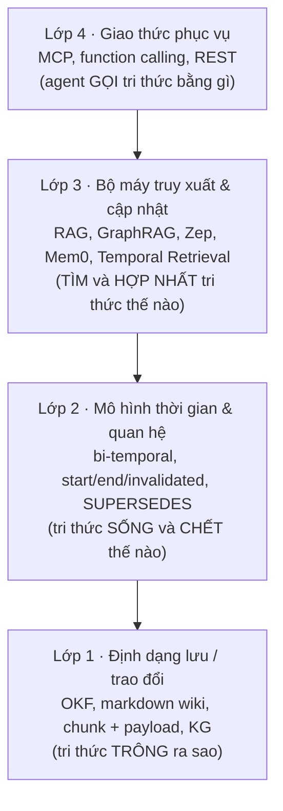

# Tổng hợp & phân biệt: định dạng tri thức, memory agent, và ý nghĩa cho 3 cơ chế

> Chốt lại `01`–`10`. Dựa trên các nguồn **đã đọc**: spec OKF (Open Knowledge Format, định dạng mở lưu tri thức thành thư mục file markdown có khối YAML ở đầu mỗi file) v0.2 và gist Karpathy (`09`, `10`, đọc qua WebFetch nên là bản diễn giải), paper Zep (`07`, đọc PDF 10 trang), paper Mem0 (`08`, đọc PDF 23 trang), changelog MCP (Model Context Protocol, giao thức chuẩn để ứng dụng AI gọi công cụ và dữ liệu của một server bên ngoài) (`05`). Các ô đánh dấu **[suy luận]** là phân tích của nhóm, không phải kết luận của nguồn.

## Giải thích nhanh thuật ngữ dùng trong file này

Đọc phần này trước nếu chưa quen các từ viết tắt. Các mục sau vẫn nhắc lại ngắn gọn khi cần.

**Khái niệm nền**
- **LLM** (Large Language Model, mô hình ngôn ngữ lớn như Claude, GPT, Gemini): mô hình AI đọc và viết văn bản.
- **Agent**: chương trình dùng LLM để tự lập kế hoạch và gọi công cụ (tool, tức hàm mà LLM được phép gọi, ví dụ tool tìm kiếm).
- **RAG** (Retrieval-Augmented Generation, sinh câu trả lời có tăng cường truy xuất): mỗi lần có câu hỏi, hệ thống tìm các đoạn văn bản liên quan rồi đưa cho LLM đọc để trả lời. **GraphRAG** là RAG có dùng thêm đồ thị tri thức.
- **Chunk**: một đoạn văn bản được cắt ra từ tài liệu để lưu và tìm kiếm. **Payload**: các trường metadata đi kèm mỗi chunk (như `start_time`) dùng để lọc.
- **VectorDB**: cơ sở dữ liệu tìm theo nghĩa (qua embedding, tức vector số biểu diễn ý nghĩa của văn bản). **GraphDB** (ví dụ Neo4j): cơ sở dữ liệu lưu đồ thị gồm nút và cạnh.
- **KG** (Knowledge Graph, đồ thị tri thức): nút là thực thể (người, công ty...), cạnh là quan hệ giữa chúng. **Triplet**: một bộ ba (chủ thể, quan hệ, đối tượng), ví dụ (Ông A, làm giám đốc, Công ty X).
- **Ingest** (nạp tài liệu vào hệ thống: đọc, rút fact, lưu), **query** (hỏi đáp), **lint** (kiểm tra định kỳ để dò lỗi và mâu thuẫn, mượn tên công cụ dò lỗi mã nguồn).
- **Benchmark**: bộ câu hỏi và đáp án chuẩn để đo chất lượng hệ thống.

**Các hệ thống và chuẩn được so sánh**
- **OKF** (Open Knowledge Format, định dạng mở của Google Cloud): lưu tri thức thành thư mục file markdown; mỗi file có một khối metadata dạng YAML (cách viết `khóa: giá trị`) ở đầu, gọi là frontmatter. Mỗi file là một **concept** (khái niệm, một đơn vị tri thức); cả thư mục gọi là **bundle**.
- **LLM wiki (Karpathy)**: ý tưởng để LLM tự viết và cập nhật một wiki markdown thay vì chỉ truy xuất lúc hỏi (`10`).
- **Zep / Graphiti**: Zep là hệ thống trí nhớ cho agent, Graphiti là mã nguồn lõi dựng đồ thị tri thức có thời gian của Zep (`07`).
- **Mem0 / Mem0^g**: hệ thống trí nhớ cho agent, trích fact ngắn từ hội thoại rồi thêm/sửa/xóa; Mem0^g là biến thể lưu bằng đồ thị (`08`).
- **Letta / MemGPT**: hệ thống chạy agent có bộ nhớ riêng, nên vừa là kho tri thức vừa là môi trường chạy agent.
- **MCP** (Model Context Protocol): giao thức chuẩn để ứng dụng AI gọi công cụ và dữ liệu của một server bên ngoài (`05`). **Function calling** là cơ chế LLM gọi một hàm do lập trình viên khai báo; **REST** là kiểu giao diện dịch vụ qua web.

**Thuật ngữ thời gian và riêng của đồ án**
- **`start_time` / `end_time`**: ngày một sự việc bắt đầu / hết đúng ngoài đời (ví dụ A làm giám đốc từ 2005 đến 2007). **`invalidated_at`**: thời điểm một thông tin bị coi là sai từ đầu.
- **Evolution** (tiến hóa): sự việc từng đúng rồi thay đổi, ví dụ nhân viên lên giám đốc; xử lý bằng cách đóng `end_time`, vẫn trả về khi hỏi quá khứ. **Falsehood** (sai từ đầu): ví dụ tin đồn bị đính chính; đánh dấu bằng `invalidated_at`, bị loại khỏi truy xuất.
- **Bi-temporal**: theo dõi hai trục thời gian, một là lúc sự việc đúng ngoài đời, hai là lúc hệ thống biết về nó. **`ingested_at`** (hoặc `created_at`): lúc hệ thống nạp thông tin.
- **`SUPERSEDES` / `CORRECTS` / `SUSPECTS` / `TIẾP_THEO`**: các loại cạnh trong đồ thị của đồ án, lần lượt nghĩa là "thay thế bản cũ", "sửa lỗi bản cũ", "bị nghi ngờ (cáo buộc, chưa phải sự thật)", "sự kiện kế tiếp trong một chuỗi" (như chuỗi chức vụ).
- **`T_req`**: mốc thời gian mà câu hỏi nhắm tới. **Hard filter** (lọc cứng): loại hẳn kết quả không thỏa điều kiện, ví dụ bỏ mọi chunk có `start_time` sau `T_req` (chặn rò rỉ tương lai: hỏi về ngày D thì không được dùng thông tin chỉ có sau D). **`leakage_rate`**: tỷ lệ kết quả bị rò rỉ như vậy.
- **Cơ chế 1 / 2 / 3** của đồ án: Temporal Retrieval (tìm theo mốc thời gian), Timeline Summarization (tóm tắt dòng thời gian của một thực thể), Conflict Resolution (xử lý thông tin mâu thuẫn).
- **Boomerang**: mẫu thiết kế trong đó đồ thị chỉ giữ con trỏ `Chunk_ID`, khi cần chi tiết thì quay về VectorDB lấy chunk gốc.
- **Time-CoT**: Chain-of-Thought theo thời gian, bắt LLM suy luận từng bước, trước hết xác định mốc thời gian.
- **Credibility** (độ đáng tin của nguồn) và **provenance** (nguồn gốc: thông tin từ đâu ra).

## 1. Bốn lớp khác nhau, thường bị trộn lẫn

Phần lớn nhầm lẫn đến từ việc gộp các thứ nằm ở **lớp khác nhau**:

| Thứ | Thuộc lớp | Nó **không** phải là |
|---|---|---|
| OKF | 1 (định dạng) | Không phải bộ máy tìm kiếm, không có mô hình thời gian hiệu lực |
| LLM wiki (Karpathy) | 1 + một phần 3 (quy trình ingest/query/lint do LLM làm) | Không phải đặc tả; là "idea file" (file ý tưởng để dán cho agent) |
| Zep / Graphiti | 2 + 3 (mô hình bi-temporal + bộ máy KG) | Không phải định dạng trao đổi |
| Mem0 | 3 (pipeline extract→update: trích fact từ hội thoại rồi cập nhật kho) | Không có mô hình thời gian hiệu lực |
| Letta/MemGPT | 3 + runtime agent (môi trường chạy agent) | Là hệ thống chạy agent, không chỉ kho tri thức |
| MCP | 4 | Không quyết định tri thức lưu thế nào |
| Đồ án (Vector+Graph, Time-aware) | 2 + 3 (đóng góp chính) | Hiện chưa có lớp 4 |

**Hệ quả:** các lựa chọn **không loại trừ nhau**. Có thể lưu bằng OKF-profile (1), mô hình `start/end/invalidated` (2), truy xuất bằng Temporal Retrieval + Boomerang (3), phục vụ qua MCP (4). Câu hỏi "dùng OKF hay Zep?" là sai tầng.

## 2. Bảng phân biệt các hệ thống (theo các trục quan trọng với đồ án)

Số liệu Zep/Mem0 là của các nguồn đã đọc, mỗi bên dùng benchmark/cấu hình khác nhau, **không so xếp hạng tuyệt đối**.

| Trục | OKF v0.2 | LLM wiki | Zep/Graphiti | Mem0 / Mem0^g | Đồ án |
|---|---|---|---|---|---|
| Đơn vị tri thức | File = concept | Trang wiki do LLM viết | Cạnh "fact" + episode gốc (episode: đoạn dữ liệu gốc đưa vào, như một tin nhắn) | Câu fact ngắn (Mem0^g: triplet) | Chunk gốc + triplet trỏ về chunk |
| Giữ văn bản gốc | Tùy producer; `sources` trỏ ngoài | Raw bất biến nhưng wiki là diễn đạt lại | Có (episode) | Không giữ nguyên văn (fact đã trích) | Có (`Chunk_ID`, Boomerang) |
| Thời gian hiệu lực | **Không** (`generated.at` = lúc ghi) | Không có mô hình | `valid_at`/`invalid_at` | **Không**; chỉ timestamp tạo, Mem0^g có cờ invalid | `start_time`/`end_time` |
| Thời gian hệ thống biết | `generated.at`, `log.md` | `log.md` | `created_at`/`expired_at` | Timestamp tạo | Chưa có `ingested_at` (đề xuất) |
| Xử lý mâu thuẫn | Không; `status: deprecated` | LLM tự sửa, lint | Đặt `invalid_at` cạnh cũ = `valid_at` cạnh mới | Mem0: **DELETE** (mất lịch sử); Mem0^g: đánh dấu invalid | `end_time` (Evolution) / `invalidated_at` (Falsehood) |
| Phân biệt Evolution vs Falsehood | **Không** | Không | **Không** (đều coi là "từng đúng") | **Không** | **Có** (bất biến lõi) |
| Quan hệ có kiểu | Link không kiểu | Link không kiểu | Cạnh có nhãn quan hệ do LLM sinh, không có `SUPERSEDES`/`SUSPECTS` | Mem0^g có quan hệ | `SUPERSEDES`/`CORRECTS`/`SUSPECTS`/`TIẾP_THEO` |
| Lọc cứng theo mốc hỏi | Không | Không | **Không** (chỉ đưa date range vào context) | Không | **Có** (`start_time ≤ T_req`) |
| Credibility nguồn | `sources` + tín hiệu thô, suy ra không lưu điểm | Không | Không | Không | Ngoài phạm vi (decision 09) |
| Quy mô điển hình | Bundle thư mục | ~100 nguồn (theo gist) | KG lớn | Hội thoại dài | Corpus lớn |

Ba chỗ mà kết luận nghe xuôi tai nhưng cần cẩn thận:
1. **"Có timestamp" ≠ "có mô hình thời gian".** Mem0 và OKF có timestamp nhưng không có khoảng hiệu lực; Zep có khoảng hiệu lực nhưng không có Falsehood.
2. **`invalid_at` (Zep) không bằng `invalidated_at` (đồ án).** `invalid_at` của Zep tương đương `end_time` của đồ án (cạnh từng đúng, hết đúng từ lúc cạnh mới xuất hiện). Với một bản tin đính chính "sai từ đầu", Zep ghi lại thành "từng đúng", nên truy vấn lịch sử không có cảnh báo (phân tích ở `07` §5.2).
3. **Số benchmark không chuyển đổi được.** Ba benchmark mà Zep/Mem0 báo cáo là hội thoại cá nhân: LoCoMo (Long-term Conversational Memory, hội thoại dài để đo trí nhớ của agent), LongMemEval (đo trí nhớ dài hạn của chatbot qua nhiều phiên hội thoại) và DMR (Deep Memory Retrieval, bộ câu hỏi hội thoại để đo trí nhớ của agent). Đồ án dùng TimeQA (bộ câu hỏi về sự việc thay đổi theo thời gian) và tri thức dạng Wikipedia. Số của Zep/Mem0 không đưa vào bảng kết quả luận văn.

## 3. Các phân biệt khái niệm cần giữ

| Cặp dễ nhầm | Phân biệt |
|---|---|
| Thời gian **sự kiện** vs thời gian **hệ thống biết** | `start/end` (đúng ngoài đời) khác `ingested_at`/`created_at` (khi hệ thống nạp). Zep tách hai trục; OKF `generated.at` thuộc trục thứ hai, **dễ bị đọc nhầm** là trục thứ nhất |
| **Evolution** vs **Falsehood** | Đóng `end_time` (từng đúng) vs `invalidated_at` (sai từ đầu). Không hệ thống agent memory nào trong số đã đọc phân biệt; đồ án có. **Tiền lệ ngoài agent memory:** Wikidata (cơ sở tri thức mở của Wikipedia) tách qualifier `end time` (thuộc tính phụ ghi ngày hết hiệu lực, nghĩa là từng đúng) khỏi rank *deprecated* (nhãn đánh dấu giá trị sai hoặc chưa từng đúng), xem [`14`](14_Ontology_and_Temporal_Representation.md) §3 |
| **Timeline** vs **Conflict** | Chuỗi sự nghiệp là timeline (không đóng chặng trước nhờ quan hệ `TIẾP_THEO`); Zep gộp vào cùng cơ chế `invalid_at` |
| **Ghi đè (Mem0 DELETE)** vs **đóng khoảng (Zep, đồ án)** | Ghi đè mất lịch sử nên rớt ở câu hỏi quá khứ; đóng khoảng giữ lịch sử |
| **Biên dịch lúc nạp (wiki)** vs **truy xuất lúc hỏi (RAG)** | Wiki diễn đạt lại → có thể trôi nghĩa; RAG giữ văn bản gốc → có thể lấy nhầm bản cũ. Đồ án: giữ gốc + lọc thời gian |
| **Credibility lưu điểm** vs **suy ra từ tín hiệu** | OKF chọn suy ra (đổi chính sách không cần nạp lại) |
| **Định dạng (OKF)** vs **giao thức (MCP)** | OKF mô tả tri thức nằm ở đâu/trông ra sao; MCP mô tả agent gọi nó thế nào |
| **`status: deprecated` (OKF)** vs **đóng `end_time`** | Deprecated = "không còn hiện hành", không biết từ khi nào, không phân biệt sai/hết hạn |

## 4. Những gì giúp được cho từng cơ chế

### Cơ chế 1 — Temporal Retrieval
- **Không cần** graph, wiki hay Zep. Kết quả tuần 5 (VectorDB + hard filter + rerank, tức chấm lại thứ hạng các kết quả đã tìm được; `leakage_rate` 0%) đã đạt mục tiêu. Zep **không có** hard filter theo mốc hỏi nên Cơ chế 1 của đồ án **chặt hơn** ở đúng điểm này.
- **Mượn được:** (i) quy tắc chuẩn hóa ngày của prompt Zep ở phía ingestion (chỉ có năm → 1/1, chỉ có ngày → 00:00:00, kèm múi giờ) để `start_time` nhất quán; (ii) hybrid dense + BM25 + RRF cũng được Zep dùng (xác nhận thực tế, không phải bằng chứng riêng). Hybrid là kết hợp tìm theo nghĩa (dense, qua embedding) với tìm theo từ khóa; BM25 là thuật toán xếp hạng từ khóa, đếm mức trùng từ giữa câu hỏi và văn bản; RRF (Reciprocal Rank Fusion) là cách gộp nhiều bảng xếp hạng thành một bằng cách cộng 1 chia hạng; (iii) `stale_after` của OKF (mốc ngày giờ "hết tươi" do bên viết tri thức khai báo) như tín hiệu do producer khẳng định, có thể thử làm đầu vào cho chế độ `open_decay` (giảm dần điểm cho sự việc chưa có `end_time`) thay hằng số chung (**[suy luận]**, cần thực nghiệm).
- **MCP** là cách duy nhất ở đây thêm giá trị thực: lớp phục vụ với tham số `as_of` tường minh (mốc thời gian mà agent muốn xem tri thức), lọc phía server.

### Cơ chế 2 — Timeline Summarization
- **Cần** cấu trúc thực thể → chuỗi sự kiện, nhưng không nhất thiết Neo4j, một cơ sở dữ liệu đồ thị phổ biến (`03`: bảng quan hệ là phương án rẻ hơn).
- **Mượn được:** định dạng `FACT (Date range: from – to)` của Zep cho prompt Time-CoT (bắt LLM suy luận từng bước theo thời gian, trước hết xác định mốc thời gian); ý tưởng graph mỏng + truy ngược văn bản gốc (episode ↔ `Chunk_ID`, đảm bảo tra được **hai chiều**: từ đồ thị về văn bản và ngược lại); trang thực thể kiểu LLM wiki là timeline "biên dịch sẵn" nhưng phải giữ `Chunk_ID` để kiểm chứng.
- **Bằng chứng ủng hộ routing:** trong `08`, Mem0^g chỉ hơn Mem0 ở câu hỏi thời gian/chuỗi và **không** giúp single/multi-hop, lại tốn khoảng gấp đôi token → nên route theo loại câu hỏi thay vì luôn đi graph.
- **Chưa có bằng chứng** cho "community/tóm tắt cấp cao" của Zep (paper không đánh giá) → chỉ đưa vào Future Work.

### Cơ chế 3 — Conflict Resolution (giá trị nghiên cứu lớn nhất)
- **Khoảng trống rõ ràng để nêu là đóng góp:** Zep, Mem0, OKF, LLM wiki **đều không** tách Evolution khỏi Falsehood. Zep còn có điểm yếu ngay trong kết quả của mình: nhóm knowledge-update (câu hỏi về thông tin đã được cập nhật, đúng loại mà việc đóng hiệu lực nhắm tới) là nhóm yếu nhất, và paper không có ablation (thí nghiệm bỏ từng thành phần để xem nó đóng góp bao nhiêu) hay đo false-invalidation (tỷ lệ đóng hiệu lực nhầm một fact còn đúng) (theo `07`).
- **Thiết kế thực nghiệm khả thi (đề xuất):** mô phỏng hành vi "một trục" kiểu Zep và hành vi "ghi đè" kiểu Mem0 làm hai biến thể baseline (hệ thống đối chứng dùng để so sánh) cho Cơ chế 3, so với bản tách hai trục, trên câu hỏi loại đính chính và lịch sử sau cập nhật (loại 2, 4, 6 trong decision 09). Kỳ vọng định tính, **không hứa kết quả**; decision 09 cho biết loại 4 trên Wikipedia nhiễu nên chỉ là trụ cột phụ.
- **Mượn được:** so sánh cặp (fact cũ, fact mới) chỉ trong **cùng cặp entity/ô quan hệ** (Zep; entity là thực thể, ô quan hệ là cùng một cặp chủ thể - quan hệ, ví dụ cùng là "chức vụ của ông A") để giảm chi phí và nhầm lẫn; mẫu Mem0 "lấy top-s fact tương tự rồi LLM chọn một trong bốn thao tác ADD (thêm)/UPDATE (sửa)/DELETE (xóa)/NOOP (không làm gì)" ánh xạ vào bước phân loại bản sửa (NOOP ≈ hash trùng, tức nội dung giống hệt nên không đổi, hoặc chỉ sửa văn phong); `lint` của LLM wiki là pass offline gợi ý cặp chunk ứng viên `SUPERSEDES` để duyệt; so sánh theo `start_time` thay vì thứ tự nạp (Graphiti xử lý nạp lệch thứ tự, paper thì không).
- **Metric nên bổ sung:** False-invalidation rate (không nguồn nào đo).
- **Đa nguồn/credibility:** ngoài phạm vi thực hiện (decision 09). Chỉ nêu trong hạn chế, kèm tham chiếu thiết kế `sources` của OKF (tín hiệu thô, suy ra lúc truy vấn) như hướng tương lai.

## 5. Đề xuất cho schema (chỉ đề xuất, không sửa `docs/design/`)

| Đề xuất | Lý do | Ràng buộc |
|---|---|---|
| Thêm `ingested_at` (hoặc dùng `first_seen`) | Hỏi "tại ngày D hệ thống biết gì"; đo Temporal Freshness (độ tươi mới theo thời gian: hệ thống cập nhật tri thức mới nhanh và đúng đến mức nào) | **Không index** (index là chỉ mục giúp lọc nhanh; đồ án chỉ giữ 4 trường có index) |
| Tách thêm trường lý do đóng (`invalid_reason`: evolution / falsehood / recut / removed) | `invalidated_at` hiện vừa nghĩa "sai từ đầu" vừa là cờ "không còn thuộc bản hiện tại"; Zep tách `expired_at` khỏi `invalid_at` | Tùy chọn |
| OKF profile cho xuất/nhập (xem `06` §2); profile là bản quy ước riêng của đồ án về cách điền các khóa OKF | Đổi sang khóa v0.2 | Dùng khóa mở rộng (khóa tự thêm ngoài chuẩn), không dùng `generated.at` (lúc ghi nội dung) làm thời gian hiệu lực |
| Lớp MCP chỉ đọc | Phục vụ Claude/ChatGPT/agent | Lọc thời gian ở **server** |

## 6. Rủi ro khi trích dẫn

- Số LoCoMo của Zep/Mem0 **bị tranh cãi** giữa hai bên; `08` ghi nhận mà không phân xử. Đừng dùng làm bằng chứng xếp hạng.
- Một số số của Zep trong `07` được đánh dấu [không chắc] (ví dụ hai dòng single-session-user giống hệt nhau giữa hai model).
- `09`, `10` đọc qua WebFetch (bản diễn giải): tên khóa/enum đáng tin hơn câu chữ; trước khi trích nguyên văn cần mở trực tiếp trên GitHub.
- OKF mới (v0.1 → v0.2 trong vài tháng), mức chấp nhận chưa rõ; không nên để thiết kế phụ thuộc vào nó.

## Tài liệu tham khảo (docs, git)

- Tổng hợp từ `07`, `08`, `09`, `10`, `12`, `14` trong thư mục này; link gốc nằm ở mục nguồn từng file.
- **Zep:** [Zep paper, arXiv 2501.13956](https://arxiv.org/abs/2501.13956); mã nguồn [getzep/graphiti](https://github.com/getzep/graphiti); [docs Zep — facts](https://help.getzep.com/v4/facts.md)
- **Mem0:** [Mem0 paper, arXiv 2504.19413](https://arxiv.org/abs/2504.19413); mã nguồn [mem0ai/mem0](https://github.com/mem0ai/mem0) (tên repo theo kết quả tìm kiếm, chưa mở)
- **OKF:** [GoogleCloudPlatform/open-knowledge-format](https://github.com/GoogleCloudPlatform/open-knowledge-format) (repo hiện hành, có `SPEC.md`); **LLM Wiki:** [Karpathy — LLM Wiki (gist)](https://gist.github.com/karpathy/442a6bf555914893e9891c11519de94f)
- **MCP:** [Đặc tả MCP, changelog bản mới nhất](https://modelcontextprotocol.io/specification/latest/changelog); [Security Best Practices 2026-07-28](https://modelcontextprotocol.io/docs/2026-07-28/tutorials/security/security_best_practices.md); [danh sách client](https://modelcontextprotocol.io/clients)
- **Ontology:** [Wikidata Help:Ranking](https://www.wikidata.org/wiki/Help:Ranking), [Help:Qualifiers](https://www.wikidata.org/wiki/Help:Qualifiers); [arXiv 2506.07853 (LRMoo, luật)](https://arxiv.org/abs/2506.07853)
