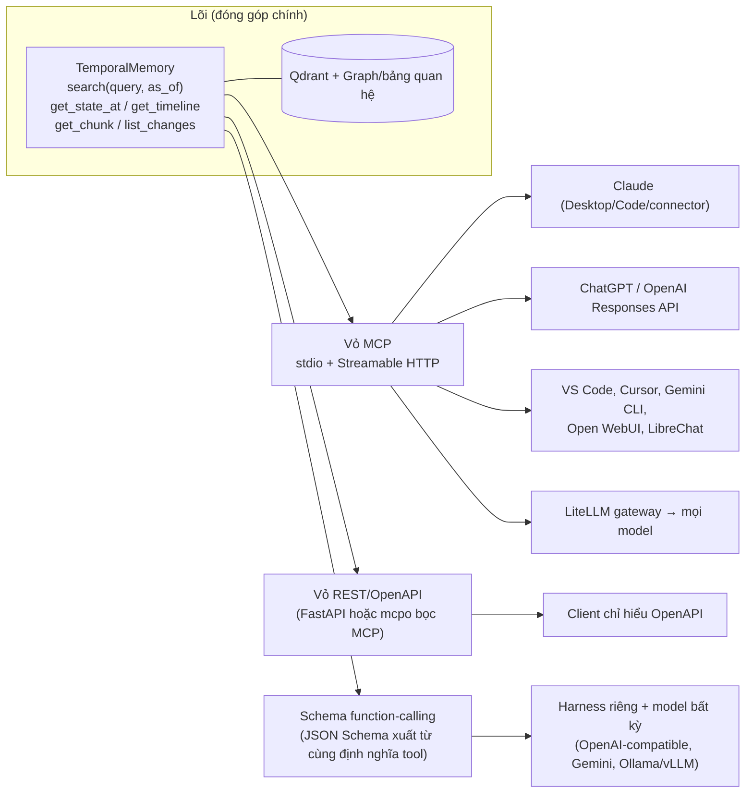

# Triển khai đồ án: chatbot đơn giản hay MCP server để cắm vào nơi khác, và chạy với nhiều LLM

> **Phạm vi:** `05` là kiến thức nền về MCP (Model Context Protocol, giao thức chuẩn để ứng dụng AI gọi công cụ và dữ liệu của một server bên ngoài; có ví dụ đời thường và sơ đồ ở `05` §1). File này trả lời quyết định thiết kế: đồ án nên *xây chatbot*, *xây MCP server*, hay cả hai; làm sao để **không phụ thuộc vào một LLM cụ thể nào** (LLM là Large Language Model, mô hình ngôn ngữ lớn như Claude, GPT, Gemini; ở đây gồm cả ChatGPT và model mã nguồn mở chạy trên máy cá nhân…); thiết kế tool (công cụ: một hàm có tên và tham số mà LLM được phép yêu cầu chạy); bảo mật; đánh giá.
> **Độ tin cậy:** tài liệu chính thức đã mở trực tiếp gồm: tài liệu OpenAI Responses API về remote MCP (**API** là Application Programming Interface, giao diện để chương trình này gọi chương trình khác; **remote MCP** là MCP server chạy trên Internet), tài liệu LiteLLM MCP Gateway (**LiteLLM** là thư viện và proxy để gọi nhiều nhà cung cấp LLM qua một giao diện chung; **proxy** là chương trình trung gian chuyển tiếp yêu cầu; **gateway** là cổng gom nhiều MCP server về một địa chỉ), README của mcpo (proxy của Open WebUI, bọc MCP server thành API theo chuẩn OpenAPI), MCP Security Best Practices (bản 2026-07-28), changelog MCP (nhật ký thay đổi giữa các bản). Còn lại là nguồn thứ cấp (không phải tài liệu chính thức), đánh dấu **[thứ cấp]**. Mục **[suy luận]** là phân tích của nhóm.

## 1. Ba phương án

| | A. Chatbot riêng | B. MCP server | C. Lõi dùng chung + 2 vỏ mỏng (khuyến nghị) |
|---|---|---|---|
| Là gì | Ứng dụng chat (CLI/web) tự gọi retrieval rồi gọi LLM | Server phơi tool (`search`, `fetch`…) cho bất kỳ MCP client nào | Thư viện `TemporalMemory` (Python) + vỏ MCP + vỏ chatbot/eval |
| Ai chọn LLM | Nhóm (cố định hoặc cấu hình) | **Người dùng/host** | Cả hai |
| Kiểm soát Query Profiler, Time-CoT | Toàn bộ | Chỉ phần server; phần suy luận do host LLM | Chatbot: toàn bộ; MCP: phần server |
| Tái lập thí nghiệm | Tốt | Kém (kết quả phụ thuộc host LLM) | Tốt (đo ở vỏ chatbot/harness) |
| Tính "cắm được" | Không | Cao | Cao |
| Chi phí | Thấp–trung bình (UI + vòng lặp tool) | Thấp (bọc hàm có sẵn) | Gần bằng A + B nhưng tái dùng nhiều |
| Rủi ro | Không dùng lại được | Khó chứng minh chất lượng end-to-end | Nhiều thứ phải bảo trì hơn |

**Khuyến nghị [suy luận]:** làm **C**. Lõi retrieval là đóng góp khoa học; vỏ MCP là cách để người khác dùng được; vỏ chatbot nhỏ là **harness đo đạc** (cố định prompt, model, `T_now`) và bản demo. Không cần UI đẹp: có thể dùng Open WebUI (giao diện chat mã nguồn mở, nối được với Ollama, tức công cụ chạy LLM mã nguồn mở ngay trên máy cá nhân, và các API tương thích OpenAI) sẵn có nối vào MCP server (xem §4) thay vì viết UI.

Giải thích nhanh các từ ở §1:

- **Host / MCP client / MCP server**: host là ứng dụng chủ có LLM bên trong (Claude Desktop, ChatGPT...); MCP client là phần mềm nhỏ trong host lo nói chuyện với server; MCP server là chương trình của đồ án đứng trước dữ liệu. **Tool** (`search`, `fetch`...) là các hàm server phơi ra (chi tiết ở `05` §1).
- **Vỏ** (wrapper): lớp bọc mỏng bên ngoài lõi để lõi dùng được qua một đường vào cụ thể (MCP, chatbot...). **Lõi** (core) là phần xử lý chính, ở đây là thư viện `TemporalMemory` (Python) lo truy xuất có xét thời gian.
- **CLI** (Command-Line Interface) là chương trình gõ lệnh trong terminal; **UI** (User Interface) là giao diện người dùng. **Vòng lặp tool** là chu trình: LLM yêu cầu gọi tool, chương trình chạy tool, trả kết quả cho LLM, lặp lại đến khi có câu trả lời.
- **Query Profiler**: thành phần phân tích câu hỏi (thuộc loại nào, hỏi mốc thời gian nào) để chọn cách truy xuất. **Time-CoT** (Chain-of-Thought theo thời gian): bắt LLM suy luận từng bước, trước hết xác định mốc thời gian được hỏi rồi mới trả lời.
- **Harness**: bộ khung chạy thí nghiệm với điều kiện cố định (cùng prompt, cùng model, cùng `T_now`) để đo và so sánh công bằng; **prompt** là lời nhắc gửi cho LLM; `T_now` là ngày giờ hiện tại theo đồng hồ của server, dùng để đổi "hiện nay", "năm ngoái" ra ngày tuyệt đối. **Tái lập thí nghiệm** là chạy lại và ra cùng kết quả. **End-to-end** là đo cả chuỗi từ câu hỏi đến câu trả lời cuối cùng.

## 2. Kiến trúc trung lập với LLM

Giải thích nhanh sơ đồ:

- **Qdrant** là cơ sở dữ liệu vector (lưu đoạn văn dưới dạng dãy số để tìm theo ý nghĩa); **Graph/bảng quan hệ** là nơi lưu thực thể và quan hệ (cơ sở dữ liệu đồ thị như **Neo4j**, hoặc bảng trong cơ sở dữ liệu quan hệ).
- **stdio** (standard input/output, đầu vào/ra chuẩn của một tiến trình): server chạy như chương trình con trên cùng máy, hợp cho chạy cục bộ. **Streamable HTTP**: server chạy như dịch vụ web, client gọi qua HTTP. Hai cái này gọi chung là **transport** (cách truyền tin giữa client và server).
- **REST** là kiểu API web gọi qua HTTP; **OpenAPI** là chuẩn mô tả API REST bằng JSON hoặc YAML, để client tự biết có những hàm nào; **FastAPI** là framework Python để dựng API web; **mcpo** là proxy bọc MCP server thành API OpenAPI.
- **Function-calling**: tính năng của LLM trả về yêu cầu "gọi hàm này với tham số này"; **JSON Schema** là cách khai báo tên và kiểu các tham số bằng JSON. **OpenAI-compatible** là giao diện bắt chước API của OpenAI, nên code viết cho OpenAI chạy được với model khác. **Ollama** và **vLLM** là hai chương trình chạy LLM mã nguồn mở (Ollama thân thiện với máy cá nhân, vLLM là engine phục vụ tốc độ cao). **LiteLLM gateway** gom mọi model về một cổng.
- **Responses API** là API của OpenAI có hỗ trợ gọi MCP server từ xa (chi tiết ở §3).

Nguyên tắc: **một định nghĩa tool, nhiều đường vào**. Mô tả tool/schema (bản khai báo cấu trúc) sinh từ cùng một nguồn để MCP, REST và function-calling thuần không lệch nhau.

## 3. Ma trận hỗ trợ MCP theo nền tảng LLM

| Nền tảng | Cách nối MCP | Primitive hỗ trợ | Ghi chú | Nguồn / độ tin |
|---|---|---|---|---|
| **Claude** (claude.ai, Desktop, Code) | Custom connector (remote, beta) / `claude mcp add --transport http` / stdio | Tools (+ resources, prompts ở một số client) | Kết nối đi từ cloud Anthropic ⇒ cần HTTPS công khai (claude.ai) | `05`, Claude Help (search) |
| **OpenAI Responses API** | Tool `type: "mcp"` với `server_url`, `authorization`, `allowed_tools`, `require_approval` | **Chỉ tools** | Transport: Streamable HTTP và HTTP/SSE. Mặc định hỏi duyệt từng lần gọi (`mcp_approval_request`). Có `tunnel_id` (Secure MCP Tunnel) cho server riêng tư. Token OAuth gửi lại mỗi request. Giá: chỉ tính token | **Docs chính thức, đã mở** |
| **ChatGPT** (giao diện) | Custom connector / Developer Mode | Tools; cần `search`/`fetch` cho deep research | Quyền theo gói mâu thuẫn giữa nguồn | `05`; **[thứ cấp]**, cần kiểm tra OpenAI |
| **Gemini API** (thư viện `google-genai`) | Truyền MCP `ClientSession` vào `tools=[session]`, SDK tự gọi (automatic function calling) | Chỉ tools **[thứ cấp]** | README `python-genai` ghi "MCP support (experimental)". Trang function calling chính thức trên ai.google.dev: phần đọc được **không** nhắc MCP | README GitHub (search) + FastMCP docs |
| **Gemini CLI** | `~/.gemini/settings.json` | Tools | **[thứ cấp]** | contextbolt, mcpbundles |
| **VS Code + Copilot** | Cấu hình `servers` (không phải `mcpServers`), chỉ ở Agent mode, từ v1.102 (07/2025) | Tools | **[thứ cấp]**; chính trang MCP liệt kê VS Code là client | modelcontextprotocol.io (đã mở) |
| **Cursor** | Native, có OAuth cho server URL | Tools | Chính trang MCP liệt kê Cursor | modelcontextprotocol.io |
| **Open WebUI** | MCP native qua **Streamable HTTP** (từ v0.6.31, theo search); stdio/SSE phải qua **mcpo** | Tools | Không mở được trang docs (404 khi fetch) nên phần native **[thứ cấp]**; README mcpo đã đọc | mcpo README (đã mở) |
| **LibreChat** | Có hỗ trợ MCP, cấu hình tập trung nhiều người dùng | — | Chỉ nhắc thoáng qua trong kết quả, **chưa kiểm** | **[thứ cấp, yếu]** |
| **LiteLLM Proxy** | **MCP Gateway**: một endpoint cố định cho mọi tool MCP; tool trình bày dạng OpenAI-compatible nên dùng chung cho **mọi provider LiteLLM hỗ trợ** | Tools, prompts, resources | Transport Streamable HTTP, SSE; stdio mặc định tắt. Auth đa dạng (API key, bearer, OAuth2…); kiểm soát theo key/team. `/v1/chat/completions`: chạy tool tự động nếu `require_approval: "never"` | **Docs chính thức, đã mở** |
| **LangChain** | `langchain-mcp-adapters`: biến tool MCP thành tool LangChain; `MultiServerMCPClient` | Tools (+ prompts, resources) | Mặc định không giữ phiên giữa các lần gọi; có interceptor | reference.langchain.com (search) |
| **Ollama / vLLM** (model cục bộ) | **Không nói MCP**: cần cầu nối (MCP client) làm vòng lặp tool-call | Tools | Xem §3.1 | **[thứ cấp]** |

Giải thích nhanh các từ trong ma trận:

- **Primitive**: loại thành phần cơ bản mà MCP server phơi ra (tools, resources, prompts; xem `05` §1). Nhiều nền tảng chỉ hỗ trợ tools.
- **Custom connector / remote / beta**: kết nối tùy chỉnh để người dùng tự thêm một MCP server vào chatbot; remote là server chạy trên Internet; beta là bản thử nghiệm. `claude mcp add --transport http` là lệnh của Claude Code để thêm một server. **Cloud Anthropic** là hạ tầng máy chủ của Anthropic.
- **stdio**: xem giải thích dưới sơ đồ §2. **Streamable HTTP**: kiểu truyền của MCP qua HTTP, thay cho kiểu cũ HTTP+SSE. **SSE** (Server-Sent Events) là kênh HTTP một chiều để server liên tục đẩy dữ liệu về client. **Deprecated** nghĩa là không còn khuyến khích dùng.
- **OAuth**: chuẩn ủy quyền cho phép ứng dụng truy cập dịch vụ thay người dùng mà không lộ mật khẩu; **token** ở đây là chuỗi mã chứng minh được phép (gửi kèm mỗi request), còn ở các chỗ khác trong file token cũng là đơn vị đếm chữ của LLM, tính tiền theo đó. **API key** là chuỗi mã bí mật định danh người dùng API; **bearer token** là token gửi kèm request để chứng minh quyền; **OAuth2/OAuth 2.1** là các phiên bản của chuẩn OAuth.
- Các trường của tool `type: "mcp"` trong Responses API: `server_url` (địa chỉ MCP server); `authorization` (token gửi kèm); `allowed_tools` (danh sách tool được phép dùng); `require_approval` (có bắt hỏi người dùng duyệt trước mỗi lần gọi hay không); `mcp_approval_request` (yêu cầu duyệt do API gửi về); `tunnel_id` / Secure MCP Tunnel (đường hầm bảo mật nối tới server riêng tư không công khai).
- **Developer Mode** (chế độ dành cho nhà phát triển của ChatGPT) cho phép dùng tool tùy ý; **deep research** là chế độ ChatGPT tự tra cứu nhiều bước rồi viết báo cáo, và chế độ này cần hai tool tên `search` và `fetch`.
- **SDK** (Software Development Kit): bộ thư viện lập trình sẵn. **`google-genai`** là SDK Python của Google cho Gemini; `ClientSession` là đối tượng đại diện cho một kết nối tới MCP server trong SDK MCP Python; **automatic function calling**: LLM trả về yêu cầu gọi một hàm kèm tham số, SDK chạy hàm rồi trả kết quả lại cho LLM mà lập trình viên không phải viết vòng lặp. **FastMCP** là framework Python rút gọn việc viết MCP server.
- **Sản phẩm/công cụ**: Open WebUI và LibreChat là giao diện chat mã nguồn mở; Cursor và VS Code + Copilot là trình soạn code có trợ lý AI (**Agent mode** là chế độ trợ lý tự thực hiện nhiều bước); Gemini CLI là công cụ dòng lệnh của Google; `servers` và `mcpServers` là hai tên khóa khác nhau trong file cấu hình JSON, mỗi ứng dụng quy ước một kiểu; **mcpo** là proxy MCP sang OpenAPI.
- **LiteLLM Proxy / MCP Gateway**: **endpoint** là địa chỉ URL cố định mà client gọi vào; **provider** là nhà cung cấp LLM; `/v1/chat/completions` là đường dẫn API chuẩn kiểu OpenAI để gửi hội thoại cho LLM; **OpenAI-compatible** là giao diện bắt chước API của OpenAI.
- **LangChain**: framework xây ứng dụng dùng LLM; `langchain-mcp-adapters` chuyển tool MCP thành tool LangChain. **Session** (phiên) là cuộc làm việc liên tục mà server nhớ client; "không giữ phiên" nghĩa là mỗi lần gọi độc lập. **Interceptor** là đoạn code chèn vào giữa để can thiệp hoặc ghi log mỗi lần gọi tool.
- **Ollama** là công cụ chạy LLM mã nguồn mở ngay trên máy cá nhân; **vLLM** là engine phục vụ LLM mã nguồn mở với tốc độ cao. Hai cái này chỉ lo phần LLM, không tự biết MCP (xem §3.1).

**Quan sát then chốt [suy luận]:** hai API chính thức đã xác nhận (OpenAI Responses, Gemini qua SDK) đều **chỉ dùng tools**. Vì vậy:
- **Mọi chức năng cốt lõi phải có mặt dưới dạng tool.** `resources` và `prompts` (ví dụ bundle OKF, tức thư mục các file markdown có khối YAML ở đầu mỗi file, hay mẫu "tóm tắt dòng thời gian") chỉ là phần thưởng cho client hỗ trợ, không được là đường duy nhất. **OKF** là Open Knowledge Format, định dạng mở lưu tri thức theo kiểu đó.
- Giữ danh sách tool **ngắn (≈5)** và đầu ra **gọn**: tool definitions (khai báo tên, mô tả, tham số của tool) đi vào **ngữ cảnh** (context: toàn bộ chữ LLM nhìn thấy trong một lượt, có giới hạn độ dài) mỗi lượt; OpenAI khuyên `allowed_tools` để giảm chi phí và độ trễ.

### 3.1. Model mã nguồn mở / cục bộ

- Ollama chỉ suy luận và phát ra tool call (một lần LLM yêu cầu gọi công cụ kèm tham số); **bridge** (cầu nối: chương trình đứng giữa, đóng vai MCP client, dịch danh sách tool sang định dạng Ollama hiểu và tự chạy vòng lặp "model yêu cầu tool, chạy tool, trả kết quả") chịu trách nhiệm phần đó. Lựa chọn **[thứ cấp]**: MCPHost (viết bằng Go, một ngôn ngữ lập trình; README ghi không còn bảo trì, chuyển sang "Kit"), MCP-Bridge (thử với vLLM), hoặc tự viết bằng SDK MCP Python + client Ollama (ngắn).
- Model tool-calling được nhắc: họ Qwen2.5/Qwen3, Llama 3.1–3.3, Mistral Nemo, Gemma 3 (các họ LLM mã nguồn mở). **Cảnh báo chính:** model mở sinh tool call sai định dạng thường xuyên hơn model thương mại; cần **thử đúng tag** (nhãn phiên bản của model trên Ollama) **và mức lượng tử hóa** (nén model bằng cách giảm độ chính xác của các con số bên trong để chạy nhẹ hơn, đổi lại có thể kém chính xác hơn) sẽ dùng.
- Thiết kế tool phải "dễ cho model yếu" **[suy luận]**: tham số phẳng (không lồng nhau), ít tham số bắt buộc, `as_of` là chuỗi ngày theo chuẩn ISO (định dạng ngày quốc tế) `YYYY-MM-DD` tùy chọn, enum (tập giá trị cố định để chọn) thay vì văn bản tự do, mô tả một câu nói *khi nào dùng*, và server tự điền mặc định hợp lý (ví dụ `as_of = T_now`).
- **Đường rẻ nhất để chạy nhiều model:** harness của nhóm gọi qua giao diện **OpenAI-compatible** (Ollama, vLLM, LiteLLM đều phơi giao diện này) hoặc qua **LiteLLM**; tool dùng định dạng function-calling của OpenAI (xem giải thích dưới sơ đồ §2). Khi đó đổi model chỉ là đổi tên model.

## 4. Chatbot: dựng hay dùng sẵn?

| Công cụ | Vai trò | Ưu | Nhược | Độ tin |
|---|---|---|---|---|
| **Open WebUI** (+ Ollama/OpenAI-compatible) | Giao diện chat sẵn, đa model, RAG (Retrieval-Augmented Generation, tìm đoạn tài liệu liên quan rồi đưa cho LLM đọc để trả lời), đa người dùng | Không phải viết UI; gắn MCP server Streamable HTTP | Cần Docker (công cụ đóng gói ứng dụng để chạy giống nhau ở mọi máy); không kiểm soát vòng lặp để thí nghiệm | **[thứ cấp]** |
| **LibreChat** | Giao diện đa nhà cung cấp, nhánh hội thoại | Đa provider, cấu hình MCP tập trung | Cài đặt/bảo trì nặng | **[thứ cấp, yếu]** |
| **Chainlit** (framework Python để dựng giao diện chatbot) | Framework chatbot Python tùy biến | Tùy biến tốt, hợp ứng dụng riêng | API còn thay đổi | **[thứ cấp]** |
| **Gradio / Streamlit** | Hai thư viện Python dựng nhanh giao diện demo (Gradio) và ứng dụng web dữ liệu (Streamlit) | Rất nhanh | Tùy biến UI hạn chế; Streamlit chưa kiểm | **[thứ cấp]** |
| **CLI tự viết** (vòng lặp tool + LiteLLM) | **Harness đo đạc** | Kiểm soát hoàn toàn, tái lập, ghi log | Không đẹp | — (tự làm) |

Gợi ý **[suy luận]**: harness = CLI hoặc notebook (tài liệu chạy code từng ô, như Jupyter) dùng LiteLLM (cho thí nghiệm); demo = Open WebUI hoặc Claude Desktop trỏ vào MCP server (không cần UI riêng). Nếu hội đồng muốn thấy "một chatbot", dựng một trang Gradio/Chainlit mỏng gọi cùng harness.

## 5. Query Profiler và Time-CoT nằm ở đâu khi dùng MCP?

Kiến trúc đồ án có lớp Query Processing (xử lý câu hỏi: Profiler phân loại câu hỏi và trích mốc thời gian, Routing chọn cơ chế truy xuất phù hợp) và lớp Generation (sinh câu trả lời, dùng Time-CoT). Với MCP, *host LLM* (LLM nằm trong ứng dụng chủ) tự viết câu trả lời, nên có ba cách như bảng sau. `T_req` là mốc thời gian mà câu hỏi nhắm tới (requested time), còn `as_of` là tham số tool mang mốc đó.

| Cách | Mô tả | Ưu | Nhược |
|---|---|---|---|
| **1. Server mỏng, host quyết định** | Tool nhận `as_of` do host LLM điền; mô tả tool hướng dẫn host quy đổi "năm ngoái" thành ngày | Server không cần LLM; rẻ | Phụ thuộc host: host yếu điền sai/ quên `as_of` |
| **2. Server tự phân tích** | Tool nhận `query` thô; server tự trích `T_req` (rule-based hoặc gọi LLM nhỏ) với `T_now` của server | Nhất quán, không phụ thuộc host; đúng bất biến "relative time" | Server cần LLM hoặc bộ phân tích ngày; thêm độ trễ |
| **3. Lai (khuyến nghị)** | `as_of` tùy chọn: có thì dùng, không thì server tự phân tích rồi **trả lại `resolved_as_of`** trong kết quả | Host mạnh thì tận dụng, host yếu vẫn đúng; kết quả minh bạch | Hơi phức tạp hơn |

Giải thích nhanh: **rule-based** là dùng luật viết tay (ví dụ biểu thức nhận dạng ngày) thay vì mô hình học máy; `resolved_as_of` là mốc ngày tuyệt đối mà server đã tự quy đổi ra; **relative time** là thời gian tương đối như "năm ngoái", "hiện nay".

Bất biến **no future leakage** (không trả thông tin xảy ra sau mốc được hỏi) **luôn thực thi ở server**, bất kể cách nào. Time-CoT: đặt vào *mô tả tool* và/hoặc `prompt` MCP (loại mẫu lời nhắc, ví dụ "tóm tắt dòng thời gian") thay vì ép host; ở harness thì dùng prompt đã chọn trên tập valid (tập dữ liệu dùng để chọn và chỉnh cấu hình trước khi đo trên tập test).

## 6. Đánh giá khi có nhiều LLM

- **Tách hai tầng đo:** (i) *Chất lượng truy xuất* — không phụ thuộc host LLM; đã có ở tuần 4–5 (MRR: trung bình nghịch đảo thứ hạng của kết quả đúng đầu tiên; hit@k: tỉ lệ có kết quả đúng nằm trong k kết quả đầu; `leakage_rate`: tỉ lệ kết quả trả về chứa thông tin sau mốc thời gian được hỏi). (ii) *Chất lượng end-to-end* qua host — đo bằng harness cố định, chạy với vài model.
- **Thêm chỉ số tool-use theo model [suy luận]:** tỉ lệ tool call đúng định dạng; tỉ lệ điền đúng `as_of` (so với đáp án chuẩn của câu hỏi); `leakage_rate` end-to-end; số lượt gọi tool/câu; token. Đây vừa là kết quả thí nghiệm vừa là phép thử "có cắm được vào model X không".
- Mẫu tối thiểu: 1 model thương mại + 1–2 model mở cỡ nhỏ (Qwen/Llama/Gemma qua Ollama). Số liệu so sánh giữa các model chỉ mang tính định hướng nếu mỗi model chỉ chạy một lần.
- Gắn với giả thuyết đồ án: Plain RAG vs Temporal Retrieval (**RAG** là Retrieval-Augmented Generation, tìm đoạn tài liệu liên quan rồi đưa cho LLM đọc để trả lời; **Plain RAG** là bản thuần, chỉ tìm theo độ giống nghĩa và không kiểm soát thời gian; **Temporal Retrieval** là Cơ chế 1 của đồ án, truy xuất có lọc và chấm điểm theo thời gian) **qua cùng một giao diện MCP** — hai server, cùng host, cùng câu hỏi.

## 7. Bảo mật khi mở server ra ngoài

Từ trang *Security Best Practices* chính thức (bản 2026-07-28) và tài liệu OpenAI:

| Rủi ro | Biện pháp |
|---|---|
| **Token passthrough** (server nhận token không cấp cho chính nó rồi chuyển tiếp) bị cấm | Server chỉ chấp nhận token có audience là chính nó; đồ án chỉ đọc nên tránh proxy tới API bên thứ ba |
| **Confused deputy** (proxy OAuth + client ID tĩnh + DCR + cookie đồng ý) | Chỉ liên quan nếu tự làm OAuth proxy; tránh bằng cách không làm proxy hoặc dùng IdP có sẵn |
| **Scope minimization** | Một scope đọc (`mcp:read`); không scope toàn quyền |
| **State handle hijacking** (bản stateless dùng handle thay session) | Đồ án nên **không có trạng thái**; nếu có, handle ngẫu nhiên, gắn với user |
| **SSRF (Server-Side Request Forgery, lừa server gửi request tới địa chỉ nội bộ) phía client**; **server cục bộ độc hại** | Dành cho người viết client; với stdio cục bộ chỉ chạy mã tin cậy, có xác nhận lệnh |
| **Prompt injection qua nội dung chunk** | Nội dung chunk là dữ liệu không đáng tin; trả kèm nhãn nguồn; không đưa chỉ thị trong chunk vào tool description; chỉ đọc nên thiệt hại giới hạn |
| **Tool poisoning / "rug pull"** [thứ cấp] | Cố định và phiên bản hóa tool description; thứ tự tool xác định (changelog MCP khuyến nghị) |
| **Rò dữ liệu qua OpenAI** | Dữ liệu gửi tới server và kết quả tool đi vào ngữ cảnh model; `store=true` lưu 30 ngày trừ khi có Zero Data Retention |
| Ủy quyền mặc định tắt | MCP không bảo mật mặc định: server công khai cần ít nhất API key/OAuth + giới hạn tốc độ |

Giải thích nhanh các từ trong bảng bảo mật:

- **Audience** là bên mà token được cấp cho; **token passthrough** là server nhận một token không dành cho mình rồi chuyển tiếp đi nơi khác, nguy hiểm vì khó biết ai đang dùng quyền của ai. **Scope** là phạm vi quyền của token (`mcp:read` là quyền chỉ đọc); **scope minimization** là chỉ cấp quyền tối thiểu cần dùng.
- **Confused deputy** ("người đại diện bị lừa"): kẻ gian lừa một bên có quyền (ở đây là server proxy) làm việc thay mình. **OAuth proxy** là server đứng giữa để làm thủ tục OAuth hộ client. **Client ID tĩnh** là mã định danh cố định của ứng dụng. **DCR** (Dynamic Client Registration) là cách ứng dụng client tự đăng ký với máy chủ cấp quyền ngay lúc chạy. **Cookie đồng ý** là tệp nhỏ trình duyệt lưu việc người dùng đã đồng ý cấp quyền. **IdP** (Identity Provider) là nhà cung cấp danh tính để đăng nhập, như đăng nhập bằng Google.
- **Stateless** là server không nhớ gì giữa hai lần gọi; thay vì **session** (phiên), nó dùng **handle** (mã do server cấp để lần sau trỏ lại đúng trạng thái cũ); **state handle hijacking** là kẻ gian đánh cắp hoặc đoán handle của người khác để dùng.
- **SSRF** (Server-Side Request Forgery) là lừa một bên gửi request tới địa chỉ nội bộ mà người ngoài không được vào. **Server cục bộ độc hại** là server MCP chạy trên máy mình nhưng chứa mã xấu.
- **Prompt injection** là nhét chỉ thị độc hại vào nội dung (ví dụ trong một đoạn văn bản được lưu) để LLM làm theo như thể đó là lệnh của người dùng; **chunk** là một đoạn văn bản được cắt ra để lưu và tìm kiếm. **Tool poisoning** là "đầu độc" mô tả tool để LLM làm theo chỉ thị xấu; **rug pull** là tool ban đầu lành, về sau bị đổi mô tả hoặc hành vi thành độc.
- `store=true` là tùy chọn của OpenAI lưu lại dữ liệu cuộc gọi; **Zero Data Retention** là chế độ không lưu dữ liệu. **Giới hạn tốc độ** (rate limit) là số request tối đa trong một khoảng thời gian.

Với đồ án (dữ liệu công khai như Wikipedia/TimeQA, chỉ đọc) rủi ro thấp; nhưng nên nêu mục này trong luận văn vì "cắm được vào nơi khác" kéo theo trách nhiệm đó.

## 8. Triển khai

| Tình huống | Cách |
|---|---|
| Dev / demo cục bộ | **stdio** với Claude Desktop/Code, Cursor, VS Code |
| Dùng từ nhiều client trong mạng nội bộ | **Streamable HTTP** (SSE cũ đã deprecated), Docker Compose: server + Qdrant (+ Neo4j nếu dùng) |
| Dùng từ claude.ai / ChatGPT | HTTPS công khai (ngrok/Cloudflare Tunnel); OpenAI API có thêm Secure MCP Tunnel (`tunnel_id`) |
| Client chỉ hiểu OpenAPI | `mcpo` (proxy MCP→OpenAPI, có `--api-key`, hot-reload, OAuth 2.1 cho streamable-http) hoặc FastAPI trực tiếp |
| Nhiều model qua một cổng | LiteLLM Proxy + MCP Gateway (quản lý key/team, theo dõi chi phí) |

Giải thích nhanh các từ trong bảng: **Docker Compose** là công cụ khai báo và chạy cùng lúc nhiều container (mỗi container là một ứng dụng đóng gói sẵn, ví dụ server, Qdrant, Neo4j); **HTTPS công khai** là địa chỉ web có mã hóa mà ai trên Internet cũng truy cập được; **ngrok** và **Cloudflare Tunnel** là công cụ tạo đường hầm để máy cá nhân có địa chỉ công khai; **hot-reload** là tự nạp lại cấu hình khi đổi mà không cần khởi động lại; **FastAPI** là framework Python dựng API web; **claude.ai** là giao diện web của Claude. Giải thích **OpenAPI**, **stdio**, **Streamable HTTP**, **SSE** ở dưới sơ đồ §2.

Spec (đặc tả chính thức) MCP 2026-07-28 là **stateless** (server không nhớ gì giữa hai lần gọi, xem `05` §2), hợp server chỉ đọc. Hệ sinh thái client có thể chưa theo kịp, nên thiết kế chạy được với cả bản 2025-11-25 (`05` §2). Giao thức đã được trao cho Agentic AI Foundation (Linux Foundation) ngày 09/12/2025 **[thứ cấp]**, giảm rủi ro phụ thuộc một hãng.

## 9. Kế hoạch đề xuất

1. **Đóng gói lõi** thành thư viện với 5 hàm công khai (lấy từ pipeline tuần 4–5); xuất schema tool từ một nơi.
2. **Vỏ MCP** (SDK Python chính thức hoặc FastMCP) với `search` + `fetch` trước (tương thích ChatGPT), rồi `get_state_at`, `get_timeline`. Kiểm bằng MCP Inspector (công cụ chính thức có giao diện web để thử và gỡ lỗi một MCP server) và Claude Code.
3. **Harness** (CLI + LiteLLM): chạy bộ test 400 câu của tuần 5 qua giao diện tool với 3 model (1 thương mại, 2 mở). Ghi các chỉ số tool-use ở §6.
4. **Demo**: Open WebUI + Ollama hoặc Claude Desktop trỏ vào server.
5. (Tùy chọn) Bản `Plain RAG` cùng giao diện để so sánh công bằng.
6. Viết mục bảo mật và hạn chế vào luận văn.

## 10. Câu hỏi mở

- Đồ án cần chạy trên claude.ai/ChatGPT thật (phải host công khai) hay đủ ở mức Claude Desktop/Code + Open WebUI?
- Cách §5 nào (khuyến nghị lai) — có chấp nhận thêm bộ phân tích ngày phía server?
- Model mở nào chạy được trên máy của nhóm (VRAM là bộ nhớ của card đồ họa, quyết định chạy được model cỡ nào)? Ảnh hưởng tới việc chọn model cho §6.
- Cần kiểm tra lại các ô **[thứ cấp]**: Open WebUI native MCP (không mở được docs), Gemini API MCP trên ai.google.dev, LibreChat, quyền theo gói của ChatGPT.

## 11. Nguồn

- OpenAI — [Remote MCP / connectors](https://developers.openai.com/api/docs/guides/tools-connectors-mcp) (đã mở)
- LiteLLM — [MCP Gateway](https://docs.litellm.ai/docs/mcp) (đã mở)
- Open WebUI — [mcpo](https://github.com/open-webui/mcpo) (đã mở); [docs MCP](https://docs.openwebui.com/features/mcp) (**404 khi mở**, chỉ thấy trong kết quả search)
- MCP — [Security Best Practices 2026-07-28](https://modelcontextprotocol.io/docs/2026-07-28/tutorials/security/security_best_practices.md), [Giới thiệu & danh sách client](https://modelcontextprotocol.io/clients), [changelog](https://modelcontextprotocol.io/specification/latest/changelog) (đã mở)
- Gemini — [googleapis/python-genai](https://github.com/googleapis/python-genai) (README, qua search), [FastMCP × Gemini](https://gofastmcp.com/integrations/gemini), [function calling](https://ai.google.dev/gemini-api/docs/function-calling) (mở được một phần, không thấy MCP)
- Model cục bộ — [DEV: MCP với Ollama](https://dev.to/hola_gus/how-to-use-mcp-servers-with-ollama-and-local-llms-f3), [lilting.ch](https://lilting.ch/en/articles/ollama-local-llm-mcp-server-bridge), [morphllm](https://www.morphllm.com/ollama-mcp) (đều thứ cấp)
- Client: [contextbolt](https://contextbolt.com/blog/ai-tools-mcp-support/), [mcpbundles](https://mcpbundles.com/blog/state-of-mcp-clients), [LangChain MCP adapters](https://reference.langchain.com/python/langchain_mcp_adapters) (thứ cấp)
- Bảo mật (thứ cấp): [WorkOS](https://workos.com/blog/mcp-security-risks-best-practices), [Scalar](https://scalar.com/learn/mcp/mcp-server-security)
- UI chatbot (thứ cấp, nguồn so sánh mang tính khuôn mẫu): [toolhalla.ai](https://toolhalla.ai/compare/gradio-vs-chainlit)
